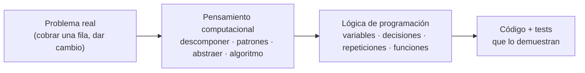
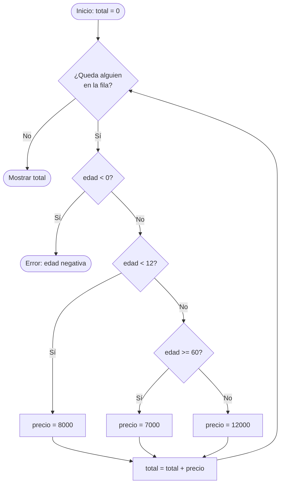
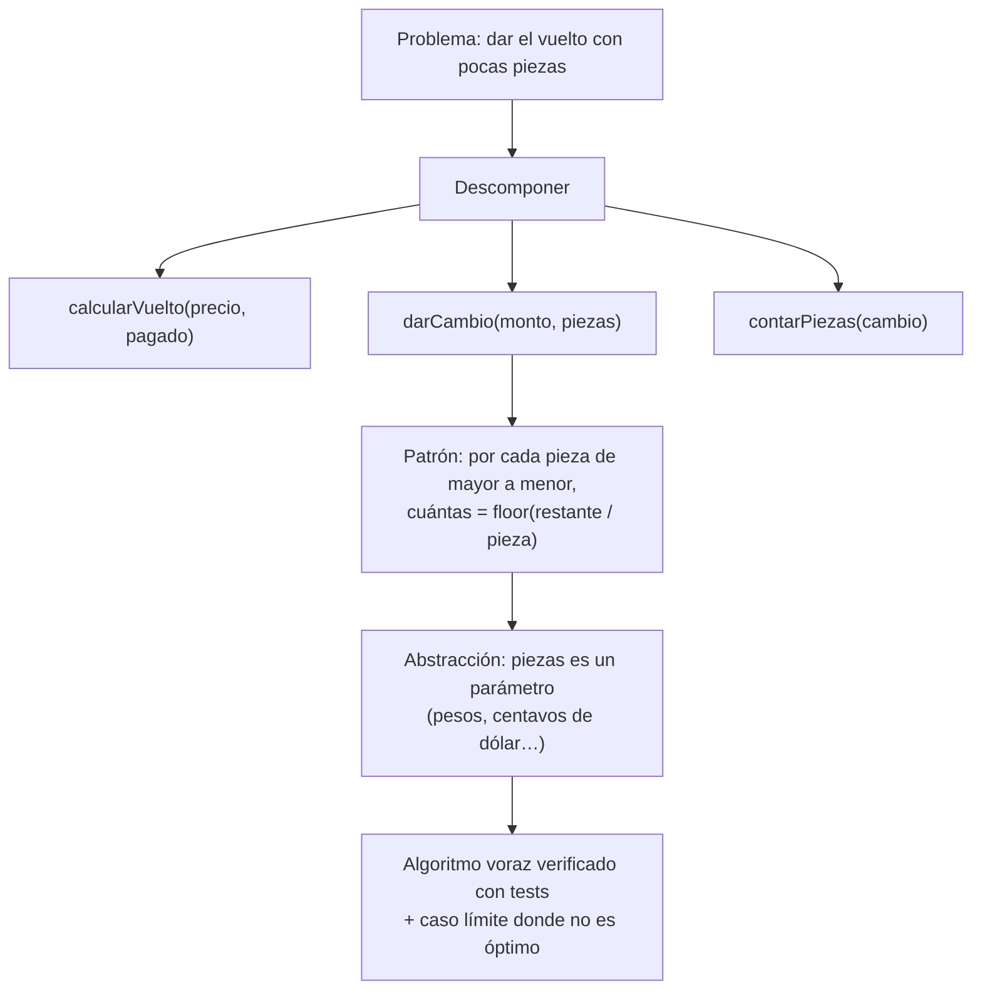

# Módulo 0.2 · Lógica de programación y pensamiento computacional

**Fase 0 · Fundamentos absolutos** (semana 1 de 4). **Duración:** 6 h (2 temas de 3 h). **Dificultad:** 1 de 5.
**Dependencias:** Módulo 0.1 (ejecutar un programa con `node` y correr un test con `node --test`).
**Herramientas:** Node.js 26.13.1 LTS, sin dependencias externas..

Aquí aprendes los cuatro ladrillos con los que se escribe cualquier programa (variables, decisiones,
repeticiones y funciones) y la forma de pensar que te permite convertir un problema del mundo real en pasos que
una computadora pueda seguir. Todo microservicio que escribas después, por sofisticado que sea, está hecho de
estos ladrillos.



**Texto alternativo:** cuatro cajas en línea. Un problema real pasa por el pensamiento computacional (cuatro
herramientas), se expresa con la lógica de programación (cuatro ladrillos) y termina en código con tests.

---


### Lógica de programación

<details open>
<summary><strong>Capa 1 — Lectura</strong></summary>

#### ► DE QUÉ TRATA
Aplicar variables, decisiones (if/else), operadores lógicos (&&, ||), repeticiones (for) y funciones para resolver las reglas de una taquilla de cine, y detectar con un test un error de borde (> en lugar de >=); lo compruebas cuando logica/cine.test.js pasa 5 de 5 y sabes explica…

#### ► LA IDEA EN UNA FRASE
**Aplicar variables, decisiones (if/else), operadores lógicos (&&, ||), repeticiones (for) y funciones para resolver las reglas de una taquilla de cine, y detectar con un test un error de borde (> en lugar de >=); lo compruebas cuando logica/cine.test.js pasa 5 de 5 y sabes explicar por qué fallaba la versión rota.**

#### ► POR QUÉ EXISTE ESTO
Programar es dar instrucciones exactas. Para eso usas cuatro ladrillos:

#### ► LA ANALOGÍA
Piensa en lógica de programación como una herramienta de taller: útil cuando conoces su propósito y sus límites.
**Dónde se rompe la analogía:** en software, los efectos dependen del contexto, la escala y los trade-offs.

#### ► CÓMO FUNCIONA


1. Programar es dar instrucciones exactas.
2. Para eso usas cuatro ladrillos:

#### ► LO QUE PUEDE SALIR MAL
| Síntoma | Causa probable | Arreglo |
|---|---|---|
| Lógica de programación se aplica pero el resultado no mejora | Se usó sin medir el problema real | Mide antes y compara contra la alternativa simple |
| Aparece complejidad inesperada | Se adoptó la técnica sin comprender sus trade-offs | Vuelve a la sección de trade-offs y reduce el alcance |
| Falla en un caso límite | Se asumió un contexto que no se cumple | Prueba el caso límite y documenta cuándo NO usarlo |

#### ► TRADE-OFFS
| Opción | Cuándo usarla | Cuándo NO usarla |
|---|---|---|
| Usar Lógica de programación | Cuando el problema coincide con su propósito y el beneficio es observable | Cuando agrega complejidad sin resolver un problema real |
| Alternativa más simple | Cuando el contexto es pequeño, estable o fácil de razonar | Cuando ya demostró no escalar o no cumplir el requisito |
| Postergar la decisión | Cuando falta evidencia del problema | Cuando el costo de esperar es mayor que el costo de probar |

#### ► CUÁNDO NO USAR ESTO
La «pirámide» de if anidados (*arrow code*):

#### ► DE VUELTA A LA ANALOGÍA
Volviendo a la analogía: lógica de programación funciona como el modelo inicial, pero recuerda dónde se rompe: en producción importan la evidencia, la escala y el costo de equivocarte.

#### ► LO QUE DEBES RECORDAR
- Programar es dar instrucciones exactas.
- Para eso usas cuatro ladrillos:

#### ► PREGUNTAS PARA PENSAR
1. ¿Qué problema concreto resuelve lógica de programación en tu contexto?
2. ¿Cómo sabrías que lógica de programación no está funcionando bien?
3. ¿Qué alternativa más simple considerarías antes de usar lógica de programación?

</details>

<details>
<summary><strong>Capa 2 — Construcción</strong></summary>

#### Código y verificación


```json
{
  "name": "modulo-0-2-logica-y-pensamiento",
  "version": "1.0.0",
  "private": true,
  "type": "module",
  "engines": { "node": ">=26.13.1" },
  "scripts": { "test": "node --test" }
}
```

```javascript
// Módulo 0.2 · Lógica de programación
// Los 4 ladrillos de cualquier programa: variables, decisiones, repeticiones y funciones.
// Ejemplo: la taquilla de un cine decide quién entra y cuánto paga.
// Requisitos: Node.js 26.13.1 LTS (funciona desde Node 22). Sin dependencias.
// Ejecuta: node logica/cine.js

// FUNCIÓN + DECISIÓN: ¿puede entrar a una película para mayores de 18?
// Regla: entra si tiene boleto Y (es mayor de edad O va con un adulto).
export function puedeEntrar(edad, tieneBoleto, vaConAdulto) {
  return tieneBoleto && (edad >= 18 || vaConAdulto);
}

// DECISIÓN CON VARIAS RAMAS: el precio depende de la edad.
export function precioBoleto(edad) {
  if (edad < 0) {
    throw new Error('La edad no puede ser negativa');
  } else if (edad < 12) {
    return 8000; // niños
  } else if (edad >= 60) {
    return 7000; // adultos mayores
  } else {
    return 12000; // general
  }
}

// REPETICIÓN: recorre la fila y suma lo que paga cada persona.
export function cobrarFila(edades) {
  let total = 0; // VARIABLE: una caja con nombre cuyo contenido cambia
  for (const edad of edades) {
    total += precioBoleto(edad);
  }
  return total;
}

if (import.meta.main) {
  const fila = [8, 25, 67, 15];
  console.log(`Fila: ${fila.join(', ')} años`);
  for (const edad of fila) {
    console.log(`  ${edad} años -> paga ${precioBoleto(edad)}`);
  }
  console.log(`Total de la fila: ${cobrarFila(fila)}`);
  console.log(`¿Entra un chico de 15 con boleto y sin adulto? ${puedeEntrar(15, true, false)}`);
  console.log(`¿Entra un chico de 15 con boleto y con adulto? ${puedeEntrar(15, true, true)}`);
}
```

```bash
   node logica/cine.js
   ```

```bash
   node -e "import('./logica/cine.js').then(m => console.log(m.precioBoleto(60)))"
   ```

```bash
   node --test --test-reporter=spec logica/cine.test.js
   ```

</details>

### Pensamiento computacional

<details open>
<summary><strong>Capa 1 — Lectura</strong></summary>

#### ► DE QUÉ TRATA
Descomponer un problema real (dar el vuelto en una caja registradora) en subproblemas, reconocer el patrón que se repite, abstraerlo en una función reutilizable y evaluar en qué caso ese algoritmo no da la mejor respuesta; lo compruebas cuando pensamiento/cambio.test.js pasa 6 de…

#### ► LA IDEA EN UNA FRASE
**Descomponer un problema real (dar el vuelto en una caja registradora) en subproblemas, reconocer el patrón que se repite, abstraerlo en una función reutilizable y evaluar en qué caso ese algoritmo no da la mejor respuesta; lo compruebas cuando pensamiento/cambio.test.js pasa 6 de 6, incluido el caso donde el algoritmo voraz no es óptimo.**

#### ► POR QUÉ EXISTE ESTO
Pensamiento computacional es una forma de pensar los problemas para que una computadora pueda resolverlos. No requiere computadora: lo usas cuando organizas una mudanza o sigues una receta. Tiene cuatro herramientas:

#### ► LA ANALOGÍA
Piensa en pensamiento computacional como una herramienta de taller: útil cuando conoces su propósito y sus límites.
**Dónde se rompe la analogía:** en software, los efectos dependen del contexto, la escala y los trade-offs.

#### ► CÓMO FUNCIONA


1. Pensamiento computacional es una forma de pensar los problemas para que una computadora pueda resolverlos.
2. No requiere computadora: lo usas cuando organizas una mudanza o sigues una receta.
3. Tiene cuatro herramientas:

#### ► LO QUE PUEDE SALIR MAL
| Síntoma | Causa probable | Arreglo |
|---|---|---|
| Pensamiento computacional se aplica pero el resultado no mejora | Se usó sin medir el problema real | Mide antes y compara contra la alternativa simple |
| Aparece complejidad inesperada | Se adoptó la técnica sin comprender sus trade-offs | Vuelve a la sección de trade-offs y reduce el alcance |
| Falla en un caso límite | Se asumió un contexto que no se cumple | Prueba el caso límite y documenta cuándo NO usarlo |

#### ► TRADE-OFFS
| Opción | Cuándo usarla | Cuándo NO usarla |
|---|---|---|
| Usar Pensamiento computacional | Cuando el problema coincide con su propósito y el beneficio es observable | Cuando agrega complejidad sin resolver un problema real |
| Alternativa más simple | Cuando el contexto es pequeño, estable o fácil de razonar | Cuando ya demostró no escalar o no cumplir el requisito |
| Postergar la decisión | Cuando falta evidencia del problema | Cuando el costo de esperar es mayor que el costo de probar |

#### ► CUÁNDO NO USAR ESTO
La «función Dios» (*God function*): una sola función que valida, calcula, elige piezas, formatea el texto y lo imprime.

#### ► DE VUELTA A LA ANALOGÍA
Volviendo a la analogía: pensamiento computacional funciona como el modelo inicial, pero recuerda dónde se rompe: en producción importan la evidencia, la escala y el costo de equivocarte.

#### ► LO QUE DEBES RECORDAR
- Pensamiento computacional es una forma de pensar los problemas para que una computadora pueda resolverlos.
- No requiere computadora: lo usas cuando organizas una mudanza o sigues una receta.
- Tiene cuatro herramientas:

#### ► PREGUNTAS PARA PENSAR
1. ¿Qué problema concreto resuelve pensamiento computacional en tu contexto?
2. ¿Cómo sabrías que pensamiento computacional no está funcionando bien?
3. ¿Qué alternativa más simple considerarías antes de usar pensamiento computacional?

</details>

<details>
<summary><strong>Capa 2 — Construcción</strong></summary>

#### Código y verificación


```javascript
// Módulo 0.2 · Pensamiento computacional
// Problema: una caja registradora debe devolver el cambio con la menor cantidad de billetes/monedas.
// Las 4 herramientas del pensamiento computacional aplicadas:
//   1. Descomposición: "dar cambio" = calcular el vuelto + elegir piezas + contar piezas.
//   2. Patrones: siempre se repite lo mismo: "toma la pieza más grande que quepa".
//   3. Abstracción: no importa si son pesos o dólares; solo importan los valores de las piezas.
//   4. Algoritmo: los pasos exactos, en orden, que escribimos abajo.
// Requisitos: Node.js 26.13.1 LTS (funciona desde Node 22). Sin dependencias.
// Ejecuta: node pensamiento/cambio.js

// Paso de la descomposición 1: calcular el vuelto.
export function calcularVuelto(precio, pagado) {
  if (pagado < precio) throw new Error(`Faltan ${precio - pagado} para pagar`);
  return pagado - precio;
}

// Pasos 2 y 3: elegir piezas (patrón repetido) usando valores abstractos.
export function darCambio(monto, piezas = [50000, 20000, 10000, 5000, 2000, 1000, 500, 200, 100]) {
  const ordenadas = [...piezas].sort((a, b) => b - a); // de la más grande a la más pequeña
  const resultado = {};
  let restante = monto;
  for (const pieza of ordenadas) {
    const cuantas = Math.floor(restante / pieza); // ¿cuántas veces cabe esta pieza?
    if (cuantas > 0) {
      resultado[pieza] = cuantas;
      restante -= cuantas * pieza;
    }
  }
  if (restante !== 0) throw new Error(`No se puede dar exacto: sobran ${restante}`);
  return resultado;
}

export function contarPiezas(cambio) {
  return Object.values(cambio).reduce((suma, n) => suma + n, 0);
}

if (import.meta.main) {
  const vuelto = calcularVuelto(13700, 50000);
  const cambio = darCambio(vuelto);
  console.log(`Precio 13700, pagan con 50000 -> vuelto ${vuelto}`);
  for (const [pieza, cuantas] of Object.entries(cambio).sort((a, b) => b[0] - a[0])) {
    console.log(`  ${cuantas} x ${pieza}`);
  }
  console.log(`Piezas entregadas: ${contarPiezas(cambio)}`);
}
```

```bash
   node pensamiento/cambio.js
   ```

```bash
   node -e "import('./pensamiento/cambio.js').then(m => { console.log(m.darCambio(68, [25, 10, 5, 1])); console.log(m.darCambio(6, [1, 3, 4])); })"
   ```

```text
Precio 13700, pagan con 50000 -> vuelto 36300
  1 x 20000
  1 x 10000
  1 x 5000
  1 x 1000
  1 x 200
  1 x 100
Piezas entregadas: 6
```

```text
{ '1': 3, '5': 1, '10': 1, '25': 2 }
{ '1': 2, '4': 1 }
```

</details>
