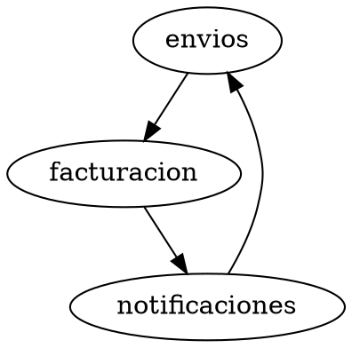

# Curso Microservicios · Construir un monolito modular antes de extraer servicios

## Aprende construyendo

RutaFlow empieza como un solo artefacto desplegable con módulos de Envíos y Facturación. En este módulo no extraes procesos: haces visibles las fronteras, reduces dependencias y conviertes decisiones arquitectónicas en pruebas. Solo al final evalúas si separar un servicio compra autonomía suficiente para pagar red, despliegue, datos y operación adicionales.

## Entorno reproducible

Cada tema indica sus archivos. Para los ejercicios Java crea `academia-labs/microservices/modular-rutaflow`; usa JDK 25 y Maven Wrapper. La demostración de ArchUnit incluye un proyecto independiente generado desde una carpeta limpia para que la prueba no dependa de avances ocultos.

### Tema 1: Distinguir estructura lógica de unidad de despliegue · Fundamentos · 40 min

**Prerrequisito:** tema «Refutar falacias distribuidas mediante evidencia reproducible» del módulo «Antes de distribuir: proceso, red y falacias» (referencia interna M0 T10).

**Al finalizar podrás:** clasificar monolito, monolito modular, monolito distribuido y servicios autónomos usando artefactos, procesos, módulos, datos y despliegue, sin inferir arquitectura por tamaño, repositorio o presencia de HTTP.

#### Paso 1 · Objetivo y preparación

Usarás **JDK 27.0.1**. Crea `academia-labs/microservices/clasificacion/{src,out,evidence}`. Debes distinguir proceso, puerto y frontera de red; ahora añadirás unidad lógica y unidad de despliegue.

#### Paso 2 · Contexto y caso real

**¿Por qué es importante?** Llamar microservicio a cualquier API pequeña hace que un equipo pague serialización, fallos parciales y operación distribuida sin obtener autonomía.

RutaFlow contiene Envíos y Facturación en `rutaflow.jar`. Dos módulos dentro de un artefacto siguen siendo un monolito desplegable, aunque sus paquetes estén bien separados. Dividirlos en dos procesos que comparten tablas y release train crea un monolito distribuido. La clasificación debe salir de fronteras observables, no de una etiqueta comercial.

#### Paso 3 · Teoría, modelo mental y analogía

| Subtema crítico | Papel | Evidencia |
|---|---|---|
| Unidad lógica | Núcleo | Un módulo agrupa una capacidad y puede vivir dentro de un proceso |
| Artefacto/proceso | Núcleo | Define empaquetado y ejecución, no cohesión interna |
| Monolito modular | Núcleo | Un despliegue contiene módulos con APIs e internals controlados |
| Servicio | Variante | Ofrece una capacidad; no exige proceso remoto |
| Microservicio autónomo | Profundización | Suma contrato, datos, despliegue y operación propios |
| Monolito distribuido | Diagnóstico | Múltiples procesos conservan coordinación obligatoria o datos compartidos |

Analogía: un edificio puede contener departamentos independientes bajo una sola administración; construir varios edificios conectados por pasillos obligatorios no crea independencia. El tamaño no decide: importan responsabilidades y cambios coordinados.

**Límite profesional:** esta clasificación describe estructura observable, pero no demuestra por sí sola buena cohesión, seguridad ni rentabilidad. Dos servicios pueden ser autónomos y aun así estar mal diseñados; esas decisiones requieren las evidencias de los temas siguientes.

```text
1 artefacto + 1 proceso + módulos -> MONOLITO_MODULAR
2 procesos + tablas/release compartidos -> MONOLITO_DISTRIBUIDO
2 procesos + datos/despliegue propios -> SERVICIOS_AUTONOMOS
```

#### Paso 4 · Demostración guiada desde cero

Crea `clasificacion/src/ClasificarArquitectura.java` copiando el archivo completo desde `examples/professional-bridges/microservices/ClasificarArquitectura.java`.

```java
public final class ClasificarArquitectura {
  record Evidencia(int artefactos,int procesos,int modulos,boolean datosCompartidos,
                   boolean despliegueIndependiente) { }
  private ClasificarArquitectura() { }
  static String clasificar(Evidencia e) {
    if (e.artefactos()==1 && e.procesos()==1 && e.modulos()>1) return "MONOLITO_MODULAR";
    if (e.procesos()>1 && (e.datosCompartidos() || !e.despliegueIndependiente()))
      return "MONOLITO_DISTRIBUIDO";
    if (e.procesos()>1 && e.despliegueIndependiente()) return "SERVICIOS_AUTONOMOS";
    return "MONOLITO";
  }
  public static void main(String[] args) {
    System.out.println(clasificar(new Evidencia(1,1,2,true,false)));
    System.out.println(clasificar(new Evidencia(2,2,2,true,false)));
    System.out.println(clasificar(new Evidencia(2,2,2,false,true)));
  }
}
```

```bash
mkdir -p academia-labs/microservices/clasificacion/{src,out,evidence}
cp examples/professional-bridges/microservices/ClasificarArquitectura.java academia-labs/microservices/clasificacion/src/
cd academia-labs/microservices/clasificacion
javac --release 27 -d out src/ClasificarArquitectura.java
java -cp out ClasificarArquitectura
```

**Resultado esperado:** `MONOLITO_MODULAR`, `MONOLITO_DISTRIBUIDO` y `SERVICIOS_AUTONOMOS`.

**Fallo deliberado:** clasifica sólo por `procesos > 1` → **Error esperado:** el segundo caso aparece como autónomo → **Diagnóstico:** ignoraste datos y despliegue coordinado; restaura todas las evidencias.

#### Paso 5 · Práctica guiada

1. **Reproducción:** explica las tres clasificaciones. Pista: separa módulo de proceso.
2. **Variación:** un proceso con un módulo debe dar `MONOLITO`.
3. **Diagnóstico:** dos repositorios con una tabla compartida no son autónomos.
4. **Integración:** inventaría artefactos, procesos, módulos y datos en `evidence/clasificacion.md`.
5. **Diseño:** clasifica una arquitectura real y anota evidencia faltante, sin adivinar.

**Conexión con el proyecto integrador:** conserva la línea base de RutaFlow antes de cualquier extracción.

#### Paso 6 · Práctica independiente

Clasifica cuatro variantes de RutaFlow y defiende cada resultado con artefacto, proceso, propiedad de datos, release y operación. Incluye un caso deliberadamente ambiguo y especifica qué evidencia pedirías.

#### Paso 7 · Cierre

- [ ] Distingo módulo, servicio, proceso y artefacto.
- [ ] Reconozco un monolito modular.
- [ ] Diagnostico un monolito distribuido.
- [ ] No clasifico por tamaño o HTTP.
- [ ] Declaro evidencia faltante.

Si fallas 2 o más puntos, repite la matriz. **Siguiente tema:** «Evaluar autonomía antes de extraer un proceso» (referencia interna M1 T2). **Errores comunes:** equiparar repositorio, API o contenedor con microservicio. **Fuentes oficiales:** [Azure microservices style](https://learn.microsoft.com/en-us/azure/architecture/guide/architecture-styles/microservices).

### Tema 2: Evaluar autonomía antes de extraer un proceso · Fundamentos · 45 min

**Prerrequisito:** tema «Distinguir estructura lógica de unidad de despliegue» del módulo «Construir un monolito modular antes de extraer servicios» (referencia interna M1 T1).

**Al finalizar podrás:** decidir si una capacidad está lista para extraerse mediante compatibilidad de contrato, propiedad de datos, despliegue, operación y beneficio medido, y justificar profesionalmente mantenerla modular cuando falta evidencia.

#### Paso 1 · Objetivo y preparación

Usarás **JDK 27.0.1** y la clasificación anterior. Crea `academia-labs/microservices/autonomia/{src,out,evidence}`. No necesitas Spring ni Docker: la decisión precede a la tecnología de despliegue.

#### Paso 2 · Contexto y caso real

**¿Por qué es importante?** Separar un proceso compra valor sólo si reduce coordinación o aísla una necesidad medible. Sin datos y operación propios, el equipo conserva el acoplamiento y añade red, pipeline e incidentes.

Facturación parece una candidata porque «puede escalar», pero hoy comparte transacción, equipo, base y release con Envíos. El resultado profesional es mantenerla modular hasta demostrar un cuello, una cadencia distinta o requisito regulatorio y preparar ownership completo. «No extraer todavía» es una decisión válida, reversible y medible.

#### Paso 3 · Teoría, modelo mental y analogía

| Subtema crítico | Papel | Evidencia |
|---|---|---|
| Contrato compatible | Prerrequisito | Consumidores evolucionan sin despliegue coordinado obligatorio |
| Datos propios | Núcleo | Escrituras y migraciones tienen propietario único |
| Despliegue independiente | Núcleo | Release y rollback no requieren cambiar otros componentes |
| Operación propia | Núcleo | SLO, alertas, capacidad y on-call tienen dueño |
| Beneficio medido | Decisión | Cadencia, aislamiento, regulación o escalado superan costo distribuido |
| Reversibilidad | Límite | ADR define cuándo revisar o revertir la extracción |

Analogía: independizar una tienda exige inventario, caja, personal y responsabilidad propios; mover sólo el letrero a otro local duplica costos sin autonomía.

#### Paso 4 · Demostración guiada desde cero

Crea `autonomia/src/EvaluarAutonomia.java` copiando el archivo completo desde `examples/professional-bridges/microservices/EvaluarAutonomia.java`.

```java
public final class EvaluarAutonomia {
  record Senales(boolean contratoCompatible,boolean datosPropios,boolean despliegueIndependiente,
                 boolean operacionPropia,boolean beneficioMedido) { }
  private EvaluarAutonomia() { }
  static String decidir(Senales s) {
    int autonomy=(s.contratoCompatible()?1:0)+(s.datosPropios()?1:0)
        +(s.despliegueIndependiente()?1:0)+(s.operacionPropia()?1:0);
    return autonomy==4 && s.beneficioMedido()?"CANDIDATO_A_EXTRAER":"MANTENER_MODULAR";
  }
  public static void main(String[] args) {
    System.out.println(decidir(new Senales(true,false,false,false,false)));
    System.out.println(decidir(new Senales(true,true,true,true,true)));
  }
}
```

```bash
mkdir -p academia-labs/microservices/autonomia/{src,out,evidence}
cp examples/professional-bridges/microservices/EvaluarAutonomia.java academia-labs/microservices/autonomia/src/
cd academia-labs/microservices/autonomia
javac --release 27 -d out src/EvaluarAutonomia.java
java -cp out EvaluarAutonomia
```

**Resultado esperado:** `MANTENER_MODULAR` y `CANDIDATO_A_EXTRAER`.

**Fallo deliberado:** decide extraer sólo porque `contratoCompatible=true` → **Error esperado:** el primer caso se vuelve candidato sin datos, despliegue, operación ni beneficio → **Diagnóstico:** una API no compra autonomía; restaura todas las señales.

#### Paso 5 · Práctica guiada

1. **Reproducción:** justifica ambos resultados. Pista: cuatro autonomías y un beneficio.
2. **Variación:** activa datos propios pero no operación; debe mantenerse modular.
3. **Diagnóstico:** detecta «CPU alta» sin perfil atribuible como evidencia insuficiente.
4. **Integración:** crea `evidence/autonomia.csv` con señal, medida, dueño y estado.
5. **Diseño:** define un disparador cuantificable y una condición de reversión.

**Conexión con el proyecto integrador:** esta matriz alimentará el ADR final y puede concluir mantener el monolito.

#### Paso 6 · Práctica independiente

Evalúa Envíos y Facturación por separado. Propón una extracción y una no extracción, cuantifica el beneficio esperado y enumera costos de red, consistencia, seguridad y on-call.

#### Paso 7 · Cierre

- [ ] Exijo contrato, datos, despliegue y operación propios.
- [ ] Vinculo extracción a un beneficio medido.
- [ ] Reconozco evidencia insuficiente.
- [ ] Documento costo distribuido.
- [ ] Defino revisión y reversión.

Si fallas 2 o más puntos, vuelve a la matriz. **Siguiente tema:** «Agrupar código por capacidad de negocio» (referencia interna M1 T3). **Errores comunes:** extraer por moda, CPU global o cantidad de líneas. **Fuentes oficiales:** [Azure domain analysis](https://learn.microsoft.com/en-us/azure/architecture/microservices/model/domain-analysis).

### Tema 3: Cohesión, acoplamiento y API del módulo · Aplicación · 90 min

**Al terminar podrás:** agrupar código por capacidad, ocultar internals y medir dependencias que atraviesan una frontera.

**¿Por qué es importante?** Una carpeta llamada `microservices` no crea autonomía; la cohesión y las dependencias reales determinan si el límite puede evolucionar sin arrastrar al resto.

#### Aprende

| Subtema | Papel | Evidencia observable |
|---|---|---|
| Cohesión funcional | Núcleo | Envíos reúne reglas que cambian por la misma razón de negocio |
| Acoplamiento aferente/eferente | Profundización | entradas/salidas del módulo se inventarían explícitamente |
| API proporcionada | Núcleo | otros módulos importan `envios.api`, no repositorios internos |
| Implementación interna | Núcleo | paquete `internal` no aparece en consumidores |
| Modelo compartido | Límite | DTO universal obliga a coordinar cambios no relacionados |
| Ciclos | Diagnóstico | A→B→A impide ordenar evolución y extracción |

**Cohesión** pregunta si los elementos pertenecen juntos porque implementan la misma capacidad. **Acoplamiento** pregunta cuánto sabe un módulo de otro y cuántos cambios se propagan. Contar imports ayuda, pero una dependencia de datos o de despliegue puede existir sin import Java; registra también tablas, eventos y llamadas.

La API proporcionada debe expresar operaciones del dominio, por ejemplo `registrarEnvio`, no exponer la entidad JPA o el repositorio. Los internals pueden cambiar sin recompilar consumidores. Duplicar un concepto pequeño en dos contextos puede reducir acoplamiento; compartir un «modelo corporativo» gigante suele congelar significados distintos.

#### Practica

Crea esta estructura:

```text
src/main/java/rutaflow/envios/api/RegistrarEnvio.java
src/main/java/rutaflow/envios/internal/ServicioEnvios.java
src/main/java/rutaflow/facturacion/api/EmitirFactura.java
src/main/java/rutaflow/facturacion/internal/ServicioFacturacion.java
evidence/dependencias.csv
```

En `evidence/dependencias.csv` registra `origen,destino,tipo,motivo`. Añade solo `facturacion,envios.api,java,consultar referencia estable`; no añadas `envios.internal`.

```bash
bash -c "! grep -R 'rutaflow\.envios\.internal' src/main/java/rutaflow/facturacion"
bash -c "grep -q 'facturacion,envios.api' evidence/dependencias.csv"
```

**Resultado esperado:** no aparece ningún import hacia internals y sí existe una dependencia declarada hacia la API. **Fallo deliberado:** importa `ServicioEnvios` desde Facturación; el primer comando debe fallar. **Transferencia al proyecto integrador:** reemplaza ese acceso por `RegistrarEnvio` o un evento estable y registra por qué. **Límite:** `grep` no entiende bytecode, reflexión ni dependencias indirectas; el Tema 5 convierte la intención en una prueba arquitectónica real.

**Interacciones que también debes medir.** Un módulo puede evitar imports y seguir acoplado mediante una tabla que ambos escriben, nombres de columnas copiados, un tópico sin propietario o una secuencia temporal obligatoria. Registra esas aristas en el mismo inventario con tipos `datos`, `evento` y `operación`. Una API pública demasiado grande amplía el radio de cambio; una demasiado pequeña y conversacional produce llamadas chatty. Busca operaciones coherentes con el caso de uso, no getters remotos de cada campo. Fuente: [Spring Modulith — módulos y sus interfaces](https://docs.spring.io/spring-modulith/reference/fundamentals.html).

### Tema 4: Arquitectura hexagonal — dominio, puertos y adaptadores · Aplicación · 95 min

**Al terminar podrás:** mantener el dominio independiente de HTTP, JPA y mensajería, y cambiar un adaptador mediante una prueba.

**¿Por qué es importante?** Una frontera de servicio no será autónoma si la regla de negocio conoce directamente el framework o el transporte que se pretende sustituir.

#### Aprende

| Subtema | Papel | Evidencia observable |
|---|---|---|
| Dominio | Núcleo | calcula tarifa sin Spring, JPA ni red |
| Puerto de entrada | Núcleo | describe un caso de uso invocable |
| Puerto de salida | Núcleo | dominio solicita persistencia mediante interfaz propia |
| Adaptador de entrada | Variante | HTTP traduce request a comando |
| Adaptador de salida | Variante | memoria/JPA implementan el mismo puerto |
| Regla de dependencias | Diagnóstico | adaptadores dependen hacia dentro; dominio no importa hacia fuera |

Hexagonal separa política de mecanismos. Un puerto pertenece al lado que define la necesidad: el caso de uso define qué operación ofrece y el dominio define qué persistencia requiere. Un adaptador traduce un protocolo concreto. No crees una interfaz por cada clase: crea un puerto cuando exista una frontera sustituible o una capacidad externa.

La inversión útil se observa al probar el caso de uso con un adaptador en memoria. Si necesitas levantar Spring para calcular una tarifa, la regla quedó mezclada. Hexagonal no elimina dependencias; dirige las dependencias de compilación hacia el dominio y hace explícitos los contratos.

#### Practica

Crea `src/main/java/rutaflow/envios/dominio/CalcularTarifa.java`:

```java
package rutaflow.envios.dominio;
public final class CalcularTarifa {
  public long enCentavos(int kilometros, int kilos) {
    if (kilometros < 0 || kilos <= 0) throw new IllegalArgumentException("distancia/peso inválidos");
    return 1_000L + kilometros * 80L + kilos * 120L;
  }
}
```

Crea `src/test/java/rutaflow/envios/dominio/CalcularTarifaTest.java` con JUnit y verifica 10 km/2 kg = 2040 centavos y peso cero rechazado.

```bash
./mvnw -q -Dtest=CalcularTarifaTest test
```

**Resultado esperado:** dos pruebas pasan sin iniciar Spring ni una base. **Fallo deliberado:** agrega `@Service` o importa `JpaRepository` en el dominio; el cálculo puede seguir verde, pero la regla de dependencias del Tema 5 debe rechazarlo. **Transferencia al proyecto integrador:** implementa `GuardarEnvio` con adaptador en memoria y luego JPA; la prueba del caso de uso debe permanecer igual. **Cuándo no añadir un puerto:** si no existe frontera, sustitución ni política que proteger, la interfaz solo duplica una clase.

**Errores de diseño y rendimiento.** No conviertas cada objeto de dominio en DTO de transporte ni hagas que el mapper decida reglas: el adaptador traduce representaciones y el dominio conserva invariantes. Un puerto de salida con métodos genéricos de CRUD filtra la forma de persistencia; prefiere necesidades como `guardar` o `buscarPendientesDeAsignacion`. La abstracción no vuelve barata una llamada: un adaptador remoto debe declarar deadline, errores y observabilidad, mientras uno en memoria no los necesita. Fuente: [Azure — modelar servicios mediante análisis de dominio](https://learn.microsoft.com/en-us/azure/architecture/microservices/model/domain-analysis).

### Tema 5: Dependencias, ciclos y costo de coordinación · Integración · 80 min

**Al terminar podrás:** interpretar un grafo de módulos, detectar ciclos y relacionarlos con cambios coordinados.

**¿Por qué es importante?** Un ciclo lógico vuelve ficticia la autonomía: ninguno de los módulos puede cambiar, probarse o extraerse sin conocer al otro.

#### Aprende

| Subtema | Papel | Evidencia observable |
|---|---|---|
| Grafo dirigido | Prerrequisito | nodo=módulo, arista=dependencia |
| Dependencia estable | Decisión | API pequeña cambia menos que internals |
| Ciclo directo/transitivo | Diagnóstico | Envíos→Facturación→Notificaciones→Envíos |
| Acoplamiento temporal | Profundización | ambos deben estar disponibles en el mismo instante |
| Acoplamiento de datos | Límite | tabla compartida crea dependencia sin import |
| Ruptura de ciclo | Aplicación | evento, inversión o reasignación de responsabilidad |

Un grafo acíclico permite ordenar compilación y evolución; no garantiza buen diseño, pero un ciclo sí revela que el límite declarado no coincide con las decisiones reales. Romperlo con un evento solo ayuda si el consumidor no necesita una respuesta inmediata y el contrato tiene propietario. Publicar eventos para ocultar un ciclo puede crear uno temporal más difícil de ver.

El costo de coordinación se observa: cantidad de repositorios/cambios que deben liberarse juntos, equipos consultados, pruebas cruzadas y ventanas de despliegue. No uses un número de imports como única decisión; combínalo con propiedad de datos, fallos y ritmo de cambio.

#### Practica

Crea `evidence/grafo.dot` y registra en `evidence/grafo.md` qué dependencia de código o datos respalda cada arista:



```bash
bash -c "grep -q 'notificaciones -> envios' evidence/grafo.dot"
bash -c "dot -Tsvg evidence/grafo.dot -o evidence/grafo.svg"
```

**Resultado esperado:** `evidence/grafo.svg` muestra el ciclo de tres módulos. **Fallo deliberado:** elimina visualmente una flecha sin cambiar el código/dependencia real; la documentación queda falsa. **Transferencia al proyecto integrador:** reasigna la decisión «envío confirmado» a Envíos y permite que Notificaciones consuma el hecho sin llamar de vuelta. Actualiza CSV, DOT y prueba arquitectónica. **Límite:** Graphviz visualiza lo declarado; ArchUnit inspecciona bytecode y será la evidencia ejecutable del siguiente tema.

**Elección de ruptura.** Invertir una dependencia introduce una interfaz poseída por quien necesita la capacidad; mover responsabilidad cambia el límite cuando la decisión estaba en el módulo equivocado; un evento desacopla el tiempo solo si el flujo tolera asincronía. Ninguna opción es gratuita. Verifica que el evento sea un hecho pasado, que tenga propietario y que no obligue a una respuesta circular. Después de romper el ciclo, mide si disminuyeron cambios coordinados o solo cambió la notación. Fuente: [Spring Modulith — verificación de estructura](https://docs.spring.io/spring-modulith/reference/verification.html).

**Práctica de transferencia adicional:** añade al grafo una arista discontinua para una dependencia de datos y otra para disponibilidad síncrona. Explica cuál impide desplegar por separado aunque ArchUnit permanezca verde. Propón una prueba distinta para cada una: ownership de migraciones para datos y test de degradación para disponibilidad. Así separas topología de código, datos y runtime.

### Tema 6: Fitness functions con ArchUnit · Integración · 110 min

**Al terminar podrás:** bloquear acceso a internals y ciclos en el build, observar una violación y corregirla.

**¿Por qué es importante?** Una regla escrita en un diagrama se degrada; una fitness function falla exactamente cuando el código contradice la arquitectura acordada.

#### Aprende

| Subtema | Papel | Evidencia observable |
|---|---|---|
| Importación de bytecode | Prerrequisito | ArchUnit analiza clases compiladas |
| Regla de capas | Núcleo | dominio no depende de adapters |
| Regla de internals | Núcleo | Facturación no accede a `envios.internal` |
| Slices y ciclos | Núcleo | el build informa el camino completo del ciclo |
| Falsos positivos/exclusiones | Límite | exclusión documentada no se usa para silenciar deuda |
| Spring Modulith | Variante | `ApplicationModules.verify()` comprueba ciclos/API/allowedDependencies |

ArchUnit expresa reglas sobre dependencias reales del bytecode. La regla debe nombrar intención de negocio y fallar con un mensaje accionable. `slices().matching("rutaflow.(*)..")` agrupa paquetes de primer nivel; si la convención no coincide con el código, la prueba dará una falsa sensación de seguridad.

Spring Modulith puede derivar módulos desde paquetes y verificar ausencia de ciclos, acceso solo por API y dependencias permitidas. Es útil en Spring, pero no sustituye entender la regla; aquí ArchUnit mantiene el ejemplo independiente del framework.

#### Practica

Genera un proyecto Maven vacío y añade ArchUnit JUnit 5. Crea `src/test/java/rutaflow/ArquitecturaTest.java`:

```java
package rutaflow;
import static com.tngtech.archunit.lang.syntax.ArchRuleDefinition.noClasses;
import com.tngtech.archunit.core.importer.ClassFileImporter;
import com.tngtech.archunit.junit.AnalyzeClasses;
import org.junit.jupiter.api.Test;

@AnalyzeClasses(packages = "rutaflow")
class ArquitecturaTest {
  @Test void facturacionNoUsaInternalsDeEnvios() {
    var clases = new ClassFileImporter().importPackages("rutaflow");
    noClasses().that().resideInAPackage("rutaflow.facturacion..")
      .should().dependOnClassesThat().resideInAPackage("rutaflow.envios.internal..")
      .check(clases);
  }
}
```

```bash
./mvnw -q -Dtest=ArquitecturaTest test
```

**Resultado esperado:** la prueba pasa mientras Facturación use `envios.api`. **Fallo deliberado:** crea una clase de Facturación que importe `ServicioEnvios`; Maven debe fallar y nombrar origen/destino de la dependencia. Corrige usando la API y confirma verde. **Transferencia al proyecto integrador:** añade una regla `slices` sin ciclos y una regla para que `..dominio..` no dependa de `..adaptadores..`. **Límite:** reflexión, SQL compartido y coordinación de despliegue no aparecen necesariamente en bytecode; requieren otras fitness functions.

**Mantenimiento de la fitness function.** Ejecuta la regla en cada pull request y haz que el mensaje explique el límite, no solo el paquete. Cuando cambie la convención, crea primero una prueba que falle por el motivo esperado. Las excepciones deben tener dueño, razón y fecha de eliminación; una lista global de paquetes ignorados convierte la prueba en decoración. Además de ciclos y capas, combina pruebas de contratos, migraciones y ownership de esquema. Fuente: [ArchUnit User Guide](https://www.archunit.org/userguide/html/000_Index.html).

**Práctica de transferencia adicional:** cambia deliberadamente el patrón de paquetes para que la regla `slices` no encuentre módulos y confirma que una prueba vacía puede pasar. Añade una aserción sobre la cantidad/nombres de slices detectados o usa la verificación de módulos de Spring Modulith. El objetivo es demostrar que la propia fitness function también necesita una prueba contra falsos verdes.

### Tema 7: Evidencia y ADR para decidir una extracción · Experto · 90 min

**Al terminar podrás:** decidir mantener o extraer un módulo mediante señales medibles, riesgos y condición de reversión.

**¿Por qué es importante?** «Escalar» o «tener equipos independientes» son afirmaciones vacías si no se mide dónde está el cuello de botella ni quién puede operar el nuevo servicio.

#### Aprende

| Subtema | Papel | Evidencia observable |
|---|---|---|
| Cadencia de cambio | Núcleo | commits/releases de un módulo difieren de los demás |
| Escalado independiente | Variante | perfil muestra consumo atribuible al módulo |
| Ownership | Núcleo | equipo posee código, datos, on-call y SLO |
| Acoplamiento de datos | Diagnóstico | joins/transacciones compartidas bloquean extracción |
| Costo operacional | Límite | pipeline, secretos, observabilidad, incidentes y capacidad |
| ADR reversible | Decisión | contexto, opciones, evidencia, decisión y disparador de revisión |

Una extracción se justifica cuando una frontera de negocio ya es clara y existe beneficio verificable: cadencia, aislamiento de fallo, requisito regulatorio o escalado diferente. El beneficio debe superar latencia, consistencia eventual, duplicación, despliegue y carga cognitiva. Si la organización no puede poseer on-call y datos, no obtiene autonomía real.

El ADR no promete certeza. Registra la evidencia disponible, alternativas (incluido mantener el monolito), consecuencias y fecha/condición para revisar. Una decisión profesional válida puede ser **no extraer todavía**.

#### Practica

Crea `docs/adr/0001-extraer-facturacion.md`:

```markdown
# ADR-0001: mantener Facturación dentro del monolito modular
## Contexto
Un equipo, una cadencia y transacción local Envío–Factura; sin cuello medido.
## Opciones
1. Mantener módulo protegido. 2. Extraer proceso y datos.
## Decisión
Mantener: el costo distribuido supera el beneficio observado.
## Evidencia y consecuencias
ArchUnit verde; cero escalado independiente; conservar métricas por módulo.
## Revisar cuando
Equipo propietario separado o consumo sostenido >60% atribuible a Facturación durante 30 días.
```

```bash
bash -c "test -s docs/adr/0001-extraer-facturacion.md"
bash -c "grep -q 'Mantener' docs/adr/0001-extraer-facturacion.md"
bash -c "grep -q 'Revisar cuando' docs/adr/0001-extraer-facturacion.md"
```

**Resultado esperado:** los tres comandos terminan en `0` y la decisión incluye alternativa y disparador cuantificable. **Fallo deliberado:** escribe «extraer porque microservicios escalan» sin métrica, ownership ni datos; el ADR no permite comprobar la decisión. **Transferencia al proyecto integrador RutaFlow Distribuido:** conserva Facturación modular hasta que se cumpla el disparador; entonces aplica el Módulo 2 para validar el límite de dominio antes de mover código. **Cuándo no usar la métrica sola:** un porcentaje de CPU no demuestra límite de negocio ni seguridad operacional.

**Fuentes primarias y de arquitectura:** [Spring Modulith — fundamentos](https://docs.spring.io/spring-modulith/reference/fundamentals.html), [Spring Modulith — verificación](https://docs.spring.io/spring-modulith/reference/verification.html), [ArchUnit User Guide](https://www.archunit.org/userguide/html/000_Index.html) y [Azure Architecture Center — análisis de dominio](https://learn.microsoft.com/en-us/azure/architecture/microservices/model/domain-analysis).
