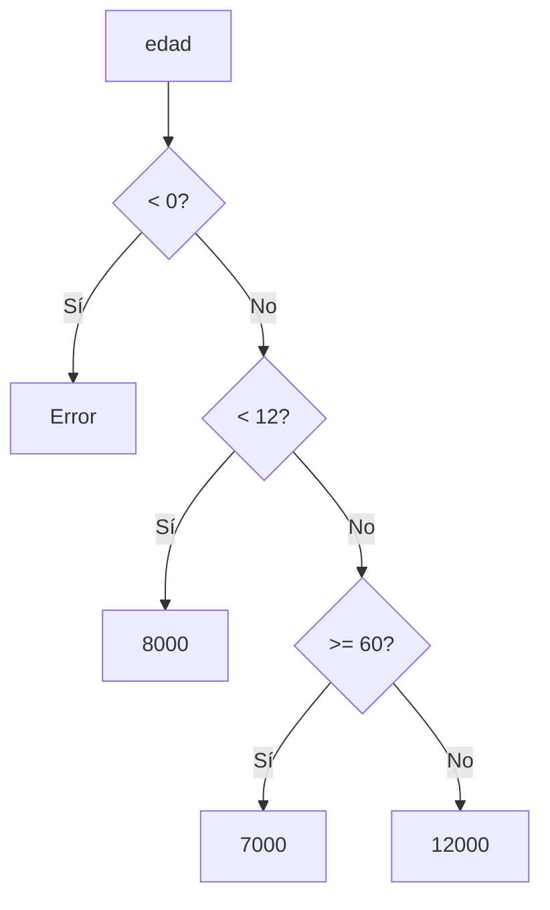

# Módulo 1 · Lógica de programación y pensamiento computacional

La lógica de programación no es un lenguaje específico: es la capacidad de describir reglas precisas que una máquina pueda ejecutar. El pensamiento computacional es la disciplina para llegar a esas reglas: descomponer, reconocer patrones, abstraer y definir algoritmos verificables.

**Entorno de referencia verificado (2026-05-22):** Node.js v24.18.0.

## Aprende construyendo

### Tema 1: Lógica de programación · Básico · 180 min

Caso guía: calcular el cobro de una fila de cine aplicando reglas por edad y validando entradas.

#### Variable y estado

**Definición formal.** Una variable es un nombre ligado a un valor en un ámbito. El estado es el conjunto de valores relevantes en un momento de ejecución.

**Para qué sirve.** Representar datos de entrada, intermedios y resultados.

**Cuándo usarlo / cuándo no.** Usa nombres específicos y ámbito mínimo. Evita mutar una variable para representar conceptos distintos.

**Ejemplo mínimo enfocado (ejecutable).**

```bash
mkdir -p ms1-var
cd ms1-var
```

Crea el archivo `var.mjs`:

```js
let total = 0;
total += 8000;
total += 12000;
console.log(total);
```

```bash
node var.mjs
```

**Error común.** Reutilizar `x`, `tmp`, `data` para todo. Corrección: nombres con intención (`total`, `edad`, `precioBase`).

**Verificación (Node 24.18.0, 2026-05-22).** `20000`.

#### Decisión (`if/else`) y guard clauses

**Definición formal.** Una decisión selecciona un camino de ejecución según una condición booleana.

**Para qué sirve.** Modelar reglas de negocio.

**Cuándo usarlo / cuándo no.** Úsalo cuando el comportamiento depende de condiciones. Prefiere guard clauses para invalidar temprano entradas malas.



**Ejemplo mínimo enfocado (ejecutable).**

```bash
mkdir -p ms1-if
cd ms1-if
```

Crea el archivo `edad.mjs`:

```js
function precioBoleto(edad) {
  if (edad < 0) throw new Error('edad negativa');
  if (edad < 12) return 8000;
  if (edad >= 60) return 7000;
  return 12000;
}

console.log(precioBoleto(8));
console.log(precioBoleto(60));
```

```bash
node edad.mjs
```

**Error común.** Borde mal definido (`>` vs `>=`). Corrección: probar límites.

**Verificación (Node 24.18.0, 2026-05-22).** `8000`, `7000`.

#### Operadores lógicos

**Definición formal.** `&&`, `||`, `!` combinan o niegan booleanos. `&&` y `||` hacen cortocircuito.

**Para qué sirve.** Expresar reglas compuestas.

**Ejemplo mínimo enfocado (ejecutable).**

```bash
mkdir -p ms1-bool
cd ms1-bool
```

Crea el archivo `bool.mjs`:

```js
function puedeEntrar(edad, tieneBoleto, vaConAdulto) {
  return tieneBoleto && (edad >= 18 || vaConAdulto);
}

console.log(puedeEntrar(15, true, false));
console.log(puedeEntrar(15, true, true));
```

```bash
node bool.mjs
```

**Error común.** Precedencia mal asumida. Corrección: paréntesis explícitos.

**Verificación (Node 24.18.0, 2026-05-22).** `false`, `true`.

#### Repetición (`for`)

**Definición formal.** Un bucle repite un bloque sobre una colección o mientras una condición se cumpla.

**Para qué sirve.** Aplicar la misma regla a muchos elementos.

**Ejemplo mínimo enfocado (ejecutable).**

```bash
mkdir -p ms1-loop
cd ms1-loop
```

Crea el archivo `loop.mjs`:

```js
function cobrarFila(edades) {
  let total = 0;
  for (const edad of edades) total += edad < 12 ? 8000 : 12000;
  return total;
}

console.log(cobrarFila([8, 25, 15]));
```

```bash
node loop.mjs
```

**Error común.** Off-by-one o mutar colección durante iteración. Corrección: tests con vacío, uno y borde.

**Verificación (Node 24.18.0, 2026-05-22).** `32000`.

#### Función y contrato pequeño

**Definición formal.** Unidad reutilizable con entradas, comportamiento y salida/efecto definido.

**Ejemplo mínimo enfocado (ejecutable).**

```bash
mkdir -p ms1-fn
cd ms1-fn
```

Crea el archivo `fn.mjs`:

```js
export function precioBoleto(edad) {
  if (edad < 0) throw new Error('edad negativa');
  return edad < 12 ? 8000 : edad >= 60 ? 7000 : 12000;
}

console.log(precioBoleto(30));
```

```bash
node fn.mjs
```

**Error común.** Función que hace validación, cálculo, I/O y logging todo junto. Corrección: separar responsabilidades.

**Verificación (Node 24.18.0, 2026-05-22).** `12000`.

### Tema 2: Pensamiento computacional · Básico · 180 min

Caso guía: convertir un problema de cambio de moneda en pasos verificables.

#### Descomposición

**Definición formal.** Dividir un problema en subproblemas más pequeños y manejables.

**Ejemplo mínimo enfocado (ejecutable).**

```bash
mkdir -p ms1-decomp
cd ms1-decomp
```

Crea el archivo `decomp.mjs`:

```js
function validar(monto) {
  return Number.isInteger(monto) && monto >= 0;
}

function calcular(monto) {
  return { billetes: Math.floor(monto / 10000), resto: monto % 10000 };
}

const monto = 25000;
console.log(JSON.stringify(validar(monto) ? calcular(monto) : null));
```

```bash
node decomp.mjs
```

**Verificación (Node 24.18.0, 2026-05-22).** `{"billetes":2,"resto":5000}`.

#### Patrones y abstracción

**Definición formal.** Patrón: similitud reutilizable. Abstracción: exponer lo esencial y ocultar detalle irrelevante.

**Ejemplo mínimo enfocado (ejecutable).**

```bash
mkdir -p ms1-abstr
cd ms1-abstr
```

Crea el archivo `abstr.mjs`:

```js
function contarPor(cond, lista) {
  return lista.filter(cond).length;
}

const edades = [8, 15, 30, 67];
console.log(contarPor((e) => e < 12, edades));
console.log(contarPor((e) => e >= 60, edades));
```

```bash
node abstr.mjs
```

**Error común.** Abstracción prematura. Corrección: abstraer cuando el patrón es real, no hipotético.

**Verificación (Node 24.18.0, 2026-05-22).** `1`, `1`.

#### Algoritmo y caso borde

**Definición formal.** Algoritmo: secuencia finita y precisa de pasos. Caso borde: entrada en el límite que expone defectos.

**Ejemplo mínimo enfocado (ejecutable).**

```bash
mkdir -p ms1-edge
cd ms1-edge
```

Crea el archivo `edge.mjs`:

```js
function dividir(a, b) {
  if (b === 0) throw new Error('division por cero');
  return a / b;
}

console.log(dividir(10, 2));
try { dividir(10, 0); } catch (e) { console.log(e.message); }
```

```bash
node edge.mjs
```

**Error común.** Probar solo el “happy path”. Corrección: incluir 0, vacío, negativo, máximo, inválido.

**Verificación (Node 24.18.0, 2026-05-22).** `5`, `division por cero`.

## Cierre

La lógica de programación se vuelve confiable cuando las reglas son pequeñas, nombradas y probadas en bordes. Pensamiento computacional es el método para llegar ahí.

## Checklist

- Uso variables con intención clara.
- Modelo decisiones y bordes.
- Extraigo funciones con contrato pequeño.
- Descompongo, abstraigo y verifico casos borde.
