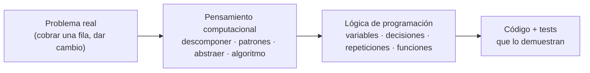
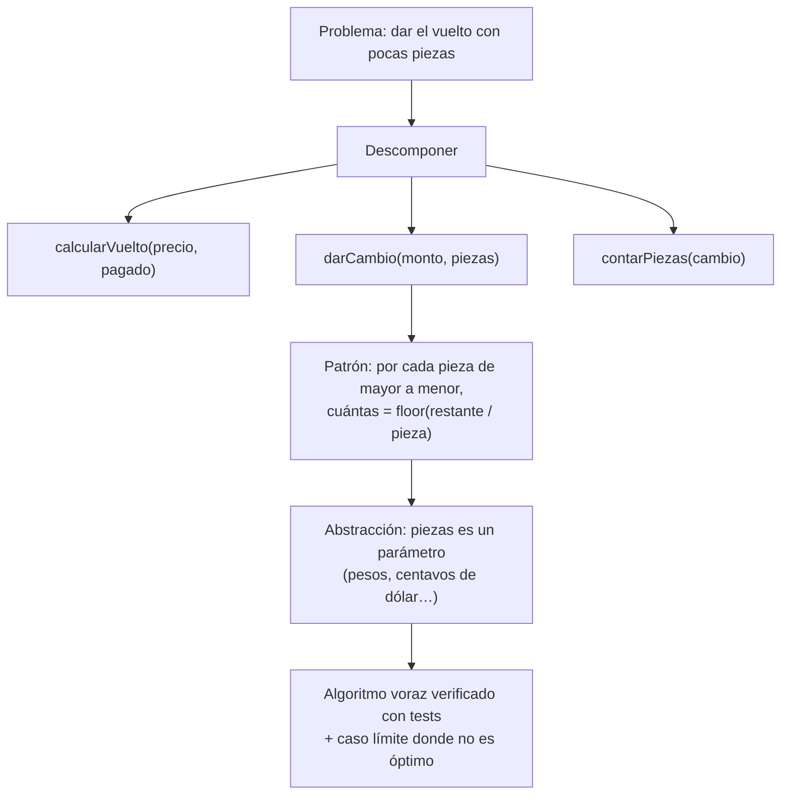

# Módulo 0.2 · Lógica de programación y pensamiento computacional

**Fase 0 · Fundamentos absolutos** (semana 1 de 4). **Duración:** 6 h (2 temas de 3 h). **Dificultad:** 1 de 5.
**Dependencias:** Módulo 0.1 (ejecutar un programa con `node` y correr un test con `node --test`).
**Herramientas:** Node.js 26.13.1 LTS, sin dependencias externas. **Laboratorio:**
`modulo-1`.

Aquí aprendes los cuatro ladrillos con los que se escribe cualquier programa (variables, decisiones,
repeticiones y funciones) y la forma de pensar que te permite convertir un problema del mundo real en pasos que
una computadora pueda seguir. Todo microservicio que escribas después, por sofisticado que sea, está hecho de
estos ladrillos.



**Texto alternativo:** cuatro cajas en línea. Un problema real pasa por el pensamiento computacional (cuatro
herramientas), se expresa con la lógica de programación (cuatro ladrillos) y termina en código con tests.

---

### Lógica de programación

#### 1. UBICACIÓN

Módulo 0.2, Lección 1 de 2 · Fase 0 · `web/public/content/microservices/modulo-1.md` · Laboratorio
`logica`.

#### 2. PRERREQUISITOS

- Módulo 0.1: qué es un programa (datos, instrucciones, resultado) y cómo ejecutarlo con `node`.
- Saber correr un test con `node --test` y leer `✔` / `✖`.
- Aritmética básica y las comparaciones «mayor que», «menor que», «igual».

#### 3. OBJETIVO DE APRENDIZAJE

**Aplicar** variables, decisiones (`if/else`), operadores lógicos (`&&`, `||`), repeticiones (`for`) y funciones
para resolver las reglas de una taquilla de cine, y **detectar** con un test un error de borde (`>` en lugar de
`>=`); lo compruebas cuando `logica/cine.test.js` pasa 5 de 5 y sabes explicar por qué fallaba la versión rota.

#### 4. ANALOGÍA VISUAL

Dibuja la **taquilla de un cine** vista desde arriba. Frente a ella, una **fila de cuatro personas** con su edad
escrita en la camiseta: 8, 25, 67 y 15. La cajera tiene sobre el mostrador:

- una **caja registradora** con una pantalla que dice «Total: 0» y va subiendo (una **variable**);
- un **cartel de precios con flechas** que se bifurcan: «¿menor de 12? → 8000», «¿60 o más? → 7000»,
  «si no → 12000» (una **decisión**);
- una **flecha circular** pintada en el piso que vuelve desde la taquilla al inicio de la fila: «siguiente»
  (una **repetición**);
- un **sello** con la palabra «PRECIO» que estampa en cada boleto: siempre hace lo mismo con cualquier edad
  (una **función**).

Junto a la puerta de la sala, un portero con un letrero: «Entra si tienes boleto **Y** (eres mayor de 18 **O**
vienes con un adulto)». Ese letrero es lógica booleana: dos condiciones unidas por «y» y «o».

#### 5. DIAGRAMA TÉCNICO


**Texto alternativo:** diagrama de flujo vertical. Empieza con total en 0 y pregunta si queda alguien en la
fila; si no, muestra el total. Si sí, comprueba si la edad es negativa (error), luego si es menor de 12 (precio
8000), si no, si es 60 o más (7000), y si no, 12000. Suma el precio al total y vuelve a preguntar por la fila.

#### 6. EXPLICACIÓN NIVEL 0

Programar es dar instrucciones exactas. Para eso usas cuatro ladrillos:

1. **Variable:** una caja con nombre donde guardas un dato que puede cambiar. `let total = 0` es la pantalla de la
   caja registradora.
2. **Decisión:** «si pasa esto, haz aquello; si no, haz lo otro». En código: `if (edad < 12) { ... } else { ... }`.
3. **Repetición (bucle):** hacer lo mismo para cada elemento. `for (const edad of fila) { ... }` significa «por
   cada edad de la fila, haz esto».
4. **Función:** un grupo de instrucciones con nombre, que recibe datos y devuelve un resultado.
   `precioBoleto(25)` devuelve `12000`.

Además, las condiciones se pueden combinar: `&&` significa **y** (las dos deben cumplirse), `||` significa **o**
(basta una), y `!` significa **no**. El resultado de una condición es siempre `true` (verdadero) o `false`
(falso): eso se llama un valor **booleano**.

#### 7. EXPLICACIÓN INTERMEDIA

- **Orden de evaluación en `if/else if`:** se revisan las condiciones de arriba abajo y se ejecuta **solo la
  primera** que sea verdadera. Por eso `edad < 12` va antes que `edad >= 60`: el orden es parte de la lógica.
- **Bordes:** los errores más frecuentes están en los límites (11, 12, 59, 60). `edad > 60` deja fuera a quien
  tiene exactamente 60. Los tests deben probar **el valor del borde y el de al lado** (`precioBoleto(59)` y
  `precioBoleto(60)`).
- **Cortocircuito:** en `tieneBoleto && (...)`, si `tieneBoleto` es `false` JavaScript ni siquiera evalúa el
  paréntesis: el resultado ya es `false`. Con `||`, si la primera parte es `true`, no mira la segunda.
- **Precedencia:** `&&` se evalúa antes que `||`. Los paréntesis de `tieneBoleto && (edad >= 18 || vaConAdulto)`
  no son decoración: sin ellos, un adulto **sin boleto** podría entrar.
- **Errores explícitos:** ante una entrada imposible (edad negativa), la función **lanza** un error con `throw`
  en vez de devolver un precio inventado. El test lo comprueba con `assert.throws`.
- **Comparación estricta:** en JavaScript usa `===` (compara valor y tipo). `==` convierte tipos y produce
  sorpresas (`'5' == 5` es `true`).

#### 8. EXPLICACIÓN MAESTRA

- **Cadena de `if` frente a tabla de datos.** Con 3 tarifas, `if/else if` es lo más legible. Con 30 tarifas que
  cambian cada mes, conviene una **tabla de reglas** (un arreglo `[{ hasta: 11, precio: 8000 }, ...]`) que se
  recorre: el negocio cambia datos, no código. Trade-off: la tabla es flexible pero esconde la lógica en datos
  que también hay que validar y probar.
- **Bucle `for` frente a funciones de colección.** `cobrarFila` podría escribirse como
  `edades.map(precioBoleto).reduce((a, b) => a + b, 0)`. Es más compacta y declarativa (Java la tiene con
  Streams, Módulo 1), pero al principio el `for` explícito se depura mejor. Elige la que tu equipo lea más rápido.
- **Excepciones frente a valores de error.** `throw` detiene el flujo y obliga a quien llama a manejarlo; devolver
  `null` o `-1` es más barato pero se olvida fácil. En un microservicio, un error de validación se convierte en
  una respuesta 400 en la frontera (Módulo 2 y Módulo 14), nunca en un precio silenciosamente incorrecto.
- **Cuándo NO** escribir lógica propia: si la regla ya existe en una librería probada (fechas, monedas,
  impuestos de un país) o en otro servicio que es su dueño, reutilízala; duplicar reglas de negocio en varios
  servicios es la semilla del «monolito distribuido» (Módulo 30).

#### 9. CÓDIGO EJECUTABLE

Versiones: **Node.js 26.13.1 LTS** (también corre en Node 22). Sin dependencias. `package.json` mínimo del
laboratorio:

```json
{
  "name": "modulo-0-2-logica-y-pensamiento",
  "version": "1.0.0",
  "private": true,
  "type": "module",
  "engines": { "node": ">=26.13.1" },
  "scripts": { "test": "node --test" }
}
```

Archivo `cine.js`:

```javascript
// Módulo 0.2 · Lógica de programación
// Los 4 ladrillos de cualquier programa: variables, decisiones, repeticiones y funciones.
// Ejemplo: la taquilla de un cine decide quién entra y cuánto paga.
// Requisitos: Node.js 26.13.1 LTS (funciona desde Node 22). Sin dependencias.
// Ejecuta: node logica/cine.js

// FUNCIÓN + DECISIÓN: ¿puede entrar a una película para mayores de 18?
// Regla: entra si tiene boleto Y (es mayor de edad O va con un adulto).
export function puedeEntrar(edad, tieneBoleto, vaConAdulto) {
  return tieneBoleto && (edad >= 18 || vaConAdulto);
}

// DECISIÓN CON VARIAS RAMAS: el precio depende de la edad.
export function precioBoleto(edad) {
  if (edad < 0) {
    throw new Error('La edad no puede ser negativa');
  } else if (edad < 12) {
    return 8000; // niños
  } else if (edad >= 60) {
    return 7000; // adultos mayores
  } else {
    return 12000; // general
  }
}

// REPETICIÓN: recorre la fila y suma lo que paga cada persona.
export function cobrarFila(edades) {
  let total = 0; // VARIABLE: una caja con nombre cuyo contenido cambia
  for (const edad of edades) {
    total += precioBoleto(edad);
  }
  return total;
}

if (import.meta.main) {
  const fila = [8, 25, 67, 15];
  console.log(`Fila: ${fila.join(', ')} años`);
  for (const edad of fila) {
    console.log(`  ${edad} años -> paga ${precioBoleto(edad)}`);
  }
  console.log(`Total de la fila: ${cobrarFila(fila)}`);
  console.log(`¿Entra un chico de 15 con boleto y sin adulto? ${puedeEntrar(15, true, false)}`);
  console.log(`¿Entra un chico de 15 con boleto y con adulto? ${puedeEntrar(15, true, true)}`);
}
```

#### 10. MINI-LABORATORIO

1. En tu carpeta de trabajo, ejecuta el programa:
   ```bash
   node logica/cine.js
   ```
2. **Predice y comprueba:** antes de ejecutar, escribe en papel qué devolverá `precioBoleto(60)`. Luego:
   ```bash
   node -e "import('./logica/cine.js').then(m => console.log(m.precioBoleto(60)))"
   ```
3. **Rompe la lógica a propósito:** en `logica/cine.js` cambia `edad >= 60` por `edad > 60`, guarda y ejecuta el
   test. Observa cuál falla. Después, deshaz el cambio.
   ```bash
   node --test --test-reporter=spec logica/cine.test.js
   ```

**Output esperado** (paso 1):

```text
Fila: 8, 25, 67, 15 años
  8 años -> paga 8000
  25 años -> paga 12000
  67 años -> paga 7000
  15 años -> paga 12000
Total de la fila: 39000
¿Entra un chico de 15 con boleto y sin adulto? false
¿Entra un chico de 15 con boleto y con adulto? true
```

Paso 2: `7000`. Paso 3 (con el error introducido):

```text
✔ sin boleto nadie entra, aunque sea adulto (0.748499ms)
✔ un menor entra solo si va con un adulto (0.153788ms)
✖ los bordes de edad caen en la tarifa correcta (0.883617ms)
✔ la fila suma el precio de cada persona (0.146356ms)
✔ una edad negativa es un error, no un precio (1.317278ms)
…
  AssertionError [ERR_ASSERTION]: Expected values to be strictly equal:

  12000 !== 7000
```

**Captura comentada:** en el paso 3, solo una línea cambia de `✔` a `✖`. El mensaje `12000 !== 7000` se lee
«obtuve 12000, esperaba 7000»: la persona de 60 años cayó en la tarifa general. La suma de la fila sigue
pasando porque en esa fila nadie tiene exactamente 60: los tests de borde atrapan lo que los casos «normales» no.

#### 11. VERIFICACIÓN

Con el código correcto, el test debe pasar completo:

```bash
node --test --test-reporter=spec logica/cine.test.js
```

Salida real:

```text
✔ sin boleto nadie entra, aunque sea adulto (0.554325ms)
✔ un menor entra solo si va con un adulto (0.166841ms)
✔ los bordes de edad caen en la tarifa correcta (0.093232ms)
✔ la fila suma el precio de cada persona (0.098384ms)
✔ una edad negativa es un error, no un precio (0.288728ms)
ℹ tests 5
ℹ pass 5
ℹ fail 0
```

**Pregunta de comprobación:** si quitas los paréntesis y escribes `tieneBoleto && edad >= 18 || vaConAdulto`,
¿entra alguien de 30 años sin boleto que va con un adulto? *(Sí: `&&` se evalúa primero, `false || true` es
`true`. Por eso los paréntesis son parte de la regla.)*

#### 12. ERROR COMÚN

**Síntoma:** el precio sale mal solo para algunas edades y «el código parece correcto». **Cómo se ve:** en el
diagrama de flujo, una flecha de borde que cae en la rama equivocada; en el test, `✖` con `12000 !== 7000`.
**Diagnóstico:** imprime el valor en el borde y en sus vecinos:

```bash
node -e "import('./logica/cine.js').then(m => [11,12,59,60].forEach(e => console.log(e, m.precioBoleto(e))))"
```

Si `60` muestra `12000`, la comparación es `>` donde la regla dice «60 o más» (`>=`). **Arreglo:** traduce la
frase del negocio palabra por palabra («o más» → `>=`, «menor de» → `<`) y añade un test por cada borde.

#### 13. PREGUNTA DE ENTREVISTA

«¿Qué es la evaluación en cortocircuito y cuándo puede causar un error o evitarlo?»

**Respuesta modelo:** en `a && b`, si `a` es falso no se evalúa `b`; en `a || b`, si `a` es verdadero no se
evalúa `b`. Sirve para protegerse: `usuario && usuario.nombre` evita leer una propiedad de algo que no existe.
Puede causar errores si `b` tiene un efecto que esperabas que ocurriera siempre (por ejemplo, registrar un
evento) o si se usa `||` para valores por defecto con datos válidos falsos: `cantidad || 1` convierte un `0`
legítimo en `1`; para eso existe `??`, que solo reemplaza `null` o `undefined`.

#### 14. ANTI-PATRÓN RELACIONADO

**La «pirámide» de `if` anidados (*arrow code*):**

```javascript
// ✖ Anti-patrón: cada regla nueva añade un nivel de sangría
if (tieneBoleto) {
  if (edad >= 18) {
    entra = true;
  } else {
    if (vaConAdulto) {
      entra = true;
    } else {
      entra = false;
    }
  }
} else {
  entra = false;
}
```

Se ve como una flecha que apunta a la derecha: el código se aleja del margen con cada condición y es casi
imposible ver todos los caminos. Exprésalo como una condición con nombre
(`return tieneBoleto && (edad >= 18 || vaConAdulto)`) o con **retornos tempranos** (`if (!tieneBoleto) return
false;`) que mantienen el código plano.

---

### Pensamiento computacional

#### 1. UBICACIÓN

Módulo 0.2, Lección 2 de 2 · Fase 0.

#### 2. PRERREQUISITOS

- Tema anterior «Lógica de programación» (variables, decisiones, bucles, funciones y `throw`).
- Saber dividir y obtener la parte entera (cuántas veces cabe 20000 en 36300: 1).

#### 3. OBJETIVO DE APRENDIZAJE

**Descomponer** un problema real (dar el vuelto en una caja registradora) en subproblemas, **reconocer** el
patrón que se repite, **abstraerlo** en una función reutilizable y **evaluar** en qué caso ese algoritmo no da la
mejor respuesta; lo compruebas cuando `pensamiento/cambio.test.js` pasa 6 de 6, incluido el caso donde el
algoritmo voraz no es óptimo.

#### 4. ANALOGÍA VISUAL

Dibuja una **caja registradora abierta** con sus compartimentos de billetes y monedas ordenados de izquierda a
derecha, del más grande al más pequeño: 50000, 20000, 10000, 5000, 2000, 1000, 500, 200, 100. Encima, un papel
dice «Vuelto: 36300». La mano del cajero hace siempre el **mismo gesto**: mira el compartimento más grande, se
pregunta «¿cabe en lo que falta?», toma uno si cabe, y si no, se mueve al siguiente compartimento. Junto a la
caja hay cuatro carteles pegados con cinta:

1. «**Descomponer**: vuelto = pagado − precio; luego elegir piezas; luego contarlas».
2. «**Patrón**: siempre la pieza más grande que quepa».
3. «**Abstraer**: da igual si son pesos o dólares; solo importan los valores».
4. «**Algoritmo**: los pasos exactos, en orden, sin ambigüedad».

En una esquina, un quinto cartel en rojo con una advertencia: «Con monedas de 1, 3 y 4, para dar 6 el gesto da
4+1+1 (tres monedas), pero 3+3 son solo dos».

#### 5. DIAGRAMA TÉCNICO



**Texto alternativo:** diagrama vertical. El problema «dar el vuelto con pocas piezas» se descompone en tres
funciones: calcularVuelto, darCambio y contarPiezas. darCambio aplica el patrón de tomar, de mayor a menor,
cuántas piezas caben; ese patrón se abstrae haciendo que la lista de piezas sea un parámetro, y termina en un
algoritmo voraz verificado con tests, incluido un caso donde no es óptimo.

#### 6. EXPLICACIÓN NIVEL 0

**Pensamiento computacional** es una forma de pensar los problemas para que una computadora pueda resolverlos.
No requiere computadora: lo usas cuando organizas una mudanza o sigues una receta. Tiene cuatro herramientas:

1. **Descomposición:** partir un problema grande en partes pequeñas. «Dar cambio» = «calcular cuánto devolver» +
   «elegir billetes» + «contar cuántos di».
2. **Reconocimiento de patrones:** notar qué se repite. Con cada billete haces lo mismo: «¿cabe? tómalo».
3. **Abstracción:** quedarte con lo importante y olvidar el detalle. Para el cálculo no importa el color del
   billete ni el país; solo su valor.
4. **Algoritmo:** escribir los pasos exactos, en orden, sin dudas posibles. Si dos personas siguen el algoritmo,
   obtienen el mismo resultado.

Cuando tienes las cuatro, pasar a código es casi traducir.

#### 7. EXPLICACIÓN INTERMEDIA

- La descomposición produce **funciones pequeñas con una sola responsabilidad**: `calcularVuelto` valida y
  resta, `darCambio` elige piezas, `contarPiezas` suma. Cada una tiene su test.
- El patrón «toma la pieza más grande que quepa» es un **algoritmo voraz** (*greedy*): en cada paso toma la mejor
  opción local sin mirar el futuro. `Math.floor(restante / pieza)` calcula cuántas veces cabe una pieza de una
  sola vez, en lugar de restar de a una.
- La abstracción aparece como **parámetro con valor por defecto**: `piezas = [50000, …, 100]`. Pasando
  `[25, 10, 5, 1]` la misma función sirve para centavos de dólar. Además, la función ordena una **copia**
  (`[...piezas].sort(...)`) para no modificar el arreglo de quien la llama.
- El algoritmo declara sus **casos imposibles**: pagar de menos lanza un error; un monto que no se puede formar
  con las piezas (por ejemplo, 150 con piezas de 100) también.

#### 8. EXPLICACIÓN MAESTRA

- **Voraz frente a programación dinámica.** El voraz es O(n) en el número de tipos de pieza, simple y correcto
  para sistemas monetarios «canónicos» como los de la mayoría de países. Con un sistema no canónico (1, 3, 4) no
  garantiza el mínimo; la **programación dinámica** (calcular el mínimo para cada monto de 0 a N) sí lo
  garantiza, a cambio de O(N × piezas) en tiempo y memoria. Alternativa intermedia: voraz + verificación de que
  el sistema de piezas es canónico. Elige según los datos reales, y documenta el supuesto en un test, como hace
  aquí el último caso.
- **La descomposición es diseño.** Las mismas cuatro herramientas deciden, a escala, cómo partir un sistema en
  servicios (DDD, Módulo 5): descomponer por capacidades del negocio, reconocer patrones de comunicación, abstraer
  contratos. Una mala descomposición en funciones produce código enredado; una mala descomposición en servicios
  produce un monolito distribuido.
- **Cuándo NO** abstraer: si solo existe un caso de uso y no hay señales de un segundo, una abstracción prematura
  (parámetros, interfaces, configuraciones) añade complejidad sin beneficio. Regla práctica: abstrae al ver el
  patrón repetirse, no al imaginarlo.

#### 9. CÓDIGO EJECUTABLE

Versiones: **Node.js 26.13.1 LTS** (también corre en Node 22). Sin dependencias; usa el `package.json` del tema
anterior. Archivo `cambio.js`:

```javascript
// Módulo 0.2 · Pensamiento computacional
// Problema: una caja registradora debe devolver el cambio con la menor cantidad de billetes/monedas.
// Las 4 herramientas del pensamiento computacional aplicadas:
//   1. Descomposición: "dar cambio" = calcular el vuelto + elegir piezas + contar piezas.
//   2. Patrones: siempre se repite lo mismo: "toma la pieza más grande que quepa".
//   3. Abstracción: no importa si son pesos o dólares; solo importan los valores de las piezas.
//   4. Algoritmo: los pasos exactos, en orden, que escribimos abajo.
// Requisitos: Node.js 26.13.1 LTS (funciona desde Node 22). Sin dependencias.
// Ejecuta: node pensamiento/cambio.js

// Paso de la descomposición 1: calcular el vuelto.
export function calcularVuelto(precio, pagado) {
  if (pagado < precio) throw new Error(`Faltan ${precio - pagado} para pagar`);
  return pagado - precio;
}

// Pasos 2 y 3: elegir piezas (patrón repetido) usando valores abstractos.
export function darCambio(monto, piezas = [50000, 20000, 10000, 5000, 2000, 1000, 500, 200, 100]) {
  const ordenadas = [...piezas].sort((a, b) => b - a); // de la más grande a la más pequeña
  const resultado = {};
  let restante = monto;
  for (const pieza of ordenadas) {
    const cuantas = Math.floor(restante / pieza); // ¿cuántas veces cabe esta pieza?
    if (cuantas > 0) {
      resultado[pieza] = cuantas;
      restante -= cuantas * pieza;
    }
  }
  if (restante !== 0) throw new Error(`No se puede dar exacto: sobran ${restante}`);
  return resultado;
}

export function contarPiezas(cambio) {
  return Object.values(cambio).reduce((suma, n) => suma + n, 0);
}

if (import.meta.main) {
  const vuelto = calcularVuelto(13700, 50000);
  const cambio = darCambio(vuelto);
  console.log(`Precio 13700, pagan con 50000 -> vuelto ${vuelto}`);
  for (const [pieza, cuantas] of Object.entries(cambio).sort((a, b) => b[0] - a[0])) {
    console.log(`  ${cuantas} x ${pieza}`);
  }
  console.log(`Piezas entregadas: ${contarPiezas(cambio)}`);
}
```

#### 10. MINI-LABORATORIO

1. **Primero sin computadora:** en papel, descompón «dar el vuelto de 50000 para una compra de 13700» y escribe
   cuántas piezas de cada valor entregarías.
2. En tu carpeta de trabajo, compara tu papel con el programa:
   ```bash
   node pensamiento/cambio.js
   ```
3. Prueba la abstracción con otras piezas (centavos de dólar) y el caso donde el voraz falla:
   ```bash
   node -e "import('./pensamiento/cambio.js').then(m => { console.log(m.darCambio(68, [25, 10, 5, 1])); console.log(m.darCambio(6, [1, 3, 4])); })"
   ```

**Output esperado** (paso 2):

```text
Precio 13700, pagan con 50000 -> vuelto 36300
  1 x 20000
  1 x 10000
  1 x 5000
  1 x 1000
  1 x 200
  1 x 100
Piezas entregadas: 6
```

Paso 3:

```text
{ '1': 3, '5': 1, '10': 1, '25': 2 }
{ '1': 2, '4': 1 }
```

**Captura comentada:** en el paso 3, la primera línea dice 2 de 25, 1 de 10, 1 de 5 y 3 de 1 (68 en 7 piezas).
La segunda dice 1 de 4 y 2 de 1: tres piezas para 6, cuando 3 + 3 lo haría con dos. Node muestra las claves
numéricas en orden ascendente; el contenido es lo que importa.

#### 11. VERIFICACIÓN

```bash
node --test --test-reporter=spec pensamiento/cambio.test.js
```

Salida real:

```text
✔ el vuelto es lo pagado menos el precio (0.615142ms)
✔ si pagan de menos, es un error (0.306166ms)
✔ 36300 se entrega con 6 piezas (0.613276ms)
✔ vuelto 0 no entrega piezas (0.088844ms)
✔ la abstracción sirve con otras piezas (centavos de dólar) (0.290367ms)
✔ el patrón voraz no siempre da el mínimo: con piezas 1, 3 y 4, para 6 da 3 piezas y lo óptimo es 2 (0.10493ms)
ℹ tests 6
ℹ pass 6
ℹ fail 0
```

Para el módulo completo: los comandos de verificación indicados (11 tests y `RESULTADO: OK · Módulo 0.2 (lógica y pensamiento
computacional) verificado`). **Pregunta de comprobación:** ¿cuál de las cuatro herramientas te permitió reusar
`darCambio` con centavos de dólar sin cambiar su código? *(La abstracción: las piezas son un parámetro.)*

#### 12. ERROR COMÚN

**Síntoma:** empiezas a escribir código sin descomponer y terminas con una función de 60 líneas que «casi
funciona». **Cómo se ve:** en el diagrama, una sola caja gigante en vez de tres; en el código, variables que
cambian en muchos lugares y casos que no sabes dónde probar. Un caso concreto: olvidar ordenar las piezas.

```bash
node -e "const p=[100,500,200]; let r=700, s=[]; for (const x of p) { const c=Math.floor(r/x); if(c){s.push(c+'x'+x); r-=c*x;} } console.log(s)"
```

Imprime `[ '7x100' ]`: siete monedas en lugar de dos (500 + 200), porque el patrón «la más grande primero» no se
cumplió. **Diagnóstico:** escribe el algoritmo en pasos numerados en español y compáralo con el código línea a
línea. **Arreglo:** descompón primero, una función por paso, y deja que el test del caso «normal» (36300 → 6
piezas) te avise si el patrón se rompe.

#### 13. PREGUNTA DE ENTREVISTA

«¿Qué es un algoritmo voraz y cómo decides si es suficiente?»

**Respuesta modelo:** es un algoritmo que en cada paso toma la mejor opción local sin reconsiderar decisiones
pasadas. Es suficiente cuando el problema tiene la propiedad de que las elecciones locales óptimas llevan al
óptimo global (por ejemplo, sistemas monetarios canónicos o ciertos problemas de planificación). Lo decido con
evidencia: busco un contraejemplo pequeño, lo dejo como test y, si existe y el resultado importa, uso
programación dinámica u otra técnica exacta, midiendo su costo. Si el voraz es «suficientemente bueno» para el
negocio, lo documento explícitamente.

#### 14. ANTI-PATRÓN RELACIONADO

**La «función Dios»** (*God function*): una sola función que valida, calcula, elige piezas, formatea el texto y lo
imprime.

```javascript
// ✖ Anti-patrón: todo mezclado; no se puede probar el cálculo sin capturar la consola
function cajaRegistradora(precio, pagado) {
  if (pagado < precio) { console.log('ERROR'); return; }
  let r = pagado - precio;
  for (const x of [50000, 20000, 10000]) { /* ... */ console.log(x); }
  console.log('Gracias por su compra');
}
```

Se ve como una función larga cuyo nombre no describe una sola acción, con `console.log` mezclado con cálculo y
errores que se imprimen en vez de lanzarse. Descompón: funciones puras que calculan (probables) y un borde que
imprime. A escala de arquitectura, es el mismo error que un servicio que «lo hace todo».
