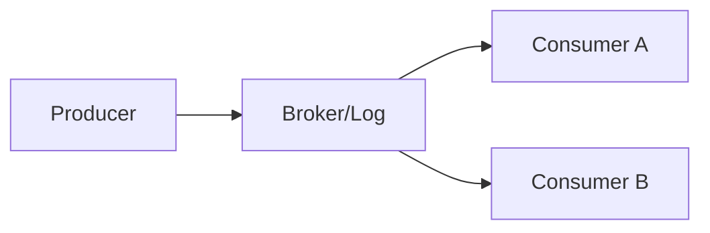

# Módulo 2.2 · Comunicación entre servicios

Los microservicios se coordinan por contratos. Este módulo compara REST, gRPC, GraphQL y mensajería asíncrona, con criterios para elegir según latencia, acoplamiento, streaming y consistencia.

**Entorno de referencia verificado (2026-05-22):** JDK 27.0.1.0.2, Node.js v24.18.0, Docker 29.9.3.

## Aprende construyendo

### Tema 1: REST síncrono: RestTemplate, WebClient, OpenFeign · Intermedio · 180 min

Caso guía: servicio A consulta servicio B por HTTP.

#### REST síncrono

**Definición formal.** Comunicación request/response sobre HTTP, normalmente JSON. El caller espera respuesta.

**Herramientas.** `RestTemplate` (legado en mantenimiento), `WebClient` (reactivo/no bloqueante), `OpenFeign` (cliente declarativo).

**Ejemplo mínimo (ejecutable, Node simulando contrato HTTP).**

```bash
mkdir -p ms10-rest
cd ms10-rest
```

Crea el archivo `server.mjs`:

```js
import http from 'node:http';
const s = http.createServer((req,res)=>{ if(req.url==='/status'){res.writeHead(200,{'Content-Type':'application/json'});res.end(JSON.stringify({ok:true}));} else {res.writeHead(404);res.end();}});
s.listen(0,'127.0.0.1', async ()=>{ const r = await fetch(`http://127.0.0.1:${s.address().port}/status`); console.log(r.status, await r.text()); s.close(); });
```

```bash
node server.mjs
```

**Error común.** Cadena síncrona larga sin timeout. Corrección: timeout, circuit breaker, presupuesto de latencia.

**Verificación (Node 24.18.0, 2026-05-22).** `200 {"ok":true}`.

### Tema 2: gRPC: Protocol Buffers, servicios, streaming · Avanzado · 180 min

Caso guía: comunicación interna de baja latencia con contrato fuerte.

#### gRPC + Protobuf

**Definición formal.** gRPC es un framework RPC sobre HTTP/2; Protobuf define contratos binarios tipados.

**Cuándo usar.** Interno service-to-service, alto throughput, streaming. No ideal para browser público sin gateway.

**Error común.** Romper compatibilidad de campos Protobuf. Corrección: reglas de evolución (no reusar números de campo).

**Nota de verificación.** Requiere toolchain gRPC/protoc; lab reproducible.

### Tema 3: GraphQL con Spring for GraphQL · Intermedio · 150 min

Caso guía: cliente móvil necesita solo algunos campos.

#### GraphQL

**Definición formal.** Lenguaje de consulta donde el cliente define forma de respuesta sobre un esquema.

**Error común.** N+1 en resolvers. Corrección: DataLoader/batching.

### Tema 4: Mensajería asíncrona: RabbitMQ y Kafka (introducción) · Intermedio · 180 min

Caso guía: notificar evento sin esperar al consumidor.

#### Async messaging

**Definición formal.** Productor emite mensaje/evento; consumidores procesan después. Acopla menos en tiempo, más en contrato.



**Error común.** Asumir exactly-once. Corrección: diseñar idempotencia.

### Tema 5: Sync vs async: criterios de decisión · Intermedio · 90 min

Caso guía: consulta de saldo (sync) vs envío de email (async).

#### Criterio

**Definición formal.** Sync cuando el cliente necesita respuesta inmediata para continuar; async cuando se puede diferir, fanout, o tolerar eventual consistency.

**Ejemplo mínimo (ejecutable).**

```bash
mkdir -p ms10-decision
cd ms10-decision
```

Crea el archivo `decide.mjs`:

```js
function elegir({ necesitaRespuestaInmediata, fanout, toleraEventual }) {
  if (fanout || toleraEventual) return 'async';
  if (necesitaRespuestaInmediata) return 'sync';
  return 'async';
}
console.log(elegir({ necesitaRespuestaInmediata: true, fanout: false, toleraEventual: false }));
console.log(elegir({ necesitaRespuestaInmediata: false, fanout: true, toleraEventual: true }));
```

```bash
node decide.mjs
```

**Verificación (Node 24.18.0, 2026-05-22).** `sync`, `async`.

## Cierre

El protocolo es un trade-off. Sync simplifica lectura inmediata; async desacopla y escala, pero exige idempotencia y observabilidad.

## Checklist

- Sé cuándo usar REST/gRPC/GraphQL/async.
- Pongo timeouts en sync.
- Diseño idempotencia en async.
- Versiono contratos.
