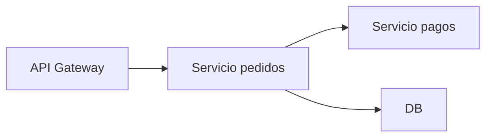

# Módulo 10 · Observabilidad

Un microservicio sin observabilidad es una caja negra distribuida. Observabilidad combina métricas, logs y traces para responder por qué algo falló, dónde y con qué impacto.

**Entorno de referencia verificado (2026-05-22):** JDK 27.0.1.0.2, Spring Boot 3.5.0, Docker 29.9.3.

## Aprende construyendo

### Tema 1: Micrometer + Prometheus · Intermedio · 150 min

Caso guía: medir tasa de errores y latencia por endpoint.

#### Métricas

**Definición formal.** Medidas numéricas agregadas en el tiempo (counter, gauge, timer/histogram). Micrometer es fachada; Prometheus scrapea y almacena.

**Regla.** Tags de baja cardinalidad. `userId` en tag destruye el TSDB.

**Error común.** Medir solo CPU/memoria. Corrección: métricas RED/USE y de negocio.

### Tema 2: OpenTelemetry + Zipkin/Jaeger · Avanzado · 150 min

Caso guía: request lenta cruzando 4 servicios.

#### Tracing distribuido

**Definición formal.** Trace es una cadena de spans con `traceId`; cada span representa una operación. OTel estandariza instrumentación/export.

**Error común.** No propagar headers de trace. Corrección: instrumentación OTel y propagación W3C.

### Tema 3: Logging estructurado · Intermedio · 90 min

Caso guía: buscar todos los errores de un `orderId`.

#### Logs estructurados

**Definición formal.** Logs con campos clave/valor (JSON) y contexto de correlación.

**Error común.** Loguear texto libre sin IDs. Corrección: `traceId`, `spanId`, `orderId` como campos.

### Tema 4: Grafana: dashboards · Intermedio · 90 min

Caso guía: tablero de salud del servicio.

#### Dashboard

**Definición formal.** Visualización de métricas/logs/traces para operación. Debe responder preguntas concretas.

**Error común.** Dashboard bonito pero inútil. Corrección: RED (Rate, Errors, Duration), saturación, y SLOs.

### Tema 5: Alerting basado en p99 · Intermedio · 90 min

Caso guía: p99 sube pero promedio parece bien.

#### Alertas por percentiles

**Definición formal.** p99 es la latencia bajo la cual cae el 99% de requests; captura cola de latencia que el promedio oculta.

**Error común.** Alertar por promedio. Corrección: percentiles, burn rate, y síntomas orientados al usuario.

## Cierre

Métricas dicen “qué”, logs dicen “qué pasó” y traces dicen “dónde”. Necesitas los tres, correlacionados.

## Checklist

- Métricas RED/USE.
- Traces con propagación.
- Logs JSON con correlation IDs.
- Alertas por síntomas/p99/SLO.
