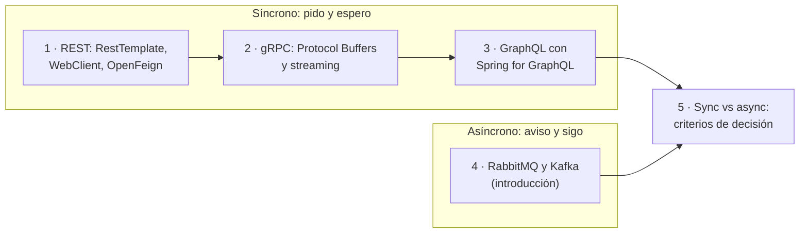
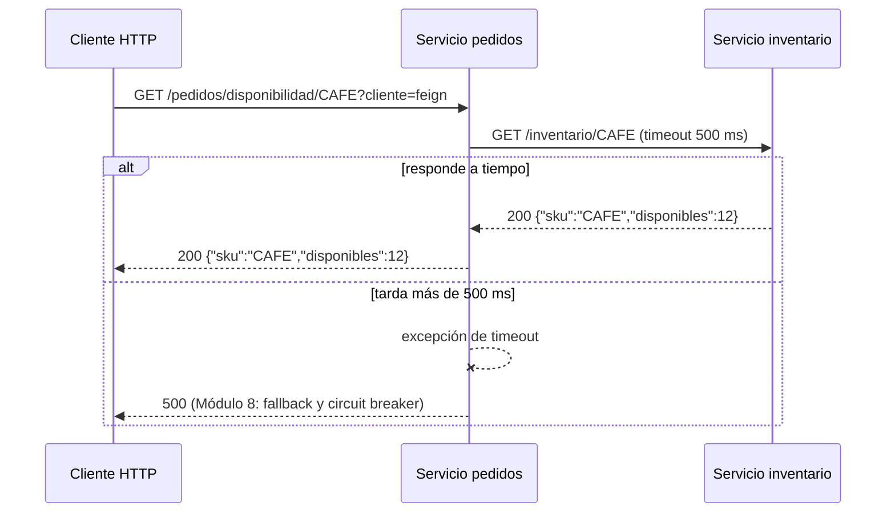
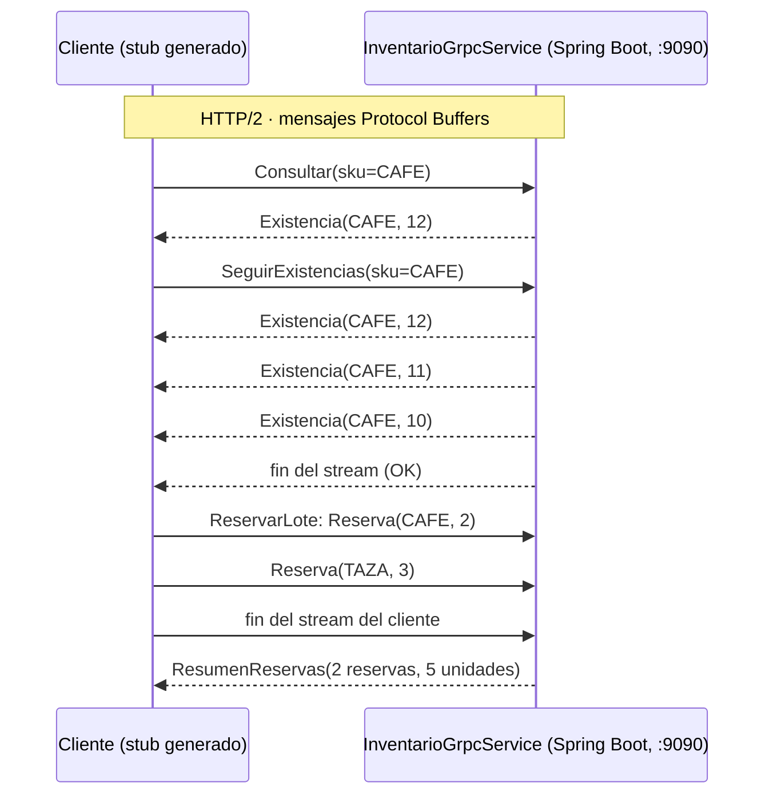
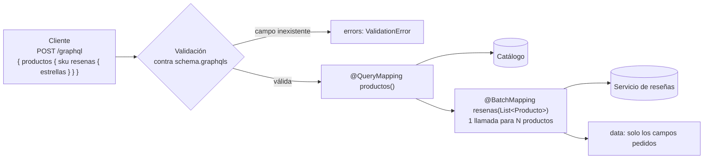
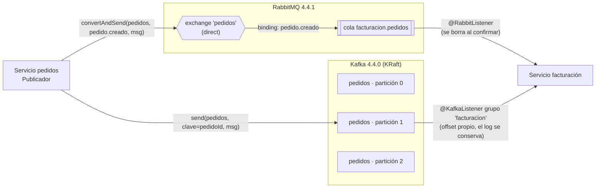
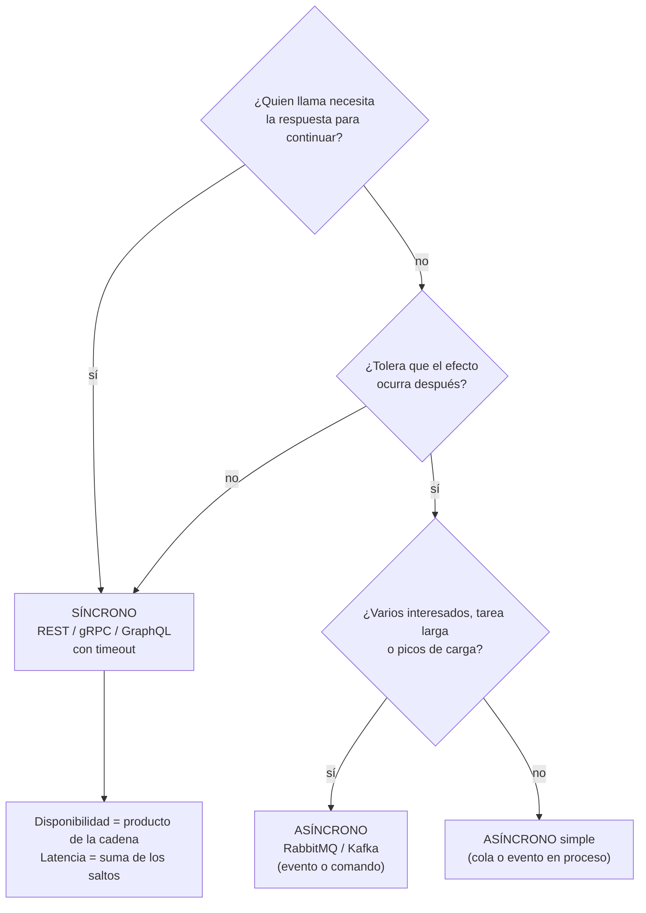

# Módulo 6 · Comunicación entre servicios

**Fase 1 · Spring Boot de cero a experto** (semanas 8 y 9 de 12). **Duración:** 13 h (5 temas de 2–3 h).
**Dificultad:** 3 de 5 (4 de 5 en gRPC y mensajería). **Dependencias:** Módulo 5 (contextos delimitados, eventos de
dominio, database-per-service), Spring MVC y testing (Módulos 2 y 3), Docker Compose (Módulo 0.5). **Herramientas:**
**JDK 25 LTS (25.0.5)**, **Spring Boot 4.1.3** (RestClient/RestTemplate, WebClient, gRPC nativo con Spring gRPC 1.1.2 y
grpc-java 1.84.1, Spring for GraphQL 2.0, Spring AMQP 4.1.3, Spring for Apache Kafka 4.1.3), **Spring Cloud 2025.1.4**
(OpenFeign), **RabbitMQ 4.4.1** y **Apache Kafka 4.4.0** en Docker Compose, y Gradle 9.9.2 mediante `./gradlew`.
**Laboratorio:** `examples/microservicios/modulo-10/` (un subproyecto Gradle por tema; `./verificar.sh` levanta los
brokers y ejecuta todos los tests).

Cuando un sistema se parte en servicios, las llamadas a métodos se vuelven **mensajes por la red**. Este módulo te da
las cinco herramientas para hacerlo y, sobre todo, el criterio para elegir: pedir algo y esperar la respuesta (REST,
gRPC, GraphQL) o avisar que algo pasó y seguir (RabbitMQ, Kafka).



**Texto alternativo:** mapa del módulo. El bloque «Síncrono: pido y espero» contiene, en orden, el tema 1 (REST con
RestTemplate, WebClient y OpenFeign), el tema 2 (gRPC) y el tema 3 (GraphQL). El bloque «Asíncrono: aviso y sigo»
contiene el tema 4 (RabbitMQ y Kafka). Los temas 3 y 4 llevan al tema 5, sync vs async: criterios de decisión.

**Cómo usar el laboratorio.** Entra en `examples/microservicios/modulo-10` y ejecuta `./verificar.sh`. Para un solo
tema: `cd f048-grpc && ../gradlew test`. Solo el tema 4 necesita Docker (`docker compose up -d --wait` en la carpeta del
módulo).

---

### REST síncrono: RestTemplate, WebClient, OpenFeign

#### 1. UBICACIÓN

Módulo 6, Lección 1 de 5 · Fase 1 · `web/public/content/microservices/modulo-10.md` · Laboratorio
`examples/microservicios/modulo-10/f047-rest-sincrono/`.

#### 2. PRERREQUISITOS

- HTTP (métodos, códigos, cabeceras) y JSON (Módulo 0.4).
- Spring MVC, records como DTO y Jackson (Módulo 2).
- `@SpringBootTest` y `@DynamicPropertySource` (Módulo 3).

#### 3. OBJETIVO DE APRENDIZAJE

**Implementar** la misma llamada entre servicios con RestTemplate, WebClient, OpenFeign y RestClient con
`@HttpExchange`, **configurar** timeouts explícitos y **explicar** cómo cada cliente trata un 404 y una respuesta
lenta; lo compruebas cuando `ClientesRestTest` pasa 3 de 3.

#### 4. ANALOGÍA VISUAL

Dibuja **cuatro formas de pedir un dato por teléfono** al almacén:

1. **RestTemplate:** un teléfono fijo de disco. Marcas, esperas en la línea sin poder hacer nada más hasta que
   contesten. Funciona, es conocido por todos y ya no le agregan funciones.
2. **WebClient:** dejas el mensaje y te devuelven la llamada. Mientras tanto atiendes a otros clientes; el teléfono
   suena cuando la respuesta está lista (un `Mono`, «una respuesta que llegará»).
3. **OpenFeign:** una **secretaria** con una libreta de contactos: tú le dices «consulta existencias de CAFE» y ella sabe
   el número, marca y te trae la respuesta. Solo escribiste la tarjeta de contacto (una interfaz).
4. **RestClient + `@HttpExchange`:** la versión moderna de la secretaria que ya viene con Spring, sin contratar a una
   agencia externa.

Encima de los cuatro teléfonos, un **reloj de arena** pegado a cada uno: el timeout. Sin él, puedes quedarte en la
línea para siempre.

#### 5. DIAGRAMA TÉCNICO



**Texto alternativo:** diagrama de secuencia con tres participantes. El cliente pide al servicio de pedidos la
disponibilidad de CAFE; pedidos llama a inventario con un timeout de 500 ms. Si inventario responde a tiempo, devuelve
200 con el JSON y pedidos lo reenvía al cliente. Si tarda más de 500 ms, pedidos corta la llamada con una excepción de
timeout y responde 500; el Módulo 8 enseña a responder mejor con fallback y circuit breaker.

#### 6. EXPLICACIÓN NIVEL 0

Cuando el servicio de **pedidos** necesita saber cuántas unidades quedan, le **pregunta** al servicio de
**inventario** por HTTP, igual que tu navegador le pregunta a una página web. Es **síncrono** porque pedidos espera la
respuesta antes de seguir.

En Spring hay varias herramientas («clientes HTTP») para hacer esa pregunta desde Java: **RestTemplate** (la clásica),
**WebClient** (la que no bloquea), **OpenFeign** (escribes una interfaz y se genera sola) y **RestClient** con
interfaces `@HttpExchange` (la recomendada hoy para código nuevo). Todas convierten el JSON de la respuesta en un
objeto Java, aquí el record `Existencia`.

#### 7. EXPLICACIÓN INTERMEDIA

| Cliente | Estilo | Viene de | 404 se convierte en | Timeout en el lab |
|---|---|---|---|---|
| `RestTemplate` | métodos (`getForObject`), bloqueante | Spring Framework (en mantenimiento) | `HttpClientErrorException.NotFound` | `RestTemplateBuilder.connectTimeout/readTimeout` |
| `WebClient` | fluido, **no bloqueante** (`Mono`/`Flux`) | Spring WebFlux | `WebClientResponseException.NotFound` (al suscribirse) | `.timeout(Duration)` del `Mono` |
| OpenFeign | interfaz declarativa | Spring Cloud OpenFeign | `FeignException.NotFound` | `spring.cloud.openfeign.client.config.<nombre>.read-timeout` |
| `RestClient` + `@HttpExchange` | interfaz declarativa sobre cliente fluido, bloqueante | Spring Framework 7 | `HttpClientErrorException.NotFound` | `spring.http.serviceclient.<grupo>.read-timeout` |

- **Spring Boot 4 separa los clientes en *starters*:** `spring-boot-starter-restclient` (RestTemplateBuilder,
  RestClient.Builder y grupos `@HttpExchange`) y `spring-boot-starter-webclient` (WebClient.Builder sobre Reactor
  Netty). Inyecta siempre los *builders* de Boot: traen Jackson, observabilidad y SSL configurados.
- **`@ImportHttpServices(group = "inventario", types = InventarioHttp.class)`** registra la interfaz como bean; su URL
  base sale de `spring.http.serviceclient.inventario.base-url`.
- **`@EnableFeignClients` + `@FeignClient(name = "inventario", url = "${inventario.url}")`**: Spring Cloud genera la
  implementación. El nombre sirve también para el balanceo con Service Discovery (Módulo 7).
- **`block()`** en el controlador MVC solo está para comparar los cuatro clientes en el mismo endpoint; en una
  aplicación WebFlux devolverías el `Mono` directamente.

#### 8. EXPLICACIÓN MAESTRA

- **¿Cuál elegir hoy?** Para servicios Spring MVC nuevos: `RestClient` (fluido) o interfaces `@HttpExchange` (declarativo)
  con hilos virtuales (Módulo 1) si necesitas mucha concurrencia. `WebClient` cuando toda la aplicación es reactiva o
  necesitas *streaming* y composición de muchas llamadas concurrentes. OpenFeign sigue siendo común en código
  existente con Spring Cloud, pero el propio proyecto lo considera *feature-complete*; las interfaces HTTP de Spring
  Framework cubren su caso de uso sin dependencia extra. RestTemplate: mantenlo donde ya está, no lo uses en código
  nuevo.
- **Timeouts en cascada:** si pedidos espera 5 s a inventario y el cliente de pedidos espera 3 s, pedidos sigue
  trabajando para nadie. Cada salto debe tener un timeout **menor** que el de quien lo llama (presupuesto de latencia,
  Módulo 8).
- **Reintentos:** solo en operaciones idempotentes (GET, PUT) y con *backoff* y *jitter*; un POST reintentado sin clave
  de idempotencia puede crear dos pedidos.
- **Alternativas al REST síncrono:** gRPC (contrato binario y *streaming*, tema 2), GraphQL (el cliente elige los
  campos, tema 3) o mensajería (no esperas, tema 4).
- **Cuándo NO usar una llamada síncrona:** cuando el llamador no necesita la respuesta para continuar (notificar,
  auditar, actualizar copias), o cuando encadenarías más de 2 o 3 saltos síncronos en la misma petición del usuario: la
  disponibilidad se multiplica y la latencia se suma (tema 5).

#### 9. CÓDIGO EJECUTABLE

Versiones: **JDK 25 LTS**, **Spring Boot 4.1.3** (Spring Framework 7.0.11, Jackson 3.1.8, Reactor Netty), **Spring Cloud
2025.1.4** (Spring Cloud OpenFeign 5.0.4; Spring Cloud Commons 5.0.4 declara compatibles Spring Boot 4.0.x y 4.1.x).
> **Build con Gradle (y su equivalencia en Maven).** Este laboratorio se construye con **Gradle 9.9.2** y Kotlin DSL
> mediante el wrapper `./gradlew` (no instalas Gradle). `settings.gradle.kts` lista los subproyectos (en Maven,
> `<modules>` del POM agregador), cada carpeta tiene su `build.gradle.kts` (su `pom.xml`) y
> `gradle/libs.versions.toml` es el **catálogo de versiones** (las `<properties>` y el `dependencyManagement`): por eso
> las dependencias se escriben `libs.…`. Equivalencias: `./mvnw test` → `./gradlew test` ·
> `./mvnw package -DskipTests` → `./gradlew bootJar` · `./mvnw spring-boot:run` → `./gradlew bootRun` ·
> `-Dtest=Clase` → `--tests Clase` · `target/` → `build/` (el jar queda en `build/libs/`). Gradle escribe una línea
> `PASSED` por test y termina con `BUILD SUCCESSFUL` (Maven: `Tests run: N` y `BUILD SUCCESS`).

`modulo-10/settings.gradle.kts`:

```kotlin
// Módulo 6 (modulo-10) · Build multi-proyecto: "./gradlew test" ejecuta los tests de todos los subproyectos.
// Cada carpeta tiene su propio build.gradle.kts; las versiones viven en gradle/libs.versions.toml
// (catálogo "libs"). Equivale al POM agregador con <modules> de Maven.
pluginManagement {
    repositories {
        gradlePluginPortal()
        mavenCentral()
    }
}

dependencyResolutionManagement {
    repositories {
        mavenCentral()
    }
}

rootProject.name = "modulo-10-laboratorios"

include(
    "f047-rest-sincrono",
    "f048-grpc",
    "f049-graphql",
    "f050-mensajeria",
    "f051-sync-async",
)
```

`modulo-10/gradle/libs.versions.toml`:

```toml
# Módulo 6 (modulo-10)
# Catálogo de versiones del laboratorio: una sola fuente para plugins y librerías.
# Las librerías SIN versión las fija el BOM de Spring Boot (spring-boot-dependencies) o el BOM que importe el proyecto.

[versions]
# Plugin de Protobuf que usa la documentación de Spring Boot 4.1 (reference/io/grpc.html)
protobuf-plugin = "0.9.6"
spring-boot = "4.1.3"
# Spring Cloud 2025.1.4: su verificador de compatibilidad acepta Spring Boot 4.0.x y 4.1.x (trae OpenFeign 5.0.4)
spring-cloud = "2025.1.4"

[libraries]
spring-boot-starter-webmvc = { module = "org.springframework.boot:spring-boot-starter-webmvc" }
spring-boot-starter-restclient = { module = "org.springframework.boot:spring-boot-starter-restclient" }
spring-boot-starter-webclient = { module = "org.springframework.boot:spring-boot-starter-webclient" }
spring-cloud-starter-openfeign = { module = "org.springframework.cloud:spring-cloud-starter-openfeign" }
spring-boot-starter-webmvc-test = { module = "org.springframework.boot:spring-boot-starter-webmvc-test" }
junit-platform-launcher = { module = "org.junit.platform:junit-platform-launcher" }
spring-boot-starter-grpc-server = { module = "org.springframework.boot:spring-boot-starter-grpc-server" }
spring-boot-starter-grpc-client = { module = "org.springframework.boot:spring-boot-starter-grpc-client" }
spring-boot-starter-grpc-client-test = { module = "org.springframework.boot:spring-boot-starter-grpc-client-test" }
spring-boot-starter-graphql = { module = "org.springframework.boot:spring-boot-starter-graphql" }
spring-boot-starter-graphql-test = { module = "org.springframework.boot:spring-boot-starter-graphql-test" }
spring-boot-starter-amqp = { module = "org.springframework.boot:spring-boot-starter-amqp" }
spring-boot-starter-kafka = { module = "org.springframework.boot:spring-boot-starter-kafka" }
spring-boot-starter-test = { module = "org.springframework.boot:spring-boot-starter-test" }

[plugins]
spring-boot = { id = "org.springframework.boot", version.ref = "spring-boot" }
spring-dependency-management = { id = "io.spring.dependency-management", version = "1.1.7" }
protobuf = { id = "com.google.protobuf", version.ref = "protobuf-plugin" }
```

`f047-rest-sincrono/build.gradle.kts`:

```kotlin
// F047 · REST síncrono: RestTemplate, WebClient, OpenFeign (y RestClient + @HttpExchange)
plugins {
    java
    alias(libs.plugins.spring.boot)
    alias(libs.plugins.spring.dependency.management)
}

group = "academia.microservicios"
version = "1.0.0"

java {
    toolchain {
        languageVersion = JavaLanguageVersion.of(25)
    }
}

dependencyManagement {
    imports {
        mavenBom("org.springframework.cloud:spring-cloud-dependencies:${libs.versions.spring.cloud.get()}")
    }
}

dependencies {
    // Servidor MVC (el servicio de pedidos expone su propia API)
    implementation(libs.spring.boot.starter.webmvc)
    // RestTemplateBuilder, RestClient.Builder y clientes @HttpExchange
    implementation(libs.spring.boot.starter.restclient)
    // WebClient.Builder (Reactor Netty)
    implementation(libs.spring.boot.starter.webclient)
    // OpenFeign declarativo
    implementation(libs.spring.cloud.starter.openfeign)
    testImplementation(libs.spring.boot.starter.webmvc.test)
    // Gradle 9 exige declarar el lanzador de JUnit Platform (ya no lo añade por su cuenta)
    testRuntimeOnly(libs.junit.platform.launcher)
}

tasks.withType<Test> {
    useJUnitPlatform()
    testLogging {
        events("passed", "skipped", "failed")   // una línea por test en la consola
        // el mensaje completo de cada fallo (valor esperado y obtenido), no solo el tipo de excepción
        exceptionFormat = org.gradle.api.tasks.testing.logging.TestExceptionFormat.FULL
    }
}
```

`src/main/resources/application.properties`:

```properties
spring.application.name=pedidos
server.port=${PORT:8080}
# Dónde está el servicio de inventario (llega del entorno en producción).
inventario.url=${INVENTARIO_URL:http://localhost:9091}
# Timeouts: SIEMPRE explícitos en una llamada entre servicios.
inventario.timeout=500ms
# OpenFeign: timeouts del cliente llamado "inventario" (milisegundos).
spring.cloud.openfeign.client.config.inventario.connect-timeout=500
spring.cloud.openfeign.client.config.inventario.read-timeout=500
# RestClient + @HttpExchange: el grupo "inventario" se configura con propiedades.
spring.http.serviceclient.inventario.base-url=${inventario.url}
spring.http.serviceclient.inventario.read-timeout=500ms
```

`src/main/java/academia/rest/Existencia.java` y `PedidosApp.java`:

```java
package academia.rest;

/** Lo que responde inventario: {"sku":"CAFE","disponibles":12}. Jackson 3 lo convierte en este record. */
public record Existencia(String sku, int disponibles) {
}
```

```java
package academia.rest;

import org.springframework.boot.SpringApplication;
import org.springframework.boot.autoconfigure.SpringBootApplication;
import org.springframework.cloud.openfeign.EnableFeignClients;
import org.springframework.web.service.registry.ImportHttpServices;

@SpringBootApplication
@EnableFeignClients
@ImportHttpServices(group = "inventario", types = InventarioHttp.class)
public class PedidosApp {

    public static void main(String[] args) {
        SpringApplication.run(PedidosApp.class, args);
    }
}
```

Los cuatro clientes · `ClienteRestTemplate.java`, `ClienteWebClient.java`, `ClienteFeign.java` e `InventarioHttp.java`:

```java
package academia.rest;

import java.time.Duration;
import org.springframework.beans.factory.annotation.Value;
import org.springframework.boot.restclient.RestTemplateBuilder;
import org.springframework.stereotype.Component;
import org.springframework.web.client.RestTemplate;

/** 1. RestTemplate: síncrono, API de métodos (getForObject...). En mantenimiento: no recibe funciones nuevas. */
@Component
public class ClienteRestTemplate {

    private final RestTemplate rest;

    public ClienteRestTemplate(RestTemplateBuilder builder, @Value("${inventario.url}") String url,
            @Value("${inventario.timeout}") Duration timeout) {
        this.rest = builder.baseUri(url).connectTimeout(timeout).readTimeout(timeout).build();
    }

    public Existencia consultar(String sku) {
        return rest.getForObject("/inventario/{sku}", Existencia.class, sku);
    }
}
```

```java
package academia.rest;

import java.time.Duration;
import org.springframework.beans.factory.annotation.Value;
import org.springframework.stereotype.Component;
import org.springframework.web.reactive.function.client.WebClient;
import reactor.core.publisher.Mono;

/** 2. WebClient: no bloqueante. Devuelve un Mono: la respuesta llega «después», sin ocupar un hilo esperando. */
@Component
public class ClienteWebClient {

    private final WebClient web;
    private final Duration timeout;

    public ClienteWebClient(WebClient.Builder builder, @Value("${inventario.url}") String url,
            @Value("${inventario.timeout}") Duration timeout) {
        this.web = builder.baseUrl(url).build();
        this.timeout = timeout;
    }

    public Mono<Existencia> consultar(String sku) {
        return web.get().uri("/inventario/{sku}", sku)
                .retrieve()
                .bodyToMono(Existencia.class)
                .timeout(timeout);
    }
}
```

```java
package academia.rest;

import org.springframework.cloud.openfeign.FeignClient;
import org.springframework.web.bind.annotation.GetMapping;
import org.springframework.web.bind.annotation.PathVariable;

/** 3. OpenFeign: declaras una interfaz y Spring Cloud genera la implementación HTTP. */
@FeignClient(name = "inventario", url = "${inventario.url}")
public interface ClienteFeign {

    @GetMapping("/inventario/{sku}")
    Existencia consultar(@PathVariable("sku") String sku);
}
```

```java
package academia.rest;

import org.springframework.web.bind.annotation.PathVariable;
import org.springframework.web.service.annotation.GetExchange;

/** 4. Interfaz HTTP de Spring Framework 7 (@HttpExchange) sobre RestClient: la opción recomendada para código nuevo. */
public interface InventarioHttp {

    @GetExchange("/inventario/{sku}")
    Existencia consultar(@PathVariable String sku);
}
```

`src/main/java/academia/rest/DisponibilidadController.java`:

```java
package academia.rest;

import org.springframework.web.bind.annotation.GetMapping;
import org.springframework.web.bind.annotation.PathVariable;
import org.springframework.web.bind.annotation.RequestParam;
import org.springframework.web.bind.annotation.RestController;

/** GET /pedidos/disponibilidad/CAFE?cliente=resttemplate|webclient|feign|httpexchange */
@RestController
class DisponibilidadController {

    private final ClienteRestTemplate restTemplate;
    private final ClienteWebClient webClient;
    private final ClienteFeign feign;
    private final InventarioHttp httpExchange;

    DisponibilidadController(ClienteRestTemplate restTemplate, ClienteWebClient webClient, ClienteFeign feign,
            InventarioHttp httpExchange) {
        this.restTemplate = restTemplate;
        this.webClient = webClient;
        this.feign = feign;
        this.httpExchange = httpExchange;
    }

    @GetMapping("/pedidos/disponibilidad/{sku}")
    Existencia disponibilidad(@PathVariable String sku, @RequestParam(defaultValue = "resttemplate") String cliente) {
        return switch (cliente) {
            case "resttemplate" -> restTemplate.consultar(sku);
            // block() solo porque este controlador es MVC (bloqueante); en WebFlux devolverías el Mono.
            case "webclient" -> webClient.consultar(sku).block();
            case "feign" -> feign.consultar(sku);
            case "httpexchange" -> httpExchange.consultar(sku);
            default -> throw new IllegalArgumentException("cliente desconocido: " + cliente);
        };
    }
}
```

Inventario de mentira para el laboratorio manual · `inventario-falso/InventarioFalso.java`:

```java
import com.sun.net.httpserver.HttpServer;
import java.net.InetSocketAddress;
import java.nio.charset.StandardCharsets;

/**
 * Inventario de mentira para el laboratorio F047 (Java puro, sin dependencias).
 * Uso: java InventarioFalso.java [puerto]   (por defecto 9091)
 *   GET /inventario/CAFE  -> 200 {"sku":"CAFE","disponibles":12}
 *   GET /inventario/LENTO -> tarda 2 s (para probar timeouts)
 *   GET /inventario/otro  -> 404
 */
public class InventarioFalso {

    public static void main(String[] args) throws Exception {
        int puerto = args.length > 0 ? Integer.parseInt(args[0]) : 9091;
        HttpServer servidor = HttpServer.create(new InetSocketAddress("127.0.0.1", puerto), 0);
        servidor.createContext("/inventario/", ex -> {
            String sku = ex.getRequestURI().getPath().substring("/inventario/".length());
            System.out.println("inventario: GET " + sku);
            if (sku.equals("LENTO")) {
                try {
                    Thread.sleep(2_000);
                } catch (InterruptedException e) {
                    Thread.currentThread().interrupt();
                }
            }
            int codigo = sku.equals("CAFE") || sku.equals("LENTO") ? 200 : 404;
            String cuerpo = codigo == 200 ? "{\"sku\":\"" + sku + "\",\"disponibles\":12}" : "{\"error\":\"no existe\"}";
            byte[] bytes = cuerpo.getBytes(StandardCharsets.UTF_8);
            ex.getResponseHeaders().set("Content-Type", "application/json");
            ex.sendResponseHeaders(codigo, bytes.length);
            ex.getResponseBody().write(bytes);
            ex.close();
        });
        servidor.start();
        System.out.println("Inventario falso escuchando en http://127.0.0.1:" + puerto);
    }
}
```

#### 10. MINI-LABORATORIO

1. Arranca el inventario falso (solo JDK) y compruébalo con `curl`:
   ```bash
   cd examples/microservicios/modulo-10/f047-rest-sincrono
   java inventario-falso/InventarioFalso.java 9091 &
   curl -s localhost:9091/inventario/CAFE; echo
   curl -s -o /dev/null -w "%{http_code}\n" localhost:9091/inventario/TE
   ```
2. Arranca el servicio de pedidos en otra terminal y pide lo mismo con los cuatro clientes:
   ```bash
   ../gradlew -q bootRun
   for c in resttemplate webclient feign httpexchange; do
     curl -s "localhost:8080/pedidos/disponibilidad/CAFE?cliente=$c"; echo "  <- $c"
   done
   ```
3. **Rómpelo a propósito:** pide el SKU lento, `curl -s -o /dev/null -w "%{http_code} en %{time_total}s\n"
   "localhost:8080/pedidos/disponibilidad/LENTO?cliente=feign"`, y repite con
   `INVENTARIO_URL=http://localhost:9999` (un puerto donde no hay nadie).

**Output esperado:**

Paso 1 (salida real con JDK 25.0.5; las dos primeras líneas son de `curl`, las demás del inventario falso):

```text
{"sku":"CAFE","disponibles":12}
404
Exception in thread "main" java.net.BindException: Address already in use
	at java.base/sun.nio.ch.Net.bind0(Native Method)
	at java.base/sun.nio.ch.Net.bind(Net.java:522)
	inventario: GET CAFE
inventario: GET TE
nelImpl.netBind(ServerSocketChannelImpl.java:335)
	at java.base/sun.nio.ch.ServerSocketChannelImpl.bind(ServerSocketChannelImpl.java:297)
	at java.base/sun.nio.ch.ServerSocketAdaptor.bind(ServerSocketAdaptor.java:80)
	at jdk.httpserver/sun.net.httpserver.ServerImpl.<init>(ServerImpl.java:147)
	at jdk.httpserver/sun.net.httpserver.HttpServerImpl.<init>(HttpServerImpl.java:45)
	at jdk.httpserver/sun.net.httpserver.DefaultHttpServerProvider.createHttpServer(DefaultHttpServerProvider.java:35)
	at jdk.httpserver/com.sun.net.httpserver.HttpServer.create(HttpServer.java:152)
	at InventarioFalso.main(InventarioFalso.java:16)
bash: line 1: kill: (25568) - No such process
```

- Paso 2: cuatro líneas iguales, `{"sku":"CAFE","disponibles":12}  <- resttemplate` y así con `webclient`, `feign` y
  `httpexchange`.
- Paso 3: `500 en 0.5…s`: la llamada se corta a los ~500 ms aunque el inventario tarda 2 s, y el log de pedidos
  muestra la excepción del cliente (con Feign, un `feign.RetryableException` por *read timeout*). Con el puerto vacío,
  la respuesta es 500 casi inmediata y el log muestra `Connection refused`.

**Captura comentada:** el tiempo del paso 3 es la prueba de que el timeout funciona: sin él, cada petición de un usuario
quedaría ocupando un hilo de pedidos durante los 2 s (o para siempre, si inventario se cuelga).

#### 11. VERIFICACIÓN

```bash
cd examples/microservicios/modulo-10/f047-rest-sincrono
../gradlew test
```

`src/test/java/academia/rest/ClientesRestTest.java`:

```java
package academia.rest;

import static org.assertj.core.api.Assertions.assertThat;
import static org.assertj.core.api.Assertions.assertThatThrownBy;

import com.sun.net.httpserver.HttpServer;
import feign.FeignException;
import java.io.IOException;
import java.net.InetSocketAddress;
import java.nio.charset.StandardCharsets;
import java.util.concurrent.TimeoutException;
import org.junit.jupiter.api.AfterAll;
import org.junit.jupiter.api.Test;
import org.springframework.beans.factory.annotation.Autowired;
import org.springframework.boot.test.context.SpringBootTest;
import org.springframework.test.context.DynamicPropertyRegistry;
import org.springframework.test.context.DynamicPropertySource;
import org.springframework.web.client.HttpClientErrorException;
import org.springframework.web.client.ResourceAccessException;

/** Un inventario de mentira en un puerto libre; los cuatro clientes reales lo consultan. */
@SpringBootTest
class ClientesRestTest {

    static final HttpServer INVENTARIO = arrancarInventario();

    static HttpServer arrancarInventario() {
        try {
            HttpServer s = HttpServer.create(new InetSocketAddress("127.0.0.1", 0), 0);
            s.createContext("/inventario/", ex -> {
                String sku = ex.getRequestURI().getPath().substring("/inventario/".length());
                if (sku.equals("LENTO")) {
                    try {
                        Thread.sleep(2_000);
                    } catch (InterruptedException e) {
                        Thread.currentThread().interrupt();
                    }
                }
                int codigo = sku.equals("NO-EXISTE") ? 404 : 200;
                byte[] cuerpo = ("{\"sku\":\"" + sku + "\",\"disponibles\":12}").getBytes(StandardCharsets.UTF_8);
                ex.getResponseHeaders().set("Content-Type", "application/json");
                ex.sendResponseHeaders(codigo, cuerpo.length);
                ex.getResponseBody().write(cuerpo);
                ex.close();
            });
            s.start();
            return s;
        } catch (IOException e) {
            throw new IllegalStateException(e);
        }
    }

    @DynamicPropertySource
    static void url(DynamicPropertyRegistry registro) {
        registro.add("inventario.url", () -> "http://127.0.0.1:" + INVENTARIO.getAddress().getPort());
    }

    @AfterAll
    static void apagar() {
        INVENTARIO.stop(0);
    }

    @Autowired ClienteRestTemplate restTemplate;
    @Autowired ClienteWebClient webClient;
    @Autowired ClienteFeign feign;
    @Autowired InventarioHttp httpExchange;

    @Test
    void losCuatroClientesObtienenLaMismaRespuesta() {
        var esperado = new Existencia("CAFE", 12);
        assertThat(restTemplate.consultar("CAFE")).isEqualTo(esperado);
        assertThat(webClient.consultar("CAFE").block()).isEqualTo(esperado);
        assertThat(feign.consultar("CAFE")).isEqualTo(esperado);
        assertThat(httpExchange.consultar("CAFE")).isEqualTo(esperado);
    }

    @Test
    void un404SeConvierteEnUnaExcepcionDistintaEnCadaCliente() {
        assertThatThrownBy(() -> restTemplate.consultar("NO-EXISTE")).isInstanceOf(HttpClientErrorException.NotFound.class);
        assertThatThrownBy(() -> feign.consultar("NO-EXISTE")).isInstanceOf(FeignException.NotFound.class);
        assertThatThrownBy(() -> httpExchange.consultar("NO-EXISTE")).isInstanceOf(HttpClientErrorException.NotFound.class);
    }

    @Test
    void elTimeoutCortaLaEsperaEnVezDeColgarAlLlamador() {
        assertThatThrownBy(() -> restTemplate.consultar("LENTO")).isInstanceOf(ResourceAccessException.class);
        assertThatThrownBy(() -> webClient.consultar("LENTO").block()).hasRootCauseInstanceOf(TimeoutException.class);
        assertThatThrownBy(() -> feign.consultar("LENTO")).isInstanceOf(FeignException.class);
    }
}
```

**Output esperado:** 3 líneas `PASSED` (una por test) y `BUILD SUCCESSFUL` *(salida de Gradle pendiente de verificación en el Mac)*. **Pregunta de
comprobación:** ¿por qué el test de timeout de WebClient usa `hasRootCauseInstanceOf(TimeoutException.class)` y no
`isInstanceOf`? *(Porque `block()` envuelve la excepción comprobada `TimeoutException` del `Mono` en una excepción no
comprobada; la causa original queda dentro.)*

#### 12. ERROR COMÚN

**Síntoma:** en producción, cuando inventario se pone lento, **pedidos también deja de responder**, aunque su CPU está
casi en cero. **Cómo se ve:** los *thread dumps* de pedidos muestran cientos de hilos `http-nio-8080-exec-*` en estado
`RUNNABLE` dentro de `java.net.SocketInputStream.read` (o esperando en el cliente HTTP); el pool de Tomcat se agota y
las peticiones nuevas hacen cola. **Diagnóstico:** un cliente HTTP creado con `new RestTemplate()` o sin timeouts de
lectura espera indefinidamente. Revisa cómo se construye cada cliente y busca `readTimeout`, `.timeout(` o
`read-timeout`. **Arreglo:** usa los *builders* de Spring Boot y declara timeouts de conexión y lectura en cada cliente
(como en este laboratorio); en el Módulo 8 añadirás circuit breaker y *bulkhead*.

#### 13. PREGUNTA DE ENTREVISTA

«RestTemplate, WebClient, OpenFeign o RestClient: ¿cuál usarías en un microservicio Spring Boot nuevo y por qué?»

**Respuesta modelo:** en un servicio MVC nuevo usaría RestClient, o interfaces `@HttpExchange` sobre RestClient si
quiero un cliente declarativo; son parte de Spring Framework, Spring Boot los configura (Jackson, observabilidad, SSL,
timeouts por propiedades) y con hilos virtuales el modelo bloqueante escala bien. WebClient lo reservo para
aplicaciones reactivas o para *streaming*/fan-out con muchas llamadas concurrentes. OpenFeign lo mantengo en código
existente con Spring Cloud, sabiendo que está en modo *feature-complete*. RestTemplate solo en código heredado. En
todos: timeouts explícitos, reintentos solo en operaciones idempotentes y propagación de trazas.

#### 14. ANTI-PATRÓN RELACIONADO

**Cadena de llamadas síncronas (*chatty services*):**

```text
cliente → pedidos → inventario → precios → impuestos → descuentos   (5 saltos síncronos por petición)
latencia ≈ suma de los 5 · disponibilidad ≈ producto de los 5
```

Se ve en una traza distribuida como una escalera larga de *spans* uno debajo del otro, y en un diagrama como servicios
que no pueden responder nada sin preguntarle a otros cuatro. Reduce saltos: agrupa lo que siempre se consulta junto,
guarda copias locales alimentadas por eventos o pasa a comunicación asíncrona donde no necesitas la respuesta.

---

### gRPC: Protocol Buffers, servicios, streaming

#### 1. UBICACIÓN

Módulo 6, Lección 2 de 5 · Fase 1 · Laboratorio `examples/microservicios/modulo-10/f048-grpc/`.

#### 2. PRERREQUISITOS

- REST síncrono y timeouts (tema 1).
- Interfaces, clases anónimas y `CompletableFuture` en Java (Módulo 1).
- Qué es un contrato entre servicios (Módulo 5).

#### 3. OBJETIVO DE APRENDIZAJE

**Definir** un contrato en Protocol Buffers con una llamada unaria, una de *streaming* del servidor y una de
*streaming* del cliente, **implementarlo** con el soporte gRPC de Spring Boot 4.1 y **explicar** por qué los números de
campo son el contrato; lo compruebas cuando `InventarioGrpcTest` pasa 4 de 4 y `demo-binario.sh` muestra el mensaje de
8 bytes.

#### 4. ANALOGÍA VISUAL

Dibuja **una oficina de correos con formularios prediseñados**. En REST con JSON, cada carta es una hoja en blanco
escrita a mano: «Querido inventario, el sku es CAFE...», legible por cualquiera pero larga. En gRPC, ambos lados tienen
el **mismo talonario de formularios** (el archivo `.proto`) con casillas numeradas: casilla 1 = sku, casilla 2 =
disponibles. La carta solo lleva «1: CAFE · 2: 12», mucho más corta, y viaja por un **tubo neumático** (HTTP/2) que
permite varias cosas a la vez: mandar una carta y recibir una respuesta (unario), mandar una carta y recibir un rollo
continuo de notas (*streaming* del servidor) o ir echando muchas notas al tubo y recibir un solo recibo al final
(*streaming* del cliente). Si alguien reimprime el talonario cambiando el número de las casillas, las cartas viejas se
leen mal sin que nadie lo note.

#### 5. DIAGRAMA TÉCNICO



**Texto alternativo:** diagrama de secuencia entre un cliente con stub generado y el servicio gRPC de Spring Boot en el
puerto 9090, sobre HTTP/2 con mensajes Protocol Buffers. Primero una llamada unaria: Consultar CAFE devuelve CAFE con 12.
Después SeguirExistencias: el servidor envía tres mensajes (12, 11 y 10) y cierra el stream. Por último ReservarLote: el
cliente envía dos reservas (CAFE 2 y TAZA 3), cierra su stream y recibe un resumen con 2 reservas y 5 unidades.

#### 6. EXPLICACIÓN NIVEL 0

**gRPC** es otra forma de que un servicio le pida algo a otro, creada por Google. En lugar de escribir URLs y JSON a
mano, escribes un **contrato** en un archivo `.proto`: qué funciones ofrece el servicio y qué datos lleva cada mensaje.
Una herramienta (`protoc`) **genera el código** del cliente y del servidor a partir de ese archivo.

Los datos viajan en **Protocol Buffers**, un formato **binario** (ceros y unos, no texto) más pequeño y rápido de
procesar que JSON. Además gRPC usa HTTP/2, que permite **streaming**: enviar muchos mensajes por la misma conexión, en
una o en ambas direcciones.

#### 7. EXPLICACIÓN INTERMEDIA

- **El `.proto`:** `service Inventario` declara tres RPC; `stream` delante del tipo de retorno significa *streaming*
  del servidor y delante del parámetro, *streaming* del cliente (con `stream` en ambos sería bidireccional). Cada campo
  tiene un **número** (`string sku = 1;`) que es su identidad en el binario.
- **El binario:** `Existencia{sku:"CAFE", disponibles:12}` ocupa **8 bytes** (`0a 04 43 41 46 45 10 0c`): `0a` = campo 1
  de tipo texto, `04` = longitud, `43 41 46 45` = «CAFE», `10` = campo 2 entero, `0c` = 12. El mismo dato en JSON ocupa
  31 bytes.
- **Generación en Gradle:** el plugin `com.google.protobuf` (0.9.6) lee `src/main/proto`. El plugin de Spring Boot 4.1
  reacciona a él y configura `protoc` y `protoc-gen-grpc-java` con las versiones del BOM, así que en el
  `build.gradle.kts` solo se activa (`protobuf { plugins { create("grpc") } }`). En Maven lo hace el
  `protobuf-maven-plugin` de io.github.ascopes, configurado por el *parent* de Boot. Genera `InventarioGrpc` (stubs y `InventarioImplBase`) y las clases de mensajes en
  `academia.grpc.proto`.
- **Servidor:** `spring-boot-starter-grpc-server` arranca un servidor Netty en `spring.grpc.server.port` y registra todo
  bean `BindableService` (tu clase que extiende `InventarioImplBase`). También activa el servicio de **reflexión** (para
  que herramientas como `grpcurl` descubran los servicios) y el de *health*.
- **Errores:** no hay códigos HTTP sino **Status**: `NOT_FOUND`, `INVALID_ARGUMENT`, `DEADLINE_EXCEEDED`,
  `UNAVAILABLE`... Se envían con `respuesta.onError(Status.NOT_FOUND.withDescription(...).asRuntimeException())`.
- **Deadlines:** el cliente fija cuánto espera (`withDeadlineAfter(2, SECONDS)`) y el plazo viaja al servidor, que
  puede dejar de trabajar si ya venció.
- **Tests:** `@AutoConfigureTestGrpcTransport` arranca servidor y canal **en proceso** (sin puertos);
  `GrpcChannelFactory.createChannel(...)` da el canal para crear stubs.

#### 8. EXPLICACIÓN MAESTRA

- **Cuándo brilla gRPC:** comunicación interna servicio a servicio con alto volumen o baja latencia, contratos estrictos
  compartidos entre lenguajes (Java, Go, Node: Módulo 18), *streaming* real (telemetría, cotizaciones, chats) y
  *deadlines* propagados.
- **Costos:** no lo consume un navegador directamente (necesitas gRPC-Web o un *transcoding* a JSON), la depuración
  requiere herramientas (`grpcurl`, reflexión), algunos balanceadores L4 no reparten bien HTTP/2 de larga duración
  (el balanceo debe ser L7 o del lado del cliente) y el binario no se lee a simple vista.
- **Evolución del contrato:** se pueden **agregar** campos con números nuevos y **dejar de usar** campos (marcándolos
  `reserved`); nunca cambiar el número ni el tipo de un campo existente. Herramientas como `buf breaking` detectan
  cambios incompatibles en CI.
- **Alternativas:** REST/JSON con OpenAPI (universal, legible, cacheable), GraphQL (consultas flexibles para clientes
  de interfaz) y mensajería (cuando no necesitas respuesta). Muchas arquitecturas exponen REST o GraphQL hacia fuera y
  usan gRPC dentro.
- **Cuándo NO:** APIs públicas para terceros o navegadores, equipos sin experiencia en HTTP/2 y Protocol Buffers con
  pocas llamadas entre servicios (el beneficio de rendimiento no compensa la curva), o cuando el cuello de botella es la
  base de datos y no la serialización.

#### 9. CÓDIGO EJECUTABLE

Versiones: **JDK 25 LTS**, **Spring Boot 4.1.3** (soporte gRPC nativo desde 4.1: Spring gRPC 1.1.2, grpc-java 1.84.1,
Protobuf Java 4.36.2, gestionados por el BOM; plugin de Gradle `com.google.protobuf` 0.9.6). `f048-grpc/build.gradle.kts`:

```kotlin
// F048 · gRPC: Protocol Buffers, servicios, streaming (soporte gRPC nativo de Spring Boot 4.1)
plugins {
    java
    alias(libs.plugins.spring.boot)
    alias(libs.plugins.spring.dependency.management)
    // Genera las clases Java desde src/main/proto. El plugin de Boot reacciona a este plugin y fija protoc
    // (protobuf-java 4.36.2) y protoc-gen-grpc-java (grpc-java 1.84.1): aquí solo se activa.
    alias(libs.plugins.protobuf)
}

group = "academia.microservicios"
version = "1.0.0"

java {
    toolchain {
        languageVersion = JavaLanguageVersion.of(25)
    }
}

dependencies {
    // Servidor gRPC (Netty, grpc-java 1.84.1, Spring gRPC 1.1.2, reflexión y health)
    implementation(libs.spring.boot.starter.grpc.server)
    // Cliente gRPC (GrpcChannelFactory) para la consola y los tests
    implementation(libs.spring.boot.starter.grpc.client)
    // @AutoConfigureTestGrpcTransport: servidor y canal en proceso para los tests
    testImplementation(libs.spring.boot.starter.grpc.client.test)
    // Gradle 9 exige declarar el lanzador de JUnit Platform (ya no lo añade por su cuenta)
    testRuntimeOnly(libs.junit.platform.launcher)
}

tasks.withType<Test> {
    useJUnitPlatform()
    testLogging {
        events("passed", "skipped", "failed")   // una línea por test en la consola
        // el mensaje completo de cada fallo (valor esperado y obtenido), no solo el tipo de excepción
        exceptionFormat = org.gradle.api.tasks.testing.logging.TestExceptionFormat.FULL
    }
}

protobuf {
    plugins {
        create("grpc")   // activa el generador de stubs gRPC; artefacto y versión los pone el plugin de Boot
    }
}

// ../gradlew -q bootRun -Pprincipal=academia.grpc.ClienteDeConsola arranca otra clase con main
// (en Maven: -Dspring-boot.run.main-class=...). Sin la propiedad, Boot busca la clase @SpringBootApplication.
springBoot {
    providers.gradleProperty("principal").orNull?.let { mainClass = it }
}
```

Contrato · `src/main/proto/inventario.proto`:

```protobuf
// F048 · Contrato del servicio de inventario. Es la fuente de verdad: cliente y servidor se generan desde aquí.
syntax = "proto3";

package academia.inventario.v1;

option java_multiple_files = true;
option java_package = "academia.grpc.proto";

service Inventario {
  // Unario: una petición, una respuesta.
  rpc Consultar (ConsultaRequest) returns (Existencia);
  // Streaming del servidor: una petición, varias respuestas en el tiempo.
  rpc SeguirExistencias (ConsultaRequest) returns (stream Existencia);
  // Streaming del cliente: muchas peticiones, una respuesta al final.
  rpc ReservarLote (stream Reserva) returns (ResumenReservas);
}

message ConsultaRequest {
  string sku = 1;
}

message Existencia {
  string sku = 1;          // el número (1, 2...) es la identidad del campo en el binario: no lo cambies nunca
  int32 disponibles = 2;
}

message Reserva {
  string sku = 1;
  int32 cantidad = 2;
}

message ResumenReservas {
  int32 reservas = 1;
  int32 unidades = 2;
}
```

`src/main/resources/application.properties`:

```properties
spring.application.name=inventario-grpc
# Puerto del servidor gRPC (HTTP/2). La reflexión está activa por defecto: grpcurl puede listar servicios.
spring.grpc.server.port=9090
```

`src/main/java/academia/grpc/GrpcApp.java` e `InventarioGrpcService.java`:

```java
package academia.grpc;

import org.springframework.boot.SpringApplication;
import org.springframework.boot.autoconfigure.SpringBootApplication;

@SpringBootApplication
public class GrpcApp {

    public static void main(String[] args) {
        SpringApplication.run(GrpcApp.class, args);
    }
}
```

```java
package academia.grpc;

import academia.grpc.proto.ConsultaRequest;
import academia.grpc.proto.Existencia;
import academia.grpc.proto.InventarioGrpc;
import academia.grpc.proto.Reserva;
import academia.grpc.proto.ResumenReservas;
import io.grpc.Status;
import io.grpc.stub.StreamObserver;
import java.util.Map;
import java.util.concurrent.ConcurrentHashMap;
import org.springframework.stereotype.Service;

/** Implementación del servicio: Spring Boot registra cualquier bean BindableService en el servidor gRPC. */
@Service
public class InventarioGrpcService extends InventarioGrpc.InventarioImplBase {

    private final Map<String, Integer> stock = new ConcurrentHashMap<>(Map.of("CAFE", 12, "TAZA", 4));

    @Override
    public void consultar(ConsultaRequest peticion, StreamObserver<Existencia> respuesta) {
        Integer disponibles = stock.get(peticion.getSku());
        if (disponibles == null) {
            // Los errores viajan como Status (no como HTTP 404): NOT_FOUND + descripción.
            respuesta.onError(Status.NOT_FOUND.withDescription("sku desconocido: " + peticion.getSku())
                    .asRuntimeException());
            return;
        }
        respuesta.onNext(Existencia.newBuilder().setSku(peticion.getSku()).setDisponibles(disponibles).build());
        respuesta.onCompleted();
    }

    @Override
    public void seguirExistencias(ConsultaRequest peticion, StreamObserver<Existencia> respuesta) {
        // Simula tres cambios de stock enviados por el MISMO canal, uno detrás de otro.
        int actual = stock.getOrDefault(peticion.getSku(), 0);
        for (int i = 0; i < 3; i++) {
            respuesta.onNext(Existencia.newBuilder().setSku(peticion.getSku()).setDisponibles(actual - i).build());
        }
        respuesta.onCompleted();
    }

    @Override
    public StreamObserver<Reserva> reservarLote(StreamObserver<ResumenReservas> respuesta) {
        // El cliente envía reservas una a una; respondemos una sola vez cuando él termina (onCompleted).
        return new StreamObserver<>() {
            int reservas;
            int unidades;

            @Override
            public void onNext(Reserva reserva) {
                reservas++;
                unidades += reserva.getCantidad();
            }

            @Override
            public void onError(Throwable error) {
                // El cliente canceló: no hay a quién responder.
            }

            @Override
            public void onCompleted() {
                respuesta.onNext(ResumenReservas.newBuilder().setReservas(reservas).setUnidades(unidades).build());
                respuesta.onCompleted();
            }
        };
    }
}
```

Cliente de consola · `src/main/java/academia/grpc/ClienteDeConsola.java`:

```java
package academia.grpc;

import academia.grpc.proto.ConsultaRequest;
import academia.grpc.proto.InventarioGrpc;
import io.grpc.ManagedChannel;
import io.grpc.ManagedChannelBuilder;
import io.grpc.StatusRuntimeException;
import java.util.concurrent.TimeUnit;

/**
 * Cliente gRPC mínimo (sin Spring) contra el servidor en localhost:9090.
 * Ejecuta: ./gradlew -q bootRun -Pprincipal=academia.grpc.ClienteDeConsola
 */
public final class ClienteDeConsola {

    public static void main(String[] args) throws InterruptedException {
        ManagedChannel canal = ManagedChannelBuilder.forAddress("localhost", 9090).usePlaintext().build();
        try {
            // Deadline: el cliente decide cuánto está dispuesto a esperar (aquí, 2 segundos).
            var stub = InventarioGrpc.newBlockingStub(canal).withDeadlineAfter(2, TimeUnit.SECONDS);
            var existencia = stub.consultar(ConsultaRequest.newBuilder().setSku("CAFE").build());
            System.out.println("Unario   -> " + existencia.getSku() + " = " + existencia.getDisponibles());
            stub.seguirExistencias(ConsultaRequest.newBuilder().setSku("CAFE").build())
                .forEachRemaining(e -> System.out.println("Stream   -> " + e.getSku() + " = " + e.getDisponibles()));
            try {
                stub.consultar(ConsultaRequest.newBuilder().setSku("TE").build());
            } catch (StatusRuntimeException e) {
                System.out.println("Error    -> " + e.getStatus().getCode() + ": " + e.getStatus().getDescription());
            }
        } finally {
            canal.shutdown().awaitTermination(2, TimeUnit.SECONDS);
        }
    }
}
```

Demostración del binario · `protobuf/demo-binario.sh` (no necesita paquetes globales de Python: usa `protoc` del PATH,
el que descargó `../gradlew compileJava` en `~/.gradle` o un entorno virtual propio en `protobuf/.venv`) y el contrato «roto»
`protobuf/inventario-v2-roto.proto`:

```bash
#!/usr/bin/env bash
# F048 · Cómo se ve un mensaje Protocol Buffers en el cable, y qué pasa si cambias los números de campo.
# Busca protoc en este orden, sin depender de paquetes globales de Python:
#   1. `protoc` en el PATH (por ejemplo, `brew install protobuf`).
#   2. El protoc que descargó el build de Gradle de f048-grpc (plugin com.google.protobuf) en ~/.gradle.
#   3. Un entorno virtual propio en protobuf/.venv con grpcio-tools 1.84.1 (tiene ruedas para Python 3.10 a 3.15).
set -euo pipefail
cd "$(dirname "$0")/.."
TMP=$(mktemp -d); trap 'rm -rf "$TMP"' EXIT

buscar_protoc_de_gradle() {
  local so arq
  case "$(uname -s)" in Darwin) so=osx ;; Linux) so=linux ;; *) return 1 ;; esac
  case "$(uname -m)" in arm64|aarch64) arq=aarch_64 ;; x86_64|amd64) arq=x86_64 ;; *) return 1 ;; esac
  # protobuf-java 4.36.2 (BOM de Spring Boot 4.1.3) -> com.google.protobuf:protoc:4.36.2:exe:<so>-<arq>
  # La caché de Gradle guarda cada archivo en una carpeta con su hash: se busca por nombre
  local cache="${GRADLE_USER_HOME:-${HOME}/.gradle}/caches/modules-2/files-2.1/com.google.protobuf/protoc/4.36.2"
  [ -d "$cache" ] || return 1
  local exe
  exe=$(find "$cache" -name "protoc-4.36.2-${so}-${arq}.exe" | head -1)
  [ -n "$exe" ] || return 1
  cp "$exe" "$TMP/protoc" && chmod +x "$TMP/protoc"   # se copia para darle permiso de ejecución sin tocar la caché
  echo "$TMP/protoc"
}

if command -v protoc >/dev/null; then
  PROTOC=(protoc)
elif P=$(buscar_protoc_de_gradle); then
  PROTOC=("$P")
else
  VENV=protobuf/.venv
  if [ ! -x "$VENV/bin/python" ]; then
    echo "== Creando $VENV con grpcio-tools 1.84.1 (solo la primera vez)"
    python3 -m venv "$VENV"
    "$VENV/bin/python" -m pip install -q grpcio-tools==1.84.1
  fi
  PROTOC=("$VENV/bin/python" -m grpc_tools.protoc)
fi
echo "== protoc: $("${PROTOC[@]}" --version)"

MSG='sku: "CAFE"
disponibles: 12'
BIN="$TMP/existencia.bin"
echo "$MSG" | "${PROTOC[@]}" -I src/main/proto --encode=academia.inventario.v1.Existencia src/main/proto/inventario.proto > "$BIN"
echo "== Bytes en el cable ($(wc -c < "$BIN" | tr -d ' ') bytes):"
od -An -tx1 "$BIN"
echo "== El mismo dato en JSON ($(printf '{"sku":"CAFE","disponibles":12}' | wc -c | tr -d ' ') bytes):"
echo '{"sku":"CAFE","disponibles":12}'
echo "== Leído con el contrato correcto:"
"${PROTOC[@]}" -I src/main/proto --decode=academia.inventario.v1.Existencia src/main/proto/inventario.proto < "$BIN"
echo "== Leído con el contrato v2 (números cambiados): sku y disponibles quedan vacíos, todo va a campos desconocidos"
"${PROTOC[@]}" -I protobuf --decode=academia.inventario.v1.Existencia protobuf/inventario-v2-roto.proto < "$BIN"
```

```protobuf
// F048 · Error común: alguien «ordenó» los campos y cambió sus NÚMEROS. Compila, pero rompe el contrato.
syntax = "proto3";

package academia.inventario.v1;

message Existencia {
  int32 disponibles = 1;   // antes era el 2
  string sku = 2;          // antes era el 1
}
```

#### 10. MINI-LABORATORIO

1. Mira el mensaje en el cable y el efecto de cambiar los números de campo:
   ```bash
   cd examples/microservicios/modulo-10/f048-grpc
   ./protobuf/demo-binario.sh
   ```
2. Genera el código y arranca el servidor gRPC:
   ```bash
   ../gradlew -q compileJava        # genera build/generated/sources/proto
   ../gradlew -q bootRun
   ```
3. En otra terminal, ejecuta el cliente de consola:
   ```bash
   ../gradlew -q bootRun -Pprincipal=academia.grpc.ClienteDeConsola
   ```
4. (Opcional, con `grpcurl` instalado) explora el servidor por reflexión:
   `grpcurl -plaintext localhost:9090 list` y
   `grpcurl -plaintext -d '{"sku":"CAFE"}' localhost:9090 academia.inventario.v1.Inventario/SeguirExistencias`.

**Output esperado:**

Paso 1 (salida real, con el entorno virtual que crea el script la primera vez; tu primera línea muestra la versión del
`protoc` que encontró: el de Homebrew, el que descargó Gradle o el de grpcio-tools 1.84.1, `libprotoc 35.1`):

```text
== Creando protobuf/.venv con grpcio-tools 1.84.1 (solo la primera vez)
== protoc: libprotoc 35.1
== Bytes en el cable (8 bytes):
 0a 04 43 41 46 45 10 0c
== El mismo dato en JSON (31 bytes):
{"sku":"CAFE","disponibles":12}
== Leído con el contrato correcto:
sku: "CAFE"
disponibles: 12
== Leído con el contrato v2 (números cambiados): sku y disponibles quedan vacíos, todo va a campos desconocidos
1: "CAFE"
2: 12
```

- Paso 2: el log de Spring Boot termina con `Started GrpcApp in ... seconds` y una línea del servidor gRPC indicando el
  puerto 9090.
- Paso 3:
  ```text
  Unario   -> CAFE = 12
  Stream   -> CAFE = 12
  Stream   -> CAFE = 11
  Stream   -> CAFE = 10
  Error    -> NOT_FOUND: sku desconocido: TE
  ```
- Paso 4: `list` muestra `academia.inventario.v1.Inventario` junto a los servicios de reflexión y de *health*; la
  segunda orden imprime tres objetos JSON, `{"sku": "CAFE", "disponibles": 12}`, luego 11 y 10.

**Captura comentada:** en el paso 1, con el contrato v2 los datos **no se pierden con un error**, se pierden en silencio:
`protoc` no reconoce los campos (el tipo del cable no coincide con el del nuevo número) y los deja como desconocidos
`1:` y `2:`, de modo que `sku` y `disponibles` quedan vacíos. En Java leerías `""` y `0`.

#### 11. VERIFICACIÓN

```bash
cd examples/microservicios/modulo-10/f048-grpc
../gradlew test
```

`src/test/java/academia/grpc/InventarioGrpcTest.java`:

```java
package academia.grpc;

import static org.assertj.core.api.Assertions.assertThat;
import static org.assertj.core.api.Assertions.assertThatThrownBy;

import academia.grpc.proto.ConsultaRequest;
import academia.grpc.proto.Existencia;
import academia.grpc.proto.InventarioGrpc;
import academia.grpc.proto.Reserva;
import academia.grpc.proto.ResumenReservas;
import io.grpc.Status;
import io.grpc.StatusRuntimeException;
import io.grpc.stub.StreamObserver;
import java.util.ArrayList;
import java.util.List;
import java.util.concurrent.CompletableFuture;
import java.util.concurrent.TimeUnit;
import org.junit.jupiter.api.Test;
import org.springframework.beans.factory.annotation.Autowired;
import org.springframework.boot.grpc.test.autoconfigure.AutoConfigureTestGrpcTransport;
import org.springframework.boot.test.context.SpringBootTest;
import org.springframework.grpc.client.GrpcChannelFactory;

/** Servidor y cliente en el mismo proceso (sin puertos): prueba el contrato completo en milisegundos. */
@SpringBootTest
@AutoConfigureTestGrpcTransport
class InventarioGrpcTest {

    @Autowired
    GrpcChannelFactory canales;

    private InventarioGrpc.InventarioBlockingStub bloqueante() {
        return InventarioGrpc.newBlockingStub(canales.createChannel("0.0.0.0:0"));
    }

    @Test
    void unarioDevuelveLaExistencia() {
        Existencia e = bloqueante().consultar(ConsultaRequest.newBuilder().setSku("CAFE").build());
        assertThat(e.getDisponibles()).isEqualTo(12);
    }

    @Test
    void unSkuDesconocidoEsNotFound() {
        assertThatThrownBy(() -> bloqueante().consultar(ConsultaRequest.newBuilder().setSku("TE").build()))
            .isInstanceOf(StatusRuntimeException.class)
            .extracting(e -> ((StatusRuntimeException) e).getStatus().getCode())
            .isEqualTo(Status.Code.NOT_FOUND);
    }

    @Test
    void elServidorEnviaTresMensajesPorElMismoStream() {
        List<Integer> recibidos = new ArrayList<>();
        bloqueante().seguirExistencias(ConsultaRequest.newBuilder().setSku("CAFE").build())
            .forEachRemaining(e -> recibidos.add(e.getDisponibles()));
        assertThat(recibidos).containsExactly(12, 11, 10);
    }

    @Test
    void elClienteEnviaUnLoteYRecibeUnResumen() throws Exception {
        var resultado = new CompletableFuture<ResumenReservas>();
        var asincrono = InventarioGrpc.newStub(canales.createChannel("0.0.0.0:0"));
        StreamObserver<Reserva> envio = asincrono.reservarLote(new StreamObserver<>() {
            public void onNext(ResumenReservas r) { resultado.complete(r); }
            public void onError(Throwable t) { resultado.completeExceptionally(t); }
            public void onCompleted() { }
        });
        envio.onNext(Reserva.newBuilder().setSku("CAFE").setCantidad(2).build());
        envio.onNext(Reserva.newBuilder().setSku("TAZA").setCantidad(3).build());
        envio.onCompleted();
        ResumenReservas resumen = resultado.get(5, TimeUnit.SECONDS);
        assertThat(resumen.getReservas()).isEqualTo(2);
        assertThat(resumen.getUnidades()).isEqualTo(5);
    }
}
```

**Output esperado:** 4 líneas `PASSED` (una por test) y `BUILD SUCCESSFUL` *(salida de Gradle pendiente de verificación en el Mac)*. **Pregunta de
comprobación:** necesitas agregar el campo `bodega` a `Existencia`. ¿Qué número le das y por qué? *(Uno nuevo, el 3:
los clientes viejos ignoran el campo desconocido y los nuevos reciben `""` de los servidores viejos; reutilizar 1 o 2
rompería a todos.)*

#### 12. ERROR COMÚN

**Síntoma:** el cliente recibe `io.grpc.StatusRuntimeException: UNIMPLEMENTED: Method not found:
academia.inventario.Inventario/Consultar` aunque el servidor está arriba. **Cómo se ve:** el servidor no registra
ningún error; el cliente falla en la primera llamada. **Diagnóstico:** el nombre completo del método incluye el
`package` del `.proto`. El cliente se generó con una copia del contrato cuyo `package` es distinto
(`academia.inventario` frente a `academia.inventario.v1`). Compara con `grpcurl -plaintext localhost:9090 list` lo que el
servidor expone. **Arreglo:** una sola fuente del `.proto` (un repositorio o artefacto de contratos versionado) de la que
generan cliente y servidor, y control de cambios incompatibles en CI. El otro clásico, `UNAVAILABLE: io exception`,
significa que no hay servidor en esa dirección o que el cliente usa TLS y el servidor texto plano (o al revés).

#### 13. PREGUNTA DE ENTREVISTA

«¿Cuándo elegirías gRPC en lugar de REST para comunicar dos microservicios?»

**Respuesta modelo:** para comunicación interna con muchas llamadas o requisitos de latencia, contratos tipados
compartidos entre equipos y lenguajes, y casos de *streaming*. Protocol Buffers da mensajes pequeños y generación de
código, HTTP/2 multiplexa y permite *streaming* en ambos sentidos, y los *deadlines* se propagan. A cambio, necesito
balanceo L7 o del lado del cliente, herramientas para depurar y disciplina de compatibilidad (no cambiar números de
campo, usar `reserved`). Para APIs públicas, navegadores o integraciones simples seguiría con REST/JSON, a menudo
exponiendo REST fuera y gRPC dentro.

#### 14. ANTI-PATRÓN RELACIONADO

**Reutilizar o renumerar campos del `.proto`:**

```protobuf
message Existencia {
  int32 disponibles = 1;   // ✘ antes el 1 era sku
  // string bodega = 2;    // ✘ campo borrado sin «reserved 2;» y su número se reusa mañana
}
```

Se ve como un *diff* inocente en una revisión de código y, en producción, como datos que llegan vacíos o con valores
absurdos solo entre versiones distintas del cliente y el servidor. Marca los campos retirados con `reserved` (número y
nombre) y agrega siempre números nuevos.

---

### GraphQL con Spring for GraphQL

#### 1. UBICACIÓN

Módulo 6, Lección 3 de 5 · Fase 1 · Laboratorio `examples/microservicios/modulo-10/f049-graphql/`.

#### 2. PRERREQUISITOS

- REST y JSON (tema 1 y Módulo 0.4).
- Controladores de Spring y records (Módulo 2).
- Tests de *slice* de Spring Boot (`@WebMvcTest`, Módulo 3): `@GraphQlTest` es la versión para GraphQL.

#### 3. OBJETIVO DE APRENDIZAJE

**Definir** un esquema GraphQL con consultas y una mutación, **resolverlo** con `@QueryMapping`, `@MutationMapping` y
`@BatchMapping`, y **demostrar** que el cliente recibe solo los campos pedidos y que las reseñas se cargan sin N+1; lo
compruebas cuando `CatalogoGraphQlTest` pasa 4 de 4.

#### 4. ANALOGÍA VISUAL

Dibuja **dos restaurantes**. En el primero (REST) hay **menús fijos**: el «combo producto» trae siempre nombre, precio,
foto, descripción, reseñas y proveedor, aunque solo quieras el precio; y si quieres el producto **y** sus reseñas,
pides dos combos en dos filas distintas. En el segundo (GraphQL) hay un **buffet con plato vacío**: tomas una hoja de
pedido (la consulta), marcas exactamente «nombre y precio del CAFE» o «sku de todos los productos y las estrellas de
sus reseñas», la entregas en **una sola ventanilla** (`/graphql`) y te sirven un plato con justo eso. Detrás del
mostrador, un **mesero eficiente** junta las reseñas de todos los platos en **un solo viaje** a la cocina de reseñas en
lugar de ir una vez por plato (`@BatchMapping`). Pegado en la pared, el **menú completo de lo que existe** (el esquema):
si pides «costo», que no está en la pared, te lo devuelven antes de cocinar nada.

#### 5. DIAGRAMA TÉCNICO



**Texto alternativo:** un cliente envía por POST a /graphql una consulta que pide sku de los productos y estrellas de sus
reseñas. La consulta se valida contra schema.graphqls: si pide un campo inexistente, se responde con un error de
validación. Si es válida, @QueryMapping productos() lee el catálogo y @BatchMapping resenas recibe la lista completa de
productos y hace una sola llamada al servicio de reseñas. La respuesta contiene solo los campos pedidos.

#### 6. EXPLICACIÓN NIVEL 0

**GraphQL** es un lenguaje para pedir datos a un servidor en el que **el cliente decide qué campos quiere**. Hay una sola
dirección (`/graphql`) y un **esquema** que describe todo lo que se puede pedir, con sus tipos. Una consulta se parece
a la forma de la respuesta:

```graphql
{ producto(sku: "CAFE") { nombre precio } }
```

devuelve `{"data":{"producto":{"nombre":"Café de Huila 500 g","precio":32000}}}`. Para **cambiar** datos se usan
**mutaciones**. Es muy útil para pantallas (web, móvil) que necesitan combinar datos de varios lugares en una sola
petición.

#### 7. EXPLICACIÓN INTERMEDIA

- **Esquema primero:** Spring for GraphQL carga los archivos `.graphqls` de `src/main/resources/graphql/` y, al
  arrancar, **inspecciona** que cada campo tenga un resolvedor (o una propiedad con el mismo nombre en el record).
- **Resolvedores:** `@QueryMapping productos()` resuelve `Query.productos`; `@Argument String sku` recibe argumentos;
  `@MutationMapping calificar(...)` resuelve la mutación. Los campos simples (`nombre`, `precio`) salen de los
  componentes del record `Producto`.
- **N+1:** si `Producto.resenas` se resolviera producto por producto, una lista de 50 productos haría 50 llamadas al
  servicio de reseñas. `@BatchMapping` recibe **todos** los productos de la respuesta y devuelve un
  `Map<Producto, List<Resena>>`: 1 llamada. El test lo comprueba contando llamadas.
- **Errores:** una consulta inválida (campo inexistente) no se ejecuta y devuelve `errors` con tipo `ValidationError`;
  una excepción en un resolvedor devuelve `data` parcial (el campo en `null`) y un error con la ruta (`path`) del campo.
  La respuesta HTTP suele ser **200** aunque haya errores: hay que leer `errors`.
- **Transporte:** con `spring-boot-starter-webmvc`, el endpoint es `POST /graphql`; con
  `spring.graphql.graphiql.enabled=true` tienes un editor web en `/graphiql`.
- **Tests:** `@GraphQlTest(CatalogoController.class)` carga el esquema y el controlador sin servidor HTTP;
  `GraphQlTester` ejecuta documentos y navega la respuesta con `path(...)`.

#### 8. EXPLICACIÓN MAESTRA

- **GraphQL como BFF o gateway de composición:** muy útil delante de varios microservicios para que cada pantalla haga
  una sola petición (Módulo 7, BFF). Para un grafo entre muchos equipos existen enfoques federados (Apollo Federation,
  Módulo 18).
- **Costos y riesgos:** caché HTTP difícil (todo es POST a una URL), consultas maliciosas o accidentales muy profundas
  o costosas (limita profundidad y complejidad, usa *persisted queries*), autorización por campo y observabilidad por
  resolvedor, no por URL.
- **Alternativas:** REST con recursos bien diseñados (simple, cacheable, universal); REST con parámetros de campos
  (`?fields=nombre,precio`); gRPC entre servicios internos. GraphQL tiene sentido cuando **muchos clientes distintos**
  necesitan **formas distintas** de los mismos datos.
- **Cuándo NO:** comunicación servicio a servicio dentro del *backend* (prefiere REST o gRPC con contratos más
  simples), APIs con un solo consumidor y pantallas estables, cargas de archivos o descargas binarias, o equipos sin
  capacidad de operar límites de costo de consultas.

#### 9. CÓDIGO EJECUTABLE

Versiones: **JDK 25 LTS**, **Spring Boot 4.1.3** (Spring for GraphQL 2.0.7 y graphql-java 25.1, gestionados).
`f049-graphql/build.gradle.kts`:

```kotlin
// F049 · GraphQL con Spring for GraphQL 2.0 (graphql-java 25)
plugins {
    java
    alias(libs.plugins.spring.boot)
    alias(libs.plugins.spring.dependency.management)
}

group = "academia.microservicios"
version = "1.0.0"

java {
    toolchain {
        languageVersion = JavaLanguageVersion.of(25)
    }
}

dependencies {
    // Spring for GraphQL 2.0.7 + graphql-java 25.1 (gestionados por Boot 4.1.3)
    implementation(libs.spring.boot.starter.graphql)
    // Transporte HTTP: POST /graphql y GraphiQL en /graphiql
    implementation(libs.spring.boot.starter.webmvc)
    // @GraphQlTest y GraphQlTester
    testImplementation(libs.spring.boot.starter.graphql.test)
    // Gradle 9 exige declarar el lanzador de JUnit Platform (ya no lo añade por su cuenta)
    testRuntimeOnly(libs.junit.platform.launcher)
}

tasks.withType<Test> {
    useJUnitPlatform()
    testLogging {
        events("passed", "skipped", "failed")   // una línea por test en la consola
        // el mensaje completo de cada fallo (valor esperado y obtenido), no solo el tipo de excepción
        exceptionFormat = org.gradle.api.tasks.testing.logging.TestExceptionFormat.FULL
    }
}
```

Esquema · `src/main/resources/graphql/schema.graphqls`:

```graphql
# F049 · El esquema es el contrato: qué se puede pedir y con qué tipos.
type Query {
  producto(sku: ID!): Producto
  productos: [Producto!]!
}

type Mutation {
  calificar(sku: ID!, estrellas: Int!, comentario: String): Resena!
}

type Producto {
  sku: ID!
  nombre: String!
  precio: Int!
  resenas: [Resena!]!
}

type Resena {
  estrellas: Int!
  comentario: String
}
```

`src/main/resources/application.properties`:

```properties
spring.application.name=catalogo-graphql
server.port=${PORT:8080}
# Editor web para probar consultas: http://localhost:8080/graphiql
spring.graphql.graphiql.enabled=true
```

`src/main/java/academia/graphql/Modelo.java`, `Catalogo.java` y `Resenas.java`:

```java
package academia.graphql;

/** Tipos del dominio. Los nombres de los componentes coinciden con los campos del esquema. */
final class Modelo {

    private Modelo() {
    }

    record Producto(String sku, String nombre, int precio) {
    }

    record Resena(String sku, int estrellas, String comentario) {
    }
}
```

```java
package academia.graphql;

import academia.graphql.Modelo.Producto;
import java.util.List;
import java.util.Optional;
import org.springframework.stereotype.Component;

/** Catálogo en memoria (en un sistema real: el servicio de catálogo o su base de datos). */
@Component
class Catalogo {

    private final List<Producto> productos = List.of(
            new Producto("CAFE", "Café de Huila 500 g", 32_000),
            new Producto("TAZA", "Taza de barro", 18_500),
            new Producto("FILTRO", "Filtro de tela", 9_000));

    List<Producto> todos() {
        return productos;
    }

    Optional<Producto> porSku(String sku) {
        return productos.stream().filter(p -> p.sku().equals(sku)).findFirst();
    }
}
```

```java
package academia.graphql;

import academia.graphql.Modelo.Resena;
import java.util.Collection;
import java.util.List;
import java.util.Map;
import java.util.concurrent.CopyOnWriteArrayList;
import java.util.concurrent.atomic.AtomicInteger;
import java.util.stream.Collectors;
import org.springframework.stereotype.Component;

/**
 * Simula el servicio de reseñas. Cuenta cuántas veces lo llaman para que VEAS el problema N+1.
 */
@Component
class Resenas {

    private final List<Resena> resenas = new CopyOnWriteArrayList<>(List.of(
            new Resena("CAFE", 5, "Aroma increíble"),
            new Resena("CAFE", 4, null),
            new Resena("TAZA", 3, "Se despicó")));
    final AtomicInteger llamadas = new AtomicInteger();

    /** UNA llamada para muchos productos (lo que usa @BatchMapping). */
    Map<String, List<Resena>> deVarios(Collection<String> skus) {
        llamadas.incrementAndGet();
        return resenas.stream().filter(r -> skus.contains(r.sku())).collect(Collectors.groupingBy(Resena::sku));
    }

    Resena agregar(String sku, int estrellas, String comentario) {
        Resena r = new Resena(sku, estrellas, comentario);
        resenas.add(r);
        return r;
    }
}
```

`src/main/java/academia/graphql/CatalogoController.java` y `GraphQlApp.java`:

```java
package academia.graphql;

import academia.graphql.Modelo.Producto;
import academia.graphql.Modelo.Resena;
import java.util.List;
import java.util.Map;
import java.util.function.Function;
import java.util.stream.Collectors;
import org.springframework.graphql.data.method.annotation.Argument;
import org.springframework.graphql.data.method.annotation.BatchMapping;
import org.springframework.graphql.data.method.annotation.MutationMapping;
import org.springframework.graphql.data.method.annotation.QueryMapping;
import org.springframework.stereotype.Controller;

/** Cada método resuelve un campo del esquema. El cliente decide qué campos pide; solo esos se resuelven. */
@Controller
class CatalogoController {

    private final Catalogo catalogo;
    private final Resenas resenas;

    CatalogoController(Catalogo catalogo, Resenas resenas) {
        this.catalogo = catalogo;
        this.resenas = resenas;
    }

    @QueryMapping
    List<Producto> productos() {
        return catalogo.todos();
    }

    @QueryMapping
    Producto producto(@Argument String sku) {
        return catalogo.porSku(sku).orElse(null);   // null => "producto": null en la respuesta
    }

    /** Resuelve Producto.resenas para TODOS los productos de la respuesta en una sola llamada (evita N+1). */
    @BatchMapping
    Map<Producto, List<Resena>> resenas(List<Producto> productos) {
        Map<String, List<Resena>> porSku = resenas.deVarios(productos.stream().map(Producto::sku).toList());
        return productos.stream().collect(Collectors.toMap(Function.identity(),
                p -> porSku.getOrDefault(p.sku(), List.of())));
    }

    @MutationMapping
    Resena calificar(@Argument String sku, @Argument int estrellas, @Argument String comentario) {
        if (estrellas < 1 || estrellas > 5) {
            throw new IllegalArgumentException("las estrellas van de 1 a 5");
        }
        return resenas.agregar(sku, estrellas, comentario);
    }
}
```

```java
package academia.graphql;

import org.springframework.boot.SpringApplication;
import org.springframework.boot.autoconfigure.SpringBootApplication;

@SpringBootApplication
public class GraphQlApp {

    public static void main(String[] args) {
        SpringApplication.run(GraphQlApp.class, args);
    }
}
```

#### 10. MINI-LABORATORIO

1. Arranca el servicio:
   ```bash
   cd examples/microservicios/modulo-10/f049-graphql
   ../gradlew -q bootRun
   ```
2. En otra terminal, envía tres documentos con `curl`:
   ```bash
   curl -s localhost:8080/graphql -H 'Content-Type: application/json' \
     -d '{"query":"{ producto(sku: \"CAFE\") { nombre precio } }"}'; echo
   curl -s localhost:8080/graphql -H 'Content-Type: application/json' \
     -d '{"query":"{ productos { sku resenas { estrellas } } }"}'; echo
   curl -s localhost:8080/graphql -H 'Content-Type: application/json' \
     -d '{"query":"{ productos { sku costo } }"}'; echo
   ```
3. Abre `http://localhost:8080/graphiql`, escribe `{ productos { nombre } }` y usa el autocompletado: el editor conoce
   el esquema por introspección.

**Output esperado:**

```text
{"data":{"producto":{"nombre":"Café de Huila 500 g","precio":32000}}}
{"data":{"productos":[{"sku":"CAFE","resenas":[{"estrellas":5},{"estrellas":4}]},{"sku":"TAZA","resenas":[{"estrellas":3}]},{"sku":"FILTRO","resenas":[]}]}}
```

La tercera respuesta no trae `data` sino `errors` con un objeto cuyo `message` es el de graphql-java 25 para un campo
indefinido (menciona `costo` y el tipo `Producto`) y cuya extensión `classification` es `ValidationError`.

**Captura comentada:** la primera respuesta tiene **solo** `nombre` y `precio`, aunque `Producto` tiene cuatro campos.
`FILTRO` aparece con `resenas: []`: el `@BatchMapping` debe devolver una entrada para cada producto, aunque sea vacía.
(Antes de escribir el código, el esquema y las cuatro consultas del test se validaron con la librería de referencia
`graphql` 16 para JavaScript: tres válidas y la de `costo` rechazada con «Cannot query field "costo" on type
"Producto".»; graphql-java formula el mismo error con otras palabras.)

#### 11. VERIFICACIÓN

```bash
cd examples/microservicios/modulo-10/f049-graphql
../gradlew test
```

`src/test/java/academia/graphql/CatalogoGraphQlTest.java`:

```java
package academia.graphql;

import static org.assertj.core.api.Assertions.assertThat;

import graphql.ErrorType;
import org.junit.jupiter.api.Test;
import org.springframework.beans.factory.annotation.Autowired;
import org.springframework.boot.graphql.test.autoconfigure.GraphQlTest;
import org.springframework.context.annotation.Import;
import org.springframework.graphql.test.tester.GraphQlTester;

/** @GraphQlTest carga el esquema y los controladores GraphQL, sin servidor HTTP. */
@GraphQlTest(CatalogoController.class)
@Import({Catalogo.class, Resenas.class})
class CatalogoGraphQlTest {

    @Autowired
    GraphQlTester graphQl;

    @Autowired
    Resenas resenas;

    @Test
    void elClienteRecibeSoloLosCamposQuePidio() {
        graphQl.document("{ producto(sku: \"CAFE\") { nombre precio } }")
            .execute()
            .path("producto.nombre").entity(String.class).isEqualTo("Café de Huila 500 g")
            .path("producto.precio").entity(Integer.class).isEqualTo(32000)
            .path("producto.sku").pathDoesNotExist();
    }

    @Test
    void lasResenasDeTodosLosProductosSeCarganEnUnaSolaLlamada() {
        int antes = resenas.llamadas.get();
        graphQl.document("{ productos { sku resenas { estrellas } } }")
            .execute()
            .path("productos[*].sku").entityList(String.class).containsExactly("CAFE", "TAZA", "FILTRO")
            .path("productos[0].resenas[*].estrellas").entityList(Integer.class).containsExactly(5, 4);
        assertThat(resenas.llamadas.get() - antes).isEqualTo(1);   // no 3: sin N+1
    }

    @Test
    void unCampoQueNoExisteEnElEsquemaEsUnErrorDeValidacion() {
        graphQl.document("{ productos { sku costo } }")
            .execute()
            .errors()
            .expect(e -> e.getErrorType() == ErrorType.ValidationError && e.getMessage().contains("costo"))
            .verify();
    }

    @Test
    void laMutacionValidaSusArgumentos() {
        graphQl.document("mutation { calificar(sku: \"FILTRO\", estrellas: 9) { estrellas } }")
            .execute()
            .errors()
            .expect(e -> e.getPath().equals("calificar"))
            .verify();
    }
}
```

**Output esperado:** 4 líneas `PASSED` (una por test) y `BUILD SUCCESSFUL` *(salida de Gradle pendiente de verificación en el Mac)*. **Pregunta de
comprobación:** si quitas `@BatchMapping` y resuelves `resenas` con un `@SchemaMapping` que consulta producto por
producto, ¿qué test falla y con qué número? *(El de una sola llamada: el contador sube 3, uno por producto.)*

#### 12. ERROR COMÚN

**Síntoma:** la aplicación arranca, pero un campo siempre llega en `null` (o la consulta falla con un error de tipo no
nulo) aunque el dato existe. **Cómo se ve:** al arrancar, Spring for GraphQL registra en el log un informe de
**inspección del esquema** que lista los campos sin resolvedor (*unmapped fields*), por ejemplo `Producto.resenas`, y
la respuesta trae `"resenas": null` o un error para un `[Resena!]!`. **Diagnóstico:** el nombre del método o del
componente del record no coincide con el campo del esquema (`resenias` frente a `resenas`), o el método está en una
clase sin `@Controller`. Lee el informe de inspección del arranque. **Arreglo:** alinea nombres o usa
`@SchemaMapping(typeName = "Producto", field = "resenas")` de forma explícita.

#### 13. PREGUNTA DE ENTREVISTA

«¿Qué es el problema N+1 en GraphQL y cómo lo resuelves en Spring for GraphQL?»

**Respuesta modelo:** ocurre cuando un campo de una lista se resuelve elemento por elemento: una consulta trae N
productos (1 llamada) y luego, por cada uno, se piden sus reseñas (N llamadas). En Spring for GraphQL se resuelve con
`@BatchMapping` (o registrando un `DataLoader`), que agrupa las claves de todos los elementos de la respuesta y hace
una sola llamada por lote, devolviendo un mapa de padre a hijos. Además pondría límites de profundidad y complejidad
para que un cliente no dispare consultas costosas, y mediría la latencia por resolvedor.

#### 14. ANTI-PATRÓN RELACIONADO

**Exponer el modelo de la base de datos tal cual como esquema GraphQL:**

```graphql
# ✘ generado desde las tablas
type ProductoEntity { id_producto: Int  fk_proveedor: Int  flg_activo: String  usr_mod: String  resenaEntities: [ResenaEntity] }
```

Se ve como un esquema con nombres de columnas, llaves foráneas y banderas internas, y como clientes acoplados a cada
cambio de tabla. Diseña el esquema desde las necesidades de los clientes (lenguaje del dominio, tipos no nulos donde
corresponda) y trátalo como un contrato que evoluciona agregando campos y marcando los viejos con `@deprecated`.

---

### Mensajería asíncrona: RabbitMQ y Kafka (introducción)

#### 1. UBICACIÓN

Módulo 6, Lección 4 de 5 · Fase 1 · Laboratorio `examples/microservicios/modulo-10/f050-mensajeria/` (con
`docker-compose.yml` en la carpeta del módulo). Se profundiza en el Módulo 11 (mensajería avanzada).

#### 2. PRERREQUISITOS

- Eventos de dominio y database-per-service (Módulo 5).
- Docker Compose y `curl` (Fase 0).
- Beans, `@Configuration` y `@SpringBootTest` (Módulos 1 y 3).

#### 3. OBJETIVO DE APRENDIZAJE

**Publicar** y **consumir** un evento con RabbitMQ (exchange, binding, cola) y con Kafka (topic, partición, grupo de
consumidores) desde Spring Boot, y **explicar** la diferencia de modelo entre ambos; lo compruebas cuando
`MensajeriaTest` pasa 3 de 3 con los brokers del Docker Compose.

#### 4. ANALOGÍA VISUAL

Dibuja dos formas de repartir avisos en una empresa:

1. **RabbitMQ: una oficina de correos con casilleros.** El servicio de Pedidos deja un sobre en la **ventanilla**
   «pedidos» (el *exchange*) con la etiqueta «pedido.creado» (la *routing key*). Un empleado mira una **tabla de
   reparto** (los *bindings*) y mete una copia en el **casillero** de Facturación (la cola). Cuando Facturación saca el
   sobre y firma el recibo (*ack*), el sobre **desaparece** del casillero.
2. **Kafka: un libro de actas encuadernado.** Pedidos **escribe una línea nueva** al final de uno de los tres tomos del
   libro «pedidos» (el topic y sus particiones); el tomo lo decide la clave del pedido, así todo lo de un mismo cliente
   queda en el mismo tomo y en orden. Nadie arranca hojas: cada lector (grupo de consumidores) lleva **su propio
   separador** (el *offset*) y lee a su ritmo; un lector nuevo puede empezar desde la primera página.

En ambas escenas, Pedidos **no espera** a que Facturación lea: deja el aviso y vuelve a atender clientes.

#### 5. DIAGRAMA TÉCNICO



**Texto alternativo:** el servicio de pedidos publica por dos caminos. En RabbitMQ envía al exchange directo «pedidos»
con la routing key pedido.creado; un binding lo copia a la cola facturacion.pedidos, de donde lo consume un
@RabbitListener del servicio de facturación y el mensaje se borra al confirmarse. En Kafka envía al topic «pedidos»,
que tiene tres particiones; la clave del pedido elige la partición (en el dibujo, la 1), y un @KafkaListener del grupo
facturacion lee con su propio offset mientras el log se conserva.

#### 6. EXPLICACIÓN NIVEL 0

En la **mensajería asíncrona**, un servicio no llama a otro: **deja un mensaje** en un intermediario (el **broker**) y
sigue con su trabajo. El otro servicio lo recoge cuando puede. Si el receptor está caído, el broker **guarda** el
mensaje hasta que vuelva.

- **RabbitMQ** funciona como un **cartero**: recibe mensajes, los reparte en **colas** según reglas y los borra cuando
  el receptor confirma que los procesó.
- **Kafka** funciona como un **registro histórico**: guarda los mensajes en orden en un **log** durante un tiempo
  configurable; cada grupo de lectores avanza a su ritmo y puede volver a leer.

Ambos se usan para avisar «pasó algo» (un **evento**) a uno o muchos servicios.

#### 7. EXPLICACIÓN INTERMEDIA

| Concepto | RabbitMQ (AMQP 0-9-1) | Kafka |
|---|---|---|
| Dónde publicas | *exchange* + *routing key* | *topic* (+ clave opcional) |
| Dónde se guarda | colas; el mensaje se **borra** al confirmarse | log particionado; se **conserva** según la retención |
| Varios interesados | una cola por interesado, cada una con su binding | un **grupo de consumidores** por interesado |
| Orden | por cola | por **partición** (misma clave → misma partición) |
| Reprocesar el pasado | no (salvo *streams* de RabbitMQ) | sí: mover el *offset* |
| Escala del consumo | varios consumidores compiten por una cola | hasta un consumidor por partición dentro del grupo |

En Spring Boot 4.1:

- `spring-boot-starter-amqp`: `RabbitTemplate.convertAndSend(exchange, routingKey, mensaje)` y
  `@RabbitListener(queues = ...)`. Los beans `DirectExchange`, `Queue` y `Binding` se **declaran** en el broker al
  arrancar.
- `spring-boot-starter-kafka`: `KafkaTemplate.send(topic, clave, valor)` devuelve un `CompletableFuture<SendResult>`
  (en el laboratorio se espera con `get(10, SECONDS)` para conocer la partición) y `@KafkaListener(topics = ...)` usa el
  `group-id` de las propiedades. El bean `NewTopic` crea el topic con 3 particiones. Por defecto Boot usa
  `StringSerializer`/`StringDeserializer`, por eso los mensajes del laboratorio son texto.
- `spring.kafka.consumer.auto-offset-reset=earliest`: un grupo **nuevo** empieza desde el principio del topic (el valor
  por defecto de Kafka es `latest`).

#### 8. EXPLICACIÓN MAESTRA

- **Elegir broker:** RabbitMQ brilla en enrutamiento flexible (direct, topic, fanout, headers), colas de trabajo con
  prioridad y TTL, y latencia baja con volúmenes moderados. Kafka brilla en alto volumen, orden por clave, reprocesamiento
  (*replay*), múltiples consumidores independientes de un mismo flujo y *event sourcing*/CDC. Alternativas: NATS (ligero,
  Módulos 11 y 18), Pulsar, o servicios gestionados (Amazon SQS/SNS, Google Pub/Sub).
- **Garantías de entrega:** por defecto ambos dan **al menos una vez**: un consumidor puede recibir un duplicado (por
  ejemplo, si se cae antes de confirmar). Diseña consumidores **idempotentes** (Módulos 22 y 25). En el productor,
  RabbitMQ ofrece *publisher confirms* y Kafka `acks=all` e idempotencia del productor (Módulo 11).
- **Escritura doble:** guardar en tu base y publicar en el broker son dos operaciones; si la segunda falla, pierdes el
  evento. La solución es el patrón *outbox* (Módulo 25).
- **Esquemas:** con texto o JSON sin contrato, cualquier productor puede romper a los consumidores. En sistemas reales
  se versionan los mensajes (Avro/Protobuf con Schema Registry, Módulo 11).
- **Cuándo NO usar mensajería:** cuando el usuario necesita la respuesta ya (consultar saldo), cuando el flujo es tan
  simple que un broker más es infraestructura sin beneficio, o para disfrazar una llamada síncrona (publicar y quedarse
  esperando la respuesta en otra cola). También es un error usar Kafka como cola de tareas con prioridades o RabbitMQ como
  almacenamiento histórico.

#### 9. CÓDIGO EJECUTABLE

Versiones: **JDK 25 LTS**, **Spring Boot 4.1.3** (Spring AMQP 4.1.3, Spring for Apache Kafka 4.1.3, kafka-clients
4.2.2), imágenes **`rabbitmq:4.4.1-management`** y **`apache/kafka:4.4.0`**. `modulo-10/docker-compose.yml`:

```yaml
# Módulo 6 (modulo-10) · Brokers del laboratorio de mensajería (F050).
# Arranca:  docker compose up -d --wait   (espera a que ambos healthchecks estén "healthy")
# Detén:    docker compose down           (sin volúmenes: colas y topics se borran)
services:
  rabbitmq:
    image: rabbitmq:4.4.1-management
    environment:
      RABBITMQ_DEFAULT_USER: academia
      RABBITMQ_DEFAULT_PASS: academia
    ports:
      - "5672:5672"     # AMQP 0-9-1 (la aplicación)
      - "15672:15672"   # consola web: http://localhost:15672 (academia / academia)
    healthcheck:
      test: ["CMD", "rabbitmq-diagnostics", "-q", "ping"]
      interval: 5s
      timeout: 10s
      retries: 30
  kafka:
    image: apache/kafka:4.4.0
    # Sin variables: la imagen arranca un nodo KRaft (broker + controlador) anunciado en localhost:9092.
    ports:
      - "9092:9092"
    healthcheck:
      test: ["CMD-SHELL", "/opt/kafka/bin/kafka-topics.sh --bootstrap-server localhost:9092 --list >/dev/null"]
      interval: 5s
      timeout: 15s
      retries: 30
```

`f050-mensajeria/build.gradle.kts`:

```kotlin
// F050 · Mensajería asíncrona: RabbitMQ y Kafka (introducción)
plugins {
    java
    alias(libs.plugins.spring.boot)
    alias(libs.plugins.spring.dependency.management)
}

group = "academia.microservicios"
version = "1.0.0"

java {
    toolchain {
        languageVersion = JavaLanguageVersion.of(25)
    }
}

dependencies {
    // Spring AMQP 4.1.x + cliente RabbitMQ 5.x
    implementation(libs.spring.boot.starter.amqp)
    // Spring for Apache Kafka 4.1.x + kafka-clients 4.2.2
    implementation(libs.spring.boot.starter.kafka)
    // POST /pedidos para publicar a mano en el laboratorio
    implementation(libs.spring.boot.starter.webmvc)
    testImplementation(libs.spring.boot.starter.test)
    // Gradle 9 exige declarar el lanzador de JUnit Platform (ya no lo añade por su cuenta)
    testRuntimeOnly(libs.junit.platform.launcher)
}

tasks.withType<Test> {
    useJUnitPlatform()
    testLogging {
        events("passed", "skipped", "failed")   // una línea por test en la consola
        // el mensaje completo de cada fallo (valor esperado y obtenido), no solo el tipo de excepción
        exceptionFormat = org.gradle.api.tasks.testing.logging.TestExceptionFormat.FULL
    }
}
```

`src/main/resources/application.properties`:

```properties
spring.application.name=mensajeria
server.port=${PORT:8080}
# RabbitMQ del docker-compose.yml del módulo (usuario creado por RABBITMQ_DEFAULT_USER)
spring.rabbitmq.host=${RABBIT_HOST:localhost}
spring.rabbitmq.port=5672
spring.rabbitmq.username=academia
spring.rabbitmq.password=academia
# Kafka del docker-compose.yml del módulo (modo KRaft, un solo nodo)
spring.kafka.bootstrap-servers=${KAFKA_BOOTSTRAP:localhost:9092}
spring.kafka.consumer.group-id=facturacion
# Un grupo NUEVO empieza a leer desde el principio del topic (por defecto Kafka usa latest).
spring.kafka.consumer.auto-offset-reset=earliest
```

`src/main/java/academia/mensajeria/Topologia.java`:

```java
package academia.mensajeria;

import org.apache.kafka.clients.admin.NewTopic;
import org.springframework.amqp.core.Binding;
import org.springframework.amqp.core.BindingBuilder;
import org.springframework.amqp.core.DirectExchange;
import org.springframework.amqp.core.Queue;
import org.springframework.context.annotation.Bean;
import org.springframework.context.annotation.Configuration;
import org.springframework.kafka.config.TopicBuilder;

/** Declara la «tubería» en los dos brokers. Spring la crea al arrancar si no existe. */
@Configuration
class Topologia {

    static final String EXCHANGE = "pedidos";
    static final String RUTA = "pedido.creado";
    static final String COLA_FACTURACION = "facturacion.pedidos";
    static final String TOPIC = "pedidos";

    // RabbitMQ: el productor publica en un exchange; el binding copia el mensaje a la cola de cada interesado.
    @Bean
    DirectExchange exchangePedidos() {
        return new DirectExchange(EXCHANGE);
    }

    @Bean
    Queue colaFacturacion() {
        return new Queue(COLA_FACTURACION, true);   // durable: sobrevive a un reinicio del broker
    }

    @Bean
    Binding facturacionEscuchaPedidos(Queue colaFacturacion, DirectExchange exchangePedidos) {
        return BindingBuilder.bind(colaFacturacion).to(exchangePedidos).with(RUTA);
    }

    // Kafka: un topic es un log particionado; los mensajes con la misma clave van a la misma partición (orden).
    @Bean
    NewTopic topicPedidos() {
        return TopicBuilder.name(TOPIC).partitions(3).replicas(1).build();
    }
}
```

`Publicador.java`, `Facturacion.java`, `PedidosController.java` y `MensajeriaApp.java`:

```java
package academia.mensajeria;

import java.util.concurrent.TimeUnit;
import org.springframework.amqp.rabbit.core.RabbitTemplate;
import org.springframework.kafka.core.KafkaTemplate;
import org.springframework.stereotype.Component;

/** El servicio de pedidos publica «PedidoCreado» y sigue con su trabajo: no espera a Facturación. */
@Component
public class Publicador {

    private final RabbitTemplate rabbit;
    private final KafkaTemplate<String, String> kafka;

    Publicador(RabbitTemplate rabbit, KafkaTemplate<String, String> kafka) {
        this.rabbit = rabbit;
        this.kafka = kafka;
    }

    public void porRabbit(String pedidoId) {
        rabbit.convertAndSend(Topologia.EXCHANGE, Topologia.RUTA, "PedidoCreado:" + pedidoId);
    }

    /** La clave (pedidoId) decide la partición. get(...) espera la confirmación del broker (máx. 10 s). */
    public int porKafka(String pedidoId) throws Exception {
        var resultado = kafka.send(Topologia.TOPIC, pedidoId, "PedidoCreado:" + pedidoId).get(10, TimeUnit.SECONDS);
        return resultado.getRecordMetadata().partition();
    }
}
```

```java
package academia.mensajeria;

import java.util.concurrent.BlockingQueue;
import java.util.concurrent.LinkedBlockingQueue;
import org.apache.kafka.clients.consumer.ConsumerRecord;
import org.slf4j.Logger;
import org.slf4j.LoggerFactory;
import org.springframework.amqp.rabbit.annotation.RabbitListener;
import org.springframework.kafka.annotation.KafkaListener;
import org.springframework.stereotype.Component;

/** El consumidor (Facturación) recibe cuando puede; si está caído, el broker guarda los mensajes. */
@Component
public class Facturacion {

    private static final Logger log = LoggerFactory.getLogger(Facturacion.class);
    final BlockingQueue<String> desdeRabbit = new LinkedBlockingQueue<>();
    final BlockingQueue<String> desdeKafka = new LinkedBlockingQueue<>();

    @RabbitListener(queues = Topologia.COLA_FACTURACION)
    void alRecibirDeRabbit(String mensaje) {
        log.info("RabbitMQ -> {}", mensaje);
        desdeRabbit.add(mensaje);
    }

    @KafkaListener(topics = Topologia.TOPIC)
    void alRecibirDeKafka(ConsumerRecord<String, String> registro) {
        log.info("Kafka -> {} (partición {}, offset {})", registro.value(), registro.partition(), registro.offset());
        desdeKafka.add(registro.value());
    }
}
```

```java
package academia.mensajeria;

import org.springframework.http.ResponseEntity;
import org.springframework.web.bind.annotation.PathVariable;
import org.springframework.web.bind.annotation.PostMapping;
import org.springframework.web.bind.annotation.RequestParam;
import org.springframework.web.bind.annotation.RestController;

/** POST /pedidos/P-1?canal=rabbit|kafka  -> 202 Accepted: aceptado, se procesará después. */
@RestController
class PedidosController {

    private final Publicador publicador;

    PedidosController(Publicador publicador) {
        this.publicador = publicador;
    }

    record Aceptado(String pedido, String canal, Integer particion) {
    }

    @PostMapping("/pedidos/{id}")
    ResponseEntity<Aceptado> crear(@PathVariable String id, @RequestParam String canal) throws Exception {
        if (canal.equals("kafka")) {
            int particion = publicador.porKafka(id);
            return ResponseEntity.accepted().body(new Aceptado(id, "kafka", particion));
        }
        publicador.porRabbit(id);
        return ResponseEntity.accepted().body(new Aceptado(id, "rabbit", null));
    }
}
```

```java
package academia.mensajeria;

import org.springframework.boot.SpringApplication;
import org.springframework.boot.autoconfigure.SpringBootApplication;

@SpringBootApplication
public class MensajeriaApp {

    public static void main(String[] args) {
        SpringApplication.run(MensajeriaApp.class, args);
    }
}
```

#### 10. MINI-LABORATORIO

1. Levanta los brokers y espera a que estén sanos:
   ```bash
   cd examples/microservicios/modulo-10
   docker compose up -d --wait
   docker compose ps
   ```
2. Arranca el servicio y publica un pedido por cada canal:
   ```bash
   cd f050-mensajeria && ../gradlew -q bootRun          # terminal 1
   curl -s -X POST "localhost:8080/pedidos/P-1?canal=rabbit"; echo
   curl -s -X POST "localhost:8080/pedidos/P-2?canal=kafka"; echo
   ```
3. Lee el topic de Kafka desde el principio con la herramienta del propio broker (los mensajes siguen ahí aunque
   Facturación ya los consumió):
   ```bash
   docker compose exec kafka /opt/kafka/bin/kafka-console-consumer.sh --bootstrap-server localhost:9092 \
     --topic pedidos --from-beginning --property print.key=true --timeout-ms 5000
   ```
4. **Rómpelo a propósito:** detén el servicio (`Ctrl+C`), publica un mensaje directamente en la cola desde la consola web
   de RabbitMQ (http://localhost:15672, `academia`/`academia`, cola `facturacion.pedidos`, *Publish message*) y vuelve a
   arrancar el servicio. Al terminar: `docker compose down`.

**Output esperado:**

- Paso 1: `docker compose ps` muestra `rabbitmq` y `kafka` con estado `Up ... (healthy)`.
- Paso 2: `{"pedido":"P-1","canal":"rabbit","particion":null}` y `{"pedido":"P-2","canal":"kafka","particion":N}`
  (N entre 0 y 2, siempre el mismo para la clave `P-2`). En el log del servicio: `RabbitMQ -> PedidoCreado:P-1` y
  `Kafka -> PedidoCreado:P-2 (partición N, offset 0)`.
- Paso 3: una línea con la clave, un tabulador y el valor, y al cumplirse los 5 s el resumen de la herramienta (el
  *timeout* aparece además como una excepción informativa en la consola):

```text
P-2	PedidoCreado:P-2
Processed a total of 1 messages
```

- Paso 4: al arrancar, el servicio consume en seguida el mensaje que esperaba en la cola: el broker lo guardó mientras
  Facturación estaba caída.

**Captura comentada:** en el paso 3 ves la diferencia central con RabbitMQ: en Kafka, consumir **no borra**. En la
consola web de RabbitMQ, la cola `facturacion.pedidos` muestra 0 mensajes listos después del paso 2: allí, consumir sí
borra.

#### 11. VERIFICACIÓN

```bash
cd examples/microservicios/modulo-10
docker compose up -d --wait
cd f050-mensajeria && ../gradlew test
```

`src/test/java/academia/mensajeria/MensajeriaTest.java`:

```java
package academia.mensajeria;

import static org.assertj.core.api.Assertions.assertThat;

import java.util.concurrent.TimeUnit;
import org.junit.jupiter.api.Test;
import org.springframework.beans.factory.annotation.Autowired;
import org.springframework.boot.test.context.SpringBootTest;

/** Requiere RabbitMQ y Kafka del docker-compose.yml del módulo: docker compose up -d --wait */
@SpringBootTest
class MensajeriaTest {

    @Autowired
    Publicador publicador;

    @Autowired
    Facturacion facturacion;

    @Test
    void rabbitEntregaElMensajeALaColaDeFacturacion() throws Exception {
        publicador.porRabbit("R-1");
        assertThat(facturacion.desdeRabbit.poll(10, TimeUnit.SECONDS)).isEqualTo("PedidoCreado:R-1");
    }

    @Test
    void kafkaEntregaElMensajeAlGrupoDeFacturacion() throws Exception {
        publicador.porKafka("K-1");
        // El listener puede recibir antes mensajes de ejecuciones anteriores (el log de Kafka se conserva).
        String recibido;
        do {
            recibido = facturacion.desdeKafka.poll(30, TimeUnit.SECONDS);
        } while (recibido != null && !recibido.equals("PedidoCreado:K-1"));
        assertThat(recibido).isEqualTo("PedidoCreado:K-1");
    }

    @Test
    void laMismaClaveSiempreVaALaMismaParticion() throws Exception {
        int primera = publicador.porKafka("CLIENTE-7");
        int segunda = publicador.porKafka("CLIENTE-7");
        assertThat(segunda).isEqualTo(primera);
    }
}
```

**Output esperado:** 3 líneas `PASSED` (una por test) y `BUILD SUCCESSFUL` *(salida de Gradle pendiente de verificación en el Mac)*. **Pregunta de
comprobación:** agregas un servicio de Puntos que también debe enterarse de cada pedido. ¿Qué creas en RabbitMQ y qué
en Kafka? *(En RabbitMQ, una cola `puntos.pedidos` con su binding al mismo exchange; en Kafka, nada en el broker: el
servicio usa un `group-id` nuevo, `puntos`, y lee el mismo topic.)*

#### 12. ERROR COMÚN

**Síntoma:** despliegas un consumidor de Kafka nuevo y **no recibe los pedidos que ya estaban en el topic**; solo ve
los que llegan después. **Cómo se ve:** el log muestra que el grupo se unió y que se le asignaron particiones, pero
ninguna línea `Kafka -> ...`; con `kafka-consumer-groups.sh --describe --group <grupo>` ves el `CURRENT-OFFSET` igual
al `LOG-END-OFFSET`. **Diagnóstico:** para un grupo sin *offsets* guardados, Kafka aplica `auto.offset.reset`, cuyo
valor por defecto es `latest`: empieza al final. **Arreglo:** si el consumidor debe procesar el historial, configura
`spring.kafka.consumer.auto-offset-reset=earliest` **antes** del primer arranque del grupo (después ya tiene *offsets*
y la propiedad no aplica; habría que reiniciarlos con `kafka-consumer-groups.sh --reset-offsets`). El equivalente en
RabbitMQ: publicar en un exchange **sin binding** hacia ninguna cola; el mensaje se descarta en silencio.

#### 13. PREGUNTA DE ENTREVISTA

«¿Cuándo usarías RabbitMQ y cuándo Kafka?»

**Respuesta modelo:** RabbitMQ cuando necesito un *message broker* clásico: enrutamiento flexible por exchanges,
colas de trabajo donde cada mensaje lo procesa un consumidor y desaparece, prioridades, TTL y DLQ, con volúmenes
moderados y latencia baja. Kafka cuando necesito un log de eventos durable y particionado: alto volumen, orden por
clave, varios consumidores independientes que leen el mismo flujo a su ritmo, reprocesar el pasado o alimentar CDC y
analítica. En ambos asumiría entrega al menos una vez, consumidores idempotentes, outbox en el productor y contratos de
mensaje versionados.

#### 14. ANTI-PATRÓN RELACIONADO

**Petición-respuesta disfrazada sobre el broker:**

```java
// ✘ «asíncrono» que en realidad bloquea esperando la respuesta en otra cola
rabbit.convertAndSend("inventario", "consultar", sku);
String respuesta = (String) rabbit.receiveAndConvert("respuestas.pedidos", 5_000);   // espera hasta 5 s
```

Se ve como un servicio que publica y se queda esperando, con colas de «respuestas» y correlaciones manuales: tienes la
latencia de una llamada síncrona más la complejidad de un broker. Si necesitas la respuesta para continuar, usa una
llamada síncrona con timeout (temas 1 y 2); usa mensajes para avisar hechos que otros procesan después.

---

### Sync vs async: criterios de decisión

#### 1. UBICACIÓN

Módulo 6, Lección 5 de 5 · Fase 1 · Laboratorio `examples/microservicios/modulo-10/f051-sync-async/`.

#### 2. PRERREQUISITOS

- Los cuatro temas anteriores de este módulo.
- Eventos de Spring (`ApplicationEventPublisher`, `@EventListener`) y `@Async` (Módulos 1 y 5).
- Porcentajes y multiplicación de probabilidades (Módulo 0.2).

#### 3. OBJETIVO DE APRENDIZAJE

**Decidir** con cinco preguntas si una interacción entre servicios debe ser síncrona o asíncrona, **calcular** la
disponibilidad y la latencia de una cadena síncrona y **medir** la diferencia de tiempo de respuesta entre ambos
estilos en Spring Boot; lo compruebas cuando `CriteriosDeComunicacionTest` y `SyncAsyncTest` pasan 6 de 6.

#### 4. ANALOGÍA VISUAL

Dibuja a una persona en la **ventanilla de un banco** y a otra en un **buzón de correo**. En la ventanilla (síncrono),
pides tu saldo y **esperas de pie** hasta que el cajero responde; si el sistema del cajero está lento, la fila entera
espera, y si el cajero tiene que llamar a otra sucursal, que llama a otra, tu espera es la suma de todas. En el buzón
(asíncrono), dejas una carta («cambié de dirección») y **te vas**; el banco la procesa después, y varias áreas (tarjetas,
seguros, correspondencia) reciben copia sin que tú las conozcas. Sobre la ventanilla, un cartel: «¿Necesitas la
respuesta para irte?». Sobre el buzón: «¿Te da igual si pasa dentro de un minuto?».

#### 5. DIAGRAMA TÉCNICO



**Texto alternativo:** árbol de decisión. Si quien llama necesita la respuesta para continuar, la recomendación es
síncrono (REST, gRPC o GraphQL con timeout). Si no la necesita, se pregunta si tolera que el efecto ocurra después: si no
lo tolera, también síncrono; si lo tolera y hay varios interesados, tareas largas o picos de carga, asíncrono con
RabbitMQ o Kafka; si no, asíncrono simple con una cola o un evento en proceso. Desde síncrono, una nota recuerda que la
disponibilidad de la cadena es el producto y la latencia la suma.

#### 6. EXPLICACIÓN NIVEL 0

**Síncrono** es como una llamada telefónica: preguntas y esperas en la línea hasta que te responden. **Asíncrono** es
como un mensaje de texto: lo envías y sigues con tu vida; la respuesta (si hay) llega después.

Entre servicios, la regla de bolsillo es: **si necesitas la respuesta para seguir, llama (síncrono); si solo estás
avisando que algo pasó, envía un mensaje (asíncrono)**. El problema de llamar siempre es que, si encadenas muchas
llamadas, basta que **una** falle o tarde para que todo falle o tarde.

#### 7. EXPLICACIÓN INTERMEDIA

Las cinco preguntas del record `Necesidad`:

| Pregunta | Si la respuesta es «sí» |
|---|---|
| ¿El usuario espera el resultado en pantalla? | empuja a síncrono, salvo que tolere ver «en proceso» |
| ¿Quien llama necesita datos de vuelta para continuar? | síncrono |
| ¿Tolera consistencia eventual? | habilita asíncrono |
| ¿Varios servicios reaccionan al mismo hecho? | asíncrono (evento); el emisor no los conoce |
| ¿Tarea larga o picos de carga? | asíncrono (la cola amortigua) |

**La aritmética de las cadenas síncronas:** si cada servicio está disponible el 99,5 % del tiempo y una petición
necesita a 5 servicios en cadena, la disponibilidad es 0,995⁵ ≈ **97,52 %** (unas 18 horas de fallo al mes en lugar de
3,6). Y si cada salto tarda 80 ms, la latencia mínima es **400 ms**. Con mensajería, el usuario solo depende del primer
servicio; los demás trabajan después.

En Spring Boot, el laboratorio implementa el mismo caso de uso de dos formas: `POST /pedidos/{id}/sincrono` llama al
`Notificador` (300 ms) y responde **201** al terminar; `POST /pedidos/{id}/asincrono` publica `PedidoCreado` y responde
**202 Accepted** de inmediato, mientras un `@Async @EventListener` hace el trabajo en otro hilo. En un sistema distribuido,
ese evento viajaría por RabbitMQ o Kafka (tema 4).

#### 8. EXPLICACIÓN MAESTRA

- **El costo de lo asíncrono:** consistencia eventual que hay que explicar en la interfaz («tu pedido está en
  proceso»), duplicados y desorden (consumidores idempotentes), errores que no vuelven al usuario (DLQ, reintentos,
  alertas), trazabilidad más difícil (propagar `traceparent` en los mensajes, Módulo 10) y un broker que operar.
- **Patrones intermedios:** *request-reply* asíncrono con 202 + URL de estado (`Location: /pedidos/P-1/estado`) para
  tareas largas; **copias locales** alimentadas por eventos para convertir una llamada síncrona frecuente en una lectura
  local; **sagas** (Módulos 22 y 25) para transacciones de negocio que cruzan servicios.
- **Comandos frente a eventos:** un comando («ReservaInventario») tiene un destinatario y espera que algo ocurra; un
  evento («PedidoCreado») informa un hecho y no sabe quién escucha. Mezclarlos produce acoplamiento oculto.
- **Cuándo NO hacerlo asíncrono:** validaciones que el usuario necesita ya (stock disponible al pagar, saldo),
  operaciones que deben fallar o tener éxito juntas desde el punto de vista del usuario, o sistemas pequeños donde una
  llamada con timeout es más simple de operar que un broker. **Cuándo NO hacerlo síncrono:** notificaciones, auditoría,
  actualización de copias, tareas largas y cualquier cosa con varios interesados.

#### 9. CÓDIGO EJECUTABLE

Versiones: **JDK 25 LTS**, **Spring Boot 4.1.3** (Spring MVC; JUnit Jupiter 6.0.3). `Necesidad` y
`CriteriosDeComunicacion` son Java puro. `f051-sync-async/build.gradle.kts`:

```kotlin
// F051 · Sync vs async: criterios de decisión
plugins {
    java
    alias(libs.plugins.spring.boot)
    alias(libs.plugins.spring.dependency.management)
}

group = "academia.microservicios"
version = "1.0.0"

java {
    toolchain {
        languageVersion = JavaLanguageVersion.of(25)
    }
}

dependencies {
    implementation(libs.spring.boot.starter.webmvc)
    testImplementation(libs.spring.boot.starter.webmvc.test)
    // Gradle 9 exige declarar el lanzador de JUnit Platform (ya no lo añade por su cuenta)
    testRuntimeOnly(libs.junit.platform.launcher)
}

tasks.withType<Test> {
    useJUnitPlatform()
    testLogging {
        events("passed", "skipped", "failed")   // una línea por test en la consola
        // el mensaje completo de cada fallo (valor esperado y obtenido), no solo el tipo de excepción
        exceptionFormat = org.gradle.api.tasks.testing.logging.TestExceptionFormat.FULL
    }
}
```

`src/main/java/academia/decision/Necesidad.java` y `CriteriosDeComunicacion.java`:

```java
package academia.decision;

/**
 * Las preguntas que te haces ANTES de elegir cómo se comunican dos servicios.
 *
 * @param usuarioEsperaElResultado      ¿la pantalla necesita la respuesta para mostrar algo ya?
 * @param elLlamadorNecesitaDatosDeVuelta ¿quien llama no puede seguir sin la respuesta?
 * @param toleraConsistenciaEventual    ¿da igual si el efecto ocurre segundos después?
 * @param variosInteresados             ¿más de un servicio reacciona al mismo hecho?
 * @param tareaLargaOPicosDeCarga       ¿tarda mucho o llega en ráfagas que conviene amortiguar?
 */
public record Necesidad(String caso, boolean usuarioEsperaElResultado, boolean elLlamadorNecesitaDatosDeVuelta,
        boolean toleraConsistenciaEventual, boolean variosInteresados, boolean tareaLargaOPicosDeCarga) {
}
```

```java
package academia.decision;

import java.util.ArrayList;
import java.util.List;
import java.util.Locale;

/** Regla de decisión de F051: síncrono si necesitas la respuesta para continuar; asíncrono si no. */
public final class CriteriosDeComunicacion {

    public enum Estilo { SINCRONO, ASINCRONO }

    public record Decision(Estilo estilo, List<String> razones) {
    }

    private CriteriosDeComunicacion() {
    }

    public static Decision decidir(Necesidad n) {
        List<String> razones = new ArrayList<>();
        if (n.elLlamadorNecesitaDatosDeVuelta() || (n.usuarioEsperaElResultado() && !n.toleraConsistenciaEventual())) {
            razones.add("quien llama no puede continuar sin la respuesta");
            if (n.variosInteresados()) {
                razones.add("y además publica un evento para los demás interesados");
            }
            return new Decision(Estilo.SINCRONO, razones);
        }
        if (n.toleraConsistenciaEventual()) {
            razones.add("el efecto puede ocurrir después");
        }
        if (n.variosInteresados()) {
            razones.add("varios servicios reaccionan al mismo hecho sin que el emisor los conozca");
        }
        if (n.tareaLargaOPicosDeCarga()) {
            razones.add("la cola amortigua picos y tareas largas");
        }
        return new Decision(Estilo.ASINCRONO, razones);
    }

    /** Disponibilidad de una cadena SÍNCRONA: todos deben estar arriba a la vez (se multiplican). */
    public static double disponibilidadEnCadena(double... disponibilidades) {
        double total = 1.0;
        for (double d : disponibilidades) {
            total *= d;
        }
        return total;
    }

    /** Latencia de una cadena SÍNCRONA: se suman las esperas de cada salto. */
    public static long latenciaEnCadena(long... milisegundos) {
        long total = 0;
        for (long ms : milisegundos) {
            total += ms;
        }
        return total;
    }

    public static void main(String[] args) {
        for (Necesidad n : List.of(
                new Necesidad("Consultar saldo antes de pagar", true, true, false, false, false),
                new Necesidad("Enviar correo de confirmación", false, false, true, false, false),
                new Necesidad("Pedido creado: facturar, despachar y sumar puntos", false, false, true, true, false),
                new Necesidad("Generar el reporte mensual en PDF", false, false, true, false, true))) {
            Decision d = decidir(n);
            System.out.printf("%-50s -> %s %s%n", n.caso(), d.estilo(), d.razones());
        }
        System.out.printf(Locale.ROOT, "Cadena síncrona de 5 servicios al 99,5 %%: %.4f %% disponible%n",
                disponibilidadEnCadena(0.995, 0.995, 0.995, 0.995, 0.995) * 100);
        System.out.printf("Latencia de 5 saltos de 80 ms: %d ms%n", latenciaEnCadena(80, 80, 80, 80, 80));
    }
}
```

`SyncAsyncApp.java`, `Notificador.java` y `PedidosController.java`:

```java
package academia.decision;

import org.springframework.boot.SpringApplication;
import org.springframework.boot.autoconfigure.SpringBootApplication;
import org.springframework.scheduling.annotation.EnableAsync;

@EnableAsync
@SpringBootApplication
public class SyncAsyncApp {

    public static void main(String[] args) {
        SpringApplication.run(SyncAsyncApp.class, args);
    }
}
```

```java
package academia.decision;

import java.util.concurrent.atomic.AtomicInteger;
import org.springframework.context.event.EventListener;
import org.springframework.scheduling.annotation.Async;
import org.springframework.stereotype.Component;

/** Un servicio lento (300 ms), por ejemplo un proveedor de correo. */
@Component
public class Notificador {

    // Privado y leído con un método: Spring envuelve este bean en un proxy CGLIB por @Async, y los campos del
    // proxy no se inicializan (un test que lea notificador.enviados vería null). Los métodos sí se delegan.
    private final AtomicInteger enviados = new AtomicInteger();

    public record PedidoCreado(String id) {
    }

    public int enviados() {
        return enviados.get();
    }

    /** Llamada directa (síncrona): quien llama espera los 300 ms. */
    public void notificar(String pedidoId) {
        dormir(300);
        enviados.incrementAndGet();
    }

    /** Reacción a un evento en otro hilo (asíncrona): quien publica no espera. */
    @Async
    @EventListener
    public void alCrearsePedido(PedidoCreado evento) {
        notificar(evento.id());
    }

    private static void dormir(long ms) {
        try {
            Thread.sleep(ms);
        } catch (InterruptedException e) {
            Thread.currentThread().interrupt();
        }
    }
}
```

```java
package academia.decision;

import org.springframework.context.ApplicationEventPublisher;
import org.springframework.http.ResponseEntity;
import org.springframework.web.bind.annotation.PathVariable;
import org.springframework.web.bind.annotation.PostMapping;
import org.springframework.web.bind.annotation.RestController;

/** Mismo caso de uso con los dos estilos para que compares el tiempo de respuesta. */
@RestController
class PedidosController {

    private final Notificador notificador;
    private final ApplicationEventPublisher eventos;

    PedidosController(Notificador notificador, ApplicationEventPublisher eventos) {
        this.notificador = notificador;
        this.eventos = eventos;
    }

    @PostMapping("/pedidos/{id}/sincrono")
    ResponseEntity<String> sincrono(@PathVariable String id) {
        notificador.notificar(id);                          // espera 300 ms
        return ResponseEntity.status(201).body("creado y notificado " + id);
    }

    @PostMapping("/pedidos/{id}/asincrono")
    ResponseEntity<String> asincrono(@PathVariable String id) {
        eventos.publishEvent(new Notificador.PedidoCreado(id));   // vuelve de inmediato
        return ResponseEntity.accepted().body("creado; la notificación va en camino " + id);
    }
}
```

#### 10. MINI-LABORATORIO

1. Ejecuta los criterios y la aritmética de cadenas (solo JDK):
   ```bash
   cd examples/microservicios/modulo-10/f051-sync-async
   javac -d /tmp/f051 src/main/java/academia/decision/Necesidad.java src/main/java/academia/decision/CriteriosDeComunicacion.java
   java -cp /tmp/f051 academia.decision.CriteriosDeComunicacion
   ```
2. Arranca el servicio y mide los dos estilos:
   ```bash
   ../gradlew -q bootRun          # terminal 1
   curl -s -o /dev/null -w "síncrono:  %{http_code} en %{time_total}s\n" -X POST localhost:8080/pedidos/P-1/sincrono
   curl -s -o /dev/null -w "asíncrono: %{http_code} en %{time_total}s\n" -X POST localhost:8080/pedidos/P-2/asincrono
   ```
3. Cambia en `main` el caso «Enviar correo de confirmación» a `usuarioEsperaElResultado = true` y
   `toleraConsistenciaEventual = false`, vuelve a compilar y ejecutar: ¿qué decide y por qué?

**Output esperado:**

Paso 1 (salida real con JDK 25.0.5):

```text
Consultar saldo antes de pagar                     -> SINCRONO [quien llama no puede continuar sin la respuesta]
Enviar correo de confirmación                      -> ASINCRONO [el efecto puede ocurrir después]
Pedido creado: facturar, despachar y sumar puntos  -> ASINCRONO [el efecto puede ocurrir después, varios servicios reaccionan al mismo hecho sin que el emisor los conozca]
Generar el reporte mensual en PDF                  -> ASINCRONO [el efecto puede ocurrir después, la cola amortigua picos y tareas largas]
Cadena síncrona de 5 servicios al 99,5 %: 97.5249 % disponible
Latencia de 5 saltos de 80 ms: 400 ms
```

- Paso 2: `síncrono:  201 en 0.3…s` y `asíncrono: 202 en 0.0…s` (los milisegundos exactos varían).
- Paso 3: `SINCRONO [quien llama no puede continuar sin la respuesta]`: si el usuario debe ver el resultado y no
  tolera esperar, la pantalla espera la respuesta.

**Captura comentada:** con solo 5 servicios al 99,5 %, la cadena baja a 97,52 %: perdiste casi dos «nueves». En el
paso 2 la diferencia de tiempo es el trabajo que el estilo asíncrono saca del camino del usuario.

#### 11. VERIFICACIÓN

```bash
cd examples/microservicios/modulo-10/f051-sync-async
../gradlew test
```

`src/test/java/academia/decision/CriteriosDeComunicacionTest.java` y `SyncAsyncTest.java`:

```java
package academia.decision;

import static org.junit.jupiter.api.Assertions.assertEquals;

import academia.decision.CriteriosDeComunicacion.Estilo;
import org.junit.jupiter.api.Test;

class CriteriosDeComunicacionTest {

    @Test
    void siNecesitasLaRespuestaParaSeguirEsSincrono() {
        var d = CriteriosDeComunicacion.decidir(new Necesidad("saldo", true, true, false, false, false));
        assertEquals(Estilo.SINCRONO, d.estilo());
    }

    @Test
    void variosInteresadosYConsistenciaEventualEsAsincrono() {
        var d = CriteriosDeComunicacion.decidir(new Necesidad("pedido creado", false, false, true, true, false));
        assertEquals(Estilo.ASINCRONO, d.estilo());
        assertEquals(2, d.razones().size());
    }

    @Test
    void laDisponibilidadDeUnaCadenaSincronaSeMultiplica() {
        assertEquals(0.97525, CriteriosDeComunicacion.disponibilidadEnCadena(0.995, 0.995, 0.995, 0.995, 0.995), 1e-5);
    }

    @Test
    void laLatenciaDeUnaCadenaSincronaSeSuma() {
        assertEquals(400, CriteriosDeComunicacion.latenciaEnCadena(80, 80, 80, 80, 80));
    }
}
```

```java
package academia.decision;

import static org.assertj.core.api.Assertions.assertThat;
import static org.springframework.test.web.servlet.request.MockMvcRequestBuilders.post;
import static org.springframework.test.web.servlet.result.MockMvcResultMatchers.status;

import org.junit.jupiter.api.Test;
import org.springframework.beans.factory.annotation.Autowired;
import org.springframework.boot.test.context.SpringBootTest;
import org.springframework.boot.webmvc.test.autoconfigure.AutoConfigureMockMvc;
import org.springframework.test.web.servlet.MockMvc;

@SpringBootTest
@AutoConfigureMockMvc
class SyncAsyncTest {

    @Autowired
    MockMvc mvc;

    @Autowired
    Notificador notificador;

    @Test
    void elSincronoEsperaAlServicioLento() throws Exception {
        long inicio = System.nanoTime();
        mvc.perform(post("/pedidos/S-1/sincrono")).andExpect(status().isCreated());
        assertThat((System.nanoTime() - inicio) / 1_000_000).isGreaterThanOrEqualTo(300);
    }

    @Test
    void elAsincronoRespondeAntesYElTrabajoTerminaDespues() throws Exception {
        int antes = notificador.enviados();
        long inicio = System.nanoTime();
        mvc.perform(post("/pedidos/A-1/asincrono")).andExpect(status().isAccepted());
        assertThat((System.nanoTime() - inicio) / 1_000_000).isLessThan(250);
        Thread.sleep(600);   // el hilo de @Async termina su trabajo
        assertThat(notificador.enviados()).isGreaterThan(antes);
    }
}
```

**Output esperado:** 6 líneas `PASSED` (una por test) y `BUILD SUCCESSFUL` *(salida de Gradle pendiente de verificación en el Mac)*. **Pregunta de
comprobación:** un flujo de checkout llama en cadena a 3 servicios con 99,9 % cada uno. ¿Cuál es la disponibilidad de
la cadena y qué cambiarías? *(0,999³ ≈ 99,70 %; sacaría del camino síncrono todo lo que no necesita respuesta, como
notificaciones y puntos, publicándolo como eventos.)*

#### 12. ERROR COMÚN

**Síntoma:** pasaste la notificación a `@EventListener` «para hacerla asíncrona», pero el endpoint sigue tardando
300 ms. **Cómo se ve:** `asíncrono: 202 en 0.3…s` en el paso 2, y en el log el trabajo del listener corre en el mismo
hilo de la petición (`http-nio-8080-exec-1`) en lugar de un hilo `task-1`. **Diagnóstico:** `@EventListener` es
**síncrono** por defecto; `@Async` solo funciona si la aplicación tiene `@EnableAsync` y el método se invoca a través
del proxy de Spring (no desde la misma clase). Imprime `Thread.currentThread().getName()` en el listener. **Arreglo:**
`@EnableAsync` en la aplicación y `@Async` en el listener, como en el laboratorio; en un sistema distribuido, publica el
evento en un broker.

Otro error real (Mac, Spring Boot 4.1.3), de la primera versión de este laboratorio, cuyo test leía un campo del bean:

```text
java.lang.NullPointerException: Cannot invoke "java.util.concurrent.atomic.AtomicInteger.get()" because "this.notificador.enviados" is null
```

**Diagnóstico:** como `Notificador` tiene un método `@Async`, Spring no inyecta el objeto original sino un **proxy
CGLIB** (una subclase generada). Las llamadas a métodos se delegan al objeto real, pero los **campos** del proxy nunca se
inicializan: leer `notificador.enviados` desde fuera devuelve `null`. **Arreglo:** campos privados y acceso por métodos
(`notificador.enviados()`), como en el código actual.

#### 13. PREGUNTA DE ENTREVISTA

«Diseñas el checkout de una tienda: pagos, inventario, facturación, correo y puntos. ¿Qué haces síncrono y qué
asíncrono?»

**Respuesta modelo:** síncrono solo lo que el usuario necesita para confirmar la compra: autorizar el pago (con
timeout e idempotencia) y reservar inventario, porque si fallan, la compra no debe confirmarse. Todo lo demás
(facturación, correo, puntos, analítica) reacciona a un evento `PedidoConfirmado` publicado con outbox en un broker,
con consumidores idempotentes y DLQ. Así el usuario depende de 2 servicios y no de 5, la latencia baja y un fallo del
correo no tumba ventas. Si reservar inventario y cobrar deben compensarse ante fallos posteriores, usaría una saga.

#### 14. ANTI-PATRÓN RELACIONADO

**Todo síncrono «porque es más fácil de depurar»:**

```text
POST /checkout
  → pagos (120 ms) → inventario (80 ms) → facturación (150 ms) → correo (300 ms) → puntos (90 ms)
  = 740 ms y 5 formas de fallar por cada compra; el correo caído devuelve error al comprador
```

Se ve en las trazas como una escalera de *spans* y en los incidentes como «no se puede comprar porque el proveedor de
correo está lento». Pregúntate en cada flecha si quien llama necesita la respuesta; si no, conviértela en un evento.

---
