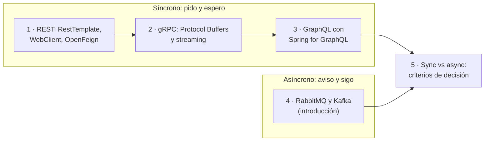
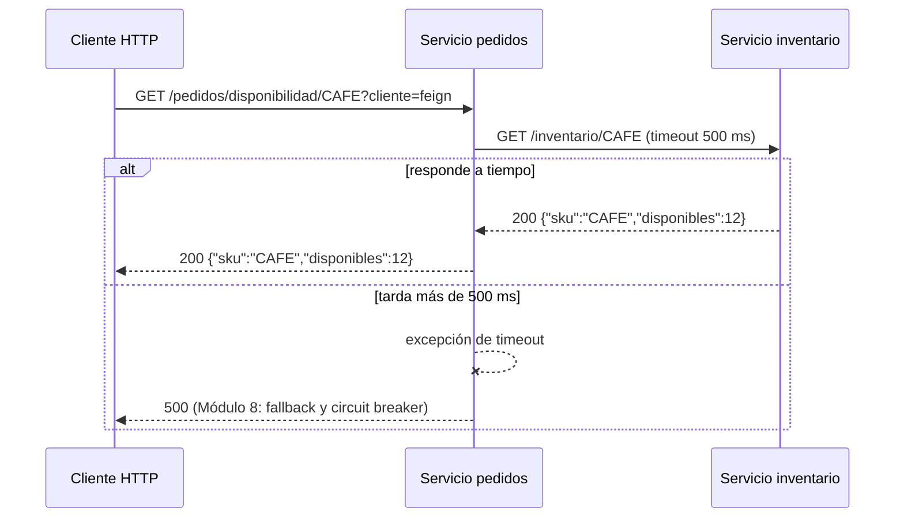
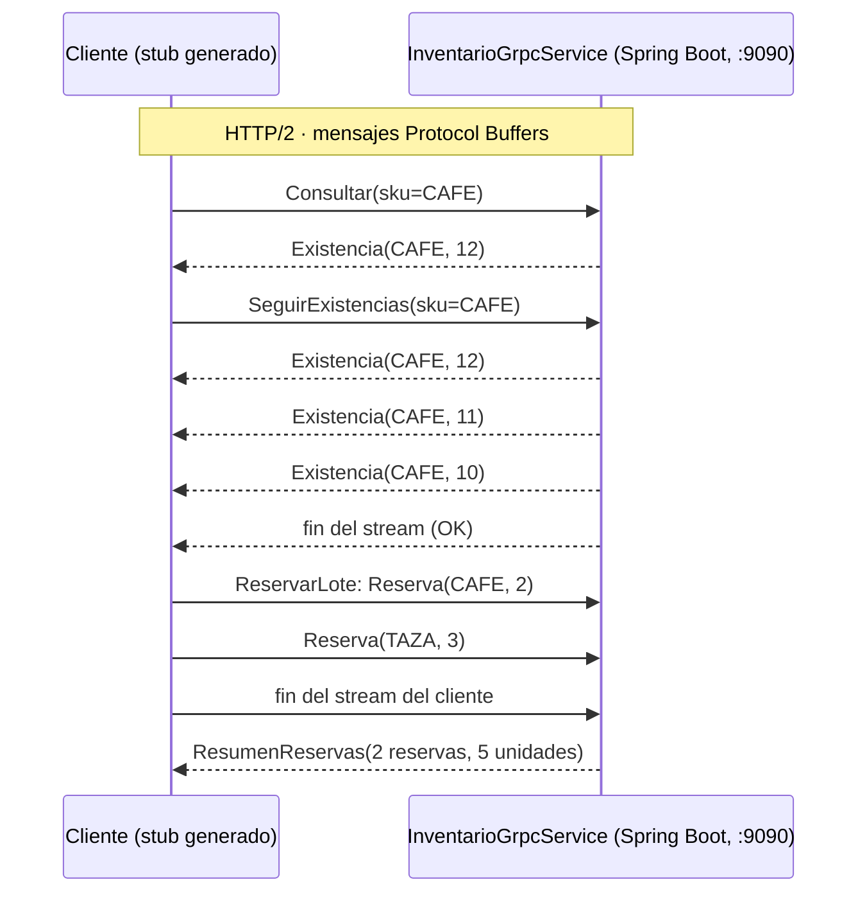
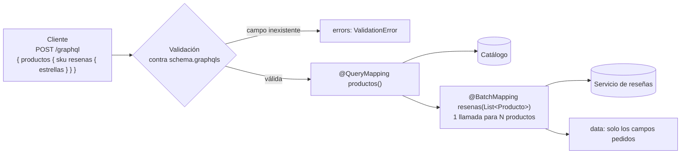
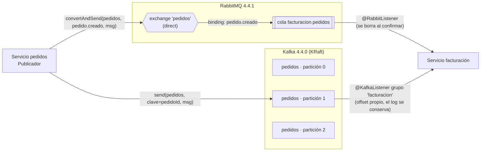
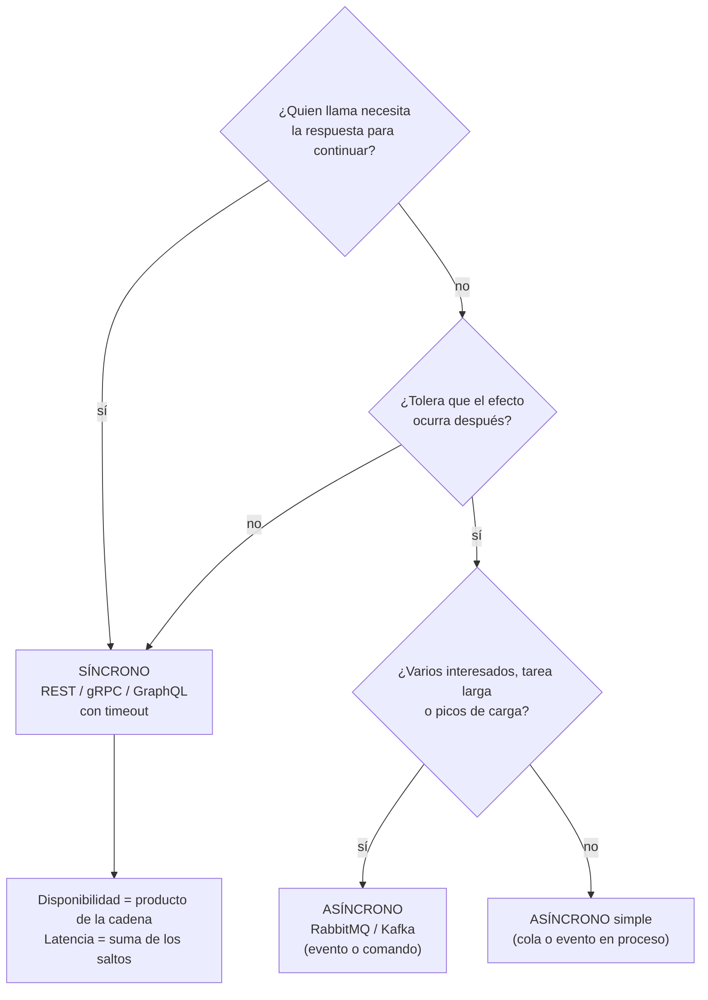

# Módulo 6 · Comunicación entre servicios

**Fase 1 · Spring Boot de cero a experto** (semanas 8 y 9 de 12). **Duración:** 13 h (5 temas de 2–3 h).
**Dificultad:** 3 de 5 (4 de 5 en gRPC y mensajería). **Dependencias:** Módulo 5 (contextos delimitados, eventos de
dominio, database-per-service), Spring MVC y testing (Módulos 2 y 3), Docker Compose (Módulo 0.5). **Herramientas:**
**JDK 25 LTS (25.0.5)**, **Spring Boot 4.1.3** (RestClient/RestTemplate, WebClient, gRPC nativo con Spring gRPC 1.1.2 y
grpc-java 1.84.1, Spring for GraphQL 2.0, Spring AMQP 4.1.3, Spring for Apache Kafka 4.1.3), **Spring Cloud 2025.1.4**
(OpenFeign), **RabbitMQ 4.4.1** y **Apache Kafka 4.4.0** en Docker Compose, y Gradle 9.9.2 mediante `./gradlew`.
Cuando un sistema se parte en servicios, las llamadas a métodos se vuelven **mensajes por la red**. Este módulo te da
las cinco herramientas para hacerlo y, sobre todo, el criterio para elegir: pedir algo y esperar la respuesta (REST,
gRPC, GraphQL) o avisar que algo pasó y seguir (RabbitMQ, Kafka).



**Texto alternativo:** mapa del módulo. El bloque «Síncrono: pido y espero» contiene, en orden, el tema 1 (REST con
RestTemplate, WebClient y OpenFeign), el tema 2 (gRPC) y el tema 3 (GraphQL). El bloque «Asíncrono: aviso y sigo»
contiene el tema 4 (RabbitMQ y Kafka). Los temas 3 y 4 llevan al tema 5, sync vs async: criterios de decisión.

---


### REST síncrono: RestTemplate, WebClient, OpenFeign

<details open>
<summary><strong>Capa 1 — Lectura</strong></summary>

#### ► DE QUÉ TRATA
Implementar la misma llamada entre servicios con RestTemplate, WebClient, OpenFeign y RestClient con @HttpExchange, configurar timeouts explícitos y explicar cómo cada cliente trata un 404 y una respuesta lenta; lo compruebas cuando ClientesRestTest pasa 3 de 3.

#### ► LA IDEA EN UNA FRASE
**Implementar la misma llamada entre servicios con RestTemplate, WebClient, OpenFeign y RestClient con @HttpExchange, configurar timeouts explícitos y explicar cómo cada cliente trata un 404 y una respuesta lenta; lo compruebas cuando ClientesRestTest pasa 3 de 3.**

#### ► POR QUÉ EXISTE ESTO
Cuando el servicio de pedidos necesita saber cuántas unidades quedan, le pregunta al servicio de inventario por HTTP, igual que tu navegador le pregunta a una página web. Es síncrono porque pedidos espera la respuesta antes de seguir.

#### ► LA ANALOGÍA
Piensa en rest síncrono: resttemplate, webclient, openfeign como una herramienta de taller: útil cuando conoces su propósito y sus límites.
**Dónde se rompe la analogía:** en software, los efectos dependen del contexto, la escala y los trade-offs.

#### ► CÓMO FUNCIONA


1. Cuando el servicio de pedidos necesita saber cuántas unidades quedan, le pregunta al servicio de inventario por HTTP, igual que tu navegador le pregunta a una página web.
2. Es síncrono porque pedidos espera la respuesta antes de seguir.

#### ► LO QUE PUEDE SALIR MAL
| Síntoma | Causa probable | Arreglo |
|---|---|---|
| REST síncrono: RestTemplate, WebClient, OpenFeign se aplica pero el resultado no mejora | Se usó sin medir el problema real | Mide antes y compara contra la alternativa simple |
| Aparece complejidad inesperada | Se adoptó la técnica sin comprender sus trade-offs | Vuelve a la sección de trade-offs y reduce el alcance |
| Falla en un caso límite | Se asumió un contexto que no se cumple | Prueba el caso límite y documenta cuándo NO usarlo |

#### ► TRADE-OFFS
| Opción | Cuándo usarla | Cuándo NO usarla |
|---|---|---|
| Usar REST síncrono: RestTemplate, WebClient, OpenFeign | Cuando el problema coincide con su propósito y el beneficio es observable | Cuando agrega complejidad sin resolver un problema real |
| Alternativa más simple | Cuando el contexto es pequeño, estable o fácil de razonar | Cuando ya demostró no escalar o no cumplir el requisito |
| Postergar la decisión | Cuando falta evidencia del problema | Cuando el costo de esperar es mayor que el costo de probar |

#### ► CUÁNDO NO USAR ESTO
Cadena de llamadas síncronas (*chatty services*):

#### ► DE VUELTA A LA ANALOGÍA
Volviendo a la analogía: rest síncrono: resttemplate, webclient, openfeign funciona como el modelo inicial, pero recuerda dónde se rompe: en producción importan la evidencia, la escala y el costo de equivocarte.

#### ► LO QUE DEBES RECORDAR
- Cuando el servicio de pedidos necesita saber cuántas unidades quedan, le pregunta al servicio de inventario por HTTP, igual que tu navegador le pregunta a una página web.
- Es síncrono porque pedidos espera la respuesta antes de seguir.

#### ► PREGUNTAS PARA PENSAR
1. ¿Qué problema concreto resuelve rest síncrono: resttemplate, webclient, openfeign en tu contexto?
2. ¿Cómo sabrías que rest síncrono: resttemplate, webclient, openfeign no está funcionando bien?
3. ¿Qué alternativa más simple considerarías antes de usar rest síncrono: resttemplate, webclient, openfeign?

</details>

<details>
<summary><strong>Capa 2 — Construcción</strong></summary>

#### Construcción guiada
1. Arranca el inventario falso (solo JDK) y compruébalo con `curl`:
   ```bash
   java inventario-falso/InventarioFalso.java 9091 &
   curl -s localhost:9091/inventario/CAFE; echo
   curl -s -o /dev/null -w "%{http_code}\n" localhost:9091/inventario/TE
   ```
2. Arranca el servicio de pedidos en otra terminal y pide lo mismo con los cuatro clientes:
   ```bash
   ../gradlew -q bootRun
   for c in resttemplate webclient feign httpexchange; do
     curl -s "localhost:8080/pedidos/disponibilidad/CAFE?cliente=$c"; echo "  <- $c"
   done
   ```
3. **Rómpelo a propósito:** pide el SKU lento, `curl -s -o /dev/null -w "%{http_code} en %{time_total}s\n"
   "localhost:8080/pedidos/disponibilidad/LENTO?cliente=feign"`, y repite con
   `INVENTARIO_URL=http://localhost:9999` (un puerto donde no hay nadie).

**Output esperado:**

Paso 1 (salida real con JDK 25.0.5; las dos primeras líneas son de `curl`, las demás del inventario falso):

```text
{"sku":"CAFE","disponibles":12}
404
Exception in thread "main" java.net.BindException: Address already in use
	at java.base/sun.nio.ch.Net.bind0(Native Method)
	at java.base/sun.nio.ch.Net.bind(Net.java:522)
	inventario: GET CAFE
inventario: GET TE
nelImpl.netBind(ServerSocketChannelImpl.java:335)
	at java.base/sun.nio.ch.ServerSocketChannelImpl.bind(ServerSocketChannelImpl.java:297)
	at java.base/sun.nio.ch.ServerSocketAdaptor.bind(ServerSocketAdaptor.java:80)
	at jdk.httpserver/sun.net.httpserver.ServerImpl.<init>(ServerImpl.java:147)
	at jdk.httpserver/sun.net.httpserver.HttpServerImpl.<init>(HttpServerImpl.java:45)
	at jdk.httpserver/sun.net.httpserver.DefaultHttpServerProvider.createHttpServer(DefaultHttpServerProvider.java:35)
	at jdk.httpserver/com.sun.net.httpserver.HttpServer.create(HttpServer.java:152)
	at InventarioFalso.main(InventarioFalso.java:16)
bash: line 1: kill: (25568) - No such process
```

- Paso 2: cuatro líneas iguales, `{"sku":"CAFE","disponibles":12}  <- resttemplate` y así con `webclient`, `feign` y
  `httpexchange`.
- Paso 3: `500 en 0.5…s`: la llamada se corta a los ~500 ms aunque el inventario tarda 2 s, y el log de pedidos
  muestra la excepción del cliente (con Feign, un `feign.RetryableException` por *read timeout*). Con el puerto vacío,
  la respuesta es 500 casi inmediata y el log muestra `Connection refused`.

**Captura comentada:** el tiempo del paso 3 es la prueba de que el timeout funciona: sin él, cada petición de un usuario
quedaría ocupando un hilo de pedidos durante los 2 s (o para siempre, si inventario se cuelga).

#### Código de referencia / ejecutable
Versiones: **JDK 25 LTS**, **Spring Boot 4.1.3** (Spring Framework 7.0.11, Jackson 3.1.8, Reactor Netty), **Spring Cloud
2025.1.4** (Spring Cloud OpenFeign 5.0.4; Spring Cloud Commons 5.0.4 declara compatibles Spring Boot 4.0.x y 4.1.x).
> **Build con Gradle (y su equivalencia en Maven).** Este laboratorio se construye con **Gradle 9.9.2** y Kotlin DSL
> mediante el wrapper `./gradlew` (no instalas Gradle). `settings.gradle.kts` lista los subproyectos (en Maven,
> `<modules>` del POM agregador), cada carpeta tiene su `build.gradle.kts` (su `pom.xml`) y
> `gradle/libs.versions.toml` es el **catálogo de versiones** (las `<properties>` y el `dependencyManagement`): por eso
> las dependencias se escriben `libs.…`. Equivalencias: `./mvnw test` → `./gradlew test` ·
> `./mvnw package -DskipTests` → `./gradlew bootJar` · `./mvnw spring-boot:run` → `./gradlew bootRun` ·
> `-Dtest=Clase` → `--tests Clase` · `target/` → `build/` (el jar queda en `build/libs/`). Gradle escribe una línea
> `PASSED` por test y termina con `BUILD SUCCESSFUL` (Maven: `Tests run: N` y `BUILD SUCCESS`).

`modulo-10/settings.gradle.kts`:

```kotlin
// Módulo 6 (modulo-10) · Build multi-proyecto: "./gradlew test" ejecuta los tests de todos los subproyectos.
// Cada carpeta tiene su propio build.gradle.kts; las versiones viven en gradle/libs.versions.toml
// (catálogo "libs"). Equivale al POM agregador con <modules> de Maven.
pluginManagement {
    repositories {
        gradlePluginPortal()
        mavenCentral()
    }
}
// Sin esto, un alumno sin JDK 25 instalado ve el build morir en la configuración, antes de cualquier test.
plugins {
    id("org.gradle.toolchains.foojay-resolver-convention") version "1.0.0"
}


dependencyResolutionManagement {
    repositories {
        mavenCentral()
    }
}

rootProject.name = "modulo-10-laboratorios"

include(
    "f047-rest-sincrono",
    "f048-grpc",
    "f049-graphql",
    "f050-mensajeria",
    "f051-sync-async",
)
```

`modulo-10/gradle/libs.versions.toml`:

```toml
# Módulo 6 (modulo-10)
# Catálogo de versiones del laboratorio: una sola fuente para plugins y librerías.
# Las librerías SIN versión las fija el BOM de Spring Boot (spring-boot-dependencies) o el BOM que importe el proyecto.

[versions]
# Plugin de Protobuf que usa la documentación de Spring Boot 4.1 (reference/io/grpc.html)
protobuf-plugin = "0.9.6"
spring-boot = "4.1.3"
# Spring Cloud 2025.1.4: su verificador de compatibilidad acepta Spring Boot 4.0.x y 4.1.x (trae OpenFeign 5.0.4)
spring-cloud = "2025.1.4"

[libraries]
spring-boot-starter-webmvc = { module = "org.springframework.boot:spring-boot-starter-webmvc" }
spring-boot-starter-restclient = { module = "org.springframework.boot:spring-boot-starter-restclient" }
spring-boot-starter-webclient = { module = "org.springframework.boot:spring-boot-starter-webclient" }
spring-cloud-starter-openfeign = { module = "org.springframework.cloud:spring-cloud-starter-openfeign" }
spring-boot-starter-webmvc-test = { module = "org.springframework.boot:spring-boot-starter-webmvc-test" }
junit-platform-launcher = { module = "org.junit.platform:junit-platform-launcher" }
spring-boot-starter-grpc-server = { module = "org.springframework.boot:spring-boot-starter-grpc-server" }
spring-boot-starter-grpc-client = { module = "org.springframework.boot:spring-boot-starter-grpc-client" }
spring-boot-starter-grpc-client-test = { module = "org.springframework.boot:spring-boot-starter-grpc-client-test" }
spring-boot-starter-graphql = { module = "org.springframework.boot:spring-boot-starter-graphql" }
spring-boot-starter-graphql-test = { module = "org.springframework.boot:spring-boot-starter-graphql-test" }
spring-boot-starter-amqp = { module = "org.springframework.boot:spring-boot-starter-amqp" }
spring-boot-starter-kafka = { module = "org.springframework.boot:spring-boot-starter-kafka" }
spring-boot-starter-test = { module = "org.springframework.boot:spring-boot-starter-test" }

[plugins]
spring-boot = { id = "org.springframework.boot", version.ref = "spring-boot" }
spring-dependency-management = { id = "io.spring.dependency-management", version = "1.1.7" }
protobuf = { id = "com.google.protobuf", version.ref = "protobuf-plugin" }
```

`f047-rest-sincrono/build.gradle.kts`:

```kotlin
// F047 · REST síncrono: RestTemplate, WebClient, OpenFeign (y RestClient + @HttpExchange)
plugins {
    java
    alias(libs.plugins.spring.boot)
    alias(libs.plugins.spring.dependency.management)
}

group = "academia.microservicios"
version = "1.0.0"

java {
    toolchain {
        languageVersion = JavaLanguageVersion.of(25)
    }
}

dependencyManagement {
    imports {
        mavenBom("org.springframework.cloud:spring-cloud-dependencies:${libs.versions.spring.cloud.get()}")
    }
}

dependencies {
    // Servidor MVC (el servicio de pedidos expone su propia API)
    implementation(libs.spring.boot.starter.webmvc)
    // RestTemplateBuilder, RestClient.Builder y clientes @HttpExchange
    implementation(libs.spring.boot.starter.restclient)
    // WebClient.Builder (Reactor Netty)
    implementation(libs.spring.boot.starter.webclient)
    // OpenFeign declarativo
    implementation(libs.spring.cloud.starter.openfeign)
    testImplementation(libs.spring.boot.starter.webmvc.test)
    // Gradle 9 exige declarar el lanzador de JUnit Platform (ya no lo añade por su cuenta)
    testRuntimeOnly(libs.junit.platform.launcher)
}

tasks.withType<Test> {
    useJUnitPlatform()
    testLogging {
        events("passed", "skipped", "failed")   // una línea por test en la consola
        // el mensaje completo de cada fallo (valor esperado y obtenido), no solo el tipo de excepción
        exceptionFormat = org.gradle.api.tasks.testing.logging.TestExceptionFormat.FULL
    }
}
```

`src/main/resources/application.properties`:

```properties
spring.application.name=pedidos
server.port=${PORT:8080}
# Dónde está el servicio de inventario (llega del entorno en producción).
inventario.url=${INVENTARIO_URL:http://localhost:9091}
# Timeouts: SIEMPRE explícitos en una llamada entre servicios.
inventario.timeout=500ms
# OpenFeign: timeouts del cliente llamado "inventario" (milisegundos).
spring.cloud.openfeign.client.config.inventario.connect-timeout=500
spring.cloud.openfeign.client.config.inventario.read-timeout=500
# RestClient + @HttpExchange: el grupo "inventario" se configura con propiedades.
spring.http.serviceclient.inventario.base-url=${inventario.url}
spring.http.serviceclient.inventario.read-timeout=500ms
```

`src/main/java/academia/rest/Existencia.java` y `PedidosApp.java`:

```java
package academia.rest;

/** Lo que responde inventario: {"sku":"CAFE","disponibles":12}. Jackson 3 lo convierte en este record. */
public record Existencia(String sku, int disponibles) {
}
```

```java
package academia.rest;

import org.springframework.boot.SpringApplication;
import org.springframework.boot.autoconfigure.SpringBootApplication;
import org.springframework.cloud.openfeign.EnableFeignClients;
import org.springframework.web.service.registry.ImportHttpServices;

@SpringBootApplication
@EnableFeignClients
@ImportHttpServices(group = "inventario", types = InventarioHttp.class)
public class PedidosApp {

    public static void main(String[] args) {
        SpringApplication.run(PedidosApp.class, args);
    }
}
```

Los cuatro clientes · `ClienteRestTemplate.java`, `ClienteWebClient.java`, `ClienteFeign.java` e `InventarioHttp.java`:

```java
package academia.rest;

import java.time.Duration;
import org.springframework.beans.factory.annotation.Value;
import org.springframework.boot.restclient.RestTemplateBuilder;
import org.springframework.stereotype.Component;
import org.springframework.web.client.RestTemplate;

/** 1. RestTemplate: síncrono, API de métodos (getForObject...). En mantenimiento: no recibe funciones nuevas. */
@Component
public class ClienteRestTemplate {

    private final RestTemplate rest;

    public ClienteRestTemplate(RestTemplateBuilder builder, @Value("${inventario.url}") String url,
            @Value("${inventario.timeout}") Duration timeout) {
        this.rest = builder.baseUri(url).connectTimeout(timeout).readTimeout(timeout).build();
    }

    public Existencia consultar(String sku) {
        return rest.getForObject("/inventario/{sku}", Existencia.class, sku);
    }
}
```

```java
package academia.rest;

import java.time.Duration;
import org.springframework.beans.factory.annotation.Value;
import org.springframework.stereotype.Component;
import org.springframework.web.reactive.function.client.WebClient;
import reactor.core.publisher.Mono;

/** 2. WebClient: no bloqueante. Devuelve un Mono: la respuesta llega «después», sin ocupar un hilo esperando. */
@Component
public class ClienteWebClient {

    private final WebClient web;
    private final Duration timeout;

    public ClienteWebClient(WebClient.Builder builder, @Value("${inventario.url}") String url,
            @Value("${inventario.timeout}") Duration timeout) {
        this.web = builder.baseUrl(url).build();
        this.timeout = timeout;
    }

    public Mono<Existencia> consultar(String sku) {
        return web.get().uri("/inventario/{sku}", sku)
                .retrieve()
                .bodyToMono(Existencia.class)
                .timeout(timeout);
    }
}
```

```java
package academia.rest;

import org.springframework.cloud.openfeign.FeignClient;
import org.springframework.web.bind.annotation.GetMapping;
import org.springframework.web.bind.annotation.PathVariable;

/** 3. OpenFeign: declaras una interfaz y Spring Cloud genera la implementación HTTP. */
@FeignClient(name = "inventario", url = "${inventario.url}")
public interface ClienteFeign {

    @GetMapping("/inventario/{sku}")
    Existencia consultar(@PathVariable("sku") String sku);
}
```

```java
package academia.rest;

import org.springframework.web.bind.annotation.PathVariable;
import org.springframework.web.service.annotation.GetExchange;

/** 4. Interfaz HTTP de Spring Framework 7 (@HttpExchange) sobre RestClient: la opción recomendada para código nuevo. */
public interface InventarioHttp {

    @GetExchange("/inventario/{sku}")
    Existencia consultar(@PathVariable String sku);
}
```

`src/main/java/academia/rest/DisponibilidadController.java`:

```java
package academia.rest;

import org.springframework.web.bind.annotation.GetMapping;
import org.springframework.web.bind.annotation.PathVariable;
import org.springframework.web.bind.annotation.RequestParam;
import org.springframework.web.bind.annotation.RestController;

/** GET /pedidos/disponibilidad/CAFE?cliente=resttemplate|webclient|feign|httpexchange */
@RestController
class DisponibilidadController {

    private final ClienteRestTemplate restTemplate;
    private final ClienteWebClient webClient;
    private final ClienteFeign feign;
    private final InventarioHttp httpExchange;

    DisponibilidadController(ClienteRestTemplate restTemplate, ClienteWebClient webClient, ClienteFeign feign,
            InventarioHttp httpExchange) {
        this.restTemplate = restTemplate;
        this.webClient = webClient;
        this.feign = feign;
        this.httpExchange = httpExchange;
    }

    @GetMapping("/pedidos/disponibilidad/{sku}")
    Existencia disponibilidad(@PathVariable String sku, @RequestParam(defaultValue = "resttemplate") String cliente) {
        return switch (cliente) {
            case "resttemplate" -> restTemplate.consultar(sku);
            // block() solo porque este controlador es MVC (bloqueante); en WebFlux devolverías el Mono.
            case "webclient" -> webClient.consultar(sku).block();
            case "feign" -> feign.consultar(sku);
            case "httpexchange" -> httpExchange.consultar(sku);
            default -> throw new IllegalArgumentException("cliente desconocido: " + cliente);
        };
    }
}
```

Inventario de mentira para el laboratorio manual · `inventario-falso/InventarioFalso.java`:

```java
import com.sun.net.httpserver.HttpServer;
import java.net.InetSocketAddress;
import java.nio.charset.StandardCharsets;

/**
 * Inventario de mentira para el laboratorio F047 (Java puro, sin dependencias).
 * Uso: java InventarioFalso.java [puerto]   (por defecto 9091)
 *   GET /inventario/CAFE  -> 200 {"sku":"CAFE","disponibles":12}
 *   GET /inventario/LENTO -> tarda 2 s (para probar timeouts)
 *   GET /inventario/otro  -> 404
 */
public class InventarioFalso {

    public static void main(String[] args) throws Exception {
        int puerto = args.length > 0 ? Integer.parseInt(args[0]) : 9091;
        HttpServer servidor = HttpServer.create(new InetSocketAddress("127.0.0.1", puerto), 0);
        servidor.createContext("/inventario/", ex -> {
            String sku = ex.getRequestURI().getPath().substring("/inventario/".length());
            System.out.println("inventario: GET " + sku);
            if (sku.equals("LENTO")) {
                try {
                    Thread.sleep(2_000);
                } catch (InterruptedException e) {
                    Thread.currentThread().interrupt();
                }
            }
            int codigo = sku.equals("CAFE") || sku.equals("LENTO") ? 200 : 404;
            String cuerpo = codigo == 200 ? "{\"sku\":\"" + sku + "\",\"disponibles\":12}" : "{\"error\":\"no existe\"}";
            byte[] bytes = cuerpo.getBytes(StandardCharsets.UTF_8);
            ex.getResponseHeaders().set("Content-Type", "application/json");
            ex.sendResponseHeaders(codigo, bytes.length);
            ex.getResponseBody().write(bytes);
            ex.close();
        });
        servidor.start();
        System.out.println("Inventario falso escuchando en http://127.0.0.1:" + puerto);
    }
}
```

#### Verificación
```bash
../gradlew test
```

`src/test/java/academia/rest/ClientesRestTest.java`:

```java
package academia.rest;

import static org.assertj.core.api.Assertions.assertThat;
import static org.assertj.core.api.Assertions.assertThatThrownBy;

import com.sun.net.httpserver.HttpServer;
import feign.FeignException;
import java.io.IOException;
import java.net.InetSocketAddress;
import java.nio.charset.StandardCharsets;
import java.util.concurrent.TimeoutException;
import org.junit.jupiter.api.AfterAll;
import org.junit.jupiter.api.Test;
import org.springframework.beans.factory.annotation.Autowired;
import org.springframework.boot.test.context.SpringBootTest;
import org.springframework.test.context.DynamicPropertyRegistry;
import org.springframework.test.context.DynamicPropertySource;
import org.springframework.web.client.HttpClientErrorException;
import org.springframework.web.client.ResourceAccessException;

/** Un inventario de mentira en un puerto libre; los cuatro clientes reales lo consultan. */
@SpringBootTest
class ClientesRestTest {

    static final HttpServer INVENTARIO = arrancarInventario();

    static HttpServer arrancarInventario() {
        try {
            HttpServer s = HttpServer.create(new InetSocketAddress("127.0.0.1", 0), 0);
            s.createContext("/inventario/", ex -> {
                String sku = ex.getRequestURI().getPath().substring("/inventario/".length());
                if (sku.equals("LENTO")) {
                    try {
                        Thread.sleep(2_000);
                    } catch (InterruptedException e) {
                        Thread.currentThread().interrupt();
                    }
                }
                int codigo = sku.equals("NO-EXISTE") ? 404 : 200;
                byte[] cuerpo = ("{\"sku\":\"" + sku + "\",\"disponibles\":12}").getBytes(StandardCharsets.UTF_8);
                ex.getResponseHeaders().set("Content-Type", "application/json");
                ex.sendResponseHeaders(codigo, cuerpo.length);
                ex.getResponseBody().write(cuerpo);
                ex.close();
            });
            s.start();
            return s;
        } catch (IOException e) {
            throw new IllegalStateException(e);
        }
    }

    @DynamicPropertySource
    static void url(DynamicPropertyRegistry registro) {
        registro.add("inventario.url", () -> "http://127.0.0.1:" + INVENTARIO.getAddress().getPort());
    }

    @AfterAll
    static void apagar() {
        INVENTARIO.stop(0);
    }

    @Autowired ClienteRestTemplate restTemplate;
    @Autowired ClienteWebClient webClient;
    @Autowired ClienteFeign feign;
    @Autowired InventarioHttp httpExchange;

    @Test
    void losCuatroClientesObtienenLaMismaRespuesta() {
        var esperado = new Existencia("CAFE", 12);
        assertThat(restTemplate.consultar("CAFE")).isEqualTo(esperado);
        assertThat(webClient.consultar("CAFE").block()).isEqualTo(esperado);
        assertThat(feign.consultar("CAFE")).isEqualTo(esperado);
        assertThat(httpExchange.consultar("CAFE")).isEqualTo(esperado);
    }

    @Test
    void un404SeConvierteEnUnaExcepcionDistintaEnCadaCliente() {
        assertThatThrownBy(() -> restTemplate.consultar("NO-EXISTE")).isInstanceOf(HttpClientErrorException.NotFound.class);
        assertThatThrownBy(() -> feign.consultar("NO-EXISTE")).isInstanceOf(FeignException.NotFound.class);
        assertThatThrownBy(() -> httpExchange.consultar("NO-EXISTE")).isInstanceOf(HttpClientErrorException.NotFound.class);
    }

    @Test
    void elTimeoutCortaLaEsperaEnVezDeColgarAlLlamador() {
        assertThatThrownBy(() -> restTemplate.consultar("LENTO")).isInstanceOf(ResourceAccessException.class);
        assertThatThrownBy(() -> webClient.consultar("LENTO").block()).hasRootCauseInstanceOf(TimeoutException.class);
        assertThatThrownBy(() -> feign.consultar("LENTO")).isInstanceOf(FeignException.class);
    }
}
```

**Output esperado:** 3 líneas `PASSED` (una por test) y `BUILD SUCCESSFUL` *(salida de Gradle verificada en el Mac del dueño el 2026-11-21 con Gradle 9.9.2, Java 25.0.5.1 autoaprovisto y Docker Compose v5.7.1)*. **Pregunta de
comprobación:** ¿por qué el test de timeout de WebClient usa `hasRootCauseInstanceOf(TimeoutException.class)` y no
`isInstanceOf`? *(Porque `block()` envuelve la excepción comprobada `TimeoutException` del `Mono` en una excepción no
comprobada; la causa original queda dentro.)*

</details>

### gRPC: Protocol Buffers, servicios, streaming

<details open>
<summary><strong>Capa 1 — Lectura</strong></summary>

#### ► DE QUÉ TRATA
Definir un contrato en Protocol Buffers con una llamada unaria, una de *streaming* del servidor y una de *streaming* del cliente, implementarlo con el soporte gRPC de Spring Boot 4.1 y explicar por qué los números de campo son el contrato; lo compruebas cuando InventarioGrpcTest…

#### ► LA IDEA EN UNA FRASE
**Definir un contrato en Protocol Buffers con una llamada unaria, una de *streaming* del servidor y una de *streaming* del cliente, implementarlo con el soporte gRPC de Spring Boot 4.1 y explicar por qué los números de campo son el contrato; lo compruebas cuando InventarioGrpcTest pasa 4 de 4 y demo-binario.sh muestra el mensaje de 8 bytes.**

#### ► POR QUÉ EXISTE ESTO
gRPC es otra forma de que un servicio le pida algo a otro, creada por Google. En lugar de escribir URLs y JSON a mano, escribes un contrato en un archivo .proto: qué funciones ofrece el servicio y qué datos lleva cada mensaje. Una herramienta (protoc) genera el código del cliente y del servidor a partir de ese archivo.

#### ► LA ANALOGÍA
Piensa en grpc: protocol buffers, servicios, streaming como una herramienta de taller: útil cuando conoces su propósito y sus límites.
**Dónde se rompe la analogía:** en software, los efectos dependen del contexto, la escala y los trade-offs.

#### ► CÓMO FUNCIONA


1. gRPC es otra forma de que un servicio le pida algo a otro, creada por Google.
2. En lugar de escribir URLs y JSON a mano, escribes un contrato en un archivo .proto: qué funciones ofrece el servicio y qué datos lleva cada mensaje.
3. Una herramienta (protoc) genera el código del cliente y del servidor a partir de ese archivo.

#### ► LO QUE PUEDE SALIR MAL
| Síntoma | Causa probable | Arreglo |
|---|---|---|
| gRPC: Protocol Buffers, servicios, streaming se aplica pero el resultado no mejora | Se usó sin medir el problema real | Mide antes y compara contra la alternativa simple |
| Aparece complejidad inesperada | Se adoptó la técnica sin comprender sus trade-offs | Vuelve a la sección de trade-offs y reduce el alcance |
| Falla en un caso límite | Se asumió un contexto que no se cumple | Prueba el caso límite y documenta cuándo NO usarlo |

#### ► TRADE-OFFS
| Opción | Cuándo usarla | Cuándo NO usarla |
|---|---|---|
| Usar gRPC: Protocol Buffers, servicios, streaming | Cuando el problema coincide con su propósito y el beneficio es observable | Cuando agrega complejidad sin resolver un problema real |
| Alternativa más simple | Cuando el contexto es pequeño, estable o fácil de razonar | Cuando ya demostró no escalar o no cumplir el requisito |
| Postergar la decisión | Cuando falta evidencia del problema | Cuando el costo de esperar es mayor que el costo de probar |

#### ► CUÁNDO NO USAR ESTO
Reutilizar o renumerar campos del .proto:

#### ► DE VUELTA A LA ANALOGÍA
Volviendo a la analogía: grpc: protocol buffers, servicios, streaming funciona como el modelo inicial, pero recuerda dónde se rompe: en producción importan la evidencia, la escala y el costo de equivocarte.

#### ► LO QUE DEBES RECORDAR
- gRPC es otra forma de que un servicio le pida algo a otro, creada por Google.
- En lugar de escribir URLs y JSON a mano, escribes un contrato en un archivo .proto: qué funciones ofrece el servicio y qué datos lleva cada mensaje.
- Una herramienta (protoc) genera el código del cliente y del servidor a partir de ese archivo.

#### ► PREGUNTAS PARA PENSAR
1. ¿Qué problema concreto resuelve grpc: protocol buffers, servicios, streaming en tu contexto?
2. ¿Cómo sabrías que grpc: protocol buffers, servicios, streaming no está funcionando bien?
3. ¿Qué alternativa más simple considerarías antes de usar grpc: protocol buffers, servicios, streaming?

</details>

<details>
<summary><strong>Capa 2 — Construcción</strong></summary>

#### Código de referencia / ejecutable
Versiones: **JDK 25 LTS**, **Spring Boot 4.1.3** (soporte gRPC nativo desde 4.1: Spring gRPC 1.1.2, grpc-java 1.84.1,
Protobuf Java 4.36.2, gestionados por el BOM; plugin de Gradle `com.google.protobuf` 0.9.6). `f048-grpc/build.gradle.kts`:

```kotlin
// F048 · gRPC: Protocol Buffers, servicios, streaming (soporte gRPC nativo de Spring Boot 4.1)
plugins {
    java
    alias(libs.plugins.spring.boot)
    alias(libs.plugins.spring.dependency.management)
    // Genera las clases Java desde src/main/proto. El plugin de Boot reacciona a este plugin y fija protoc
    // (protobuf-java 4.36.2) y protoc-gen-grpc-java (grpc-java 1.84.1): aquí solo se activa.
    alias(libs.plugins.protobuf)
}

group = "academia.microservicios"
version = "1.0.0"

java {
    toolchain {
        languageVersion = JavaLanguageVersion.of(25)
    }
}

dependencies {
    // Servidor gRPC (Netty, grpc-java 1.84.1, Spring gRPC 1.1.2, reflexión y health)
    implementation(libs.spring.boot.starter.grpc.server)
    // Cliente gRPC (GrpcChannelFactory) para la consola y los tests
    implementation(libs.spring.boot.starter.grpc.client)
    // @AutoConfigureTestGrpcTransport: servidor y canal en proceso para los tests
    testImplementation(libs.spring.boot.starter.grpc.client.test)
    // Gradle 9 exige declarar el lanzador de JUnit Platform (ya no lo añade por su cuenta)
    testRuntimeOnly(libs.junit.platform.launcher)
}

tasks.withType<Test> {
    useJUnitPlatform()
    testLogging {
        events("passed", "skipped", "failed")   // una línea por test en la consola
        // el mensaje completo de cada fallo (valor esperado y obtenido), no solo el tipo de excepción
        exceptionFormat = org.gradle.api.tasks.testing.logging.TestExceptionFormat.FULL
    }
}

protobuf {
    plugins {
        create("grpc")   // activa el generador de stubs gRPC; artefacto y versión los pone el plugin de Boot
    }
}

// ../gradlew -q bootRun -Pprincipal=academia.grpc.ClienteDeConsola arranca otra clase con main
// (en Maven: -Dspring-boot.run.main-class=...). Sin la propiedad, Boot busca la clase @SpringBootApplication.
springBoot {
    providers.gradleProperty("principal").orNull?.let { mainClass = it }
}
```

Contrato · `src/main/proto/inventario.proto`:

```protobuf
// F048 · Contrato del servicio de inventario. Es la fuente de verdad: cliente y servidor se generan desde aquí.
syntax = "proto3";

package academia.inventario.v1;

option java_multiple_files = true;
option java_package = "academia.grpc.proto";

service Inventario {
  // Unario: una petición, una respuesta.
  rpc Consultar (ConsultaRequest) returns (Existencia);
  // Streaming del servidor: una petición, varias respuestas en el tiempo.
  rpc SeguirExistencias (ConsultaRequest) returns (stream Existencia);
  // Streaming del cliente: muchas peticiones, una respuesta al final.
  rpc ReservarLote (stream Reserva) returns (ResumenReservas);
}

message ConsultaRequest {
  string sku = 1;
}

message Existencia {
  string sku = 1;          // el número (1, 2...) es la identidad del campo en el binario: no lo cambies nunca
  int32 disponibles = 2;
}

message Reserva {
  string sku = 1;
  int32 cantidad = 2;
}

message ResumenReservas {
  int32 reservas = 1;
  int32 unidades = 2;
}
```

`src/main/resources/application.properties`:

```properties
spring.application.name=inventario-grpc
# Puerto del servidor gRPC (HTTP/2). La reflexión está activa por defecto: grpcurl puede listar servicios.
spring.grpc.server.port=9090
```

`src/main/java/academia/grpc/GrpcApp.java` e `InventarioGrpcService.java`:

```java
package academia.grpc;

import org.springframework.boot.SpringApplication;
import org.springframework.boot.autoconfigure.SpringBootApplication;

@SpringBootApplication
public class GrpcApp {

    public static void main(String[] args) {
        SpringApplication.run(GrpcApp.class, args);
    }
}
```

```java
package academia.grpc;

import academia.grpc.proto.ConsultaRequest;
import academia.grpc.proto.Existencia;
import academia.grpc.proto.InventarioGrpc;
import academia.grpc.proto.Reserva;
import academia.grpc.proto.ResumenReservas;
import io.grpc.Status;
import io.grpc.stub.StreamObserver;
import java.util.Map;
import java.util.concurrent.ConcurrentHashMap;
import org.springframework.stereotype.Service;

/** Implementación del servicio: Spring Boot registra cualquier bean BindableService en el servidor gRPC. */
@Service
public class InventarioGrpcService extends InventarioGrpc.InventarioImplBase {

    private final Map<String, Integer> stock = new ConcurrentHashMap<>(Map.of("CAFE", 12, "TAZA", 4));

    @Override
    public void consultar(ConsultaRequest peticion, StreamObserver<Existencia> respuesta) {
        Integer disponibles = stock.get(peticion.getSku());
        if (disponibles == null) {
            // Los errores viajan como Status (no como HTTP 404): NOT_FOUND + descripción.
            respuesta.onError(Status.NOT_FOUND.withDescription("sku desconocido: " + peticion.getSku())
                    .asRuntimeException());
            return;
        }
        respuesta.onNext(Existencia.newBuilder().setSku(peticion.getSku()).setDisponibles(disponibles).build());
        respuesta.onCompleted();
    }

    @Override
    public void seguirExistencias(ConsultaRequest peticion, StreamObserver<Existencia> respuesta) {
        // Simula tres cambios de stock enviados por el MISMO canal, uno detrás de otro.
        int actual = stock.getOrDefault(peticion.getSku(), 0);
        for (int i = 0; i < 3; i++) {
            respuesta.onNext(Existencia.newBuilder().setSku(peticion.getSku()).setDisponibles(actual - i).build());
        }
        respuesta.onCompleted();
    }

    @Override
    public StreamObserver<Reserva> reservarLote(StreamObserver<ResumenReservas> respuesta) {
        // El cliente envía reservas una a una; respondemos una sola vez cuando él termina (onCompleted).
        return new StreamObserver<>() {
            int reservas;
            int unidades;

            @Override
            public void onNext(Reserva reserva) {
                reservas++;
                unidades += reserva.getCantidad();
            }

            @Override
            public void onError(Throwable error) {
                // El cliente canceló: no hay a quién responder.
            }

            @Override
            public void onCompleted() {
                respuesta.onNext(ResumenReservas.newBuilder().setReservas(reservas).setUnidades(unidades).build());
                respuesta.onCompleted();
            }
        };
    }
}
```

Cliente de consola · `src/main/java/academia/grpc/ClienteDeConsola.java`:

```java
package academia.grpc;

import academia.grpc.proto.ConsultaRequest;
import academia.grpc.proto.InventarioGrpc;
import io.grpc.ManagedChannel;
import io.grpc.ManagedChannelBuilder;
import io.grpc.StatusRuntimeException;
import java.util.concurrent.TimeUnit;

/**
 * Cliente gRPC mínimo (sin Spring) contra el servidor en localhost:9090.
 * Ejecuta: ./gradlew -q bootRun -Pprincipal=academia.grpc.ClienteDeConsola
 */
public final class ClienteDeConsola {

    public static void main(String[] args) throws InterruptedException {
        ManagedChannel canal = ManagedChannelBuilder.forAddress("localhost", 9090).usePlaintext().build();
        try {
            // Deadline: el cliente decide cuánto está dispuesto a esperar (aquí, 2 segundos).
            var stub = InventarioGrpc.newBlockingStub(canal).withDeadlineAfter(2, TimeUnit.SECONDS);
            var existencia = stub.consultar(ConsultaRequest.newBuilder().setSku("CAFE").build());
            System.out.println("Unario   -> " + existencia.getSku() + " = " + existencia.getDisponibles());
            stub.seguirExistencias(ConsultaRequest.newBuilder().setSku("CAFE").build())
                .forEachRemaining(e -> System.out.println("Stream   -> " + e.getSku() + " = " + e.getDisponibles()));
            try {
                stub.consultar(ConsultaRequest.newBuilder().setSku("TE").build());
            } catch (StatusRuntimeException e) {
                System.out.println("Error    -> " + e.getStatus().getCode() + ": " + e.getStatus().getDescription());
            }
        } finally {
            canal.shutdown().awaitTermination(2, TimeUnit.SECONDS);
        }
    }
}
```

Demostración del binario · `protobuf/demo-binario.sh` (no necesita paquetes globales de Python: usa `protoc` del PATH,
el que descargó `../gradlew compileJava` en `~/.gradle` o un entorno virtual propio en `protobuf/.venv`) y el contrato «roto»
`protobuf/inventario-v2-roto.proto`:

```bash
#!/usr/bin/env bash
# F048 · Cómo se ve un mensaje Protocol Buffers en el cable, y qué pasa si cambias los números de campo.
# Busca protoc en este orden, sin depender de paquetes globales de Python:
#   1. `protoc` en el PATH (por ejemplo, `brew install protobuf`).
#   2. El protoc que descargó el build de Gradle de f048-grpc (plugin com.google.protobuf) en ~/.gradle.
#   3. Un entorno virtual propio en protobuf/.venv con grpcio-tools 1.84.1 (tiene ruedas para Python 3.10 a 3.15).
set -euo pipefail
cd "$(dirname "$0")/.."
TMP=$(mktemp -d); trap 'rm -rf "$TMP"' EXIT

buscar_protoc_de_gradle() {
  local so arq
  case "$(uname -s)" in Darwin) so=osx ;; Linux) so=linux ;; *) return 1 ;; esac
  case "$(uname -m)" in arm64|aarch64) arq=aarch_64 ;; x86_64|amd64) arq=x86_64 ;; *) return 1 ;; esac
  # protobuf-java 4.36.2 (BOM de Spring Boot 4.1.3) -> com.google.protobuf:protoc:4.36.2:exe:<so>-<arq>
  # La caché de Gradle guarda cada archivo en una carpeta con su hash: se busca por nombre
  local cache="${GRADLE_USER_HOME:-${HOME}/.gradle}/caches/modules-2/files-2.1/com.google.protobuf/protoc/4.36.2"
  [ -d "$cache" ] || return 1
  local exe
  exe=$(find "$cache" -name "protoc-4.36.2-${so}-${arq}.exe" | head -1)
  [ -n "$exe" ] || return 1
  cp "$exe" "$TMP/protoc" && chmod +x "$TMP/protoc"   # se copia para darle permiso de ejecución sin tocar la caché
  echo "$TMP/protoc"
}

if command -v protoc >/dev/null; then
  PROTOC=(protoc)
elif P=$(buscar_protoc_de_gradle); then
  PROTOC=("$P")
else
  VENV=protobuf/.venv
  if [ ! -x "$VENV/bin/python" ]; then
    echo "== Creando $VENV con grpcio-tools 1.84.1 (solo la primera vez)"
    python3 -m venv "$VENV"
    "$VENV/bin/python" -m pip install -q grpcio-tools==1.84.1
  fi
  PROTOC=("$VENV/bin/python" -m grpc_tools.protoc)
fi
echo "== protoc: $("${PROTOC[@]}" --version)"

MSG='sku: "CAFE"
disponibles: 12'
BIN="$TMP/existencia.bin"
echo "$MSG" | "${PROTOC[@]}" -I src/main/proto --encode=academia.inventario.v1.Existencia src/main/proto/inventario.proto > "$BIN"
echo "== Bytes en el cable ($(wc -c < "$BIN" | tr -d ' ') bytes):"
od -An -tx1 "$BIN"
echo "== El mismo dato en JSON ($(printf '{"sku":"CAFE","disponibles":12}' | wc -c | tr -d ' ') bytes):"
echo '{"sku":"CAFE","disponibles":12}'
echo "== Leído con el contrato correcto:"
"${PROTOC[@]}" -I src/main/proto --decode=academia.inventario.v1.Existencia src/main/proto/inventario.proto < "$BIN"
echo "== Leído con el contrato v2 (números cambiados): sku y disponibles quedan vacíos, todo va a campos desconocidos"
"${PROTOC[@]}" -I protobuf --decode=academia.inventario.v1.Existencia protobuf/inventario-v2-roto.proto < "$BIN"
```

```protobuf
// F048 · Error común: alguien «ordenó» los campos y cambió sus NÚMEROS. Compila, pero rompe el contrato.
syntax = "proto3";

package academia.inventario.v1;

message Existencia {
  int32 disponibles = 1;   // antes era el 2
  string sku = 2;          // antes era el 1
}
```

#### Verificación
```bash
../gradlew test
```

`src/test/java/academia/grpc/InventarioGrpcTest.java`:

```java
package academia.grpc;

import static org.assertj.core.api.Assertions.assertThat;
import static org.assertj.core.api.Assertions.assertThatThrownBy;

import academia.grpc.proto.ConsultaRequest;
import academia.grpc.proto.Existencia;
import academia.grpc.proto.InventarioGrpc;
import academia.grpc.proto.Reserva;
import academia.grpc.proto.ResumenReservas;
import io.grpc.Status;
import io.grpc.StatusRuntimeException;
import io.grpc.stub.StreamObserver;
import java.util.ArrayList;
import java.util.List;
import java.util.concurrent.CompletableFuture;
import java.util.concurrent.TimeUnit;
import org.junit.jupiter.api.Test;
import org.springframework.beans.factory.annotation.Autowired;
import org.springframework.boot.grpc.test.autoconfigure.AutoConfigureTestGrpcTransport;
import org.springframework.boot.test.context.SpringBootTest;
import org.springframework.grpc.client.GrpcChannelFactory;

/** Servidor y cliente en el mismo proceso (sin puertos): prueba el contrato completo en milisegundos. */
@SpringBootTest
@AutoConfigureTestGrpcTransport
class InventarioGrpcTest {

    @Autowired
    GrpcChannelFactory canales;

    private InventarioGrpc.InventarioBlockingStub bloqueante() {
        return InventarioGrpc.newBlockingStub(canales.createChannel("0.0.0.0:0"));
    }

    @Test
    void unarioDevuelveLaExistencia() {
        Existencia e = bloqueante().consultar(ConsultaRequest.newBuilder().setSku("CAFE").build());
        assertThat(e.getDisponibles()).isEqualTo(12);
    }

    @Test
    void unSkuDesconocidoEsNotFound() {
        assertThatThrownBy(() -> bloqueante().consultar(ConsultaRequest.newBuilder().setSku("TE").build()))
            .isInstanceOf(StatusRuntimeException.class)
            .extracting(e -> ((StatusRuntimeException) e).getStatus().getCode())
            .isEqualTo(Status.Code.NOT_FOUND);
    }

    @Test
    void elServidorEnviaTresMensajesPorElMismoStream() {
        List<Integer> recibidos = new ArrayList<>();
        bloqueante().seguirExistencias(ConsultaRequest.newBuilder().setSku("CAFE").build())
            .forEachRemaining(e -> recibidos.add(e.getDisponibles()));
        assertThat(recibidos).containsExactly(12, 11, 10);
    }

    @Test
    void elClienteEnviaUnLoteYRecibeUnResumen() throws Exception {
        var resultado = new CompletableFuture<ResumenReservas>();
        var asincrono = InventarioGrpc.newStub(canales.createChannel("0.0.0.0:0"));
        StreamObserver<Reserva> envio = asincrono.reservarLote(new StreamObserver<>() {
            public void onNext(ResumenReservas r) { resultado.complete(r); }
            public void onError(Throwable t) { resultado.completeExceptionally(t); }
            public void onCompleted() { }
        });
        envio.onNext(Reserva.newBuilder().setSku("CAFE").setCantidad(2).build());
        envio.onNext(Reserva.newBuilder().setSku("TAZA").setCantidad(3).build());
        envio.onCompleted();
        ResumenReservas resumen = resultado.get(5, TimeUnit.SECONDS);
        assertThat(resumen.getReservas()).isEqualTo(2);
        assertThat(resumen.getUnidades()).isEqualTo(5);
    }
}
```

**Output esperado:** 4 líneas `PASSED` (una por test) y `BUILD SUCCESSFUL` *(salida de Gradle verificada en el Mac del dueño el 2026-11-21 con Gradle 9.9.2, Java 25.0.5.1 autoaprovisto y Docker Compose v5.7.1)*. **Pregunta de
comprobación:** necesitas agregar el campo `bodega` a `Existencia`. ¿Qué número le das y por qué? *(Uno nuevo, el 3:
los clientes viejos ignoran el campo desconocido y los nuevos reciben `""` de los servidores viejos; reutilizar 1 o 2
rompería a todos.)*

</details>

### GraphQL con Spring for GraphQL

<details open>
<summary><strong>Capa 1 — Lectura</strong></summary>

#### ► DE QUÉ TRATA
Definir un esquema GraphQL con consultas y una mutación, resolverlo con @QueryMapping, @MutationMapping y @BatchMapping, y demostrar que el cliente recibe solo los campos pedidos y que las reseñas se cargan sin N+1; lo compruebas cuando CatalogoGraphQlTest pasa 4 de 4.

#### ► LA IDEA EN UNA FRASE
**Definir un esquema GraphQL con consultas y una mutación, resolverlo con @QueryMapping, @MutationMapping y @BatchMapping, y demostrar que el cliente recibe solo los campos pedidos y que las reseñas se cargan sin N+1; lo compruebas cuando CatalogoGraphQlTest pasa 4 de 4.**

#### ► POR QUÉ EXISTE ESTO
GraphQL es un lenguaje para pedir datos a un servidor en el que el cliente decide qué campos quiere. Hay una sola dirección (/graphql) y un esquema que describe todo lo que se puede pedir, con sus tipos. Una consulta se parece a la forma de la respuesta:

#### ► LA ANALOGÍA
Piensa en graphql con spring for graphql como una herramienta de taller: útil cuando conoces su propósito y sus límites.
**Dónde se rompe la analogía:** en software, los efectos dependen del contexto, la escala y los trade-offs.

#### ► CÓMO FUNCIONA


1. GraphQL es un lenguaje para pedir datos a un servidor en el que el cliente decide qué campos quiere.
2. Hay una sola dirección (/graphql) y un esquema que describe todo lo que se puede pedir, con sus tipos.
3. Una consulta se parece a la forma de la respuesta:

#### ► LO QUE PUEDE SALIR MAL
| Síntoma | Causa probable | Arreglo |
|---|---|---|
| GraphQL con Spring for GraphQL se aplica pero el resultado no mejora | Se usó sin medir el problema real | Mide antes y compara contra la alternativa simple |
| Aparece complejidad inesperada | Se adoptó la técnica sin comprender sus trade-offs | Vuelve a la sección de trade-offs y reduce el alcance |
| Falla en un caso límite | Se asumió un contexto que no se cumple | Prueba el caso límite y documenta cuándo NO usarlo |

#### ► TRADE-OFFS
| Opción | Cuándo usarla | Cuándo NO usarla |
|---|---|---|
| Usar GraphQL con Spring for GraphQL | Cuando el problema coincide con su propósito y el beneficio es observable | Cuando agrega complejidad sin resolver un problema real |
| Alternativa más simple | Cuando el contexto es pequeño, estable o fácil de razonar | Cuando ya demostró no escalar o no cumplir el requisito |
| Postergar la decisión | Cuando falta evidencia del problema | Cuando el costo de esperar es mayor que el costo de probar |

#### ► CUÁNDO NO USAR ESTO
Exponer el modelo de la base de datos tal cual como esquema GraphQL:

#### ► DE VUELTA A LA ANALOGÍA
Volviendo a la analogía: graphql con spring for graphql funciona como el modelo inicial, pero recuerda dónde se rompe: en producción importan la evidencia, la escala y el costo de equivocarte.

#### ► LO QUE DEBES RECORDAR
- GraphQL es un lenguaje para pedir datos a un servidor en el que el cliente decide qué campos quiere.
- Hay una sola dirección (/graphql) y un esquema que describe todo lo que se puede pedir, con sus tipos.
- Una consulta se parece a la forma de la respuesta:

#### ► PREGUNTAS PARA PENSAR
1. ¿Qué problema concreto resuelve graphql con spring for graphql en tu contexto?
2. ¿Cómo sabrías que graphql con spring for graphql no está funcionando bien?
3. ¿Qué alternativa más simple considerarías antes de usar graphql con spring for graphql?

</details>

<details>
<summary><strong>Capa 2 — Construcción</strong></summary>

#### Código de referencia / ejecutable
Versiones: **JDK 25 LTS**, **Spring Boot 4.1.3** (Spring for GraphQL 2.0.7 y graphql-java 25.1, gestionados).
`f049-graphql/build.gradle.kts`:

```kotlin
// F049 · GraphQL con Spring for GraphQL 2.0 (graphql-java 25)
plugins {
    java
    alias(libs.plugins.spring.boot)
    alias(libs.plugins.spring.dependency.management)
}

group = "academia.microservicios"
version = "1.0.0"

java {
    toolchain {
        languageVersion = JavaLanguageVersion.of(25)
    }
}

dependencies {
    // Spring for GraphQL 2.0.7 + graphql-java 25.1 (gestionados por Boot 4.1.3)
    implementation(libs.spring.boot.starter.graphql)
    // Transporte HTTP: POST /graphql y GraphiQL en /graphiql
    implementation(libs.spring.boot.starter.webmvc)
    // @GraphQlTest y GraphQlTester
    testImplementation(libs.spring.boot.starter.graphql.test)
    // Gradle 9 exige declarar el lanzador de JUnit Platform (ya no lo añade por su cuenta)
    testRuntimeOnly(libs.junit.platform.launcher)
}

tasks.withType<Test> {
    useJUnitPlatform()
    testLogging {
        events("passed", "skipped", "failed")   // una línea por test en la consola
        // el mensaje completo de cada fallo (valor esperado y obtenido), no solo el tipo de excepción
        exceptionFormat = org.gradle.api.tasks.testing.logging.TestExceptionFormat.FULL
    }
}
```

Esquema · `src/main/resources/graphql/schema.graphqls`:

```graphql
# F049 · El esquema es el contrato: qué se puede pedir y con qué tipos.
type Query {
  producto(sku: ID!): Producto
  productos: [Producto!]!
}

type Mutation {
  calificar(sku: ID!, estrellas: Int!, comentario: String): Resena!
}

type Producto {
  sku: ID!
  nombre: String!
  precio: Int!
  resenas: [Resena!]!
}

type Resena {
  estrellas: Int!
  comentario: String
}
```

`src/main/resources/application.properties`:

```properties
spring.application.name=catalogo-graphql
server.port=${PORT:8080}
# Editor web para probar consultas: http://localhost:8080/graphiql
spring.graphql.graphiql.enabled=true
```

`src/main/java/academia/graphql/Modelo.java`, `Catalogo.java` y `Resenas.java`:

```java
package academia.graphql;

/** Tipos del dominio. Los nombres de los componentes coinciden con los campos del esquema. */
final class Modelo {

    private Modelo() {
    }

    record Producto(String sku, String nombre, int precio) {
    }

    record Resena(String sku, int estrellas, String comentario) {
    }
}
```

```java
package academia.graphql;

import academia.graphql.Modelo.Producto;
import java.util.List;
import java.util.Optional;
import org.springframework.stereotype.Component;

/** Catálogo en memoria (en un sistema real: el servicio de catálogo o su base de datos). */
@Component
class Catalogo {

    private final List<Producto> productos = List.of(
            new Producto("CAFE", "Café de Huila 500 g", 32_000),
            new Producto("TAZA", "Taza de barro", 18_500),
            new Producto("FILTRO", "Filtro de tela", 9_000));

    List<Producto> todos() {
        return productos;
    }

    Optional<Producto> porSku(String sku) {
        return productos.stream().filter(p -> p.sku().equals(sku)).findFirst();
    }
}
```

```java
package academia.graphql;

import academia.graphql.Modelo.Resena;
import java.util.Collection;
import java.util.List;
import java.util.Map;
import java.util.concurrent.CopyOnWriteArrayList;
import java.util.concurrent.atomic.AtomicInteger;
import java.util.stream.Collectors;
import org.springframework.stereotype.Component;

/**
 * Simula el servicio de reseñas. Cuenta cuántas veces lo llaman para que VEAS el problema N+1.
 */
@Component
class Resenas {

    private final List<Resena> resenas = new CopyOnWriteArrayList<>(List.of(
            new Resena("CAFE", 5, "Aroma increíble"),
            new Resena("CAFE", 4, null),
            new Resena("TAZA", 3, "Se despicó")));
    final AtomicInteger llamadas = new AtomicInteger();

    /** UNA llamada para muchos productos (lo que usa @BatchMapping). */
    Map<String, List<Resena>> deVarios(Collection<String> skus) {
        llamadas.incrementAndGet();
        return resenas.stream().filter(r -> skus.contains(r.sku())).collect(Collectors.groupingBy(Resena::sku));
    }

    Resena agregar(String sku, int estrellas, String comentario) {
        Resena r = new Resena(sku, estrellas, comentario);
        resenas.add(r);
        return r;
    }
}
```

`src/main/java/academia/graphql/CatalogoController.java` y `GraphQlApp.java`:

```java
package academia.graphql;

import academia.graphql.Modelo.Producto;
import academia.graphql.Modelo.Resena;
import java.util.List;
import java.util.Map;
import java.util.function.Function;
import java.util.stream.Collectors;
import org.springframework.graphql.data.method.annotation.Argument;
import org.springframework.graphql.data.method.annotation.BatchMapping;
import org.springframework.graphql.data.method.annotation.MutationMapping;
import org.springframework.graphql.data.method.annotation.QueryMapping;
import org.springframework.stereotype.Controller;

/** Cada método resuelve un campo del esquema. El cliente decide qué campos pide; solo esos se resuelven. */
@Controller
class CatalogoController {

    private final Catalogo catalogo;
    private final Resenas resenas;

    CatalogoController(Catalogo catalogo, Resenas resenas) {
        this.catalogo = catalogo;
        this.resenas = resenas;
    }

    @QueryMapping
    List<Producto> productos() {
        return catalogo.todos();
    }

    @QueryMapping
    Producto producto(@Argument String sku) {
        return catalogo.porSku(sku).orElse(null);   // null => "producto": null en la respuesta
    }

    /** Resuelve Producto.resenas para TODOS los productos de la respuesta en una sola llamada (evita N+1). */
    @BatchMapping
    Map<Producto, List<Resena>> resenas(List<Producto> productos) {
        Map<String, List<Resena>> porSku = resenas.deVarios(productos.stream().map(Producto::sku).toList());
        return productos.stream().collect(Collectors.toMap(Function.identity(),
                p -> porSku.getOrDefault(p.sku(), List.of())));
    }

    @MutationMapping
    Resena calificar(@Argument String sku, @Argument int estrellas, @Argument String comentario) {
        if (estrellas < 1 || estrellas > 5) {
            throw new IllegalArgumentException("las estrellas van de 1 a 5");
        }
        return resenas.agregar(sku, estrellas, comentario);
    }
}
```

```java
package academia.graphql;

import org.springframework.boot.SpringApplication;
import org.springframework.boot.autoconfigure.SpringBootApplication;

@SpringBootApplication
public class GraphQlApp {

    public static void main(String[] args) {
        SpringApplication.run(GraphQlApp.class, args);
    }
}
```

#### Verificación
```bash
../gradlew test
```

`src/test/java/academia/graphql/CatalogoGraphQlTest.java`:

```java
package academia.graphql;

import static org.assertj.core.api.Assertions.assertThat;

import graphql.ErrorType;
import org.junit.jupiter.api.Test;
import org.springframework.beans.factory.annotation.Autowired;
import org.springframework.boot.graphql.test.autoconfigure.GraphQlTest;
import org.springframework.context.annotation.Import;
import org.springframework.graphql.test.tester.GraphQlTester;

/** @GraphQlTest carga el esquema y los controladores GraphQL, sin servidor HTTP. */
@GraphQlTest(CatalogoController.class)
@Import({Catalogo.class, Resenas.class})
class CatalogoGraphQlTest {

    @Autowired
    GraphQlTester graphQl;

    @Autowired
    Resenas resenas;

    @Test
    void elClienteRecibeSoloLosCamposQuePidio() {
        graphQl.document("{ producto(sku: \"CAFE\") { nombre precio } }")
            .execute()
            .path("producto.nombre").entity(String.class).isEqualTo("Café de Huila 500 g")
            .path("producto.precio").entity(Integer.class).isEqualTo(32000)
            .path("producto.sku").pathDoesNotExist();
    }

    @Test
    void lasResenasDeTodosLosProductosSeCarganEnUnaSolaLlamada() {
        int antes = resenas.llamadas.get();
        graphQl.document("{ productos { sku resenas { estrellas } } }")
            .execute()
            .path("productos[*].sku").entityList(String.class).containsExactly("CAFE", "TAZA", "FILTRO")
            .path("productos[0].resenas[*].estrellas").entityList(Integer.class).containsExactly(5, 4);
        assertThat(resenas.llamadas.get() - antes).isEqualTo(1);   // no 3: sin N+1
    }

    @Test
    void unCampoQueNoExisteEnElEsquemaEsUnErrorDeValidacion() {
        graphQl.document("{ productos { sku costo } }")
            .execute()
            .errors()
            .expect(e -> e.getErrorType() == ErrorType.ValidationError && e.getMessage().contains("costo"))
            .verify();
    }

    @Test
    void laMutacionValidaSusArgumentos() {
        graphQl.document("mutation { calificar(sku: \"FILTRO\", estrellas: 9) { estrellas } }")
            .execute()
            .errors()
            .expect(e -> e.getPath().equals("calificar"))
            .verify();
    }
}
```

**Output esperado:** 4 líneas `PASSED` (una por test) y `BUILD SUCCESSFUL` *(salida de Gradle verificada en el Mac del dueño el 2026-11-21 con Gradle 9.9.2, Java 25.0.5.1 autoaprovisto y Docker Compose v5.7.1)*. **Pregunta de
comprobación:** si quitas `@BatchMapping` y resuelves `resenas` con un `@SchemaMapping` que consulta producto por
producto, ¿qué test falla y con qué número? *(El de una sola llamada: el contador sube 3, uno por producto.)*

</details>

### Mensajería asíncrona: RabbitMQ y Kafka (introducción)

<details open>
<summary><strong>Capa 1 — Lectura</strong></summary>

#### ► DE QUÉ TRATA
Publicar y consumir un evento con RabbitMQ (exchange, binding, cola) y con Kafka (topic, partición, grupo de consumidores) desde Spring Boot, y explicar la diferencia de modelo entre ambos; lo compruebas cuando MensajeriaTest pasa 3 de 3 con los brokers del Docker Compose.

#### ► LA IDEA EN UNA FRASE
**Publicar y consumir un evento con RabbitMQ (exchange, binding, cola) y con Kafka (topic, partición, grupo de consumidores) desde Spring Boot, y explicar la diferencia de modelo entre ambos; lo compruebas cuando MensajeriaTest pasa 3 de 3 con los brokers del Docker Compose.**

#### ► POR QUÉ EXISTE ESTO
En la mensajería asíncrona, un servicio no llama a otro: deja un mensaje en un intermediario (el broker) y sigue con su trabajo. El otro servicio lo recoge cuando puede. Si el receptor está caído, el broker guarda el mensaje hasta que vuelva.

#### ► LA ANALOGÍA
Piensa en mensajería asíncrona: rabbitmq y kafka (introducción) como una herramienta de taller: útil cuando conoces su propósito y sus límites.
**Dónde se rompe la analogía:** en software, los efectos dependen del contexto, la escala y los trade-offs.

#### ► CÓMO FUNCIONA


1. **RabbitMQ** funciona como un **cartero**: recibe mensajes, los reparte en **colas** según reglas y los borra cuando
2. **Kafka** funciona como un **registro histórico**: guarda los mensajes en orden en un **log** durante un tiempo

#### ► LO QUE PUEDE SALIR MAL
| Síntoma | Causa probable | Arreglo |
|---|---|---|
| Mensajería asíncrona: RabbitMQ y Kafka (introducción) se aplica pero el resultado no mejora | Se usó sin medir el problema real | Mide antes y compara contra la alternativa simple |
| Aparece complejidad inesperada | Se adoptó la técnica sin comprender sus trade-offs | Vuelve a la sección de trade-offs y reduce el alcance |
| Falla en un caso límite | Se asumió un contexto que no se cumple | Prueba el caso límite y documenta cuándo NO usarlo |

#### ► TRADE-OFFS
| Opción | Cuándo usarla | Cuándo NO usarla |
|---|---|---|
| Usar Mensajería asíncrona: RabbitMQ y Kafka (introducción) | Cuando el problema coincide con su propósito y el beneficio es observable | Cuando agrega complejidad sin resolver un problema real |
| Alternativa más simple | Cuando el contexto es pequeño, estable o fácil de razonar | Cuando ya demostró no escalar o no cumplir el requisito |
| Postergar la decisión | Cuando falta evidencia del problema | Cuando el costo de esperar es mayor que el costo de probar |

#### ► CUÁNDO NO USAR ESTO
Petición-respuesta disfrazada sobre el broker:

#### ► DE VUELTA A LA ANALOGÍA
Volviendo a la analogía: mensajería asíncrona: rabbitmq y kafka (introducción) funciona como el modelo inicial, pero recuerda dónde se rompe: en producción importan la evidencia, la escala y el costo de equivocarte.

#### ► LO QUE DEBES RECORDAR
- **RabbitMQ** funciona como un **cartero**: recibe mensajes, los reparte en **colas** según reglas y los borra cuando
- **Kafka** funciona como un **registro histórico**: guarda los mensajes en orden en un **log** durante un tiempo

#### ► PREGUNTAS PARA PENSAR
1. ¿Qué problema concreto resuelve mensajería asíncrona: rabbitmq y kafka (introducción) en tu contexto?
2. ¿Cómo sabrías que mensajería asíncrona: rabbitmq y kafka (introducción) no está funcionando bien?
3. ¿Qué alternativa más simple considerarías antes de usar mensajería asíncrona: rabbitmq y kafka (introducción)?

</details>

<details>
<summary><strong>Capa 2 — Construcción</strong></summary>

#### Código de referencia / ejecutable
Versiones: **JDK 25 LTS**, **Spring Boot 4.1.3** (Spring AMQP 4.1.3, Spring for Apache Kafka 4.1.3, kafka-clients
4.2.2), imágenes **`rabbitmq:4.4.1-management`** y **`apache/kafka:4.4.0`**. `modulo-10/docker-compose.yml`:

```yaml
# Módulo 6 (modulo-10) · Brokers del laboratorio de mensajería (F050).
# Arranca:  docker compose up -d --wait   (espera a que ambos healthchecks estén "healthy")
# Detén:    docker compose down           (sin volúmenes: colas y topics se borran)
services:
  rabbitmq:
    image: rabbitmq:4.4.1-management
    environment:
      RABBITMQ_DEFAULT_USER: academia
      RABBITMQ_DEFAULT_PASS: academia
    ports:
      - "5672:5672"     # AMQP 0-9-1 (la aplicación)
      - "15672:15672"   # consola web: http://localhost:15672 (academia / academia)
    healthcheck:
      test: ["CMD", "rabbitmq-diagnostics", "-q", "ping"]
      interval: 5s
      timeout: 10s
      retries: 30
  kafka:
    image: apache/kafka:4.4.0
    # Sin variables: la imagen arranca un nodo KRaft (broker + controlador) anunciado en localhost:9092.
    ports:
      - "9092:9092"
    healthcheck:
      test: ["CMD-SHELL", "/opt/kafka/bin/kafka-topics.sh --bootstrap-server localhost:9092 --list >/dev/null"]
      interval: 5s
      timeout: 15s
      retries: 30
```

`f050-mensajeria/build.gradle.kts`:

```kotlin
// F050 · Mensajería asíncrona: RabbitMQ y Kafka (introducción)
plugins {
    java
    alias(libs.plugins.spring.boot)
    alias(libs.plugins.spring.dependency.management)
}

group = "academia.microservicios"
version = "1.0.0"

java {
    toolchain {
        languageVersion = JavaLanguageVersion.of(25)
    }
}

dependencies {
    // Spring AMQP 4.1.x + cliente RabbitMQ 5.x
    implementation(libs.spring.boot.starter.amqp)
    // Spring for Apache Kafka 4.1.x + kafka-clients 4.2.2
    implementation(libs.spring.boot.starter.kafka)
    // POST /pedidos para publicar a mano en el laboratorio
    implementation(libs.spring.boot.starter.webmvc)
    testImplementation(libs.spring.boot.starter.test)
    // Gradle 9 exige declarar el lanzador de JUnit Platform (ya no lo añade por su cuenta)
    testRuntimeOnly(libs.junit.platform.launcher)
}

tasks.withType<Test> {
    useJUnitPlatform()
    testLogging {
        events("passed", "skipped", "failed")   // una línea por test en la consola
        // el mensaje completo de cada fallo (valor esperado y obtenido), no solo el tipo de excepción
        exceptionFormat = org.gradle.api.tasks.testing.logging.TestExceptionFormat.FULL
    }
}
```

`src/main/resources/application.properties`:

```properties
spring.application.name=mensajeria
server.port=${PORT:8080}
# RabbitMQ del docker-compose.yml del módulo (usuario creado por RABBITMQ_DEFAULT_USER)
spring.rabbitmq.host=${RABBIT_HOST:localhost}
spring.rabbitmq.port=5672
spring.rabbitmq.username=academia
spring.rabbitmq.password=academia
# Kafka del docker-compose.yml del módulo (modo KRaft, un solo nodo)
spring.kafka.bootstrap-servers=${KAFKA_BOOTSTRAP:localhost:9092}
spring.kafka.consumer.group-id=facturacion
# Un grupo NUEVO empieza a leer desde el principio del topic (por defecto Kafka usa latest).
spring.kafka.consumer.auto-offset-reset=earliest
```

`src/main/java/academia/mensajeria/Topologia.java`:

```java
package academia.mensajeria;

import org.apache.kafka.clients.admin.NewTopic;
import org.springframework.amqp.core.Binding;
import org.springframework.amqp.core.BindingBuilder;
import org.springframework.amqp.core.DirectExchange;
import org.springframework.amqp.core.Queue;
import org.springframework.context.annotation.Bean;
import org.springframework.context.annotation.Configuration;
import org.springframework.kafka.config.TopicBuilder;

/** Declara la «tubería» en los dos brokers. Spring la crea al arrancar si no existe. */
@Configuration
class Topologia {

    static final String EXCHANGE = "pedidos";
    static final String RUTA = "pedido.creado";
    static final String COLA_FACTURACION = "facturacion.pedidos";
    static final String TOPIC = "pedidos";

    // RabbitMQ: el productor publica en un exchange; el binding copia el mensaje a la cola de cada interesado.
    @Bean
    DirectExchange exchangePedidos() {
        return new DirectExchange(EXCHANGE);
    }

    @Bean
    Queue colaFacturacion() {
        return new Queue(COLA_FACTURACION, true);   // durable: sobrevive a un reinicio del broker
    }

    @Bean
    Binding facturacionEscuchaPedidos(Queue colaFacturacion, DirectExchange exchangePedidos) {
        return BindingBuilder.bind(colaFacturacion).to(exchangePedidos).with(RUTA);
    }

    // Kafka: un topic es un log particionado; los mensajes con la misma clave van a la misma partición (orden).
    @Bean
    NewTopic topicPedidos() {
        return TopicBuilder.name(TOPIC).partitions(3).replicas(1).build();
    }
}
```

`Publicador.java`, `Facturacion.java`, `PedidosController.java` y `MensajeriaApp.java`:

```java
package academia.mensajeria;

import java.util.concurrent.TimeUnit;
import org.springframework.amqp.rabbit.core.RabbitTemplate;
import org.springframework.kafka.core.KafkaTemplate;
import org.springframework.stereotype.Component;

/** El servicio de pedidos publica «PedidoCreado» y sigue con su trabajo: no espera a Facturación. */
@Component
public class Publicador {

    private final RabbitTemplate rabbit;
    private final KafkaTemplate<String, String> kafka;

    Publicador(RabbitTemplate rabbit, KafkaTemplate<String, String> kafka) {
        this.rabbit = rabbit;
        this.kafka = kafka;
    }

    public void porRabbit(String pedidoId) {
        rabbit.convertAndSend(Topologia.EXCHANGE, Topologia.RUTA, "PedidoCreado:" + pedidoId);
    }

    /** La clave (pedidoId) decide la partición. get(...) espera la confirmación del broker (máx. 10 s). */
    public int porKafka(String pedidoId) throws Exception {
        var resultado = kafka.send(Topologia.TOPIC, pedidoId, "PedidoCreado:" + pedidoId).get(10, TimeUnit.SECONDS);
        return resultado.getRecordMetadata().partition();
    }
}
```

```java
package academia.mensajeria;

import java.util.concurrent.BlockingQueue;
import java.util.concurrent.LinkedBlockingQueue;
import org.apache.kafka.clients.consumer.ConsumerRecord;
import org.slf4j.Logger;
import org.slf4j.LoggerFactory;
import org.springframework.amqp.rabbit.annotation.RabbitListener;
import org.springframework.kafka.annotation.KafkaListener;
import org.springframework.stereotype.Component;

/** El consumidor (Facturación) recibe cuando puede; si está caído, el broker guarda los mensajes. */
@Component
public class Facturacion {

    private static final Logger log = LoggerFactory.getLogger(Facturacion.class);
    final BlockingQueue<String> desdeRabbit = new LinkedBlockingQueue<>();
    final BlockingQueue<String> desdeKafka = new LinkedBlockingQueue<>();

    @RabbitListener(queues = Topologia.COLA_FACTURACION)
    void alRecibirDeRabbit(String mensaje) {
        log.info("RabbitMQ -> {}", mensaje);
        desdeRabbit.add(mensaje);
    }

    @KafkaListener(topics = Topologia.TOPIC)
    void alRecibirDeKafka(ConsumerRecord<String, String> registro) {
        log.info("Kafka -> {} (partición {}, offset {})", registro.value(), registro.partition(), registro.offset());
        desdeKafka.add(registro.value());
    }
}
```

```java
package academia.mensajeria;

import org.springframework.http.ResponseEntity;
import org.springframework.web.bind.annotation.PathVariable;
import org.springframework.web.bind.annotation.PostMapping;
import org.springframework.web.bind.annotation.RequestParam;
import org.springframework.web.bind.annotation.RestController;

/** POST /pedidos/P-1?canal=rabbit|kafka  -> 202 Accepted: aceptado, se procesará después. */
@RestController
class PedidosController {

    private final Publicador publicador;

    PedidosController(Publicador publicador) {
        this.publicador = publicador;
    }

    record Aceptado(String pedido, String canal, Integer particion) {
    }

    @PostMapping("/pedidos/{id}")
    ResponseEntity<Aceptado> crear(@PathVariable String id, @RequestParam String canal) throws Exception {
        if (canal.equals("kafka")) {
            int particion = publicador.porKafka(id);
            return ResponseEntity.accepted().body(new Aceptado(id, "kafka", particion));
        }
        publicador.porRabbit(id);
        return ResponseEntity.accepted().body(new Aceptado(id, "rabbit", null));
    }
}
```

```java
package academia.mensajeria;

import org.springframework.boot.SpringApplication;
import org.springframework.boot.autoconfigure.SpringBootApplication;

@SpringBootApplication
public class MensajeriaApp {

    public static void main(String[] args) {
        SpringApplication.run(MensajeriaApp.class, args);
    }
}
```

#### Verificación
```bash
docker compose up -d --wait
cd f050-mensajeria && ../gradlew test
```

`src/test/java/academia/mensajeria/MensajeriaTest.java`:

```java
package academia.mensajeria;

import static org.assertj.core.api.Assertions.assertThat;

import java.util.concurrent.TimeUnit;
import org.junit.jupiter.api.Test;
import org.springframework.beans.factory.annotation.Autowired;
import org.springframework.boot.test.context.SpringBootTest;

/** Requiere RabbitMQ y Kafka del docker-compose.yml del módulo: docker compose up -d --wait */
@SpringBootTest
class MensajeriaTest {

    @Autowired
    Publicador publicador;

    @Autowired
    Facturacion facturacion;

    @Test
    void rabbitEntregaElMensajeALaColaDeFacturacion() throws Exception {
        publicador.porRabbit("R-1");
        assertThat(facturacion.desdeRabbit.poll(10, TimeUnit.SECONDS)).isEqualTo("PedidoCreado:R-1");
    }

    @Test
    void kafkaEntregaElMensajeAlGrupoDeFacturacion() throws Exception {
        publicador.porKafka("K-1");
        // El listener puede recibir antes mensajes de ejecuciones anteriores (el log de Kafka se conserva).
        String recibido;
        do {
            recibido = facturacion.desdeKafka.poll(30, TimeUnit.SECONDS);
        } while (recibido != null && !recibido.equals("PedidoCreado:K-1"));
        assertThat(recibido).isEqualTo("PedidoCreado:K-1");
    }

    @Test
    void laMismaClaveSiempreVaALaMismaParticion() throws Exception {
        int primera = publicador.porKafka("CLIENTE-7");
        int segunda = publicador.porKafka("CLIENTE-7");
        assertThat(segunda).isEqualTo(primera);
    }
}
```

**Output esperado:** 3 líneas `PASSED` (una por test) y `BUILD SUCCESSFUL` *(salida de Gradle verificada en el Mac del dueño el 2026-11-21 con Gradle 9.9.2, Java 25.0.5.1 autoaprovisto y Docker Compose v5.7.1)*. **Pregunta de
comprobación:** agregas un servicio de Puntos que también debe enterarse de cada pedido. ¿Qué creas en RabbitMQ y qué
en Kafka? *(En RabbitMQ, una cola `puntos.pedidos` con su binding al mismo exchange; en Kafka, nada en el broker: el
servicio usa un `group-id` nuevo, `puntos`, y lee el mismo topic.)*

</details>

### Sync vs async: criterios de decisión

<details open>
<summary><strong>Capa 1 — Lectura</strong></summary>

#### ► DE QUÉ TRATA
Decidir con cinco preguntas si una interacción entre servicios debe ser síncrona o asíncrona, calcular la disponibilidad y la latencia de una cadena síncrona y medir la diferencia de tiempo de respuesta entre ambos estilos en Spring Boot; lo compruebas cuando CriteriosDeComunicac…

#### ► LA IDEA EN UNA FRASE
**Decidir con cinco preguntas si una interacción entre servicios debe ser síncrona o asíncrona, calcular la disponibilidad y la latencia de una cadena síncrona y medir la diferencia de tiempo de respuesta entre ambos estilos en Spring Boot; lo compruebas cuando CriteriosDeComunicacionTest y SyncAsyncTest pasan 6 de 6.**

#### ► POR QUÉ EXISTE ESTO
Síncrono es como una llamada telefónica: preguntas y esperas en la línea hasta que te responden. Asíncrono es como un mensaje de texto: lo envías y sigues con tu vida; la respuesta (si hay) llega después.

#### ► LA ANALOGÍA
Piensa en sync vs async: criterios de decisión como una herramienta de taller: útil cuando conoces su propósito y sus límites.
**Dónde se rompe la analogía:** en software, los efectos dependen del contexto, la escala y los trade-offs.

#### ► CÓMO FUNCIONA


1. Síncrono es como una llamada telefónica: preguntas y esperas en la línea hasta que te responden.
2. Asíncrono es como un mensaje de texto: lo envías y sigues con tu vida; la respuesta (si hay) llega después.

#### ► LO QUE PUEDE SALIR MAL
| Síntoma | Causa probable | Arreglo |
|---|---|---|
| Sync vs async: criterios de decisión se aplica pero el resultado no mejora | Se usó sin medir el problema real | Mide antes y compara contra la alternativa simple |
| Aparece complejidad inesperada | Se adoptó la técnica sin comprender sus trade-offs | Vuelve a la sección de trade-offs y reduce el alcance |
| Falla en un caso límite | Se asumió un contexto que no se cumple | Prueba el caso límite y documenta cuándo NO usarlo |

#### ► TRADE-OFFS
| Opción | Cuándo usarla | Cuándo NO usarla |
|---|---|---|
| Usar Sync vs async: criterios de decisión | Cuando el problema coincide con su propósito y el beneficio es observable | Cuando agrega complejidad sin resolver un problema real |
| Alternativa más simple | Cuando el contexto es pequeño, estable o fácil de razonar | Cuando ya demostró no escalar o no cumplir el requisito |
| Postergar la decisión | Cuando falta evidencia del problema | Cuando el costo de esperar es mayor que el costo de probar |

#### ► CUÁNDO NO USAR ESTO
Todo síncrono «porque es más fácil de depurar»:

#### ► DE VUELTA A LA ANALOGÍA
Volviendo a la analogía: sync vs async: criterios de decisión funciona como el modelo inicial, pero recuerda dónde se rompe: en producción importan la evidencia, la escala y el costo de equivocarte.

#### ► LO QUE DEBES RECORDAR
- Síncrono es como una llamada telefónica: preguntas y esperas en la línea hasta que te responden.
- Asíncrono es como un mensaje de texto: lo envías y sigues con tu vida; la respuesta (si hay) llega después.

#### ► PREGUNTAS PARA PENSAR
1. ¿Qué problema concreto resuelve sync vs async: criterios de decisión en tu contexto?
2. ¿Cómo sabrías que sync vs async: criterios de decisión no está funcionando bien?
3. ¿Qué alternativa más simple considerarías antes de usar sync vs async: criterios de decisión?

</details>

<details>
<summary><strong>Capa 2 — Construcción</strong></summary>

#### Objetivo observable
**Decidir** con cinco preguntas si una interacción entre servicios debe ser síncrona o asíncrona, **calcular** la
disponibilidad y la latencia de una cadena síncrona y **medir** la diferencia de tiempo de respuesta entre ambos
estilos en Spring Boot; lo compruebas cuando `CriteriosDeComunicacionTest` y `SyncAsyncTest` pasan 6 de 6.

#### Construcción guiada
1. Ejecuta los criterios y la aritmética de cadenas (solo JDK):
   ```bash
   javac -d /tmp/f051 src/main/java/academia/decision/Necesidad.java src/main/java/academia/decision/CriteriosDeComunicacion.java
   java -cp /tmp/f051 academia.decision.CriteriosDeComunicacion
   ```
2. Arranca el servicio y mide los dos estilos:
   ```bash
   ../gradlew -q bootRun          # terminal 1
   curl -s -o /dev/null -w "síncrono:  %{http_code} en %{time_total}s\n" -X POST localhost:8080/pedidos/P-1/sincrono
   curl -s -o /dev/null -w "asíncrono: %{http_code} en %{time_total}s\n" -X POST localhost:8080/pedidos/P-2/asincrono
   ```
3. Cambia en `main` el caso «Enviar correo de confirmación» a `usuarioEsperaElResultado = true` y
   `toleraConsistenciaEventual = false`, vuelve a compilar y ejecutar: ¿qué decide y por qué?

**Output esperado:**

Paso 1 (salida real con JDK 25.0.5):

```text
Consultar saldo antes de pagar                     -> SINCRONO [quien llama no puede continuar sin la respuesta]
Enviar correo de confirmación                      -> ASINCRONO [el efecto puede ocurrir después]
Pedido creado: facturar, despachar y sumar puntos  -> ASINCRONO [el efecto puede ocurrir después, varios servicios reaccionan al mismo hecho sin que el emisor los conozca]
Generar el reporte mensual en PDF                  -> ASINCRONO [el efecto puede ocurrir después, la cola amortigua picos y tareas largas]
Cadena síncrona de 5 servicios al 99,5 %: 97.5249 % disponible
Latencia de 5 saltos de 80 ms: 400 ms
```

- Paso 2: `síncrono:  201 en 0.3…s` y `asíncrono: 202 en 0.0…s` (los milisegundos exactos varían).
- Paso 3: `SINCRONO [quien llama no puede continuar sin la respuesta]`: si el usuario debe ver el resultado y no
  tolera esperar, la pantalla espera la respuesta.

**Captura comentada:** con solo 5 servicios al 99,5 %, la cadena baja a 97,52 %: perdiste casi dos «nueves». En el
paso 2 la diferencia de tiempo es el trabajo que el estilo asíncrono saca del camino del usuario.

#### Código de referencia / ejecutable
Versiones: **JDK 25 LTS**, **Spring Boot 4.1.3** (Spring MVC; JUnit Jupiter 6.0.3). `Necesidad` y
`CriteriosDeComunicacion` son Java puro. `f051-sync-async/build.gradle.kts`:

```kotlin
// F051 · Sync vs async: criterios de decisión
plugins {
    java
    alias(libs.plugins.spring.boot)
    alias(libs.plugins.spring.dependency.management)
}

group = "academia.microservicios"
version = "1.0.0"

java {
    toolchain {
        languageVersion = JavaLanguageVersion.of(25)
    }
}

dependencies {
    implementation(libs.spring.boot.starter.webmvc)
    testImplementation(libs.spring.boot.starter.webmvc.test)
    // Gradle 9 exige declarar el lanzador de JUnit Platform (ya no lo añade por su cuenta)
    testRuntimeOnly(libs.junit.platform.launcher)
}

tasks.withType<Test> {
    useJUnitPlatform()
    testLogging {
        events("passed", "skipped", "failed")   // una línea por test en la consola
        // el mensaje completo de cada fallo (valor esperado y obtenido), no solo el tipo de excepción
        exceptionFormat = org.gradle.api.tasks.testing.logging.TestExceptionFormat.FULL
    }
}
```

`src/main/java/academia/decision/Necesidad.java` y `CriteriosDeComunicacion.java`:

```java
package academia.decision;

/**
 * Las preguntas que te haces ANTES de elegir cómo se comunican dos servicios.
 *
 * @param usuarioEsperaElResultado      ¿la pantalla necesita la respuesta para mostrar algo ya?
 * @param elLlamadorNecesitaDatosDeVuelta ¿quien llama no puede seguir sin la respuesta?
 * @param toleraConsistenciaEventual    ¿da igual si el efecto ocurre segundos después?
 * @param variosInteresados             ¿más de un servicio reacciona al mismo hecho?
 * @param tareaLargaOPicosDeCarga       ¿tarda mucho o llega en ráfagas que conviene amortiguar?
 */
public record Necesidad(String caso, boolean usuarioEsperaElResultado, boolean elLlamadorNecesitaDatosDeVuelta,
        boolean toleraConsistenciaEventual, boolean variosInteresados, boolean tareaLargaOPicosDeCarga) {
}
```

```java
package academia.decision;

import java.util.ArrayList;
import java.util.List;
import java.util.Locale;

/** Regla de decisión de F051: síncrono si necesitas la respuesta para continuar; asíncrono si no. */
public final class CriteriosDeComunicacion {

    public enum Estilo { SINCRONO, ASINCRONO }

    public record Decision(Estilo estilo, List<String> razones) {
    }

    private CriteriosDeComunicacion() {
    }

    public static Decision decidir(Necesidad n) {
        List<String> razones = new ArrayList<>();
        if (n.elLlamadorNecesitaDatosDeVuelta() || (n.usuarioEsperaElResultado() && !n.toleraConsistenciaEventual())) {
            razones.add("quien llama no puede continuar sin la respuesta");
            if (n.variosInteresados()) {
                razones.add("y además publica un evento para los demás interesados");
            }
            return new Decision(Estilo.SINCRONO, razones);
        }
        if (n.toleraConsistenciaEventual()) {
            razones.add("el efecto puede ocurrir después");
        }
        if (n.variosInteresados()) {
            razones.add("varios servicios reaccionan al mismo hecho sin que el emisor los conozca");
        }
        if (n.tareaLargaOPicosDeCarga()) {
            razones.add("la cola amortigua picos y tareas largas");
        }
        return new Decision(Estilo.ASINCRONO, razones);
    }

    /** Disponibilidad de una cadena SÍNCRONA: todos deben estar arriba a la vez (se multiplican). */
    public static double disponibilidadEnCadena(double... disponibilidades) {
        double total = 1.0;
        for (double d : disponibilidades) {
            total *= d;
        }
        return total;
    }

    /** Latencia de una cadena SÍNCRONA: se suman las esperas de cada salto. */
    public static long latenciaEnCadena(long... milisegundos) {
        long total = 0;
        for (long ms : milisegundos) {
            total += ms;
        }
        return total;
    }

    public static void main(String[] args) {
        for (Necesidad n : List.of(
                new Necesidad("Consultar saldo antes de pagar", true, true, false, false, false),
                new Necesidad("Enviar correo de confirmación", false, false, true, false, false),
                new Necesidad("Pedido creado: facturar, despachar y sumar puntos", false, false, true, true, false),
                new Necesidad("Generar el reporte mensual en PDF", false, false, true, false, true))) {
            Decision d = decidir(n);
            System.out.printf("%-50s -> %s %s%n", n.caso(), d.estilo(), d.razones());
        }
        System.out.printf(Locale.ROOT, "Cadena síncrona de 5 servicios al 99,5 %%: %.4f %% disponible%n",
                disponibilidadEnCadena(0.995, 0.995, 0.995, 0.995, 0.995) * 100);
        System.out.printf("Latencia de 5 saltos de 80 ms: %d ms%n", latenciaEnCadena(80, 80, 80, 80, 80));
    }
}
```

`SyncAsyncApp.java`, `Notificador.java` y `PedidosController.java`:

```java
package academia.decision;

import org.springframework.boot.SpringApplication;
import org.springframework.boot.autoconfigure.SpringBootApplication;
import org.springframework.scheduling.annotation.EnableAsync;

@EnableAsync
@SpringBootApplication
public class SyncAsyncApp {

    public static void main(String[] args) {
        SpringApplication.run(SyncAsyncApp.class, args);
    }
}
```

```java
package academia.decision;

import java.util.concurrent.atomic.AtomicInteger;
import org.springframework.context.event.EventListener;
import org.springframework.scheduling.annotation.Async;
import org.springframework.stereotype.Component;

/** Un servicio lento (300 ms), por ejemplo un proveedor de correo. */
@Component
public class Notificador {

    // Privado y leído con un método: Spring envuelve este bean en un proxy CGLIB por @Async, y los campos del
    // proxy no se inicializan (un test que lea notificador.enviados vería null). Los métodos sí se delegan.
    private final AtomicInteger enviados = new AtomicInteger();

    public record PedidoCreado(String id) {
    }

    public int enviados() {
        return enviados.get();
    }

    /** Llamada directa (síncrona): quien llama espera los 300 ms. */
    public void notificar(String pedidoId) {
        dormir(300);
        enviados.incrementAndGet();
    }

    /** Reacción a un evento en otro hilo (asíncrona): quien publica no espera. */
    @Async
    @EventListener
    public void alCrearsePedido(PedidoCreado evento) {
        notificar(evento.id());
    }

    private static void dormir(long ms) {
        try {
            Thread.sleep(ms);
        } catch (InterruptedException e) {
            Thread.currentThread().interrupt();
        }
    }
}
```

```java
package academia.decision;

import org.springframework.context.ApplicationEventPublisher;
import org.springframework.http.ResponseEntity;
import org.springframework.web.bind.annotation.PathVariable;
import org.springframework.web.bind.annotation.PostMapping;
import org.springframework.web.bind.annotation.RestController;

/** Mismo caso de uso con los dos estilos para que compares el tiempo de respuesta. */
@RestController
class PedidosController {

    private final Notificador notificador;
    private final ApplicationEventPublisher eventos;

    PedidosController(Notificador notificador, ApplicationEventPublisher eventos) {
        this.notificador = notificador;
        this.eventos = eventos;
    }

    @PostMapping("/pedidos/{id}/sincrono")
    ResponseEntity<String> sincrono(@PathVariable String id) {
        notificador.notificar(id);                          // espera 300 ms
        return ResponseEntity.status(201).body("creado y notificado " + id);
    }

    @PostMapping("/pedidos/{id}/asincrono")
    ResponseEntity<String> asincrono(@PathVariable String id) {
        eventos.publishEvent(new Notificador.PedidoCreado(id));   // vuelve de inmediato
        return ResponseEntity.accepted().body("creado; la notificación va en camino " + id);
    }
}
```

#### Verificación
```bash
../gradlew test
```

`src/test/java/academia/decision/CriteriosDeComunicacionTest.java` y `SyncAsyncTest.java`:

```java
package academia.decision;

import static org.junit.jupiter.api.Assertions.assertEquals;

import academia.decision.CriteriosDeComunicacion.Estilo;
import org.junit.jupiter.api.Test;

class CriteriosDeComunicacionTest {

    @Test
    void siNecesitasLaRespuestaParaSeguirEsSincrono() {
        var d = CriteriosDeComunicacion.decidir(new Necesidad("saldo", true, true, false, false, false));
        assertEquals(Estilo.SINCRONO, d.estilo());
    }

    @Test
    void variosInteresadosYConsistenciaEventualEsAsincrono() {
        var d = CriteriosDeComunicacion.decidir(new Necesidad("pedido creado", false, false, true, true, false));
        assertEquals(Estilo.ASINCRONO, d.estilo());
        assertEquals(2, d.razones().size());
    }

    @Test
    void laDisponibilidadDeUnaCadenaSincronaSeMultiplica() {
        assertEquals(0.97525, CriteriosDeComunicacion.disponibilidadEnCadena(0.995, 0.995, 0.995, 0.995, 0.995), 1e-5);
    }

    @Test
    void laLatenciaDeUnaCadenaSincronaSeSuma() {
        assertEquals(400, CriteriosDeComunicacion.latenciaEnCadena(80, 80, 80, 80, 80));
    }
}
```

```java
package academia.decision;

import static org.assertj.core.api.Assertions.assertThat;
import static org.springframework.test.web.servlet.request.MockMvcRequestBuilders.post;
import static org.springframework.test.web.servlet.result.MockMvcResultMatchers.status;

import org.junit.jupiter.api.Test;
import org.springframework.beans.factory.annotation.Autowired;
import org.springframework.boot.test.context.SpringBootTest;
import org.springframework.boot.webmvc.test.autoconfigure.AutoConfigureMockMvc;
import org.springframework.test.web.servlet.MockMvc;

@SpringBootTest
@AutoConfigureMockMvc
class SyncAsyncTest {

    @Autowired
    MockMvc mvc;

    @Autowired
    Notificador notificador;

    @Test
    void elSincronoEsperaAlServicioLento() throws Exception {
        long inicio = System.nanoTime();
        mvc.perform(post("/pedidos/S-1/sincrono")).andExpect(status().isCreated());
        assertThat((System.nanoTime() - inicio) / 1_000_000).isGreaterThanOrEqualTo(300);
    }

    @Test
    void elAsincronoRespondeAntesYElTrabajoTerminaDespues() throws Exception {
        int antes = notificador.enviados();
        long inicio = System.nanoTime();
        mvc.perform(post("/pedidos/A-1/asincrono")).andExpect(status().isAccepted());
        assertThat((System.nanoTime() - inicio) / 1_000_000).isLessThan(250);
        Thread.sleep(600);   // el hilo de @Async termina su trabajo
        assertThat(notificador.enviados()).isGreaterThan(antes);
    }
}
```

**Output esperado:** 6 líneas `PASSED` (una por test) y `BUILD SUCCESSFUL` *(salida de Gradle verificada en el Mac del dueño el 2026-11-21 con Gradle 9.9.2, Java 25.0.5.1 autoaprovisto y Docker Compose v5.7.1)*. **Pregunta de
comprobación:** un flujo de checkout llama en cadena a 3 servicios con 99,9 % cada uno. ¿Cuál es la disponibilidad de
la cadena y qué cambiarías? *(0,999³ ≈ 99,70 %; sacaría del camino síncrono todo lo que no necesita respuesta, como
notificaciones y puntos, publicándolo como eventos.)*

</details>
