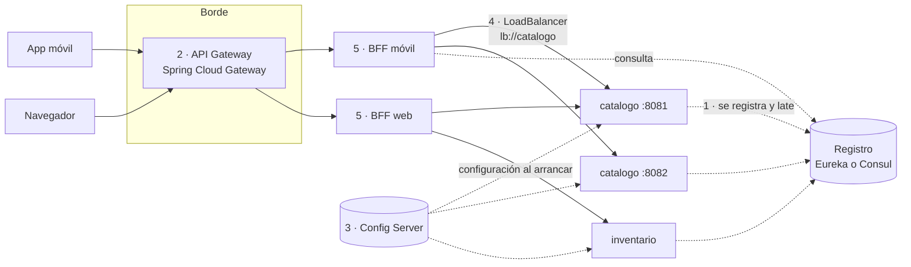
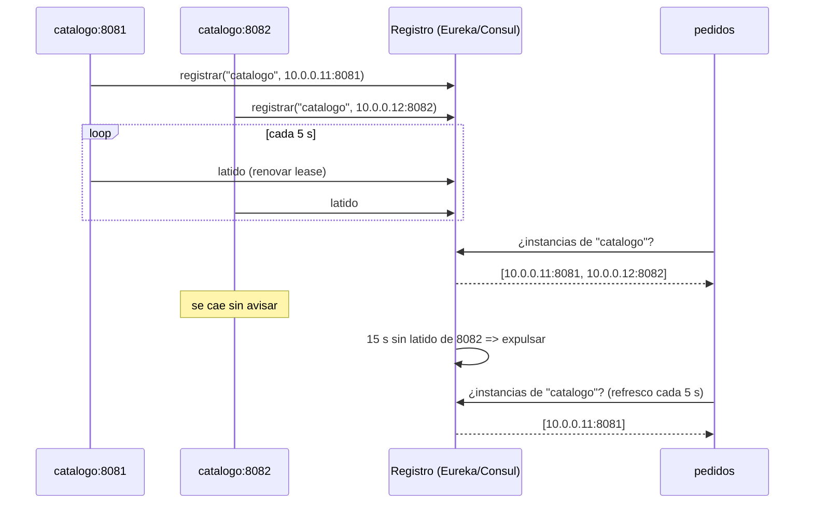
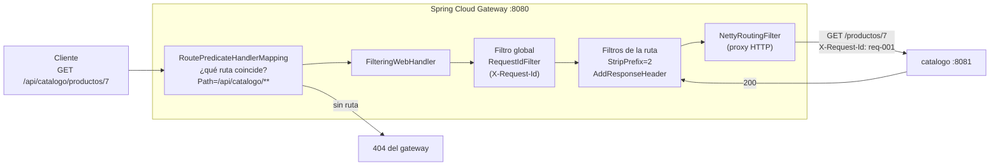
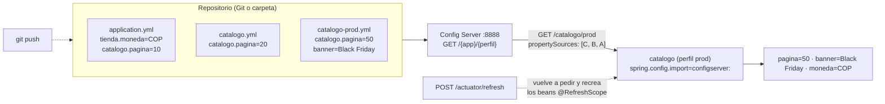
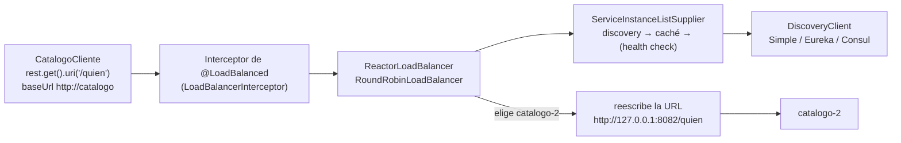
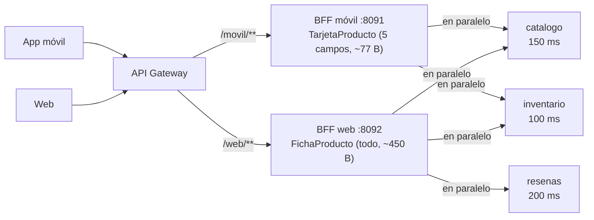

# Módulo 7 · Spring Cloud e infraestructura

**Fase 1 · Spring Boot de cero a experto** (media semana según la tabla de contenidos). **Duración:** 11 h (5 temas
de 2–2,5 h). **Dificultad:** 3 de 5. **Dependencias:** Módulo 6 (comunicación entre servicios con `RestClient`), y
del Módulo 1 los perfiles y la configuración externalizada. **Herramientas:**JDK 25 LTS (25.0.5)**, **Spring Boot
4.1.3**, **Spring Cloud 2025.1.4 «Oakwood»** (Gateway 5.0.4, Netflix Eureka 5.0.3, Consul 5.0.4, Config 5.0.6,
Commons/LoadBalancer 5.0.4), **Consul 2.1.0** con Docker Compose, Testcontainers 2.0.5, Gradle 9.9.2 por el wrapper
y `curl`. **Laboratorio:** `modulo-11` (una demostración con JDK puro por tema en `jdk/` y
un subproyecto Gradle por tema; `./verificar.sh` lo ejecuta todo).

En el Módulo 6 tus servicios se llamaban con URLs fijas (`http://localhost:8082`). En producción eso no aguanta: las
instancias nacen y mueren, cambian de IP, hay varias copias de cada servicio y cada entorno tiene su configuración.
Spring Cloud te da las piezas de infraestructura que resuelven eso: un **registro** donde cada instancia se anuncia,
un **gateway** como única puerta de entrada, un **servidor de configuración** central, un **balanceador** dentro de
cada cliente y, encima de todo, el patrón **BFF** para que cada tipo de cliente reciba justo lo que necesita.



**Texto alternativo:** mapa del módulo. A la izquierda, una app móvil y un navegador entran por un único «API Gateway»
(tema 2) en el borde. El gateway reenvía a dos BFF (tema 5): uno móvil y otro web. Los BFF llaman a dos instancias de
catálogo (puertos 8081 y 8082) y a inventario, eligiendo instancia con el LoadBalancer (tema 4, `lb://catalogo`).
Con líneas punteadas, cada servicio se registra y manda latidos a un «Registro» Eureka o Consul (tema 1), que los BFF
consultan; y un «Config Server» (tema 3) entrega la configuración a cada servicio al arrancar.

---
### Service Discovery: Eureka, Consul

#### 1. UBICACIÓN

Módulo 7, Lección 1 de 5 · Fase 1 · 2,5 h: `jdk/Registro.java`,
`f052-eureka/` (servidor Eureka + servicio `catalogo`) y `f052-consul/` (el mismo servicio registrado en Consul).

#### 2. PRERREQUISITOS

- Módulo 6: un servicio que llama a otro con `RestClient` usando una URL.
- Módulo 1: perfiles, `application.yml` y variables de entorno; Módulo 0.5: Docker y Docker Compose.
- Saber qué es una IP, un puerto y un *health check* (`/actuator/health`, Módulo 0.4 y Módulo 1).

#### 3. OBJETIVO DE APRENDIZAJE

**Configurar** un registro de servicios (Eureka y Consul) en el que dos instancias de `catalogo` se registran solas,
de modo que el test `EurekaRegistroTest` encuentre ambas por nombre, y **explicar** con la salida de
`jdk/Registro.java` cómo el registro expulsa una instancia que deja de enviar latidos.

#### 4. ANALOGÍA VISUAL

La **recepción de un edificio de oficinas** con un tablero de corcho. Cada empleado que llega (una instancia) cuelga
su ficha: «Catálogo — oficina 11, extensión 8081». Cada cierto tiempo pasa por recepción y dice «sigo aquí» (el
**latido**). Si alguien se va sin avisar (se cae), la recepcionista, al ver que hace rato no pasa, **descuelga su
ficha** (expulsión). Quien busca a «Catálogo» ya no recorre pasillos con una dirección escrita en un papel viejo:
pregunta en recepción por el **nombre** y recibe la lista de oficinas donde hoy hay alguien de Catálogo. Dibuja el
tablero con dos fichas verdes y una gris tachada, y un reloj de arena al lado de cada ficha.

#### 5. DIAGRAMA TÉCNICO



**Texto alternativo:** diagrama de secuencia con cuatro participantes: catalogo:8081, catalogo:8082, el Registro
(Eureka o Consul) y pedidos. Las dos instancias de catálogo se registran con su nombre y dirección. En un bucle, cada
5 segundos, ambas envían un latido. Pedidos pregunta por las instancias de «catalogo» y recibe las dos direcciones.
Una nota indica que 8082 se cae sin avisar; el registro, tras 15 segundos sin su latido, la expulsa. Cuando pedidos
vuelve a preguntar (refresca cada 5 segundos) recibe solo 10.0.0.11:8081.

#### 6. EXPLICACIÓN NIVEL 0

Un microservicio necesita la **dirección** de otro para llamarlo, igual que necesitas el número de teléfono de una
persona. Si escribes la dirección a mano en el código (`http://10.0.0.11:8081`), el día que ese servicio cambie de
máquina o se agregue una segunda copia, tu programa sigue llamando al sitio viejo.

**Service Discovery** («descubrimiento de servicios») resuelve eso con una agenda compartida, el **registro**:

1. Cada copia de un servicio, al arrancar, se anota en la agenda con su **nombre** (`catalogo`) y su dirección.
2. Mientras está viva, avisa cada pocos segundos que sigue ahí (el **latido**).
3. Quien necesita llamar a `catalogo` pregunta a la agenda por el nombre y recibe las direcciones vigentes.
4. Si una copia deja de avisar, la agenda la borra.

**Eureka** y **Consul** son dos agendas de este tipo. Eureka es una aplicación Java (la levantas tú con Spring);
Consul es un programa independiente de HashiCorp que se ejecuta como contenedor.

#### 7. EXPLICACIÓN INTERMEDIA

**El mecanismo** (lo ves entero en `jdk/Registro.java`): un mapa `servicio → instancia → (url, último latido)`, una
operación para registrar/renovar, una para consultar, y una tarea periódica que borra las instancias cuyo último
latido es más viejo que el TTL. Todo registro real añade a eso replicación, estados (`UP`, `DOWN`,
`OUT_OF_SERVICE`) y una API HTTP.

**Eureka con Spring Cloud Netflix 5.0.3:**

- **Servidor:** `spring-cloud-starter-netflix-eureka-server` + `@EnableEurekaServer`. En modo *standalone* pones
  `eureka.client.register-with-eureka=false` y `fetch-registry=false` (el servidor no se registra en sí mismo).
  Panel web en `http://localhost:8761`, API en `/eureka/apps`.
- **Cliente:** `spring-cloud-starter-netflix-eureka-client`. Al arrancar, la instancia se registra con
  `spring.application.name` (Eureka lo guarda en mayúsculas: `CATALOGO`) y luego envía un latido cada
  `eureka.instance.lease-renewal-interval-in-seconds` (**30 s por defecto**). El servidor la expulsa si no recibe
  latidos en `lease-expiration-duration-in-seconds` (**90 s por defecto**). Cada cliente descarga **una copia del
  registro** cada `eureka.client.registry-fetch-interval-seconds` (**30 s por defecto**) y consulta esa copia local:
  si el servidor de Eureka se cae, los clientes siguen funcionando con lo último que descargaron.
- En Spring Cloud 2025.1 el cliente Eureka habla HTTP con `RestClient`, así que necesitas
  `spring-boot-starter-restclient` en el classpath (o `WebClient` / Jersey). Si Jersey está en el classpath (lo trae
  el starter del servidor), el cliente lo prefiere: desactívalo con `eureka.client.jersey.enabled: false` (error
  común de este tema).

**Consul con Spring Cloud Consul 5.0.4:** `spring-cloud-starter-consul-discovery` registra la instancia en el agente
de Consul (`spring.cloud.consul.host` y `port`, 8500 por defecto) y le pide a Consul que **la chequee él mismo**:
Consul llama a `/actuator/health` cada `health-check-interval` (10 s por defecto) y solo devuelve las instancias que
pasan el chequeo. Por eso el servicio necesita Actuator. Además de registro, Consul es un almacén clave-valor
(configuración), tiene DNS (`catalogo.service.consul`) y es la base de Consul Connect (*service mesh*).

**La misma abstracción para los dos:** tu código usa `DiscoveryClient.getInstances("catalogo")` de Spring Cloud
Commons. Cambiar de Eureka a Consul es cambiar la dependencia y la configuración, no el código. El balanceador del
tema 4 usa esa lista.

#### 8. EXPLICACIÓN MAESTRA

**Dos filosofías.** En el teorema CAP, **Eureka elige disponibilidad (AP)**: los servidores replican entre pares de
forma asíncrona, los clientes guardan caché y, con el *self-preservation mode*, si el servidor deja de recibir muchos
latidos a la vez (típico de una partición de red) **deja de expulsar** instancias, porque supone que el problema es la
red y no los servicios. Prefiere darte una lista quizá vieja a no darte ninguna. **Consul elige consistencia (CP)**:
sus servidores usan Raft, necesitan quórum para escribir (3 o 5 servidores en producción) y un agente en cada nodo
hace los chequeos de salud localmente.

| Criterio | Eureka | Consul | Registro de la plataforma (Kubernetes) |
|---|---|---|---|
| Modelo | AP, réplicas entre pares | CP con Raft + agentes | etcd (CP) + `Service` y DNS |
| Salud | Latido del cliente (*lease*) | Chequeo activo HTTP/TCP/TTL | *readiness probe* |
| Lenguajes | Pensado para JVM | Cualquiera (HTTP/DNS) | Cualquiera (DNS) |
| Extra | — | KV, DNS, *service mesh* | Todo el ciclo de vida |
| Estado | Netflix lo dejó de usar internamente; Spring lo mantiene | Activo (HashiCorp) | Estándar de facto |

**Cuándo NO usarlo.** Si despliegas en **Kubernetes**, ya tienes descubrimiento: un `Service` llamado `catalogo` te
da un nombre DNS estable (`http://catalogo`) y kube-proxy reparte entre los pods sanos (*readiness*). Añadir Eureka
encima duplica la fuente de verdad: dos sistemas pueden discrepar sobre qué instancia está viva. Tampoco lo necesitas
con 2–3 servicios de despliegue fijo detrás de un balanceador de la nube: una URL configurable por entorno basta.
Úsalo cuando tienes instancias que escalan solas fuera de Kubernetes (VMs, varias nubes) o necesitas descubrimiento
entre plataformas distintas (Consul).

**Trade-offs que pagas:** el registro es infraestructura crítica (si cae y los clientes no tienen caché, nadie
encuentra a nadie), la información siempre llega con retraso (latidos + caché + refresco: con los valores por defecto
de Eureka, una instancia caída puede seguir recibiendo tráfico hasta **90 s + 30 s + 30 s**) y por eso el descubrimiento
**siempre** va acompañado de timeouts y reintentos (Módulo 8).

#### 9. CÓDIGO EJECUTABLE

**Versiones:** JDK 25 LTS, Spring Boot 4.1.3, Spring Cloud 2025.1.4 (Netflix Eureka 5.0.3, Consul 5.0.4),
Testcontainers 2.0.5, imagen `hashicorp/consul:2.1.0`.

**El mecanismo con JDK puro** — `modulo-11/jdk/Registro.java` (se ejecuta con `java Registro.java`, sin dependencias):

```java
// F052 · Service Discovery por dentro: un registro mínimo con latidos y expulsión (solo JDK 25).
// Ejecuta: java Registro.java
// Qué demuestra: las instancias se registran, mandan latidos y el registro expulsa
// a la que deja de latir (lo mismo que hacen Eureka con sus "leases" y Consul con sus checks TTL).
import com.sun.net.httpserver.HttpServer;
import java.net.InetSocketAddress;
import java.net.URI;
import java.net.http.HttpClient;
import java.net.http.HttpRequest;
import java.net.http.HttpResponse;
import java.nio.charset.StandardCharsets;
import java.util.Map;
import java.util.TreeMap;
import java.util.concurrent.ConcurrentHashMap;
import java.util.concurrent.Executors;
import java.util.concurrent.TimeUnit;

public class Registro {

    static final long TTL_MS = 3_000;                       // sin latido durante 3 s => fuera
    // servicio -> (idInstancia -> [url, instante del último latido])
    static final Map<String, Map<String, Object[]>> REGISTRO = new ConcurrentHashMap<>();

    public static void main(String[] args) throws Exception {
        HttpServer servidor = HttpServer.create(new InetSocketAddress("127.0.0.1", 0), 0);
        // PUT /registro/{servicio}/{id}?url=...  registra o renueva (latido)
        servidor.createContext("/registro/", ex -> {
            String[] partes = ex.getRequestURI().getPath().split("/"); // ["", "registro", servicio, id]
            String url = ex.getRequestURI().getQuery().substring("url=".length());
            REGISTRO.computeIfAbsent(partes[2], s -> new ConcurrentHashMap<>())
                    .put(partes[3], new Object[] {url, System.currentTimeMillis()});
            ex.sendResponseHeaders(204, -1);
            ex.close();
        });
        // GET /servicios/{servicio}  devuelve las instancias vivas como "id=url" separadas por coma
        servidor.createContext("/servicios/", ex -> {
            String servicio = ex.getRequestURI().getPath().substring("/servicios/".length());
            Map<String, String> vivas = new TreeMap<>();
            REGISTRO.getOrDefault(servicio, Map.of()).forEach((id, v) -> vivas.put(id, (String) v[0]));
            byte[] cuerpo = vivas.toString().getBytes(StandardCharsets.UTF_8);
            ex.sendResponseHeaders(200, cuerpo.length);
            ex.getResponseBody().write(cuerpo);
            ex.close();
        });
        servidor.start();
        String base = "http://127.0.0.1:" + servidor.getAddress().getPort();

        // Expulsor: cada 500 ms borra las instancias cuyo último latido es más viejo que el TTL.
        var tareas = Executors.newScheduledThreadPool(2);
        tareas.scheduleAtFixedRate(() -> REGISTRO.values().forEach(instancias ->
            instancias.entrySet().removeIf(e -> {
                boolean vencida = System.currentTimeMillis() - (long) e.getValue()[1] > TTL_MS;
                if (vencida) System.out.println("[registro] expulsada " + e.getKey() + " (sin latido > " + TTL_MS + " ms)");
                return vencida;
            })), 500, 500, TimeUnit.MILLISECONDS);

        HttpClient http = HttpClient.newHttpClient();
        Runnable latido1 = () -> put(http, base + "/registro/catalogo/catalogo-1?url=http://10.0.0.11:8081");
        latido1.run();
        put(http, base + "/registro/catalogo/catalogo-2?url=http://10.0.0.12:8081"); // se registra y "muere"
        // catalogo-1 sigue latiendo cada segundo; catalogo-2 nunca vuelve a latir.
        tareas.scheduleAtFixedRate(latido1, 1, 1, TimeUnit.SECONDS);

        String antes = get(http, base + "/servicios/catalogo");
        System.out.println("t=0s   instancias de catalogo: " + antes);
        Thread.sleep(4_500);
        String despues = get(http, base + "/servicios/catalogo");
        System.out.println("t=4,5s instancias de catalogo: " + despues);

        tareas.shutdownNow();
        servidor.stop(0);
        if (!antes.contains("catalogo-2") || despues.contains("catalogo-2") || !despues.contains("catalogo-1")) {
            System.out.println("FALLA: el registro no expulsó a catalogo-2");
            System.exit(1);
        }
        System.out.println("OK: el cliente solo ve instancias que laten");
    }

    static void put(HttpClient http, String url) {
        try {
            http.send(HttpRequest.newBuilder(URI.create(url)).PUT(HttpRequest.BodyPublishers.noBody()).build(),
                      HttpResponse.BodyHandlers.discarding());
        } catch (Exception e) { throw new IllegalStateException(e); }
    }

    static String get(HttpClient http, String url) throws Exception {
        return http.send(HttpRequest.newBuilder(URI.create(url)).build(), HttpResponse.BodyHandlers.ofString()).body();
    }
}
```

**Eureka con Spring Cloud.** Un solo proyecto con dos aplicaciones: el servidor (lee `servidor.yml`) y el servicio
`catalogo` (lee `catalogo.yml`). `f052-eureka/build.gradle.kts`:

```kotlin
// F052 · Service Discovery con Eureka: servidor + cliente "catalogo" en un mismo proyecto
plugins {
    java
    alias(libs.plugins.spring.boot)
    alias(libs.plugins.spring.dependency.management)
}

group = "academia.microservicios"
version = "1.0.0"

java {
    toolchain {
        languageVersion = JavaLanguageVersion.of(25)
    }
}

dependencyManagement {
    imports {
        mavenBom("org.springframework.cloud:spring-cloud-dependencies:${libs.versions.spring.cloud.get()}")
    }
}

dependencies {
    // Servidor Eureka 5.0.3 (trae también el cliente Eureka)
    implementation(libs.spring.cloud.starter.netflix.eureka.server)
    // API HTTP del catálogo (Tomcat 11)
    implementation(libs.spring.boot.starter.webmvc)
    // El cliente Eureka usa RestClient para hablar con el servidor
    implementation(libs.spring.boot.starter.restclient)
    // /actuator/health: lo que Eureka publica como estado de la instancia
    implementation(libs.spring.boot.starter.actuator)
    testImplementation(libs.spring.boot.starter.test)
    // Gradle 9 exige declarar el lanzador de JUnit Platform (ya no lo añade por su cuenta)
    testRuntimeOnly(libs.junit.platform.launcher)
}

tasks.withType<Test> {
    useJUnitPlatform()
    testLogging {
        events("passed", "skipped", "failed")   // una línea por test en la consola
        // el mensaje completo de cada fallo (valor esperado y obtenido), no solo el tipo de excepción
        exceptionFormat = org.gradle.api.tasks.testing.logging.TestExceptionFormat.FULL
    }
}

// Este proyecto tiene varias clases con main. Elige cuál arranca (bootRun) o se empaqueta (bootJar) con
// -Pprincipal=paquete.Clase (en Maven: -Dspring-boot.run.main-class=...). Los tests no lo necesitan.
springBoot {
    providers.gradleProperty("principal").orNull?.let { mainClass = it }
}
```

> **Build con Gradle (y su equivalencia en Maven).** Este laboratorio se construye con **Gradle 9.9.2** y Kotlin DSL
> mediante el wrapper `./gradlew` (no instalas Gradle). `settings.gradle.kts` lista los subproyectos (en Maven,
> `<modules>` del POM agregador), cada carpeta tiene su `build.gradle.kts` (su `pom.xml`) y
> `gradle/libs.versions.toml` es el **catálogo de versiones** (las `<properties>` y el `dependencyManagement`): por eso
> las dependencias se escriben `libs.…`. Equivalencias: `./mvnw test` → `./gradlew test` ·
> `./mvnw package -DskipTests` → `./gradlew bootJar` · `./mvnw spring-boot:run` → `./gradlew bootRun` ·
> `-Dtest=Clase` → `--tests Clase` · `target/` → `build/` (el jar queda en `build/libs/`). Gradle escribe una línea
> `PASSED` por test y termina con `BUILD SUCCESSFUL` (Maven: `Tests run: N` y `BUILD SUCCESS`).

`modulo-11/settings.gradle.kts`:

```kotlin
// Módulo 7 (modulo-11) · Build multi-proyecto: "./gradlew test" ejecuta los tests de todos los subproyectos.
// Cada carpeta tiene su propio build.gradle.kts; las versiones viven en gradle/libs.versions.toml
// (catálogo "libs"). Equivale al POM agregador con <modules> de Maven.
pluginManagement {
    repositories {
        gradlePluginPortal()
        mavenCentral()
    }
}
// Sin esto, un alumno sin JDK 25 instalado ve el build morir en la configuración, antes de cualquier test.
plugins {
    id("org.gradle.toolchains.foojay-resolver-convention") version "1.0.0"
}

dependencyResolutionManagement {
    repositories {
        mavenCentral()
    }
}

rootProject.name = "modulo-11-laboratorios"

include(
    "f052-eureka",
    "f052-consul",
    "f053-gateway",
    "f054-config",
    "f055-loadbalancer",
    "f056-bff",
)
```

`modulo-11/gradle/libs.versions.toml`:

```toml
# Módulo 7 (modulo-11)
# Catálogo de versiones del laboratorio: una sola fuente para plugins y librerías.
# Las librerías SIN versión las fija el BOM de Spring Boot (spring-boot-dependencies) o el BOM que importe el proyecto.

[versions]
spring-boot = "4.1.3"
# Tren de Spring Cloud compatible con Spring Boot 4.1.x
spring-cloud = "2025.1.4"

[libraries]
spring-cloud-starter-netflix-eureka-server = { module = "org.springframework.cloud:spring-cloud-starter-netflix-eureka-server" }
spring-boot-starter-webmvc = { module = "org.springframework.boot:spring-boot-starter-webmvc" }
spring-boot-starter-restclient = { module = "org.springframework.boot:spring-boot-starter-restclient" }
spring-boot-starter-actuator = { module = "org.springframework.boot:spring-boot-starter-actuator" }
spring-boot-starter-test = { module = "org.springframework.boot:spring-boot-starter-test" }
junit-platform-launcher = { module = "org.junit.platform:junit-platform-launcher" }
spring-cloud-starter-consul-discovery = { module = "org.springframework.cloud:spring-cloud-starter-consul-discovery" }
testcontainers-junit-jupiter = { module = "org.testcontainers:testcontainers-junit-jupiter" }
testcontainers-consul = { module = "org.testcontainers:testcontainers-consul" }
spring-cloud-starter-gateway-server-webflux = { module = "org.springframework.cloud:spring-cloud-starter-gateway-server-webflux" }
spring-cloud-config-server = { module = "org.springframework.cloud:spring-cloud-config-server" }
spring-cloud-starter-config = { module = "org.springframework.cloud:spring-cloud-starter-config" }
spring-cloud-starter-loadbalancer = { module = "org.springframework.cloud:spring-cloud-starter-loadbalancer" }

[plugins]
spring-boot = { id = "org.springframework.boot", version.ref = "spring-boot" }
spring-dependency-management = { id = "io.spring.dependency-management", version = "1.1.7" }
```

`f052-eureka/src/main/java/academia/discovery/servidor/EurekaServidorApp.java`:

```java
package academia.discovery.servidor;

import org.springframework.boot.autoconfigure.SpringBootApplication;
import org.springframework.boot.builder.SpringApplicationBuilder;
import org.springframework.cloud.netflix.eureka.server.EnableEurekaServer;
import org.springframework.context.ConfigurableApplicationContext;

/** Registro de servicios. Lee su configuración de servidor.yml (no de application.yml). */
@SpringBootApplication
@EnableEurekaServer
public class EurekaServidorApp {

    public static ConfigurableApplicationContext arrancar(String... args) {
        return new SpringApplicationBuilder(EurekaServidorApp.class)
            .properties("spring.config.name=servidor")
            .run(args);
    }

    public static void main(String[] args) {
        arrancar(args);
    }
}
```

`f052-eureka/src/main/resources/servidor.yml`:

```yaml
server:
  port: 8761
spring:
  application:
    name: eureka-servidor
eureka:
  instance:
    hostname: localhost
  client:
    # El starter del SERVIDOR trae Jersey 3 al classpath (org.glassfish.jersey.client.JerseyClient). Con
    # jersey.enabled=true (valor por defecto) el cliente Eureka elige Jersey, pero nadie crea su
    # TransportClientFactories y el EurekaClient no se puede construir. Forzamos RestClient.
    jersey:
      enabled: false
    # El servidor no se registra a sí mismo ni descarga el registro (modo standalone).
    register-with-eureka: false
    fetch-registry: false
  server:
    # Solo para el laboratorio: expulsar rápido y responder sin la caché de 30 s.
    enable-self-preservation: false
    eviction-interval-timer-in-ms: 2000
    use-read-only-response-cache: false
```

`f052-eureka/src/main/java/academia/discovery/catalogo/CatalogoApp.java`:

```java
package academia.discovery.catalogo;

import java.util.List;
import org.springframework.boot.autoconfigure.SpringBootApplication;
import org.springframework.boot.builder.SpringApplicationBuilder;
import org.springframework.cloud.client.ServiceInstance;
import org.springframework.cloud.client.discovery.DiscoveryClient;
import org.springframework.context.ConfigurableApplicationContext;
import org.springframework.web.bind.annotation.GetMapping;
import org.springframework.web.bind.annotation.PathVariable;
import org.springframework.web.bind.annotation.RestController;

/** Servicio "catalogo": se registra en Eureka al arrancar y consulta el registro. Config: catalogo.yml. */
@SpringBootApplication
@RestController
public class CatalogoApp {

    record Producto(long id, String nombre, long precio, String atendidoPor) {}

    private final DiscoveryClient discovery;
    private final String instancia;

    CatalogoApp(DiscoveryClient discovery, org.springframework.core.env.Environment env) {
        this.discovery = discovery;
        this.instancia = env.getProperty("eureka.instance.instance-id", "?");
    }

    @GetMapping("/productos/{id}")
    Producto producto(@PathVariable long id) {
        return new Producto(id, "Audífonos BT", 189_000, instancia);
    }

    /** Lo que el registro dice que existe de un servicio (lista local, refrescada cada 5 s). */
    @GetMapping("/instancias/{servicio}")
    List<String> instancias(@PathVariable String servicio) {
        return discovery.getInstances(servicio).stream()
            .map(i -> i.getInstanceId() + " -> " + i.getUri())
            .toList();
    }

    public static ConfigurableApplicationContext arrancar(String... args) {
        return new SpringApplicationBuilder(CatalogoApp.class)
            .properties("spring.config.name=catalogo")
            .run(args);
    }

    public static void main(String[] args) {
        arrancar(args);
    }
}
```

`f052-eureka/src/main/resources/catalogo.yml` (latidos de 5 s y expulsión a los 15 s **solo para el laboratorio**;
en producción deja los valores por defecto):

```yaml
server:
  port: ${PUERTO:8081}
spring:
  application:
    name: catalogo            # este es el nombre con el que otros lo buscarán
eureka:
  client:
    # El starter del SERVIDOR trae Jersey 3 al classpath (org.glassfish.jersey.client.JerseyClient). Con
    # jersey.enabled=true (valor por defecto) el cliente Eureka elige Jersey, pero nadie crea su
    # TransportClientFactories y el EurekaClient no se puede construir. Forzamos RestClient.
    jersey:
      enabled: false
    service-url:
      defaultZone: ${EUREKA_URL:http://localhost:8761/eureka/}
    registry-fetch-interval-seconds: 5      # por defecto 30
  instance:
    instance-id: ${spring.application.name}:${server.port}
    lease-renewal-interval-in-seconds: 5    # latido; por defecto 30
    lease-expiration-duration-in-seconds: 15 # sin latido durante 15 s => expulsado; por defecto 90
management:
  endpoints:
    web:
      exposure:
        include: health,info
```

**Consul.** El mismo servicio, otra dependencia. `f052-consul/build.gradle.kts`:

```kotlin
// F052 · Service Discovery con Consul: el mismo catálogo registrado en Consul 2.1
plugins {
    java
    alias(libs.plugins.spring.boot)
    alias(libs.plugins.spring.dependency.management)
}

group = "academia.microservicios"
version = "1.0.0"

java {
    toolchain {
        languageVersion = JavaLanguageVersion.of(25)
    }
}

dependencyManagement {
    imports {
        mavenBom("org.springframework.cloud:spring-cloud-dependencies:${libs.versions.spring.cloud.get()}")
    }
}

dependencies {
    // Cliente de Consul 5.0.4: registro + chequeo de salud + DiscoveryClient
    implementation(libs.spring.cloud.starter.consul.discovery)
    // API HTTP del catálogo
    implementation(libs.spring.boot.starter.webmvc)
    // Consul llama a /actuator/health cada 10 s para saber si la instancia está sana
    implementation(libs.spring.boot.starter.actuator)
    // Testcontainers 2.0.5 (gestionado por Boot): Consul real en el test
    testImplementation(libs.testcontainers.junit.jupiter)
    testImplementation(libs.testcontainers.consul)
    testImplementation(libs.spring.boot.starter.test)
    // Gradle 9 exige declarar el lanzador de JUnit Platform (ya no lo añade por su cuenta)
    testRuntimeOnly(libs.junit.platform.launcher)
}

tasks.withType<Test> {
    useJUnitPlatform()
    testLogging {
        events("passed", "skipped", "failed")   // una línea por test en la consola
        // el mensaje completo de cada fallo (valor esperado y obtenido), no solo el tipo de excepción
        exceptionFormat = org.gradle.api.tasks.testing.logging.TestExceptionFormat.FULL
    }
}
```

(Es igual al de Eureka cambiando las dependencias; el BOM de Spring Cloud 2025.1.4 se importa en el bloque
`dependencyManagement`.) `f052-consul/src/main/resources/application.yml`:

```yaml
server:
  port: ${PUERTO:8081}
spring:
  application:
    name: catalogo
  cloud:
    consul:
      host: ${CONSUL_HOST:localhost}
      port: 8500
      discovery:
        instance-id: ${spring.application.name}-${server.port}
        health-check-path: /actuator/health
        health-check-interval: 10s
        prefer-ip-address: true
```

`docker-compose.yml` del módulo (Consul en modo desarrollo):

```yaml
# Módulo 7 (modulo-11) · Infraestructura de Spring Cloud.
# Consul 2.1.0 en modo desarrollo (un solo nodo, todo en memoria): registro de servicios + UI.
#   docker compose up -d --wait      -> UI en http://localhost:8500
#   docker compose down
# Eureka Server y Config Server son aplicaciones Spring Boot del laboratorio: se arrancan con ./gradlew
# (ver README). El test de f052-consul arranca su propio Consul con Testcontainers.
services:
  consul:
    image: hashicorp/consul:2.1.0
    command: ["agent", "-dev", "-client=0.0.0.0", "-ui"]
    ports: ["8500:8500"]
    # Para que Consul pueda llamar a /actuator/health de las apps que corren en tu máquina (Linux).
    extra_hosts: ["host.docker.internal:host-gateway"]
    healthcheck:
      test: ["CMD", "consul", "members"]
      interval: 3s
      timeout: 3s
      retries: 20
```

#### 10. MINI-LABORATORIO

1. **El mecanismo, sin Spring.** Desde el código de este tema:

```bash
java jdk/Registro.java
```

   **Output esperado** (ejecutado con JDK 25.0.5):

```text
t=0s   instancias de catalogo: {catalogo-1=http://10.0.0.11:8081, catalogo-2=http://10.0.0.12:8081}
[registro] expulsada catalogo-2 (sin latido > 3000 ms)
t=4,5s instancias de catalogo: {catalogo-1=http://10.0.0.11:8081}
OK: el cliente solo ve instancias que laten
```

   **Captura comentada:** al principio el registro tiene las dos instancias. `catalogo-2` se registró una vez y no
   volvió a latir; a los 3 s el expulsor la borra (la línea `[registro] expulsada` aparece entre las dos consultas).
   `catalogo-1`, que late cada segundo, sigue en la lista.

2. **Eureka.** Abre tres terminales en `f052-eureka`:

```bash
../gradlew -q bootRun -Pprincipal=academia.discovery.servidor.EurekaServidorApp
PUERTO=8081 ../gradlew -q bootRun -Pprincipal=academia.discovery.catalogo.CatalogoApp
PUERTO=8082 ../gradlew -q bootRun -Pprincipal=academia.discovery.catalogo.CatalogoApp
```

   Espera unos 10 s y pregunta a una instancia qué ve en el registro:

```bash
curl -s localhost:8081/instancias/catalogo
```

   **Output esperado:** `["catalogo:8081 -> http://<tu-host>:8081","catalogo:8082 -> http://<tu-host>:8082"]` (el
   orden puede variar). **Captura descrita:** en `http://localhost:8761`, la tabla «Instances currently registered
   with Eureka» muestra la aplicación `CATALOGO` con `UP (2)`.

3. **Fallo deliberado:** detén la instancia de 8082 con `Ctrl+C`. Spring la **desregistra** al apagarse; a los
   ~5 s `curl -s localhost:8081/instancias/catalogo` devuelve solo `catalogo:8081`. Ahora mata la de 8081 sin darle
   tiempo a despedirse (`kill -9` a su PID, que ves con `jps -l`): el panel la mantiene hasta que pasan 15 s sin
   latido y el expulsor (cada 2 s en `servidor.yml`) la borra.

4. **Consul.** En `modulo-11`:

```bash
docker compose up -d --wait
cd f052-consul && ../gradlew -q bootRun \
  --args="--spring.cloud.consul.discovery.prefer-ip-address=false --spring.cloud.consul.discovery.hostname=host.docker.internal"
```

   En otra terminal:

```bash
curl -s 'localhost:8500/v1/health/service/catalogo?passing=true' | jq -r '.[].Service.Service'
```

   **Output esperado:** `catalogo` (Consul devuelve JSON con un espacio tras los dos puntos: compara con `jq`,
   no con `grep '"Service":"catalogo"'`). **Captura descrita:** en `http://localhost:8500/ui`, el servicio
   `catalogo` aparece con su chequeo «Service 'catalogo' check» en verde. `host.docker.internal` hace falta porque
   el chequeo lo ejecuta Consul **desde el contenedor** contra tu máquina. Termina con `docker compose down`.

#### 11. VERIFICACIÓN

`f052-eureka/src/test/java/academia/discovery/EurekaRegistroTest.java` arranca el servidor y **dos** instancias de
`catalogo` en la misma JVM, cada una en un puerto libre, y espera hasta 30 s a que el `DiscoveryClient` vea las dos:

```java
package academia.discovery;

import static org.assertj.core.api.Assertions.assertThat;

import academia.discovery.catalogo.CatalogoApp;
import academia.discovery.servidor.EurekaServidorApp;
import java.net.ServerSocket;
import java.util.List;
import org.junit.jupiter.api.Test;
import org.springframework.cloud.client.ServiceInstance;
import org.springframework.cloud.client.discovery.DiscoveryClient;
import org.springframework.context.ConfigurableApplicationContext;

class EurekaRegistroTest {

    @Test
    void dosInstanciasDeCatalogoSeRegistranYSeDescubren() throws Exception {
        int puertoEureka = libre(), puerto1 = libre(), puerto2 = libre();
        String eureka = "--eureka.client.service-url.defaultZone=http://localhost:" + puertoEureka + "/eureka/";
        try (ConfigurableApplicationContext servidor = EurekaServidorApp.arrancar("--server.port=" + puertoEureka);
             ConfigurableApplicationContext c1 = CatalogoApp.arrancar("--server.port=" + puerto1, eureka);
             ConfigurableApplicationContext c2 = CatalogoApp.arrancar("--server.port=" + puerto2, eureka)) {

            DiscoveryClient discovery = c1.getBean(DiscoveryClient.class);
            List<ServiceInstance> instancias = List.of();
            for (int i = 0; i < 60 && instancias.size() < 2; i++) {   // hasta 30 s
                Thread.sleep(500);
                instancias = discovery.getInstances("catalogo");
            }
            assertThat(instancias).extracting(ServiceInstance::getPort).containsExactlyInAnyOrder(puerto1, puerto2);
            assertThat(instancias).extracting(ServiceInstance::getInstanceId)
                .containsExactlyInAnyOrder("catalogo:" + puerto1, "catalogo:" + puerto2);
        }
    }

    static int libre() throws Exception {
        try (ServerSocket s = new ServerSocket(0)) {
            return s.getLocalPort();
        }
    }
}
```

`f052-consul/src/test/java/academia/consul/ConsulRegistroTest.java` hace lo mismo contra un Consul real arrancado con
Testcontainers:

```java
package academia.consul;

import static org.assertj.core.api.Assertions.assertThat;

import java.util.List;
import org.junit.jupiter.api.Test;
import org.springframework.beans.factory.annotation.Autowired;
import org.springframework.boot.test.context.SpringBootTest;
import org.springframework.cloud.client.ServiceInstance;
import org.springframework.cloud.client.discovery.DiscoveryClient;
import org.springframework.test.context.DynamicPropertyRegistry;
import org.springframework.test.context.DynamicPropertySource;
import org.testcontainers.consul.ConsulContainer;
import org.testcontainers.junit.jupiter.Container;
import org.testcontainers.junit.jupiter.Testcontainers;

@Testcontainers
@SpringBootTest(webEnvironment = SpringBootTest.WebEnvironment.RANDOM_PORT)
class ConsulRegistroTest {

    @Container
    static ConsulContainer consul = new ConsulContainer("hashicorp/consul:2.1.0");

    @DynamicPropertySource
    static void consul(DynamicPropertyRegistry r) {
        r.add("spring.cloud.consul.host", consul::getHost);
        r.add("spring.cloud.consul.port", () -> consul.getMappedPort(8500));
        // El chequeo HTTP lo hace Consul desde el contenedor: no llega a tu puerto local, así que
        // en el test lo desactivamos y solo comprobamos registro y descubrimiento.
        r.add("spring.cloud.consul.discovery.register-health-check", () -> "false");
    }

    @Autowired DiscoveryClient discovery;

    @Test
    void elCatalogoApareceEnConsul() throws Exception {
        List<ServiceInstance> instancias = List.of();
        for (int i = 0; i < 20 && instancias.isEmpty(); i++) {
            Thread.sleep(500);
            instancias = discovery.getInstances("catalogo");
        }
        assertThat(instancias).hasSize(1);
        assertThat(instancias.getFirst().getInstanceId()).startsWith("catalogo-");
        assertThat(discovery.getServices()).contains("catalogo", "consul");
    }
}
```

```bash
cd f052-eureka && ../gradlew test
cd ../f052-consul && ../gradlew test        # Docker encendido
```

**Output esperado:** 1 línea `PASSED` y `BUILD SUCCESSFUL` *(salida de Gradle verificada en el Mac del dueño el 2026-11-21 con Gradle 9.9.2, Java 25.0.5.1 autoaprovisto y Docker Compose v5.7.1)* en cada carpeta.

**Pregunta de comprobación:** con los valores por defecto de Eureka (latido 30 s, expulsión 90 s, refresco del
cliente 30 s), una instancia muere por un corte de luz. ¿Cuánto tiempo, como máximo aproximado, pueden seguir
llegándole peticiones y qué te protege mientras tanto?

<details>
<summary>Respuesta</summary>

Unos 90 s hasta que el servidor la expulsa (más el intervalo del expulsor, 60 s por defecto), más hasta 30 s de la
caché de respuestas del servidor y 30 s del refresco del cliente: del orden de 2–3 minutos. Mientras tanto te
protegen los timeouts, los reintentos contra otra instancia y el circuit breaker del Módulo 8. Por eso el registro
nunca sustituye a la resiliencia.
</details>

#### 12. ERROR COMÚN

**Síntoma:** el servicio con el cliente Eureka no arranca y el error no menciona Eureka Server ni la red.

**Cómo se ve** (error real al ejecutar `EurekaRegistroTest` en macOS con Spring Cloud 2025.1.4, antes de la
corrección):

```text
EurekaRegistroTest.dosInstanciasDeCatalogoSeRegistranYSeDescubren:21 » ApplicationContext Failed to start bean 'eurekaAutoServiceRegistration'
Caused by: java.lang.NullPointerException: Cannot invoke "org.springframework.cloud.netflix.eureka.CloudEurekaClient.getApplications()"
  because the return value of "org.springframework.cloud.netflix.eureka.serviceregistry.EurekaRegistration.getEurekaClient()" is null
```

**Diagnóstico** (leído en las fuentes de Spring Cloud Netflix 5.0.3):

1. `spring-cloud-starter-netflix-eureka-server` trae Jersey 3 al classpath (`org.glassfish.jersey.core:jersey-client`
   y `eureka-client-jersey3`). En `f052-eureka` el servidor y `catalogo` comparten classpath, así que `catalogo`
   también lo tiene.
2. `DiscoveryClientOptionalArgsConfiguration` elige el transporte: si existe la clase
   `org.glassfish.jersey.client.JerseyClient` y `eureka.client.jersey.enabled` no es `false` (por defecto es
   `true`), la rama Jersey gana y la de `RestClient` se desactiva. Pero la rama Jersey **no crea** ningún bean
   `TransportClientFactories`.
3. El bean `eurekaClient` (`@RefreshScope` + `@Lazy`) exige un `TransportClientFactories`. Al ser perezoso, el contexto
   arranca y el fallo aparece después: `EurekaRegistration.getEurekaClient()` intenta resolver el proxy, captura la
   excepción, la deja en el log como `error getting CloudEurekaClient` y devuelve `null`; el registro automático
   choca con ese `null`.

**Diagnóstico visual:** busca hacia arriba en el log la línea `error getting CloudEurekaClient`: la causa real está
en su traza, no en el `NullPointerException`. Y comprueba qué transporte se eligió: con `RestClient` el log dice
`Eureka HTTP Client uses RestClient`; si no aparece esa línea, el cliente no tiene transporte.

**Arreglo:** `eureka.client.jersey.enabled: false` en `catalogo.yml` y `servidor.yml` (la documentación lo indica
para cuando Jersey está en el classpath y no lo quieres en el cliente) con `spring-boot-starter-restclient` en `build.gradle.kts`.
En un proyecto real el servidor y los clientes van en artefactos separados y el cliente nunca ve Jersey.

**Otro síntoma frecuente:** el servicio arranca pero nunca aparece en el panel y cada 30 s el log repite
`Cannot execute request on any known server`. Es una `defaultZone` mal escrita (otro puerto, sin `/eureka/`, o la
clave en minúsculas: es la clave de un mapa y debe ser `defaultZone`). Compruébalo con `curl -s
localhost:8761/eureka/apps`.

#### 13. PREGUNTA DE ENTREVISTA

«¿Usarías Eureka en un clúster de Kubernetes? ¿Qué diferencia hay entre descubrimiento en el cliente y en el
servidor?»

**Respuesta modelo:** en Kubernetes normalmente no: la plataforma ya ofrece descubrimiento en el **servidor** (un
`Service` con DNS estable y kube-proxy repartiendo entre pods con *readiness* en verde), y añadir Eureka crea una
segunda fuente de verdad que puede discrepar. El descubrimiento en el **cliente** (Eureka + Spring Cloud LoadBalancer)
pone la lista de instancias y la elección dentro de cada servicio: da más control (zonas, reintentos a otra
instancia, *hints*) a cambio de una librería por lenguaje y de lógica repetida en cada cliente. Lo elegiría fuera de
Kubernetes o entre plataformas; dentro, me quedo con el `Service` y, si necesito más control, con un *service mesh*.

#### 14. ANTI-PATRÓN RELACIONADO

**Direcciones fijas «temporales» y registro sin caché ni timeouts:**

```yaml
# application-prod.yml
catalogo:
  url: http://10.0.3.17:8081     # la IP de la VM de hoy; mañana el autoescalado crea otra
```

Se ve en producción como un servicio que «a veces» falla después de cada despliegue o escalado: la IP cambió y
nadie actualizó el archivo. El extremo opuesto también es un anti-patrón: consultar al registro en **cada** petición
y sin caché, de modo que el registro se convierte en un punto único de fallo y en un cuello de botella. La regla:
nombres lógicos (`catalogo`), lista local refrescada periódicamente y timeouts en cada llamada.

---
### API Gateway: Spring Cloud Gateway

#### 1. UBICACIÓN

Módulo 7, Lección 2 de 5 · Fase 1 · 2,5 h: `jdk/MiniGateway.java`
y `f053-gateway/`.

#### 2. PRERREQUISITOS

- Tema anterior (nombres lógicos de servicio) y Módulo 6 (llamadas HTTP entre servicios).
- Módulo 0.4: cabeceras HTTP, códigos 404/502 y `curl -i`.
- Saber leer YAML anidado (Módulo 0.4).

#### 3. OBJETIVO DE APRENDIZAJE

**Construir** un API Gateway con Spring Cloud Gateway que enrute `/api/catalogo/**` y `/api/inventario/**` a sus
servicios, quite el prefijo y añada un `X-Request-Id`, de modo que los 3 tests de `GatewayTest` pasen, y **distinguir**
en una respuesta 404 si la dio el gateway (sin ruta) o el servicio (ruta mal reescrita).

#### 4. ANALOGÍA VISUAL

La **portería de un conjunto residencial**. Todos los visitantes entran por una sola puerta. El portero mira el
destino («torre 2, apartamento 701»), revisa el documento, anota la visita en la planilla con un número de ficha y te
indica el camino. No sube a arreglar la nevera del 701: solo **dirige, controla y anota**. Si preguntas por la «torre
9», que no existe, el mismo portero te dice «aquí no hay torre 9» sin molestar a ningún residente. Dibuja la portería
con un letrero de flechas (torres 1, 2, 3), una planilla con números de ficha y una talanquera.

#### 5. DIAGRAMA TÉCNICO



**Texto alternativo:** el cliente envía GET /api/catalogo/productos/7 al gateway. Dentro del gateway, el
RoutePredicateHandlerMapping busca la ruta cuyo predicado coincide (Path=/api/catalogo/**) y pasa al
FilteringWebHandler, que aplica primero el filtro global RequestIdFilter (pone X-Request-Id), luego los filtros de la
ruta (StripPrefix=2 y AddResponseHeader) y por último el NettyRoutingFilter, que hace de proxy y llama a catalogo:8081
con GET /productos/7 y la cabecera X-Request-Id: req-001. La respuesta 200 vuelve por los filtros. Si ninguna ruta
coincide, el gateway responde 404 sin llamar a nadie.

#### 6. EXPLICACIÓN NIVEL 0

Cuando tienes muchos servicios, cada uno con su dirección, los clientes (la app, la web) tendrían que conocerlos
todos. Un **API Gateway** es un único servidor que se pone delante: el cliente solo conoce
`https://api.tienda.com`, y el gateway decide a qué servicio interno mandar cada petición mirando la ruta.

Además de **enrutar**, el gateway es el lugar natural para lo que todas las peticiones necesitan: ponerles un número
de seguimiento, comprobar quién eres, limitar cuántas peticiones haces y medir. Lo que **no** hace es lógica de
negocio: no calcula precios ni decide si un pedido es válido.

**Spring Cloud Gateway** es un gateway que configuras con una tabla de rutas en YAML. Cada ruta tiene un destino
(`uri`), unas condiciones (`predicates`) y unos pasos de transformación (`filters`).

#### 7. EXPLICACIÓN INTERMEDIA

**Dos sabores.** Desde Spring Cloud 2025.0 el gateway se publica en dos variantes con nombres nuevos:
`spring-cloud-starter-gateway-server-webflux` (sobre WebFlux y Netty, el original) y
`spring-cloud-starter-gateway-server-webmvc` (sobre Spring MVC y Tomcat). Las propiedades llevan el prefijo de su
variante: `spring.cloud.gateway.server.webflux.routes`. Este tema usa la variante WebFlux.

**Ruta = id + uri + predicados + filtros.**

- **Predicados** (*Route Predicate Factories*): `Path=/api/catalogo/**`, `Method=GET`, `Header=X-Version, 2`,
  `Host=**.tienda.com`, `After=...`. Todos deben cumplirse. La primera ruta que coincide gana (orden de la lista).
- **Filtros de ruta** (*GatewayFilter Factories*): `StripPrefix=2` quita los dos primeros segmentos
  (`/api/catalogo`), `RewritePath`, `AddRequestHeader`, `AddResponseHeader`, `CircuitBreaker`, `Retry`,
  `RequestRateLimiter` (con Redis).
- **Filtros globales** (`GlobalFilter` + `Ordered`): se aplican a todas las rutas. `RequestIdFilter` del laboratorio
  pone `X-Request-Id` con `Ordered.HIGHEST_PRECEDENCE` para que vaya primero.
- **`uri: lb://catalogo`**: con Spring Cloud LoadBalancer (tema 4) y un registro (tema 1), el gateway resuelve el
  nombre y reparte entre instancias.
- **Timeouts globales** en `spring.cloud.gateway.server.webflux.httpclient`: `connect-timeout` (ms) y
  `response-timeout` (duración). Sin ellos, un servicio colgado retiene conexiones del gateway.

**El mecanismo por dentro** (`jdk/MiniGateway.java`): una tabla prefijo → servicio, una búsqueda de la primera ruta
que coincide, la reescritura de la ruta, la cabecera de correlación y la traducción de errores (sin ruta → 404; el
servicio no responde → 502).

#### 8. EXPLICACIÓN MAESTRA

**Patrones de Azure que conviene distinguir:** *Gateway Routing* (una sola dirección para varios servicios),
*Gateway Offloading* (TLS, autenticación, límites, compresión en el borde) y *Gateway Aggregation* (componer varias
llamadas en una respuesta). Spring Cloud Gateway hace muy bien las dos primeras; la agregación pertenece a un BFF
(tema 5), porque es lógica de una experiencia concreta.

| Opción | Fortaleza | Coste | Cuándo |
|---|---|---|---|
| Spring Cloud Gateway (WebFlux) | Rutas en YAML o Java, filtros en Java, integración con LoadBalancer/Resilience4j | Una app más que operar; modelo reactivo | Equipo Java que quiere lógica de borde propia |
| Spring Cloud Gateway (WebMVC) | Modelo bloqueante conocido; con hilos virtuales escala bien | Menos filtros históricos que WebFlux | Equipos sin experiencia reactiva |
| Gateway gestionado (AWS API Gateway, Azure APIM) | Sin servidores que operar, planes de uso, portal | Coste por petición, *lock-in* | Producto con API pública y poco tráfico interno |
| Ingress/Gateway API de Kubernetes (NGINX, Envoy) | Estándar de la plataforma, muy eficiente | Filtros propios = otro lenguaje/config | Ya estás en Kubernetes y el borde es simple |

**Cuándo NO usarlo.** Con un solo servicio o un monolito, un gateway propio es una pieza más que desplegar, monitorear
y que puede caerse: un balanceador de la nube o un Ingress basta. Tampoco lo uses como «orquestador»: si empiezas a
escribir `if (pedido.total >...)` en un filtro, has creado un monolito en el borde que todos los equipos tienen que
modificar (el anti-patrón de este tema).

**Trade-offs:** el gateway es un **punto único de fallo** y un salto de red más (añade latencia, normalmente pocos
milisegundos): despliega varias réplicas, ponle timeouts y circuit breakers a cada ruta, y mide su p99. Y es un
**cuello de botella organizativo** si un único equipo controla las rutas de todos: versiona su configuración y deja
que cada equipo proponga sus rutas.

#### 9. CÓDIGO EJECUTABLE

**Versiones:** JDK 25 LTS, Spring Boot 4.1.3, Spring Cloud 2025.1.4 (Spring Cloud Gateway 5.0.4, variante WebFlux).

**El mecanismo con JDK puro** — `modulo-11/jdk/MiniGateway.java`:

```java
// F053 · API Gateway por dentro: tabla de rutas, StripPrefix y X-Request-Id (solo JDK 25).
// Ejecuta: java MiniGateway.java
// Qué demuestra: un único punto de entrada que enruta por prefijo, quita el prefijo antes de
// reenviar, añade un identificador de petición y responde 404 a lo que no tiene ruta.
import com.sun.net.httpserver.HttpExchange;
import com.sun.net.httpserver.HttpServer;
import java.io.IOException;
import java.net.InetSocketAddress;
import java.net.URI;
import java.net.http.HttpClient;
import java.net.http.HttpRequest;
import java.net.http.HttpResponse;
import java.nio.charset.StandardCharsets;
import java.util.LinkedHashMap;
import java.util.Map;
import java.util.UUID;

public class MiniGateway {

    public static void main(String[] args) throws Exception {
        // Dos servicios de juguete que responden qué ruta y qué X-Request-Id les llegó.
        HttpServer catalogo = backend("catalogo");
        HttpServer inventario = backend("inventario");

        // Tabla de rutas: prefijo público -> servicio interno (lo que en Spring Cloud Gateway es
        // "predicates: Path=/api/catalogo/**" + "filters: StripPrefix=2").
        Map<String, String> rutas = new LinkedHashMap<>();
        rutas.put("/api/catalogo/", "http://127.0.0.1:" + catalogo.getAddress().getPort());
        rutas.put("/api/inventario/", "http://127.0.0.1:" + inventario.getAddress().getPort());

        HttpClient http = HttpClient.newHttpClient();
        HttpServer gateway = HttpServer.create(new InetSocketAddress("127.0.0.1", 0), 0);
        gateway.createContext("/", ex -> {
            String ruta = ex.getRequestURI().getPath();
            String destino = rutas.entrySet().stream()
                .filter(r -> ruta.startsWith(r.getKey()))
                .map(r -> r.getValue() + "/" + ruta.substring(r.getKey().length()))   // StripPrefix=2
                .findFirst().orElse(null);
            if (destino == null) {
                responder(ex, 404, "{\"error\":\"SIN_RUTA\",\"ruta\":\"" + ruta + "\"}");
                return;
            }
            String id = ex.getRequestHeaders().getFirst("X-Request-Id");
            if (id == null) id = UUID.randomUUID().toString();             // filtro global
            try {
                HttpResponse<String> r = http.send(HttpRequest.newBuilder(URI.create(destino))
                        .header("X-Request-Id", id).build(), HttpResponse.BodyHandlers.ofString());
                ex.getResponseHeaders().add("X-Request-Id", id);
                responder(ex, r.statusCode(), r.body());
            } catch (Exception e) {
                responder(ex, 502, "{\"error\":\"SERVICIO_NO_RESPONDE\"}");
            }
        });
        gateway.start();
        String gw = "http://127.0.0.1:" + gateway.getAddress().getPort();

        int fallos = 0;
        fallos += probar(http, gw + "/api/catalogo/productos/7", "req-001", 200, "catalogo recibió /productos/7 con X-Request-Id=req-001");
        fallos += probar(http, gw + "/api/inventario/stock/7", "req-002", 200, "inventario recibió /stock/7 con X-Request-Id=req-002");
        fallos += probar(http, gw + "/api/pagos/1", "req-003", 404, "SIN_RUTA");
        inventario.stop(0);                                                // apagamos un servicio
        fallos += probar(http, gw + "/api/inventario/stock/7", "req-004", 502, "SERVICIO_NO_RESPONDE");

        gateway.stop(0);
        catalogo.stop(0);
        System.out.println(fallos == 0 ? "OK: el gateway enruta, quita el prefijo y propaga X-Request-Id" : "FALLA");
        System.exit(fallos == 0 ? 0 : 1);
    }

    static int probar(HttpClient http, String url, String id, int estado, String esperado) throws Exception {
        HttpResponse<String> r = http.send(HttpRequest.newBuilder(URI.create(url)).header("X-Request-Id", id).build(),
                                           HttpResponse.BodyHandlers.ofString());
        String ruta = URI.create(url).getPath();
        System.out.printf("GET %-26s -> %d %s%n", ruta, r.statusCode(), r.body());
        return r.statusCode() == estado && r.body().contains(esperado) ? 0 : 1;
    }

    static HttpServer backend(String nombre) throws IOException {
        HttpServer s = HttpServer.create(new InetSocketAddress("127.0.0.1", 0), 0);
        s.createContext("/", ex -> responder(ex, 200, nombre + " recibió " + ex.getRequestURI().getPath()
                + " con X-Request-Id=" + ex.getRequestHeaders().getFirst("X-Request-Id")));
        s.start();
        return s;
    }

    static void responder(HttpExchange ex, int estado, String cuerpo) throws IOException {
        byte[] b = cuerpo.getBytes(StandardCharsets.UTF_8);
        ex.sendResponseHeaders(estado, b.length);
        ex.getResponseBody().write(b);
        ex.close();
    }
}
```

**Spring Cloud Gateway.** `f053-gateway/build.gradle.kts`:

```kotlin
// F053 · API Gateway con Spring Cloud Gateway (servidor WebFlux)
plugins {
    java
    alias(libs.plugins.spring.boot)
    alias(libs.plugins.spring.dependency.management)
}

group = "academia.microservicios"
version = "1.0.0"

java {
    toolchain {
        languageVersion = JavaLanguageVersion.of(25)
    }
}

dependencyManagement {
    imports {
        mavenBom("org.springframework.cloud:spring-cloud-dependencies:${libs.versions.spring.cloud.get()}")
    }
}

dependencies {
    // Spring Cloud Gateway 5.0.4 sobre WebFlux/Netty (nombre del starter desde Spring Cloud 2025.0)
    implementation(libs.spring.cloud.starter.gateway.server.webflux)
    testImplementation(libs.spring.boot.starter.test)
    // Gradle 9 exige declarar el lanzador de JUnit Platform (ya no lo añade por su cuenta)
    testRuntimeOnly(libs.junit.platform.launcher)
}

tasks.withType<Test> {
    useJUnitPlatform()
    testLogging {
        events("passed", "skipped", "failed")   // una línea por test en la consola
        // el mensaje completo de cada fallo (valor esperado y obtenido), no solo el tipo de excepción
        exceptionFormat = org.gradle.api.tasks.testing.logging.TestExceptionFormat.FULL
    }
}
```

`f053-gateway/src/main/resources/application.yml` (toda la lógica de enrutamiento):

```yaml
server:
  port: 8080
spring:
  application:
    name: gateway
  cloud:
    gateway:
      server:
        webflux:
          routes:
            - id: catalogo
              uri: ${CATALOGO_URL:http://localhost:8081}   # con discovery: lb://catalogo
              predicates:
                - Path=/api/catalogo/**
              filters:
                - StripPrefix=2                  # /api/catalogo/productos/7 -> /productos/7
                - AddResponseHeader=X-Gateway, academia
            - id: inventario
              uri: ${INVENTARIO_URL:http://localhost:8082}
              predicates:
                - Path=/api/inventario/**
              filters:
                - StripPrefix=2
          httpclient:
            connect-timeout: 1000               # ms para abrir la conexión con el servicio
            response-timeout: 2s                # tiempo máximo esperando la respuesta
```

`f053-gateway/src/main/java/academia/gateway/RequestIdFilter.java`:

```java
package academia.gateway;

import java.util.Optional;
import java.util.UUID;
import org.springframework.cloud.gateway.filter.GatewayFilterChain;
import org.springframework.cloud.gateway.filter.GlobalFilter;
import org.springframework.core.Ordered;
import org.springframework.http.server.reactive.ServerHttpRequest;
import org.springframework.stereotype.Component;
import org.springframework.web.server.ServerWebExchange;
import reactor.core.publisher.Mono;

/** Filtro global: toda petición sale del gateway con un X-Request-Id (el del cliente o uno nuevo). */
@Component
class RequestIdFilter implements GlobalFilter, Ordered {

    static final String CABECERA = "X-Request-Id";

    @Override
    public Mono<Void> filter(ServerWebExchange exchange, GatewayFilterChain chain) {
        String id = Optional.ofNullable(exchange.getRequest().getHeaders().getFirst(CABECERA))
            .orElseGet(() -> UUID.randomUUID().toString());
        ServerHttpRequest peticion = exchange.getRequest().mutate()
            .headers(h -> h.set(CABECERA, id))
            .build();
        exchange.getResponse().getHeaders().set(CABECERA, id);     // el cliente también lo ve
        return chain.filter(exchange.mutate().request(peticion).build());
    }

    @Override
    public int getOrder() {
        return Ordered.HIGHEST_PRECEDENCE;                          // antes que cualquier otro filtro
    }
}
```

`f053-gateway/src/main/java/academia/gateway/GatewayApp.java`:

```java
package academia.gateway;

import org.springframework.boot.SpringApplication;
import org.springframework.boot.autoconfigure.SpringBootApplication;

/** El gateway no tiene controladores: todo lo define la tabla de rutas de application.yml. */
@SpringBootApplication
public class GatewayApp {

    public static void main(String[] args) {
        SpringApplication.run(GatewayApp.class, args);
    }
}
```

#### 10. MINI-LABORATORIO

1. **El mecanismo, sin Spring:**

```bash
java jdk/MiniGateway.java
```

   **Output esperado** (ejecutado con JDK 25.0.5):

```text
GET /api/catalogo/productos/7  -> 200 catalogo recibió /productos/7 con X-Request-Id=req-001
GET /api/inventario/stock/7    -> 200 inventario recibió /stock/7 con X-Request-Id=req-002
GET /api/pagos/1               -> 404 {"error":"SIN_RUTA","ruta":"/api/pagos/1"}
GET /api/inventario/stock/7    -> 502 {"error":"SERVICIO_NO_RESPONDE"}
OK: el gateway enruta, quita el prefijo y propaga X-Request-Id
```

   **Captura comentada:** los servicios reciben la ruta **sin** `/api/catalogo` (StripPrefix) y el mismo
   `X-Request-Id` que envió el cliente. `/api/pagos` no tiene ruta: el 404 lo da el gateway. En la última línea el
   inventario está apagado: el gateway traduce el fallo de conexión a 502.

2. **Spring Cloud Gateway.** Necesitas algo detrás: usa la demostración del tema 1 como «catálogo» o, más simple,
   dos servidores de prueba con Python (incluido en macOS y Linux):

```bash
mkdir -p /tmp/cat/productos && echo '{"id":7,"nombre":"Audífonos BT"}' > /tmp/cat/productos/7
python3 -m http.server 8081 --directory /tmp/cat &
cd f053-gateway && ../gradlew -q bootRun
```

   En otra terminal:

```bash
curl -i -H 'X-Request-Id: req-001' localhost:8080/api/catalogo/productos/7
curl -s -o /dev/null -w '%{http_code}\n' localhost:8080/api/pagos/1
```

   **Output esperado:** el primer comando muestra `HTTP/1.1 200 OK`, las cabeceras `X-Request-Id: req-001` y
   `X-Gateway: academia`, y el cuerpo `{"id":7,"nombre":"Audífonos BT"}`; el segundo imprime `404`. **Captura
   descrita:** en la terminal de Python aparece `"GET /productos/7 HTTP/1.1" 200`: el servidor recibió la ruta sin
   prefijo.

3. **Fallo deliberado:** apaga Python (`kill %1`) y repite el primer `curl`. **Output esperado:** un error 5xx del
   gateway (`500` o `503` según la versión, con el cuerpo JSON de error de Spring) en menos de 1 s gracias a
   `connect-timeout: 1000`.

#### 11. VERIFICACIÓN

`f053-gateway/src/test/java/academia/gateway/GatewayTest.java` arranca el gateway en un puerto aleatorio con dos
servicios de prueba (`Backend.java`, un `HttpServer` del JDK) y comprueba enrutamiento, `X-Request-Id` y 404:

```java
package academia.gateway;

import static org.assertj.core.api.Assertions.assertThat;

import java.net.URI;
import java.net.http.HttpClient;
import java.net.http.HttpRequest;
import java.net.http.HttpResponse;
import org.junit.jupiter.api.AfterAll;
import org.junit.jupiter.api.Test;
import org.springframework.beans.factory.annotation.Value;
import org.springframework.boot.test.context.SpringBootTest;
import org.springframework.test.context.DynamicPropertyRegistry;
import org.springframework.test.context.DynamicPropertySource;

@SpringBootTest(webEnvironment = SpringBootTest.WebEnvironment.RANDOM_PORT)
class GatewayTest {

    static Backend catalogo, inventario;

    @DynamicPropertySource
    static void rutas(DynamicPropertyRegistry r) throws Exception {
        catalogo = new Backend(0, p -> "\"catalogo recibió " + p.replace("|", " con X-Request-Id=") + "\"");
        inventario = new Backend(0, p -> "\"inventario recibió " + p.replace("|", " con X-Request-Id=") + "\"");
        r.add("CATALOGO_URL", catalogo::url);
        r.add("INVENTARIO_URL", inventario::url);
    }

    @AfterAll
    static void apagar() {
        catalogo.close();
        inventario.close();
    }

    @Value("${local.server.port}") int puerto;
    final HttpClient http = HttpClient.newHttpClient();

    HttpResponse<String> get(String ruta, String requestId) throws Exception {
        HttpRequest.Builder b = HttpRequest.newBuilder(URI.create("http://localhost:" + puerto + ruta));
        if (requestId != null) b.header("X-Request-Id", requestId);
        return http.send(b.build(), HttpResponse.BodyHandlers.ofString());
    }

    @Test
    void enrutaPorPrefijoYQuitaElPrefijo() throws Exception {
        HttpResponse<String> r = get("/api/catalogo/productos/7", "req-001");
        assertThat(r.statusCode()).isEqualTo(200);
        assertThat(r.body()).isEqualTo("\"catalogo recibió /productos/7 con X-Request-Id=req-001\"");
        assertThat(r.headers().firstValue("X-Gateway")).hasValue("academia");
    }

    @Test
    void generaUnRequestIdSiElClienteNoLoEnvia() throws Exception {
        HttpResponse<String> r = get("/api/inventario/stock/7", null);
        String id = r.headers().firstValue("X-Request-Id").orElseThrow();
        assertThat(id).hasSize(36);                                   // un UUID
        assertThat(r.body()).contains("inventario recibió /stock/7 con X-Request-Id=" + id);
    }

    @Test
    void loQueNoTieneRutaDa404() throws Exception {
        assertThat(get("/api/pagos/1", "req-003").statusCode()).isEqualTo(404);
    }
}
```

```bash
cd f053-gateway && ../gradlew test
```

**Output esperado:** 3 líneas `PASSED` (una por test) y `BUILD SUCCESSFUL` *(salida de Gradle verificada en el Mac del dueño el 2026-11-21 con Gradle 9.9.2, Java 25.0.5.1 autoaprovisto y Docker Compose v5.7.1)*.

**Pregunta de comprobación:** tienes dos rutas: `Path=/api/**` → `legado` y, debajo, `Path=/api/catalogo/**` →
`catalogo`. ¿A dónde va `GET /api/catalogo/productos/7` y cómo lo arreglas?

<details>
<summary>Respuesta</summary>

Va a `legado`: la primera ruta que coincide gana y `/api/**` coincide con todo. Pon la ruta más específica primero
(o usa la propiedad `order` de cada ruta, menor número = más prioridad).
</details>

#### 12. ERROR COMÚN

**Síntoma:** a través del gateway todo responde 404, pero el servicio, llamado directamente
(`curl localhost:8081/productos/7`), responde 200.

**Cómo se ve:** quitas `StripPrefix=2` de la ruta y pides `/api/catalogo/productos/7`. En el log del servicio de
prueba (el `http.server` de Python del paso 2) aparece la ruta completa (salida real):

```text
127.0.0.1 - - [19/Nov/2026 21:57:43] code 404, message File not found
127.0.0.1 - - [19/Nov/2026 21:57:43] "GET /api/catalogo/productos/7 HTTP/1.1" 404 -
```

**Diagnóstico visual:** hay dos 404 posibles y se distinguen por **quién** responde. Si el 404 lleva `X-Gateway:
academia`, la petición pasó por la ruta y el 404 lo dio el **servicio** (no conoce `/api/catalogo/...`): falta
reescribir la ruta. Si no lleva esa cabecera y el log del servicio está vacío, el 404 lo dio el **gateway** (ningún
predicado coincidió). Activa `logging.level.org.springframework.cloud.gateway=DEBUG` para ver
`Route matched: catalogo` o `No RouteDefinition found`.

**Arreglo:** añade `StripPrefix=2` (o `RewritePath=/api/catalogo/(?<resto>.*), /$\{resto}`) y comprueba con el log
del servicio que llega `/productos/7`.

#### 13. PREGUNTA DE ENTREVISTA

«¿Qué pondrías en un API Gateway y qué nunca pondrías?»

**Respuesta modelo:** pondría lo **transversal** y sin conocimiento del dominio: enrutamiento, terminación TLS,
validación del token (no la autorización fina de negocio), límite de peticiones por cliente, correlación
(`X-Request-Id`/`traceparent`), CORS, compresión, timeouts y circuit breakers por ruta, y métricas. Nunca pondría
reglas de negocio, orquestación de varios servicios ni transformaciones específicas de una pantalla: eso acopla
a todos los equipos a un mismo despliegue. La composición para una experiencia concreta va en un BFF. Y lo trataría
como componente crítico: varias réplicas, configuración versionada y alertas sobre su p99.

#### 14. ANTI-PATRÓN RELACIONADO

**El gateway «inteligente» (monolito en el borde):**

```java
@Component
class DescuentoFilter implements GlobalFilter {
    public Mono<Void> filter(ServerWebExchange ex, GatewayFilterChain chain) {
        // Regla de negocio en el gateway: aplica 10 % a clientes VIP leyendo la base de clientes
        if (clientesRepo.esVip(ex.getRequest().getHeaders().getFirst("X-Cliente"))) { /* reescribe el cuerpo */ }
        return chain.filter(ex);
    }
}
```

Se ve así: cada cambio de una promoción obliga a desplegar el gateway, que comparten todos los equipos; el gateway
necesita acceso a la base de clientes, y un error en el filtro tumba **todas** las APIs. Las reglas de descuento
pertenecen al servicio de precios; el gateway solo enruta y aplica políticas transversales.

---
### Config Server: configuración centralizada

#### 1. UBICACIÓN

Módulo 7, Lección 3 de 5 · Fase 1 · 2 h: `jdk/ConfigCentral.java` y
`f054-config/` (Config Server + cliente `catalogo` + carpeta `config-repo/`).

#### 2. PRERREQUISITOS

- Módulo 1, «Perfiles y configuración externalizada»: `application.yml`, `application-prod.yml`, precedencia.
- Módulo 0.4: Git (el backend por defecto del Config Server es un repositorio Git) y variables de entorno.
- ficha 1 de este módulo (nombres de aplicación: `spring.application.name`).

#### 3. OBJETIVO DE APRENDIZAJE

**Configurar** un Config Server que sirva `application.yml`, `catalogo.yml` y `catalogo-prod.yml`, y un cliente que
reciba la fuente de mayor prioridad, de modo que los 2 tests de `ConfigServerTest` pasen; y **predecir** qué valor
ve un servicio después de un `git push` con y sin `POST /actuator/refresh`.

#### 4. ANALOGÍA VISUAL

El **tablero de anuncios de la sala de profesores** de un colegio. Hay una hoja general «para todos» (horario del
timbre), una hoja por materia (Matemáticas: «calculadora permitida») y una hoja por materia y jornada (Matemáticas,
jornada tarde: «examen el viernes»). Cada profesor, al llegar por la mañana, **copia en su libreta** lo que le
aplica: primero lo general, encima lo de su materia y encima lo de su jornada; si dos hojas dicen cosas distintas,
gana la más específica. Si la coordinadora cambia una hoja a mediodía, nadie se entera hasta que vuelva a mirar el
tablero (**refrescar**). Si un día el tablero no está, un profesor prudente no da clase con una libreta en blanco
(**fail-fast**). Dibuja el tablero con tres hojas superpuestas de colores y una libreta abierta al lado.

#### 5. DIAGRAMA TÉCNICO



**Texto alternativo:** a la izquierda, un repositorio con tres archivos: application.yml (moneda COP, página 10),
catalogo.yml (página 20) y catalogo-prod.yml (página 50 y banner Black Friday). El Config Server en el puerto 8888 los
lee y, ante GET /catalogo/prod, responde una lista de fuentes ordenada de mayor a menor prioridad: catalogo-prod,
catalogo, application. El cliente catalogo con perfil prod, que usa spring.config.import=configserver:, termina con
página 50, banner Black Friday y moneda COP. Con líneas punteadas: un git push cambia el repositorio y un POST a
/actuator/refresh hace que el cliente vuelva a pedir la configuración y recree los beans con @RefreshScope.

#### 6. EXPLICACIÓN NIVEL 0

Cada servicio tiene **configuración**: valores que no son código y cambian según el entorno (la dirección de la
base de datos, cuántos productos mostrar por página, un mensaje de promoción). Con 20 servicios y 3 entornos, tener
un `application.yml` dentro de cada servicio significa 60 archivos repartidos, y para cambiar un valor hay que
reconstruir y desplegar.

Un **Config Server** es un servicio que guarda la configuración de todos en un solo lugar (normalmente un repositorio
Git) y se la entrega a cada servicio cuando arranca. Cada servicio dice «soy `catalogo` y estoy en `prod`» y el
servidor le devuelve lo que le corresponde. Cambiar un valor es hacer un commit; los servicios lo recogen al
reiniciar o cuando se les pide **refrescar**.

#### 7. EXPLICACIÓN INTERMEDIA

**Servidor:** `spring-cloud-config-server` + `@EnableConfigServer`. Expone `GET /{aplicación}/{perfil}[/{rama}]`,
que devuelve JSON con `propertySources` ordenadas de **mayor a menor** prioridad. Backends: `git` (por defecto:
`spring.cloud.config.server.git.uri`), `native` (carpetas o classpath: `spring.profiles.active=native` +
`spring.cloud.config.server.native.search-locations`), Vault, JDBC, S3 y otros. El laboratorio usa `native` con la
carpeta `config-repo/` para no necesitar un repositorio remoto.

**Precedencia** (de menor a mayor): `application.yml` → `application-{perfil}.yml` → `{app}.yml` →
`{app}-{perfil}.yml`. Es la misma idea de perfiles del Módulo 1, ahora con el nombre de la aplicación.

**Cliente:** `spring-cloud-starter-config` y, en su configuración local,
`spring.config.import: configserver:http://localhost:8888`. Con el prefijo `optional:` el servicio arranca aunque el
servidor no responda (con sus valores locales); sin él, y con `spring.cloud.config.fail-fast: true`, **no arranca**.
El nombre que envía es `spring.application.name` y el perfil, `spring.profiles.active`.

**Refresco en caliente:** los valores se leen al arrancar. Tras cambiar el repositorio, `POST /actuator/refresh`
(Actuator con el endpoint `refresh` expuesto) vuelve a pedir la configuración, publica los cambios y **recrea** los
beans anotados con `@RefreshScope`; los `@ConfigurationProperties` mutables se vuelven a enlazar. Para refrescar muchas
instancias a la vez existe Spring Cloud Bus (un mensaje por RabbitMQ o Kafka).

**El mecanismo por dentro** (`jdk/ConfigCentral.java`): un mapa de archivos, una mezcla en orden `application` →
`{app}` → `{app}-{perfil}` donde la última fuente gana, un cliente que guarda su copia y solo la cambia al refrescar,
y el fallo de arranque cuando el servidor no responde.

#### 8. EXPLICACIÓN MAESTRA

| Opción | Ventaja | Coste | Cuándo |
|---|---|---|---|
| Spring Cloud Config (Git) | Historial, revisión por *pull request*, rollback con `git revert`, perfiles y etiquetas | Un servicio más, crítico en el arranque | Muchos servicios Spring fuera de Kubernetes |
| Variables de entorno / `ConfigMap` de Kubernetes | Nada que operar; 12-Factor puro | Cambiar = redesplegar o reiniciar pods; poca estructura | Kubernetes y pocos valores por servicio |
| Consul KV / etcd | Cambios en caliente con *watch*, multiplataforma | Otro sistema distribuido; sin revisión por PR por defecto | Ya usas Consul para descubrimiento |
| AWS AppConfig / Azure App Configuration | Gestionado, *feature flags*, despliegue gradual de config | Coste y *lock-in* | Nube única y necesitas despliegue seguro de config |

**Secretos:** el Config Server **no** es un gestor de secretos. Puede cifrar valores (`{cipher}...` con una clave
simétrica o asimétrica), pero un repositorio Git con contraseñas, aunque cifradas, es un riesgo. Lo correcto es
Vault (Módulo 9) como backend del Config Server o directamente desde el servicio.

**Cuándo NO usarlo.** En Kubernetes con configuración pequeña, `ConfigMap` + variables de entorno resuelven lo mismo
sin otro servicio crítico. Tampoco si tus equipos despliegan con frecuencia: la configuración puede viajar con el
despliegue (*config as code* junto al servicio). Y nunca para *feature flags* que cambian por minuto: usa una
herramienta de flags.

**Riesgos que pagas:** (1) el servidor es una **dependencia de arranque**: si cae durante un despliegue masivo,
ningún servicio arranca (mitígalo con varias réplicas, `retry` del cliente y caché local); (2) un `git push` erróneo
llega a todos los entornos que refresquen (protege la rama, usa etiquetas por entorno: `/{app}/{perfil}/{label}`);
(3) `@RefreshScope` recrea beans: un bean con estado (un pool de conexiones) puede cerrarse en mitad de una petición.

#### 9. CÓDIGO EJECUTABLE

**Versiones:** JDK 25 LTS, Spring Boot 4.1.3, Spring Cloud 2025.1.4 (Spring Cloud Config 5.0.6).

**El mecanismo con JDK puro** — `modulo-11/jdk/ConfigCentral.java`:

```java
// F054 · Config Server por dentro: un servidor de configuración y un cliente que la refresca (solo JDK 25).
// Ejecuta: java ConfigCentral.java
// Qué demuestra: (1) el orden de precedencia {app}-{perfil} > {app} > application que usa Spring
// Cloud Config, (2) que cambiar el repositorio no cambia al cliente hasta que refresca, y
// (3) qué pasa si el servidor no está: fail-fast frente a valores locales de respaldo.
import com.sun.net.httpserver.HttpServer;
import java.net.InetSocketAddress;
import java.net.URI;
import java.net.http.HttpClient;
import java.net.http.HttpRequest;
import java.net.http.HttpResponse;
import java.nio.charset.StandardCharsets;
import java.util.LinkedHashMap;
import java.util.Map;
import java.util.TreeMap;
import java.util.concurrent.ConcurrentHashMap;

public class ConfigCentral {

    // El "repositorio Git" del servidor: un archivo por nombre (application, catalogo, catalogo-prod).
    static final Map<String, Map<String, String>> REPO = new ConcurrentHashMap<>();

    public static void main(String[] args) throws Exception {
        REPO.put("application", Map.of("tienda.moneda", "COP", "catalogo.pagina", "10"));
        REPO.put("catalogo", Map.of("catalogo.pagina", "20"));
        REPO.put("catalogo-prod", Map.of("catalogo.pagina", "50", "catalogo.banner", "Black Friday"));

        HttpServer servidor = HttpServer.create(new InetSocketAddress("127.0.0.1", 0), 0);
        // GET /{app}/{perfil}: mezcla de menor a mayor prioridad, como el Config Server.
        servidor.createContext("/", ex -> {
            String[] p = ex.getRequestURI().getPath().split("/");   // ["", app, perfil]
            Map<String, String> mezcla = new TreeMap<>();
            for (String fuente : new String[] {"application", p[1], p[1] + "-" + p[2]}) {
                mezcla.putAll(REPO.getOrDefault(fuente, Map.of()));  // la última fuente gana
            }
            byte[] b = mezcla.toString().getBytes(StandardCharsets.UTF_8);
            ex.sendResponseHeaders(200, b.length);
            ex.getResponseBody().write(b);
            ex.close();
        });
        servidor.start();
        String url = "http://127.0.0.1:" + servidor.getAddress().getPort();

        Cliente dev = new Cliente(url, "catalogo", "default");
        Cliente prod = new Cliente(url, "catalogo", "prod");
        System.out.println("catalogo/default -> " + dev.config);
        System.out.println("catalogo/prod    -> " + prod.config);

        // Alguien cambia el repositorio (git push). El cliente sigue con lo que cargó al arrancar.
        REPO.put("catalogo-prod", Map.of("catalogo.pagina", "80", "catalogo.banner", "Cyber Monday"));
        System.out.println("tras el push, sin refrescar: catalogo.pagina=" + prod.config.get("catalogo.pagina"));
        prod.refrescar();                                           // POST /actuator/refresh en Spring
        System.out.println("tras refrescar:              catalogo.pagina=" + prod.config.get("catalogo.pagina"));

        servidor.stop(0);                                           // el Config Server se cae
        String failFast;
        try {
            new Cliente(url, "catalogo", "prod");
            failFast = "arrancó";
        } catch (IllegalStateException e) {
            failFast = e.getMessage();
        }
        System.out.println("arranque sin servidor (fail-fast): " + failFast);

        boolean ok = "20".equals(dev.config.get("catalogo.pagina")) && "COP".equals(dev.config.get("tienda.moneda"))
            && "80".equals(prod.config.get("catalogo.pagina")) && failFast.startsWith("no pude leer");
        System.out.println(ok ? "OK: precedencia, refresco y fail-fast comprobados" : "FALLA");
        System.exit(ok ? 0 : 1);
    }

    /** Cliente mínimo: lee su configuración al arrancar y solo la cambia al refrescar. */
    static class Cliente {
        final String url, app, perfil;
        Map<String, String> config = new LinkedHashMap<>();
        final HttpClient http = HttpClient.newHttpClient();

        Cliente(String url, String app, String perfil) {
            this.url = url; this.app = app; this.perfil = perfil;
            refrescar();
        }

        void refrescar() {
            try {
                String cuerpo = http.send(HttpRequest.newBuilder(URI.create(url + "/" + app + "/" + perfil)).build(),
                                          HttpResponse.BodyHandlers.ofString()).body();
                Map<String, String> nueva = new TreeMap<>();
                for (String par : cuerpo.substring(1, cuerpo.length() - 1).split(", ")) {
                    String[] kv = par.split("=", 2);
                    nueva.put(kv[0], kv[1]);
                }
                config = nueva;
            } catch (Exception e) {
                throw new IllegalStateException("no pude leer " + app + "/" + perfil + " del Config Server: "
                        + e.getClass().getSimpleName());
            }
        }
    }
}
```

**Spring Cloud Config.** `f054-config/build.gradle.kts`:

```kotlin
// F054 · Config Server: servidor de configuración + cliente "catalogo" con refresco
plugins {
    java
    alias(libs.plugins.spring.boot)
    alias(libs.plugins.spring.dependency.management)
}

group = "academia.microservicios"
version = "1.0.0"

java {
    toolchain {
        languageVersion = JavaLanguageVersion.of(25)
    }
}

dependencyManagement {
    imports {
        mavenBom("org.springframework.cloud:spring-cloud-dependencies:${libs.versions.spring.cloud.get()}")
    }
}

dependencies {
    // Spring Cloud Config Server 5.0.6 (backend "native": carpeta config-repo/)
    implementation(libs.spring.cloud.config.server)
    // Cliente: spring.config.import=configserver:...
    implementation(libs.spring.cloud.starter.config)
    // API HTTP (servidor y cliente)
    implementation(libs.spring.boot.starter.webmvc)
    // POST /actuator/refresh en el cliente
    implementation(libs.spring.boot.starter.actuator)
    testImplementation(libs.spring.boot.starter.test)
    // Gradle 9 exige declarar el lanzador de JUnit Platform (ya no lo añade por su cuenta)
    testRuntimeOnly(libs.junit.platform.launcher)
}

tasks.withType<Test> {
    useJUnitPlatform()
    testLogging {
        events("passed", "skipped", "failed")   // una línea por test en la consola
        // el mensaje completo de cada fallo (valor esperado y obtenido), no solo el tipo de excepción
        exceptionFormat = org.gradle.api.tasks.testing.logging.TestExceptionFormat.FULL
    }
}

// Este proyecto tiene varias clases con main. Elige cuál arranca (bootRun) o se empaqueta (bootJar) con
// -Pprincipal=paquete.Clase (en Maven: -Dspring-boot.run.main-class=...). Los tests no lo necesitan.
springBoot {
    providers.gradleProperty("principal").orNull?.let { mainClass = it }
}
```

El «repositorio»: `f054-config/config-repo/application.yml`, `catalogo.yml` y `catalogo-prod.yml`:

```yaml
# Lo comparten TODAS las aplicaciones que pidan configuración a este servidor.
tienda:
  moneda: COP
catalogo:
  pagina: 10
```

```yaml
# Solo para spring.application.name=catalogo (cualquier perfil).
catalogo:
  pagina: 20
```

```yaml
# Solo para catalogo con el perfil prod. Es la fuente de mayor prioridad.
catalogo:
  pagina: 50
  banner: Black Friday
```

Servidor: `f054-config/src/main/java/academia/config/servidor/ConfigServidorApp.java` y su `servidor.yml`:

```java
package academia.config.servidor;

import org.springframework.boot.autoconfigure.SpringBootApplication;
import org.springframework.boot.builder.SpringApplicationBuilder;
import org.springframework.cloud.config.server.EnableConfigServer;
import org.springframework.context.ConfigurableApplicationContext;

/** Config Server: GET /{aplicacion}/{perfil} devuelve la configuración mezclada. Config: servidor.yml. */
@SpringBootApplication
@EnableConfigServer
public class ConfigServidorApp {

    public static ConfigurableApplicationContext arrancar(String... args) {
        return new SpringApplicationBuilder(ConfigServidorApp.class)
            .properties("spring.config.name=servidor")
            .run(args);
    }

    public static void main(String[] args) {
        arrancar(args);
    }
}
```

```yaml
server:
  port: 8888
spring:
  application:
    name: config-servidor
  profiles:
    active: native               # lee archivos de una carpeta; en producción: git (por defecto)
  cloud:
    config:
      import-check:
        enabled: false           # el servidor no se pide configuración a sí mismo
      server:
        native:
          search-locations: ${CONFIG_REPO:file:./config-repo/}
```

Cliente: `f054-config/src/main/java/academia/config/catalogo/CatalogoConfigApp.java` y su `catalogo.yml` local:

```java
package academia.config.catalogo;

import java.util.Map;
import org.springframework.beans.factory.annotation.Value;
import org.springframework.boot.autoconfigure.SpringBootApplication;
import org.springframework.boot.builder.SpringApplicationBuilder;
import org.springframework.cloud.context.config.annotation.RefreshScope;
import org.springframework.context.ConfigurableApplicationContext;
import org.springframework.stereotype.Component;
import org.springframework.web.bind.annotation.GetMapping;
import org.springframework.web.bind.annotation.RestController;

/** Cliente: al arrancar pide su configuración al Config Server. Config local: catalogo.yml. */
@SpringBootApplication
@RestController
public class CatalogoConfigApp {

    /** @RefreshScope: el bean se vuelve a crear con los valores nuevos tras POST /actuator/refresh. */
    @Component
    @RefreshScope
    public static class Ajustes {
        @Value("${catalogo.pagina}") int pagina;
        @Value("${catalogo.banner:sin banner}") String banner;
        @Value("${tienda.moneda}") String moneda;

        public Map<String, Object> comoMapa() {
            return Map.of("pagina", pagina, "banner", banner, "moneda", moneda);
        }
    }

    private final Ajustes ajustes;

    CatalogoConfigApp(Ajustes ajustes) {
        this.ajustes = ajustes;
    }

    @GetMapping("/ajustes")
    Map<String, Object> ajustes() {
        return ajustes.comoMapa();
    }

    public static ConfigurableApplicationContext arrancar(String... args) {
        return new SpringApplicationBuilder(CatalogoConfigApp.class)
            // spring-cloud-config-server está en este classpath (laboratorio de un solo proyecto) y su
            // ConfigServerBootstrapApplicationListener pone spring.cloud.config.enabled=false si nadie lo
            // define antes: el resolver "configserver:" quedaría apagado. Lo activamos de forma explícita.
            .properties("spring.config.name=catalogo", "spring.cloud.config.enabled=true")
            .run(args);
    }

    public static void main(String[] args) {
        arrancar(args);
    }
}
```

```yaml
server:
  port: 8081
spring:
  application:
    name: catalogo                 # con este nombre pide catalogo.yml y catalogo-{perfil}.yml
  config:
    import: configserver:${CONFIG_URL:http://localhost:8888}
  cloud:
    config:
      fail-fast: true              # sin Config Server, no arranca (en vez de arrancar con valores vacíos)
management:
  endpoints:
    web:
      exposure:
        include: health,refresh
```

#### 10. MINI-LABORATORIO

1. **El mecanismo, sin Spring:**

```bash
java jdk/ConfigCentral.java
```

   **Output esperado** (ejecutado con JDK 25.0.5):

```text
catalogo/default -> {catalogo.pagina=20, tienda.moneda=COP}
catalogo/prod    -> {catalogo.banner=Black Friday, catalogo.pagina=50, tienda.moneda=COP}
tras el push, sin refrescar: catalogo.pagina=50
tras refrescar:              catalogo.pagina=80
arranque sin servidor (fail-fast): no pude leer catalogo/prod del Config Server: ConnectException
OK: precedencia, refresco y fail-fast comprobados
```

   **Captura comentada:** `catalogo.pagina` vale 10 en `application`, 20 en `catalogo` y 50 en `catalogo-prod`: cada
   cliente ve el valor de su fuente más específica, y `tienda.moneda` llega a todos desde `application`. Tras el
   «push» el cliente sigue con 50 hasta que refresca.

2. **El servidor.** Desde `f054-config` (el servidor busca `./config-repo/` relativo a la carpeta actual):

```bash
../gradlew -q bootRun -Pprincipal=academia.config.servidor.ConfigServidorApp
```

   En otra terminal:

```bash
curl -s localhost:8888/catalogo/prod | jq '.propertySources[] | {name, source}'
```

   **Output esperado:** tres objetos, en este orden: el de `.../config-repo/catalogo-prod.yml` con
   `{"catalogo.pagina": 50, "catalogo.banner": "Black Friday"}`, el de `catalogo.yml` con `{"catalogo.pagina": 20}` y
   el de `application.yml` con la moneda y la página 10.

3. **El cliente con perfil prod:**

```bash
SPRING_PROFILES_ACTIVE=prod ../gradlew -q bootRun -Pprincipal=academia.config.catalogo.CatalogoConfigApp
curl -s localhost:8081/ajustes
```

   **Output esperado:** `{"pagina":50,"banner":"Black Friday","moneda":"COP"}` (el orden de las claves puede
   variar).

4. **Refresco en caliente.** Edita `config-repo/catalogo-prod.yml`: `pagina: 80` y `banner: Cyber Monday`. Luego:

```bash
curl -s localhost:8081/ajustes                        # sigue en 50: el cliente no se enteró
curl -s -X POST localhost:8081/actuator/refresh       # ["catalogo.banner","catalogo.pagina"]
curl -s localhost:8081/ajustes                        # ahora 80 y Cyber Monday
```

   **Output esperado:** el `POST` devuelve la lista de claves que cambiaron; la última consulta muestra
   `"pagina":80` y `"banner":"Cyber Monday"`. Deja el archivo como estaba.

5. **Fallo deliberado:** detén el servidor y arranca de nuevo el cliente. **Output esperado:** `APPLICATION FAILED
   TO START` y, en la traza, `Could not locate PropertySource and the fail fast property is set, failing`. Con
   `optional:configserver:` en lugar de `configserver:` arrancaría, pero `@Value("${catalogo.pagina}")` fallaría
   porque nadie define ese valor.

#### 11. VERIFICACIÓN

`f054-config/src/test/java/academia/config/ConfigServerTest.java` arranca el servidor y el cliente en puertos libres
y comprueba la mezcla y el *fail-fast*:

```java
package academia.config;

import static org.assertj.core.api.Assertions.assertThat;
import static org.assertj.core.api.Assertions.assertThatThrownBy;

import academia.config.catalogo.CatalogoConfigApp;
import academia.config.servidor.ConfigServidorApp;
import java.net.ServerSocket;
import java.net.URI;
import java.net.http.HttpClient;
import java.net.http.HttpRequest;
import java.net.http.HttpResponse;
import java.util.Map;
import org.junit.jupiter.api.Test;
import org.springframework.context.ConfigurableApplicationContext;

class ConfigServerTest {

    final HttpClient http = HttpClient.newHttpClient();

    @Test
    void elServidorMezclaYElClienteRecibeLaFuenteDeMayorPrioridad() throws Exception {
        int puertoServidor = libre();
        try (ConfigurableApplicationContext servidor = ConfigServidorApp.arrancar("--server.port=" + puertoServidor)) {
            String json = http.send(HttpRequest.newBuilder(URI.create(
                    "http://localhost:" + puertoServidor + "/catalogo/prod")).build(),
                HttpResponse.BodyHandlers.ofString()).body();
            assertThat(json).contains("catalogo-prod.yml", "\"catalogo.pagina\":50");

            try (ConfigurableApplicationContext cliente = CatalogoConfigApp.arrancar("--server.port=0",
                    "--spring.profiles.active=prod", "--CONFIG_URL=http://localhost:" + puertoServidor)) {
                Map<String, Object> ajustes = cliente.getBean(CatalogoConfigApp.Ajustes.class).comoMapa();
                assertThat(ajustes).containsEntry("pagina", 50)          // catalogo-prod.yml gana
                                   .containsEntry("banner", "Black Friday")
                                   .containsEntry("moneda", "COP");      // viene de application.yml
            }
        }
    }

    @Test
    void sinConfigServerElClienteNoArranca() throws Exception {
        int nadieEscucha = libre();
        assertThatThrownBy(() -> CatalogoConfigApp.arrancar("--server.port=0",
                "--CONFIG_URL=http://localhost:" + nadieEscucha).close())
            .hasStackTraceContaining("Could not locate PropertySource");
    }

    static int libre() throws Exception {
        try (ServerSocket s = new ServerSocket(0)) {
            return s.getLocalPort();
        }
    }
}
```

```bash
cd f054-config && ../gradlew test
```

**Output esperado:** 2 líneas `PASSED` (una por test) y `BUILD SUCCESSFUL` *(salida de Gradle verificada en el Mac del dueño el 2026-11-21 con Gradle 9.9.2, Java 25.0.5.1 autoaprovisto y Docker Compose v5.7.1)*.

**Pregunta de comprobación:** el servicio `inventario` arranca con perfil `prod` y en el repositorio existen
`application.yml` (`timeout: 2s`), `application-prod.yml` (`timeout: 1s`) e `inventario.yml` (`timeout: 3s`). ¿Qué
timeout ve?

<details>
<summary>Respuesta</summary>

3 s: un archivo con el nombre de la aplicación (`inventario.yml`) tiene más prioridad que los `application*`, incluso
que `application-prod.yml`. Si quieres 1 s en prod para inventario, créalo en `inventario-prod.yml`.
</details>

#### 12. ERROR COMÚN

**Síntoma:** el cliente no arranca y el error dice que no sabe leer la ubicación `configserver:`, aunque
`spring-cloud-starter-config` está en `build.gradle.kts`.

**Cómo se ve** (error real de `ConfigServerTest` en macOS con Spring Cloud Config 5.0.6, antes de la corrección):

```text
java.lang.IllegalStateException: Unable to load config data from 'configserver:http://localhost:49886'
Caused by: java.lang.IllegalStateException: Incorrect ConfigDataLocationResolver chosen or file extension is not known
  to any PropertySourceLoader. ... The location is being resolved using the StandardConfigDataLocationResolver,
  check the location prefix if a different resolver is expected
```

**Diagnóstico** (leído en las fuentes de Spring Cloud Config 5.0.6): el resolver del cliente,
`ConfigServerConfigDataLocationResolver`, solo acepta `configserver:` si `spring.cloud.config.enabled` vale `true`
(por defecto lo es). Pero `f054-config` tiene también `spring-cloud-config-server` en el classpath, y el servidor trae
`ConfigServerBootstrapApplicationListener`, que añade `spring.cloud.config.enabled=false` a **cualquier** aplicación
que no lo haya definido como `true` (para que el servidor no se pida configuración a sí mismo). Con el resolver
apagado, Spring Boot prueba el resolver estándar de archivos, que no entiende el prefijo. **Diagnóstico visual:** la
palabra clave es `StandardConfigDataLocationResolver`: si aparece con una ubicación `configserver:`, el cliente de
Config no está activo (falta la dependencia o alguien puso `enabled=false`).

**Arreglo:** en `CatalogoConfigApp.arrancar` se define `spring.cloud.config.enabled=true` antes de arrancar (como
propiedad por defecto, visible para el listener). En un proyecto real el cliente no lleva el servidor en su classpath
y no hace falta. Con el resolver activo y el servidor caído, el error correcto es otro:
`ConfigClientFailFastException: Could not locate PropertySource and the fail fast property is set, failing` (lo
comprueba `sinConfigServerElClienteNoArranca`).

**Otro síntoma frecuente:** el servicio arranca pero usa los valores generales (`catalogo.pagina=10`).
`curl -s localhost:8888/catalog/prod | jq '.propertySources[].name'` muestra solo las fuentes `application`: el nombre
que envía el cliente (`spring.application.name`) no coincide con el del archivo. El log del cliente lo revela en
`Located environment: name=catalog, profiles=[prod],...`. Alinea el nombre y comprueba siempre con
`GET /{app}/{perfil}` qué devuelve el servidor.

#### 13. PREGUNTA DE ENTREVISTA

«¿Cómo cambias la configuración de 30 instancias en producción sin redesplegar, y qué riesgos tiene?»

**Respuesta modelo:** con la configuración en un repositorio Git servido por Spring Cloud Config, el cambio pasa por
*pull request* y queda en el historial. Después lo propago con Spring Cloud Bus (un `POST /actuator/busrefresh` que
viaja por Kafka o RabbitMQ a todas las instancias) o, en Kubernetes, con un `ConfigMap` y un reinicio gradual. Los
riesgos: un valor erróneo llega a todas las instancias a la vez (lo mitigo con validación de la configuración al
enlazarla, despliegue gradual de la config y rollback con `git revert`), los beans `@RefreshScope` se recrean bajo
carga, y el servidor de configuración se vuelve dependencia de arranque (varias réplicas y *fail-fast* con
reintentos). Los secretos no van ahí: van en Vault.

#### 14. ANTI-PATRÓN RELACIONADO

**Config Server como base de datos de negocio y almacén de secretos:**

```yaml
# config-repo/precios.yml   (en Git, visible para todos los que leen el repositorio)
precios:
  audifonos-bt: 189000          # el equipo comercial "cambia precios" con commits
  descuento-vip: 15
spring:
  datasource:
    password: Sup3rS3creta!      # secreto en texto plano en el historial de Git para siempre
```

Se ve así: el repositorio de configuración tiene cientos de commits diarios de personas de negocio, cada cambio de
precio exige `refresh` en todas las instancias y la contraseña queda en el historial aunque luego la borres. Los
datos de negocio van en la base de datos del servicio dueño (con su API), y los secretos en Vault.

---
### Load Balancing: Spring Cloud LoadBalancer

#### 1. UBICACIÓN

Módulo 7, Lección 4 de 5 · Fase 1 · 2 h: `jdk/Balanceador.java` y
`f055-loadbalancer/`.

#### 2. PRERREQUISITOS

- Tema 1 (registro de servicios y `DiscoveryClient`).
- Módulo 6: `RestClient` y su `Builder`.
- Saber qué es un health check (`/actuator/health`).

#### 3. OBJETIVO DE APRENDIZAJE

**Implementar** balanceo de carga en el cliente con `@LoadBalanced RestClient.Builder`, de modo que 6 llamadas a
`http://catalogo` se repartan 2-2-2 entre tres instancias (test `BalanceoTest`), y **explicar** con la salida de
`jdk/Balanceador.java` por qué, sin health check, una instancia caída hace fallar 1 de cada 3 llamadas.

#### 4. ANALOGÍA VISUAL

Las **filas de cajas de un supermercado** vistas desde arriba, con un **empleado repartidor** a la entrada de la
zona de cajas. Tiene la lista de cajas abiertas (1, 2, 3) y manda a cada cliente a la siguiente caja de la lista,
en orden, como quien reparte cartas: 1, 2, 3, 1, 2, 3 (*round-robin*). Si la caja 2 se queda sin cajero y nadie
avisa al repartidor, él sigue mandando gente a la caja 2, donde esperan para nada. Si el repartidor **mira** antes
qué cajas tienen la luz encendida (*health check*), solo reparte entre la 1 y la 3. Dibuja las tres cajas, la 2 con
la luz apagada, y flechas numeradas que salen del repartidor.

#### 5. DIAGRAMA TÉCNICO



**Texto alternativo:** el código de CatalogoCliente hace una petición a /quien con URL base http://catalogo. El
interceptor que añade @LoadBalanced la captura y pregunta al RoundRobinLoadBalancer, que obtiene la lista de
instancias de un ServiceInstanceListSupplier; este la saca del DiscoveryClient (simple, Eureka o Consul), la guarda
en caché y opcionalmente filtra las que no pasan el health check. El balanceador elige catalogo-2, la URL se
reescribe a http://127.0.0.1:8082/quien y la petición sale hacia catalogo-2.

#### 6. EXPLICACIÓN NIVEL 0

Cuando un servicio tiene varias copias (instancias) para atender más usuarios, alguien tiene que decidir **a cuál
copia** va cada petición. Eso es **balancear la carga**. Puede hacerlo una máquina en medio (un balanceador de la
nube, NGINX) o el propio servicio que llama, que conoce la lista de copias y elige una cada vez: eso es **balanceo en
el cliente**.

**Spring Cloud LoadBalancer** hace lo segundo. Escribes `http://catalogo` como si `catalogo` fuera una página web, y
antes de enviar la petición la librería cambia ese nombre por la dirección real de una de las copias, rotando entre
ellas.

#### 7. EXPLICACIÓN INTERMEDIA

- **Activación:** `spring-cloud-starter-loadbalancer` + un `RestClient.Builder` (o `RestTemplate`, `WebClient.Builder`)
  anotado con `@LoadBalanced`. El *post-processor* le añade un interceptor que trata el *host* de la URL como
  `serviceId`. Sin la anotación, `http://catalogo` es un nombre DNS más y falla al resolverse.
- **De dónde sale la lista:** del `DiscoveryClient` activo. Sin registro, `SimpleDiscoveryClient` lee
  `spring.cloud.discovery.client.simple.instances.<servicio>[i].uri` (lo usa el laboratorio). Con Eureka o Consul en
  el classpath, la lista llega del registro sin cambiar el código.
- **Algoritmos:** `RoundRobinLoadBalancer` (por defecto; empieza en una posición aleatoria y avanza con un contador
  atómico) y `RandomLoadBalancer`. Se cambia por servicio con `@LoadBalancerClient(name = "catalogo",
  configuration =...)` declarando un bean `ReactorLoadBalancer<ServiceInstance>`.
- **Proveedores de instancias encadenados** (`ServiceInstanceListSupplier.builder()`): `.withDiscoveryClient()`,
  `.withCaching()` (35 s por defecto), `.withHealthChecks()` (consulta `/actuator/health` de cada instancia
  periódicamente y descarta las que fallan), `.withZonePreference()`, `.withSameInstancePreference()`. Por
  propiedades: `spring.cloud.loadbalancer.configurations=health-check` o `zone-preference`.
- **Reintentos:** `spring.cloud.loadbalancer.retry.*` puede repetir una petición idempotente en **otra** instancia
  (requiere Spring Retry en el classpath para clientes bloqueantes).

**El mecanismo por dentro** (`jdk/Balanceador.java`): un contador atómico módulo el número de instancias, y un
filtro que pregunta `/actuator/health` antes de elegir.

#### 8. EXPLICACIÓN MAESTRA

| Opción | Dónde decide | Ventaja | Coste |
|---|---|---|---|
| Cliente (Spring Cloud LoadBalancer) | En cada servicio | Sin salto extra; reglas por servicio (zona, misma instancia, reintento en otra) | Lógica en cada cliente y por lenguaje; cada cliente ve una lista con retraso distinto |
| Servidor (ALB/NLB, NGINX, HAProxy) | En un proxy dedicado | Transparente para el código, cualquier lenguaje | Un salto y un componente más; algoritmos genéricos |
| Plataforma (`Service` de Kubernetes) | kube-proxy en cada nodo | Gratis en Kubernetes | Balanceo por **conexión**, no por petición (con HTTP/2 o gRPC y keep-alive se desequilibra) |
| Service mesh (Envoy/Istio) | *Sidecar* junto a cada pod | Por petición, *outlier detection*, reintentos y mTLS sin código | Complejidad operativa y recursos por pod |

**Algoritmos y su trampa.** *Round-robin* supone instancias iguales y peticiones iguales; si una instancia es más
lenta (vecino ruidoso, GC), recibe la misma cantidad y acumula cola. *Least-connections* o *power of two choices*
(elige dos al azar y manda a la menos cargada) se adaptan mejor; Spring Cloud LoadBalancer no los trae, pero puedes
implementarlos como `ReactorServiceInstanceLoadBalancer`. **Health checks activos** (el balanceador pregunta) detectan
caídas con retraso del intervalo; **pasivos** (*outlier detection*: sacar una instancia tras N errores reales) reaccionan
más rápido. Lo robusto combina ambos con reintento en otra instancia y circuit breaker (Módulo 8).

**Cuándo NO usarlo.** En Kubernetes sin requisitos especiales, el `Service` ya balancea: `@LoadBalanced` con
Kubernetes DiscoveryClient solo tiene sentido si necesitas reglas por petición. Con una sola instancia, no aporta nada.

#### 9. CÓDIGO EJECUTABLE

**Versiones:** JDK 25 LTS, Spring Boot 4.1.3, Spring Cloud 2025.1.4 (Spring Cloud Commons/LoadBalancer 5.0.4).

**El mecanismo con JDK puro** — `modulo-11/jdk/Balanceador.java`:

```java
// F055 · Balanceo de carga en el cliente por dentro: round-robin y filtro de instancias sanas (solo JDK 25).
// Ejecuta: java Balanceador.java
// Qué demuestra: (1) round-robin reparte 6 llamadas 2-2-2 entre 3 instancias, (2) si una instancia
// muere y el balanceador no lo sabe, 1 de cada 3 llamadas falla, (3) con un chequeo de salud
// (lo que hace .withHealthChecks() en Spring Cloud LoadBalancer) ya no falla ninguna.
import com.sun.net.httpserver.HttpServer;
import java.net.InetSocketAddress;
import java.net.URI;
import java.net.http.HttpClient;
import java.net.http.HttpRequest;
import java.net.http.HttpResponse;
import java.nio.charset.StandardCharsets;
import java.time.Duration;
import java.util.ArrayList;
import java.util.List;
import java.util.Map;
import java.util.TreeMap;
import java.util.concurrent.atomic.AtomicInteger;

public class Balanceador {

    static final HttpClient HTTP = HttpClient.newBuilder().connectTimeout(Duration.ofMillis(300)).build();

    public static void main(String[] args) throws Exception {
        List<HttpServer> servidores = new ArrayList<>();
        List<String> instancias = new ArrayList<>();               // lo que devolvería el registro
        for (int i = 1; i <= 3; i++) {
            String nombre = "catalogo-" + i;
            HttpServer s = HttpServer.create(new InetSocketAddress("127.0.0.1", 0), 0);
            s.createContext("/", ex -> {
                byte[] b = nombre.getBytes(StandardCharsets.UTF_8);
                ex.sendResponseHeaders(200, b.length);
                ex.getResponseBody().write(b);
                ex.close();
            });
            s.start();
            servidores.add(s);
            instancias.add("http://127.0.0.1:" + s.getAddress().getPort());
        }

        Map<String, Integer> r1 = repartir(new RoundRobin(instancias, false), 6);
        System.out.println("1) Las 3 vivas, round-robin:          " + r1);

        servidores.get(1).stop(0);                                 // catalogo-2 muere
        Map<String, Integer> r2 = repartir(new RoundRobin(instancias, false), 6);
        System.out.println("2) catalogo-2 caída, sin health check: " + r2);
        Map<String, Integer> r3 = repartir(new RoundRobin(instancias, true), 6);
        System.out.println("3) catalogo-2 caída, con health check: " + r3);

        servidores.forEach(s -> s.stop(0));
        boolean ok = r1.equals(Map.of("catalogo-1", 2, "catalogo-2", 2, "catalogo-3", 2))
            && r2.getOrDefault("ERROR", 0) == 2 && !r3.containsKey("ERROR");
        System.out.println(ok ? "OK: round-robin reparte y el health check evita la instancia caída" : "FALLA");
        System.exit(ok ? 0 : 1);
    }

    /** Hace n llamadas y cuenta quién respondió (o "ERROR"). */
    static Map<String, Integer> repartir(RoundRobin rr, int n) {
        Map<String, Integer> cuenta = new TreeMap<>();
        for (int i = 0; i < n; i++) {
            String quien;
            try {
                quien = HTTP.send(HttpRequest.newBuilder(URI.create(rr.elegir() + "/productos")).build(),
                                  HttpResponse.BodyHandlers.ofString()).body();
            } catch (Exception e) {
                quien = "ERROR";
            }
            cuenta.merge(quien, 1, Integer::sum);
        }
        return cuenta;
    }

    /** Round-robin como RoundRobinLoadBalancer: un contador atómico módulo el número de instancias. */
    static class RoundRobin {
        final List<String> instancias;
        final boolean conHealthCheck;
        final AtomicInteger posicion = new AtomicInteger();

        RoundRobin(List<String> instancias, boolean conHealthCheck) {
            this.instancias = instancias;
            this.conHealthCheck = conHealthCheck;
        }

        String elegir() {
            List<String> candidatas = conHealthCheck ? instancias.stream().filter(RoundRobin::sana).toList() : instancias;
            return candidatas.get(Math.floorMod(posicion.getAndIncrement(), candidatas.size()));
        }

        static boolean sana(String url) {                         // en Spring: GET /actuator/health
            try {
                return HTTP.send(HttpRequest.newBuilder(URI.create(url + "/actuator/health")).build(),
                                 HttpResponse.BodyHandlers.discarding()).statusCode() == 200;
            } catch (Exception e) {
                return false;
            }
        }
    }
}
```

**Spring Cloud LoadBalancer.** `f055-loadbalancer/build.gradle.kts`:

```kotlin
// F055 · Spring Cloud LoadBalancer: balanceo en el cliente con RestClient
plugins {
    java
    alias(libs.plugins.spring.boot)
    alias(libs.plugins.spring.dependency.management)
}

group = "academia.microservicios"
version = "1.0.0"

java {
    toolchain {
        languageVersion = JavaLanguageVersion.of(25)
    }
}

dependencyManagement {
    imports {
        mavenBom("org.springframework.cloud:spring-cloud-dependencies:${libs.versions.spring.cloud.get()}")
    }
}

dependencies {
    // Spring Cloud LoadBalancer (Commons 5.0.4): round-robin por defecto
    implementation(libs.spring.cloud.starter.loadbalancer)
    // RestClient.Builder de Spring Boot 4
    implementation(libs.spring.boot.starter.restclient)
    testImplementation(libs.spring.boot.starter.test)
    // Gradle 9 exige declarar el lanzador de JUnit Platform (ya no lo añade por su cuenta)
    testRuntimeOnly(libs.junit.platform.launcher)
}

tasks.withType<Test> {
    useJUnitPlatform()
    testLogging {
        events("passed", "skipped", "failed")   // una línea por test en la consola
        // el mensaje completo de cada fallo (valor esperado y obtenido), no solo el tipo de excepción
        exceptionFormat = org.gradle.api.tasks.testing.logging.TestExceptionFormat.FULL
    }
}
```

`f055-loadbalancer/src/main/java/academia/balanceo/BalanceoApp.java`:

```java
package academia.balanceo;

import org.springframework.beans.factory.annotation.Value;
import org.springframework.boot.CommandLineRunner;
import org.springframework.boot.SpringApplication;
import org.springframework.boot.autoconfigure.SpringBootApplication;
import org.springframework.cloud.client.loadbalancer.LoadBalanced;
import org.springframework.context.annotation.Bean;
import org.springframework.web.client.RestClient;

@SpringBootApplication
public class BalanceoApp {

    /** @LoadBalanced: "http://catalogo" deja de ser un host y pasa a ser un NOMBRE de servicio. */
    @Bean
    @LoadBalanced
    RestClient.Builder restClientBalanceado() {
        return RestClient.builder();
    }

    /** Para el laboratorio: --demo.llamadas=6 hace 6 llamadas e imprime quién atendió cada una. */
    @Bean
    CommandLineRunner demo(CatalogoCliente cliente, @Value("${demo.llamadas:0}") int llamadas) {
        return args -> {
            for (int i = 1; i <= llamadas; i++) {
                String quien;
                try {
                    quien = cliente.quienAtiende();
                } catch (RuntimeException e) {
                    quien = "ERROR " + e.getClass().getSimpleName();
                }
                System.out.println("llamada " + i + " -> " + quien);
            }
        };
    }

    public static void main(String[] args) {
        SpringApplication.run(BalanceoApp.class, args);
    }
}
```

`f055-loadbalancer/src/main/java/academia/balanceo/CatalogoCliente.java`:

```java
package academia.balanceo;

import org.springframework.stereotype.Component;
import org.springframework.web.client.RestClient;

@Component
public class CatalogoCliente {

    private final RestClient rest;

    CatalogoCliente(RestClient.Builder balanceado) {
        // "catalogo" se resuelve en CADA llamada: el balanceador elige una instancia de la lista.
        this.rest = balanceado.baseUrl("http://catalogo").build();
    }

    public String quienAtiende() {
        return rest.get().uri("/quien").retrieve().body(String.class);
    }
}
```

`f055-loadbalancer/src/main/resources/application.yml`:

```yaml
spring:
  application:
    name: pedidos
  cloud:
    discovery:
      client:
        simple:
          # Lista fija de instancias (SimpleDiscoveryClient). Con Eureka o Consul en el classpath,
          # la lista llega del registro y este bloque sobra.
          instances:
            catalogo:
              - uri: http://localhost:8081
              - uri: http://localhost:8082
              - uri: http://localhost:8083
```

Para filtrar instancias caídas con health check, añade a `application.yml` (y Actuator en las instancias de
catálogo):

```yaml
spring:
  cloud:
    loadbalancer:
      configurations: health-check          # ServiceInstanceListSupplier con health checks
      health-check:
        interval: 5s                        # cada cuánto pregunta a /actuator/health
```

#### 10. MINI-LABORATORIO

1. **El mecanismo, sin Spring:**

```bash
java jdk/Balanceador.java
```

   **Output esperado** (ejecutado con JDK 25.0.5):

```text
1) Las 3 vivas, round-robin:          {catalogo-1=2, catalogo-2=2, catalogo-3=2}
2) catalogo-2 caída, sin health check: {ERROR=2, catalogo-1=2, catalogo-3=2}
3) catalogo-2 caída, con health check: {catalogo-1=3, catalogo-3=3}
OK: round-robin reparte y el health check evita la instancia caída
```

   **Captura comentada:** con las tres vivas, reparto perfecto. Al apagar `catalogo-2`, el balanceador sin health
   check la sigue eligiendo una de cada tres veces: 2 errores de 6. Con el filtro de salud, las 6 llamadas se
   reparten 3-3 entre las vivas.

2. **Con Spring.** Levanta tres «catálogos» que responden su nombre (Python, en tres terminales o en segundo plano):

```bash
for i in 1 2 3; do mkdir -p /tmp/c$i && echo -n catalogo-$i > /tmp/c$i/quien; \
  python3 -m http.server 808$i --directory /tmp/c$i > /dev/null 2>&1 & done
```

   Después, desde `f055-loadbalancer`, haz 6 llamadas con el `CommandLineRunner` de `BalanceoApp` (la aplicación no
   tiene servidor web: termina al acabar):

```bash
../gradlew -q bootRun --args=--demo.llamadas=6
```

   **Output esperado:** seis líneas `llamada N -> catalogo-X` con `catalogo-1`, `catalogo-2` y `catalogo-3` dos veces
   cada uno, en rotación (la primera puede ser cualquiera: `RoundRobinLoadBalancer` empieza en una posición
   aleatoria).

3. **Fallo deliberado:** mata el servidor del puerto 8082 (`kill %2`) y repite: dos de las seis líneas dicen
   `ERROR ResourceAccessException` (conexión rechazada). Activa `configurations: health-check`, reinicia y, pasado el
   primer intervalo de chequeo, las seis llamadas van a 8081 y 8083. Termina con `kill %1 %3`.

#### 11. VERIFICACIÓN

`f055-loadbalancer/src/test/java/academia/balanceo/BalanceoTest.java` levanta tres servidores del JDK, los registra
como instancias de `catalogo` y comprueba el reparto y el efecto de una instancia caída:

```java
package academia.balanceo;

import static org.assertj.core.api.Assertions.assertThat;

import java.util.Map;
import java.util.TreeMap;
import org.junit.jupiter.api.AfterAll;
import org.junit.jupiter.api.Test;
import org.springframework.beans.factory.annotation.Autowired;
import org.springframework.boot.test.context.SpringBootTest;
import org.springframework.test.context.DynamicPropertyRegistry;
import org.springframework.test.context.DynamicPropertySource;

@SpringBootTest
class BalanceoTest {

    static Backend[] instancias = new Backend[3];

    @DynamicPropertySource
    static void instancias(DynamicPropertyRegistry r) throws Exception {
        for (int i = 0; i < 3; i++) {
            String nombre = "catalogo-" + (i + 1);
            instancias[i] = new Backend(0, p -> nombre);
            int n = i;
            r.add("spring.cloud.discovery.client.simple.instances.catalogo[" + i + "].uri", () -> instancias[n].url());
        }
    }

    @AfterAll
    static void apagar() {
        for (Backend b : instancias) b.close();
    }

    @Autowired CatalogoCliente cliente;

    Map<String, Integer> repartir(int llamadas) {
        Map<String, Integer> cuenta = new TreeMap<>();
        for (int i = 0; i < llamadas; i++) {
            String quien;
            try {
                quien = cliente.quienAtiende();
            } catch (Exception e) {
                quien = "ERROR";
            }
            cuenta.merge(quien, 1, Integer::sum);
        }
        return cuenta;
    }

    @Test
    void roundRobinRepartePorIgualYSinHealthCheckUnaCaidaProduceErrores() {
        assertThat(repartir(6)).isEqualTo(Map.of("catalogo-1", 2, "catalogo-2", 2, "catalogo-3", 2));

        instancias[1].apagar();                         // catalogo-2 muere; la lista NO cambia
        Map<String, Integer> conUnaCaida = repartir(6);
        assertThat(conUnaCaida).containsEntry("ERROR", 2).doesNotContainKey("catalogo-2");
    }
}
```

```bash
cd f055-loadbalancer && ../gradlew test
```

**Output esperado:** 1 línea `PASSED` y `BUILD SUCCESSFUL` *(salida de Gradle verificada en el Mac del dueño el 2026-11-21 con Gradle 9.9.2, Java 25.0.5.1 autoaprovisto y Docker Compose v5.7.1)*. Verás un `WARN` de
LoadBalancer recomendando Caffeine para la caché: en producción añade `com.github.ben-manes.caffeine:caffeine`.

**Pregunta de comprobación:** tienes 2 instancias de `catalogo` en la zona A y 1 en la zona B; tu servicio corre en
la zona A. ¿Qué proporción de tráfico va a la zona B con round-robin y qué cambiarías?

<details>
<summary>Respuesta</summary>

Un tercio, y cada una de esas llamadas cruza de zona (más latencia y, en la nube, coste de transferencia). Usaría
`spring.cloud.loadbalancer.configurations=zone-preference` con `spring.cloud.loadbalancer.zone=A`: el balanceador
prefiere instancias de la misma zona y solo usa la B si en la A no hay ninguna.
</details>

#### 12. ERROR COMÚN

**Síntoma:** `http://catalogo/quien` falla aunque el registro tiene las tres instancias.

**Cómo se ve:** olvidaste `@LoadBalanced` (o inyectaste el `RestClient.Builder` de Spring Boot en lugar del tuyo).
El cliente HTTP intenta resolver `catalogo` en DNS. Con el cliente del JDK 25 la cadena de causas es (salida real
de `HttpClient` contra `http://catalogo/quien`):

```text
java.net.ConnectException
 <- java.net.ConnectException
 <- java.net.ConnectException
 <- java.nio.channels.UnresolvedAddressException
```

y `RestClient` la envuelve en `ResourceAccessException: I/O error on GET request for "http://catalogo/quien"`.

**Diagnóstico:** `UnresolvedAddressException` (o `UnknownHostException`, según el cliente HTTP) significa «nadie
tradujo el nombre»: el interceptor del balanceador no está en ese cliente. Con dos `RestClient.Builder` en el contexto
(el de Boot y el tuyo con `@LoadBalanced`), Spring inyecta uno según el nombre del parámetro o el `@Primary`: comprueba
cuál recibió tu clase.

**Arreglo:** anota el bean con `@LoadBalanced` e inyecta ese (usa `@LoadBalanced` también en el punto de inyección o
un `@Qualifier`). Si conviven llamadas internas (balanceadas) y externas (a una API pública), usa **dos** builders
distintos: el balanceado trataría `api.pagos.com` como nombre de servicio.

#### 13. PREGUNTA DE ENTREVISTA

«¿Por qué un `Service` de Kubernetes puede repartir mal el tráfico gRPC y cómo lo resuelves?»

**Respuesta modelo:** kube-proxy balancea **conexiones**, no peticiones. gRPC usa HTTP/2 con una conexión larga que
multiplexa todas las peticiones, así que cada cliente queda pegado a un pod y unos pods reciben mucho más que otros.
Se resuelve balanceando por **petición**: en el cliente (gRPC con *round_robin* sobre un *headless service*, o Spring
Cloud LoadBalancer con el DiscoveryClient de Kubernetes) o con un *service mesh* (Envoy) que reparte cada petición.
También ayuda limitar la vida máxima de las conexiones para que se redistribuyan.

#### 14. ANTI-PATRÓN RELACIONADO

**Balanceo «a mano» con una lista fija y sin salud:**

```java
private final List<String> catalogos = List.of("http://10.0.0.11:8081", "http://10.0.0.12:8081");
private int i = 0;                                         // ni atómico ni compartido entre hilos
String url() { return catalogos.get(i++ % catalogos.size()); }   // i++ sin sincronizar y sin health check
```

Se ve así: con carga concurrente, `i++` pierde incrementos (dos hilos leen el mismo valor) y el reparto se tuerce; al
llegar a `Integer.MAX_VALUE`, `i++` desborda a negativo y `get` lanza `IndexOutOfBoundsException`; y una instancia
caída sigue recibiendo su parte. Usa el balanceador de la plataforma o de Spring Cloud, que resuelven concurrencia,
salud y actualización de la lista.

---
### BFF pattern

#### 1. UBICACIÓN

Módulo 7, Lección 5 de 5 · Fase 1 · 2 h: `jdk/Bff.java` y
`f056-bff/` (dos aplicaciones: `BffMovilApp` en el puerto 8091 y `BffWebApp` en el 8092).

#### 2. PRERREQUISITOS

- Tema 2 (API Gateway: qué va en el borde y qué no).
- Módulo 6: `RestClient`; Módulo 1: hilos virtuales y `CompletableFuture`.
- Módulo 2: records como DTO de respuesta.

#### 3. OBJETIVO DE APRENDIZAJE

**Diseñar** dos BFF (móvil y web) sobre los mismos servicios de dominio, cada uno con el contrato de su pantalla y
con llamadas en paralelo, de modo que el test `BffTest` compruebe que la respuesta móvil pesa menos de un tercio de la
web y llega en menos de 250 ms; y **justificar** cuándo un BFF sobra.

#### 4. ANALOGÍA VISUAL

Una **cocina central** que prepara los mismos ingredientes (servicios de dominio) y **dos meseros** distintos. El
mesero de la **barra rápida** (BFF móvil) arma un plato pequeño en una bandeja de cartón: lo justo, rápido, para comer
de pie. El mesero del **comedor** (BFF web) arma el plato completo, con entrada, guarnición y la nota del chef (las
reseñas). Los dos piden a la cocina **a la vez** lo que necesitan, no un ingrediente después de otro. Cada mesero
trabaja con su jefe de salón (el equipo de la app o de la web) y cambia su presentación sin pedir permiso a la cocina.
Dibuja la cocina al centro, una bandeja pequeña a la izquierda y un plato grande a la derecha.

#### 5. DIAGRAMA TÉCNICO



**Texto alternativo:** la app móvil y la web entran por el API Gateway. Las rutas /movil/** van al BFF móvil
(puerto 8091), que devuelve una TarjetaProducto de 5 campos (unos 77 bytes); las rutas /web/** van al BFF web (puerto
8092), que devuelve la FichaProducto completa (unos 450 bytes). El BFF móvil llama en paralelo a catálogo (150 ms) e
inventario (100 ms); el BFF web llama en paralelo a catálogo, inventario y reseñas (200 ms).

#### 6. EXPLICACIÓN NIVEL 0

Distintos clientes necesitan cosas distintas: la app del celular tiene pantalla pequeña y datos móviles caros; la
web tiene una pantalla grande y muestra más detalle. Si los dos usan la misma API genérica, la app descarga datos
que no muestra y la web tiene que hacer muchas llamadas para armar su página.

**BFF** significa *Backend For Frontend*: un pequeño servicio **por tipo de cliente** que habla con los servicios de
la tienda y le devuelve a **su** cliente exactamente lo que su pantalla necesita, en una sola respuesta. Lo mantiene,
idealmente, el mismo equipo que hace la app o la web.

#### 7. EXPLICACIÓN INTERMEDIA

- **Un BFF por experiencia**, no por tecnología: «app de compradores», «web de compradores», «consola de bodega».
  Si iOS y Android muestran lo mismo, comparten BFF.
- **Composición en paralelo:** las llamadas que no dependen entre sí salen a la vez. El tiempo total es el de la
  más lenta (+ composición), no la suma. En el laboratorio, `Servicios` lanza cada llamada en un hilo virtual con
  `CompletableFuture.supplyAsync(..., Executors.newVirtualThreadPerTaskExecutor())` y el controlador espera con
  `join()`. Si una llamada necesita el resultado de otra (pedir el stock de los productos que devolvió el catálogo),
  esa sí va en secuencia.
- **Contrato propio:** cada BFF define sus DTO (`TarjetaProducto`, `FichaProducto`) y los evoluciona al ritmo de su
  cliente. El dominio no cambia porque una pantalla cambie.
- **Qué hace un BFF:** composición, adaptación de formatos, paginación y tamaño de imágenes para su dispositivo,
  degradación cuando falla una dependencia no crítica (Módulo 8). **Qué no hace:** reglas de negocio (precios,
  disponibilidad real), que siguen en sus servicios.
- **Dónde va:** detrás del gateway (que sigue haciendo lo transversal) o, a veces, siendo él mismo el borde de su
  cliente.

**El mecanismo por dentro** (`jdk/Bff.java`): tres servicios con latencia, dos composiciones distintas en paralelo y
la medición del tamaño y el tiempo de cada una.

#### 8. EXPLICACIÓN MAESTRA

| Opción | Ventaja | Coste | Cuándo |
|---|---|---|---|
| BFF por experiencia (Sam Newman) | Contrato a medida, autonomía del equipo de cliente, menos datos por la red | Un servicio por cliente; riesgo de duplicar lógica | Clientes con necesidades muy distintas y equipos separados |
| API genérica única | Un solo contrato que mantener | Sobrecarga de datos (*over-fetching*) o muchas llamadas (*under-fetching*) | Un solo tipo de cliente o clientes parecidos |
| GraphQL (Módulo 6) | El cliente pide justo los campos | Complejidad de caché, costes de consulta, N+1 | Muchas pantallas con combinaciones cambiantes |
| Agregación en el gateway | Sin servicio nuevo | Lógica de experiencia en un componente compartido | Casos muy simples y estables |

**Duplicación:** dos BFF que calculan lo mismo (por ejemplo, «disponible si stock > 0») divergen con el tiempo. Lo
que es regla de negocio baja al servicio de dominio; lo que es presentación se queda en cada BFF y puede duplicarse
sin culpa. **Propiedad:** el BFF lo mantiene el equipo del cliente; si lo mantiene un equipo «de backend» central,
vuelves a tener una API genérica con más pasos.

**Cuándo NO usarlo (respuesta correcta frecuente).** Con un solo cliente, o con una app y una web que muestran lo
mismo, un BFF es un salto de red y un despliegue extra sin beneficio: un endpoint bien diseñado en el servicio o un
gateway basta. Tampoco crees un BFF por cada pantalla: crecen los servicios más que el valor. Y si tu equipo es
pequeño, cada servicio nuevo que operar compite con las funcionalidades: empieza con una API y separa un BFF cuando el
dolor (payloads enormes, cambios de la app bloqueados por otro equipo) sea medible.

#### 9. CÓDIGO EJECUTABLE

**Versiones:** JDK 25 LTS, Spring Boot 4.1.3 (Spring MVC, `RestClient`, Jackson 3), hilos virtuales de Java 25.

**El mecanismo con JDK puro** — `modulo-11/jdk/Bff.java`:

```java
// F056 · BFF por dentro: un backend para la app móvil y otro para la web (solo JDK 25).
// Ejecuta: java Bff.java
// Qué demuestra: con los mismos tres servicios, el BFF móvil compone una respuesta pequeña
// (2 llamadas en paralelo) y el BFF web una completa (3 llamadas en paralelo). Mide bytes y tiempo.
// java Bff.java --secuencial  -> el error común: las llamadas una tras otra (la latencia se suma).
import com.sun.net.httpserver.HttpServer;
import java.net.InetSocketAddress;
import java.net.URI;
import java.net.http.HttpClient;
import java.net.http.HttpRequest;
import java.net.http.HttpResponse;
import java.nio.charset.StandardCharsets;
import java.util.concurrent.CompletableFuture;

public class Bff {

    static final HttpClient HTTP = HttpClient.newHttpClient();
    static String catalogo, inventario, resenas;
    static boolean secuencial;

    public static void main(String[] args) throws Exception {
        secuencial = args.length > 0 && args[0].equals("--secuencial");
        // Servicios de dominio con su latencia simulada.
        catalogo = servicio(150, """
            {"id":7,"nombre":"Audífonos BT","precio":189000,"descripcion":"Audífonos inalámbricos con \
            cancelación de ruido, 30 horas de batería y estuche de carga rápida USB-C.",\
            "imagenes":["a.jpg","b.jpg","c.jpg","d.jpg","e.jpg"],\
            "especificaciones":{"peso":"250 g","bluetooth":"5.4","garantia":"12 meses"}}""");
        inventario = servicio(100, "{\"sku\":7,\"stock\":12,\"bodega\":\"BOG-1\"}");
        resenas = servicio(200, "{\"promedio\":4.6,\"total\":318,\"ultimas\":[\"Muy buenos\",\"Buena batería\"]}");

        bffWeb(7);                                  // calentamiento: la 1.ª llamada de la JVM es más lenta
        long t0 = System.nanoTime();
        String movil = bffMovil(7);
        long msMovil = (System.nanoTime() - t0) / 1_000_000;
        t0 = System.nanoTime();
        String web = bffWeb(7);
        long msWeb = (System.nanoTime() - t0) / 1_000_000;

        System.out.println("BFF móvil (" + bytes(movil) + " bytes, " + msMovil + " ms): " + movil);
        System.out.println("BFF web   (" + bytes(web) + " bytes, " + msWeb + " ms)");
        if (secuencial) {
            System.out.println("FALLA (esperada con --secuencial): la latencia es la SUMA de las llamadas");
            System.exit(1);
        }
        boolean ok = bytes(movil) < bytes(web) / 3 && msMovil < 240 && msWeb < 400 && msWeb >= 200 && movil.contains("\"stock\":12");
        System.out.println(ok ? "OK: cada cliente recibe solo lo que su pantalla necesita, en paralelo" : "FALLA");
        System.exit(ok ? 0 : 1);
    }

    /** Móvil: nombre, precio, stock y UNA imagen. Catálogo e inventario en paralelo. */
    static String bffMovil(int id) {
        var producto = get(catalogo + "/productos/" + id);
        if (secuencial) producto.join();                 // ERROR: espera al catálogo antes de pedir el stock
        var stock = get(inventario + "/stock/" + id);
        String p = producto.join(), s = stock.join();
        return "{\"id\":" + id + ",\"nombre\":" + campo(p, "nombre") + ",\"precio\":" + campo(p, "precio")
            + ",\"stock\":" + campo(s, "stock") + ",\"imagen\":\"a.jpg\"}";
    }

    /** Web: el producto completo, el stock por bodega y las reseñas. Tres llamadas en paralelo. */
    static String bffWeb(int id) {
        var producto = get(catalogo + "/productos/" + id);
        if (secuencial) producto.join();
        var stock = get(inventario + "/stock/" + id);
        if (secuencial) stock.join();
        var opiniones = get(resenas + "/resenas/" + id);
        return "{\"producto\":" + producto.join() + ",\"inventario\":" + stock.join()
            + ",\"resenas\":" + opiniones.join() + "}";
    }

    static CompletableFuture<String> get(String url) {
        return HTTP.sendAsync(HttpRequest.newBuilder(URI.create(url)).build(), HttpResponse.BodyHandlers.ofString())
                   .thenApply(HttpResponse::body);
    }

    /** Extrae un valor simple de un JSON plano (en Spring lo hace Jackson). */
    static String campo(String json, String nombre) {
        int i = json.indexOf("\"" + nombre + "\":") + nombre.length() + 3;
        int fin = i;
        while (fin < json.length() && json.charAt(fin) != ',' && json.charAt(fin) != '}') fin++;
        return json.substring(i, fin);
    }

    static int bytes(String s) { return s.getBytes(StandardCharsets.UTF_8).length; }

    static String servicio(int latenciaMs, String cuerpo) throws Exception {
        HttpServer s = HttpServer.create(new InetSocketAddress("127.0.0.1", 0), 0);
        s.setExecutor(java.util.concurrent.Executors.newVirtualThreadPerTaskExecutor());
        s.createContext("/", ex -> {
            try { Thread.sleep(latenciaMs); } catch (InterruptedException e) { Thread.currentThread().interrupt(); }
            byte[] b = cuerpo.getBytes(StandardCharsets.UTF_8);
            ex.getResponseHeaders().add("Content-Type", "application/json");
            ex.sendResponseHeaders(200, b.length);
            ex.getResponseBody().write(b);
            ex.close();
        });
        s.start();
        return "http://127.0.0.1:" + s.getAddress().getPort();
    }
}
```

**Dos BFF con Spring Boot.** `f056-bff/build.gradle.kts`:

```kotlin
// F056 · BFF pattern: un backend para la app móvil y otro para la web
plugins {
    java
    alias(libs.plugins.spring.boot)
    alias(libs.plugins.spring.dependency.management)
}

group = "academia.microservicios"
version = "1.0.0"

java {
    toolchain {
        languageVersion = JavaLanguageVersion.of(25)
    }
}

dependencyManagement {
    imports {
        mavenBom("org.springframework.cloud:spring-cloud-dependencies:${libs.versions.spring.cloud.get()}")
    }
}

dependencies {
    // API HTTP de cada BFF
    implementation(libs.spring.boot.starter.webmvc)
    // RestClient para llamar a catálogo, inventario y reseñas
    implementation(libs.spring.boot.starter.restclient)
    testImplementation(libs.spring.boot.starter.test)
    // Gradle 9 exige declarar el lanzador de JUnit Platform (ya no lo añade por su cuenta)
    testRuntimeOnly(libs.junit.platform.launcher)
}

tasks.withType<Test> {
    useJUnitPlatform()
    testLogging {
        events("passed", "skipped", "failed")   // una línea por test en la consola
        // el mensaje completo de cada fallo (valor esperado y obtenido), no solo el tipo de excepción
        exceptionFormat = org.gradle.api.tasks.testing.logging.TestExceptionFormat.FULL
    }
}

// Este proyecto tiene varias clases con main. Elige cuál arranca (bootRun) o se empaqueta (bootJar) con
// -Pprincipal=paquete.Clase (en Maven: -Dspring-boot.run.main-class=...). Los tests no lo necesitan.
springBoot {
    providers.gradleProperty("principal").orNull?.let { mainClass = it }
}
```

Las llamadas a los servicios, compartidas — `f056-bff/src/main/java/academia/bff/Servicios.java`:

```java
package academia.bff;

import java.util.Map;
import java.util.concurrent.CompletableFuture;
import java.util.concurrent.ExecutorService;
import java.util.concurrent.Executors;
import org.springframework.beans.factory.annotation.Value;
import org.springframework.core.ParameterizedTypeReference;
import org.springframework.stereotype.Component;
import org.springframework.web.client.RestClient;

/** Llamadas a los servicios de dominio. Cada llamada corre en su propio hilo virtual: en paralelo. */
@Component
public class Servicios {

    static final ParameterizedTypeReference<Map<String, Object>> JSON = new ParameterizedTypeReference<>() {};
    private final RestClient rest;
    private final ExecutorService hilos = Executors.newVirtualThreadPerTaskExecutor();
    private final String catalogo, inventario, resenas;

    Servicios(RestClient.Builder builder,
              @Value("${servicios.catalogo}") String catalogo,
              @Value("${servicios.inventario}") String inventario,
              @Value("${servicios.resenas}") String resenas) {
        this.rest = builder.build();
        this.catalogo = catalogo;
        this.inventario = inventario;
        this.resenas = resenas;
    }

    public CompletableFuture<Map<String, Object>> producto(long id) { return get(catalogo + "/productos/" + id); }
    public CompletableFuture<Map<String, Object>> stock(long id)    { return get(inventario + "/stock/" + id); }
    public CompletableFuture<Map<String, Object>> resenas(long id)  { return get(resenas + "/resenas/" + id); }

    private CompletableFuture<Map<String, Object>> get(String url) {
        return CompletableFuture.supplyAsync(() -> rest.get().uri(url).retrieve().body(JSON), hilos);
    }
}
```

`f056-bff/src/main/java/academia/bff/movil/BffMovilApp.java`:

```java
package academia.bff.movil;

import academia.bff.Servicios;
import java.util.List;
import java.util.Map;
import org.springframework.boot.autoconfigure.SpringBootApplication;
import org.springframework.boot.builder.SpringApplicationBuilder;
import org.springframework.context.ConfigurableApplicationContext;
import org.springframework.context.annotation.Import;
import org.springframework.web.bind.annotation.GetMapping;
import org.springframework.web.bind.annotation.PathVariable;
import org.springframework.web.bind.annotation.RestController;

/** BFF de la app móvil (puerto 8091): lo justo para una tarjeta de producto en una pantalla pequeña. */
@SpringBootApplication
@Import(Servicios.class)
@RestController
public class BffMovilApp {

    /** El contrato lo decide el equipo de la app móvil. */
    public record TarjetaProducto(long id, String nombre, long precio, int stock, String imagen) {}

    private final Servicios servicios;

    BffMovilApp(Servicios servicios) {
        this.servicios = servicios;
    }

    @GetMapping("/movil/productos/{id}")
    TarjetaProducto tarjeta(@PathVariable long id) {
        var producto = servicios.producto(id);                      // las dos llamadas salen a la vez
        var stock = servicios.stock(id);
        Map<String, Object> p = producto.join(), s = stock.join();
        List<?> imagenes = (List<?>) p.get("imagenes");
        return new TarjetaProducto(id, (String) p.get("nombre"), ((Number) p.get("precio")).longValue(),
                                   ((Number) s.get("stock")).intValue(), (String) imagenes.getFirst());
    }

    public static ConfigurableApplicationContext arrancar(String... args) {
        return new SpringApplicationBuilder(BffMovilApp.class).properties("server.port=8091").run(args);
    }

    public static void main(String[] args) {
        arrancar(args);
    }
}
```

`f056-bff/src/main/java/academia/bff/web/BffWebApp.java`:

```java
package academia.bff.web;

import academia.bff.Servicios;
import java.util.Map;
import org.springframework.boot.autoconfigure.SpringBootApplication;
import org.springframework.boot.builder.SpringApplicationBuilder;
import org.springframework.context.ConfigurableApplicationContext;
import org.springframework.context.annotation.Import;
import org.springframework.web.bind.annotation.GetMapping;
import org.springframework.web.bind.annotation.PathVariable;
import org.springframework.web.bind.annotation.RestController;

/** BFF de la web (puerto 8092): la ficha completa con reseñas, para una pantalla grande. */
@SpringBootApplication
@Import(Servicios.class)
@RestController
public class BffWebApp {

    public record FichaProducto(Map<String, Object> producto, Map<String, Object> inventario,
                                Map<String, Object> resenas) {}

    private final Servicios servicios;

    BffWebApp(Servicios servicios) {
        this.servicios = servicios;
    }

    @GetMapping("/web/productos/{id}")
    FichaProducto ficha(@PathVariable long id) {
        var producto = servicios.producto(id);                      // tres llamadas en paralelo
        var stock = servicios.stock(id);
        var resenas = servicios.resenas(id);
        return new FichaProducto(producto.join(), stock.join(), resenas.join());
    }

    public static ConfigurableApplicationContext arrancar(String... args) {
        return new SpringApplicationBuilder(BffWebApp.class).properties("server.port=8092").run(args);
    }

    public static void main(String[] args) {
        arrancar(args);
    }
}
```

`f056-bff/src/main/resources/application.yml`:

```yaml
servicios:
  catalogo: ${CATALOGO_URL:http://localhost:8081}
  inventario: ${INVENTARIO_URL:http://localhost:8082}
  resenas: ${RESENAS_URL:http://localhost:8083}
```

#### 10. MINI-LABORATORIO

1. **El mecanismo, sin Spring:**

```bash
java jdk/Bff.java
```

   **Output esperado** (ejecutado con JDK 25.0.5; los milisegundos cambian en cada máquina):

```text
BFF móvil (77 bytes, 156 ms): {"id":7,"nombre":"Audífonos BT","precio":189000,"stock":12,"imagen":"a.jpg"}
BFF web   (446 bytes, 211 ms)
OK: cada cliente recibe solo lo que su pantalla necesita, en paralelo
```

   **Captura comentada:** el móvil recibe 77 bytes en ~150 ms (lo que tarda el catálogo, la más lenta de sus dos
   llamadas); la web, 446 bytes en ~200 ms (lo que tardan las reseñas). Ninguno paga la suma de latencias.

2. **Fallo deliberado: llamadas en secuencia.**

```bash
java jdk/Bff.java --secuencial
```

   **Output esperado** (real):

```text
BFF móvil (77 bytes, 265 ms): {"id":7,"nombre":"Audífonos BT","precio":189000,"stock":12,"imagen":"a.jpg"}
BFF web   (446 bytes, 464 ms)
FALLA (esperada con --secuencial): la latencia es la SUMA de las llamadas
```

   150 + 100 ≈ 250 ms para el móvil y 150 + 100 + 200 ≈ 450 ms para la web: la misma información, el doble de
   espera.

3. **Con Spring.** Sirve los tres «servicios» con `servicios-falsos.py` (Python, solo biblioteca estándar: entrega
   los archivos de una carpeta como `application/json`) y arranca los dos BFF desde `f056-bff`:

```bash
mkdir -p /tmp/s/productos /tmp/s/stock /tmp/s/resenas
echo '{"id":7,"nombre":"Audífonos BT","precio":189000,"descripcion":"Cancelación de ruido","imagenes":["a.jpg","b.jpg"],"especificaciones":{"peso":"250 g"}}' > /tmp/s/productos/7
echo '{"sku":7,"stock":12,"bodega":"BOG-1"}' > /tmp/s/stock/7
echo '{"promedio":4.6,"total":318}' > /tmp/s/resenas/7
python3 ../servicios-falsos.py 8081 /tmp/s 150 > /dev/null 2>&1 &
export CATALOGO_URL=http://localhost:8081 INVENTARIO_URL=http://localhost:8081 RESENAS_URL=http://localhost:8081
../gradlew -q bootRun -Pprincipal=academia.bff.movil.BffMovilApp &
../gradlew -q bootRun -Pprincipal=academia.bff.web.BffWebApp &
```

   Cuando ambos digan `Started`, compara:

```bash
curl -s localhost:8091/movil/productos/7; echo
curl -s localhost:8092/web/productos/7 | wc -c
```

   **Output esperado:** el primero, un JSON con exactamente `id`, `nombre`, `precio`, `stock` e `imagen`
   (`"imagen":"a.jpg"`); el segundo, el número de bytes de la ficha completa, varias veces mayor. Detén todo con
   `kill %1 %2 %3`.

#### 11. VERIFICACIÓN

`f056-bff/src/test/java/academia/bff/BffTest.java` levanta catálogo (150 ms), inventario (100 ms) y reseñas
(200 ms) con `Backend.java` y arranca los dos BFF:

```java
package academia.bff;

import static org.assertj.core.api.Assertions.assertThat;

import academia.bff.movil.BffMovilApp;
import academia.bff.web.BffWebApp;
import java.net.URI;
import java.net.http.HttpClient;
import java.net.http.HttpRequest;
import java.net.http.HttpResponse;
import org.junit.jupiter.api.AfterAll;
import org.junit.jupiter.api.BeforeAll;
import org.junit.jupiter.api.Test;
import org.springframework.context.ConfigurableApplicationContext;

class BffTest {

    static Backend catalogo, inventario, resenas;
    static ConfigurableApplicationContext movil, web;
    final HttpClient http = HttpClient.newHttpClient();

    @BeforeAll
    static void arrancar() throws Exception {
        catalogo = new Backend(150, p -> """
            {"id":7,"nombre":"Audífonos BT","precio":189000,"descripcion":"Audífonos inalámbricos con cancelación de ruido",
             "imagenes":["a.jpg","b.jpg","c.jpg","d.jpg","e.jpg"],
             "especificaciones":{"peso":"250 g","bluetooth":"5.4","garantia":"12 meses"}}""");
        inventario = new Backend(100, p -> "{\"sku\":7,\"stock\":12,\"bodega\":\"BOG-1\"}");
        resenas = new Backend(200, p -> "{\"promedio\":4.6,\"total\":318}");
        String[] urls = {"--server.port=0", "--CATALOGO_URL=" + catalogo.url(),
                         "--INVENTARIO_URL=" + inventario.url(), "--RESENAS_URL=" + resenas.url()};
        movil = BffMovilApp.arrancar(urls);
        web = BffWebApp.arrancar(urls);
    }

    @AfterAll
    static void apagar() {
        movil.close();
        web.close();
        catalogo.close();
        inventario.close();
        resenas.close();
    }

    HttpResponse<String> get(ConfigurableApplicationContext app, String ruta) throws Exception {
        String puerto = app.getEnvironment().getProperty("local.server.port");
        return http.send(HttpRequest.newBuilder(URI.create("http://localhost:" + puerto + ruta)).build(),
                         HttpResponse.BodyHandlers.ofString());
    }

    @Test
    void elMovilRecibeUnaTarjetaPequenaYLaWebLaFichaCompleta() throws Exception {
        get(movil, "/movil/productos/7");                            // calentamiento
        long t0 = System.nanoTime();
        String tarjeta = get(movil, "/movil/productos/7").body();
        long msMovil = (System.nanoTime() - t0) / 1_000_000;
        String ficha = get(web, "/web/productos/7").body();

        // Jackson 3 puede ordenar las propiedades: comprobamos cada campo, no el orden.
        assertThat(tarjeta).contains("\"id\":7", "\"nombre\":\"Audífonos BT\"", "\"precio\":189000",
                                     "\"stock\":12", "\"imagen\":\"a.jpg\"")
                           .doesNotContain("especificaciones", "descripcion");
        assertThat(ficha).contains("\"especificaciones\"", "\"promedio\":4.6", "\"bodega\":\"BOG-1\"");
        assertThat(tarjeta.length()).isLessThan(ficha.length() / 3);
        assertThat(msMovil).as("catálogo (150 ms) e inventario (100 ms) en paralelo").isLessThan(250);
    }
}
```

```bash
cd f056-bff && ../gradlew test
```

**Output esperado:** 1 línea `PASSED` y `BUILD SUCCESSFUL` *(salida de Gradle verificada en el Mac del dueño el 2026-11-21 con Gradle 9.9.2, Java 25.0.5.1 autoaprovisto y Docker Compose v5.7.1)*.

**Pregunta de comprobación:** tu empresa tiene app iOS, app Android y web; iOS y Android muestran exactamente las
mismas pantallas. ¿Cuántos BFF creas?

<details>
<summary>Respuesta</summary>

Dos: uno para la experiencia móvil (compartido por iOS y Android, que tienen las mismas necesidades) y uno para la
web. El BFF se define por experiencia de usuario, no por plataforma tecnológica.
</details>

#### 12. ERROR COMÚN

**Síntoma:** el BFF responde bien pero lento; con más servicios detrás, cada vez peor.

**Cómo se ve** (salida real de `java jdk/Bff.java --secuencial`): `BFF web (446 bytes, 464 ms)` frente a los ~210 ms de
la versión en paralelo. En una traza distribuida (Módulo 10) se ve como una «escalera»: cada barra de llamada empieza
cuando termina la anterior, en lugar de barras superpuestas.

**Diagnóstico:** busca en el código un `join()`, `get()` o `retrieve().body(...)` bloqueante **entre** el
lanzamiento de dos llamadas independientes. En el ejemplo: `producto.join()` antes de pedir el stock.

**Arreglo:** lanza todas las llamadas independientes primero y espera después (`var a =...; var b =...;
a.join(); b.join();`), o usa `CompletableFuture.allOf(...)`. Solo las llamadas que necesitan datos de otra van en
secuencia.

#### 13. PREGUNTA DE ENTREVISTA

«¿Qué diferencia hay entre un API Gateway y un BFF? ¿Puedo tener los dos?»

**Respuesta modelo:** el gateway es infraestructura transversal y genérica: enruta, autentica, limita y mide para
todos los clientes, sin conocer pantallas. El BFF es un servicio de aplicación de **una** experiencia: compone y
adapta datos para su cliente y lo mantiene el equipo de ese cliente. Se combinan: el gateway delante (TLS, token,
límites) y un BFF por experiencia detrás. Si el gateway empieza a componer respuestas para una pantalla, se está
convirtiendo en un BFF compartido por todos, que es justo lo que el patrón quiere evitar.

#### 14. ANTI-PATRÓN RELACIONADO

**El «BFF» compartido que crece sin dueño:**

```java
@GetMapping("/productos/{id}")
Map<String, Object> producto(@PathVariable long id, @RequestParam String cliente) {
    var p = servicios.producto(id).join();
    if (cliente.equals("movil")) { /* recorta */ }
    else if (cliente.equals("web")) { /* agrega reseñas */ }
    else if (cliente.equals("kiosko")) { /* otro formato */ }
    else if (cliente.equals("partner-x")) { /* otro más */ }
    return p;
}
```

Se ve así: un solo servicio con `if` por cliente, mantenido por un equipo central, donde cada cambio de la app espera
en la cola de ese equipo y puede romper a la web. Es una API genérica disfrazada de BFF. Separa un BFF por
experiencia, cada uno con su dueño y su contrato.

---

**Siguiente módulo:** Módulo 8 · Resiliencia (`modulo-12.md`): qué hacer cuando el registro, el gateway o un
servicio detrás del BFF fallan o se vuelven lentos.
