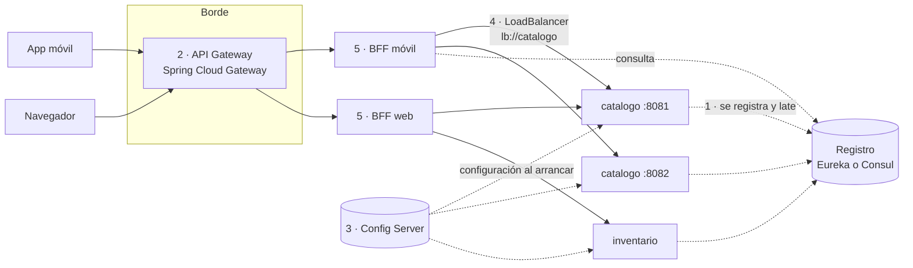
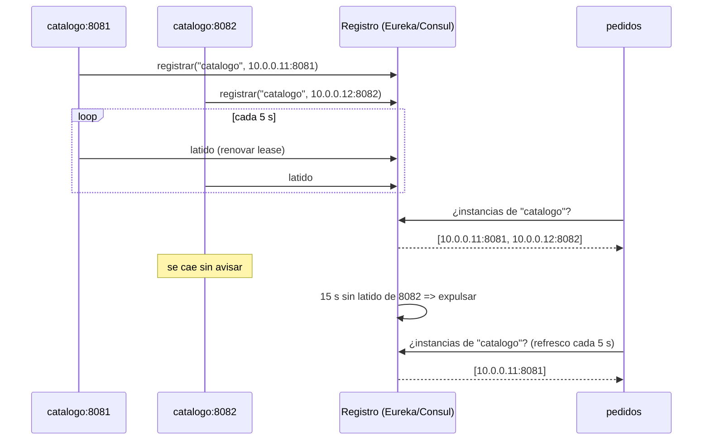
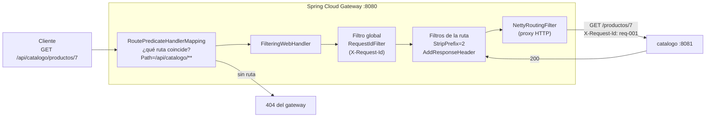
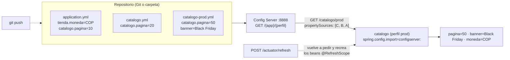
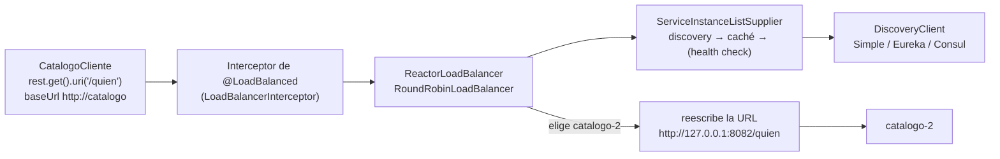
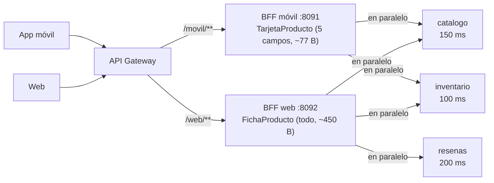

# Módulo 7 · Spring Cloud e infraestructura

**Fase 1 · Spring Boot de cero a experto** (media semana según la tabla de contenidos). **Duración:** 11 h (5 temas
de 2–2,5 h). **Dificultad:** 3 de 5. **Dependencias:** Módulo 6 (comunicación entre servicios con `RestClient`), y
del Módulo 1 los perfiles y la configuración externalizada. **Herramientas:**JDK 25 LTS (25.0.5)**, **Spring Boot
4.1.3**, **Spring Cloud 2025.1.4 «Oakwood»** (Gateway 5.0.4, Netflix Eureka 5.0.3, Consul 5.0.4, Config 5.0.6,
Commons/LoadBalancer 5.0.4), **Consul 2.1.0** con Docker Compose, Testcontainers 2.0.5, Gradle 9.9.2 por el wrapper
y `curl`..

En el Módulo 6 tus servicios se llamaban con URLs fijas (`http://localhost:8082`). En producción eso no aguanta: las
instancias nacen y mueren, cambian de IP, hay varias copias de cada servicio y cada entorno tiene su configuración.
Spring Cloud te da las piezas de infraestructura que resuelven eso: un **registro** donde cada instancia se anuncia,
un **gateway** como única puerta de entrada, un **servidor de configuración** central, un **balanceador** dentro de
cada cliente y, encima de todo, el patrón **BFF** para que cada tipo de cliente reciba justo lo que necesita.



**Texto alternativo:** mapa del módulo. A la izquierda, una app móvil y un navegador entran por un único «API Gateway»
(tema 2) en el borde. El gateway reenvía a dos BFF (tema 5): uno móvil y otro web. Los BFF llaman a dos instancias de
catálogo (puertos 8081 y 8082) y a inventario, eligiendo instancia con el LoadBalancer (tema 4, `lb://catalogo`).
Con líneas punteadas, cada servicio se registra y manda latidos a un «Registro» Eureka o Consul (tema 1), que los BFF
consultan; y un «Config Server» (tema 3) entrega la configuración a cada servicio al arrancar.

---


### Service Discovery: Eureka, Consul

<details open>
<summary><strong>Capa 1 — Lectura</strong></summary>

#### ► DE QUÉ TRATA
Configurar un registro de servicios (Eureka y Consul) en el que dos instancias de catalogo se registran solas, de modo que el test EurekaRegistroTest encuentre ambas por nombre, y explicar con la salida de jdk/Registro.java cómo el registro expulsa una instancia que deja de envia…

#### ► LA IDEA EN UNA FRASE
**Configurar un registro de servicios (Eureka y Consul) en el que dos instancias de catalogo se registran solas, de modo que el test EurekaRegistroTest encuentre ambas por nombre, y explicar con la salida de jdk/Registro.java cómo el registro expulsa una instancia que deja de enviar latidos.**

#### ► POR QUÉ EXISTE ESTO
Un microservicio necesita la dirección de otro para llamarlo, igual que necesitas el número de teléfono de una persona. Si escribes la dirección a mano en el código (http://10.0.0.11:8081), el día que ese servicio cambie de máquina o se agregue una segunda copia, tu programa sigue llamando al sitio viejo.

#### ► LA ANALOGÍA
Piensa en service discovery: eureka, consul como una herramienta de taller: útil cuando conoces su propósito y sus límites.
**Dónde se rompe la analogía:** en software, los efectos dependen del contexto, la escala y los trade-offs.

#### ► CÓMO FUNCIONA


1. Un microservicio necesita la dirección de otro para llamarlo, igual que necesitas el número de teléfono de una persona.
2. Si escribes la dirección a mano en el código (http://10.0.0.11:8081), el día que ese servicio cambie de máquina o se agregue una segunda copia, tu programa sigue llamando al sitio viejo.

#### ► LO QUE PUEDE SALIR MAL
| Síntoma | Causa probable | Arreglo |
|---|---|---|
| Service Discovery: Eureka, Consul se aplica pero el resultado no mejora | Se usó sin medir el problema real | Mide antes y compara contra la alternativa simple |
| Aparece complejidad inesperada | Se adoptó la técnica sin comprender sus trade-offs | Vuelve a la sección de trade-offs y reduce el alcance |
| Falla en un caso límite | Se asumió un contexto que no se cumple | Prueba el caso límite y documenta cuándo NO usarlo |

#### ► TRADE-OFFS
| Opción | Cuándo usarla | Cuándo NO usarla |
|---|---|---|
| Usar Service Discovery: Eureka, Consul | Cuando el problema coincide con su propósito y el beneficio es observable | Cuando agrega complejidad sin resolver un problema real |
| Alternativa más simple | Cuando el contexto es pequeño, estable o fácil de razonar | Cuando ya demostró no escalar o no cumplir el requisito |
| Postergar la decisión | Cuando falta evidencia del problema | Cuando el costo de esperar es mayor que el costo de probar |

#### ► CUÁNDO NO USAR ESTO
Direcciones fijas «temporales» y registro sin caché ni timeouts:

#### ► DE VUELTA A LA ANALOGÍA
Volviendo a la analogía: service discovery: eureka, consul funciona como el modelo inicial, pero recuerda dónde se rompe: en producción importan la evidencia, la escala y el costo de equivocarte.

#### ► LO QUE DEBES RECORDAR
- Un microservicio necesita la dirección de otro para llamarlo, igual que necesitas el número de teléfono de una persona.
- Si escribes la dirección a mano en el código (http://10.0.0.11:8081), el día que ese servicio cambie de máquina o se agregue una segunda copia, tu programa sigue llamando al sitio viejo.

#### ► PREGUNTAS PARA PENSAR
1. ¿Qué problema concreto resuelve service discovery: eureka, consul en tu contexto?
2. ¿Cómo sabrías que service discovery: eureka, consul no está funcionando bien?
3. ¿Qué alternativa más simple considerarías antes de usar service discovery: eureka, consul?

</details>

<details>
<summary><strong>Capa 2 — Construcción</strong></summary>

#### Código de referencia / ejecutable
**Versiones:** JDK 25 LTS, Spring Boot 4.1.3, Spring Cloud 2025.1.4 (Netflix Eureka 5.0.3, Consul 5.0.4),
Testcontainers 2.0.5, imagen `hashicorp/consul:2.1.0`.

**El mecanismo con JDK puro** — `modulo-11/jdk/Registro.java` (se ejecuta con `java Registro.java`, sin dependencias):

```java
// F052 · Service Discovery por dentro: un registro mínimo con latidos y expulsión (solo JDK 25).
// Ejecuta: java Registro.java
// Qué demuestra: las instancias se registran, mandan latidos y el registro expulsa
// a la que deja de latir (lo mismo que hacen Eureka con sus "leases" y Consul con sus checks TTL).
import com.sun.net.httpserver.HttpServer;
import java.net.InetSocketAddress;
import java.net.URI;
import java.net.http.HttpClient;
import java.net.http.HttpRequest;
import java.net.http.HttpResponse;
import java.nio.charset.StandardCharsets;
import java.util.Map;
import java.util.TreeMap;
import java.util.concurrent.ConcurrentHashMap;
import java.util.concurrent.Executors;
import java.util.concurrent.TimeUnit;

public class Registro {

    static final long TTL_MS = 3_000;                       // sin latido durante 3 s => fuera
    // servicio -> (idInstancia -> [url, instante del último latido])
    static final Map<String, Map<String, Object[]>> REGISTRO = new ConcurrentHashMap<>();

    public static void main(String[] args) throws Exception {
        HttpServer servidor = HttpServer.create(new InetSocketAddress("127.0.0.1", 0), 0);
        // PUT /registro/{servicio}/{id}?url=...  registra o renueva (latido)
        servidor.createContext("/registro/", ex -> {
            String[] partes = ex.getRequestURI().getPath().split("/"); // ["", "registro", servicio, id]
            String url = ex.getRequestURI().getQuery().substring("url=".length());
            REGISTRO.computeIfAbsent(partes[2], s -> new ConcurrentHashMap<>())
                    .put(partes[3], new Object[] {url, System.currentTimeMillis()});
            ex.sendResponseHeaders(204, -1);
            ex.close();
        });
        // GET /servicios/{servicio}  devuelve las instancias vivas como "id=url" separadas por coma
        servidor.createContext("/servicios/", ex -> {
            String servicio = ex.getRequestURI().getPath().substring("/servicios/".length());
            Map<String, String> vivas = new TreeMap<>();
            REGISTRO.getOrDefault(servicio, Map.of()).forEach((id, v) -> vivas.put(id, (String) v[0]));
            byte[] cuerpo = vivas.toString().getBytes(StandardCharsets.UTF_8);
            ex.sendResponseHeaders(200, cuerpo.length);
            ex.getResponseBody().write(cuerpo);
            ex.close();
        });
        servidor.start();
        String base = "http://127.0.0.1:" + servidor.getAddress().getPort();

        // Expulsor: cada 500 ms borra las instancias cuyo último latido es más viejo que el TTL.
        var tareas = Executors.newScheduledThreadPool(2);
        tareas.scheduleAtFixedRate(() -> REGISTRO.values().forEach(instancias ->
            instancias.entrySet().removeIf(e -> {
                boolean vencida = System.currentTimeMillis() - (long) e.getValue()[1] > TTL_MS;
                if (vencida) System.out.println("[registro] expulsada " + e.getKey() + " (sin latido > " + TTL_MS + " ms)");
                return vencida;
            })), 500, 500, TimeUnit.MILLISECONDS);

        HttpClient http = HttpClient.newHttpClient();
        Runnable latido1 = () -> put(http, base + "/registro/catalogo/catalogo-1?url=http://10.0.0.11:8081");
        latido1.run();
        put(http, base + "/registro/catalogo/catalogo-2?url=http://10.0.0.12:8081"); // se registra y "muere"
        // catalogo-1 sigue latiendo cada segundo; catalogo-2 nunca vuelve a latir.
        tareas.scheduleAtFixedRate(latido1, 1, 1, TimeUnit.SECONDS);

        String antes = get(http, base + "/servicios/catalogo");
        System.out.println("t=0s   instancias de catalogo: " + antes);
        Thread.sleep(4_500);
        String despues = get(http, base + "/servicios/catalogo");
        System.out.println("t=4,5s instancias de catalogo: " + despues);

        tareas.shutdownNow();
        servidor.stop(0);
        if (!antes.contains("catalogo-2") || despues.contains("catalogo-2") || !despues.contains("catalogo-1")) {
            System.out.println("FALLA: el registro no expulsó a catalogo-2");
            System.exit(1);
        }
        System.out.println("OK: el cliente solo ve instancias que laten");
    }

    static void put(HttpClient http, String url) {
        try {
            http.send(HttpRequest.newBuilder(URI.create(url)).PUT(HttpRequest.BodyPublishers.noBody()).build(),
                      HttpResponse.BodyHandlers.discarding());
        } catch (Exception e) { throw new IllegalStateException(e); }
    }

    static String get(HttpClient http, String url) throws Exception {
        return http.send(HttpRequest.newBuilder(URI.create(url)).build(), HttpResponse.BodyHandlers.ofString()).body();
    }
}
```

**Eureka con Spring Cloud.** Un solo proyecto con dos aplicaciones: el servidor (lee `servidor.yml`) y el servicio
`catalogo` (lee `catalogo.yml`). `f052-eureka/build.gradle.kts`:

```kotlin
// F052 · Service Discovery con Eureka: servidor + cliente "catalogo" en un mismo proyecto
plugins {
    java
    alias(libs.plugins.spring.boot)
    alias(libs.plugins.spring.dependency.management)
}

group = "academia.microservicios"
version = "1.0.0"

java {
    toolchain {
        languageVersion = JavaLanguageVersion.of(25)
    }
}

dependencyManagement {
    imports {
        mavenBom("org.springframework.cloud:spring-cloud-dependencies:${libs.versions.spring.cloud.get()}")
    }
}

dependencies {
    // Servidor Eureka 5.0.3 (trae también el cliente Eureka)
    implementation(libs.spring.cloud.starter.netflix.eureka.server)
    // API HTTP del catálogo (Tomcat 11)
    implementation(libs.spring.boot.starter.webmvc)
    // El cliente Eureka usa RestClient para hablar con el servidor
    implementation(libs.spring.boot.starter.restclient)
    // /actuator/health: lo que Eureka publica como estado de la instancia
    implementation(libs.spring.boot.starter.actuator)
    testImplementation(libs.spring.boot.starter.test)
    // Gradle 9 exige declarar el lanzador de JUnit Platform (ya no lo añade por su cuenta)
    testRuntimeOnly(libs.junit.platform.launcher)
}

tasks.withType<Test> {
    useJUnitPlatform()
    testLogging {
        events("passed", "skipped", "failed")   // una línea por test en la consola
        // el mensaje completo de cada fallo (valor esperado y obtenido), no solo el tipo de excepción
        exceptionFormat = org.gradle.api.tasks.testing.logging.TestExceptionFormat.FULL
    }
}

// Este proyecto tiene varias clases con main. Elige cuál arranca (bootRun) o se empaqueta (bootJar) con
// -Pprincipal=paquete.Clase (en Maven: -Dspring-boot.run.main-class=...). Los tests no lo necesitan.
springBoot {
    providers.gradleProperty("principal").orNull?.let { mainClass = it }
}
```

> **Build con Gradle (y su equivalencia en Maven).** Este laboratorio se construye con **Gradle 9.9.2** y Kotlin DSL
> mediante el wrapper `./gradlew` (no instalas Gradle). `settings.gradle.kts` lista los subproyectos (en Maven,
> `<modules>` del POM agregador), cada carpeta tiene su `build.gradle.kts` (su `pom.xml`) y
> `gradle/libs.versions.toml` es el **catálogo de versiones** (las `<properties>` y el `dependencyManagement`): por eso
> las dependencias se escriben `libs.…`. Equivalencias: `./mvnw test` → `./gradlew test` ·
> `./mvnw package -DskipTests` → `./gradlew bootJar` · `./mvnw spring-boot:run` → `./gradlew bootRun` ·
> `-Dtest=Clase` → `--tests Clase` · `target/` → `build/` (el jar queda en `build/libs/`). Gradle escribe una línea
> `PASSED` por test y termina con `BUILD SUCCESSFUL` (Maven: `Tests run: N` y `BUILD SUCCESS`).

`modulo-11/settings.gradle.kts`:

```kotlin
// Módulo 7 (modulo-11) · Build multi-proyecto: "./gradlew test" ejecuta los tests de todos los subproyectos.
// Cada carpeta tiene su propio build.gradle.kts; las versiones viven en gradle/libs.versions.toml
// (catálogo "libs"). Equivale al POM agregador con <modules> de Maven.
pluginManagement {
    repositories {
        gradlePluginPortal()
        mavenCentral()
    }
}
// Sin esto, un alumno sin JDK 25 instalado ve el build morir en la configuración, antes de cualquier test.
plugins {
    id("org.gradle.toolchains.foojay-resolver-convention") version "1.0.0"
}

dependencyResolutionManagement {
    repositories {
        mavenCentral()
    }
}

rootProject.name = "modulo-11-laboratorios"

include(
    "f052-eureka",
    "f052-consul",
    "f053-gateway",
    "f054-config",
    "f055-loadbalancer",
    "f056-bff",
)
```

`modulo-11/gradle/libs.versions.toml`:

```toml
# Módulo 7 (modulo-11)
# Catálogo de versiones del laboratorio: una sola fuente para plugins y librerías.
# Las librerías SIN versión las fija el BOM de Spring Boot (spring-boot-dependencies) o el BOM que importe el proyecto.

[versions]
spring-boot = "4.1.3"
# Tren de Spring Cloud compatible con Spring Boot 4.1.x
spring-cloud = "2025.1.4"

[libraries]
spring-cloud-starter-netflix-eureka-server = { module = "org.springframework.cloud:spring-cloud-starter-netflix-eureka-server" }
spring-boot-starter-webmvc = { module = "org.springframework.boot:spring-boot-starter-webmvc" }
spring-boot-starter-restclient = { module = "org.springframework.boot:spring-boot-starter-restclient" }
spring-boot-starter-actuator = { module = "org.springframework.boot:spring-boot-starter-actuator" }
spring-boot-starter-test = { module = "org.springframework.boot:spring-boot-starter-test" }
junit-platform-launcher = { module = "org.junit.platform:junit-platform-launcher" }
spring-cloud-starter-consul-discovery = { module = "org.springframework.cloud:spring-cloud-starter-consul-discovery" }
testcontainers-junit-jupiter = { module = "org.testcontainers:testcontainers-junit-jupiter" }
testcontainers-consul = { module = "org.testcontainers:testcontainers-consul" }
spring-cloud-starter-gateway-server-webflux = { module = "org.springframework.cloud:spring-cloud-starter-gateway-server-webflux" }
spring-cloud-config-server = { module = "org.springframework.cloud:spring-cloud-config-server" }
spring-cloud-starter-config = { module = "org.springframework.cloud:spring-cloud-starter-config" }
spring-cloud-starter-loadbalancer = { module = "org.springframework.cloud:spring-cloud-starter-loadbalancer" }

[plugins]
spring-boot = { id = "org.springframework.boot", version.ref = "spring-boot" }
spring-dependency-management = { id = "io.spring.dependency-management", version = "1.1.7" }
```

`f052-eureka/src/main/java/academia/discovery/servidor/EurekaServidorApp.java`:

```java
package academia.discovery.servidor;

import org.springframework.boot.autoconfigure.SpringBootApplication;
import org.springframework.boot.builder.SpringApplicationBuilder;
import org.springframework.cloud.netflix.eureka.server.EnableEurekaServer;
import org.springframework.context.ConfigurableApplicationContext;

/** Registro de servicios. Lee su configuración de servidor.yml (no de application.yml). */
@SpringBootApplication
@EnableEurekaServer
public class EurekaServidorApp {

    public static ConfigurableApplicationContext arrancar(String... args) {
        return new SpringApplicationBuilder(EurekaServidorApp.class)
            .properties("spring.config.name=servidor")
            .run(args);
    }

    public static void main(String[] args) {
        arrancar(args);
    }
}
```

`f052-eureka/src/main/resources/servidor.yml`:

```yaml
server:
  port: 8761
spring:
  application:
    name: eureka-servidor
eureka:
  instance:
    hostname: localhost
  client:
    # El starter del SERVIDOR trae Jersey 3 al classpath (org.glassfish.jersey.client.JerseyClient). Con
    # jersey.enabled=true (valor por defecto) el cliente Eureka elige Jersey, pero nadie crea su
    # TransportClientFactories y el EurekaClient no se puede construir. Forzamos RestClient.
    jersey:
      enabled: false
    # El servidor no se registra a sí mismo ni descarga el registro (modo standalone).
    register-with-eureka: false
    fetch-registry: false
  server:
    # Solo para el laboratorio: expulsar rápido y responder sin la caché de 30 s.
    enable-self-preservation: false
    eviction-interval-timer-in-ms: 2000
    use-read-only-response-cache: false
```

`f052-eureka/src/main/java/academia/discovery/catalogo/CatalogoApp.java`:

```java
package academia.discovery.catalogo;

import java.util.List;
import org.springframework.boot.autoconfigure.SpringBootApplication;
import org.springframework.boot.builder.SpringApplicationBuilder;
import org.springframework.cloud.client.ServiceInstance;
import org.springframework.cloud.client.discovery.DiscoveryClient;
import org.springframework.context.ConfigurableApplicationContext;
import org.springframework.web.bind.annotation.GetMapping;
import org.springframework.web.bind.annotation.PathVariable;
import org.springframework.web.bind.annotation.RestController;

/** Servicio "catalogo": se registra en Eureka al arrancar y consulta el registro. Config: catalogo.yml. */
@SpringBootApplication
@RestController
public class CatalogoApp {

    record Producto(long id, String nombre, long precio, String atendidoPor) {}

    private final DiscoveryClient discovery;
    private final String instancia;

    CatalogoApp(DiscoveryClient discovery, org.springframework.core.env.Environment env) {
        this.discovery = discovery;
        this.instancia = env.getProperty("eureka.instance.instance-id", "?");
    }

    @GetMapping("/productos/{id}")
    Producto producto(@PathVariable long id) {
        return new Producto(id, "Audífonos BT", 189_000, instancia);
    }

    /** Lo que el registro dice que existe de un servicio (lista local, refrescada cada 5 s). */
    @GetMapping("/instancias/{servicio}")
    List<String> instancias(@PathVariable String servicio) {
        return discovery.getInstances(servicio).stream()
            .map(i -> i.getInstanceId() + " -> " + i.getUri())
            .toList();
    }

    public static ConfigurableApplicationContext arrancar(String... args) {
        return new SpringApplicationBuilder(CatalogoApp.class)
            .properties("spring.config.name=catalogo")
            .run(args);
    }

    public static void main(String[] args) {
        arrancar(args);
    }
}
```

`f052-eureka/src/main/resources/catalogo.yml` (latidos de 5 s y expulsión a los 15 s **solo para el laboratorio**;
en producción deja los valores por defecto):

```yaml
server:
  port: ${PUERTO:8081}
spring:
  application:
    name: catalogo            # este es el nombre con el que otros lo buscarán
eureka:
  client:
    # El starter del SERVIDOR trae Jersey 3 al classpath (org.glassfish.jersey.client.JerseyClient). Con
    # jersey.enabled=true (valor por defecto) el cliente Eureka elige Jersey, pero nadie crea su
    # TransportClientFactories y el EurekaClient no se puede construir. Forzamos RestClient.
    jersey:
      enabled: false
    service-url:
      defaultZone: ${EUREKA_URL:http://localhost:8761/eureka/}
    registry-fetch-interval-seconds: 5      # por defecto 30
  instance:
    instance-id: ${spring.application.name}:${server.port}
    lease-renewal-interval-in-seconds: 5    # latido; por defecto 30
    lease-expiration-duration-in-seconds: 15 # sin latido durante 15 s => expulsado; por defecto 90
management:
  endpoints:
    web:
      exposure:
        include: health,info
```

**Consul.** El mismo servicio, otra dependencia. `f052-consul/build.gradle.kts`:

```kotlin
// F052 · Service Discovery con Consul: el mismo catálogo registrado en Consul 2.1
plugins {
    java
    alias(libs.plugins.spring.boot)
    alias(libs.plugins.spring.dependency.management)
}

group = "academia.microservicios"
version = "1.0.0"

java {
    toolchain {
        languageVersion = JavaLanguageVersion.of(25)
    }
}

dependencyManagement {
    imports {
        mavenBom("org.springframework.cloud:spring-cloud-dependencies:${libs.versions.spring.cloud.get()}")
    }
}

dependencies {
    // Cliente de Consul 5.0.4: registro + chequeo de salud + DiscoveryClient
    implementation(libs.spring.cloud.starter.consul.discovery)
    // API HTTP del catálogo
    implementation(libs.spring.boot.starter.webmvc)
    // Consul llama a /actuator/health cada 10 s para saber si la instancia está sana
    implementation(libs.spring.boot.starter.actuator)
    // Testcontainers 2.0.5 (gestionado por Boot): Consul real en el test
    testImplementation(libs.testcontainers.junit.jupiter)
    testImplementation(libs.testcontainers.consul)
    testImplementation(libs.spring.boot.starter.test)
    // Gradle 9 exige declarar el lanzador de JUnit Platform (ya no lo añade por su cuenta)
    testRuntimeOnly(libs.junit.platform.launcher)
}

tasks.withType<Test> {
    useJUnitPlatform()
    testLogging {
        events("passed", "skipped", "failed")   // una línea por test en la consola
        // el mensaje completo de cada fallo (valor esperado y obtenido), no solo el tipo de excepción
        exceptionFormat = org.gradle.api.tasks.testing.logging.TestExceptionFormat.FULL
    }
}
```

(Es igual al de Eureka cambiando las dependencias; el BOM de Spring Cloud 2025.1.4 se importa en el bloque
`dependencyManagement`.) `f052-consul/src/main/resources/application.yml`:

```yaml
server:
  port: ${PUERTO:8081}
spring:
  application:
    name: catalogo
  cloud:
    consul:
      host: ${CONSUL_HOST:localhost}
      port: 8500
      discovery:
        instance-id: ${spring.application.name}-${server.port}
        health-check-path: /actuator/health
        health-check-interval: 10s
        prefer-ip-address: true
```

`docker-compose.yml` del módulo (Consul en modo desarrollo):

```yaml
# Módulo 7 (modulo-11) · Infraestructura de Spring Cloud.
# Consul 2.1.0 en modo desarrollo (un solo nodo, todo en memoria): registro de servicios + UI.
#   docker compose up -d --wait      -> UI en http://localhost:8500
#   docker compose down
# Eureka Server y Config Server son aplicaciones Spring Boot del laboratorio: se arrancan con ./gradlew
# (ver README). El test de f052-consul arranca su propio Consul con Testcontainers.
services:
  consul:
    image: hashicorp/consul:2.1.0
    command: ["agent", "-dev", "-client=0.0.0.0", "-ui"]
    ports: ["8500:8500"]
    # Para que Consul pueda llamar a /actuator/health de las apps que corren en tu máquina (Linux).
    extra_hosts: ["host.docker.internal:host-gateway"]
    healthcheck:
      test: ["CMD", "consul", "members"]
      interval: 3s
      timeout: 3s
      retries: 20
```

#### Verificación
`f052-eureka/src/test/java/academia/discovery/EurekaRegistroTest.java` arranca el servidor y **dos** instancias de
`catalogo` en la misma JVM, cada una en un puerto libre, y espera hasta 30 s a que el `DiscoveryClient` vea las dos:

```java
package academia.discovery;

import static org.assertj.core.api.Assertions.assertThat;

import academia.discovery.catalogo.CatalogoApp;
import academia.discovery.servidor.EurekaServidorApp;
import java.net.ServerSocket;
import java.util.List;
import org.junit.jupiter.api.Test;
import org.springframework.cloud.client.ServiceInstance;
import org.springframework.cloud.client.discovery.DiscoveryClient;
import org.springframework.context.ConfigurableApplicationContext;

class EurekaRegistroTest {

    @Test
    void dosInstanciasDeCatalogoSeRegistranYSeDescubren() throws Exception {
        int puertoEureka = libre(), puerto1 = libre(), puerto2 = libre();
        String eureka = "--eureka.client.service-url.defaultZone=http://localhost:" + puertoEureka + "/eureka/";
        try (ConfigurableApplicationContext servidor = EurekaServidorApp.arrancar("--server.port=" + puertoEureka);
             ConfigurableApplicationContext c1 = CatalogoApp.arrancar("--server.port=" + puerto1, eureka);
             ConfigurableApplicationContext c2 = CatalogoApp.arrancar("--server.port=" + puerto2, eureka)) {

            DiscoveryClient discovery = c1.getBean(DiscoveryClient.class);
            List<ServiceInstance> instancias = List.of();
            for (int i = 0; i < 60 && instancias.size() < 2; i++) {   // hasta 30 s
                Thread.sleep(500);
                instancias = discovery.getInstances("catalogo");
            }
            assertThat(instancias).extracting(ServiceInstance::getPort).containsExactlyInAnyOrder(puerto1, puerto2);
            assertThat(instancias).extracting(ServiceInstance::getInstanceId)
                .containsExactlyInAnyOrder("catalogo:" + puerto1, "catalogo:" + puerto2);
        }
    }

    static int libre() throws Exception {
        try (ServerSocket s = new ServerSocket(0)) {
            return s.getLocalPort();
        }
    }
}
```

`f052-consul/src/test/java/academia/consul/ConsulRegistroTest.java` hace lo mismo contra un Consul real arrancado con
Testcontainers:

```java
package academia.consul;

import static org.assertj.core.api.Assertions.assertThat;

import java.util.List;
import org.junit.jupiter.api.Test;
import org.springframework.beans.factory.annotation.Autowired;
import org.springframework.boot.test.context.SpringBootTest;
import org.springframework.cloud.client.ServiceInstance;
import org.springframework.cloud.client.discovery.DiscoveryClient;
import org.springframework.test.context.DynamicPropertyRegistry;
import org.springframework.test.context.DynamicPropertySource;
import org.testcontainers.consul.ConsulContainer;
import org.testcontainers.junit.jupiter.Container;
import org.testcontainers.junit.jupiter.Testcontainers;

@Testcontainers
@SpringBootTest(webEnvironment = SpringBootTest.WebEnvironment.RANDOM_PORT)
class ConsulRegistroTest {

    @Container
    static ConsulContainer consul = new ConsulContainer("hashicorp/consul:2.1.0");

    @DynamicPropertySource
    static void consul(DynamicPropertyRegistry r) {
        r.add("spring.cloud.consul.host", consul::getHost);
        r.add("spring.cloud.consul.port", () -> consul.getMappedPort(8500));
        // El chequeo HTTP lo hace Consul desde el contenedor: no llega a tu puerto local, así que
        // en el test lo desactivamos y solo comprobamos registro y descubrimiento.
        r.add("spring.cloud.consul.discovery.register-health-check", () -> "false");
    }

    @Autowired DiscoveryClient discovery;

    @Test
    void elCatalogoApareceEnConsul() throws Exception {
        List<ServiceInstance> instancias = List.of();
        for (int i = 0; i < 20 && instancias.isEmpty(); i++) {
            Thread.sleep(500);
            instancias = discovery.getInstances("catalogo");
        }
        assertThat(instancias).hasSize(1);
        assertThat(instancias.getFirst().getInstanceId()).startsWith("catalogo-");
        assertThat(discovery.getServices()).contains("catalogo", "consul");
    }
}
```

```bash
cd f052-eureka && ../gradlew test
cd ../f052-consul && ../gradlew test        # Docker encendido
```

**Output esperado:** 1 línea `PASSED` y `BUILD SUCCESSFUL` *(salida de Gradle verificada en el Mac del dueño el 2026-11-21 con Gradle 9.9.2, Java 25.0.5.1 autoaprovisto y Docker Compose v5.7.1)* en cada carpeta.

**Pregunta de comprobación:** con los valores por defecto de Eureka (latido 30 s, expulsión 90 s, refresco del
cliente 30 s), una instancia muere por un corte de luz. ¿Cuánto tiempo, como máximo aproximado, pueden seguir
llegándole peticiones y qué te protege mientras tanto?

<details>
<summary>Respuesta</summary>

Unos 90 s hasta que el servidor la expulsa (más el intervalo del expulsor, 60 s por defecto), más hasta 30 s de la
caché de respuestas del servidor y 30 s del refresco del cliente: del orden de 2–3 minutos. Mientras tanto te
protegen los timeouts, los reintentos contra otra instancia y el circuit breaker del Módulo 8. Por eso el registro
nunca sustituye a la resiliencia.
</details>

</details>

### API Gateway: Spring Cloud Gateway

<details open>
<summary><strong>Capa 1 — Lectura</strong></summary>

#### ► DE QUÉ TRATA
Construir un API Gateway con Spring Cloud Gateway que enrute /api/catalogo/ y /api/inventario/ a sus servicios, quite el prefijo y añada un X-Request-Id, de modo que los 3 tests de GatewayTest pasen, y distinguir en una respuesta 404 si la dio el gateway (sin ruta) o el servicio…

#### ► LA IDEA EN UNA FRASE
**Construir un API Gateway con Spring Cloud Gateway que enrute /api/catalogo/ y /api/inventario/ a sus servicios, quite el prefijo y añada un X-Request-Id, de modo que los 3 tests de GatewayTest pasen, y distinguir en una respuesta 404 si la dio el gateway (sin ruta) o el servicio (ruta mal reescrita).**

#### ► POR QUÉ EXISTE ESTO
Cuando tienes muchos servicios, cada uno con su dirección, los clientes (la app, la web) tendrían que conocerlos todos. Un API Gateway es un único servidor que se pone delante: el cliente solo conoce https://api.tienda.com, y el gateway decide a qué servicio interno mandar cada petición mirando la ruta.

#### ► LA ANALOGÍA
Piensa en api gateway: spring cloud gateway como una herramienta de taller: útil cuando conoces su propósito y sus límites.
**Dónde se rompe la analogía:** en software, los efectos dependen del contexto, la escala y los trade-offs.

#### ► CÓMO FUNCIONA


1. Cuando tienes muchos servicios, cada uno con su dirección, los clientes (la app, la web) tendrían que conocerlos todos.
2. Un API Gateway es un único servidor que se pone delante: el cliente solo conoce https://api.tienda.com, y el gateway decide a qué servicio interno mandar cada petición mirando la ruta.

#### ► LO QUE PUEDE SALIR MAL
| Síntoma | Causa probable | Arreglo |
|---|---|---|
| API Gateway: Spring Cloud Gateway se aplica pero el resultado no mejora | Se usó sin medir el problema real | Mide antes y compara contra la alternativa simple |
| Aparece complejidad inesperada | Se adoptó la técnica sin comprender sus trade-offs | Vuelve a la sección de trade-offs y reduce el alcance |
| Falla en un caso límite | Se asumió un contexto que no se cumple | Prueba el caso límite y documenta cuándo NO usarlo |

#### ► TRADE-OFFS
| Opción | Cuándo usarla | Cuándo NO usarla |
|---|---|---|
| Usar API Gateway: Spring Cloud Gateway | Cuando el problema coincide con su propósito y el beneficio es observable | Cuando agrega complejidad sin resolver un problema real |
| Alternativa más simple | Cuando el contexto es pequeño, estable o fácil de razonar | Cuando ya demostró no escalar o no cumplir el requisito |
| Postergar la decisión | Cuando falta evidencia del problema | Cuando el costo de esperar es mayor que el costo de probar |

#### ► CUÁNDO NO USAR ESTO
El gateway «inteligente» (monolito en el borde):

#### ► DE VUELTA A LA ANALOGÍA
Volviendo a la analogía: api gateway: spring cloud gateway funciona como el modelo inicial, pero recuerda dónde se rompe: en producción importan la evidencia, la escala y el costo de equivocarte.

#### ► LO QUE DEBES RECORDAR
- Cuando tienes muchos servicios, cada uno con su dirección, los clientes (la app, la web) tendrían que conocerlos todos.
- Un API Gateway es un único servidor que se pone delante: el cliente solo conoce https://api.tienda.com, y el gateway decide a qué servicio interno mandar cada petición mirando la ruta.

#### ► PREGUNTAS PARA PENSAR
1. ¿Qué problema concreto resuelve api gateway: spring cloud gateway en tu contexto?
2. ¿Cómo sabrías que api gateway: spring cloud gateway no está funcionando bien?
3. ¿Qué alternativa más simple considerarías antes de usar api gateway: spring cloud gateway?

</details>

<details>
<summary><strong>Capa 2 — Construcción</strong></summary>

#### Código de referencia / ejecutable
**Versiones:** JDK 25 LTS, Spring Boot 4.1.3, Spring Cloud 2025.1.4 (Spring Cloud Gateway 5.0.4, variante WebFlux).

**El mecanismo con JDK puro** — `modulo-11/jdk/MiniGateway.java`:

```java
// F053 · API Gateway por dentro: tabla de rutas, StripPrefix y X-Request-Id (solo JDK 25).
// Ejecuta: java MiniGateway.java
// Qué demuestra: un único punto de entrada que enruta por prefijo, quita el prefijo antes de
// reenviar, añade un identificador de petición y responde 404 a lo que no tiene ruta.
import com.sun.net.httpserver.HttpExchange;
import com.sun.net.httpserver.HttpServer;
import java.io.IOException;
import java.net.InetSocketAddress;
import java.net.URI;
import java.net.http.HttpClient;
import java.net.http.HttpRequest;
import java.net.http.HttpResponse;
import java.nio.charset.StandardCharsets;
import java.util.LinkedHashMap;
import java.util.Map;
import java.util.UUID;

public class MiniGateway {

    public static void main(String[] args) throws Exception {
        // Dos servicios de juguete que responden qué ruta y qué X-Request-Id les llegó.
        HttpServer catalogo = backend("catalogo");
        HttpServer inventario = backend("inventario");

        // Tabla de rutas: prefijo público -> servicio interno (lo que en Spring Cloud Gateway es
        // "predicates: Path=/api/catalogo/**" + "filters: StripPrefix=2").
        Map<String, String> rutas = new LinkedHashMap<>();
        rutas.put("/api/catalogo/", "http://127.0.0.1:" + catalogo.getAddress().getPort());
        rutas.put("/api/inventario/", "http://127.0.0.1:" + inventario.getAddress().getPort());

        HttpClient http = HttpClient.newHttpClient();
        HttpServer gateway = HttpServer.create(new InetSocketAddress("127.0.0.1", 0), 0);
        gateway.createContext("/", ex -> {
            String ruta = ex.getRequestURI().getPath();
            String destino = rutas.entrySet().stream()
                .filter(r -> ruta.startsWith(r.getKey()))
                .map(r -> r.getValue() + "/" + ruta.substring(r.getKey().length()))   // StripPrefix=2
                .findFirst().orElse(null);
            if (destino == null) {
                responder(ex, 404, "{\"error\":\"SIN_RUTA\",\"ruta\":\"" + ruta + "\"}");
                return;
            }
            String id = ex.getRequestHeaders().getFirst("X-Request-Id");
            if (id == null) id = UUID.randomUUID().toString();             // filtro global
            try {
                HttpResponse<String> r = http.send(HttpRequest.newBuilder(URI.create(destino))
                        .header("X-Request-Id", id).build(), HttpResponse.BodyHandlers.ofString());
                ex.getResponseHeaders().add("X-Request-Id", id);
                responder(ex, r.statusCode(), r.body());
            } catch (Exception e) {
                responder(ex, 502, "{\"error\":\"SERVICIO_NO_RESPONDE\"}");
            }
        });
        gateway.start();
        String gw = "http://127.0.0.1:" + gateway.getAddress().getPort();

        int fallos = 0;
        fallos += probar(http, gw + "/api/catalogo/productos/7", "req-001", 200, "catalogo recibió /productos/7 con X-Request-Id=req-001");
        fallos += probar(http, gw + "/api/inventario/stock/7", "req-002", 200, "inventario recibió /stock/7 con X-Request-Id=req-002");
        fallos += probar(http, gw + "/api/pagos/1", "req-003", 404, "SIN_RUTA");
        inventario.stop(0);                                                // apagamos un servicio
        fallos += probar(http, gw + "/api/inventario/stock/7", "req-004", 502, "SERVICIO_NO_RESPONDE");

        gateway.stop(0);
        catalogo.stop(0);
        System.out.println(fallos == 0 ? "OK: el gateway enruta, quita el prefijo y propaga X-Request-Id" : "FALLA");
        System.exit(fallos == 0 ? 0 : 1);
    }

    static int probar(HttpClient http, String url, String id, int estado, String esperado) throws Exception {
        HttpResponse<String> r = http.send(HttpRequest.newBuilder(URI.create(url)).header("X-Request-Id", id).build(),
                                           HttpResponse.BodyHandlers.ofString());
        String ruta = URI.create(url).getPath();
        System.out.printf("GET %-26s -> %d %s%n", ruta, r.statusCode(), r.body());
        return r.statusCode() == estado && r.body().contains(esperado) ? 0 : 1;
    }

    static HttpServer backend(String nombre) throws IOException {
        HttpServer s = HttpServer.create(new InetSocketAddress("127.0.0.1", 0), 0);
        s.createContext("/", ex -> responder(ex, 200, nombre + " recibió " + ex.getRequestURI().getPath()
                + " con X-Request-Id=" + ex.getRequestHeaders().getFirst("X-Request-Id")));
        s.start();
        return s;
    }

    static void responder(HttpExchange ex, int estado, String cuerpo) throws IOException {
        byte[] b = cuerpo.getBytes(StandardCharsets.UTF_8);
        ex.sendResponseHeaders(estado, b.length);
        ex.getResponseBody().write(b);
        ex.close();
    }
}
```

**Spring Cloud Gateway.** `f053-gateway/build.gradle.kts`:

```kotlin
// F053 · API Gateway con Spring Cloud Gateway (servidor WebFlux)
plugins {
    java
    alias(libs.plugins.spring.boot)
    alias(libs.plugins.spring.dependency.management)
}

group = "academia.microservicios"
version = "1.0.0"

java {
    toolchain {
        languageVersion = JavaLanguageVersion.of(25)
    }
}

dependencyManagement {
    imports {
        mavenBom("org.springframework.cloud:spring-cloud-dependencies:${libs.versions.spring.cloud.get()}")
    }
}

dependencies {
    // Spring Cloud Gateway 5.0.4 sobre WebFlux/Netty (nombre del starter desde Spring Cloud 2025.0)
    implementation(libs.spring.cloud.starter.gateway.server.webflux)
    testImplementation(libs.spring.boot.starter.test)
    // Gradle 9 exige declarar el lanzador de JUnit Platform (ya no lo añade por su cuenta)
    testRuntimeOnly(libs.junit.platform.launcher)
}

tasks.withType<Test> {
    useJUnitPlatform()
    testLogging {
        events("passed", "skipped", "failed")   // una línea por test en la consola
        // el mensaje completo de cada fallo (valor esperado y obtenido), no solo el tipo de excepción
        exceptionFormat = org.gradle.api.tasks.testing.logging.TestExceptionFormat.FULL
    }
}
```

`f053-gateway/src/main/resources/application.yml` (toda la lógica de enrutamiento):

```yaml
server:
  port: 8080
spring:
  application:
    name: gateway
  cloud:
    gateway:
      server:
        webflux:
          routes:
            - id: catalogo
              uri: ${CATALOGO_URL:http://localhost:8081}   # con discovery: lb://catalogo
              predicates:
                - Path=/api/catalogo/**
              filters:
                - StripPrefix=2                  # /api/catalogo/productos/7 -> /productos/7
                - AddResponseHeader=X-Gateway, academia
            - id: inventario
              uri: ${INVENTARIO_URL:http://localhost:8082}
              predicates:
                - Path=/api/inventario/**
              filters:
                - StripPrefix=2
          httpclient:
            connect-timeout: 1000               # ms para abrir la conexión con el servicio
            response-timeout: 2s                # tiempo máximo esperando la respuesta
```

`f053-gateway/src/main/java/academia/gateway/RequestIdFilter.java`:

```java
package academia.gateway;

import java.util.Optional;
import java.util.UUID;
import org.springframework.cloud.gateway.filter.GatewayFilterChain;
import org.springframework.cloud.gateway.filter.GlobalFilter;
import org.springframework.core.Ordered;
import org.springframework.http.server.reactive.ServerHttpRequest;
import org.springframework.stereotype.Component;
import org.springframework.web.server.ServerWebExchange;
import reactor.core.publisher.Mono;

/** Filtro global: toda petición sale del gateway con un X-Request-Id (el del cliente o uno nuevo). */
@Component
class RequestIdFilter implements GlobalFilter, Ordered {

    static final String CABECERA = "X-Request-Id";

    @Override
    public Mono<Void> filter(ServerWebExchange exchange, GatewayFilterChain chain) {
        String id = Optional.ofNullable(exchange.getRequest().getHeaders().getFirst(CABECERA))
            .orElseGet(() -> UUID.randomUUID().toString());
        ServerHttpRequest peticion = exchange.getRequest().mutate()
            .headers(h -> h.set(CABECERA, id))
            .build();
        exchange.getResponse().getHeaders().set(CABECERA, id);     // el cliente también lo ve
        return chain.filter(exchange.mutate().request(peticion).build());
    }

    @Override
    public int getOrder() {
        return Ordered.HIGHEST_PRECEDENCE;                          // antes que cualquier otro filtro
    }
}
```

`f053-gateway/src/main/java/academia/gateway/GatewayApp.java`:

```java
package academia.gateway;

import org.springframework.boot.SpringApplication;
import org.springframework.boot.autoconfigure.SpringBootApplication;

/** El gateway no tiene controladores: todo lo define la tabla de rutas de application.yml. */
@SpringBootApplication
public class GatewayApp {

    public static void main(String[] args) {
        SpringApplication.run(GatewayApp.class, args);
    }
}
```

#### Verificación
`f053-gateway/src/test/java/academia/gateway/GatewayTest.java` arranca el gateway en un puerto aleatorio con dos
servicios de prueba (`Backend.java`, un `HttpServer` del JDK) y comprueba enrutamiento, `X-Request-Id` y 404:

```java
package academia.gateway;

import static org.assertj.core.api.Assertions.assertThat;

import java.net.URI;
import java.net.http.HttpClient;
import java.net.http.HttpRequest;
import java.net.http.HttpResponse;
import org.junit.jupiter.api.AfterAll;
import org.junit.jupiter.api.Test;
import org.springframework.beans.factory.annotation.Value;
import org.springframework.boot.test.context.SpringBootTest;
import org.springframework.test.context.DynamicPropertyRegistry;
import org.springframework.test.context.DynamicPropertySource;

@SpringBootTest(webEnvironment = SpringBootTest.WebEnvironment.RANDOM_PORT)
class GatewayTest {

    static Backend catalogo, inventario;

    @DynamicPropertySource
    static void rutas(DynamicPropertyRegistry r) throws Exception {
        catalogo = new Backend(0, p -> "\"catalogo recibió " + p.replace("|", " con X-Request-Id=") + "\"");
        inventario = new Backend(0, p -> "\"inventario recibió " + p.replace("|", " con X-Request-Id=") + "\"");
        r.add("CATALOGO_URL", catalogo::url);
        r.add("INVENTARIO_URL", inventario::url);
    }

    @AfterAll
    static void apagar() {
        catalogo.close();
        inventario.close();
    }

    @Value("${local.server.port}") int puerto;
    final HttpClient http = HttpClient.newHttpClient();

    HttpResponse<String> get(String ruta, String requestId) throws Exception {
        HttpRequest.Builder b = HttpRequest.newBuilder(URI.create("http://localhost:" + puerto + ruta));
        if (requestId != null) b.header("X-Request-Id", requestId);
        return http.send(b.build(), HttpResponse.BodyHandlers.ofString());
    }

    @Test
    void enrutaPorPrefijoYQuitaElPrefijo() throws Exception {
        HttpResponse<String> r = get("/api/catalogo/productos/7", "req-001");
        assertThat(r.statusCode()).isEqualTo(200);
        assertThat(r.body()).isEqualTo("\"catalogo recibió /productos/7 con X-Request-Id=req-001\"");
        assertThat(r.headers().firstValue("X-Gateway")).hasValue("academia");
    }

    @Test
    void generaUnRequestIdSiElClienteNoLoEnvia() throws Exception {
        HttpResponse<String> r = get("/api/inventario/stock/7", null);
        String id = r.headers().firstValue("X-Request-Id").orElseThrow();
        assertThat(id).hasSize(36);                                   // un UUID
        assertThat(r.body()).contains("inventario recibió /stock/7 con X-Request-Id=" + id);
    }

    @Test
    void loQueNoTieneRutaDa404() throws Exception {
        assertThat(get("/api/pagos/1", "req-003").statusCode()).isEqualTo(404);
    }
}
```

```bash
cd f053-gateway && ../gradlew test
```

**Output esperado:** 3 líneas `PASSED` (una por test) y `BUILD SUCCESSFUL` *(salida de Gradle verificada en el Mac del dueño el 2026-11-21 con Gradle 9.9.2, Java 25.0.5.1 autoaprovisto y Docker Compose v5.7.1)*.

**Pregunta de comprobación:** tienes dos rutas: `Path=/api/**` → `legado` y, debajo, `Path=/api/catalogo/**` →
`catalogo`. ¿A dónde va `GET /api/catalogo/productos/7` y cómo lo arreglas?

<details>
<summary>Respuesta</summary>

Va a `legado`: la primera ruta que coincide gana y `/api/**` coincide con todo. Pon la ruta más específica primero
(o usa la propiedad `order` de cada ruta, menor número = más prioridad).
</details>

</details>

### Config Server: configuración centralizada

<details open>
<summary><strong>Capa 1 — Lectura</strong></summary>

#### ► DE QUÉ TRATA
Configurar un Config Server que sirva application.yml, catalogo.yml y catalogo-prod.yml, y un cliente que reciba la fuente de mayor prioridad, de modo que los 2 tests de ConfigServerTest pasen; y predecir qué valor ve un servicio después de un git push con y sin POST /actuator/re…

#### ► LA IDEA EN UNA FRASE
**Configurar un Config Server que sirva application.yml, catalogo.yml y catalogo-prod.yml, y un cliente que reciba la fuente de mayor prioridad, de modo que los 2 tests de ConfigServerTest pasen; y predecir qué valor ve un servicio después de un git push con y sin POST /actuator/refresh.**

#### ► POR QUÉ EXISTE ESTO
Cada servicio tiene configuración: valores que no son código y cambian según el entorno (la dirección de la base de datos, cuántos productos mostrar por página, un mensaje de promoción). Con 20 servicios y 3 entornos, tener un application.yml dentro de cada servicio significa 60 archivos repartidos, y para cambiar un valor hay que reconstruir y desplegar.

#### ► LA ANALOGÍA
Piensa en config server: configuración centralizada como una herramienta de taller: útil cuando conoces su propósito y sus límites.
**Dónde se rompe la analogía:** en software, los efectos dependen del contexto, la escala y los trade-offs.

#### ► CÓMO FUNCIONA


1. Cada servicio tiene configuración: valores que no son código y cambian según el entorno (la dirección de la base de datos, cuántos productos mostrar por página, un mensaje de promoción).
2. Con 20 servicios y 3 entornos, tener un application.yml dentro de cada servicio significa 60 archivos repartidos, y para cambiar un valor hay que reconstruir y desplegar.

#### ► LO QUE PUEDE SALIR MAL
| Síntoma | Causa probable | Arreglo |
|---|---|---|
| Config Server: configuración centralizada se aplica pero el resultado no mejora | Se usó sin medir el problema real | Mide antes y compara contra la alternativa simple |
| Aparece complejidad inesperada | Se adoptó la técnica sin comprender sus trade-offs | Vuelve a la sección de trade-offs y reduce el alcance |
| Falla en un caso límite | Se asumió un contexto que no se cumple | Prueba el caso límite y documenta cuándo NO usarlo |

#### ► TRADE-OFFS
| Opción | Cuándo usarla | Cuándo NO usarla |
|---|---|---|
| Usar Config Server: configuración centralizada | Cuando el problema coincide con su propósito y el beneficio es observable | Cuando agrega complejidad sin resolver un problema real |
| Alternativa más simple | Cuando el contexto es pequeño, estable o fácil de razonar | Cuando ya demostró no escalar o no cumplir el requisito |
| Postergar la decisión | Cuando falta evidencia del problema | Cuando el costo de esperar es mayor que el costo de probar |

#### ► CUÁNDO NO USAR ESTO
Config Server como base de datos de negocio y almacén de secretos:

#### ► DE VUELTA A LA ANALOGÍA
Volviendo a la analogía: config server: configuración centralizada funciona como el modelo inicial, pero recuerda dónde se rompe: en producción importan la evidencia, la escala y el costo de equivocarte.

#### ► LO QUE DEBES RECORDAR
- Cada servicio tiene configuración: valores que no son código y cambian según el entorno (la dirección de la base de datos, cuántos productos mostrar por página, un mensaje de promoción).
- Con 20 servicios y 3 entornos, tener un application.yml dentro de cada servicio significa 60 archivos repartidos, y para cambiar un valor hay que reconstruir y desplegar.

#### ► PREGUNTAS PARA PENSAR
1. ¿Qué problema concreto resuelve config server: configuración centralizada en tu contexto?
2. ¿Cómo sabrías que config server: configuración centralizada no está funcionando bien?
3. ¿Qué alternativa más simple considerarías antes de usar config server: configuración centralizada?

</details>

<details>
<summary><strong>Capa 2 — Construcción</strong></summary>

#### Código de referencia / ejecutable
**Versiones:** JDK 25 LTS, Spring Boot 4.1.3, Spring Cloud 2025.1.4 (Spring Cloud Config 5.0.6).

**El mecanismo con JDK puro** — `modulo-11/jdk/ConfigCentral.java`:

```java
// F054 · Config Server por dentro: un servidor de configuración y un cliente que la refresca (solo JDK 25).
// Ejecuta: java ConfigCentral.java
// Qué demuestra: (1) el orden de precedencia {app}-{perfil} > {app} > application que usa Spring
// Cloud Config, (2) que cambiar el repositorio no cambia al cliente hasta que refresca, y
// (3) qué pasa si el servidor no está: fail-fast frente a valores locales de respaldo.
import com.sun.net.httpserver.HttpServer;
import java.net.InetSocketAddress;
import java.net.URI;
import java.net.http.HttpClient;
import java.net.http.HttpRequest;
import java.net.http.HttpResponse;
import java.nio.charset.StandardCharsets;
import java.util.LinkedHashMap;
import java.util.Map;
import java.util.TreeMap;
import java.util.concurrent.ConcurrentHashMap;

public class ConfigCentral {

    // El "repositorio Git" del servidor: un archivo por nombre (application, catalogo, catalogo-prod).
    static final Map<String, Map<String, String>> REPO = new ConcurrentHashMap<>();

    public static void main(String[] args) throws Exception {
        REPO.put("application", Map.of("tienda.moneda", "COP", "catalogo.pagina", "10"));
        REPO.put("catalogo", Map.of("catalogo.pagina", "20"));
        REPO.put("catalogo-prod", Map.of("catalogo.pagina", "50", "catalogo.banner", "Black Friday"));

        HttpServer servidor = HttpServer.create(new InetSocketAddress("127.0.0.1", 0), 0);
        // GET /{app}/{perfil}: mezcla de menor a mayor prioridad, como el Config Server.
        servidor.createContext("/", ex -> {
            String[] p = ex.getRequestURI().getPath().split("/");   // ["", app, perfil]
            Map<String, String> mezcla = new TreeMap<>();
            for (String fuente : new String[] {"application", p[1], p[1] + "-" + p[2]}) {
                mezcla.putAll(REPO.getOrDefault(fuente, Map.of()));  // la última fuente gana
            }
            byte[] b = mezcla.toString().getBytes(StandardCharsets.UTF_8);
            ex.sendResponseHeaders(200, b.length);
            ex.getResponseBody().write(b);
            ex.close();
        });
        servidor.start();
        String url = "http://127.0.0.1:" + servidor.getAddress().getPort();

        Cliente dev = new Cliente(url, "catalogo", "default");
        Cliente prod = new Cliente(url, "catalogo", "prod");
        System.out.println("catalogo/default -> " + dev.config);
        System.out.println("catalogo/prod    -> " + prod.config);

        // Alguien cambia el repositorio (git push). El cliente sigue con lo que cargó al arrancar.
        REPO.put("catalogo-prod", Map.of("catalogo.pagina", "80", "catalogo.banner", "Cyber Monday"));
        System.out.println("tras el push, sin refrescar: catalogo.pagina=" + prod.config.get("catalogo.pagina"));
        prod.refrescar();                                           // POST /actuator/refresh en Spring
        System.out.println("tras refrescar:              catalogo.pagina=" + prod.config.get("catalogo.pagina"));

        servidor.stop(0);                                           // el Config Server se cae
        String failFast;
        try {
            new Cliente(url, "catalogo", "prod");
            failFast = "arrancó";
        } catch (IllegalStateException e) {
            failFast = e.getMessage();
        }
        System.out.println("arranque sin servidor (fail-fast): " + failFast);

        boolean ok = "20".equals(dev.config.get("catalogo.pagina")) && "COP".equals(dev.config.get("tienda.moneda"))
            && "80".equals(prod.config.get("catalogo.pagina")) && failFast.startsWith("no pude leer");
        System.out.println(ok ? "OK: precedencia, refresco y fail-fast comprobados" : "FALLA");
        System.exit(ok ? 0 : 1);
    }

    /** Cliente mínimo: lee su configuración al arrancar y solo la cambia al refrescar. */
    static class Cliente {
        final String url, app, perfil;
        Map<String, String> config = new LinkedHashMap<>();
        final HttpClient http = HttpClient.newHttpClient();

        Cliente(String url, String app, String perfil) {
            this.url = url; this.app = app; this.perfil = perfil;
            refrescar();
        }

        void refrescar() {
            try {
                String cuerpo = http.send(HttpRequest.newBuilder(URI.create(url + "/" + app + "/" + perfil)).build(),
                                          HttpResponse.BodyHandlers.ofString()).body();
                Map<String, String> nueva = new TreeMap<>();
                for (String par : cuerpo.substring(1, cuerpo.length() - 1).split(", ")) {
                    String[] kv = par.split("=", 2);
                    nueva.put(kv[0], kv[1]);
                }
                config = nueva;
            } catch (Exception e) {
                throw new IllegalStateException("no pude leer " + app + "/" + perfil + " del Config Server: "
                        + e.getClass().getSimpleName());
            }
        }
    }
}
```

**Spring Cloud Config.** `f054-config/build.gradle.kts`:

```kotlin
// F054 · Config Server: servidor de configuración + cliente "catalogo" con refresco
plugins {
    java
    alias(libs.plugins.spring.boot)
    alias(libs.plugins.spring.dependency.management)
}

group = "academia.microservicios"
version = "1.0.0"

java {
    toolchain {
        languageVersion = JavaLanguageVersion.of(25)
    }
}

dependencyManagement {
    imports {
        mavenBom("org.springframework.cloud:spring-cloud-dependencies:${libs.versions.spring.cloud.get()}")
    }
}

dependencies {
    // Spring Cloud Config Server 5.0.6 (backend "native": carpeta config-repo/)
    implementation(libs.spring.cloud.config.server)
    // Cliente: spring.config.import=configserver:...
    implementation(libs.spring.cloud.starter.config)
    // API HTTP (servidor y cliente)
    implementation(libs.spring.boot.starter.webmvc)
    // POST /actuator/refresh en el cliente
    implementation(libs.spring.boot.starter.actuator)
    testImplementation(libs.spring.boot.starter.test)
    // Gradle 9 exige declarar el lanzador de JUnit Platform (ya no lo añade por su cuenta)
    testRuntimeOnly(libs.junit.platform.launcher)
}

tasks.withType<Test> {
    useJUnitPlatform()
    testLogging {
        events("passed", "skipped", "failed")   // una línea por test en la consola
        // el mensaje completo de cada fallo (valor esperado y obtenido), no solo el tipo de excepción
        exceptionFormat = org.gradle.api.tasks.testing.logging.TestExceptionFormat.FULL
    }
}

// Este proyecto tiene varias clases con main. Elige cuál arranca (bootRun) o se empaqueta (bootJar) con
// -Pprincipal=paquete.Clase (en Maven: -Dspring-boot.run.main-class=...). Los tests no lo necesitan.
springBoot {
    providers.gradleProperty("principal").orNull?.let { mainClass = it }
}
```

El «repositorio»: `f054-config/config-repo/application.yml`, `catalogo.yml` y `catalogo-prod.yml`:

```yaml
# Lo comparten TODAS las aplicaciones que pidan configuración a este servidor.
tienda:
  moneda: COP
catalogo:
  pagina: 10
```

```yaml
# Solo para spring.application.name=catalogo (cualquier perfil).
catalogo:
  pagina: 20
```

```yaml
# Solo para catalogo con el perfil prod. Es la fuente de mayor prioridad.
catalogo:
  pagina: 50
  banner: Black Friday
```

Servidor: `f054-config/src/main/java/academia/config/servidor/ConfigServidorApp.java` y su `servidor.yml`:

```java
package academia.config.servidor;

import org.springframework.boot.autoconfigure.SpringBootApplication;
import org.springframework.boot.builder.SpringApplicationBuilder;
import org.springframework.cloud.config.server.EnableConfigServer;
import org.springframework.context.ConfigurableApplicationContext;

/** Config Server: GET /{aplicacion}/{perfil} devuelve la configuración mezclada. Config: servidor.yml. */
@SpringBootApplication
@EnableConfigServer
public class ConfigServidorApp {

    public static ConfigurableApplicationContext arrancar(String... args) {
        return new SpringApplicationBuilder(ConfigServidorApp.class)
            .properties("spring.config.name=servidor")
            .run(args);
    }

    public static void main(String[] args) {
        arrancar(args);
    }
}
```

```yaml
server:
  port: 8888
spring:
  application:
    name: config-servidor
  profiles:
    active: native               # lee archivos de una carpeta; en producción: git (por defecto)
  cloud:
    config:
      import-check:
        enabled: false           # el servidor no se pide configuración a sí mismo
      server:
        native:
          search-locations: ${CONFIG_REPO:file:./config-repo/}
```

Cliente: `f054-config/src/main/java/academia/config/catalogo/CatalogoConfigApp.java` y su `catalogo.yml` local:

```java
package academia.config.catalogo;

import java.util.Map;
import org.springframework.beans.factory.annotation.Value;
import org.springframework.boot.autoconfigure.SpringBootApplication;
import org.springframework.boot.builder.SpringApplicationBuilder;
import org.springframework.cloud.context.config.annotation.RefreshScope;
import org.springframework.context.ConfigurableApplicationContext;
import org.springframework.stereotype.Component;
import org.springframework.web.bind.annotation.GetMapping;
import org.springframework.web.bind.annotation.RestController;

/** Cliente: al arrancar pide su configuración al Config Server. Config local: catalogo.yml. */
@SpringBootApplication
@RestController
public class CatalogoConfigApp {

    /** @RefreshScope: el bean se vuelve a crear con los valores nuevos tras POST /actuator/refresh. */
    @Component
    @RefreshScope
    public static class Ajustes {
        @Value("${catalogo.pagina}") int pagina;
        @Value("${catalogo.banner:sin banner}") String banner;
        @Value("${tienda.moneda}") String moneda;

        public Map<String, Object> comoMapa() {
            return Map.of("pagina", pagina, "banner", banner, "moneda", moneda);
        }
    }

    private final Ajustes ajustes;

    CatalogoConfigApp(Ajustes ajustes) {
        this.ajustes = ajustes;
    }

    @GetMapping("/ajustes")
    Map<String, Object> ajustes() {
        return ajustes.comoMapa();
    }

    public static ConfigurableApplicationContext arrancar(String... args) {
        return new SpringApplicationBuilder(CatalogoConfigApp.class)
            // spring-cloud-config-server está en este classpath (laboratorio de un solo proyecto) y su
            // ConfigServerBootstrapApplicationListener pone spring.cloud.config.enabled=false si nadie lo
            // define antes: el resolver "configserver:" quedaría apagado. Lo activamos de forma explícita.
            .properties("spring.config.name=catalogo", "spring.cloud.config.enabled=true")
            .run(args);
    }

    public static void main(String[] args) {
        arrancar(args);
    }
}
```

```yaml
server:
  port: 8081
spring:
  application:
    name: catalogo                 # con este nombre pide catalogo.yml y catalogo-{perfil}.yml
  config:
    import: configserver:${CONFIG_URL:http://localhost:8888}
  cloud:
    config:
      fail-fast: true              # sin Config Server, no arranca (en vez de arrancar con valores vacíos)
management:
  endpoints:
    web:
      exposure:
        include: health,refresh
```

#### Verificación
`f054-config/src/test/java/academia/config/ConfigServerTest.java` arranca el servidor y el cliente en puertos libres
y comprueba la mezcla y el *fail-fast*:

```java
package academia.config;

import static org.assertj.core.api.Assertions.assertThat;
import static org.assertj.core.api.Assertions.assertThatThrownBy;

import academia.config.catalogo.CatalogoConfigApp;
import academia.config.servidor.ConfigServidorApp;
import java.net.ServerSocket;
import java.net.URI;
import java.net.http.HttpClient;
import java.net.http.HttpRequest;
import java.net.http.HttpResponse;
import java.util.Map;
import org.junit.jupiter.api.Test;
import org.springframework.context.ConfigurableApplicationContext;

class ConfigServerTest {

    final HttpClient http = HttpClient.newHttpClient();

    @Test
    void elServidorMezclaYElClienteRecibeLaFuenteDeMayorPrioridad() throws Exception {
        int puertoServidor = libre();
        try (ConfigurableApplicationContext servidor = ConfigServidorApp.arrancar("--server.port=" + puertoServidor)) {
            String json = http.send(HttpRequest.newBuilder(URI.create(
                    "http://localhost:" + puertoServidor + "/catalogo/prod")).build(),
                HttpResponse.BodyHandlers.ofString()).body();
            assertThat(json).contains("catalogo-prod.yml", "\"catalogo.pagina\":50");

            try (ConfigurableApplicationContext cliente = CatalogoConfigApp.arrancar("--server.port=0",
                    "--spring.profiles.active=prod", "--CONFIG_URL=http://localhost:" + puertoServidor)) {
                Map<String, Object> ajustes = cliente.getBean(CatalogoConfigApp.Ajustes.class).comoMapa();
                assertThat(ajustes).containsEntry("pagina", 50)          // catalogo-prod.yml gana
                                   .containsEntry("banner", "Black Friday")
                                   .containsEntry("moneda", "COP");      // viene de application.yml
            }
        }
    }

    @Test
    void sinConfigServerElClienteNoArranca() throws Exception {
        int nadieEscucha = libre();
        assertThatThrownBy(() -> CatalogoConfigApp.arrancar("--server.port=0",
                "--CONFIG_URL=http://localhost:" + nadieEscucha).close())
            .hasStackTraceContaining("Could not locate PropertySource");
    }

    static int libre() throws Exception {
        try (ServerSocket s = new ServerSocket(0)) {
            return s.getLocalPort();
        }
    }
}
```

```bash
cd f054-config && ../gradlew test
```

**Output esperado:** 2 líneas `PASSED` (una por test) y `BUILD SUCCESSFUL` *(salida de Gradle verificada en el Mac del dueño el 2026-11-21 con Gradle 9.9.2, Java 25.0.5.1 autoaprovisto y Docker Compose v5.7.1)*.

**Pregunta de comprobación:** el servicio `inventario` arranca con perfil `prod` y en el repositorio existen
`application.yml` (`timeout: 2s`), `application-prod.yml` (`timeout: 1s`) e `inventario.yml` (`timeout: 3s`). ¿Qué
timeout ve?

<details>
<summary>Respuesta</summary>

3 s: un archivo con el nombre de la aplicación (`inventario.yml`) tiene más prioridad que los `application*`, incluso
que `application-prod.yml`. Si quieres 1 s en prod para inventario, créalo en `inventario-prod.yml`.
</details>

</details>

### Load Balancing: Spring Cloud LoadBalancer

<details open>
<summary><strong>Capa 1 — Lectura</strong></summary>

#### ► DE QUÉ TRATA
Implementar balanceo de carga en el cliente con @LoadBalanced RestClient.Builder, de modo que 6 llamadas a http://catalogo se repartan 2-2-2 entre tres instancias (test BalanceoTest), y explicar con la salida de jdk/Balanceador.java por qué, sin health check, una instancia caída…

#### ► LA IDEA EN UNA FRASE
**Implementar balanceo de carga en el cliente con @LoadBalanced RestClient.Builder, de modo que 6 llamadas a http://catalogo se repartan 2-2-2 entre tres instancias (test BalanceoTest), y explicar con la salida de jdk/Balanceador.java por qué, sin health check, una instancia caída hace fallar 1 de cada 3 llamadas.**

#### ► POR QUÉ EXISTE ESTO
Cuando un servicio tiene varias copias (instancias) para atender más usuarios, alguien tiene que decidir a cuál copia va cada petición. Eso es balancear la carga. Puede hacerlo una máquina en medio (un balanceador de la nube, NGINX) o el propio servicio que llama, que conoce la lista de copias y elige una cada vez: eso es balanceo en el cliente.

#### ► LA ANALOGÍA
Piensa en load balancing: spring cloud loadbalancer como una herramienta de taller: útil cuando conoces su propósito y sus límites.
**Dónde se rompe la analogía:** en software, los efectos dependen del contexto, la escala y los trade-offs.

#### ► CÓMO FUNCIONA


1. Cuando un servicio tiene varias copias (instancias) para atender más usuarios, alguien tiene que decidir a cuál copia va cada petición.
2. Eso es balancear la carga.
3. Puede hacerlo una máquina en medio (un balanceador de la nube, NGINX) o el propio servicio que llama, que conoce la lista de copias y elige una cada vez: eso es balanceo en el cliente.

#### ► LO QUE PUEDE SALIR MAL
| Síntoma | Causa probable | Arreglo |
|---|---|---|
| Load Balancing: Spring Cloud LoadBalancer se aplica pero el resultado no mejora | Se usó sin medir el problema real | Mide antes y compara contra la alternativa simple |
| Aparece complejidad inesperada | Se adoptó la técnica sin comprender sus trade-offs | Vuelve a la sección de trade-offs y reduce el alcance |
| Falla en un caso límite | Se asumió un contexto que no se cumple | Prueba el caso límite y documenta cuándo NO usarlo |

#### ► TRADE-OFFS
| Opción | Cuándo usarla | Cuándo NO usarla |
|---|---|---|
| Usar Load Balancing: Spring Cloud LoadBalancer | Cuando el problema coincide con su propósito y el beneficio es observable | Cuando agrega complejidad sin resolver un problema real |
| Alternativa más simple | Cuando el contexto es pequeño, estable o fácil de razonar | Cuando ya demostró no escalar o no cumplir el requisito |
| Postergar la decisión | Cuando falta evidencia del problema | Cuando el costo de esperar es mayor que el costo de probar |

#### ► CUÁNDO NO USAR ESTO
Balanceo «a mano» con una lista fija y sin salud:

#### ► DE VUELTA A LA ANALOGÍA
Volviendo a la analogía: load balancing: spring cloud loadbalancer funciona como el modelo inicial, pero recuerda dónde se rompe: en producción importan la evidencia, la escala y el costo de equivocarte.

#### ► LO QUE DEBES RECORDAR
- Cuando un servicio tiene varias copias (instancias) para atender más usuarios, alguien tiene que decidir a cuál copia va cada petición.
- Eso es balancear la carga.
- Puede hacerlo una máquina en medio (un balanceador de la nube, NGINX) o el propio servicio que llama, que conoce la lista de copias y elige una cada vez: eso es balanceo en el cliente.

#### ► PREGUNTAS PARA PENSAR
1. ¿Qué problema concreto resuelve load balancing: spring cloud loadbalancer en tu contexto?
2. ¿Cómo sabrías que load balancing: spring cloud loadbalancer no está funcionando bien?
3. ¿Qué alternativa más simple considerarías antes de usar load balancing: spring cloud loadbalancer?

</details>

<details>
<summary><strong>Capa 2 — Construcción</strong></summary>

#### Construcción guiada
1. **El mecanismo, sin Spring:**

```bash
java jdk/Balanceador.java
```

   **Output esperado** (ejecutado con JDK 25.0.5):

```text
1) Las 3 vivas, round-robin:          {catalogo-1=2, catalogo-2=2, catalogo-3=2}
2) catalogo-2 caída, sin health check: {ERROR=2, catalogo-1=2, catalogo-3=2}
3) catalogo-2 caída, con health check: {catalogo-1=3, catalogo-3=3}
OK: round-robin reparte y el health check evita la instancia caída
```

   **Captura comentada:** con las tres vivas, reparto perfecto. Al apagar `catalogo-2`, el balanceador sin health
   check la sigue eligiendo una de cada tres veces: 2 errores de 6. Con el filtro de salud, las 6 llamadas se
   reparten 3-3 entre las vivas.

2. **Con Spring.** Levanta tres «catálogos» que responden su nombre (Python, en tres terminales o en segundo plano):

```bash
for i in 1 2 3; do mkdir -p /tmp/c$i && echo -n catalogo-$i > /tmp/c$i/quien; \
  python3 -m http.server 808$i --directory /tmp/c$i > /dev/null 2>&1 & done
```

   Después, desde `f055-loadbalancer`, haz 6 llamadas con el `CommandLineRunner` de `BalanceoApp` (la aplicación no
   tiene servidor web: termina al acabar):

```bash
../gradlew -q bootRun --args=--demo.llamadas=6
```

   **Output esperado:** seis líneas `llamada N -> catalogo-X` con `catalogo-1`, `catalogo-2` y `catalogo-3` dos veces
   cada uno, en rotación (la primera puede ser cualquiera: `RoundRobinLoadBalancer` empieza en una posición
   aleatoria).

3. **Fallo deliberado:** mata el servidor del puerto 8082 (`kill %2`) y repite: dos de las seis líneas dicen
   `ERROR ResourceAccessException` (conexión rechazada). Activa `configurations: health-check`, reinicia y, pasado el
   primer intervalo de chequeo, las seis llamadas van a 8081 y 8083. Termina con `kill %1 %3`.

#### Código de referencia / ejecutable
**Versiones:** JDK 25 LTS, Spring Boot 4.1.3, Spring Cloud 2025.1.4 (Spring Cloud Commons/LoadBalancer 5.0.4).

**El mecanismo con JDK puro** — `modulo-11/jdk/Balanceador.java`:

```java
// F055 · Balanceo de carga en el cliente por dentro: round-robin y filtro de instancias sanas (solo JDK 25).
// Ejecuta: java Balanceador.java
// Qué demuestra: (1) round-robin reparte 6 llamadas 2-2-2 entre 3 instancias, (2) si una instancia
// muere y el balanceador no lo sabe, 1 de cada 3 llamadas falla, (3) con un chequeo de salud
// (lo que hace .withHealthChecks() en Spring Cloud LoadBalancer) ya no falla ninguna.
import com.sun.net.httpserver.HttpServer;
import java.net.InetSocketAddress;
import java.net.URI;
import java.net.http.HttpClient;
import java.net.http.HttpRequest;
import java.net.http.HttpResponse;
import java.nio.charset.StandardCharsets;
import java.time.Duration;
import java.util.ArrayList;
import java.util.List;
import java.util.Map;
import java.util.TreeMap;
import java.util.concurrent.atomic.AtomicInteger;

public class Balanceador {

    static final HttpClient HTTP = HttpClient.newBuilder().connectTimeout(Duration.ofMillis(300)).build();

    public static void main(String[] args) throws Exception {
        List<HttpServer> servidores = new ArrayList<>();
        List<String> instancias = new ArrayList<>();               // lo que devolvería el registro
        for (int i = 1; i <= 3; i++) {
            String nombre = "catalogo-" + i;
            HttpServer s = HttpServer.create(new InetSocketAddress("127.0.0.1", 0), 0);
            s.createContext("/", ex -> {
                byte[] b = nombre.getBytes(StandardCharsets.UTF_8);
                ex.sendResponseHeaders(200, b.length);
                ex.getResponseBody().write(b);
                ex.close();
            });
            s.start();
            servidores.add(s);
            instancias.add("http://127.0.0.1:" + s.getAddress().getPort());
        }

        Map<String, Integer> r1 = repartir(new RoundRobin(instancias, false), 6);
        System.out.println("1) Las 3 vivas, round-robin:          " + r1);

        servidores.get(1).stop(0);                                 // catalogo-2 muere
        Map<String, Integer> r2 = repartir(new RoundRobin(instancias, false), 6);
        System.out.println("2) catalogo-2 caída, sin health check: " + r2);
        Map<String, Integer> r3 = repartir(new RoundRobin(instancias, true), 6);
        System.out.println("3) catalogo-2 caída, con health check: " + r3);

        servidores.forEach(s -> s.stop(0));
        boolean ok = r1.equals(Map.of("catalogo-1", 2, "catalogo-2", 2, "catalogo-3", 2))
            && r2.getOrDefault("ERROR", 0) == 2 && !r3.containsKey("ERROR");
        System.out.println(ok ? "OK: round-robin reparte y el health check evita la instancia caída" : "FALLA");
        System.exit(ok ? 0 : 1);
    }

    /** Hace n llamadas y cuenta quién respondió (o "ERROR"). */
    static Map<String, Integer> repartir(RoundRobin rr, int n) {
        Map<String, Integer> cuenta = new TreeMap<>();
        for (int i = 0; i < n; i++) {
            String quien;
            try {
                quien = HTTP.send(HttpRequest.newBuilder(URI.create(rr.elegir() + "/productos")).build(),
                                  HttpResponse.BodyHandlers.ofString()).body();
            } catch (Exception e) {
                quien = "ERROR";
            }
            cuenta.merge(quien, 1, Integer::sum);
        }
        return cuenta;
    }

    /** Round-robin como RoundRobinLoadBalancer: un contador atómico módulo el número de instancias. */
    static class RoundRobin {
        final List<String> instancias;
        final boolean conHealthCheck;
        final AtomicInteger posicion = new AtomicInteger();

        RoundRobin(List<String> instancias, boolean conHealthCheck) {
            this.instancias = instancias;
            this.conHealthCheck = conHealthCheck;
        }

        String elegir() {
            List<String> candidatas = conHealthCheck ? instancias.stream().filter(RoundRobin::sana).toList() : instancias;
            return candidatas.get(Math.floorMod(posicion.getAndIncrement(), candidatas.size()));
        }

        static boolean sana(String url) {                         // en Spring: GET /actuator/health
            try {
                return HTTP.send(HttpRequest.newBuilder(URI.create(url + "/actuator/health")).build(),
                                 HttpResponse.BodyHandlers.discarding()).statusCode() == 200;
            } catch (Exception e) {
                return false;
            }
        }
    }
}
```

**Spring Cloud LoadBalancer.** `f055-loadbalancer/build.gradle.kts`:

```kotlin
// F055 · Spring Cloud LoadBalancer: balanceo en el cliente con RestClient
plugins {
    java
    alias(libs.plugins.spring.boot)
    alias(libs.plugins.spring.dependency.management)
}

group = "academia.microservicios"
version = "1.0.0"

java {
    toolchain {
        languageVersion = JavaLanguageVersion.of(25)
    }
}

dependencyManagement {
    imports {
        mavenBom("org.springframework.cloud:spring-cloud-dependencies:${libs.versions.spring.cloud.get()}")
    }
}

dependencies {
    // Spring Cloud LoadBalancer (Commons 5.0.4): round-robin por defecto
    implementation(libs.spring.cloud.starter.loadbalancer)
    // RestClient.Builder de Spring Boot 4
    implementation(libs.spring.boot.starter.restclient)
    testImplementation(libs.spring.boot.starter.test)
    // Gradle 9 exige declarar el lanzador de JUnit Platform (ya no lo añade por su cuenta)
    testRuntimeOnly(libs.junit.platform.launcher)
}

tasks.withType<Test> {
    useJUnitPlatform()
    testLogging {
        events("passed", "skipped", "failed")   // una línea por test en la consola
        // el mensaje completo de cada fallo (valor esperado y obtenido), no solo el tipo de excepción
        exceptionFormat = org.gradle.api.tasks.testing.logging.TestExceptionFormat.FULL
    }
}
```

`f055-loadbalancer/src/main/java/academia/balanceo/BalanceoApp.java`:

```java
package academia.balanceo;

import org.springframework.beans.factory.annotation.Value;
import org.springframework.boot.CommandLineRunner;
import org.springframework.boot.SpringApplication;
import org.springframework.boot.autoconfigure.SpringBootApplication;
import org.springframework.cloud.client.loadbalancer.LoadBalanced;
import org.springframework.context.annotation.Bean;
import org.springframework.web.client.RestClient;

@SpringBootApplication
public class BalanceoApp {

    /** @LoadBalanced: "http://catalogo" deja de ser un host y pasa a ser un NOMBRE de servicio. */
    @Bean
    @LoadBalanced
    RestClient.Builder restClientBalanceado() {
        return RestClient.builder();
    }

    /** Para el laboratorio: --demo.llamadas=6 hace 6 llamadas e imprime quién atendió cada una. */
    @Bean
    CommandLineRunner demo(CatalogoCliente cliente, @Value("${demo.llamadas:0}") int llamadas) {
        return args -> {
            for (int i = 1; i <= llamadas; i++) {
                String quien;
                try {
                    quien = cliente.quienAtiende();
                } catch (RuntimeException e) {
                    quien = "ERROR " + e.getClass().getSimpleName();
                }
                System.out.println("llamada " + i + " -> " + quien);
            }
        };
    }

    public static void main(String[] args) {
        SpringApplication.run(BalanceoApp.class, args);
    }
}
```

`f055-loadbalancer/src/main/java/academia/balanceo/CatalogoCliente.java`:

```java
package academia.balanceo;

import org.springframework.stereotype.Component;
import org.springframework.web.client.RestClient;

@Component
public class CatalogoCliente {

    private final RestClient rest;

    CatalogoCliente(RestClient.Builder balanceado) {
        // "catalogo" se resuelve en CADA llamada: el balanceador elige una instancia de la lista.
        this.rest = balanceado.baseUrl("http://catalogo").build();
    }

    public String quienAtiende() {
        return rest.get().uri("/quien").retrieve().body(String.class);
    }
}
```

`f055-loadbalancer/src/main/resources/application.yml`:

```yaml
spring:
  application:
    name: pedidos
  cloud:
    discovery:
      client:
        simple:
          # Lista fija de instancias (SimpleDiscoveryClient). Con Eureka o Consul en el classpath,
          # la lista llega del registro y este bloque sobra.
          instances:
            catalogo:
              - uri: http://localhost:8081
              - uri: http://localhost:8082
              - uri: http://localhost:8083
```

Para filtrar instancias caídas con health check, añade a `application.yml` (y Actuator en las instancias de
catálogo):

```yaml
spring:
  cloud:
    loadbalancer:
      configurations: health-check          # ServiceInstanceListSupplier con health checks
      health-check:
        interval: 5s                        # cada cuánto pregunta a /actuator/health
```

#### Verificación
`f055-loadbalancer/src/test/java/academia/balanceo/BalanceoTest.java` levanta tres servidores del JDK, los registra
como instancias de `catalogo` y comprueba el reparto y el efecto de una instancia caída:

```java
package academia.balanceo;

import static org.assertj.core.api.Assertions.assertThat;

import java.util.Map;
import java.util.TreeMap;
import org.junit.jupiter.api.AfterAll;
import org.junit.jupiter.api.Test;
import org.springframework.beans.factory.annotation.Autowired;
import org.springframework.boot.test.context.SpringBootTest;
import org.springframework.test.context.DynamicPropertyRegistry;
import org.springframework.test.context.DynamicPropertySource;

@SpringBootTest
class BalanceoTest {

    static Backend[] instancias = new Backend[3];

    @DynamicPropertySource
    static void instancias(DynamicPropertyRegistry r) throws Exception {
        for (int i = 0; i < 3; i++) {
            String nombre = "catalogo-" + (i + 1);
            instancias[i] = new Backend(0, p -> nombre);
            int n = i;
            r.add("spring.cloud.discovery.client.simple.instances.catalogo[" + i + "].uri", () -> instancias[n].url());
        }
    }

    @AfterAll
    static void apagar() {
        for (Backend b : instancias) b.close();
    }

    @Autowired CatalogoCliente cliente;

    Map<String, Integer> repartir(int llamadas) {
        Map<String, Integer> cuenta = new TreeMap<>();
        for (int i = 0; i < llamadas; i++) {
            String quien;
            try {
                quien = cliente.quienAtiende();
            } catch (Exception e) {
                quien = "ERROR";
            }
            cuenta.merge(quien, 1, Integer::sum);
        }
        return cuenta;
    }

    @Test
    void roundRobinRepartePorIgualYSinHealthCheckUnaCaidaProduceErrores() {
        assertThat(repartir(6)).isEqualTo(Map.of("catalogo-1", 2, "catalogo-2", 2, "catalogo-3", 2));

        instancias[1].apagar();                         // catalogo-2 muere; la lista NO cambia
        Map<String, Integer> conUnaCaida = repartir(6);
        assertThat(conUnaCaida).containsEntry("ERROR", 2).doesNotContainKey("catalogo-2");
    }
}
```

```bash
cd f055-loadbalancer && ../gradlew test
```

**Output esperado:** 1 línea `PASSED` y `BUILD SUCCESSFUL` *(salida de Gradle verificada en el Mac del dueño el 2026-11-21 con Gradle 9.9.2, Java 25.0.5.1 autoaprovisto y Docker Compose v5.7.1)*. Verás un `WARN` de
LoadBalancer recomendando Caffeine para la caché: en producción añade `com.github.ben-manes.caffeine:caffeine`.

**Pregunta de comprobación:** tienes 2 instancias de `catalogo` en la zona A y 1 en la zona B; tu servicio corre en
la zona A. ¿Qué proporción de tráfico va a la zona B con round-robin y qué cambiarías?

<details>
<summary>Respuesta</summary>

Un tercio, y cada una de esas llamadas cruza de zona (más latencia y, en la nube, coste de transferencia). Usaría
`spring.cloud.loadbalancer.configurations=zone-preference` con `spring.cloud.loadbalancer.zone=A`: el balanceador
prefiere instancias de la misma zona y solo usa la B si en la A no hay ninguna.
</details>

</details>

### BFF pattern

<details open>
<summary><strong>Capa 1 — Lectura</strong></summary>

#### ► DE QUÉ TRATA
Diseñar dos BFF (móvil y web) sobre los mismos servicios de dominio, cada uno con el contrato de su pantalla y con llamadas en paralelo, de modo que el test BffTest compruebe que la respuesta móvil pesa menos de un tercio de la web y llega en menos de 250 ms; y justificar cuándo…

#### ► LA IDEA EN UNA FRASE
**Diseñar dos BFF (móvil y web) sobre los mismos servicios de dominio, cada uno con el contrato de su pantalla y con llamadas en paralelo, de modo que el test BffTest compruebe que la respuesta móvil pesa menos de un tercio de la web y llega en menos de 250 ms; y justificar cuándo un BFF sobra.**

#### ► POR QUÉ EXISTE ESTO
Distintos clientes necesitan cosas distintas: la app del celular tiene pantalla pequeña y datos móviles caros; la web tiene una pantalla grande y muestra más detalle. Si los dos usan la misma API genérica, la app descarga datos que no muestra y la web tiene que hacer muchas llamadas para armar su página.

#### ► LA ANALOGÍA
Piensa en bff pattern como una herramienta de taller: útil cuando conoces su propósito y sus límites.
**Dónde se rompe la analogía:** en software, los efectos dependen del contexto, la escala y los trade-offs.

#### ► CÓMO FUNCIONA


1. Distintos clientes necesitan cosas distintas: la app del celular tiene pantalla pequeña y datos móviles caros; la web tiene una pantalla grande y muestra más detalle.
2. Si los dos usan la misma API genérica, la app descarga datos que no muestra y la web tiene que hacer muchas llamadas para armar su página.

#### ► LO QUE PUEDE SALIR MAL
| Síntoma | Causa probable | Arreglo |
|---|---|---|
| BFF pattern se aplica pero el resultado no mejora | Se usó sin medir el problema real | Mide antes y compara contra la alternativa simple |
| Aparece complejidad inesperada | Se adoptó la técnica sin comprender sus trade-offs | Vuelve a la sección de trade-offs y reduce el alcance |
| Falla en un caso límite | Se asumió un contexto que no se cumple | Prueba el caso límite y documenta cuándo NO usarlo |

#### ► TRADE-OFFS
| Opción | Cuándo usarla | Cuándo NO usarla |
|---|---|---|
| Usar BFF pattern | Cuando el problema coincide con su propósito y el beneficio es observable | Cuando agrega complejidad sin resolver un problema real |
| Alternativa más simple | Cuando el contexto es pequeño, estable o fácil de razonar | Cuando ya demostró no escalar o no cumplir el requisito |
| Postergar la decisión | Cuando falta evidencia del problema | Cuando el costo de esperar es mayor que el costo de probar |

#### ► CUÁNDO NO USAR ESTO
El «BFF» compartido que crece sin dueño:

#### ► DE VUELTA A LA ANALOGÍA
Volviendo a la analogía: bff pattern funciona como el modelo inicial, pero recuerda dónde se rompe: en producción importan la evidencia, la escala y el costo de equivocarte.

#### ► LO QUE DEBES RECORDAR
- Distintos clientes necesitan cosas distintas: la app del celular tiene pantalla pequeña y datos móviles caros; la web tiene una pantalla grande y muestra más detalle.
- Si los dos usan la misma API genérica, la app descarga datos que no muestra y la web tiene que hacer muchas llamadas para armar su página.

#### ► PREGUNTAS PARA PENSAR
1. ¿Qué problema concreto resuelve bff pattern en tu contexto?
2. ¿Cómo sabrías que bff pattern no está funcionando bien?
3. ¿Qué alternativa más simple considerarías antes de usar bff pattern?

</details>

<details>
<summary><strong>Capa 2 — Construcción</strong></summary>

#### Código de referencia / ejecutable
**Versiones:** JDK 25 LTS, Spring Boot 4.1.3 (Spring MVC, `RestClient`, Jackson 3), hilos virtuales de Java 25.

**El mecanismo con JDK puro** — `modulo-11/jdk/Bff.java`:

```java
// F056 · BFF por dentro: un backend para la app móvil y otro para la web (solo JDK 25).
// Ejecuta: java Bff.java
// Qué demuestra: con los mismos tres servicios, el BFF móvil compone una respuesta pequeña
// (2 llamadas en paralelo) y el BFF web una completa (3 llamadas en paralelo). Mide bytes y tiempo.
// java Bff.java --secuencial  -> el error común: las llamadas una tras otra (la latencia se suma).
import com.sun.net.httpserver.HttpServer;
import java.net.InetSocketAddress;
import java.net.URI;
import java.net.http.HttpClient;
import java.net.http.HttpRequest;
import java.net.http.HttpResponse;
import java.nio.charset.StandardCharsets;
import java.util.concurrent.CompletableFuture;

public class Bff {

    static final HttpClient HTTP = HttpClient.newHttpClient();
    static String catalogo, inventario, resenas;
    static boolean secuencial;

    public static void main(String[] args) throws Exception {
        secuencial = args.length > 0 && args[0].equals("--secuencial");
        // Servicios de dominio con su latencia simulada.
        catalogo = servicio(150, """
            {"id":7,"nombre":"Audífonos BT","precio":189000,"descripcion":"Audífonos inalámbricos con \
            cancelación de ruido, 30 horas de batería y estuche de carga rápida USB-C.",\
            "imagenes":["a.jpg","b.jpg","c.jpg","d.jpg","e.jpg"],\
            "especificaciones":{"peso":"250 g","bluetooth":"5.4","garantia":"12 meses"}}""");
        inventario = servicio(100, "{\"sku\":7,\"stock\":12,\"bodega\":\"BOG-1\"}");
        resenas = servicio(200, "{\"promedio\":4.6,\"total\":318,\"ultimas\":[\"Muy buenos\",\"Buena batería\"]}");

        bffWeb(7);                                  // calentamiento: la 1.ª llamada de la JVM es más lenta
        long t0 = System.nanoTime();
        String movil = bffMovil(7);
        long msMovil = (System.nanoTime() - t0) / 1_000_000;
        t0 = System.nanoTime();
        String web = bffWeb(7);
        long msWeb = (System.nanoTime() - t0) / 1_000_000;

        System.out.println("BFF móvil (" + bytes(movil) + " bytes, " + msMovil + " ms): " + movil);
        System.out.println("BFF web   (" + bytes(web) + " bytes, " + msWeb + " ms)");
        if (secuencial) {
            System.out.println("FALLA (esperada con --secuencial): la latencia es la SUMA de las llamadas");
            System.exit(1);
        }
        boolean ok = bytes(movil) < bytes(web) / 3 && msMovil < 240 && msWeb < 400 && msWeb >= 200 && movil.contains("\"stock\":12");
        System.out.println(ok ? "OK: cada cliente recibe solo lo que su pantalla necesita, en paralelo" : "FALLA");
        System.exit(ok ? 0 : 1);
    }

    /** Móvil: nombre, precio, stock y UNA imagen. Catálogo e inventario en paralelo. */
    static String bffMovil(int id) {
        var producto = get(catalogo + "/productos/" + id);
        if (secuencial) producto.join();                 // ERROR: espera al catálogo antes de pedir el stock
        var stock = get(inventario + "/stock/" + id);
        String p = producto.join(), s = stock.join();
        return "{\"id\":" + id + ",\"nombre\":" + campo(p, "nombre") + ",\"precio\":" + campo(p, "precio")
            + ",\"stock\":" + campo(s, "stock") + ",\"imagen\":\"a.jpg\"}";
    }

    /** Web: el producto completo, el stock por bodega y las reseñas. Tres llamadas en paralelo. */
    static String bffWeb(int id) {
        var producto = get(catalogo + "/productos/" + id);
        if (secuencial) producto.join();
        var stock = get(inventario + "/stock/" + id);
        if (secuencial) stock.join();
        var opiniones = get(resenas + "/resenas/" + id);
        return "{\"producto\":" + producto.join() + ",\"inventario\":" + stock.join()
            + ",\"resenas\":" + opiniones.join() + "}";
    }

    static CompletableFuture<String> get(String url) {
        return HTTP.sendAsync(HttpRequest.newBuilder(URI.create(url)).build(), HttpResponse.BodyHandlers.ofString())
                   .thenApply(HttpResponse::body);
    }

    /** Extrae un valor simple de un JSON plano (en Spring lo hace Jackson). */
    static String campo(String json, String nombre) {
        int i = json.indexOf("\"" + nombre + "\":") + nombre.length() + 3;
        int fin = i;
        while (fin < json.length() && json.charAt(fin) != ',' && json.charAt(fin) != '}') fin++;
        return json.substring(i, fin);
    }

    static int bytes(String s) { return s.getBytes(StandardCharsets.UTF_8).length; }

    static String servicio(int latenciaMs, String cuerpo) throws Exception {
        HttpServer s = HttpServer.create(new InetSocketAddress("127.0.0.1", 0), 0);
        s.setExecutor(java.util.concurrent.Executors.newVirtualThreadPerTaskExecutor());
        s.createContext("/", ex -> {
            try { Thread.sleep(latenciaMs); } catch (InterruptedException e) { Thread.currentThread().interrupt(); }
            byte[] b = cuerpo.getBytes(StandardCharsets.UTF_8);
            ex.getResponseHeaders().add("Content-Type", "application/json");
            ex.sendResponseHeaders(200, b.length);
            ex.getResponseBody().write(b);
            ex.close();
        });
        s.start();
        return "http://127.0.0.1:" + s.getAddress().getPort();
    }
}
```

**Dos BFF con Spring Boot.** `f056-bff/build.gradle.kts`:

```kotlin
// F056 · BFF pattern: un backend para la app móvil y otro para la web
plugins {
    java
    alias(libs.plugins.spring.boot)
    alias(libs.plugins.spring.dependency.management)
}

group = "academia.microservicios"
version = "1.0.0"

java {
    toolchain {
        languageVersion = JavaLanguageVersion.of(25)
    }
}

dependencyManagement {
    imports {
        mavenBom("org.springframework.cloud:spring-cloud-dependencies:${libs.versions.spring.cloud.get()}")
    }
}

dependencies {
    // API HTTP de cada BFF
    implementation(libs.spring.boot.starter.webmvc)
    // RestClient para llamar a catálogo, inventario y reseñas
    implementation(libs.spring.boot.starter.restclient)
    testImplementation(libs.spring.boot.starter.test)
    // Gradle 9 exige declarar el lanzador de JUnit Platform (ya no lo añade por su cuenta)
    testRuntimeOnly(libs.junit.platform.launcher)
}

tasks.withType<Test> {
    useJUnitPlatform()
    testLogging {
        events("passed", "skipped", "failed")   // una línea por test en la consola
        // el mensaje completo de cada fallo (valor esperado y obtenido), no solo el tipo de excepción
        exceptionFormat = org.gradle.api.tasks.testing.logging.TestExceptionFormat.FULL
    }
}

// Este proyecto tiene varias clases con main. Elige cuál arranca (bootRun) o se empaqueta (bootJar) con
// -Pprincipal=paquete.Clase (en Maven: -Dspring-boot.run.main-class=...). Los tests no lo necesitan.
springBoot {
    providers.gradleProperty("principal").orNull?.let { mainClass = it }
}
```

Las llamadas a los servicios, compartidas — `f056-bff/src/main/java/academia/bff/Servicios.java`:

```java
package academia.bff;

import java.util.Map;
import java.util.concurrent.CompletableFuture;
import java.util.concurrent.ExecutorService;
import java.util.concurrent.Executors;
import org.springframework.beans.factory.annotation.Value;
import org.springframework.core.ParameterizedTypeReference;
import org.springframework.stereotype.Component;
import org.springframework.web.client.RestClient;

/** Llamadas a los servicios de dominio. Cada llamada corre en su propio hilo virtual: en paralelo. */
@Component
public class Servicios {

    static final ParameterizedTypeReference<Map<String, Object>> JSON = new ParameterizedTypeReference<>() {};
    private final RestClient rest;
    private final ExecutorService hilos = Executors.newVirtualThreadPerTaskExecutor();
    private final String catalogo, inventario, resenas;

    Servicios(RestClient.Builder builder,
              @Value("${servicios.catalogo}") String catalogo,
              @Value("${servicios.inventario}") String inventario,
              @Value("${servicios.resenas}") String resenas) {
        this.rest = builder.build();
        this.catalogo = catalogo;
        this.inventario = inventario;
        this.resenas = resenas;
    }

    public CompletableFuture<Map<String, Object>> producto(long id) { return get(catalogo + "/productos/" + id); }
    public CompletableFuture<Map<String, Object>> stock(long id)    { return get(inventario + "/stock/" + id); }
    public CompletableFuture<Map<String, Object>> resenas(long id)  { return get(resenas + "/resenas/" + id); }

    private CompletableFuture<Map<String, Object>> get(String url) {
        return CompletableFuture.supplyAsync(() -> rest.get().uri(url).retrieve().body(JSON), hilos);
    }
}
```

`f056-bff/src/main/java/academia/bff/movil/BffMovilApp.java`:

```java
package academia.bff.movil;

import academia.bff.Servicios;
import java.util.List;
import java.util.Map;
import org.springframework.boot.autoconfigure.SpringBootApplication;
import org.springframework.boot.builder.SpringApplicationBuilder;
import org.springframework.context.ConfigurableApplicationContext;
import org.springframework.context.annotation.Import;
import org.springframework.web.bind.annotation.GetMapping;
import org.springframework.web.bind.annotation.PathVariable;
import org.springframework.web.bind.annotation.RestController;

/** BFF de la app móvil (puerto 8091): lo justo para una tarjeta de producto en una pantalla pequeña. */
@SpringBootApplication
@Import(Servicios.class)
@RestController
public class BffMovilApp {

    /** El contrato lo decide el equipo de la app móvil. */
    public record TarjetaProducto(long id, String nombre, long precio, int stock, String imagen) {}

    private final Servicios servicios;

    BffMovilApp(Servicios servicios) {
        this.servicios = servicios;
    }

    @GetMapping("/movil/productos/{id}")
    TarjetaProducto tarjeta(@PathVariable long id) {
        var producto = servicios.producto(id);                      // las dos llamadas salen a la vez
        var stock = servicios.stock(id);
        Map<String, Object> p = producto.join(), s = stock.join();
        List<?> imagenes = (List<?>) p.get("imagenes");
        return new TarjetaProducto(id, (String) p.get("nombre"), ((Number) p.get("precio")).longValue(),
                                   ((Number) s.get("stock")).intValue(), (String) imagenes.getFirst());
    }

    public static ConfigurableApplicationContext arrancar(String... args) {
        return new SpringApplicationBuilder(BffMovilApp.class).properties("server.port=8091").run(args);
    }

    public static void main(String[] args) {
        arrancar(args);
    }
}
```

`f056-bff/src/main/java/academia/bff/web/BffWebApp.java`:

```java
package academia.bff.web;

import academia.bff.Servicios;
import java.util.Map;
import org.springframework.boot.autoconfigure.SpringBootApplication;
import org.springframework.boot.builder.SpringApplicationBuilder;
import org.springframework.context.ConfigurableApplicationContext;
import org.springframework.context.annotation.Import;
import org.springframework.web.bind.annotation.GetMapping;
import org.springframework.web.bind.annotation.PathVariable;
import org.springframework.web.bind.annotation.RestController;

/** BFF de la web (puerto 8092): la ficha completa con reseñas, para una pantalla grande. */
@SpringBootApplication
@Import(Servicios.class)
@RestController
public class BffWebApp {

    public record FichaProducto(Map<String, Object> producto, Map<String, Object> inventario,
                                Map<String, Object> resenas) {}

    private final Servicios servicios;

    BffWebApp(Servicios servicios) {
        this.servicios = servicios;
    }

    @GetMapping("/web/productos/{id}")
    FichaProducto ficha(@PathVariable long id) {
        var producto = servicios.producto(id);                      // tres llamadas en paralelo
        var stock = servicios.stock(id);
        var resenas = servicios.resenas(id);
        return new FichaProducto(producto.join(), stock.join(), resenas.join());
    }

    public static ConfigurableApplicationContext arrancar(String... args) {
        return new SpringApplicationBuilder(BffWebApp.class).properties("server.port=8092").run(args);
    }

    public static void main(String[] args) {
        arrancar(args);
    }
}
```

`f056-bff/src/main/resources/application.yml`:

```yaml
servicios:
  catalogo: ${CATALOGO_URL:http://localhost:8081}
  inventario: ${INVENTARIO_URL:http://localhost:8082}
  resenas: ${RESENAS_URL:http://localhost:8083}
```

#### Verificación
`f056-bff/src/test/java/academia/bff/BffTest.java` levanta catálogo (150 ms), inventario (100 ms) y reseñas
(200 ms) con `Backend.java` y arranca los dos BFF:

```java
package academia.bff;

import static org.assertj.core.api.Assertions.assertThat;

import academia.bff.movil.BffMovilApp;
import academia.bff.web.BffWebApp;
import java.net.URI;
import java.net.http.HttpClient;
import java.net.http.HttpRequest;
import java.net.http.HttpResponse;
import org.junit.jupiter.api.AfterAll;
import org.junit.jupiter.api.BeforeAll;
import org.junit.jupiter.api.Test;
import org.springframework.context.ConfigurableApplicationContext;

class BffTest {

    static Backend catalogo, inventario, resenas;
    static ConfigurableApplicationContext movil, web;
    final HttpClient http = HttpClient.newHttpClient();

    @BeforeAll
    static void arrancar() throws Exception {
        catalogo = new Backend(150, p -> """
            {"id":7,"nombre":"Audífonos BT","precio":189000,"descripcion":"Audífonos inalámbricos con cancelación de ruido",
             "imagenes":["a.jpg","b.jpg","c.jpg","d.jpg","e.jpg"],
             "especificaciones":{"peso":"250 g","bluetooth":"5.4","garantia":"12 meses"}}""");
        inventario = new Backend(100, p -> "{\"sku\":7,\"stock\":12,\"bodega\":\"BOG-1\"}");
        resenas = new Backend(200, p -> "{\"promedio\":4.6,\"total\":318}");
        String[] urls = {"--server.port=0", "--CATALOGO_URL=" + catalogo.url(),
                         "--INVENTARIO_URL=" + inventario.url(), "--RESENAS_URL=" + resenas.url()};
        movil = BffMovilApp.arrancar(urls);
        web = BffWebApp.arrancar(urls);
    }

    @AfterAll
    static void apagar() {
        movil.close();
        web.close();
        catalogo.close();
        inventario.close();
        resenas.close();
    }

    HttpResponse<String> get(ConfigurableApplicationContext app, String ruta) throws Exception {
        String puerto = app.getEnvironment().getProperty("local.server.port");
        return http.send(HttpRequest.newBuilder(URI.create("http://localhost:" + puerto + ruta)).build(),
                         HttpResponse.BodyHandlers.ofString());
    }

    @Test
    void elMovilRecibeUnaTarjetaPequenaYLaWebLaFichaCompleta() throws Exception {
        get(movil, "/movil/productos/7");                            // calentamiento
        long t0 = System.nanoTime();
        String tarjeta = get(movil, "/movil/productos/7").body();
        long msMovil = (System.nanoTime() - t0) / 1_000_000;
        String ficha = get(web, "/web/productos/7").body();

        // Jackson 3 puede ordenar las propiedades: comprobamos cada campo, no el orden.
        assertThat(tarjeta).contains("\"id\":7", "\"nombre\":\"Audífonos BT\"", "\"precio\":189000",
                                     "\"stock\":12", "\"imagen\":\"a.jpg\"")
                           .doesNotContain("especificaciones", "descripcion");
        assertThat(ficha).contains("\"especificaciones\"", "\"promedio\":4.6", "\"bodega\":\"BOG-1\"");
        assertThat(tarjeta.length()).isLessThan(ficha.length() / 3);
        assertThat(msMovil).as("catálogo (150 ms) e inventario (100 ms) en paralelo").isLessThan(250);
    }
}
```

```bash
cd f056-bff && ../gradlew test
```

**Output esperado:** 1 línea `PASSED` y `BUILD SUCCESSFUL` *(salida de Gradle verificada en el Mac del dueño el 2026-11-21 con Gradle 9.9.2, Java 25.0.5.1 autoaprovisto y Docker Compose v5.7.1)*.

**Pregunta de comprobación:** tu empresa tiene app iOS, app Android y web; iOS y Android muestran exactamente las
mismas pantallas. ¿Cuántos BFF creas?

<details>
<summary>Respuesta</summary>

Dos: uno para la experiencia móvil (compartido por iOS y Android, que tienen las mismas necesidades) y uno para la
web. El BFF se define por experiencia de usuario, no por plataforma tecnológica.
</details>

</details>
