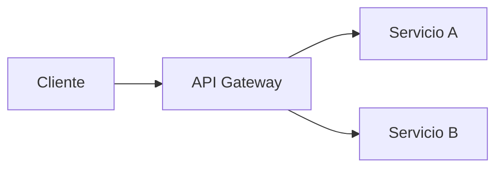

# Módulo 2.3 · Patrones de infraestructura

A medida que hay más servicios, aparecen problemas de localización, entrada, configuración y balanceo. Este módulo cubre service discovery, gateway, config server, load balancing y BFF.

**Entorno de referencia verificado (2026-05-22):** JDK 27.0.1.0.2, Spring Boot 3.5.0, Docker 29.9.3.

## Aprende construyendo

### Tema 1: Service Discovery: Eureka, Consul · Intermedio · 150 min

Caso guía: instancias suben/bajan y sus IPs cambian.

#### Service discovery

**Definición formal.** Mecanismo donde servicios se registran y otros los descubren dinámicamente.

**Eureka/Consul.** Eureka es discovery (ecosistema Spring Cloud); Consul ofrece discovery, health checks y KV.

**Error común.** Hardcodear IPs. Corrección: discovery o DNS de plataforma (Kubernetes).

### Tema 2: API Gateway: Spring Cloud Gateway · Intermedio · 150 min

Caso guía: un único punto de entrada con auth, rate limit y routing.

#### Gateway

**Definición formal.** Borde que enruta requests a servicios internos y aplica políticas transversales.

**Error común.** Gateway con lógica de negocio. Corrección: mantenerlo fino.

### Tema 3: Config Server: configuración centralizada · Intermedio · 120 min

Caso guía: cambiar config sin reconstruir cada servicio.

#### Config Server

**Definición formal.** Servicio que entrega configuración centralizada a clientes.

**Error común.** Centralizar secretos inseguros. Corrección: secret manager y cifrado.

### Tema 4: Load Balancing: Spring Cloud LoadBalancer · Intermedio · 120 min

Caso guía: 3 instancias del mismo servicio.

#### Load balancing

**Definición formal.** Distribuir tráfico entre instancias para disponibilidad y escala.

**Error común.** Asumir que LB arregla un servicio lento/roto. Corrección: health checks, timeouts, autoscaling.

### Tema 5: BFF pattern · Intermedio · 90 min

Caso guía: mobile necesita payload distinto a web.

#### BFF (Backend for Frontend)

**Definición formal.** Backend específico por tipo de cliente/UI que orquesta APIs internas para ese frontend.

**Error común.** BFF duplicando lógica de dominio. Corrección: BFF orquesta, dominio vive en servicios core.

## Cierre

La infraestructura distribuida reduce fricción operativa, pero cada pieza es otro componente a observar y asegurar.

## Checklist

- Discovery o DNS, no IPs hardcodeadas.
- Gateway fino.
- Config/secretos centralizados con seguridad.
- LB con health checks.
- BFF por necesidad de cliente.
