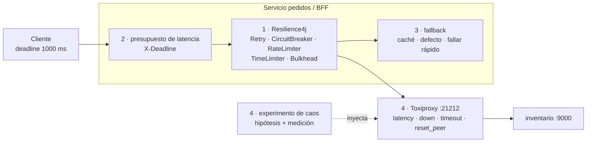
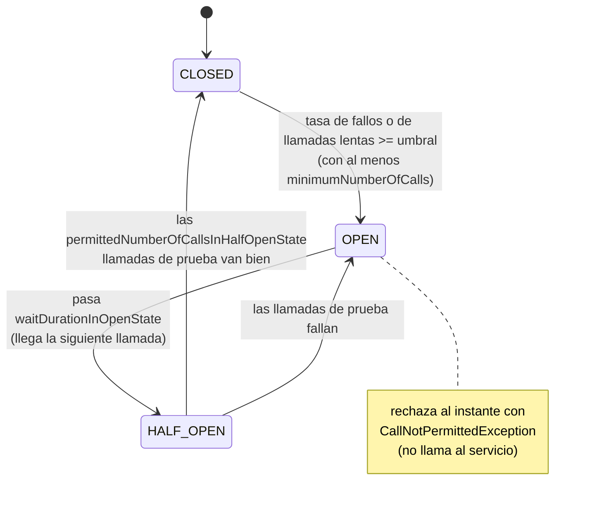
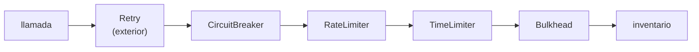
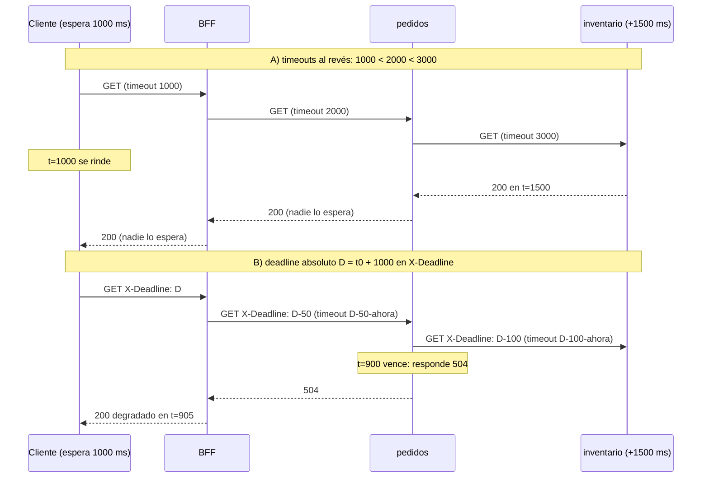
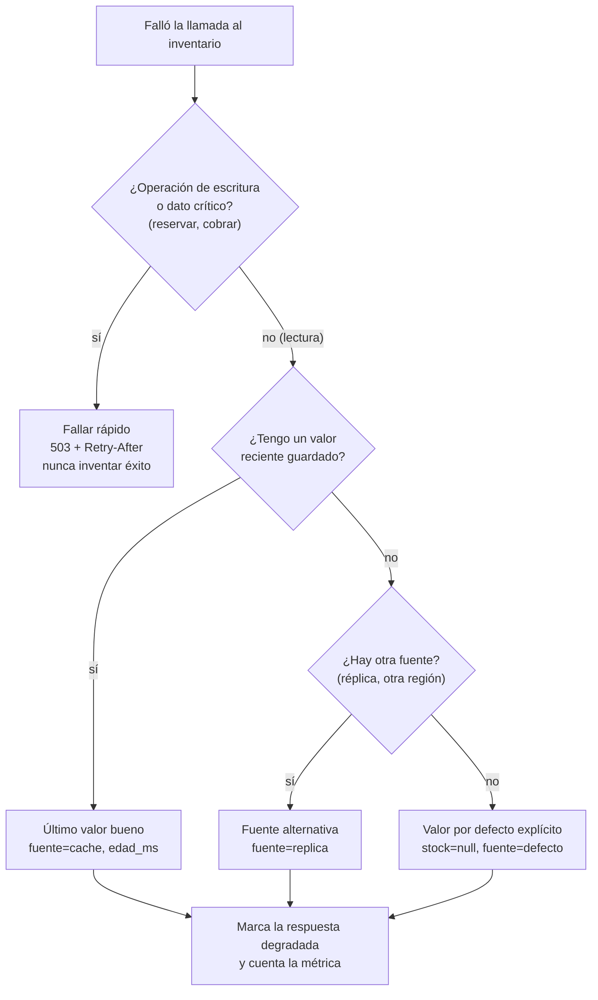
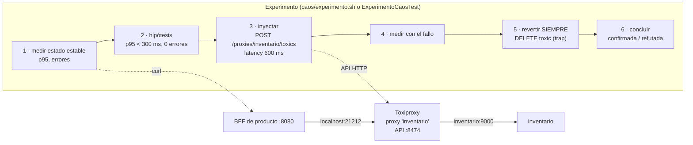

# Módulo 8 · Resiliencia

**Fase 1 · Spring Boot de cero a experto** (media semana según la tabla de contenidos). **Duración:** 10 h (4 temas
de 2–3 h). **Dificultad:** 4 de 5. **Dependencias:** Módulo 6 (llamadas entre servicios) y Módulo 7 (descubrimiento,
gateway, balanceo y BFF). **Herramientas:** **JDK 25 LTS (25.0.5)**, **Spring Boot 4.1.3**, **Resilience4j 2.4.0**
(`resilience4j-spring-boot4`), Spring Cloud 2025.1.4 (BOM), **Toxiproxy 2.13.0** con Docker Compose, Testcontainers
2.0.5 (módulo Toxiproxy) y toxiproxy-java 2.1.11, Gradle 9.9.2 por el wrapper y `curl`. **Laboratorio:**
`examples/microservicios/modulo-12/` (una demostración con JDK puro por tema en `jdk/`, un subproyecto Gradle por tema,
`docker-compose.yml` con el inventario y Toxiproxy, y `simular-fallo.sh`).

En un sistema distribuido **algo siempre está fallando**: una red que pierde paquetes, un servicio en plena
recolección de basura, una base de datos saturada. La resiliencia no consiste en evitar los fallos, sino en que un
fallo pequeño no se convierta en una caída total. En este módulo proteges cada llamada con los cinco patrones de
Resilience4j, repartes el tiempo que el cliente está dispuesto a esperar entre todos los saltos, decides qué
responder cuando una dependencia no está, y lo **demuestras rompiendo el sistema a propósito** con Toxiproxy.

**Regla del módulo:** cada tema trae una **Simulación del fallo**: un script que inyecta el fallo (Toxiproxy con
`simular-fallo.sh`, o `jdk/ProxyDeFallos.java`, que imita los mismos *toxics* sin Docker) y el comportamiento
observado.



**Texto alternativo:** mapa del módulo. Un cliente con un deadline de 1000 ms llama al servicio de pedidos o BFF.
Dentro, el presupuesto de latencia (tema 2) llega en la cabecera X-Deadline y pasa a Resilience4j (tema 1: Retry,
CircuitBreaker, RateLimiter, TimeLimiter y Bulkhead), que cuando falla recurre a un fallback (tema 3: caché, valor por
defecto o fallar rápido). Las llamadas salen hacia Toxiproxy en el puerto 21212, que inyecta latencia, caídas,
cuelgues o cortes, y de ahí al inventario en el 9000. Un experimento de caos (tema 4) inyecta fallos en Toxiproxy con
una línea punteada.

**Cómo usar el laboratorio.** Entra en `examples/microservicios/modulo-12`. `./verificar.sh --solo-jdk` ejecuta las
cuatro demostraciones (solo JDK 25). Para Toxiproxy: `docker compose up -d --wait` levanta el inventario (puerto
9000) y Toxiproxy (API en 8474, proxy en 21212); los proyectos Spring llaman a `http://localhost:21212`, así que todo
lo que inyectes con `./simular-fallo.sh` lo sufren ellos.

---
### Resilience4j: Circuit Breaker, Retry, RateLimiter, Bulkhead, TimeLimiter

#### 1. UBICACIÓN

Módulo 8, Lección 1 de 4 · Fase 1 · 3 h · Laboratorio `examples/microservicios/modulo-12/`: `jdk/Patrones.java` (con
`jdk/Inventario.java` y `jdk/ProxyDeFallos.java`), `f057-resilience4j/` y `simular-fallo.sh`.

#### 2. PRERREQUISITOS

- Módulo 6: `RestClient`; Módulo 1: hilos virtuales, `CompletableFuture`, beans y proxies de Spring (la anotación
  funciona porque Spring envuelve tu bean).
- Módulo 7: varias instancias, balanceo; Módulo 0.4: códigos 429, 503 y 504.
- Saber leer un `application.yml` con listas y duraciones (`500ms`, `2s`).

#### 3. OBJETIVO DE APRENDIZAJE

**Aplicar** los cinco patrones de Resilience4j a las llamadas de `pedidos` al inventario y **verificar** su efecto
bajo fallos inyectados, de modo que los 5 tests de `PatronesTest` pasen y puedas **explicar** el recorrido
CLOSED → OPEN → HALF_OPEN → CLOSED a partir de la salida de `jdk/Patrones.java`.

#### 4. ANALOGÍA VISUAL

El **tablero eléctrico de una casa**, ampliado. El **breaker** (Circuit Breaker) salta cuando hay demasiados
cortocircuitos seguidos y deja la línea sin corriente un rato; después dejas pasar un poquito de corriente de prueba
y, si aguanta, lo subes del todo. Al lado, un **timbre que insistes en tocar** tres veces, esperando un poco más cada
vez (Retry). En la puerta, un **portero que deja entrar solo 3 personas por minuto** (RateLimiter). Dentro, la casa
está dividida en **compartimentos estancos** como un barco: si se inunda la cocina, el agua no pasa al resto
(Bulkhead). Y en la estufa, un **temporizador de cocina** que apaga el fogón a los 5 minutos aunque la olla no esté
lista (TimeLimiter). Dibuja el tablero con un breaker abajo, un timbre, un portero con contador, un casco de barco con
mamparos y un temporizador.

#### 5. DIAGRAMA TÉCNICO





**Texto alternativo:** primer diagrama, máquina de estados del circuit breaker. Empieza en CLOSED. Pasa a OPEN cuando
la tasa de fallos o de llamadas lentas alcanza el umbral habiendo al menos el número mínimo de llamadas. De OPEN pasa
a HALF_OPEN cuando transcurre el tiempo de espera y llega una llamada. De HALF_OPEN vuelve a CLOSED si las llamadas de
prueba permitidas van bien, o a OPEN si fallan. Una nota indica que en OPEN se rechaza al instante con
CallNotPermittedException sin llamar al servicio. Segundo diagrama: el orden por defecto de los aspectos de
Resilience4j, de fuera hacia dentro: Retry, CircuitBreaker, RateLimiter, TimeLimiter, Bulkhead y finalmente la
llamada al inventario.

#### 6. EXPLICACIÓN NIVEL 0

Cuando tu servicio llama a otro, pueden pasar tres cosas malas: que el otro **no conteste** (caído), que conteste
**muy tarde** (lento) o que conteste **con error**. Si tu servicio se queda esperando o insiste sin control, se llena
de peticiones atascadas y termina cayéndose también: el fallo se **contagia** en cascada.

Resilience4j es una librería con cinco protecciones que pones alrededor de cada llamada:

| Patrón | Pregunta que responde | Qué hace |
|---|---|---|
| **Retry** | ¿Fue un fallo pasajero? | Repite la llamada unas pocas veces, esperando entre intentos. |
| **Circuit Breaker** | ¿El otro está caído? | Si fallan muchas llamadas seguidas, deja de llamar un tiempo y responde error al instante. |
| **RateLimiter** | ¿Lo estoy llamando demasiado? | Permite como máximo N llamadas por periodo. |
| **Bulkhead** | ¿Me está ocupando demasiados recursos? | Limita cuántas llamadas simultáneas puede haber hacia ese servicio. |
| **TimeLimiter** | ¿Tarda demasiado? | Corta la espera al pasar un tiempo máximo. |

En Spring las activas con una anotación sobre el método (`@CircuitBreaker(name = "inventario")`) y las configuras en
`application.yml`.

#### 7. EXPLICACIÓN INTERMEDIA

**Instalación en Spring Boot 4:** `io.github.resilience4j:resilience4j-spring-boot4:2.4.0` (la versión 2.4.0 añadió
soporte de Spring Boot 4) + `spring-boot-starter-aspectj` (las anotaciones son aspectos) + Actuator (endpoints y
salud). Cada anotación lleva un `name` que apunta a `resilience4j.<patrón>.instances.<name>` en el YAML.

**Circuit Breaker.** Guarda el resultado de las últimas llamadas en una **ventana deslizante** por número
(`COUNT_BASED`, `sliding-window-size`) o por tiempo (`TIME_BASED`, en segundos). Con al menos
`minimum-number-of-calls`, si el porcentaje de fallos ≥ `failure-rate-threshold` (o el de llamadas más lentas que
`slow-call-duration-threshold` ≥ `slow-call-rate-threshold`) pasa a **OPEN**: rechaza al instante con
`CallNotPermittedException`. Tras `wait-duration-in-open-state` pasa a **HALF_OPEN** y deja pasar
`permitted-number-of-calls-in-half-open-state` llamadas de prueba. Valores por defecto: ventana 100, mínimo 100,
umbral 50 %, 60 s abierto, 10 de prueba, lenta a partir de 60 s. `record-exceptions` / `ignore-exceptions` deciden qué
cuenta como fallo (un 404 no debería abrir el circuito).

**Retry.** `max-attempts` (cuenta el primer intento: 3 = 1 + 2 reintentos), `wait-duration`, backoff exponencial
(`enable-exponential-backoff`, `exponential-backoff-multiplier`), `retry-exceptions` / `ignore-exceptions`. Reintenta
solo operaciones **idempotentes** y errores **transitorios** (5xx, timeouts), nunca 4xx.

**RateLimiter.** `limit-for-period` permisos cada `limit-refresh-period`; si no hay permiso espera hasta
`timeout-duration` y luego lanza `RequestNotPermitted`. Protege al **otro** servicio (o una cuota de una API externa).

**Bulkhead.** `SEMAPHORE` (por defecto): `max-concurrent-calls` llamadas a la vez, espera hasta `max-wait-duration`,
luego `BulkheadFullException`. `THREADPOOL`: un pool propio por dependencia. Protege **tus** recursos: un inventario
lento no puede ocupar todos tus hilos y conexiones.

**TimeLimiter.** Para métodos que devuelven `CompletableFuture` (o tipos reactivos): `timeout-duration` y
`cancel-running-future`. Al vencer, el futuro termina con `TimeoutException`.

**Orden de los aspectos** (por defecto): `Retry ( CircuitBreaker ( RateLimiter ( TimeLimiter ( Bulkhead ( llamada ) ) ) ) )`.
Retry es el más exterior: cada reintento pasa por el circuit breaker y cuenta en su ventana. El **fallback** (método
alternativo con la misma firma + un parámetro de excepción) se pone en la anotación **exterior** que quieras que lo
use (ver el error común).

**Observar:** `/actuator/circuitbreakers`, `/actuator/circuitbreakerevents`, `/actuator/retries`… y, con
`register-health-indicator: true` y `management.health.circuitbreakers.enabled: true`, el estado del circuito en
`/actuator/health` (CLOSED = UP, OPEN = DOWN, HALF_OPEN = UNKNOWN).

#### 8. EXPLICACIÓN MAESTRA

**Combinaciones con sentido:** Retry + Circuit Breaker es la base (reintentos para lo pasajero, circuito para lo
persistente); Bulkhead por dependencia evita que una dependencia lenta agote el servidor; TimeLimiter o, mejor, el
timeout del propio cliente HTTP, porque **cancelar un `CompletableFuture` no interrumpe la tarea que lo produce**:
`cancel-running-future: true` marca el futuro como cancelado, pero una llamada bloqueante de `RestClient` dentro de
`supplyAsync` sigue hasta su *read timeout*. Por eso el código del laboratorio pone `setReadTimeout` en el cliente y
`jdk/Patrones.java` cancela con `HttpClient.sendAsync(...).cancel(true)`, que sí aborta la petición.

**Amplificación de reintentos:** con 3 servicios en cadena y 3 intentos en cada uno, un fallo al final genera
3 × 3 × 3 = 27 llamadas. Reintenta en **un** solo nivel (normalmente el más cercano al fallo), usa *jitter* para que
los clientes no reintenten sincronizados y un **presupuesto de reintentos** (no más del 10–20 % del tráfico). Ojo
también con los reintentos ocultos: el `HttpClient` del JDK reintentó por su cuenta peticiones GET cuyas conexiones
cortó `ProxyDeFallos` (lo observamos al escribir `jdk/Patrones.java`: dos cortes y una respuesta buena dentro de una
sola llamada a `send`), así que tu Retry podía multiplicarse sin que lo vieras.

| Alternativa | Ventaja | Coste |
|---|---|---|
| Resilience4j (anotaciones o API funcional) | Ligera, modular, métricas Micrometer | Configuración por servicio en cada aplicación |
| Spring Cloud CircuitBreaker | Abstracción sobre Resilience4j (cambiar de implementación sin tocar código) | Solo cubre circuit breaker, time limiter y bulkhead |
| Spring Framework 7 `@Retryable` / `@ConcurrencyLimit` (con `@EnableResilientMethods`) | Sin dependencias extra: reintento y límite de concurrencia | Sin circuit breaker ni rate limiter |
| *Service mesh* (Istio/Envoy: *outlier detection*, reintentos, timeouts) | Sin código, igual para todos los lenguajes | Menos contexto de negocio (no hay fallback con caché) |
| Hystrix | — | En mantenimiento desde 2018: no lo uses en proyectos nuevos |

**Cuándo NO usarlos.** No pongas circuit breaker a una llamada **local** o a la base de datos propia con su pool (el
pool ya limita y tiene timeouts). No reintentes operaciones **no idempotentes** (un cobro) sin clave de idempotencia
(Módulo 25). No uses RateLimiter para protegerte de tus usuarios en cada servicio: eso va en el gateway. Y no copies
los valores por defecto: con `minimum-number-of-calls: 100` y poco tráfico, el circuito nunca se abre; dimensiona la
ventana con tu tráfico real.

#### 9. CÓDIGO EJECUTABLE

**Versiones:** JDK 25 LTS, Spring Boot 4.1.3, Resilience4j 2.4.0 (`resilience4j-spring-boot4`), Spring Cloud
2025.1.4 (solo el BOM).

**El servicio que vamos a romper** — `modulo-12/jdk/Inventario.java` (también corre en Docker Compose):

```java
// Servicio "inventario" de los laboratorios del Módulo 8 (solo JDK 25).
// Ejecuta: java Inventario.java            -> escucha en 0.0.0.0:9000
// GET /stock/{sku} -> {"sku":"7","stock":12}   (cuenta las peticiones atendidas)
// FALLAR_PROXIMAS=n -> las n peticiones siguientes responden 503 (fallo de aplicación, no de red)
import com.sun.net.httpserver.HttpServer;
import java.io.IOException;
import java.net.InetSocketAddress;
import java.nio.charset.StandardCharsets;
import java.util.concurrent.Executors;
import java.util.concurrent.atomic.AtomicInteger;

public class Inventario {

    public static final AtomicInteger ATENDIDAS = new AtomicInteger();
    public static final AtomicInteger FALLAR_PROXIMAS = new AtomicInteger();

    public static HttpServer arrancar(String host, int puerto) throws IOException {
        HttpServer s = HttpServer.create(new InetSocketAddress(host, puerto), 0);
        s.setExecutor(Executors.newVirtualThreadPerTaskExecutor());
        s.createContext("/stock/", ex -> {
            ATENDIDAS.incrementAndGet();
            if (FALLAR_PROXIMAS.getAndUpdate(n -> Math.max(0, n - 1)) > 0) {
                byte[] b = "{\"error\":\"NO_DISPONIBLE\"}".getBytes(StandardCharsets.UTF_8);
                ex.sendResponseHeaders(503, b.length);
                ex.getResponseBody().write(b);
                ex.close();
                return;
            }
            String sku = ex.getRequestURI().getPath().substring("/stock/".length());
            byte[] b = ("{\"sku\":\"" + sku + "\",\"stock\":12}").getBytes(StandardCharsets.UTF_8);
            ex.getResponseHeaders().add("Content-Type", "application/json");
            ex.sendResponseHeaders(200, b.length);
            ex.getResponseBody().write(b);
            ex.close();
        });
        s.start();
        return s;
    }

    public static void main(String[] args) throws IOException {
        arrancar("0.0.0.0", args.length > 0 ? Integer.parseInt(args[0]) : 9000);
        System.out.println("inventario escuchando en :" + (args.length > 0 ? args[0] : "9000"));
    }
}
```

**El inyector de fallos sin Docker** — `modulo-12/jdk/ProxyDeFallos.java` (imita los *toxics* de Toxiproxy):

```java
// Proxy TCP que inyecta fallos entre un cliente y un servicio (solo JDK 25).
// Imita los "toxics" de Toxiproxy que usa el Módulo 8, para poder ver los fallos sin Docker:
//   latencia(ms)            ~ toxic "latency"            (retrasa la respuesta)
//   caer() / levantar()     ~ POST /proxies/{p} {"enabled":false|true}  (conexión rechazada)
//   colgar()                ~ toxic "timeout" con timeout=0 (acepta y nunca responde)
//   intermitente(p, semilla)~ toxic "reset_peer" con toxicity=p (corta algunas conexiones)
//   restablecer()           ~ POST /reset
import java.io.IOException;
import java.io.InputStream;
import java.io.OutputStream;
import java.net.InetSocketAddress;
import java.net.ServerSocket;
import java.net.Socket;
import java.util.Random;
import java.util.Set;
import java.util.concurrent.ConcurrentHashMap;

public class ProxyDeFallos implements AutoCloseable {

    private final int puertoServicio;
    private volatile ServerSocket escucha;
    private final int puerto;
    private volatile long latenciaMs;
    private volatile boolean colgado;
    private volatile double probabilidadCorte;
    private volatile Random azar = new Random(42);
    private final Set<Socket> activas = ConcurrentHashMap.newKeySet();

    public ProxyDeFallos(int puertoServicio) throws IOException {
        this.puertoServicio = puertoServicio;
        this.escucha = new ServerSocket(0, 50, java.net.InetAddress.getLoopbackAddress());
        this.puerto = escucha.getLocalPort();
        aceptar(escucha);
    }

    public int puerto() { return puerto; }
    public String url() { return "http://127.0.0.1:" + puerto; }

    // Cada cambio de "toxic" cierra las conexiones abiertas: así el cliente no reutiliza una
    // conexión keep-alive vieja y el fallo nuevo se aplica desde la siguiente petición.
    public void latencia(long ms) { latenciaMs = ms; cortarActivas(); }
    public void colgar() { colgado = true; cortarActivas(); }
    public void intermitente(double p, long semilla) { probabilidadCorte = p; azar = new Random(semilla); cortarActivas(); }

    /** Cierra el puerto y las conexiones abiertas: los clientes reciben "Connection refused". */
    public synchronized void caer() throws IOException { escucha.close(); cortarActivas(); }

    private void cortarActivas() {
        for (Socket s : activas) {
            try { s.close(); } catch (IOException ignorada) { }
        }
        activas.clear();
    }

    /** Vuelve a abrir el MISMO puerto. */
    public synchronized void levantar() throws IOException {
        if (!escucha.isClosed()) return;
        ServerSocket s = new ServerSocket();
        s.setReuseAddress(true);
        s.bind(new InetSocketAddress(java.net.InetAddress.getLoopbackAddress(), puerto));
        escucha = s;
        aceptar(s);
    }

    public void restablecer() throws IOException {
        latenciaMs = 0; colgado = false; probabilidadCorte = 0;
        cortarActivas();
        levantar();
    }

    private void aceptar(ServerSocket s) {
        Thread.ofVirtual().start(() -> {
            while (!s.isClosed()) {
                try {
                    Socket cliente = s.accept();
                    if (s.isClosed()) { cliente.close(); return; }    // llegó justo al caer
                    Thread.ofVirtual().start(() -> atender(cliente));
                } catch (IOException e) {
                    return;                                   // el puerto se cerró (caer)
                }
            }
        });
    }

    private void atender(Socket cliente) {
        activas.add(cliente);
        try (cliente) {
            if (probabilidadCorte > 0 && azar.nextDouble() < probabilidadCorte) {
                cliente.setSoLinger(true, 0);                 // cierre con RST: "Connection reset"
                return;
            }
            if (colgado) {                                    // acepta, lee y nunca contesta
                cliente.getInputStream().transferTo(OutputStream.nullOutputStream());
                return;
            }
            try (Socket servicio = new Socket("127.0.0.1", puertoServicio)) {
                Thread subida = Thread.ofVirtual().start(() -> copiar(cliente, servicio, 0));
                copiar(servicio, cliente, latenciaMs);        // la latencia se aplica a la respuesta
                subida.join(1000);
            }
        } catch (Exception ignorada) {
            // conexión cortada por una de las partes: es lo esperado en un proxy de fallos
        } finally {
            activas.remove(cliente);
        }
    }

    private static void copiar(Socket origen, Socket destino, long retrasoMs) {
        try {
            InputStream in = origen.getInputStream();
            OutputStream out = destino.getOutputStream();
            byte[] buf = new byte[8192];
            int n;
            while ((n = in.read(buf)) != -1) {
                if (retrasoMs > 0) Thread.sleep(retrasoMs);       // como Toxiproxy: cada bloque se retrasa
                out.write(buf, 0, n);
                out.flush();
            }
            destino.shutdownOutput();
        } catch (Exception ignorada) {
            // fin de la conexión
        }
    }

    @Override
    public void close() throws IOException { escucha.close(); }
}
```

**Los cinco patrones por dentro** — `modulo-12/jdk/Patrones.java`:

```java
// F057 · Los 5 patrones de Resilience4j por dentro, contra fallos inyectados (solo JDK 25).
// Ejecuta: java Patrones.java   (usa Inventario.java y ProxyDeFallos.java de esta carpeta)
// Cada patrón está escrito en pocas líneas para que veas su mecánica; en el servicio real usas
// Resilience4j 2.4.0 (f057-resilience4j), que hace lo mismo con configuración y métricas.
import java.net.URI;
import java.net.http.HttpClient;
import java.net.http.HttpRequest;
import java.net.http.HttpResponse;
import java.time.Duration;
import java.util.ArrayList;
import java.util.List;
import java.util.Random;
import java.util.concurrent.Callable;
import java.util.concurrent.CompletableFuture;
import java.util.concurrent.Semaphore;
import java.util.concurrent.TimeUnit;
import java.util.concurrent.TimeoutException;

public class Patrones {


    static final HttpClient HTTP = HttpClient.newBuilder().connectTimeout(Duration.ofMillis(500)).build();
    static ProxyDeFallos proxy;
    static long t0;
    static int fallos = 0;

    public static void main(String[] args) throws Exception {
        var inventario = Inventario.arrancar("127.0.0.1", 0);
        proxy = new ProxyDeFallos(inventario.getAddress().getPort());
        llamar();                                                    // calentamiento de la JVM

        timeLimiter();
        retry();
        circuitBreaker();
        bulkhead();
        rateLimiter();

        proxy.close();
        inventario.stop(0);
        System.out.println(fallos == 0 ? "OK: los 5 patrones se comportaron como se esperaba" : "FALLA: " + fallos);
        System.exit(fallos == 0 ? 0 : 1);
    }

    /** La llamada protegida: GET /stock/7 a través del proxy de fallos. */
    static String llamar() throws Exception {
        HttpResponse<String> r = HTTP.send(HttpRequest.newBuilder(URI.create(proxy.url() + "/stock/7")).build(),
                                           HttpResponse.BodyHandlers.ofString());
        if (r.statusCode() >= 500) throw new ErrorDelServidor(r.statusCode());
        return r.body();
    }

    // ---------------------------------------------------------------- TimeLimiter
    static void timeLimiter() throws Exception {
        System.out.println("== TimeLimiter (límite 500 ms) · fallo inyectado: latencia 2000 ms");
        proxy.latencia(2000);
        inicio();
        // Como cancelRunningFuture=true de Resilience4j: al vencer el límite se CANCELA la petición.
        // Si no la cancelas, sigue viva en segundo plano ocupando una conexión (y el JDK puede
        // reenviarla cuando el proxy la corte: una petición huérfana que nadie espera).
        CompletableFuture<HttpResponse<String>> enCurso = HTTP.sendAsync(
            HttpRequest.newBuilder(URI.create(proxy.url() + "/stock/7")).build(), HttpResponse.BodyHandlers.ofString());
        String resultado;
        try {
            resultado = enCurso.get(500, TimeUnit.MILLISECONDS).body();
        } catch (TimeoutException e) {
            enCurso.cancel(true);
            resultado = "TimeoutException";
        }
        System.out.printf("   resultado=%s tras %d ms (sin límite habrías esperado 2000 ms)%n", resultado, ms());
        comprobar(resultado.equals("TimeoutException") && ms() < 700);
        proxy.restablecer();
    }

    // ---------------------------------------------------------------- Retry
    static void retry() throws Exception {
        System.out.println("== Retry (3 intentos, espera 100 ms x2 + jitter) · fallo inyectado: 2 respuestas 503 seguidas");
        Inventario.FALLAR_PROXIMAS.set(2);
        int antes = Inventario.ATENDIDAS.get();
        Random jitter = new Random(1);
        String resultado = null;
        long espera = 100;
        for (int intento = 1; intento <= 3 && resultado == null; intento++) {
            try {
                resultado = llamar();
                System.out.println("   intento " + intento + ": OK " + resultado);
            } catch (Exception e) {
                System.out.println("   intento " + intento + ": " + e.getClass().getSimpleName() + " " + e.getMessage());
                if (intento < 3) {
                    Thread.sleep(espera + jitter.nextLong(espera / 2));   // backoff exponencial con jitter
                    espera *= 2;
                }
            }
        }
        comprobar(resultado != null && Inventario.ATENDIDAS.get() - antes == 3);
        proxy.restablecer();
    }

    // ---------------------------------------------------------------- CircuitBreaker
    enum Estado { CLOSED, OPEN, HALF_OPEN }

    static Estado estado = Estado.CLOSED;
    static final List<Boolean> ventana = new ArrayList<>();          // últimas 4 llamadas: true = falló
    static long abiertoDesde;
    static int pruebasEnHalfOpen;

    /** Ventana de 4 llamadas, umbral 50 %, 1 s abierto, 2 llamadas de prueba en HALF_OPEN. */
    static String conCircuitBreaker() throws Exception {
        if (estado == Estado.OPEN) {
            if (System.currentTimeMillis() - abiertoDesde < 1000) throw new IllegalStateException("CallNotPermitted");
            estado = Estado.HALF_OPEN;
            pruebasEnHalfOpen = 0;
            System.out.println("   -> el circuito pasa a HALF_OPEN");
        }
        try {
            String r = llamar();
            registrar(false);
            return r;
        } catch (Exception e) {
            registrar(true);
            throw e;
        }
    }

    static void registrar(boolean fallo) {
        if (estado == Estado.HALF_OPEN) {
            if (fallo) { abrir(); return; }
            if (++pruebasEnHalfOpen == 2) { estado = Estado.CLOSED; ventana.clear(); System.out.println("   -> el circuito pasa a CLOSED"); }
            return;
        }
        ventana.add(fallo);
        if (ventana.size() > 4) ventana.removeFirst();
        long fallidas = ventana.stream().filter(f -> f).count();
        if (ventana.size() == 4 && fallidas * 100 / 4 >= 50) abrir();
    }

    static void abrir() {
        estado = Estado.OPEN;
        abiertoDesde = System.currentTimeMillis();
        ventana.clear();
        System.out.println("   -> el circuito pasa a OPEN");
    }

    static void circuitBreaker() throws Exception {
        System.out.println("== CircuitBreaker · fallo inyectado: inventario caído (puerto cerrado)");
        proxy.caer();
        int antes = Inventario.ATENDIDAS.get();
        List<String> rechazos = new ArrayList<>();
        for (int i = 1; i <= 7; i++) {
            inicio();
            String r;
            try {
                r = "OK " + conCircuitBreaker();
            } catch (Exception e) {
                r = e.getClass().getSimpleName() + ("CallNotPermitted".equals(e.getMessage()) ? ": CallNotPermitted" : "");
                if (r.contains("CallNotPermitted")) rechazos.add(r);
            }
            System.out.printf("   llamada %d [%s] %s (%d ms)%n", i, estado, r, ms());
        }
        System.out.println("   ...el inventario vuelve; esperamos 1 s");
        proxy.levantar();
        Thread.sleep(1100);
        for (int i = 8; i <= 9; i++) {
            String r = "OK " + conCircuitBreaker();
            System.out.printf("   llamada %d [%s] %s%n", i, estado, r);
        }
        comprobar(rechazos.size() == 3 && estado == Estado.CLOSED && Inventario.ATENDIDAS.get() - antes == 2);
    }

    // ---------------------------------------------------------------- Bulkhead
    static void bulkhead() throws Exception {
        System.out.println("== Bulkhead (2 llamadas concurrentes, espera máxima 0) · fallo inyectado: latencia 800 ms");
        proxy.latencia(800);
        Semaphore compartimento = new Semaphore(2);
        var hilos = java.util.concurrent.Executors.newVirtualThreadPerTaskExecutor();
        List<CompletableFuture<String>> llamadas = new ArrayList<>();
        inicio();
        for (int i = 1; i <= 5; i++) {
            llamadas.add(CompletableFuture.supplyAsync(() -> {
                if (!compartimento.tryAcquire()) return "BulkheadFull";      // rechazo inmediato
                try {
                    llamarSinExcepciones();
                    return "OK";
                } finally {
                    compartimento.release();                                // libera al terminar
                }
            }, hilos));
            Thread.sleep(20);
        }
        List<String> resultados = llamadas.stream().map(CompletableFuture::join).toList();
        System.out.printf("   resultados=%s en %d ms: 3 rechazadas al instante, el resto del servicio sigue libre%n",
                          resultados, ms());
        comprobar(resultados.stream().filter("OK"::equals).count() == 2);
        proxy.restablecer();
    }

    // ---------------------------------------------------------------- RateLimiter
    static void rateLimiter() throws Exception {
        System.out.println("== RateLimiter (3 llamadas por periodo de 1 s, espera máxima 0) · 5 llamadas seguidas");
        int permisos = 3;
        long periodo = System.currentTimeMillis();
        List<String> resultados = new ArrayList<>();
        for (int i = 0; i < 5; i++) {
            if (System.currentTimeMillis() - periodo >= 1000) { periodo = System.currentTimeMillis(); permisos = 3; }
            if (permisos > 0) { permisos--; llamar(); resultados.add("OK"); }
            else resultados.add("RequestNotPermitted");
        }
        System.out.println("   resultados=" + resultados);
        comprobar(resultados.equals(List.of("OK", "OK", "OK", "RequestNotPermitted", "RequestNotPermitted")));
    }

    static class ErrorDelServidor extends Exception {
        ErrorDelServidor(int estado) { super("HTTP " + estado); }
    }

    static String llamarSinExcepciones() {
        try { return llamar(); } catch (Exception e) { return e.getClass().getSimpleName(); }
    }

    static void inicio() { t0 = System.nanoTime(); }
    static long ms() { return (System.nanoTime() - t0) / 1_000_000; }
    static void comprobar(boolean ok) { if (!ok) { fallos++; System.out.println("   FALLA en este patrón"); } }
}
```

**Resilience4j en Spring Boot.** `f057-resilience4j/build.gradle.kts`:

```kotlin
// F057 · Resilience4j: Circuit Breaker, Retry, RateLimiter, Bulkhead y TimeLimiter en el servicio "pedidos"
plugins {
    java
    alias(libs.plugins.spring.boot)
    alias(libs.plugins.spring.dependency.management)
}

group = "academia.microservicios"
version = "1.0.0"

java {
    toolchain {
        languageVersion = JavaLanguageVersion.of(25)
    }
}

dependencyManagement {
    imports {
        mavenBom("org.springframework.cloud:spring-cloud-dependencies:${libs.versions.spring.cloud.get()}")
    }
}

dependencies {
    // API HTTP de pedidos
    implementation(libs.spring.boot.starter.webmvc)
    // RestClient para llamar al inventario
    implementation(libs.spring.boot.starter.restclient)
    // /actuator/circuitbreakers, /actuator/health con el estado del circuito
    implementation(libs.spring.boot.starter.actuator)
    // Las anotaciones de Resilience4j son aspectos: necesitan AspectJ (en Boot 4 sustituye a spring-boot-starter-aop)
    implementation(libs.spring.boot.starter.aspectj)
    // Resilience4j 2.4.0: anotaciones @CircuitBreaker, @Retry, @RateLimiter, @Bulkhead, @TimeLimiter (soporte de Spring Boot 4)
    implementation(libs.resilience4j.spring.boot4)
    testImplementation(libs.spring.boot.starter.test)
    // Gradle 9 exige declarar el lanzador de JUnit Platform (ya no lo añade por su cuenta)
    testRuntimeOnly(libs.junit.platform.launcher)
}

tasks.withType<Test> {
    useJUnitPlatform()
    testLogging {
        events("passed", "skipped", "failed")   // una línea por test en la consola
        // el mensaje completo de cada fallo (valor esperado y obtenido), no solo el tipo de excepción
        exceptionFormat = org.gradle.api.tasks.testing.logging.TestExceptionFormat.FULL
    }
}
```

> **Build con Gradle (y su equivalencia en Maven).** Este laboratorio se construye con **Gradle 9.9.2** y Kotlin DSL
> mediante el wrapper `./gradlew` (no instalas Gradle). `settings.gradle.kts` lista los subproyectos (en Maven,
> `<modules>` del POM agregador), cada carpeta tiene su `build.gradle.kts` (su `pom.xml`) y
> `gradle/libs.versions.toml` es el **catálogo de versiones** (las `<properties>` y el `dependencyManagement`): por eso
> las dependencias se escriben `libs.…`. Equivalencias: `./mvnw test` → `./gradlew test` ·
> `./mvnw package -DskipTests` → `./gradlew bootJar` · `./mvnw spring-boot:run` → `./gradlew bootRun` ·
> `-Dtest=Clase` → `--tests Clase` · `target/` → `build/` (el jar queda en `build/libs/`). Gradle escribe una línea
> `PASSED` por test y termina con `BUILD SUCCESSFUL` (Maven: `Tests run: N` y `BUILD SUCCESS`).

`modulo-12/settings.gradle.kts`:

```kotlin
// Módulo 8 (modulo-12) · Build multi-proyecto: "./gradlew test" ejecuta los tests de todos los subproyectos.
// Cada carpeta tiene su propio build.gradle.kts; las versiones viven en gradle/libs.versions.toml
// (catálogo "libs"). Equivale al POM agregador con <modules> de Maven.
pluginManagement {
    repositories {
        gradlePluginPortal()
        mavenCentral()
    }
}
// Sin esto, un alumno sin JDK 25 instalado ve el build morir en la configuración, antes de cualquier test.
plugins {
    id("org.gradle.toolchains.foojay-resolver-convention") version "1.0.0"
}


dependencyResolutionManagement {
    repositories {
        mavenCentral()
    }
}

rootProject.name = "modulo-12-laboratorios"

include(
    "f057-resilience4j",
    "f058-presupuesto",
    "f059-fallbacks",
    "f060-caos",
)
```

`modulo-12/gradle/libs.versions.toml`:

```toml
# Módulo 8 (modulo-12)
# Catálogo de versiones del laboratorio: una sola fuente para plugins y librerías.
# Las librerías SIN versión las fija el BOM de Spring Boot (spring-boot-dependencies) o el BOM que importe el proyecto.

[versions]
resilience4j = "2.4.0"
spring-boot = "4.1.3"
# Tren de Spring Cloud compatible con Spring Boot 4.1.x
spring-cloud = "2025.1.4"

[libraries]
spring-boot-starter-webmvc = { module = "org.springframework.boot:spring-boot-starter-webmvc" }
spring-boot-starter-restclient = { module = "org.springframework.boot:spring-boot-starter-restclient" }
spring-boot-starter-actuator = { module = "org.springframework.boot:spring-boot-starter-actuator" }
spring-boot-starter-aspectj = { module = "org.springframework.boot:spring-boot-starter-aspectj" }
resilience4j-spring-boot4 = { module = "io.github.resilience4j:resilience4j-spring-boot4", version.ref = "resilience4j" }
spring-boot-starter-test = { module = "org.springframework.boot:spring-boot-starter-test" }
junit-platform-launcher = { module = "org.junit.platform:junit-platform-launcher" }
testcontainers-junit-jupiter = { module = "org.testcontainers:testcontainers-junit-jupiter" }
testcontainers-toxiproxy = { module = "org.testcontainers:testcontainers-toxiproxy" }
toxiproxy-java = { module = "eu.rekawek.toxiproxy:toxiproxy-java", version = "2.1.11" }

[plugins]
spring-boot = { id = "org.springframework.boot", version.ref = "spring-boot" }
spring-dependency-management = { id = "io.spring.dependency-management", version = "1.1.7" }
```

`f057-resilience4j/src/main/resources/application.yml`:

```yaml
server:
  port: 8080
spring:
  application:
    name: pedidos
inventario:
  url: ${INVENTARIO_URL:http://localhost:21212}   # Toxiproxy, delante del inventario (docker compose)
resilience4j:
  circuitbreaker:
    instances:
      inventario:
        sliding-window-type: COUNT_BASED
        sliding-window-size: 4                    # mira las 4 últimas llamadas (por defecto 100)
        minimum-number-of-calls: 4                # no decide con menos de 4 (por defecto 100)
        failure-rate-threshold: 50                # >= 50 % fallidas => OPEN
        slow-call-duration-threshold: 1s          # una llamada de más de 1 s cuenta como lenta...
        slow-call-rate-threshold: 100             # ...y si TODAS son lentas, también abre
        wait-duration-in-open-state: 2s           # tras 2 s abierto deja pasar llamadas de prueba
        permitted-number-of-calls-in-half-open-state: 2
        register-health-indicator: true
  retry:
    instances:
      inventario:
        max-attempts: 3                           # 1 intento + 2 reintentos
        wait-duration: 100ms
        enable-exponential-backoff: true          # 100 ms, 200 ms
        exponential-backoff-multiplier: 2
        ignore-exceptions:
          - io.github.resilience4j.circuitbreaker.CallNotPermittedException   # circuito abierto: no insistas
          - org.springframework.web.client.HttpClientErrorException           # 4xx: reintentar no lo arregla
  ratelimiter:
    instances:
      inventario:
        limit-for-period: 3
        limit-refresh-period: 1s
        timeout-duration: 0                       # sin cola: si no hay permiso, rechaza ya
  bulkhead:
    instances:
      inventario:
        max-concurrent-calls: 2
        max-wait-duration: 0
  timelimiter:
    instances:
      inventario:
        timeout-duration: 500ms
        cancel-running-future: true
management:
  endpoints:
    web:
      exposure:
        include: health,circuitbreakers,circuitbreakerevents,retries,ratelimiters,bulkheads,timelimiters
  endpoint:
    health:
      show-details: always
  health:
    circuitbreakers:
      enabled: true
```

`f057-resilience4j/src/main/java/academia/resiliencia/InventarioCliente.java`:

```java
package academia.resiliencia;

import io.github.resilience4j.bulkhead.annotation.Bulkhead;
import io.github.resilience4j.circuitbreaker.annotation.CircuitBreaker;
import io.github.resilience4j.ratelimiter.annotation.RateLimiter;
import io.github.resilience4j.retry.annotation.Retry;
import io.github.resilience4j.timelimiter.annotation.TimeLimiter;
import java.net.http.HttpClient;
import java.time.Duration;
import java.util.concurrent.CompletableFuture;
import java.util.concurrent.ExecutorService;
import java.util.concurrent.Executors;
import org.springframework.beans.factory.annotation.Value;
import org.springframework.http.client.JdkClientHttpRequestFactory;
import org.springframework.stereotype.Component;
import org.springframework.web.client.RestClient;

/**
 * Cliente del inventario. Cada método muestra un patrón; la configuración de cada uno está en
 * application.yml bajo resilience4j.*.instances.inventario.
 */
@Component
public class InventarioCliente {

    private final RestClient rest;
    private final ExecutorService hilos = Executors.newVirtualThreadPerTaskExecutor();

    InventarioCliente(RestClient.Builder builder, @Value("${inventario.url}") String url) {
        // Timeouts de red SIEMPRE: sin ellos, ningún patrón te salva de una conexión colgada.
        var fabrica = new JdkClientHttpRequestFactory(
            HttpClient.newBuilder().connectTimeout(Duration.ofMillis(500)).build());
        fabrica.setReadTimeout(Duration.ofSeconds(3));
        this.rest = builder.baseUrl(url).requestFactory(fabrica).build();
    }

    private Stock pedir(String sku) {
        return rest.get().uri("/stock/{sku}", sku).retrieve().body(Stock.class);
    }

    /**
     * Retry (por fuera) + CircuitBreaker (por dentro): orden por defecto de Resilience4j,
     * Retry(CircuitBreaker(RateLimiter(TimeLimiter(Bulkhead(llamada))))).
     * El fallback va en @Retry, el aspecto exterior: si lo pusieras en @CircuitBreaker,
     * el Retry vería siempre "éxito" y nunca reintentaría.
     */
    @Retry(name = "inventario", fallbackMethod = "stockDesconocido")
    @CircuitBreaker(name = "inventario")
    public Stock consultar(String sku) {
        return pedir(sku);
    }

    Stock stockDesconocido(String sku, Throwable causa) {
        return new Stock(sku, null, "fallback: " + causa.getClass().getSimpleName());
    }

    /** RateLimiter: como mucho 3 llamadas por segundo al inventario; la 4.ª recibe RequestNotPermitted. */
    @RateLimiter(name = "inventario")
    public Stock consultarConCuota(String sku) {
        return pedir(sku);
    }

    /** Bulkhead: como mucho 2 llamadas simultáneas; la 3.ª recibe BulkheadFullException al instante. */
    @Bulkhead(name = "inventario")
    public Stock consultarAislado(String sku) {
        return pedir(sku);
    }

    /** TimeLimiter: trabaja sobre CompletableFuture; a los 500 ms completa con TimeoutException y cancela. */
    @TimeLimiter(name = "inventario")
    public CompletableFuture<Stock> consultarConLimite(String sku) {
        return CompletableFuture.supplyAsync(() -> pedir(sku), hilos);
    }
}
```

`f057-resilience4j/src/main/java/academia/resiliencia/PedidosController.java` (cada rechazo → su código HTTP):

```java
package academia.resiliencia;

import io.github.resilience4j.bulkhead.BulkheadFullException;
import io.github.resilience4j.ratelimiter.RequestNotPermitted;
import java.util.Map;
import java.util.concurrent.CompletableFuture;
import java.util.concurrent.TimeoutException;
import org.springframework.http.HttpStatus;
import org.springframework.http.ResponseEntity;
import org.springframework.web.bind.annotation.ExceptionHandler;
import org.springframework.web.bind.annotation.GetMapping;
import org.springframework.web.bind.annotation.PathVariable;
import org.springframework.web.bind.annotation.RestController;

@RestController
class PedidosController {

    private final InventarioCliente inventario;

    PedidosController(InventarioCliente inventario) {
        this.inventario = inventario;
    }

    @GetMapping("/pedidos/stock/{sku}")
    Stock stock(@PathVariable String sku) { return inventario.consultar(sku); }

    @GetMapping("/pedidos/cuota/{sku}")
    Stock cuota(@PathVariable String sku) { return inventario.consultarConCuota(sku); }

    @GetMapping("/pedidos/aislado/{sku}")
    Stock aislado(@PathVariable String sku) { return inventario.consultarAislado(sku); }

    @GetMapping("/pedidos/limite/{sku}")
    CompletableFuture<Stock> limite(@PathVariable String sku) { return inventario.consultarConLimite(sku); }

    // Cada rechazo de un patrón se traduce a un código HTTP que el cliente sabe interpretar.
    @ExceptionHandler(RequestNotPermitted.class)
    ResponseEntity<Map<String, String>> cuota(RequestNotPermitted e) {
        return ResponseEntity.status(HttpStatus.TOO_MANY_REQUESTS).header("Retry-After", "1")
            .body(Map.of("error", "CUOTA_AGOTADA"));
    }

    @ExceptionHandler(BulkheadFullException.class)
    ResponseEntity<Map<String, String>> lleno(BulkheadFullException e) {
        return ResponseEntity.status(HttpStatus.SERVICE_UNAVAILABLE).body(Map.of("error", "COMPARTIMENTO_LLENO"));
    }

    @ExceptionHandler(TimeoutException.class)
    ResponseEntity<Map<String, String>> tiempo(TimeoutException e) {
        return ResponseEntity.status(HttpStatus.GATEWAY_TIMEOUT).body(Map.of("error", "INVENTARIO_LENTO"));
    }
}
```

`Stock.java` y `PedidosApp.java`:

```java
package academia.resiliencia;

/** Respuesta del inventario. stock = null significa "desconocido"; fuente dice de dónde salió. */
public record Stock(String sku, Integer stock, String fuente) {}
```

```java
package academia.resiliencia;

import org.springframework.boot.SpringApplication;
import org.springframework.boot.autoconfigure.SpringBootApplication;

@SpringBootApplication
public class PedidosApp {

    public static void main(String[] args) {
        SpringApplication.run(PedidosApp.class, args);
    }
}
```

#### 10. MINI-LABORATORIO

**Simulación del fallo (JDK, sin Docker).** `jdk/Patrones.java` arranca el inventario y `ProxyDeFallos` delante, y
para cada patrón inyecta un fallo: latencia de 2000 ms (TimeLimiter), dos respuestas 503 (Retry), puerto cerrado
(CircuitBreaker), latencia de 800 ms con 5 llamadas simultáneas (Bulkhead) y 5 llamadas seguidas (RateLimiter).

1. Ejecuta:

```bash
cd examples/microservicios/modulo-12
java jdk/Patrones.java
```

   **Output esperado** (ejecutado con JDK 25.0.5; los milisegundos varían):

```text
== TimeLimiter (límite 500 ms) · fallo inyectado: latencia 2000 ms
   resultado=TimeoutException tras 506 ms (sin límite habrías esperado 2000 ms)
== Retry (3 intentos, espera 100 ms x2 + jitter) · fallo inyectado: 2 respuestas 503 seguidas
   intento 1: ErrorDelServidor HTTP 503
   intento 2: ErrorDelServidor HTTP 503
   intento 3: OK {"sku":"7","stock":12}
== CircuitBreaker · fallo inyectado: inventario caído (puerto cerrado)
   llamada 1 [CLOSED] ConnectException (4 ms)
   llamada 2 [CLOSED] ConnectException (1 ms)
   llamada 3 [CLOSED] ConnectException (1 ms)
   -> el circuito pasa a OPEN
   llamada 4 [OPEN] ConnectException (2 ms)
   llamada 5 [OPEN] IllegalStateException: CallNotPermitted (0 ms)
   llamada 6 [OPEN] IllegalStateException: CallNotPermitted (0 ms)
   llamada 7 [OPEN] IllegalStateException: CallNotPermitted (0 ms)
   ...el inventario vuelve; esperamos 1 s
   -> el circuito pasa a HALF_OPEN
   llamada 8 [HALF_OPEN] OK {"sku":"7","stock":12}
   -> el circuito pasa a CLOSED
   llamada 9 [CLOSED] OK {"sku":"7","stock":12}
== Bulkhead (2 llamadas concurrentes, espera máxima 0) · fallo inyectado: latencia 800 ms
   resultados=[OK, OK, BulkheadFull, BulkheadFull, BulkheadFull] en 828 ms: 3 rechazadas al instante, el resto del servicio sigue libre
== RateLimiter (3 llamadas por periodo de 1 s, espera máxima 0) · 5 llamadas seguidas
   resultados=[OK, OK, OK, RequestNotPermitted, RequestNotPermitted]
OK: los 5 patrones se comportaron como se esperaba
```

   **Comportamiento observado:** el TimeLimiter corta a los ~500 ms en vez de esperar 2 s. El Retry absorbe dos
   errores pasajeros. El circuito se abre con la 4.ª llamada fallida (ventana de 4, 100 % de fallos) y las llamadas
   5–7 se rechazan en **0 ms** sin tocar la red; cuando el inventario vuelve, una llamada en HALF_OPEN sale bien y la
   segunda lo cierra. El Bulkhead rechaza al instante 3 de 5 llamadas lentas y el RateLimiter, 2 de 5.

**Simulación del fallo con Toxiproxy (Docker).** Ahora el servicio Spring de verdad, con el inventario detrás de
Toxiproxy.

2. Levanta la infraestructura y el servicio:

```bash
docker compose up -d --wait
cd f057-resilience4j && ../gradlew -q bootRun &
cd ..
curl -s localhost:8080/pedidos/stock/7; echo
```

   **Output esperado:** `{"sku":"7","stock":12,"fuente":null}`.

3. Tumba el inventario con `simular-fallo.sh` (el script de Toxiproxy de este módulo) y llama 4 veces:

```bash
./simular-fallo.sh caido
for i in 1 2 3 4; do curl -s localhost:8080/pedidos/stock/7; echo; done
curl -s localhost:8080/actuator/health | jq '.components.circuitBreakers.details.inventario.details.state'
```

   **Output esperado:** la primera respuesta termina en `"fuente":"fallback: ResourceAccessException"` (tras 3
   intentos, ~300 ms de esperas), las tres siguientes en `"fuente":"fallback: CallNotPermittedException"` (en la
   segunda, el 4.º fallo abre el circuito) y casi instantáneas; el estado es `"OPEN"`. **Captura descrita:** en `/actuator/circuitbreakerevents` ves eventos `ERROR` y un
   `STATE_TRANSITION` `CLOSED_TO_OPEN`.

4. Recupera el inventario, espera 2 s y llama dos veces:

```bash
./simular-fallo.sh sano
sleep 2; for i in 1 2; do curl -s localhost:8080/pedidos/stock/7; echo; done
```

   **Output esperado:** `{"sku":"7","stock":12,"fuente":null}` dos veces y el circuito de nuevo en `CLOSED`
   (transiciones `OPEN_TO_HALF_OPEN` y `HALF_OPEN_TO_CLOSED`).

5. Latencia y TimeLimiter/Bulkhead:

```bash
./simular-fallo.sh lento 2000
curl -s -w ' %{http_code} %{time_total}s\n' localhost:8080/pedidos/limite/7
for i in 1 2 3; do curl -s -o /dev/null -w '%{http_code}\n' localhost:8080/pedidos/aislado/7 & done; wait
./simular-fallo.sh sano
```

   **Output esperado:** `{"error":"INVENTARIO_LENTO"} 504` en ~0,5 s; de las tres llamadas simultáneas, dos `200`
   (tras ~2 s) y un `503`. Termina con `kill %1` y `docker compose down`.

#### 11. VERIFICACIÓN

`f057-resilience4j/src/test/java/academia/resiliencia/PatronesTest.java` usa un inventario falso
(`InventarioFalso.java`, un `HttpServer` del JDK al que le programas latencia, N errores 503 o caída total) y comprueba
cada patrón:

```java
package academia.resiliencia;

import static org.assertj.core.api.Assertions.assertThat;
import static org.assertj.core.api.Assertions.assertThatThrownBy;

import io.github.resilience4j.bulkhead.BulkheadFullException;
import io.github.resilience4j.circuitbreaker.CircuitBreakerRegistry;
import io.github.resilience4j.ratelimiter.RequestNotPermitted;
import java.util.ArrayList;
import java.util.List;
import java.util.concurrent.CompletableFuture;
import java.util.concurrent.ExecutionException;
import java.util.concurrent.Executors;
import java.util.concurrent.TimeoutException;
import org.junit.jupiter.api.AfterAll;
import org.junit.jupiter.api.BeforeEach;
import org.junit.jupiter.api.Test;
import org.springframework.beans.factory.annotation.Autowired;
import org.springframework.boot.test.context.SpringBootTest;
import org.springframework.test.context.DynamicPropertyRegistry;
import org.springframework.test.context.DynamicPropertySource;

@SpringBootTest
class PatronesTest {

    static InventarioFalso inventario;

    @DynamicPropertySource
    static void url(DynamicPropertyRegistry r) throws Exception {
        inventario = new InventarioFalso();
        r.add("inventario.url", inventario::url);
    }

    @AfterAll
    static void apagar() { inventario.close(); }

    @Autowired InventarioCliente cliente;
    @Autowired CircuitBreakerRegistry circuitos;

    @BeforeEach
    void limpiar() {
        inventario.reiniciar();
        circuitos.circuitBreaker("inventario").reset();
    }

    @Test
    void retryReintentaDosVecesYLaTerceraFunciona() {
        inventario.fallarProximas.set(2);
        assertThat(cliente.consultar("7")).isEqualTo(new Stock("7", 12, null));
        assertThat(inventario.atendidas).hasValue(3);
    }

    @Test
    void circuitBreakerSeAbreYDejaDeLlamarAlInventario() {
        inventario.siempreFalla = true;
        cliente.consultar("7");                       // 3 intentos fallidos (3 de 4 en la ventana)
        Stock segunda = cliente.consultar("7");       // 4.º fallo => OPEN; el 5.º intento es rechazado
        assertThat(circuitos.circuitBreaker("inventario").getState().name()).isEqualTo("OPEN");
        assertThat(segunda.fuente()).isEqualTo("fallback: CallNotPermittedException");
        int antes = inventario.atendidas.get();
        Stock tercera = cliente.consultar("7");
        assertThat(tercera.stock()).isNull();
        assertThat(inventario.atendidas).as("con el circuito abierto no sale ninguna llamada").hasValue(antes);
    }

    @Test
    void rateLimiterDejaPasarTresPorSegundo() {
        List<String> resultados = new ArrayList<>();
        for (int i = 0; i < 5; i++) {
            try {
                cliente.consultarConCuota("7");
                resultados.add("OK");
            } catch (RequestNotPermitted e) {
                resultados.add("RequestNotPermitted");
            }
        }
        assertThat(resultados).containsExactly("OK", "OK", "OK", "RequestNotPermitted", "RequestNotPermitted");
    }

    @Test
    void bulkheadRechazaLaTerceraLlamadaSimultanea() throws Exception {
        inventario.latenciaMs = 500;
        var hilos = Executors.newVirtualThreadPerTaskExecutor();
        List<CompletableFuture<String>> llamadas = new ArrayList<>();
        for (int i = 0; i < 4; i++) {
            llamadas.add(CompletableFuture.supplyAsync(() -> {
                try {
                    cliente.consultarAislado("7");
                    return "OK";
                } catch (BulkheadFullException e) {
                    return "BulkheadFull";
                }
            }, hilos));
            Thread.sleep(30);
        }
        assertThat(llamadas.stream().map(CompletableFuture::join))
            .containsExactly("OK", "OK", "BulkheadFull", "BulkheadFull");
    }

    @Test
    void timeLimiterCortaALos500ms() {
        inventario.latenciaMs = 2000;
        long t0 = System.nanoTime();
        assertThatThrownBy(() -> cliente.consultarConLimite("7").get())
            .isInstanceOf(ExecutionException.class).hasCauseInstanceOf(TimeoutException.class);
        assertThat((System.nanoTime() - t0) / 1_000_000).isBetween(450L, 900L);
    }
}
```

```bash
cd f057-resilience4j && ../gradlew test
```

**Output esperado:** 5 líneas `PASSED` (una por test) y `BUILD SUCCESSFUL` *(salida de Gradle pendiente de verificación en el Mac)*.

**Pregunta de comprobación:** con `sliding-window-size: 4`, `minimum-number-of-calls: 4`, `failure-rate-threshold: 50`
y `max-attempts: 3`, el inventario falla siempre. ¿Cuántas peticiones HTTP llegan al inventario en las dos primeras
llamadas a `consultar` y por qué no son 6?

<details>
<summary>Respuesta</summary>

4. La primera llamada hace 3 intentos (3 fallos registrados: aún por debajo del mínimo de 4). En la segunda, el primer
intento es el 4.º fallo: la ventana llega a 4 con 100 % de fallos y el circuito se abre. El segundo intento ya
recibe `CallNotPermittedException`, que el Retry ignora (está en `ignore-exceptions`), así que va directo al
fallback. Es lo que comprueba `circuitBreakerSeAbreYDejaDeLlamarAlInventario`.
</details>

#### 12. ERROR COMÚN

**Síntoma:** configuraste Retry con 3 intentos, pero ante un error pasajero el servicio responde el fallback al
primer fallo; el inventario recibe **una** sola petición.

**Cómo se ve:**

```java
@Retry(name = "inventario")
@CircuitBreaker(name = "inventario", fallbackMethod = "stockDesconocido")   // fallback en el aspecto INTERIOR
public Stock consultar(String sku) { ... }
```

Con `inventario.fallarProximas.set(2)` la respuesta es `Stock[sku=7, stock=null, fuente=fallback:
ServiceUnavailable]` (la excepción es `HttpServerErrorException.ServiceUnavailable`) y `inventario.atendidas` vale 1.
En `/actuator/metrics/resilience4j.retry.calls` sube el `kind` `successful_without_retry`: para el Retry la llamada
«fue bien».

**Diagnóstico visual:** dibuja las capas: `Retry( CircuitBreaker+fallback( llamada ) )`. El fallback del circuito
convierte el error en un resultado normal **antes** de que el Retry lo vea, así que no hay nada que reintentar.

**Arreglo:** pon el `fallbackMethod` en la anotación más **exterior** (`@Retry`, como en `InventarioCliente`), o
cambia el orden con `resilience4j.retry.retry-aspect-order` / `circuit-breaker-aspect-order` si de verdad quieres otra
composición. Y añade `CallNotPermittedException` a `ignore-exceptions` del Retry: reintentar contra un circuito
abierto solo gasta tiempo.

#### 13. PREGUNTA DE ENTREVISTA

«Tu servicio llama a un proveedor de pagos que a veces tarda 30 s. ¿Qué patrones aplicas y con qué valores?»

**Respuesta modelo:** primero un **timeout** en el cliente HTTP alineado con el presupuesto del caso de uso (por
ejemplo 2 s, no 30). Un **bulkhead** dedicado al proveedor para que sus lentitudes no agoten los hilos que atienden
otras funciones. Un **circuit breaker** que cuente también las llamadas lentas (`slow-call-duration-threshold` cercano
al timeout) para dejar de insistir cuando el proveedor está degradado. **Retry** solo si la operación es idempotente:
en un cobro, únicamente con clave de idempotencia y pocos intentos con backoff y jitter; si no, mejor registrar el
pago como «pendiente» y conciliar (fallback de negocio). Mediría p99 y tasa de rechazos por patrón para ajustar, y
definiría qué ve el usuario en cada caso (no un 500 genérico).

#### 14. ANTI-PATRÓN RELACIONADO

**Reintentar todo, en todas las capas, sin timeout:**

```yaml
resilience4j.retry.instances.inventario:
  max-attempts: 10          # y lo mismo en el gateway, en el BFF y en pedidos
  wait-duration: 0          # sin espera ni jitter
  # sin ignore-exceptions: también reintenta 400, 404 y CallNotPermittedException
```

Se ve así en un incidente: el inventario empieza a ir lento, cada capa multiplica las peticiones por 10 (con tres
capas, hasta 1000 por cada petición original), el inventario termina de caerse por la avalancha (*retry storm*) y
cuando intenta volver lo tumba la cola acumulada. Pocos intentos, backoff con jitter, reintentos en una sola capa,
nunca sobre 4xx ni sobre un circuito abierto, y siempre con timeout.

---
### Timeouts en cascada y presupuesto de latencia

#### 1. UBICACIÓN

Módulo 8, Lección 2 de 4 · Fase 1 · 2,5 h · Laboratorio `examples/microservicios/modulo-12/`: `jdk/Presupuesto.java`,
`f058-presupuesto/` y `simular-fallo.sh`.

#### 2. PRERREQUISITOS

- Tema anterior (TimeLimiter y la diferencia entre cortar la espera y cancelar el trabajo).
- Módulo 7, ficha del BFF (BFF que compone llamadas) y Módulo 0.4 (cabeceras HTTP, códigos 504).
- Saber qué es un instante *epoch* en milisegundos (`System.currentTimeMillis()`).

#### 3. OBJETIVO DE APRENDIZAJE

**Calcular** un presupuesto de latencia de extremo a extremo y **propagarlo** como deadline absoluto entre servicios,
de modo que con el inventario 1,5 s lento el cliente reciba una respuesta degradada en menos de 1000 ms (3 tests de
`PresupuestoTest`), y **detectar** en una traza los timeouts «al revés» que dejan trabajo huérfano.

#### 4. ANALOGÍA VISUAL

Una **carrera de relevos con un solo cronómetro**. El público (el cliente) solo espera 1 minuto: si no ves llegar al
último corredor en ese minuto, te vas. Mal hecho, cada corredor tiene su propio reloj «generoso» de 2 o 3 minutos y
nadie mira el reloj del público: el equipo termina la carrera ante un estadio vacío (**trabajo huérfano**). Bien
hecho, el **testigo lleva pegado el reloj del público**: cada corredor mira cuánto queda, se guarda unos segundos para
pasar el testigo y, si el tiempo no alcanza, entrega lo que tiene (respuesta degradada) antes de que el público se vaya.
Dibuja tres corredores; en la versión mala cada uno con un reloj distinto, en la buena un único reloj de cuenta
regresiva pegado al testigo.

#### 5. DIAGRAMA TÉCNICO



**Texto alternativo:** diagrama de secuencia con cliente (espera 1000 ms), BFF, pedidos e inventario (1500 ms de
latencia extra). Escenario A, timeouts al revés: el cliente llama con timeout 1000, el BFF con 2000, pedidos con 3000.
En t=1000 el cliente se rinde, pero el inventario responde en t=1500 y pedidos y BFF siguen respondiendo a nadie.
Escenario B, deadline absoluto D = t0 + 1000 en la cabecera X-Deadline: el BFF pasa D-50 a pedidos y pedidos D-100 al
inventario, cada uno con timeout igual a lo que le queda. En t=900 vence pedidos y responde 504; el BFF responde 200
degradado en t=905, antes de que el cliente se rinda.

#### 6. EXPLICACIÓN NIVEL 0

Un **timeout** es el tiempo máximo que un programa espera una respuesta antes de rendirse. Cuando una petición
atraviesa varios servicios (cliente → BFF → pedidos → inventario), cada uno espera al siguiente. Si cada servicio
elige su timeout por su cuenta, puede pasar que el cliente ya se haya ido mientras los servicios de atrás siguen
trabajando para nadie, gastando hilos, conexiones y base de datos.

El **presupuesto de latencia** es la idea de que el tiempo total lo decide quien espera (el cliente), y ese tiempo se
**reparte** entre todos los saltos. La forma más robusta de repartirlo es enviar, junto con la petición, la **hora
límite** (*deadline*): «necesito la respuesta antes de las 10:00:01.000». Cada servicio calcula cuánto le queda y no
espera más que eso.

#### 7. EXPLICACIÓN INTERMEDIA

**Regla de los timeouts en cascada:** el timeout de cada salto debe ser **menor** que el de quien lo llama, menos lo
que ese llamador necesita para componer su respuesta: `timeout(B→P) < timeout(C→B) − reserva(B)`. Con timeouts
fijos esto se rompe en cuanto alguien cambia un valor o se añade un reintento (3 intentos × 1 s ya son 3 s).

**Deadline propagado** (lo que hace gRPC con `grpc-timeout` y lo que el laboratorio hace con `X-Deadline`):

1. El primer servicio fija `D = ahora + presupuesto` (800 ms por defecto en `f058-presupuesto`) o lo lee de la
   cabecera si el cliente lo envió.
2. Antes de llamar: `restante = D − ahora − reserva`. Si `restante ≤ 0`, **no llama**: responde 504 `SIN_PRESUPUESTO`
   (escenario C).
3. Llama con `timeout = restante` y envía `X-Deadline: D − reserva`: el siguiente salto tiene un plazo más corto y
   contesta antes de que tú te rindas.
4. Si vence, decide: respuesta **degradada** (si el dato no es crítico, tema 3) o error 504.

**Por qué un instante absoluto y no «te quedan 800 ms»:** un valor relativo pierde el tiempo que la petición pasó en
colas y en la red. El absoluto lo descuenta solo; a cambio exige relojes sincronizados (NTP), así que conviene una
reserva de unos milisegundos. gRPC envía la duración relativa y cada salto la convierte a absoluta al recibirla.

**En Spring:** `JdkClientHttpRequestFactory.setReadTimeout(Duration)` fija el timeout de la respuesta. Como el valor
cambia en cada petición, `BffController` crea la fábrica por llamada sobre un `HttpClient` compartido (barato: las
conexiones se reutilizan). Con el *connect timeout* separado y corto (300 ms) detectas antes un destino caído.

#### 8. EXPLICACIÓN MAESTRA

**Presupuesto a partir del SLO.** Si el objetivo es «p99 < 1 s» para la pantalla de pedido, el presupuesto se reparte
entre saltos según sus latencias normales (p99 medido) y deja margen: gateway 20 ms, BFF 50 ms de composición,
pedidos 300 ms, inventario 200 ms… El resto es margen para un reintento **solo si cabe** (un retry que no cabe en el
presupuesto no debe intentarse). Mide la latencia **de cola** (p99, p99,9), no la media: con 5 llamadas en paralelo,
la probabilidad de que al menos una caiga en su p99 es 1 − 0,99⁵ ≈ 4,9 %.

| Técnica | Ventaja | Coste |
|---|---|---|
| Timeouts fijos decrecientes por salto | Simple, sin cabeceras | Se desalinean con cada cambio; no descuentan colas |
| Deadline propagado (cabecera o gRPC) | El total queda acotado aunque cambie la topología | Todos los servicios deben leerlo y respetarlo; relojes sincronizados |
| *Hedged requests* (segunda petición si la primera tarda más que el p95) | Recorta la cola de latencia | Más carga; solo para lecturas idempotentes |
| Cancelación propagada (gRPC, `Context`) | Libera trabajo río abajo al rendirse | Hay que comprobar la cancelación en el código |

**Cuándo NO propagar un deadline.** En trabajo **asíncrono** (un mensaje en Kafka que se procesa en minutos) el
deadline del usuario no aplica: el consumidor tiene su propio límite. Tampoco en operaciones que deben completarse
aunque el cliente se vaya (confirmar un pago ya enviado al proveedor): ahí el timeout protege recursos, pero el
trabajo se termina y se concilia. Y no lo uses como excusa para timeouts enormes: el presupuesto lo marca la
experiencia del usuario, no la paciencia del servicio más lento.

#### 9. CÓDIGO EJECUTABLE

**Versiones:** JDK 25 LTS, Spring Boot 4.1.3 (`RestClient` con `JdkClientHttpRequestFactory`).

**La cascada completa con JDK puro** — `modulo-12/jdk/Presupuesto.java` (usa `Inventario.java` y `ProxyDeFallos.java`
del tema anterior):

```java
// F058 · Timeouts en cascada y presupuesto de latencia (solo JDK 25).
// Ejecuta: java Presupuesto.java   (usa Inventario.java y ProxyDeFallos.java de esta carpeta)
// Cadena: cliente -> bff -> pedidos -> inventario (con 1500 ms de latencia inyectada).
// A) Timeouts "al revés" (cliente 1000 ms, bff 2000 ms, pedidos 3000 ms): el cliente se rinde y
//    los servicios siguen trabajando para nadie.
// B) Presupuesto propagado (cabecera X-Deadline, instante absoluto en ms): cada salto usa lo que
//    queda menos una reserva de 50 ms, pasa al siguiente un deadline 50 ms más corto y el cliente
//    recibe una respuesta degradada DENTRO de su presupuesto.
// C) Presupuesto agotado al llegar: el bff responde 504 sin llamar a nadie.
import com.sun.net.httpserver.HttpExchange;
import com.sun.net.httpserver.HttpServer;
import java.io.IOException;
import java.net.InetSocketAddress;
import java.net.URI;
import java.net.http.HttpClient;
import java.net.http.HttpRequest;
import java.net.http.HttpResponse;
import java.net.http.HttpTimeoutException;
import java.nio.charset.StandardCharsets;
import java.time.Duration;
import java.util.concurrent.Executors;

public class Presupuesto {

    static final HttpClient HTTP = HttpClient.newBuilder().executor(Executors.newVirtualThreadPerTaskExecutor()).build();
    static final long RESERVA_MS = 50;           // lo que cada salto se guarda para responder
    static volatile boolean modoPresupuesto;     // false = escenario A, true = escenarios B y C
    static volatile long t0;
    static String urlInventario, urlPedidos;

    public static void main(String[] args) throws Exception {
        var inventario = Inventario.arrancar("127.0.0.1", 0);
        var proxy = new ProxyDeFallos(inventario.getAddress().getPort());
        urlInventario = proxy.url();
        HttpServer pedidos = servidor(Presupuesto::pedidos);
        urlPedidos = "http://127.0.0.1:" + pedidos.getAddress().getPort();
        HttpServer bff = servidor(Presupuesto::bff);
        String urlBff = "http://127.0.0.1:" + bff.getAddress().getPort();
        silencio = true;
        cliente(urlBff, null, 5000);                                  // calentamiento sin fallos
        silencio = false;
        proxy.latencia(1500);
        int fallos = 0;

        System.out.println("== A) Timeouts al revés: cliente 1000 ms < bff 2000 ms < pedidos 3000 ms");
        modoPresupuesto = false;
        String a = cliente(urlBff, null, 1000);
        Thread.sleep(800);                                            // deja que terminen los huérfanos
        if (!a.startsWith("timeout")) fallos++;

        System.out.println("== B) Presupuesto propagado: X-Deadline = ahora + 1000 ms");
        modoPresupuesto = true;
        String b = cliente(urlBff, System.currentTimeMillis() + 1000, 1000);
        Thread.sleep(800);
        if (!b.contains("200") || !b.contains("\"stock\":null")) fallos++;

        System.out.println("== C) Presupuesto agotado al llegar: X-Deadline = hace 10 ms");
        int antes = Inventario.ATENDIDAS.get();
        String c = cliente(urlBff, System.currentTimeMillis() - 10, 1000);
        if (!c.contains("504") || Inventario.ATENDIDAS.get() != antes) fallos++;
        System.out.println("   llamadas que llegaron al inventario: " + (Inventario.ATENDIDAS.get() - antes));

        bff.stop(0); pedidos.stop(0); proxy.close(); inventario.stop(0);
        System.out.println(fallos == 0 ? "OK: el presupuesto propagado mantiene la respuesta dentro del plazo" : "FALLA: " + fallos);
        System.exit(fallos == 0 ? 0 : 1);
    }

    /** El cliente final: espera como máximo timeoutMs. */
    static String cliente(String urlBff, Long deadline, long timeoutMs) {
        t0 = System.nanoTime();
        HttpRequest.Builder req = HttpRequest.newBuilder(URI.create(urlBff + "/bff/pedidos/1"))
            .timeout(Duration.ofMillis(timeoutMs));
        if (deadline != null) req.header("X-Deadline", String.valueOf(deadline));
        String r;
        try {
            HttpResponse<String> resp = HTTP.send(req.build(), HttpResponse.BodyHandlers.ofString());
            r = resp.statusCode() + " " + resp.body();
        } catch (HttpTimeoutException e) {
            r = "timeout: el cliente se rindió";
        } catch (Exception e) {
            r = e.getClass().getSimpleName();
        }
        log("cliente ", r);
        return r;
    }

    /** BFF: llama a pedidos. Sin presupuesto usa 2000 ms fijos; con presupuesto, lo que queda. */
    static void bff(HttpExchange ex) throws IOException {
        String deadline = ex.getRequestHeaders().getFirst("X-Deadline");
        long timeout = 2000;
        if (modoPresupuesto) {
            timeout = Long.parseLong(deadline) - System.currentTimeMillis() - RESERVA_MS;
            if (timeout <= 0) {                                       // C) ni lo intentes
                responder(ex, 504, "{\"error\":\"SIN_PRESUPUESTO\"}", "bff     ");
                return;
            }
        }
        // Al siguiente salto le pasamos un deadline MÁS CORTO (menos nuestra reserva): así nos
        // contesta antes de que se nos acabe el tiempo a nosotros.
        String deadlineAbajo = modoPresupuesto ? String.valueOf(Long.parseLong(deadline) - RESERVA_MS) : null;
        Respuesta r = llamar(urlPedidos + "/pedidos/1", deadlineAbajo, timeout);
        if (r.estado == 200) responder(ex, 200, "{\"pedido\":1,\"detalle\":" + r.cuerpo + "}", "bff     ");
        // Degradación: el pedido se muestra, el stock queda como desconocido.
        else responder(ex, 200, "{\"pedido\":1,\"stock\":null,\"degradado\":true}", "bff     ");
    }

    /** Pedidos: llama al inventario. Sin presupuesto usa 3000 ms fijos; con presupuesto, lo que queda. */
    static void pedidos(HttpExchange ex) throws IOException {
        String deadline = ex.getRequestHeaders().getFirst("X-Deadline");
        long timeout = modoPresupuesto ? Long.parseLong(deadline) - System.currentTimeMillis() - RESERVA_MS : 3000;
        if (timeout <= 0) { responder(ex, 504, "{\"error\":\"SIN_PRESUPUESTO\"}", "pedidos "); return; }
        Respuesta r = llamar(urlInventario + "/stock/7", deadline, timeout);
        responder(ex, r.estado == 200 ? 200 : 504, r.estado == 200 ? r.cuerpo : "{\"error\":\"INVENTARIO_TIMEOUT\"}", "pedidos ");
    }

    record Respuesta(int estado, String cuerpo) {}

    static Respuesta llamar(String url, String deadline, long timeoutMs) {
        HttpRequest.Builder req = HttpRequest.newBuilder(URI.create(url)).timeout(Duration.ofMillis(timeoutMs));
        if (deadline != null) req.header("X-Deadline", deadline);    // el MISMO deadline absoluto
        try {
            HttpResponse<String> r = HTTP.send(req.build(), HttpResponse.BodyHandlers.ofString());
            return new Respuesta(r.statusCode(), r.body());
        } catch (Exception e) {
            return new Respuesta(504, null);
        }
    }

    static void responder(HttpExchange ex, int estado, String cuerpo, String quien) throws IOException {
        log(quien, "responde " + estado);
        byte[] b = cuerpo.getBytes(StandardCharsets.UTF_8);
        try {
            ex.sendResponseHeaders(estado, b.length);
            ex.getResponseBody().write(b);
        } catch (IOException e) {
            log(quien, "nadie esperaba la respuesta (el que llamó ya se fue)");
        }
        ex.close();
    }

    static volatile boolean silencio;

    static void log(String quien, String que) {
        if (silencio) return;
        System.out.printf("   %5d ms  %s %s%n", (System.nanoTime() - t0) / 1_000_000, quien, que);
    }

    interface Manejador { void manejar(HttpExchange ex) throws IOException; }

    static HttpServer servidor(Manejador m) throws IOException {
        HttpServer s = HttpServer.create(new InetSocketAddress("127.0.0.1", 0), 0);
        s.setExecutor(Executors.newVirtualThreadPerTaskExecutor());
        s.createContext("/", m::manejar);
        s.start();
        return s;
    }
}
```

**El BFF con presupuesto en Spring Boot.** `f058-presupuesto/build.gradle.kts`:

```kotlin
// F058 · Timeouts en cascada y presupuesto de latencia (deadline propagado en X-Deadline)
plugins {
    java
    alias(libs.plugins.spring.boot)
    alias(libs.plugins.spring.dependency.management)
}

group = "academia.microservicios"
version = "1.0.0"

java {
    toolchain {
        languageVersion = JavaLanguageVersion.of(25)
    }
}

dependencyManagement {
    imports {
        mavenBom("org.springframework.cloud:spring-cloud-dependencies:${libs.versions.spring.cloud.get()}")
    }
}

dependencies {
    // API HTTP del BFF
    implementation(libs.spring.boot.starter.webmvc)
    // RestClient con timeout calculado en cada llamada
    implementation(libs.spring.boot.starter.restclient)
    testImplementation(libs.spring.boot.starter.test)
    // Gradle 9 exige declarar el lanzador de JUnit Platform (ya no lo añade por su cuenta)
    testRuntimeOnly(libs.junit.platform.launcher)
}

tasks.withType<Test> {
    useJUnitPlatform()
    testLogging {
        events("passed", "skipped", "failed")   // una línea por test en la consola
        // el mensaje completo de cada fallo (valor esperado y obtenido), no solo el tipo de excepción
        exceptionFormat = org.gradle.api.tasks.testing.logging.TestExceptionFormat.FULL
    }
}
```

`f058-presupuesto/src/main/java/academia/presupuesto/Deadline.java`:

```java
package academia.presupuesto;

import java.time.Duration;

/**
 * Un instante absoluto (epoch ms) hasta el que el cliente está dispuesto a esperar.
 * Viaja en la cabecera X-Deadline y cada salto calcula cuánto le queda.
 */
public record Deadline(long epochMs) {

    public static final String CABECERA = "X-Deadline";

    public static Deadline desde(Long cabecera, Duration porDefecto) {
        return new Deadline(cabecera != null ? cabecera : System.currentTimeMillis() + porDefecto.toMillis());
    }

    /** Lo que queda, descontando la reserva que este salto necesita para componer su respuesta. */
    public Duration restante(Duration reserva) {
        return Duration.ofMillis(epochMs - System.currentTimeMillis() - reserva.toMillis());
    }

    /** El deadline que se pasa al siguiente salto: más corto, para que conteste antes que nosotros. */
    public Deadline paraElSiguiente(Duration reserva) {
        return new Deadline(epochMs - reserva.toMillis());
    }
}
```

`f058-presupuesto/src/main/java/academia/presupuesto/BffController.java`:

```java
package academia.presupuesto;

import java.net.http.HttpClient;
import java.time.Duration;
import java.util.Map;
import org.springframework.beans.factory.annotation.Value;
import org.springframework.http.ResponseEntity;
import org.springframework.http.client.JdkClientHttpRequestFactory;
import org.springframework.web.bind.annotation.GetMapping;
import org.springframework.web.bind.annotation.PathVariable;
import org.springframework.web.bind.annotation.RequestHeader;
import org.springframework.web.bind.annotation.RestController;
import org.springframework.web.client.ResourceAccessException;
import org.springframework.web.client.RestClient;

@RestController
class BffController {

    static final Duration RESERVA = Duration.ofMillis(50);
    private final HttpClient http = HttpClient.newBuilder().connectTimeout(Duration.ofMillis(300)).build();
    private final String urlPedidos;
    private final Duration presupuesto;

    BffController(@Value("${pedidos.url}") String urlPedidos,
                  @Value("${bff.presupuesto:800ms}") Duration presupuesto) {
        this.urlPedidos = urlPedidos;
        this.presupuesto = presupuesto;
    }

    @GetMapping("/bff/pedidos/{id}")
    ResponseEntity<Map<String, Object>> pedido(@PathVariable long id,
            @RequestHeader(value = Deadline.CABECERA, required = false) Long cabecera) {
        Deadline deadline = Deadline.desde(cabecera, presupuesto);
        Duration restante = deadline.restante(RESERVA);
        if (restante.isNegative() || restante.isZero()) {               // ni lo intentes
            return ResponseEntity.status(504).body(Map.of("error", "SIN_PRESUPUESTO"));
        }
        // El timeout de ESTA llamada sale del presupuesto, no de una constante.
        var fabrica = new JdkClientHttpRequestFactory(http);
        fabrica.setReadTimeout(restante);
        RestClient rest = RestClient.builder().requestFactory(fabrica).build();
        try {
            String detalle = rest.get().uri(urlPedidos + "/pedidos/{id}", id)
                .header(Deadline.CABECERA, String.valueOf(deadline.paraElSiguiente(RESERVA).epochMs()))
                .retrieve().body(String.class);
            return ResponseEntity.ok(Map.of("pedido", id, "detalle", detalle));
        } catch (ResourceAccessException tiempoAgotado) {
            // Se acabó el presupuesto: respuesta degradada y marcada, a tiempo.
            return ResponseEntity.ok(Map.of("pedido", id, "degradado", true));
        }
    }
}
```

`f058-presupuesto/src/main/resources/application.yml` y `BffApp.java`:

```yaml
server:
  port: 8090
pedidos:
  url: ${PEDIDOS_URL:http://localhost:8080}
bff:
  presupuesto: 800ms      # si el cliente no manda X-Deadline, este es su plazo
```

```java
package academia.presupuesto;

import org.springframework.boot.SpringApplication;
import org.springframework.boot.autoconfigure.SpringBootApplication;

@SpringBootApplication
public class BffApp {

    public static void main(String[] args) {
        SpringApplication.run(BffApp.class, args);
    }
}
```

#### 10. MINI-LABORATORIO

**Simulación del fallo (JDK, sin Docker).** `jdk/Presupuesto.java` monta la cadena cliente → bff → pedidos →
inventario, pone `ProxyDeFallos` delante del inventario con `latencia(1500)` y ejecuta los tres escenarios.

1. Ejecuta:

```bash
cd examples/microservicios/modulo-12
java jdk/Presupuesto.java
```

   **Output esperado** (ejecutado con JDK 25.0.5; los milisegundos varían unos pocos):

```text
== A) Timeouts al revés: cliente 1000 ms < bff 2000 ms < pedidos 3000 ms
    1007 ms  cliente  timeout: el cliente se rindió
    1509 ms  pedidos  responde 200
    1511 ms  bff      responde 200
== B) Presupuesto propagado: X-Deadline = ahora + 1000 ms
     900 ms  pedidos  responde 504
     902 ms  bff      responde 200
     904 ms  cliente  200 {"pedido":1,"stock":null,"degradado":true}
== C) Presupuesto agotado al llegar: X-Deadline = hace 10 ms
       3 ms  bff      responde 504
       8 ms  cliente  504 {"error":"SIN_PRESUPUESTO"}
   llamadas que llegaron al inventario: 0
OK: el presupuesto propagado mantiene la respuesta dentro del plazo
```

   **Comportamiento observado:** en A el cliente se rinde a los 1007 ms, pero pedidos y el BFF siguen hasta los
   1511 ms: medio segundo de trabajo (hilos, conexiones) para una respuesta que nadie lee. En B pedidos vence a los
   900 ms (deadline − 100), el BFF degrada a los 902 ms y el cliente recibe un 200 marcado como `degradado` a los
   904 ms, dentro de su segundo. En C nadie llama al inventario.

**Simulación del fallo con Toxiproxy (Docker).** El BFF de Spring llama a «pedidos»; para no levantar otro servicio,
apúntalo directamente al inventario a través de Toxiproxy (la ruta `/pedidos/1` no existe en el inventario, pero con
el fallo inyectado el BFF ni siquiera llega a recibir respuesta):

2. Arranca y comprueba el presupuesto por defecto (800 ms):

```bash
docker compose up -d --wait
cd f058-presupuesto && PEDIDOS_URL=http://localhost:21212 ../gradlew -q bootRun &
cd ..
./simular-fallo.sh lento 1500
curl -s -w ' %{time_total}s\n' localhost:8090/bff/pedidos/1
```

   **Output esperado:** `{"pedido":1,"degradado":true} 0.75…s` (el orden de las claves puede variar): el BFF se rinde
   a los 800 − 50 = 750 ms.

3. Con deadline explícito de 300 ms y con uno vencido (`date` de macOS no da milisegundos, así que los calcula
   Python):

```bash
ahora_ms() { python3 -c 'import time; print(int(time.time() * 1000))'; }
curl -s -w ' %{time_total}s\n' -H "X-Deadline: $(( $(ahora_ms) + 300 ))" localhost:8090/bff/pedidos/1
curl -s -w ' %{http_code}\n' -H "X-Deadline: $(( $(ahora_ms) - 10 ))" localhost:8090/bff/pedidos/1
./simular-fallo.sh sano
```

   **Output esperado:** la primera, `{"pedido":1,"degradado":true}` en algo menos de 0,3 s (300 − 50 de reserva, más
   lo que tarda en arrancar Python); la segunda, `{"error":"SIN_PRESUPUESTO"} 504` al instante. Termina con `kill %1`
   y `docker compose down`.

#### 11. VERIFICACIÓN

`f058-presupuesto/src/test/java/academia/presupuesto/PresupuestoTest.java` simula «pedidos» con 1500 ms de latencia
y anota el `X-Deadline` que le llega:

```java
package academia.presupuesto;

import static org.assertj.core.api.Assertions.assertThat;

import com.sun.net.httpserver.HttpServer;
import java.net.InetSocketAddress;
import java.net.URI;
import java.net.http.HttpClient;
import java.net.http.HttpRequest;
import java.net.http.HttpResponse;
import java.nio.charset.StandardCharsets;
import java.util.concurrent.Executors;
import java.util.concurrent.atomic.AtomicInteger;
import java.util.concurrent.atomic.AtomicLong;
import org.junit.jupiter.api.AfterAll;
import org.junit.jupiter.api.Test;
import org.springframework.beans.factory.annotation.Value;
import org.springframework.boot.test.context.SpringBootTest;
import org.springframework.test.context.DynamicPropertyRegistry;
import org.springframework.test.context.DynamicPropertySource;

@SpringBootTest(webEnvironment = SpringBootTest.WebEnvironment.RANDOM_PORT)
class PresupuestoTest {

    static HttpServer pedidos;
    static final AtomicInteger llamadas = new AtomicInteger();
    static final AtomicLong deadlineRecibido = new AtomicLong();

    /** "pedidos" lento: tarda 1500 ms y anota el X-Deadline que le llega. */
    @DynamicPropertySource
    static void pedidos(DynamicPropertyRegistry r) throws Exception {
        pedidos = HttpServer.create(new InetSocketAddress("127.0.0.1", 0), 0);
        pedidos.setExecutor(Executors.newVirtualThreadPerTaskExecutor());
        pedidos.createContext("/", ex -> {
            llamadas.incrementAndGet();
            deadlineRecibido.set(Long.parseLong(ex.getRequestHeaders().getFirst("X-Deadline")));
            try { Thread.sleep(1500); } catch (InterruptedException e) { Thread.currentThread().interrupt(); }
            byte[] b = "{\"estado\":\"PAGADO\"}".getBytes(StandardCharsets.UTF_8);
            ex.sendResponseHeaders(200, b.length);
            ex.getResponseBody().write(b);
            ex.close();
        });
        pedidos.start();
        r.add("pedidos.url", () -> "http://127.0.0.1:" + pedidos.getAddress().getPort());
    }

    @AfterAll
    static void apagar() { pedidos.stop(0); }

    @Value("${local.server.port}") int puerto;
    final HttpClient http = HttpClient.newHttpClient();

    HttpResponse<String> get(Long deadline) throws Exception {
        HttpRequest.Builder b = HttpRequest.newBuilder(URI.create("http://localhost:" + puerto + "/bff/pedidos/1"));
        if (deadline != null) b.header("X-Deadline", String.valueOf(deadline));
        return http.send(b.build(), HttpResponse.BodyHandlers.ofString());
    }

    @Test
    void respondeDegradadoDentroDelPresupuestoYPropagaUnDeadlineMasCorto() throws Exception {
        long deadline = System.currentTimeMillis() + 1000;
        long t0 = System.nanoTime();
        HttpResponse<String> r = get(deadline);
        long ms = (System.nanoTime() - t0) / 1_000_000;
        assertThat(r.statusCode()).isEqualTo(200);
        assertThat(r.body()).contains("\"degradado\":true");
        assertThat(ms).isLessThan(1000);
        assertThat(deadlineRecibido.get()).isEqualTo(deadline - 50);
    }

    @Test
    void sinCabeceraUsaElPresupuestoPorDefecto() throws Exception {
        long t0 = System.nanoTime();
        assertThat(get(null).body()).contains("\"degradado\":true");
        assertThat((System.nanoTime() - t0) / 1_000_000).isBetween(700L, 1000L);
    }

    @Test
    void conElPresupuestoAgotadoNoLlamaANadie() throws Exception {
        int antes = llamadas.get();
        HttpResponse<String> r = get(System.currentTimeMillis() - 10);
        assertThat(r.statusCode()).isEqualTo(504);
        assertThat(r.body()).contains("SIN_PRESUPUESTO");
        assertThat(llamadas).hasValue(antes);
    }
}
```

```bash
cd f058-presupuesto && ../gradlew test
```

**Output esperado:** 3 líneas `PASSED` (una por test) y `BUILD SUCCESSFUL` *(salida de Gradle pendiente de verificación en el Mac)*.

**Pregunta de comprobación:** el gateway tiene `response-timeout: 2s`, el BFF llama a pedidos con 3 intentos de
800 ms y pedidos llama al inventario con timeout de 1 s. ¿Qué está mal y cómo lo corriges con un presupuesto de 1,5 s?

<details>
<summary>Respuesta</summary>

El BFF puede tardar 3 × 800 ms = 2,4 s (más esperas entre reintentos), más que los 2 s del gateway: el gateway se
rinde y el BFF sigue reintentando. Y pedidos espera 1 s cuando a cada intento del BFF solo le quedan 800 ms. Con un
presupuesto de 1,5 s propagado: el gateway fija el deadline, el BFF intenta solo si queda tiempo para un intento
completo (normalmente 1 intento + 1 reintento como mucho) y pedidos usa `deadline − reserva` para el inventario.
</details>

#### 12. ERROR COMÚN

**Síntoma:** los usuarios ven timeouts, pero los paneles de los servicios internos muestran respuestas 200 lentas, y
bajo carga los servicios internos se saturan aunque «nadie» los esté usando.

**Cómo se ve** (escenario A de `jdk/Presupuesto.java`, salida real):

```text
    1007 ms  cliente  timeout: el cliente se rindió
    1509 ms  pedidos  responde 200
    1511 ms  bff      responde 200
```

En una traza distribuida (Módulo 10) se ve el *span* del cliente terminado en error a los 1000 ms y, **debajo y más
largos que su padre**, los *spans* de BFF y pedidos terminando en 200 a los 1,5 s.

**Diagnóstico:** busca hijos que duran más que su padre: es la firma de timeouts al revés. Compara la configuración
de cada salto (`response-timeout` del gateway, `setReadTimeout` de cada cliente, `timeout-duration` de TimeLimiter) y
suma los reintentos.

**Arreglo:** propaga un deadline (como `BffController`) o, como mínimo, ordena los timeouts de forma estrictamente
decreciente descontando reintentos y reserva. Y no hagas trabajo si el presupuesto ya se agotó (escenario C).

#### 13. PREGUNTA DE ENTREVISTA

«¿Cómo eliges el timeout de una llamada entre microservicios?»

**Respuesta modelo:** no lo elijo aislado. Parto del SLO de la operación de cara al usuario (por ejemplo p99 < 1 s),
lo reparto entre los saltos según su latencia medida (p99, no la media) y dejo reserva para componer la respuesta. El
timeout de cada llamada es «lo que queda del presupuesto», idealmente propagado como deadline (gRPC lo trae; en HTTP,
una cabecera). Separo *connect timeout* (corto, detecta destinos caídos) de *read timeout*. Si hay reintentos, cada
intento debe caber en lo que queda y solo se reintenta si cabe. Y al vencer, decido explícitamente entre degradar y
fallar con 504.

#### 14. ANTI-PATRÓN RELACIONADO

**Timeouts infinitos o «por si acaso»:**

```java
var fabrica = new JdkClientHttpRequestFactory();    // sin setReadTimeout: espera lo que haga falta
RestClient rest = RestClient.builder().requestFactory(fabrica).build();
// ...y en otro servicio, "para que no falle":
fabrica.setReadTimeout(Duration.ofMinutes(5));
```

Se ve así: un inventario que se cuelga deja cada petición esperando indefinidamente; con hilos limitados (o un pool de
conexiones de 50), al minuto el servicio que llama ya no atiende a nadie y el fallo sube por la cadena. Todo cliente
HTTP lleva *connect* y *read timeout* explícitos, derivados del presupuesto.

---
### Fallback strategies

#### 1. UBICACIÓN

Módulo 8, Lección 3 de 4 · Fase 1 · 2 h · Laboratorio `examples/microservicios/modulo-12/`: `jdk/Fallbacks.java`,
`f059-fallbacks/` y `simular-fallo.sh`.

#### 2. PRERREQUISITOS

- fichas 1 y 2 de este módulo (circuit breaker, `fallbackMethod`, presupuesto y respuestas degradadas).
- Módulo 4: caché y datos obsoletos (TTL); Módulo 2: `@ExceptionHandler` y códigos HTTP.
- Distinguir lectura de escritura (consultar stock frente a reservar stock).

#### 3. OBJETIVO DE APRENDIZAJE

**Elegir** la estrategia de fallback adecuada para cada dependencia según su criticidad (valor por defecto, último
valor bueno, fuente alternativa o fallar rápido) e **implementarla** con fallbacks de Resilience4j por tipo de
excepción, de modo que los 4 tests de `FallbacksTest` pasen y cada respuesta degradada diga de dónde salió el dato.

#### 4. ANALOGÍA VISUAL

El **panel de llegadas de un aeropuerto** cuando se cae el sistema de la aerolínea. Para un vuelo, el panel muestra la
última hora conocida con la etiqueta «actualizado hace 5 min» (**último valor bueno**). Para otro que nunca tuvo
datos, muestra «consulte en el mostrador» (**valor por defecto explícito**). El personal llama por radio a la torre
de control para confirmar una puerta (**fuente alternativa**). Pero en el **mostrador de embarque** nadie inventa que
tu asiento está confirmado: si el sistema de reservas no responde, te dicen «no puedo emitir el pase ahora, vuelva en
10 minutos» (**fallar rápido**). Lo que nunca verás es un panel que pone «a tiempo» a un vuelo del que no sabe nada
(**fallback mentiroso**). Dibuja el panel con tres filas distintas y, al lado, el mostrador con un cartel de «espere».

#### 5. DIAGRAMA TÉCNICO



**Texto alternativo:** árbol de decisión que empieza en «falló la llamada al inventario». Primera pregunta: ¿es una
operación de escritura o un dato crítico, como reservar o cobrar? Si sí, fallar rápido con 503 y Retry-After, nunca
inventar éxito. Si es una lectura, segunda pregunta: ¿tengo un valor reciente guardado? Si sí, devolver el último
valor bueno marcado con fuente cache y su edad. Si no, tercera pregunta: ¿hay otra fuente como una réplica u otra
región? Si sí, usarla marcada como replica; si no, devolver un valor por defecto explícito (stock nulo, fuente
defecto). Las tres ramas de lectura terminan en «marca la respuesta degradada y cuenta la métrica».

#### 6. EXPLICACIÓN NIVEL 0

Un **fallback** («plan B») es lo que tu servicio responde cuando no pudo obtener la respuesta real porque otro
servicio falló. En vez de mostrar un error al usuario, puedes darle algo útil: el último dato que conocías, un valor
neutro («disponibilidad: consultar») o el dato de otra fuente.

Pero un plan B tiene dos reglas: **decir la verdad** (marcar que el dato es aproximado o viejo) y **no usarse para lo
crítico**. Si el usuario quiere pagar o reservar y el servicio no responde, lo honesto es decir «ahora no se puede,
intenta en un momento», no fingir que funcionó.

#### 7. EXPLICACIÓN INTERMEDIA

**Las estrategias** (todas en `jdk/Fallbacks.java`):

| Estrategia | Respuesta | Bien para | Riesgo |
|---|---|---|---|
| Valor por defecto explícito | `stock: null`, `fuente: defecto` | Datos opcionales de la pantalla | Que el cliente no sepa interpretar `null` |
| Último valor bueno (caché) | el dato + `fuente: cache` + edad | Datos que cambian despacio (catálogo, precios mostrados) | Mostrar algo demasiado viejo: pon un límite de edad |
| Fuente alternativa | réplica de lectura, otra región, proveedor secundario | Lecturas importantes | La alternativa también puede fallar (y recibe de golpe toda la carga) |
| Degradar la funcionalidad | ocultar la sección de reseñas, desactivar «recomendados» | Funciones no esenciales | Que el producto decida qué es esencial, no el código |
| Fallar rápido | 503 + `Retry-After`, mensaje claro | Escrituras y datos críticos (reservas, pagos, permisos) | Ninguno: es la opción honesta |
| Encolar para después | «pedido recibido, confirmaremos» | Escrituras que admiten asincronía | Requiere idempotencia y conciliación (Módulos 11 y 25) |

**Con Resilience4j:** `fallbackMethod = "respaldo"` apunta a un método de la **misma clase** con la misma firma más un
parámetro de excepción. Puedes declarar varios con distintos tipos de excepción y Resilience4j elige el más cercano al
error real: en `InventarioServicio`, `respaldo(String, CallNotPermittedException)` se usa cuando el circuito está
abierto y `respaldo(String, Exception)` para todo lo demás. La operación crítica (`reservar`) tiene
`@CircuitBreaker` **sin** fallback: el error sube y el `@ExceptionHandler` lo convierte en 503 con `Retry-After`.

**Siempre:** marca la respuesta (`fuente`, `degradado`, edad), cuenta una métrica (`fallbacks_total{estrategia=...}`)
y alerta si el porcentaje de respuestas degradadas sube: un fallback silencioso puede esconder una caída durante días.

#### 8. EXPLICACIÓN MAESTRA

**El fallback también es código que falla.** Se ejecuta justo cuando el sistema está bajo estrés y se prueba poco: si
el fallback consulta otra base de datos que también está saturada, lo empeora (fallo en cascada por el plan B). Reglas:
el fallback debe ser **más barato y más fiable** que la ruta normal (memoria local antes que otra red), tener su propio
timeout y probarse con inyección de fallos (tema 4). La «fuente alternativa» recibe de golpe todo el tráfico: dimensiónala
o protégela con su propio bulkhead.

**Consistencia y negocio.** Mostrar un stock de hace 5 minutos está bien en la ficha de producto, no en el último paso
de la compra. La decisión de qué se degrada es de **producto**, no técnica: documenta por dependencia «crítica /
degradable / opcional» y qué ve el usuario en cada caso. Netflix popularizó la idea con fallbacks por función (si cae
el servicio de recomendaciones personalizadas, muestra las populares).

**Alternativas al fallback en el código:** *stale-if-error* en la caché HTTP (RFC 5861) o en la CDN (servir la
versión vieja si el origen falla), degradación en el cliente (la app oculta la sección si el campo viene nulo),
*feature flags* para apagar funciones costosas durante un incidente.

**Cuándo NO usar fallback:** en escrituras con efectos (cobrar, reservar, enviar un correo), en datos de autorización
(si no puedes comprobar un permiso, la respuesta es **denegar**, nunca permitir), y cuando el dato degradado puede
causar un daño mayor que el error (un precio viejo en el checkout que luego no honras).

#### 9. CÓDIGO EJECUTABLE

**Versiones:** JDK 25 LTS, Spring Boot 4.1.3, Resilience4j 2.4.0 (`resilience4j-spring-boot4`).

**Las cinco estrategias con JDK puro** — `modulo-12/jdk/Fallbacks.java` (usa `Inventario.java` y `ProxyDeFallos.java`):

```java
// F059 · Estrategias de fallback con el inventario caído (solo JDK 25).
// Ejecuta: java Fallbacks.java   (usa Inventario.java y ProxyDeFallos.java de esta carpeta)
// 1) valor por defecto explícito   2) último valor bueno (caché) con su edad
// 3) fuente alternativa (réplica)   4) fallar rápido cuando el dato es crítico
// 5) anti-patrón: un fallback que inventa un dato y engaña al usuario
import java.net.URI;
import java.net.http.HttpClient;
import java.net.http.HttpRequest;
import java.net.http.HttpResponse;
import java.time.Duration;
import java.util.Map;
import java.util.concurrent.ConcurrentHashMap;

public class Fallbacks {

    static final HttpClient HTTP = HttpClient.newBuilder().connectTimeout(Duration.ofMillis(300)).build();
    record Guardado(String json, long instante) {}
    static final Map<String, Guardado> CACHE = new ConcurrentHashMap<>();
    static String principal, replica;

    public static void main(String[] args) throws Exception {
        var inventario = Inventario.arrancar("127.0.0.1", 0);
        var proxy = new ProxyDeFallos(inventario.getAddress().getPort());
        principal = proxy.url();
        var inventarioReplica = Inventario.arrancar("127.0.0.1", 0);        // otra instancia, otra zona
        replica = "http://127.0.0.1:" + inventarioReplica.getAddress().getPort();

        System.out.println("== Inventario sano");
        System.out.println("   consulta normal          -> " + conCache("7"));     // llena la caché
        Thread.sleep(300);
        proxy.caer();
        System.out.println("== Inventario caído (fallo inyectado: puerto cerrado)");
        String defecto = porDefecto("7");
        String cache = conCache("7");
        String alternativa = conReplica("7");
        String critico = reservar("7", 1);
        String mentiroso = mentiroso("7");
        System.out.println("   1) valor por defecto     -> " + defecto);
        System.out.println("   2) último valor bueno    -> " + cache);
        System.out.println("   3) fuente alternativa    -> " + alternativa);
        System.out.println("   4) reservar (crítico)    -> " + critico);
        System.out.println("   5) ANTI-PATRÓN mentiroso -> " + mentiroso);

        proxy.close(); inventario.stop(0); inventarioReplica.stop(0);
        boolean ok = defecto.contains("\"stock\":null") && cache.contains("\"fuente\":\"cache\"")
            && alternativa.contains("\"fuente\":\"replica\"") && critico.startsWith("503");
        System.out.println(ok ? "OK: cada fallback dice de dónde sale el dato; lo crítico falla rápido" : "FALLA");
        System.exit(ok ? 0 : 1);
    }

    static String get(String base, String sku) throws Exception {
        HttpResponse<String> r = HTTP.send(HttpRequest.newBuilder(URI.create(base + "/stock/" + sku))
            .timeout(Duration.ofMillis(300)).build(), HttpResponse.BodyHandlers.ofString());
        if (r.statusCode() != 200) throw new IllegalStateException("HTTP " + r.statusCode());
        return r.body();
    }

    /** 1) Un valor neutro y MARCADO: la pantalla muestra "consultar disponibilidad". */
    static String porDefecto(String sku) {
        try {
            return get(principal, sku);
        } catch (Exception e) {
            return "{\"sku\":\"" + sku + "\",\"stock\":null,\"fuente\":\"defecto\"}";
        }
    }

    /** 2) Guarda cada respuesta buena; si falla, devuelve la última con su edad. */
    static String conCache(String sku) {
        try {
            String json = get(principal, sku);
            CACHE.put(sku, new Guardado(json, System.currentTimeMillis()));
            return json;
        } catch (Exception e) {
            Guardado g = CACHE.get(sku);
            if (g == null) return porDefecto(sku);
            long edad = System.currentTimeMillis() - g.instante();
            return g.json().replace("}", ",\"fuente\":\"cache\",\"edad_ms\":" + (edad / 100 * 100) + "}");
        }
    }

    /** 3) Otra fuente que puede estar algo desactualizada (réplica de lectura, otra región). */
    static String conReplica(String sku) {
        try {
            return get(principal, sku);
        } catch (Exception e) {
            try {
                return get(replica, sku).replace("}", ",\"fuente\":\"replica\"}");
            } catch (Exception e2) {
                return porDefecto(sku);
            }
        }
    }

    /** 4) Reservar stock es una ESCRITURA crítica: sin inventario no hay reserva. Error claro y rápido. */
    static String reservar(String sku, int unidades) {
        long t0 = System.nanoTime();
        try {
            get(principal, sku);
            return "200 reservado";
        } catch (Exception e) {
            return "503 {\"error\":\"INVENTARIO_NO_DISPONIBLE\",\"reintentar_en_s\":30} en "
                + (System.nanoTime() - t0) / 1_000_000 + " ms";
        }
    }

    /** 5) NO lo hagas: inventa disponibilidad. El cliente compra algo que quizá no existe. */
    static String mentiroso(String sku) {
        try {
            return get(principal, sku);
        } catch (Exception e) {
            return "{\"sku\":\"" + sku + "\",\"stock\":99}   <- nadie sabe que es falso";
        }
    }
}
```

**Fallbacks por tipo de error en Spring Boot.** `f059-fallbacks/build.gradle.kts`:

```kotlin
// F059 · Fallback strategies con Resilience4j: por tipo de error, caché del último valor bueno y fallar rápido
plugins {
    java
    alias(libs.plugins.spring.boot)
    alias(libs.plugins.spring.dependency.management)
}

group = "academia.microservicios"
version = "1.0.0"

java {
    toolchain {
        languageVersion = JavaLanguageVersion.of(25)
    }
}

dependencyManagement {
    imports {
        mavenBom("org.springframework.cloud:spring-cloud-dependencies:${libs.versions.spring.cloud.get()}")
    }
}

dependencies {
    // API HTTP
    implementation(libs.spring.boot.starter.webmvc)
    // RestClient para el inventario
    implementation(libs.spring.boot.starter.restclient)
    // Las anotaciones de Resilience4j son aspectos: necesitan AspectJ (en Boot 4 sustituye a spring-boot-starter-aop)
    implementation(libs.spring.boot.starter.aspectj)
    // Resilience4j 2.4.0: anotaciones @CircuitBreaker, @Retry, @RateLimiter, @Bulkhead, @TimeLimiter (soporte de Spring Boot 4)
    implementation(libs.resilience4j.spring.boot4)
    testImplementation(libs.spring.boot.starter.test)
    // Gradle 9 exige declarar el lanzador de JUnit Platform (ya no lo añade por su cuenta)
    testRuntimeOnly(libs.junit.platform.launcher)
}

tasks.withType<Test> {
    useJUnitPlatform()
    testLogging {
        events("passed", "skipped", "failed")   // una línea por test en la consola
        // el mensaje completo de cada fallo (valor esperado y obtenido), no solo el tipo de excepción
        exceptionFormat = org.gradle.api.tasks.testing.logging.TestExceptionFormat.FULL
    }
}
```

`f059-fallbacks/src/main/java/academia/fallbacks/InventarioServicio.java`:

```java
package academia.fallbacks;

import io.github.resilience4j.circuitbreaker.CallNotPermittedException;
import io.github.resilience4j.circuitbreaker.annotation.CircuitBreaker;
import java.net.http.HttpClient;
import java.time.Duration;
import java.util.Map;
import java.util.concurrent.ConcurrentHashMap;
import org.springframework.beans.factory.annotation.Value;
import org.springframework.http.client.JdkClientHttpRequestFactory;
import org.springframework.stereotype.Service;
import org.springframework.web.client.RestClient;

@Service
public class InventarioServicio {

    record Guardado(Stock stock, long instante) {}
    /** Lo que responde el inventario: {"sku":"7","stock":12}. */
    record RespuestaInventario(String sku, Integer stock) {}

    private final RestClient rest;
    private final Map<String, Guardado> ultimoBueno = new ConcurrentHashMap<>();

    InventarioServicio(RestClient.Builder builder, @Value("${inventario.url}") String url) {
        var fabrica = new JdkClientHttpRequestFactory(
            HttpClient.newBuilder().connectTimeout(Duration.ofMillis(300)).build());
        fabrica.setReadTimeout(Duration.ofMillis(300));
        this.rest = builder.baseUrl(url).requestFactory(fabrica).build();
    }

    /** LECTURA no crítica: si falla, se responde con un dato marcado (caché o defecto). */
    @CircuitBreaker(name = "inventario", fallbackMethod = "respaldo")
    public Stock consultar(String sku) {
        RespuestaInventario r = rest.get().uri("/stock/{sku}", sku).retrieve().body(RespuestaInventario.class);
        Stock s = new Stock(r.sku(), r.stock(), "inventario", 0);
        ultimoBueno.put(sku, new Guardado(s, System.currentTimeMillis()));
        return s;
    }

    // Resilience4j elige el fallback cuyo tipo de excepción es el más cercano al error real.

    /** Circuito abierto: ni se intentó la llamada. */
    Stock respaldo(String sku, CallNotPermittedException e) {
        return desdeCache(sku, "cache (circuito abierto)");
    }

    /** Cualquier otro fallo (timeout, conexión rechazada, 5xx). */
    Stock respaldo(String sku, Exception e) {
        return desdeCache(sku, "cache");
    }

    private Stock desdeCache(String sku, String fuente) {
        Guardado g = ultimoBueno.get(sku);
        if (g == null) return new Stock(sku, null, "defecto", 0);       // nunca lo vimos: desconocido
        return g.stock().conFuente(fuente, System.currentTimeMillis() - g.instante());
    }

    /** ESCRITURA crítica: sin fallback. Si el inventario no responde, el error sube y el cliente lo ve. */
    @CircuitBreaker(name = "inventario")
    public void reservar(String sku, int unidades) {
        rest.post().uri("/stock/{sku}/reservas?unidades={u}", sku, unidades).retrieve().toBodilessEntity();
    }
}
```

`f059-fallbacks/src/main/java/academia/fallbacks/Stock.java` y `StockController.java`:

```java
package academia.fallbacks;

/** stock = null: desconocido. fuente: "inventario", "cache" o "defecto". edadMs: antigüedad del dato. */
public record Stock(String sku, Integer stock, String fuente, long edadMs) {

    Stock conFuente(String nuevaFuente, long edad) {
        return new Stock(sku, stock, nuevaFuente, edad);
    }
}
```

```java
package academia.fallbacks;

import java.util.Map;
import org.springframework.http.ResponseEntity;
import org.springframework.web.bind.annotation.ExceptionHandler;
import org.springframework.web.bind.annotation.GetMapping;
import org.springframework.web.bind.annotation.PathVariable;
import org.springframework.web.bind.annotation.PostMapping;
import org.springframework.web.bind.annotation.RequestParam;
import org.springframework.web.bind.annotation.RestController;

@RestController
class StockController {

    private final InventarioServicio inventario;

    StockController(InventarioServicio inventario) {
        this.inventario = inventario;
    }

    @GetMapping("/productos/{sku}/stock")
    Stock stock(@PathVariable String sku) {
        return inventario.consultar(sku);
    }

    @PostMapping("/productos/{sku}/reservas")
    ResponseEntity<Map<String, Object>> reservar(@PathVariable String sku, @RequestParam int unidades) {
        inventario.reservar(sku, unidades);
        return ResponseEntity.ok(Map.of("sku", sku, "reservadas", unidades));
    }

    /** Fallar rápido y claro: 503 con cuándo reintentar, nunca un "reservado" inventado. */
    @ExceptionHandler(RuntimeException.class)
    ResponseEntity<Map<String, Object>> noDisponible(RuntimeException e) {
        return ResponseEntity.status(503).header("Retry-After", "30")
            .body(Map.of("error", "INVENTARIO_NO_DISPONIBLE", "causa", e.getClass().getSimpleName()));
    }
}
```

`f059-fallbacks/src/main/resources/application.yml` y `FallbacksApp.java`:

```yaml
server:
  port: 8080
inventario:
  url: ${INVENTARIO_URL:http://localhost:21212}
resilience4j:
  circuitbreaker:
    instances:
      inventario:
        sliding-window-size: 4
        minimum-number-of-calls: 4
        failure-rate-threshold: 50
        wait-duration-in-open-state: 5s
```

```java
package academia.fallbacks;

import org.springframework.boot.SpringApplication;
import org.springframework.boot.autoconfigure.SpringBootApplication;

@SpringBootApplication
public class FallbacksApp {

    public static void main(String[] args) {
        SpringApplication.run(FallbacksApp.class, args);
    }
}
```

#### 10. MINI-LABORATORIO

**Simulación del fallo (JDK, sin Docker).** `jdk/Fallbacks.java` consulta el inventario sano (llena la caché), cierra
el puerto del proxy con `proxy.caer()` y aplica cada estrategia.

1. Ejecuta:

```bash
cd examples/microservicios/modulo-12
java jdk/Fallbacks.java
```

   **Output esperado** (ejecutado con JDK 25.0.5):

```text
== Inventario sano
   consulta normal          -> {"sku":"7","stock":12}
== Inventario caído (fallo inyectado: puerto cerrado)
   1) valor por defecto     -> {"sku":"7","stock":null,"fuente":"defecto"}
   2) último valor bueno    -> {"sku":"7","stock":12,"fuente":"cache","edad_ms":300}
   3) fuente alternativa    -> {"sku":"7","stock":12,"fuente":"replica"}
   4) reservar (crítico)    -> 503 {"error":"INVENTARIO_NO_DISPONIBLE","reintentar_en_s":30} en 2 ms
   5) ANTI-PATRÓN mentiroso -> {"sku":"7","stock":99}   <- nadie sabe que es falso
OK: cada fallback dice de dónde sale el dato; lo crítico falla rápido
```

   **Comportamiento observado:** con el inventario caído, cada lectura devuelve algo útil **y marcado**; la caché dice
   la edad del dato (300 ms). La reserva falla en 2 ms con un mensaje que dice cuándo reintentar. El fallback mentiroso
   devuelve un 99 indistinguible de un dato real.

**Simulación del fallo con Toxiproxy (Docker).**

2. Arranca y llena la caché:

```bash
docker compose up -d --wait
cd f059-fallbacks && ../gradlew -q bootRun &
cd ..
curl -s localhost:8080/productos/7/stock; echo
```

   **Output esperado:** `{"sku":"7","stock":12,"fuente":"inventario","edadMs":0}` (el orden de las claves puede
   variar).

3. Tumba el inventario y consulta un producto conocido, uno desconocido y una reserva:

```bash
./simular-fallo.sh caido
curl -s localhost:8080/productos/7/stock; echo
curl -s localhost:8080/productos/99/stock; echo
curl -s -i -X POST 'localhost:8080/productos/7/reservas?unidades=1' | sed -n '1p;/Retry-After/p;$p'
```

   **Output esperado:** el 7 con `"fuente":"cache"` y su `edadMs`; el 99 con `"stock":null,"fuente":"defecto"`; la
   reserva con `HTTP/1.1 503`, `Retry-After: 30` y `{"error":"INVENTARIO_NO_DISPONIBLE",...}`.

4. Observa el fallback específico del circuito abierto. Tras el paso 3 la ventana de 4 llamadas tiene 1 éxito y
   3 fallos (75 % ≥ 50 %): el circuito ya está abierto, así que `curl -s localhost:8080/productos/7/stock` responde
   `"fuente":"cache (circuito abierto)"` al instante, sin intentar la red. Recupera con `./simular-fallo.sh sano`, espera 5 s
   (`wait-duration-in-open-state`) y la consulta vuelve a `"fuente":"inventario"`. Termina con `kill %1` y
   `docker compose down`.

#### 11. VERIFICACIÓN

`f059-fallbacks/src/test/java/academia/fallbacks/FallbacksTest.java`:

```java
package academia.fallbacks;

import static org.assertj.core.api.Assertions.assertThat;
import static org.assertj.core.api.Assertions.assertThatThrownBy;

import io.github.resilience4j.circuitbreaker.CircuitBreakerRegistry;
import org.junit.jupiter.api.AfterAll;
import org.junit.jupiter.api.BeforeEach;
import org.junit.jupiter.api.Test;
import org.springframework.beans.factory.annotation.Autowired;
import org.springframework.boot.test.context.SpringBootTest;
import org.springframework.test.context.DynamicPropertyRegistry;
import org.springframework.test.context.DynamicPropertySource;

@SpringBootTest
class FallbacksTest {

    static InventarioFalso inventario;

    @DynamicPropertySource
    static void url(DynamicPropertyRegistry r) throws Exception {
        inventario = new InventarioFalso();
        r.add("inventario.url", inventario::url);
    }

    @AfterAll
    static void apagar() { inventario.close(); }

    @Autowired InventarioServicio servicio;
    @Autowired CircuitBreakerRegistry circuitos;

    @BeforeEach
    void limpiar() {
        inventario.reiniciar();
        circuitos.circuitBreaker("inventario").reset();
    }

    @Test
    void conElInventarioCaidoDevuelveElUltimoValorBuenoMarcado() throws Exception {
        assertThat(servicio.consultar("7").fuente()).isEqualTo("inventario");
        Thread.sleep(200);
        inventario.siempreFalla = true;
        Stock s = servicio.consultar("7");
        assertThat(s.stock()).isEqualTo(12);
        assertThat(s.fuente()).isEqualTo("cache");
        assertThat(s.edadMs()).isGreaterThanOrEqualTo(200);
    }

    @Test
    void unProductoNuncaVistoQuedaComoDesconocido() {
        inventario.siempreFalla = true;
        assertThat(servicio.consultar("99")).isEqualTo(new Stock("99", null, "defecto", 0));
    }

    @Test
    void conElCircuitoAbiertoUsaElFallbackEspecifico() {
        servicio.consultar("7");                                   // llena la caché
        inventario.siempreFalla = true;
        for (int i = 0; i < 4; i++) servicio.consultar("7");      // 4 fallos => OPEN
        assertThat(servicio.consultar("7").fuente()).isEqualTo("cache (circuito abierto)");
    }

    @Test
    void reservarNoTieneFallbackYFallaRapido() {
        inventario.siempreFalla = true;
        long t0 = System.nanoTime();
        assertThatThrownBy(() -> servicio.reservar("7", 1)).isInstanceOf(RuntimeException.class);
        assertThat((System.nanoTime() - t0) / 1_000_000).isLessThan(500);
    }
}
```

```bash
cd f059-fallbacks && ../gradlew test
```

**Output esperado:** 4 líneas `PASSED` (una por test) y `BUILD SUCCESSFUL` *(salida de Gradle pendiente de verificación en el Mac)*.

**Pregunta de comprobación:** el servicio de permisos no responde y tu endpoint `GET /facturas/{id}` debe comprobar si
el usuario puede verla. Tienes en caché que hace 2 horas sí podía. ¿Qué respondes?

<details>
<summary>Respuesta</summary>

Un error (503) y no la factura. En autorización el fallback seguro es **denegar** (*fail closed*): en 2 horas le
pudieron revocar el permiso. Usar la caché de permisos solo es aceptable con una edad máxima muy corta y una decisión
explícita de seguridad.
</details>

#### 12. ERROR COMÚN

**Síntoma:** durante una caída del inventario los clientes compraron productos agotados; los paneles no mostraron
errores porque todas las respuestas fueron 200.

**Cómo se ve** (salida real de `jdk/Fallbacks.java`, estrategia 5):

```text
   5) ANTI-PATRÓN mentiroso -> {"sku":"7","stock":99}   <- nadie sabe que es falso
```

**Diagnóstico:** el fallback devuelve un dato inventado con la misma forma que uno real; ni el cliente ni los paneles
pueden distinguirlo. **Diagnóstico visual:** en el panel de métricas, la tasa de errores del servicio en 0 % y la de
llamadas al inventario fallidas en 100 % al mismo tiempo: alguien está tapando el fallo.

**Arreglo:** marca siempre el origen (`fuente`, `degradado`, edad), usa `null`/«desconocido» en lugar de inventar,
falla rápido en lo crítico y emite una métrica por fallback ejecutado con alerta cuando supere un umbral.

#### 13. PREGUNTA DE ENTREVISTA

«¿Cómo diseñas la degradación de una página de producto que depende de 6 servicios?»

**Respuesta modelo:** clasifico cada dependencia con producto: críticas (catálogo: sin él no hay página → error o
página de error amable), degradables (precio e inventario: último valor bueno con edad máxima y aviso «sujeto a
confirmación»; el checkout vuelve a validar en vivo) y opcionales (reseñas, recomendaciones: se ocultan o se
sustituyen por populares). Cada llamada con timeout dentro del presupuesto, circuit breaker y un fallback barato
(memoria local). La respuesta lleva marcas de degradación que el cliente sabe pintar, y hay métricas y alertas por
fallback. Lo pruebo inyectando fallos de cada dependencia (Toxiproxy) antes de que ocurran en producción.

#### 14. ANTI-PATRÓN RELACIONADO

**El fallback que «arregla» una escritura:**

```java
@CircuitBreaker(name = "pagos", fallbackMethod = "pagoOk")
public Recibo cobrar(Pedido p) { return pagos.cobrar(p); }

Recibo pagoOk(Pedido p, Exception e) {
    return new Recibo(p.id(), "APROBADO");      // ¡el dinero nunca se cobró!
}
```

Se ve así: pedidos despachados sin cobro, conciliaciones que no cuadran y nadie que se entere hasta fin de mes. En una
escritura crítica no hay fallback que finja éxito: fallas rápido o encolas el cobro como «pendiente» con idempotencia
y lo dices al cliente.

---
### Chaos Engineering con Toxiproxy

#### 1. UBICACIÓN

Módulo 8, Lección 4 de 4 · Fase 1 · 2,5 h · Laboratorio `examples/microservicios/modulo-12/`: `jdk/Caos.java`,
`caos/experimento.sh`, `simular-fallo.sh`, `toxiproxy.json`, `docker-compose.yml` y `f060-caos/`
(Testcontainers + Toxiproxy).

#### 2. PRERREQUISITOS

- Los tres temas anteriores (patrones, presupuesto y fallbacks).
- Módulo 3: Testcontainers; Módulo 0.5: Docker Compose; Módulo 0.4: `curl` y JSON.
- Saber qué es un percentil (p95: el 95 % de las peticiones tarda menos que ese valor).

#### 3. OBJETIVO DE APRENDIZAJE

**Ejecutar** un experimento de caos completo (estado estable, hipótesis, inyección acotada con Toxiproxy, medición,
reversión y conclusión) que **refute** la hipótesis contra un BFF sin protección y la **confirme** contra uno con
timeout y fallback, y **automatizarlo** como test (`ExperimentoCaosTest`) que falla si la resiliencia se pierde.

#### 4. ANALOGÍA VISUAL

Un **simulacro de incendio** en un edificio. No se prende fuego de verdad al edificio entero: se anuncia una
hipótesis («evacuamos en menos de 4 minutos»), se mide primero un día normal, se activa la alarma **en un solo piso**
(radio de explosión acotado), se cronometra, hay un responsable con un silbato que **detiene el simulacro** si alguien
se lastima (condición de aborto), y al final se apaga la alarma y se escribe qué falló (la puerta de emergencia
trabada). Toxiproxy es la **máquina de humo** que se coloca en el pasillo entre dos oficinas: decide cuánto humo
(latencia), si cierra la puerta (caída) o si deja la puerta entreabierta sin dejar pasar a nadie (cuelgue). Dibuja el
edificio con un solo piso con humo, un cronómetro y el silbato.

#### 5. DIAGRAMA TÉCNICO



**Texto alternativo:** a la izquierda, los seis pasos del experimento en cadena: medir el estado estable (p95 y
errores), formular la hipótesis (p95 menor que 300 ms y cero errores), inyectar con POST a /proxies/inventario/toxics
una latencia de 600 ms, medir con el fallo, revertir siempre borrando el toxic (con un trap) y concluir si la hipótesis
se confirma o se refuta. A la derecha, el BFF de producto en el puerto 8080 llama a localhost:21212, donde Toxiproxy
tiene el proxy «inventario» (API en el 8474) que reenvía a inventario:9000. Líneas punteadas: el paso 3 usa la API de
Toxiproxy y el paso 1 mide el BFF con curl.

#### 6. EXPLICACIÓN NIVEL 0

**Chaos Engineering** («ingeniería del caos») es romper tu sistema **a propósito, poco y con cuidado**, para descubrir
sus debilidades antes de que las descubra un fallo real a las 3 de la mañana. No es romper cosas al azar: es un
**experimento científico**. Dices qué debería pasar («aunque el inventario vaya lento, la página de producto responde
rápido»), provocas el problema, mides y comparas.

**Toxiproxy** es una herramienta de Shopify que se pone **entre** dos servicios, como un tubo por el que pasa toda la
conversación. Con una orden puedes hacer que ese tubo vaya lento, se corte o se quede mudo, sin tocar el código de
ninguno de los dos.

#### 7. EXPLICACIÓN INTERMEDIA

**Toxiproxy 2.13.0** es un proxy TCP con una API HTTP en el puerto **8474**:

- **Proxies:** `POST /proxies` con `{"name","listen","upstream","enabled"}`, o al arrancar con `-config archivo.json`
  (el laboratorio crea `inventario`: escucha en `0.0.0.0:21212` y reenvía a `inventario:9000`). Apagar uno:
  `POST /proxies/inventario` con `{"enabled": false}` (conexión rechazada). `POST /reset` reactiva todos y borra los
  *toxics*.
- **Toxics:** `POST /proxies/{proxy}/toxics` con `name`, `type`, `stream` (`downstream`: la respuesta; `upstream`: la
  petición), `toxicity` (probabilidad 0–1 de aplicarse a cada conexión) y `attributes`. Tipos: `latency` (`latency`,
  `jitter` en ms), `timeout` (cierra tras `timeout` ms; con 0 retiene los datos y nunca responde), `bandwidth` (`rate`
  en KB/s), `slow_close`, `reset_peer` (cierra con RST), `limit_data`, `slicer`. Borrar: `DELETE
  /proxies/{proxy}/toxics/{nombre}`.
- **CLI:** `toxiproxy-cli toxic add -t latency -a latency=1000 inventario`. **En tests:** el módulo de
  Testcontainers `ToxiproxyContainer` + el cliente `toxiproxy-java`.

**Los pasos de un experimento** (*Principles of Chaos Engineering*):

1. **Estado estable:** una métrica de negocio o de experiencia medible (p95, tasa de errores, pedidos por minuto).
2. **Hipótesis:** «con el fallo X, el estado estable se mantiene» (con umbrales numéricos).
3. **Inyección con radio acotado:** un proxy, un porcentaje de tráfico, una zona; nunca todo.
4. **Medición** durante el fallo, con **condición de aborto** (si los errores pasan de un umbral, se revierte ya).
5. **Reversión garantizada** (`trap` en bash, `finally` en Java).
6. **Conclusión:** si se refuta, encontraste una debilidad: corrígela y repite el experimento.

`jdk/Caos.java` hace los seis pasos contra dos versiones del BFF con `ProxyDeFallos` (sin Docker);
`caos/experimento.sh` los hace contra el BFF de Spring con Toxiproxy real; `ExperimentoCaosTest` los convierte en un
test que corre en cada build.

#### 8. EXPLICACIÓN MAESTRA

**Niveles de madurez:** (1) inyección en tests de integración (Toxiproxy + Testcontainers): barato, repetible, en cada
PR; (2) *game days* en un entorno de pruebas con tráfico sintético; (3) experimentos en producción con radio mínimo y
aborto automático (Chaos Monkey, AWS Fault Injection Service, Gremlin, Chaos Mesh/Litmus en Kubernetes). Empieza por el
nivel 1: la mayoría de las debilidades (timeouts ausentes, fallbacks que no funcionan) aparecen ahí.

| Herramienta | Nivel donde actúa | Ventaja | Límite |
|---|---|---|---|
| Toxiproxy | Red TCP entre dos servicios | Determinista, API simple, ideal en tests | No entiende HTTP (no inyecta un 503) |
| `tc netem` (Linux) | Interfaz de red del host/contenedor | Pérdida de paquetes, reordenamiento | Requiere privilegios; afecta a todo el tráfico de la interfaz |
| Envoy/Istio *fault injection* | HTTP en el *service mesh* | Inyecta 503 o retrasos por ruta y porcentaje | Necesita mesh |
| Chaos Mesh / Litmus | Kubernetes (pods, nodos, red, disco) | Experimentos declarativos y programados | Operación del propio sistema de caos |
| Chaos Monkey / AWS FIS | Instancias y servicios de la nube | Fallos reales de infraestructura | Producción: exige madurez y observabilidad |

**Cuándo NO hacerlo.** Sin observabilidad (no podrás medir el estado estable ni ver qué pasó), sin un mecanismo de
reversión probado, en producción sin aprobación ni comunicación al equipo de guardia, o con debilidades **ya
conocidas** sin corregir (no necesitas un experimento para confirmar que no hay timeouts: arréglalo primero). Y nunca
en un sistema que ya está en incidente.

#### 9. CÓDIGO EJECUTABLE

**Versiones:** JDK 25 LTS, Spring Boot 4.1.3, Toxiproxy 2.13.0 (`ghcr.io/shopify/toxiproxy:2.13.0`), Testcontainers
2.0.5 (`testcontainers-toxiproxy`), toxiproxy-java 2.1.11, imagen `eclipse-temurin:25-jdk` para el inventario.

**La infraestructura** — `modulo-12/docker-compose.yml` y `modulo-12/toxiproxy.json`:

```yaml
# Módulo 8 (modulo-12) · Resiliencia: el inventario y Toxiproxy delante de él.
#   docker compose up -d --wait
#   curl localhost:21212/stock/7         -> {"sku":"7","stock":12}   (a través de Toxiproxy)
#   ./simular-fallo.sh lento 2000        -> inyecta 2 s de latencia (ver simular-fallo.sh)
#   docker compose down
# Los servicios Spring Boot (f057…f060) corren en tu máquina con ./gradlew y llaman a localhost:21212.
services:
  inventario:
    image: eclipse-temurin:25-jdk
    working_dir: /lab
    # Ejecuta el código fuente directamente (Java 25 compila al vuelo los .java de la carpeta).
    command: ["java", "-Dstdout.encoding=UTF-8", "jdk/Inventario.java", "9000"]
    volumes: ["./jdk:/lab/jdk:ro"]
    ports: ["9000:9000"]
    healthcheck:
      test: ["CMD-SHELL", "bash -c 'exec 3<>/dev/tcp/127.0.0.1/9000'"]
      interval: 2s
      timeout: 2s
      retries: 30
      start_period: 5s
  toxiproxy:
    image: ghcr.io/shopify/toxiproxy:2.13.0
    # API de control en 8474; el proxy "inventario" se crea al arrancar desde toxiproxy.json.
    command: ["-host=0.0.0.0", "-config=/config/toxiproxy.json"]
    volumes: ["./toxiproxy.json:/config/toxiproxy.json:ro"]
    ports: ["8474:8474", "21212:21212"]
    depends_on:
      inventario:
        condition: service_healthy
```

```json
[
  {
    "name": "inventario",
    "listen": "0.0.0.0:21212",
    "upstream": "inventario:9000",
    "enabled": true
  }
]
```

**El script de fallos** — `modulo-12/simular-fallo.sh` (la API de Toxiproxy con `curl`):

```bash
#!/usr/bin/env bash
# Simula fallos del inventario con la API HTTP de Toxiproxy (puerto 8474). Requiere docker compose up.
# Uso:
#   ./simular-fallo.sh lento [ms]        latencia en cada respuesta (toxic "latency", 2000 ms por defecto)
#   ./simular-fallo.sh caido             apaga el proxy: conexión rechazada (enabled=false)
#   ./simular-fallo.sh cuelga            acepta la conexión y nunca responde (toxic "timeout" con 0)
#   ./simular-fallo.sh intermitente [p]  corta con RST una fracción p de las conexiones (toxic "reset_peer")
#   ./simular-fallo.sh sano              quita todos los toxics y vuelve a encender el proxy (POST /reset)
#   ./simular-fallo.sh estado            muestra el proxy y sus toxics activos
set -euo pipefail
API=${TOXIPROXY_API:-http://localhost:8474}
P=inventario
case "${1:-estado}" in
  lento)
    curl -fsS -X POST "$API/proxies/$P/toxics" -H 'Content-Type: application/json' \
      -d "{\"name\":\"lento\",\"type\":\"latency\",\"stream\":\"downstream\",\"toxicity\":1.0,\"attributes\":{\"latency\":${2:-2000},\"jitter\":0}}"
    ;;
  caido)
    curl -fsS -X POST "$API/proxies/$P" -H 'Content-Type: application/json' -d '{"enabled":false}'
    ;;
  cuelga)
    curl -fsS -X POST "$API/proxies/$P/toxics" -H 'Content-Type: application/json' \
      -d '{"name":"cuelga","type":"timeout","stream":"downstream","toxicity":1.0,"attributes":{"timeout":0}}'
    ;;
  intermitente)
    curl -fsS -X POST "$API/proxies/$P/toxics" -H 'Content-Type: application/json' \
      -d "{\"name\":\"intermitente\",\"type\":\"reset_peer\",\"stream\":\"downstream\",\"toxicity\":${2:-0.5},\"attributes\":{\"timeout\":0}}"
    ;;
  sano)
    curl -fsS -X POST "$API/reset"
    ;;
  estado)
    curl -fsS "$API/proxies/$P"
    ;;
  *)
    echo "uso: $0 lento [ms] | caido | cuelga | intermitente [p] | sano | estado" >&2
    exit 2
    ;;
esac
echo
```

**El experimento con Toxiproxy** — `modulo-12/caos/experimento.sh`:

```bash
#!/usr/bin/env bash
# F060 · Experimento de caos con Toxiproxy contra el BFF de producto (f060-caos) en localhost:8080.
# Antes: docker compose up -d --wait   y   (cd f060-caos && ../gradlew bootRun)
# Hipótesis: con +600 ms de latencia en el inventario, el p95 de /productos/7 sigue < 300 ms y no hay 5xx.
# Uso: caos/experimento.sh [latencia_ms] [p95_maximo_ms]
set -euo pipefail
API=${TOXIPROXY_API:-http://localhost:8474}
URL=${URL:-http://localhost:8080/productos/7}
LATENCIA=${1:-600}
P95_MAX=${2:-300}
N=20

medir() {   # imprime "p95_ms errores degradadas"
  local tiempos=() errores=0 degradadas=0 salida codigo ms
  for _ in $(seq 1 "$N"); do
    salida=$(curl -s -w '\n%{http_code} %{time_total}' --max-time 5 "$URL" || echo $'\n000 5')
    codigo=$(tail -1 <<<"$salida" | cut -d' ' -f1)
    ms=$(tail -1 <<<"$salida" | awk '{printf "%d", $2 * 1000}')
    tiempos+=("$ms")
    [ "$codigo" -ge 500 ] || [ "$codigo" = 000 ] && errores=$((errores + 1))
    grep -q '"degradado":true' <<<"$salida" && degradadas=$((degradadas + 1))
  done
  local p95
  p95=$(printf '%s\n' "${tiempos[@]}" | sort -n | awk -v n="$N" '{v[NR]=$1} END {i=int(0.95*n+0.999); print v[i]}')
  echo "$p95 $errores $degradadas"
}

revertir() { curl -fsS -X DELETE "$API/proxies/inventario/toxics/caos" > /dev/null 2>&1 || true; }
trap revertir EXIT INT TERM        # condición de aborto: pase lo que pase, el fallo se retira

medir > /dev/null                   # calentamiento
read -r p95 err deg < <(medir); echo "1. estado estable:  p95=${p95} ms errores=${err} degradadas=${deg}/${N}"
echo "2. hipótesis: con +${LATENCIA} ms en inventario, p95 < ${P95_MAX} ms y 0 errores"
curl -fsS -X POST "$API/proxies/inventario/toxics" -H 'Content-Type: application/json' \
  -d "{\"name\":\"caos\",\"type\":\"latency\",\"stream\":\"downstream\",\"toxicity\":1.0,\"attributes\":{\"latency\":${LATENCIA}}}" > /dev/null
echo "3. inyectado: latency ${LATENCIA} ms en el proxy inventario (radio: solo ese proxy)"
read -r p95 err deg < <(medir); echo "4. con el fallo:    p95=${p95} ms errores=${err} degradadas=${deg}/${N}"
revertir
read -r p95b errb degb < <(medir); echo "5. tras revertir:   p95=${p95b} ms errores=${errb} degradadas=${degb}/${N}"
if [ "$p95" -lt "$P95_MAX" ] && [ "$err" -eq 0 ]; then
  echo "6. hipótesis CONFIRMADA"
else
  echo "6. hipótesis REFUTADA: hay una debilidad que corregir"; exit 1
fi
```

**El experimento sin Docker** — `modulo-12/jdk/Caos.java` (usa `Inventario.java` y `ProxyDeFallos.java`):

```java
// F060 · Un experimento de Chaos Engineering completo, con fallos inyectados por proxy (solo JDK 25).
// Ejecuta: java Caos.java   (usa Inventario.java y ProxyDeFallos.java de esta carpeta)
// Pasos del experimento: 1) medir el estado estable, 2) formular la hipótesis, 3) inyectar el fallo
// con radio de explosión acotado (solo inventario), 4) medir, 5) revertir y 6) concluir.
// Se ejecuta dos veces: contra un BFF sin protección (v1) y contra uno con timeout + fallback (v2).
import com.sun.net.httpserver.HttpServer;
import java.net.InetSocketAddress;
import java.net.URI;
import java.net.http.HttpClient;
import java.net.http.HttpRequest;
import java.net.http.HttpResponse;
import java.nio.charset.StandardCharsets;
import java.time.Duration;
import java.util.ArrayList;
import java.util.Collections;
import java.util.List;
import java.util.concurrent.Executors;

public class Caos {

    static final HttpClient HTTP = HttpClient.newHttpClient();
    static final int PETICIONES = 10;
    static final long P95_MAXIMO_MS = 300;       // hipótesis del estado estable
    static String urlInventario;
    static volatile String ultimoStock = "null";

    public static void main(String[] args) throws Exception {
        var inventario = Inventario.arrancar("127.0.0.1", 0);
        var proxy = new ProxyDeFallos(inventario.getAddress().getPort());
        urlInventario = proxy.url();
        HttpServer v1 = bff(false), v2 = bff(true);

        boolean v1Confirmada = experimento("v1 sin protección", v1, proxy);
        boolean v2Confirmada = experimento("v2 timeout 200 ms + último valor bueno", v2, proxy);

        v1.stop(0); v2.stop(0); proxy.close(); inventario.stop(0);
        boolean ok = !v1Confirmada && v2Confirmada;
        System.out.println(ok ? "OK: el experimento encontró la debilidad de v1 y confirmó que v2 la corrige" : "FALLA");
        System.exit(ok ? 0 : 1);
    }

    static boolean experimento(String nombre, HttpServer bff, ProxyDeFallos proxy) throws Exception {
        String url = "http://127.0.0.1:" + bff.getAddress().getPort() + "/productos/7";
        System.out.println("== Experimento contra BFF " + nombre);
        medir(url);                                                       // calentamiento
        Medida estable = medir(url);
        System.out.println("   1. estado estable:  " + estable);
        System.out.println("   2. hipótesis: con +600 ms en inventario, p95 < " + P95_MAXIMO_MS + " ms y 0 errores");
        proxy.latencia(600);                                              // 3. inyectar (solo inventario)
        System.out.println("   3. inyectado: latencia de 600 ms en inventario (radio: solo ese proxy)");
        Medida conFallo;
        try {
            conFallo = medir(url);
        } finally {
            proxy.restablecer();                                          // 5. revertir SIEMPRE
        }
        System.out.println("   4. con el fallo:    " + conFallo);
        Medida despues = medir(url);
        System.out.println("   5. tras revertir:   " + despues);
        boolean confirmada = conFallo.p95() < P95_MAXIMO_MS && conFallo.errores() == 0;
        System.out.println("   6. hipótesis " + (confirmada ? "CONFIRMADA" : "REFUTADA: hay una debilidad que corregir"));
        return confirmada;
    }

    record Medida(long p95, int errores, int degradadas) {
        @Override public String toString() {
            return "p95=" + p95 + " ms, errores=" + errores + ", degradadas=" + degradadas + " de " + PETICIONES;
        }
    }

    static Medida medir(String url) {
        List<Long> tiempos = new ArrayList<>();
        int errores = 0, degradadas = 0;
        for (int i = 0; i < PETICIONES; i++) {
            long t0 = System.nanoTime();
            try {
                HttpResponse<String> r = HTTP.send(HttpRequest.newBuilder(URI.create(url)).build(),
                                                   HttpResponse.BodyHandlers.ofString());
                if (r.statusCode() >= 500) errores++;
                if (r.body().contains("\"degradado\":true")) degradadas++;
            } catch (Exception e) {
                errores++;
            }
            tiempos.add((System.nanoTime() - t0) / 1_000_000);
        }
        Collections.sort(tiempos);
        return new Medida(tiempos.get((int) Math.ceil(0.95 * tiempos.size()) - 1), errores, degradadas);
    }

    /** BFF de producto: v1 espera al inventario lo que haga falta; v2 espera 200 ms y degrada. */
    static HttpServer bff(boolean protegido) throws Exception {
        HttpServer s = HttpServer.create(new InetSocketAddress("127.0.0.1", 0), 0);
        s.setExecutor(Executors.newVirtualThreadPerTaskExecutor());
        s.createContext("/productos/", ex -> {
            String cuerpo;
            try {
                HttpRequest.Builder req = HttpRequest.newBuilder(URI.create(urlInventario + "/stock/7"));
                if (protegido) req.timeout(Duration.ofMillis(200));
                String stock = HTTP.send(req.build(), HttpResponse.BodyHandlers.ofString()).body();
                ultimoStock = stock;
                cuerpo = "{\"id\":7,\"inventario\":" + stock + "}";
            } catch (Exception e) {
                cuerpo = "{\"id\":7,\"inventario\":" + ultimoStock + ",\"degradado\":true}";
            }
            byte[] b = cuerpo.getBytes(StandardCharsets.UTF_8);
            ex.sendResponseHeaders(200, b.length);
            ex.getResponseBody().write(b);
            ex.close();
        });
        s.start();
        return s;
    }
}
```

**El BFF bajo prueba en Spring Boot (la versión v2)** — `f060-caos/build.gradle.kts`:

```kotlin
// F060 · Chaos Engineering con Toxiproxy: el experimento como test (Testcontainers + Toxiproxy 2.13.0)
plugins {
    java
    alias(libs.plugins.spring.boot)
    alias(libs.plugins.spring.dependency.management)
}

group = "academia.microservicios"
version = "1.0.0"

java {
    toolchain {
        languageVersion = JavaLanguageVersion.of(25)
    }
}

dependencyManagement {
    imports {
        mavenBom("org.springframework.cloud:spring-cloud-dependencies:${libs.versions.spring.cloud.get()}")
    }
}

dependencies {
    // API HTTP del BFF de producto
    implementation(libs.spring.boot.starter.webmvc)
    // RestClient con timeout de 200 ms
    implementation(libs.spring.boot.starter.restclient)
    // Testcontainers 2.0.5 (gestionado por Boot)
    testImplementation(libs.testcontainers.junit.jupiter)
    testImplementation(libs.testcontainers.toxiproxy)
    // Cliente Java de la API de Toxiproxy (no lo gestiona Boot)
    testImplementation(libs.toxiproxy.java)
    testImplementation(libs.spring.boot.starter.test)
    // Gradle 9 exige declarar el lanzador de JUnit Platform (ya no lo añade por su cuenta)
    testRuntimeOnly(libs.junit.platform.launcher)
}

tasks.withType<Test> {
    useJUnitPlatform()
    testLogging {
        events("passed", "skipped", "failed")   // una línea por test en la consola
        // el mensaje completo de cada fallo (valor esperado y obtenido), no solo el tipo de excepción
        exceptionFormat = org.gradle.api.tasks.testing.logging.TestExceptionFormat.FULL
    }
}
```

```java
package academia.caos;

import java.net.http.HttpClient;
import java.time.Duration;
import java.util.Map;
import org.springframework.beans.factory.annotation.Value;
import org.springframework.boot.SpringApplication;
import org.springframework.boot.autoconfigure.SpringBootApplication;
import org.springframework.http.client.JdkClientHttpRequestFactory;
import org.springframework.web.bind.annotation.GetMapping;
import org.springframework.web.bind.annotation.PathVariable;
import org.springframework.web.bind.annotation.RestController;
import org.springframework.web.client.RestClient;

/** BFF de producto (versión "v2" de la ficha): timeout de 200 ms al inventario + último valor bueno. */
@SpringBootApplication
@RestController
public class ProductoApp {

    private final RestClient inventario;
    private volatile String ultimoStock = "null";

    ProductoApp(RestClient.Builder builder, @Value("${inventario.url}") String url,
                @Value("${inventario.timeout:200ms}") Duration timeout) {
        var fabrica = new JdkClientHttpRequestFactory(HttpClient.newBuilder().connectTimeout(timeout).build());
        fabrica.setReadTimeout(timeout);
        this.inventario = builder.baseUrl(url).requestFactory(fabrica).build();
    }

    @GetMapping("/productos/{id}")
    Map<String, Object> producto(@PathVariable long id) {
        try {
            String stock = inventario.get().uri("/stock/{id}", id).retrieve().body(String.class);
            ultimoStock = stock;
            return Map.of("id", id, "inventario", stock, "degradado", false);
        } catch (RuntimeException e) {
            return Map.of("id", id, "inventario", ultimoStock, "degradado", true);
        }
    }

    public static void main(String[] args) {
        SpringApplication.run(ProductoApp.class, args);
    }
}
```

```yaml
server:
  port: 8080
inventario:
  url: ${INVENTARIO_URL:http://localhost:21212}
  timeout: 200ms
```

#### 10. MINI-LABORATORIO

**Simulación del fallo (JDK, sin Docker).**

1. Ejecuta el experimento contra las dos versiones del BFF:

```bash
cd examples/microservicios/modulo-12
java jdk/Caos.java
```

   **Output esperado** (ejecutado con JDK 25.0.5; los milisegundos varían):

```text
== Experimento contra BFF v1 sin protección
   1. estado estable:  p95=8 ms, errores=0, degradadas=0 de 10
   2. hipótesis: con +600 ms en inventario, p95 < 300 ms y 0 errores
   3. inyectado: latencia de 600 ms en inventario (radio: solo ese proxy)
   4. con el fallo:    p95=622 ms, errores=0, degradadas=0 de 10
   5. tras revertir:   p95=9 ms, errores=0, degradadas=0 de 10
   6. hipótesis REFUTADA: hay una debilidad que corregir
== Experimento contra BFF v2 timeout 200 ms + último valor bueno
   1. estado estable:  p95=5 ms, errores=0, degradadas=0 de 10
   2. hipótesis: con +600 ms en inventario, p95 < 300 ms y 0 errores
   3. inyectado: latencia de 600 ms en inventario (radio: solo ese proxy)
   4. con el fallo:    p95=209 ms, errores=0, degradadas=10 de 10
   5. tras revertir:   p95=6 ms, errores=0, degradadas=0 de 10
   6. hipótesis CONFIRMADA
OK: el experimento encontró la debilidad de v1 y confirmó que v2 la corrige
```

   **Comportamiento observado:** v1 hereda toda la latencia del inventario (p95 de 8 ms a 622 ms): sin errores, pero
   lento; el experimento lo detecta aunque ningún monitor de errores lo haría. v2 corta a los 200 ms y responde con el
   último stock conocido: p95 de 209 ms y 10 de 10 respuestas marcadas como degradadas. Tras revertir, las dos
   vuelven a la normalidad.

**Simulación del fallo con Toxiproxy (Docker).**

2. Levanta inventario + Toxiproxy y comprueba el proxy:

```bash
docker compose up -d --wait
curl -s localhost:8474/proxies/inventario; echo
curl -s localhost:21212/stock/7; echo
```

   **Output esperado:** un JSON con `"name":"inventario"`, `"listen":"[::]:21212"` o `"0.0.0.0:21212"`,
   `"upstream":"inventario:9000"`, `"enabled":true` y `"toxics":[]`; después `{"sku":"7","stock":12}`.

3. Prueba cada tipo de fallo midiendo con `curl`:

```bash
t() { curl -s -o /dev/null -w '%{http_code} %{time_total}s\n' --max-time 5 localhost:21212/stock/7; }
t                                      # 200 0.00Xs
./simular-fallo.sh lento 1500 >/dev/null; t; ./simular-fallo.sh sano >/dev/null    # 200 1.5Xs
./simular-fallo.sh caido >/dev/null;      t; ./simular-fallo.sh sano >/dev/null    # 000 (conexión rechazada)
./simular-fallo.sh cuelga >/dev/null;     t; ./simular-fallo.sh sano >/dev/null    # 000 5.0Xs (--max-time)
```

   **Output esperado:** lo indicado en cada comentario. **Captura descrita:** con `lento`, `GET
   /proxies/inventario` muestra el toxic `{"name":"lento","type":"latency","stream":"downstream",...}`; tras `sano`,
   `"toxics":[]`.

4. El experimento contra el BFF de Spring (v2):

```bash
cd f060-caos && ../gradlew -q bootRun &
cd ..
caos/experimento.sh 600 300
```

   **Output esperado:** las seis líneas del experimento terminando en `6. hipótesis CONFIRMADA`, con `degradadas=20/20`
   en el paso 4 y `p95` alrededor de 200–250 ms. Ahora rompe la protección: detén el BFF (`kill %1`), arráncalo
   con `(cd f060-caos && ../gradlew -q bootRun --args=--inventario.timeout=5s &)` y repite: el paso 4 da un p95 de unos 600 ms y `6. hipótesis REFUTADA` (código de salida
   1). Termina con `kill %1` y `docker compose down`.

#### 11. VERIFICACIÓN

`f060-caos/src/test/java/academia/caos/ExperimentoCaosTest.java` convierte el experimento en un test: Toxiproxy en un
contenedor, el inventario falso en la JVM del test (expuesto al contenedor con `Testcontainers.exposeHostPorts`) y el
BFF de Spring apuntando al proxy:

```java
package academia.caos;

import static org.assertj.core.api.Assertions.assertThat;

import eu.rekawek.toxiproxy.Proxy;
import eu.rekawek.toxiproxy.ToxiproxyClient;
import eu.rekawek.toxiproxy.model.ToxicDirection;
import java.net.URI;
import java.net.http.HttpClient;
import java.net.http.HttpRequest;
import java.net.http.HttpResponse;
import java.util.ArrayList;
import java.util.Collections;
import java.util.List;
import org.junit.jupiter.api.AfterAll;
import org.junit.jupiter.api.Test;
import org.springframework.beans.factory.annotation.Value;
import org.springframework.boot.test.context.SpringBootTest;
import org.springframework.test.context.DynamicPropertyRegistry;
import org.springframework.test.context.DynamicPropertySource;
import org.testcontainers.Testcontainers;
import org.testcontainers.junit.jupiter.Container;
import org.testcontainers.toxiproxy.ToxiproxyContainer;

@org.testcontainers.junit.jupiter.Testcontainers
@SpringBootTest(webEnvironment = SpringBootTest.WebEnvironment.RANDOM_PORT)
class ExperimentoCaosTest {

    static final InventarioFalso inventario;
    static {
        try {
            inventario = new InventarioFalso();
        } catch (Exception e) {
            throw new IllegalStateException(e);
        }
        // Toxiproxy corre en un contenedor: le abrimos el puerto del inventario de esta JVM.
        Testcontainers.exposeHostPorts(inventario.puerto());
    }

    @Container
    static ToxiproxyContainer toxiproxy = new ToxiproxyContainer("ghcr.io/shopify/toxiproxy:2.13.0");
    static Proxy proxy;

    @DynamicPropertySource
    static void inventario(DynamicPropertyRegistry r) throws Exception {
        ToxiproxyClient api = new ToxiproxyClient(toxiproxy.getHost(), toxiproxy.getControlPort());
        proxy = api.createProxy("inventario", "0.0.0.0:8666", "host.testcontainers.internal:" + inventario.puerto());
        r.add("inventario.url", () -> "http://" + toxiproxy.getHost() + ":" + toxiproxy.getMappedPort(8666));
    }

    @AfterAll
    static void apagar() { inventario.close(); }

    @Value("${local.server.port}") int puerto;
    final HttpClient http = HttpClient.newHttpClient();

    record Medida(long p95, int errores, int degradadas) {}

    Medida medir(int peticiones) throws Exception {
        List<Long> tiempos = new ArrayList<>();
        int errores = 0, degradadas = 0;
        for (int i = 0; i < peticiones; i++) {
            long t0 = System.nanoTime();
            HttpResponse<String> r = http.send(HttpRequest.newBuilder(
                URI.create("http://localhost:" + puerto + "/productos/7")).build(), HttpResponse.BodyHandlers.ofString());
            tiempos.add((System.nanoTime() - t0) / 1_000_000);
            if (r.statusCode() >= 500) errores++;
            if (r.body().contains("\"degradado\":true")) degradadas++;
        }
        Collections.sort(tiempos);
        return new Medida(tiempos.get((int) Math.ceil(0.95 * peticiones) - 1), errores, degradadas);
    }

    @Test
    void conSeiscientosMsDeLatenciaElP95SigueBajoTrescientos() throws Exception {
        medir(5);                                                       // calentamiento
        Medida estable = medir(10);
        assertThat(estable.degradadas()).isZero();

        proxy.toxics().latency("lenta", ToxicDirection.DOWNSTREAM, 600);   // inyectar
        Medida conFallo;
        try {
            conFallo = medir(10);
        } finally {
            proxy.toxics().get("lenta").remove();                           // revertir SIEMPRE
        }
        assertThat(conFallo.p95()).as("hipótesis: p95 < 300 ms").isLessThan(300);
        assertThat(conFallo.errores()).isZero();
        assertThat(conFallo.degradadas()).isEqualTo(10);

        assertThat(medir(10).degradadas()).as("tras revertir, todo vuelve a la normalidad").isZero();
    }
}
```

```bash
cd f060-caos && ../gradlew test         # Docker encendido
```

**Output esperado:** 1 línea `PASSED` y `BUILD SUCCESSFUL` *(salida de Gradle pendiente de verificación en el Mac)*. Si alguien quita el timeout
de `ProductoApp`, este test falla con `hipótesis: p95 < 300 ms` en el mensaje: la resiliencia queda protegida en cada
build.

**Pregunta de comprobación:** tu experimento inyecta 600 ms de latencia y la hipótesis se confirma, pero en el panel
de Toxiproxy (`GET /proxies/inventario`) ves que el BFF nunca abrió conexiones contra el puerto 21212. ¿Qué concluyes?

<details>
<summary>Respuesta</summary>

Nada: el experimento no probó el fallo. El BFF está llamando directamente al inventario (puerto 9000) y no pasa por el
proxy, así que la «confirmación» es falsa. Comprueba la URL configurada (`inventario.url`) y repite. Un experimento
válido incluye verificar que el fallo realmente afectó a la ruta medida (por ejemplo, que en v1 la latencia sí sube).
</details>

#### 12. ERROR COMÚN

**Síntoma:** el experimento sale «CONFIRMADO» siempre, incluso con la versión sin protección.

**Cómo se ve:** el BFF arrancó sin `INVENTARIO_URL` y en otro entorno su valor por defecto apunta al inventario
directo (`http://localhost:9000`). `caos/experimento.sh` imprime en el paso 4 el mismo p95 que en el estado estable y
`degradadas=0/20`. **Diagnóstico visual:** en el paso 4, «con el fallo» y «estado estable» son casi idénticos; en un
experimento real algo **tiene** que cambiar (la latencia o las respuestas degradadas).

**Diagnóstico:** comprueba por dónde pasa el tráfico: `docker compose logs toxiproxy` registra cada conexión aceptada
por el proxy (`Accepted client`), y `curl -s localhost:8474/metrics` expone métricas Prometheus de Toxiproxy. Si no hay
actividad durante el experimento, el servicio no usa el proxy.

**Arreglo:** apunta el servicio al puerto del proxy (21212), añade al experimento un «control» que verifique que el
fallo se nota (como hace `jdk/Caos.java` con v1, que debe refutarse) y no des por buena una hipótesis sin ver el
efecto del fallo.

#### 13. PREGUNTA DE ENTREVISTA

«¿Cómo introducirías Chaos Engineering en un equipo que nunca lo ha hecho?»

**Respuesta modelo:** empezaría pequeño y en el pipeline: tests de integración con Toxiproxy y Testcontainers que
inyecten latencia y caídas en cada dependencia y verifiquen timeouts y fallbacks; eso encuentra la mayoría de los
problemas sin riesgo. Después, *game days* en un entorno de pruebas: hipótesis escrita, estado estable medido con la
observabilidad existente, radio acotado, condición de aborto y reversión ensayada, y un informe con acciones. Solo con
eso maduro pasaría a experimentos en producción con un porcentaje mínimo de tráfico, aborto automático por SLO y
el equipo de guardia avisado. El objetivo no es romper cosas, es ganar confianza medible.

#### 14. ANTI-PATRÓN RELACIONADO

**Caos sin hipótesis ni reversión:**

```bash
# "Probemos qué pasa": en producción, sin medir antes, sin trap, sin avisar
curl -X POST http://toxiproxy-prod:8474/proxies/pagos/toxics \
  -d '{"name":"x","type":"timeout","attributes":{"timeout":0}}'
# ...el script falla en la línea siguiente y el toxic queda puesto
```

Se ve así: un incidente real autoinfligido que nadie sabe diagnosticar (el equipo de guardia no sabe que hay un toxic
activo), sin datos para aprender nada porque no hubo estado estable ni hipótesis. Siempre: hipótesis escrita, medición
antes y durante, radio mínimo, `trap` o `finally` que revierte, condición de aborto y aviso al equipo.

---

**Siguiente módulo:** Módulo 9 · Seguridad (`modulo-13.md`).
