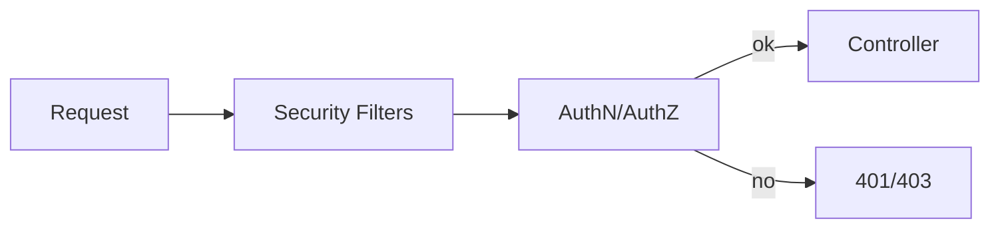

# Módulo 2.5 · Seguridad en microservicios

La seguridad distribuida combina identidad, transporte, secretos y cadena de suministro. Cada servicio es una superficie de ataque; por eso la defensa debe ser por capas: autenticación, autorización, cifrado, gestión de secretos y escaneo.

**Entorno de referencia verificado (2026-05-22):** JDK 27.0.1.0.2, Spring Boot 3.5.0, Docker 29.9.3.

## Aprende construyendo

### Tema 1: Spring Security: filter chain · Intermedio · 150 min

Caso guía: proteger endpoints con reglas explícitas.

#### Security Filter Chain

**Definición formal.** Cadena de filtros que intercepta requests HTTP para autenticación, autorización, CSRF, sesiones y otras políticas.



**Error común.** Reglas en orden incorrecto (`anyRequest` primero). Corrección: reglas específicas antes de generales.

### Tema 2: JWT: firmas simétricas vs asimétricas · Intermedio · 150 min

Caso guía: servicios internos deben validar tokens sin compartir secreto simétrico.

#### JWT

**Definición formal.** Token con header.payload.signature. Simétrico (HMAC, mismo secreto) vs asimétrico (RSA/EC, clave privada firma, pública verifica).

**Regla.** Validar `iss`, `aud`, `exp`, `nbf` y firma.

**Error común.** Confiar en payload sin verificar firma. Corrección: siempre validar firma y claims.

### Tema 3: OAuth2 y OIDC · Avanzado · 180 min

Caso guía: delegar login en IdP.

#### OAuth2/OIDC

**Definición formal.** OAuth2 autoriza acceso a recursos; OIDC agrega identidad autenticada sobre OAuth2.

**Error común.** Usar access token como prueba de identidad sin contexto OIDC. Corrección: ID token para identidad, access token para autorización.

### Tema 4: Keycloak · Intermedio · 120 min

Caso guía: centralizar usuarios, roles y clientes.

#### Keycloak

**Definición formal.** Identity Provider open source para OAuth2/OIDC/SAML, gestión de realms, clientes y roles.

**Nota de verificación.** Lab con Docker/Keycloak; no fingir salida.

### Tema 5: RBAC y Scopes · Intermedio · 120 min

Caso guía: `admin` puede borrar, `reader` solo leer.

#### RBAC/Scopes

**Definición formal.** RBAC autoriza por rol; scopes autorizan por permisos concedidos al token/cliente.

**Error común.** Solo checks en frontend. Corrección: enforcement en backend.

### Tema 6: Token Exchange (RFC 8693) · Avanzado · 90 min

Caso guía: servicio A llama a B en nombre del usuario con token de menor alcance.

#### Token Exchange

**Definición formal.** Protocolo para intercambiar un token por otro con claims/audiencia/scope adecuados.

**Error común.** Reenviar token original a todos los servicios. Corrección: token acotado por audiencia y least privilege.

### Tema 7: mTLS con Service Mesh · Avanzado · 120 min

Caso guía: cifrar y autenticar tráfico service-to-service.

#### mTLS

**Definición formal.** TLS mutuo: cliente y servidor presentan certificados. En mesh (Istio/Linkerd), suele automatizarse.

**Error común.** Asumir red interna confiable. Corrección: zero trust, mTLS donde aplica.

### Tema 8: HashiCorp Vault · Intermedio · 120 min

Caso guía: rotar credenciales DB sin redeploy manual.

#### Vault

**Definición formal.** Sistema de gestión de secretos, cifrado y credenciales dinámicas.

**Error común.** Secretos en variables de entorno sin rotación/control. Corrección: vault/secret manager y auditoría.

### Tema 9: Escaneo de vulnerabilidades: Trivy, Snyk · Intermedio · 90 min

Caso guía: detectar CVEs en imagen base.

#### Escaneo de supply chain

**Definición formal.** Análisis de dependencias/imágenes/IaC en busca de vulnerabilidades conocidas y malas configuraciones.

**Ejemplo mínimo.**

```bash
trivy image --severity HIGH,CRITICAL myapp:latest
```

**Error común.** Ignorar findings por volumen. Corrección: priorizar por explotabilidad, severidad y exposición.

**Nota de verificación.** Requiere Trivy/Snyk instalados.

## Cierre

Seguridad en microservicios es identidad + autorización + cifrado + secretos + supply chain. No hay un único control suficiente.

## Checklist

- Valido JWT/claims.
- Aplico RBAC/scopes en backend.
- Uso mTLS/zero trust cuando corresponde.
- Gestiono secretos con rotación.
- Escaneo CVEs en CI.
