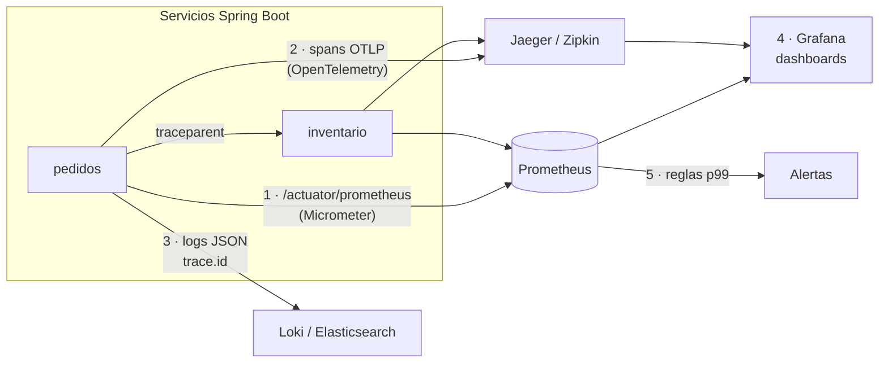
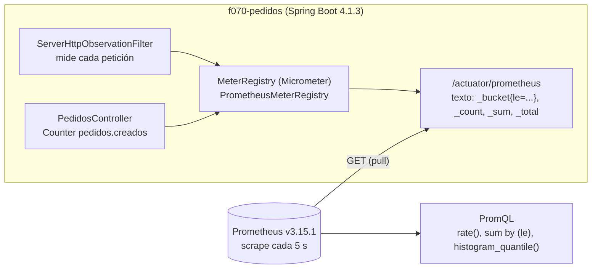
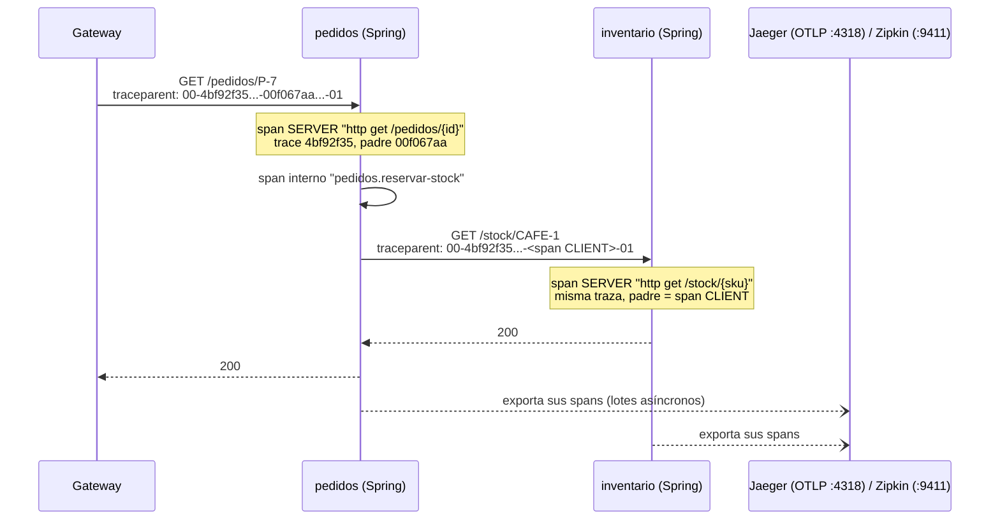
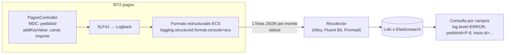
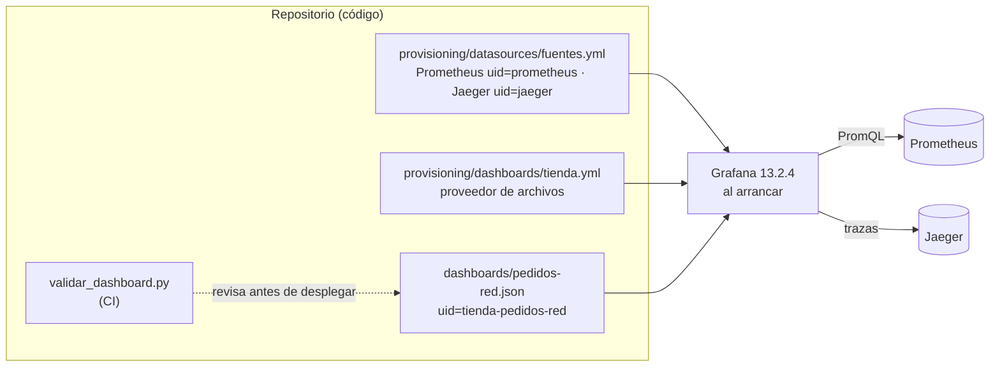
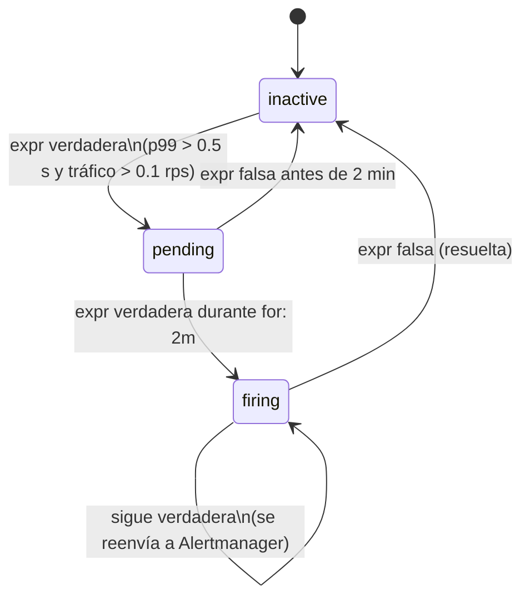

# Módulo 10 · Observabilidad

**Fase 1 · Spring Boot de cero a experto** (segunda mitad de la semana 10 de 12). **Duración:** 9 h (5 temas de
1,5–2 h). **Dificultad:** 3 de 5. **Dependencias:** Módulo 6 (servicios que se llaman entre sí con `RestClient`) y
Módulo 1 (configuración y perfiles); el tema de alertas usa los percentiles que aparecen en el Módulo 8 (presupuesto de
latencia). **Herramientas:** **JDK 25 LTS (25.0.5)**, **Spring Boot 4.1.3** (Actuator, Micrometer 1.17.3, Micrometer
Tracing 1.7.3, OpenTelemetry 1.62.0, logging estructurado), **Prometheus v3.15.1**, **Grafana 13.2.4**, **Jaeger
2.22.0**, **Zipkin 3.6.1**, Python 3 y `curl`. **Laboratorio:** `examples/microservicios/modulo-14/`
(`./verificar.sh --solo-jdk` corre las demostraciones con solo el JDK y Python; `./verificar.sh` levanta toda la pila).

Un sistema de microservicios falla de formas que no se ven desde un solo servicio: una petición lenta puede deberse a
la tercera dependencia de la segunda llamada. Observar es poder responder **preguntas nuevas** sobre producción sin
desplegar código nuevo. Para eso cada servicio emite tres señales: **métricas** (números agregados: cuántas, cuán
rápido, cuántos errores), **trazas** (el recorrido de una petición concreta por todos los servicios) y **logs** (los
eventos con detalle). Encima construyes **paneles** para mirar y **alertas** que te despiertan solo cuando el usuario
lo nota.



**Texto alternativo:** los servicios pedidos e inventario, unidos por la cabecera traceparent, emiten tres señales:
métricas en /actuator/prometheus que Prometheus raspa (tema 1), spans por OTLP hacia Jaeger o Zipkin (tema 2) y logs en
JSON con el trace.id hacia Loki o Elasticsearch (tema 3). Grafana lee de Prometheus y de Jaeger para los dashboards
(tema 4) y Prometheus evalúa reglas sobre el p99 que generan alertas (tema 5).

**Cómo usar el laboratorio.** Cada tema empieza con una demostración de `jdk/` que muestra la idea sin dependencias
(qué es una serie de Prometheus, cómo viaja un `traceparent`, qué es un log estructurado, por qué el promedio engaña).
Después la haces con Spring Boot y la pila real: `docker compose up -d --wait` levanta Prometheus (`:9090`), Grafana
(`:3000`, usuario `admin`, clave `admin-solo-dev`), Jaeger (`:16686`) y Zipkin (`:9411`). Prometheus raspa la app
`f070` en `host.docker.internal:8080`, así que la app corre en tu máquina, no en Docker.

---
### Micrometer + Prometheus

#### 1. UBICACIÓN

Módulo 10, Lección 1 de 5 · Fase 1 · 2 h · Laboratorio `examples/microservicios/modulo-14/jdk/MetricasPrometheus.java` y
`examples/microservicios/modulo-14/f070-micrometer-prometheus/`.

#### 2. PRERREQUISITOS

- Módulo 2: controladores Spring MVC y rutas con variables (`/pedidos/{id}`).
- Módulo 1: `application.properties` y beans inyectados.
- Idea de contador y de histograma (cuántos valores caen en cada rango).

#### 3. OBJETIVO DE APRENDIZAJE

**Instrumentar** un servicio Spring Boot con Micrometer para publicar métricas RED (tasa, errores, duración) y una
métrica de negocio en `/actuator/prometheus`, **leer** el formato de exposición (contador, histograma con `le`, `_sum`,
`_count`) y **evitar** la explosión de cardinalidad, comprobándolo con 2 tests y con Prometheus raspando la app.

#### 4. ANALOGÍA VISUAL

El **tablero de un carro**. No te dice todo lo que pasó en el viaje (eso sería un diario), pero te da **números que se
actualizan solos**: velocidad, kilómetros recorridos (un **contador** que solo sube), temperatura. Un mecánico
(Prometheus) pasa cada pocos segundos, **anota lo que marca el tablero** y guarda la historia para dibujar curvas. Para
las velocidades no anota cada valor: tiene **cajones** rotulados «hasta 50», «hasta 100», «hasta 120» y echa una bolita
en cada cajón que corresponda (**histograma**). El dibujo: un tablero con un odómetro, una fila de cajones con bolitas y
un mecánico con una libreta llegando cada 5 segundos.

#### 5. DIAGRAMA TÉCNICO



**Texto alternativo:** dentro de la aplicación f070-pedidos, el filtro ServerHttpObservationFilter mide cada petición y
el PedidosController incrementa un contador pedidos.creados; ambos registran en el MeterRegistry de Micrometer, que en
este caso es un PrometheusMeterRegistry y se publica en /actuator/prometheus como texto con líneas _bucket con la
etiqueta le, _count, _sum y _total. Prometheus v3.15.1 hace GET a ese endpoint cada 5 segundos (modelo pull) y permite
consultar con PromQL usando rate, sum by le e histogram_quantile.

#### 6. EXPLICACIÓN NIVEL 0

Una **métrica** es un número con nombre que tu servicio actualiza mientras trabaja: «peticiones atendidas», «pedidos
creados», «cuánto tardó cada petición». **Micrometer** es la librería de Spring para registrar esos números sin
casarte con una herramienta concreta, y **Prometheus** es una base de datos que cada pocos segundos visita tu servicio,
lee todos los números y los guarda con la hora, para poder dibujarlos y hacer preguntas como «¿cuántas peticiones por
segundo tuvimos ayer a las 3?».

#### 7. EXPLICACIÓN INTERMEDIA

- **Tipos de medidor:** `Counter` (solo sube; en Prometheus `_total`), `Gauge` (sube y baja: conexiones abiertas),
  `Timer` (cuenta, suma y, si se pide, histograma de duraciones; en Prometheus `_seconds_count`, `_seconds_sum`,
  `_seconds_max` y `_seconds_bucket`) y `DistributionSummary` (lo mismo para tamaños o importes).
- **Etiquetas (tags):** cada combinación distinta de etiquetas es una **serie temporal** distinta. Spring etiqueta
  `http.server.requests` con `method`, `uri` (la **plantilla** `/pedidos/{id}`, no el valor), `status`, `outcome` y
  `exception`. `management.metrics.tags.application=...` añade una etiqueta común a todas.
- **Histogramas:** `management.metrics.distribution.percentiles-histogram.http.server.requests=true` publica buckets
  `le` (menor o igual que) acumulados; con ellos Prometheus calcula percentiles **agregando** instancias. `slo` añade
  límites exactos (100 ms, 500 ms) y `minimum-`/`maximum-expected-value` acotan cuántos buckets se publican. La
  alternativa, `percentiles=0.99`, calcula el percentil en la app: barato, pero **no se puede sumar** entre instancias.
- **Exposición:** `spring-boot-starter-actuator` + `micrometer-registry-prometheus` crean el endpoint, que se publica
  por HTTP con `management.endpoints.web.exposure.include=health,prometheus`.
- **Prometheus** hace *pull*: raspa (`scrape`) cada `scrape_interval`, guarda muestras con marca de tiempo y añade las
  etiquetas `job` e `instance`. La serie `up{job="f070-pedidos"}` vale 1 si el último raspado funcionó.
- **PromQL esencial:** `rate(x_total[5m])` (por segundo, tolera reinicios del contador), `sum by (uri) (...)`,
  `histogram_quantile(0.99, sum by (le) (rate(x_bucket[5m])))`. En Prometheus 3 las ventanas como `[5m]` son abiertas
  por la izquierda: deja que contengan al menos dos raspados.

#### 8. EXPLICACIÓN MAESTRA

| Decisión | Opción A | Opción B | Criterio |
|---|---|---|---|
| Modelo de envío | **Pull** (Prometheus raspa) | **Push** (OTLP a un Collector u otro backend; `management.otlp.metrics.export.*`) | Pull detecta caídas (`up==0`) y no satura al backend; push sirve para *jobs* cortos y redes donde no puedes entrar |
| Percentiles | Histograma con buckets (agregable) | Percentil calculado en la app (no agregable) | Con más de una instancia, histograma siempre |
| Formato | Texto Prometheus / OpenMetrics | Histogramas nativos (exponenciales) | Los nativos dan más precisión con menos series, pero exigen soporte en todo el camino |
| Backend | Prometheus solo | Prometheus + almacenamiento a largo plazo (Thanos, Mimir, VictoriaMetrics) | Retención de semanas en un nodo frente a meses y alta disponibilidad |

**Cardinalidad:** series ≈ métricas × combinaciones de etiquetas × buckets. Un `uri` con el id real, un `userId` o un
mensaje de error como etiqueta crean series sin límite y tumban Prometheus (memoria) y la factura. Los valores únicos van
a trazas y logs; en métricas, solo valores de un conjunto pequeño y conocido. **RED** (*Rate, Errors, Duration*) para
servicios y **USE** (*Utilization, Saturation, Errors*) para recursos son los dos mínimos.

**Cuándo NO:** para saber **qué le pasó a un pedido concreto** las métricas no sirven (agregan): usa trazas (F071) y logs
(F072). Y para un *script* que corre una vez al día, una métrica raspada nunca la verá: usa push o regístralo en logs.

#### 9. CÓDIGO EJECUTABLE

**Versiones:** JDK 25 LTS · Spring Boot 4.1.3 · `spring-boot-starter-actuator` · `io.micrometer:micrometer-registry-prometheus`
(versión del BOM de Boot, Micrometer 1.17.3) · `spring-boot-starter-micrometer-metrics-test` para `@AutoConfigureMetrics`
· Prometheus v3.15.1.

**Antes** — `jdk/MetricasPrometheus.java` registra la latencia con el id real en la etiqueta `uri`:

```java
MetricasPrometheus antes = new MetricasPrometheus();
for (int id = 1; id <= 1000; id++) antes.registrarPeticion("GET", "/pedidos/" + id, 200, latencia(id));
```

y en Spring el equivalente es construir un `Timer` a mano con el valor libre como etiqueta:

```java
Timer.builder("pedidos.latencia").tag("pedido", String.valueOf(id)).register(registro)   // una serie por pedido
```

**Después** — `f070-micrometer-prometheus/build.gradle.kts`:

```kotlin
// F070 · Micrometer + Prometheus: métricas RED y de negocio en /actuator/prometheus
plugins {
    java
    alias(libs.plugins.spring.boot)
    alias(libs.plugins.spring.dependency.management)
}

group = "academia.microservicios"
version = "1.0.0"

java {
    toolchain {
        languageVersion = JavaLanguageVersion.of(25)
    }
}

dependencies {
    // Spring MVC + Tomcat 11 + Jackson 3
    implementation(libs.spring.boot.starter.webmvc)
    // Actuator: /actuator/health, /actuator/prometheus
    implementation(libs.spring.boot.starter.actuator)
    // Registro Prometheus de Micrometer (versión del BOM de Boot)
    implementation(libs.micrometer.registry.prometheus)
    // MockMvc, JUnit Jupiter 6, AssertJ
    testImplementation(libs.spring.boot.starter.webmvc.test)
    // @AutoConfigureMetrics: registro Prometheus también en los tests
    testImplementation(libs.spring.boot.starter.micrometer.metrics.test)
    // Gradle 9 exige declarar el lanzador de JUnit Platform (ya no lo añade por su cuenta)
    testRuntimeOnly(libs.junit.platform.launcher)
}

tasks.withType<Test> {
    useJUnitPlatform()
    testLogging {
        events("passed", "skipped", "failed")   // una línea por test en la consola
        // el mensaje completo de cada fallo (valor esperado y obtenido), no solo el tipo de excepción
        exceptionFormat = org.gradle.api.tasks.testing.logging.TestExceptionFormat.FULL
    }
}
```

> **Build con Gradle (y su equivalencia en Maven).** Este laboratorio se construye con **Gradle 9.9.2** y Kotlin DSL
> mediante el wrapper `./gradlew` (no instalas Gradle). `settings.gradle.kts` lista los subproyectos (en Maven,
> `<modules>` del POM agregador), cada carpeta tiene su `build.gradle.kts` (su `pom.xml`) y
> `gradle/libs.versions.toml` es el **catálogo de versiones** (las `<properties>` y el `dependencyManagement`): por eso
> las dependencias se escriben `libs.…`. Equivalencias: `./mvnw test` → `./gradlew test` ·
> `./mvnw package -DskipTests` → `./gradlew bootJar` · `./mvnw spring-boot:run` → `./gradlew bootRun` ·
> `-Dtest=Clase` → `--tests Clase` · `target/` → `build/` (el jar queda en `build/libs/`). Gradle escribe una línea
> `PASSED` por test y termina con `BUILD SUCCESSFUL` (Maven: `Tests run: N` y `BUILD SUCCESS`).

`modulo-14/settings.gradle.kts`:

```kotlin
// Módulo 10 (modulo-14) · Build multi-proyecto: "./gradlew test" ejecuta los tests de F070, F071 (con OpenTelemetry) y F072.
// F073 (Grafana) y F074 (reglas de Prometheus) no tienen build de Gradle: ver README y verificar.sh.
// Cada carpeta tiene su propio build.gradle.kts; las versiones viven en gradle/libs.versions.toml
// (catálogo "libs"). Equivale al POM agregador con <modules> de Maven.
pluginManagement {
    repositories {
        gradlePluginPortal()
        mavenCentral()
    }
}

dependencyResolutionManagement {
    repositories {
        mavenCentral()
    }
}

rootProject.name = "modulo-14-laboratorios"

include(
    "f070-micrometer-prometheus",
    "f071-tracing",
    "f072-logging-estructurado",
)
```

`modulo-14/gradle/libs.versions.toml`:

```toml
# Módulo 10 (modulo-14)
# Catálogo de versiones del laboratorio: una sola fuente para plugins y librerías.
# Las librerías SIN versión las fija el BOM de Spring Boot (spring-boot-dependencies) o el BOM que importe el proyecto.

[versions]
spring-boot = "4.1.3"

[libraries]
spring-boot-starter-webmvc = { module = "org.springframework.boot:spring-boot-starter-webmvc" }
spring-boot-starter-actuator = { module = "org.springframework.boot:spring-boot-starter-actuator" }
micrometer-registry-prometheus = { module = "io.micrometer:micrometer-registry-prometheus" }
spring-boot-starter-webmvc-test = { module = "org.springframework.boot:spring-boot-starter-webmvc-test" }
spring-boot-starter-micrometer-metrics-test = { module = "org.springframework.boot:spring-boot-starter-micrometer-metrics-test" }
junit-platform-launcher = { module = "org.junit.platform:junit-platform-launcher" }
spring-boot-starter-restclient = { module = "org.springframework.boot:spring-boot-starter-restclient" }
spring-boot-starter-opentelemetry = { module = "org.springframework.boot:spring-boot-starter-opentelemetry" }
spring-boot-starter-opentelemetry-test = { module = "org.springframework.boot:spring-boot-starter-opentelemetry-test" }
spring-boot-starter-zipkin = { module = "org.springframework.boot:spring-boot-starter-zipkin" }
spring-boot-starter-zipkin-test = { module = "org.springframework.boot:spring-boot-starter-zipkin-test" }

[plugins]
spring-boot = { id = "org.springframework.boot", version.ref = "spring-boot" }
spring-dependency-management = { id = "io.spring.dependency-management", version = "1.1.7" }
```

`src/main/java/academia/observabilidad/metricas/PedidosController.java` (la clase `MetricasApp` es la habitual con
`@SpringBootApplication`):

```java
package academia.observabilidad.metricas;

import io.micrometer.core.instrument.Counter;
import io.micrometer.core.instrument.MeterRegistry;
import java.util.Map;
import java.util.Set;
import org.springframework.http.ResponseEntity;
import org.springframework.web.bind.annotation.GetMapping;
import org.springframework.web.bind.annotation.PathVariable;
import org.springframework.web.bind.annotation.PostMapping;
import org.springframework.web.bind.annotation.RequestParam;
import org.springframework.web.bind.annotation.RestController;

@RestController
class PedidosController {

    private static final Set<String> CANALES = Set.of("web", "app");
    private final MeterRegistry registro;

    PedidosController(MeterRegistry registro) {
        this.registro = registro;
    }

    /** http.server.requests lo mide Spring solo (uri="/pedidos/{id}", la plantilla, no el id). */
    @GetMapping("/pedidos/{id}")
    Map<String, Object> pedido(@PathVariable long id, @RequestParam(defaultValue = "false") boolean lento)
            throws InterruptedException {
        Thread.sleep(lento ? 600 : 20);                     // ?lento=true simula una dependencia que tarda
        return Map.of("id", id, "estado", "confirmado");
    }

    /** Métrica de negocio: pedidos creados por canal (valores acotados: web, app u otro). */
    @PostMapping("/pedidos")
    ResponseEntity<Void> crear(@RequestParam String canal) {
        String etiqueta = CANALES.contains(canal) ? canal : "otro";   // nunca un valor libre como etiqueta
        Counter.builder("pedidos.creados")
            .description("Pedidos creados por canal")
            .tag("canal", etiqueta)
            .register(registro)
            .increment();
        return ResponseEntity.status(201).build();
    }
}
```

`src/main/resources/application.properties`:

```properties
spring.application.name=f070-pedidos
# Solo health y prometheus por HTTP (el resto de endpoints de Actuator no se publica).
management.endpoints.web.exposure.include=health,prometheus
# Etiqueta común en todas las métricas.
management.metrics.tags.application=${spring.application.name}
# Buckets de histograma para http.server.requests (necesarios para histogram_quantile en Prometheus),
# acotados entre 5 ms y 5 s, más los límites exactos de los objetivos (SLO) 100 ms y 500 ms.
management.metrics.distribution.percentiles-histogram.http.server.requests=true
management.metrics.distribution.minimum-expected-value.http.server.requests=5ms
management.metrics.distribution.maximum-expected-value.http.server.requests=5s
management.metrics.distribution.slo.http.server.requests=100ms,500ms
```

`prometheus/prometheus.yml` del laboratorio:

```yaml
# Módulo 10 · Prometheus v3.15.1: raspa f070-pedidos (en tu máquina, :8080) cada 5 s y evalúa reglas.
global:
  scrape_interval: 5s
  evaluation_interval: 5s
rule_files:
  - /etc/prometheus/reglas.yml
scrape_configs:
  - job_name: f070-pedidos
    metrics_path: /actuator/prometheus
    static_configs:
      - targets: ["host.docker.internal:8080"]
  - job_name: prometheus
    static_configs:
      - targets: ["localhost:9090"]
```

#### 10. MINI-LABORATORIO

1. Mira el formato y la cardinalidad sin Spring (ejecutado con JDK 25.0.5):

```bash
cd examples/microservicios/modulo-14/jdk
java MetricasPrometheus.java
```

   **Output esperado:**

```text
ANTES (vulnerable): uri con el id real
  1000 peticiones -> 1000 combinaciones de etiquetas -> 8000 series en Prometheus (crece con cada pedido nuevo)
DESPUÉS (seguro): uri con la plantilla
  1003 peticiones -> 2 combinaciones de etiquetas -> 18 series (no crece con el número de pedidos)
GET /metrics -> 200 text/plain; version=0.0.4; charset=utf-8
  # TYPE http_server_requests_seconds histogram
  http_server_requests_seconds_bucket{method="GET",uri="/pedidos/{id}",status="200",le="0.05"} 560
  http_server_requests_seconds_bucket{method="GET",uri="/pedidos/{id}",status="200",le="0.1"} 980
  http_server_requests_seconds_bucket{method="GET",uri="/pedidos/{id}",status="200",le="0.25"} 980
  http_server_requests_seconds_bucket{method="GET",uri="/pedidos/{id}",status="200",le="0.5"} 980
  http_server_requests_seconds_bucket{method="GET",uri="/pedidos/{id}",status="200",le="1.0"} 1000
  http_server_requests_seconds_bucket{method="GET",uri="/pedidos/{id}",status="200",le="+Inf"} 1000
  http_server_requests_seconds_sum{method="GET",uri="/pedidos/{id}",status="200"} 65.0
  http_server_requests_seconds_count{method="GET",uri="/pedidos/{id}",status="200"} 1000
  # TYPE pedidos_creados_total counter
  pedidos_creados_total{canal="app"} 10.0
  pedidos_creados_total{canal="web"} 30.0
buckets acumulados: true · bucket +Inf == _count: true
OK: exposición válida y cardinalidad acotada
```

   Comprobación cruzada con el analizador oficial del cliente Python (`pip install prometheus-client`, ejecutado aquí con
   la versión 0.26.0):

```bash
python3 -c "
from prometheus_client.parser import text_string_to_metric_families
for f in text_string_to_metric_families(open('target/metrics.txt').read()):
    print(f.name, f.type, len(f.samples), 'muestras')"
```

   **Output esperado:**

```text
http_server_requests_seconds histogram 16 muestras
pedidos_creados counter 2 muestras
```

2. Arranca la app y la pila, y genera tráfico:

```bash
cd ..
docker compose up -d --wait prometheus
(cd f070-micrometer-prometheus && ../gradlew -q bootRun) &
sleep 15 && ./carga.sh 30 0
curl -s localhost:8080/actuator/prometheus | grep -E '^pedidos_creados_total|^http_server_requests_seconds_count\{.*pedidos'
```

   **Output esperado** (verificado en macOS con Spring Boot 4.1.3; `<n>` y `<m>` dependen de la carga):

```text
pedidos_creados_total{application="f070-pedidos",canal="web"} <n>.0
http_server_requests_seconds_count{application="f070-pedidos",...,uri="/pedidos/{id}"} <m>
```

   `carga.sh` imprime antes `... peticiones en 30 s (0 % lentas)`. Fíjate en el formato real del registro Prometheus de
   Micrometer: los contadores salen como decimales (`2.0`), los buckets y `_count` como enteros, `le` es siempre la
   última etiqueta (`..._bucket{...,uri="/pedidos/{id}",le="0.1"} 1`) y las líneas `# HELP` terminan con dos espacios.
   Ninguna línea contiene un id concreto como `/pedidos/17`. Ojo si escribes expresiones regulares sobre esta salida:
   el valor `uri="/pedidos/{id}"` contiene una llave de cierre, así que `[^}]*` no sirve para «saltar etiquetas».

3. Consulta Prometheus:

```bash
curl -s 'localhost:9090/api/v1/query?query=up{job="f070-pedidos"}' | jq -r '.data.result[0].value[1]'
curl -s 'localhost:9090/api/v1/query' --data-urlencode \
  'query=sum by (uri) (rate(http_server_requests_seconds_count{job="f070-pedidos"}[1m]))' | jq -c '.data.result[] | {uri: .metric.uri, rps: .value[1]}'
```

   **Output esperado:** `1` y una línea `{"uri":"/pedidos/{id}","rps":"..."}` con un valor del orden de 15 a 20 peticiones por segundo mientras
   corre la carga (y otra para `/pedidos`, el `POST`). **Captura comentada:** en `http://localhost:9090/targets` el
   objetivo `f070-pedidos` aparece `UP` con su última duración de raspado.

4. **Fallo deliberado:** en `PedidosController.crear` cambia `.tag("canal", etiqueta)` por `.tag("canal", canal)` y
   ejecuta `../gradlew test`: falla la aserción `doesNotContain("un-valor-inventado-123")`, porque un valor libre llegó a
   ser etiqueta. Restaura la línea.

#### 11. VERIFICACIÓN

`f070-micrometer-prometheus/src/test/java/academia/observabilidad/metricas/ActuatorPrometheusTest.java`:

```java
package academia.observabilidad.metricas;

import static org.assertj.core.api.Assertions.assertThat;
import static org.springframework.test.web.servlet.request.MockMvcRequestBuilders.get;
import static org.springframework.test.web.servlet.request.MockMvcRequestBuilders.post;
import static org.springframework.test.web.servlet.result.MockMvcResultMatchers.status;

import org.junit.jupiter.api.Test;
import org.springframework.beans.factory.annotation.Autowired;
import org.springframework.boot.micrometer.metrics.test.autoconfigure.AutoConfigureMetrics;
import org.springframework.boot.test.context.SpringBootTest;
import org.springframework.boot.webmvc.test.autoconfigure.AutoConfigureMockMvc;
import org.springframework.test.web.servlet.MockMvc;

/** @AutoConfigureMetrics: en los tests Spring Boot no crea el registro Prometheus si no se lo pides. */
@SpringBootTest
@AutoConfigureMockMvc
@AutoConfigureMetrics
class ActuatorPrometheusTest {

    @Autowired MockMvc mvc;

    @Test
    void publicaRedYMetricaDeNegocioConEtiquetasAcotadas() throws Exception {
        mvc.perform(get("/pedidos/7")).andExpect(status().isOk());
        mvc.perform(get("/pedidos/8")).andExpect(status().isOk());
        mvc.perform(post("/pedidos").param("canal", "web")).andExpect(status().isCreated());
        mvc.perform(post("/pedidos").param("canal", "un-valor-inventado-123")).andExpect(status().isCreated());

        String scrape = mvc.perform(get("/actuator/prometheus")).andExpect(status().isOk())
            .andReturn().getResponse().getContentAsString();

        assertThat(scrape).containsPattern("http_server_requests_seconds_count\\{.*uri=\"/pedidos/\\{id\\}\".*\\} 2(\\.0)?\\n");
        assertThat(scrape).doesNotContain("uri=\"/pedidos/7\"");                    // la plantilla, nunca el id
        assertThat(scrape).containsPattern("http_server_requests_seconds_bucket\\{.*uri=\"/pedidos/\\{id\\}\".*le=\"0\\.5\"");
        assertThat(scrape).containsPattern("pedidos_creados_total\\{application=\"f070-pedidos\",canal=\"web\"\\} 1\\.0\\n");
        assertThat(scrape).containsPattern("pedidos_creados_total\\{.*canal=\"otro\".*\\} 1\\.0\\n");
        assertThat(scrape).doesNotContain("un-valor-inventado-123");
    }
}
```

`RegistroPrometheusTest` (en la misma carpeta) usa `PrometheusMeterRegistry` sin Spring: registra un contador y un
`Timer` con SLO de 100 y 500 ms, graba 80 ms y 700 ms y comprueba las líneas reales:
`pedidos_creados_total{canal="web"} 2.0`, `http_server_requests_seconds_bucket{uri="/pedidos/{id}",le="0.1"} 1`, lo mismo
para `le="0.5"` y `_count` en 2.

```bash
cd f070-micrometer-prometheus && ../gradlew test
```

**Output esperado:** 2 líneas `PASSED` (una por test) y `BUILD SUCCESSFUL` *(salida de Gradle pendiente de verificación en el Mac)*.

**Pregunta de comprobación:** en el paso 1, ¿por qué el bucket `le="0.25"` vale lo mismo que `le="0.1"` (980) y qué te
dice eso de la latencia?

<details>
<summary>Respuesta</summary>

Los buckets son **acumulados**: `le="0.25"` cuenta todo lo que tardó ≤ 0,25 s, incluido lo que ya contó `le="0.1"`. Que
valgan igual significa que ninguna petición tardó entre 0,1 y 0,25 s (ni entre 0,25 y 0,5); las 20 restantes están entre
0,5 y 1 s: son los pedidos lentos.
</details>

#### 12. ERROR COMÚN

**Síntoma:** en Prometheus el objetivo `f070-pedidos` aparece `DOWN` y `up{job="f070-pedidos"}` vale 0, aunque
`curl localhost:8080/actuator/prometheus` funciona en tu máquina.

**Cómo se ve:** en `http://localhost:9090/targets` el error dice algo como `Get "http://host.docker.internal:8080/actuator/prometheus":
dial tcp ...: connect: connection refused` o `server returned HTTP status 404 Not Found`.

**Diagnóstico:** con *connection refused*, Prometheus (dentro de Docker) no llega a tu máquina: en Linux falta
`extra_hosts: host.docker.internal:host-gateway` (en el `docker-compose.yml` del laboratorio ya está) o la app escucha en
otro puerto. Con 404, el endpoint no está expuesto (`management.endpoints.web.exposure.include` sin `prometheus`) o falta
`micrometer-registry-prometheus` en `build.gradle.kts`.

**Arreglo:** comprueba primero desde el contenedor: `docker compose exec prometheus wget -qO- host.docker.internal:8080/actuator/prometheus | head -3`.
Si eso funciona, el problema está en `prometheus.yml` (`metrics_path`, puerto).

#### 13. PREGUNTA DE ENTREVISTA

«¿Cómo instrumentas un microservicio Spring para Prometheus y qué cuidas al definir métricas?»

**Respuesta modelo:** Actuator más `micrometer-registry-prometheus` publica `/actuator/prometheus`; Spring ya mide
HTTP, JVM, pools y clientes con etiquetas de baja cardinalidad (plantilla de URI, método, estado). Activo histogramas de
percentiles para `http.server.requests` con límites razonables y SLO, porque con varias instancias los percentiles se
calculan en Prometheus sumando buckets (`histogram_quantile` sobre `sum by (le)`), no promediando percentiles. Añado
métricas de negocio con `Counter` o `Timer` y etiquetas de valores acotados; nada de ids, correos o mensajes de error
como etiqueta, porque cada combinación es una serie y la cardinalidad tumba Prometheus. Una etiqueta común
`application` y las alertas sobre RED completan el cuadro.

#### 14. ANTI-PATRÓN RELACIONADO

**Etiqueta con datos de alta cardinalidad:**

```java
Counter.builder("errores")
    .tag("usuario", usuario.getEmail())          // un valor por usuario
    .tag("mensaje", excepcion.getMessage())      // un valor por mensaje (con ids, fechas...)
    .register(registro).increment();
```

Millones de series, memoria de Prometheus disparada, consultas lentas y datos personales en el sistema de métricas.
Etiqueta solo con conjuntos pequeños y conocidos (`tipo=timeout|validacion|interno`); el detalle va al log estructurado
(F072) o a la traza (F071).

---
### OpenTelemetry + Zipkin/Jaeger

#### 1. UBICACIÓN

Módulo 10, Lección 2 de 5 · Fase 1 · 2 h · Laboratorio `examples/microservicios/modulo-14/jdk/TrazasW3C.java` y
`examples/microservicios/modulo-14/f071-tracing/`.

#### 2. PRERREQUISITOS

- Módulo 6: un servicio que llama a otro con `RestClient`.
- F070: Actuator y Micrometer.
- Módulo 0.4: cabeceras HTTP.

#### 3. OBJETIVO DE APRENDIZAJE

**Explicar** qué son una traza, un span y el contexto W3C `traceparent`, **activar** trazas distribuidas en Spring Boot
con Micrometer Tracing (puente OpenTelemetry, exportación OTLP a Jaeger, o Brave hacia Zipkin) y **demostrar** con un test
que el `trace-id` entrante llega al servicio siguiente con un `span-id` nuevo.

#### 4. ANALOGÍA VISUAL

La **guía de un envío por paquetería**. Al entrar el paquete le pegan una etiqueta con un **número de guía** (el
`trace-id`) que no cambia en todo el viaje. En cada bodega por la que pasa se anota un **sello con hora de entrada y de
salida** (un *span*) que dice también **de qué bodega venía** (el *span* padre). Al final, con el número de guía ves la
línea de tiempo completa y descubres que el paquete pasó 3 días en la bodega de Cali. Si una bodega olvida copiar el
número de guía en la etiqueta nueva, el viaje se parte en dos historias que nadie puede unir. El dibujo: un paquete con
una etiqueta grande `4bf92f35…`, tres bodegas con sellos de hora y una línea de tiempo con barras de distinto largo.

#### 5. DIAGRAMA TÉCNICO



**Texto alternativo:** diagrama de secuencia. El gateway llama a pedidos con una cabecera traceparent cuyo trace-id
empieza por 4bf92f35 y cuyo span padre empieza por 00f067aa. Pedidos crea un span de servidor hijo de ese padre y un
span interno de reserva de stock; luego llama a inventario con un traceparent nuevo que conserva el trace-id y lleva el
id del span de cliente. Inventario crea su span de servidor en la misma traza, con el span de cliente como padre, y
responde. Ambos servicios exportan sus spans en lotes asíncronos a Jaeger por OTLP o a Zipkin.

#### 6. EXPLICACIÓN NIVEL 0

Una **traza** es la historia completa de una petición a través de todos los servicios que tocó. Cada tramo de trabajo
(«pedidos atendió la petición», «pedidos llamó a inventario», «inventario consultó la base») es un **span**, con hora de
inicio, duración y quién es su padre. Para que los spans de distintos servicios se junten en la misma historia, cada
llamada lleva una cabecera con el **identificador de la traza**. Herramientas como **Jaeger** o **Zipkin** reciben los
spans y los dibujan como una línea de tiempo, para ver **dónde** se fue el tiempo.

#### 7. EXPLICACIÓN INTERMEDIA

- **W3C Trace Context:** `traceparent: 00-<trace-id 32 hex>-<parent-id 16 hex>-<flags 2 hex>`; el flag `01` significa
  «muestreada». `tracestate` lleva datos propios de cada proveedor. Es el formato que produce Spring Boot por defecto
  (`management.tracing.propagation.produce` = `[W3C]`) y acepta también B3 (`consume` = `[W3C, B3, B3_MULTI]`).
- **Span:** nombre, tipo (`SERVER`, `CLIENT`, `PRODUCER`, `CONSUMER`, `INTERNAL`), inicio, duración, atributos (*tags*)
  y estado de error. Los atributos de alta cardinalidad (id de pedido) **sí** van en la traza: es su sitio.
- **En Spring Boot 4:** Micrometer Tracing es la fachada; debajo, **OpenTelemetry** (`spring-boot-starter-opentelemetry`,
  exporta por OTLP: `management.opentelemetry.tracing.export.otlp.endpoint`) o **Brave** (`spring-boot-starter-zipkin`,
  exporta a `management.tracing.export.zipkin.endpoint`, por defecto `http://localhost:9411/api/v2/spans`). Spring Boot
  4.1 marca como obsoleto el soporte de Zipkin **sobre** OpenTelemetry (se retira en 4.2): para Zipkin, usa Brave.
- **Muestreo:** por defecto Spring Boot muestrea el **10 %**; `management.tracing.sampling.probability=1.0` en el
  laboratorio. El muestreador de OpenTelemetry por defecto es `parent-based-trace-id-ratio`: respeta la decisión del
  servicio anterior para no romper trazas.
- **Propagación automática** solo con los clientes construidos desde los *builders* de Spring (`RestClient.Builder`,
  `RestTemplateBuilder`, `WebClient.Builder`); un `HttpClient` creado a mano no la hace.
- **Correlación con logs:** el `traceId` y el `spanId` van al MDC y Spring los añade al log (`[traceId-spanId]` por
  defecto; formato con `logging.pattern.correlation`).
- **Spans propios:** `Observation.createNotStarted("nombre", registro).lowCardinalityKeyValue(...)
  .highCardinalityKeyValue(...).observe(() -> ...)`: las de baja cardinalidad van también a métricas; las de alta, solo a
  la traza.

#### 8. EXPLICACIÓN MAESTRA

| Pieza | Opciones | Trade-off |
|---|---|---|
| Instrumentación | Micrometer Tracing (Spring) · agente Java de OpenTelemetry (`-javaagent`, v2.33.1) · SDK OTel a mano | El agente instrumenta cientos de librerías sin código pero añade arranque y sorpresas; Micrometer es lo nativo de Spring y comparte observaciones con métricas |
| Transporte | Directo al backend · **OpenTelemetry Collector** en medio | El Collector desacopla (reintentos, muestreo por cola, envío a varios backends), a cambio de operarlo |
| Backend | **Jaeger** v2 (construido sobre el Collector, UI de búsqueda) · **Zipkin** (simple, maduro) · Grafana Tempo (barato en objeto) | Jaeger y Tempo hablan OTLP nativo; Zipkin tiene su propio formato JSON v2 |
| Muestreo | En cabeza (*head*, al iniciar) · en cola (*tail*, en el Collector, tras ver la traza completa) | Head es barato pero puede perder las trazas con error; tail guarda todas las lentas o con error y cuesta memoria |

**Cuánto cuesta:** cada span ocupa memoria y red; con 100 % de muestreo en producción el *observability tax* (Módulo 28)
puede superar el coste del propio servicio. Lo habitual: 1–10 % en cabeza más muestreo en cola de errores y lentas.

**Cuándo NO:** un monolito con una sola base de datos se diagnostica con perfiles y logs; las trazas distribuidas brillan
cuando una petición cruza procesos. Tampoco son el lugar para auditar (se muestrean): para auditoría, logs o eventos.

#### 9. CÓDIGO EJECUTABLE

**Versiones:** JDK 25 LTS · Spring Boot 4.1.3 · `spring-boot-starter-opentelemetry` (Micrometer Tracing 1.7.3 +
OpenTelemetry 1.62.0, exportación OTLP/HTTP) o, con `-Ptrazas=zipkin`, `spring-boot-starter-zipkin` (Brave + Zipkin Reporter
3.5.3) · `spring-boot-starter-restclient` · Jaeger 2.22.0 · Zipkin 3.6.1.

**Antes** — sin propagación: el cliente HTTP se crea a mano (en `jdk/TrazasW3C.java`, con `propagar = false`
el cliente no añade la cabecera) y cada servicio empieza su propia traza:

```java
// ANTES: HttpClient propio, sin traceparent -> inventario no sabe a qué traza pertenece la llamada
var req = HttpRequest.newBuilder(URI.create("http://127.0.0.1:" + puertoInventario + "/stock/CAFE-1"));
if (propagar) req.header("traceparent", "00-" + ctx[0] + "-" + cliente + "-01");   // inyectar
```

En Spring, el mismo error es `RestClient.create(url)` en lugar de `RestClient.Builder` inyectado.

**Después** — `f071-tracing/build.gradle.kts`:

```kotlin
// F071 · OpenTelemetry + Zipkin/Jaeger: trazas distribuidas entre pedidos e inventario.
// Por defecto (-Ptrazas=otel): Micrometer Tracing + OpenTelemetry, exporta por OTLP a Jaeger.
// Con "-Ptrazas=zipkin": Micrometer Tracing + Brave, exporta a Zipkin. Nunca los dos a la vez.
// (En Maven eran los perfiles "otel", activo por defecto, y "zipkin" con -Pzipkin.)
plugins {
    java
    alias(libs.plugins.spring.boot)
    alias(libs.plugins.spring.dependency.management)
}

group = "academia.microservicios"
version = "1.0.0"

java {
    toolchain {
        languageVersion = JavaLanguageVersion.of(25)
    }
}

// Propiedad de proyecto que elige el puente de trazas: es el equivalente de un perfil de Maven
val trazas = providers.gradleProperty("trazas").getOrElse("otel")

dependencies {
    // Spring MVC + Tomcat 11 + Jackson 3
    implementation(libs.spring.boot.starter.webmvc)
    // RestClient.Builder autoconfigurado: propaga traceparent solo
    implementation(libs.spring.boot.starter.restclient)
    // Actuator: /actuator/health
    implementation(libs.spring.boot.starter.actuator)
    if (trazas == "zipkin") {
        // Micrometer Tracing + Brave + exportador a Zipkin
        implementation(libs.spring.boot.starter.zipkin)
        testImplementation(libs.spring.boot.starter.zipkin.test)
    } else {
        // Micrometer Tracing + OpenTelemetry + exportador OTLP
        implementation(libs.spring.boot.starter.opentelemetry)
        testImplementation(libs.spring.boot.starter.opentelemetry.test)
    }
    // MockMvc, JUnit Jupiter 6, AssertJ
    testImplementation(libs.spring.boot.starter.webmvc.test)
    // Gradle 9 exige declarar el lanzador de JUnit Platform (ya no lo añade por su cuenta)
    testRuntimeOnly(libs.junit.platform.launcher)
}

tasks.withType<Test> {
    useJUnitPlatform()
    testLogging {
        events("passed", "skipped", "failed")   // una línea por test en la consola
        // el mensaje completo de cada fallo (valor esperado y obtenido), no solo el tipo de excepción
        exceptionFormat = org.gradle.api.tasks.testing.logging.TestExceptionFormat.FULL
    }
}
```

`src/main/java/academia/observabilidad/trazas/PedidosController.java`:

```java
package academia.observabilidad.trazas;

import io.micrometer.observation.Observation;
import io.micrometer.observation.ObservationRegistry;
import java.util.Map;
import org.slf4j.Logger;
import org.slf4j.LoggerFactory;
import org.springframework.beans.factory.annotation.Value;
import org.springframework.web.bind.annotation.GetMapping;
import org.springframework.web.bind.annotation.PathVariable;
import org.springframework.web.bind.annotation.RestController;
import org.springframework.web.client.RestClient;

@RestController
class PedidosController {

    private static final Logger log = LoggerFactory.getLogger(PedidosController.class);
    private final RestClient inventario;
    private final ObservationRegistry observaciones;

    /** DESPUÉS: el RestClient sale del RestClient.Builder de Spring, que añade traceparent a cada llamada. */
    PedidosController(RestClient.Builder builder, ObservationRegistry observaciones,
                      @Value("${tienda.inventario.url}") String urlInventario) {
        this.inventario = builder.baseUrl(urlInventario).build();
        this.observaciones = observaciones;
    }

    @GetMapping("/pedidos/{id}")
    Map<String, Object> pedido(@PathVariable String id) {
        log.info("consultando pedido {}", id);                       // el log lleva [traceId-spanId]
        // Span propio para un paso interno; "pedido.id" es de alta cardinalidad: va a la traza, no a métricas.
        Map<?, ?> stock = Observation.createNotStarted("pedidos.reservar-stock", observaciones)
            .lowCardinalityKeyValue("operacion", "reserva")
            .highCardinalityKeyValue("pedido.id", id)
            .observe(() -> inventario.get().uri("/stock/{sku}", "CAFE-1").retrieve().body(Map.class));
        return Map.of("pedido", id, "estado", "confirmado", "stock", stock);
    }
}
```

`InventarioController.java` atiende `GET /stock/{sku}` (registra un log, espera 30 ms y devuelve
`{"sku": ..., "stock": 12}`); la misma app hace de pedidos o de inventario según el nombre y el puerto con que la
arranques. `src/main/resources/application.properties`:

```properties
spring.application.name=pedidos
server.port=8081
tienda.inventario.url=${INVENTARIO_URL:http://localhost:8082}
# 100 % de las trazas en el laboratorio (por defecto Spring Boot muestrea el 10 %).
management.tracing.sampling.probability=1.0
# Con -Ptrazas=otel (por defecto): spans por OTLP/HTTP a Jaeger.
management.opentelemetry.tracing.export.otlp.endpoint=${OTLP_URL:http://localhost:4318/v1/traces}
# Con -Ptrazas=zipkin: spans a Zipkin.
management.tracing.export.zipkin.endpoint=${ZIPKIN_URL:http://localhost:9411/api/v2/spans}
```

`jdk/TrazasW3C.java` hace lo mismo a mano (crea y propaga `traceparent`, registra spans y, si defines `ZIPKIN_URL`, los
envía a Zipkin en su formato JSON v2 con `POST /api/v2/spans`).

#### 10. MINI-LABORATORIO

1. Mira la propagación sin librerías (ejecutado con JDK 25.0.5; los ids son aleatorios y el orden de las dos trazas del
   «antes» puede cambiar):

```bash
cd examples/microservicios/modulo-14/jdk
java TrazasW3C.java
```

   **Output esperado:**

```text
ANTES (sin propagar traceparent): 2 trazas sueltas
  traza ec15d5fd… (1 spans)
    inventario SERVER GET /stock/{sku}         ≥ 25 ms
  traza ea0c8a02… (2 spans)
    pedidos    SERVER POST /pedidos            ≥ 25 ms
      pedidos    CLIENT GET inventario /stock    ≥ 25 ms
DESPUÉS (propagando W3C traceparent): 1 traza con 3 spans
  traza 67310c33… (3 spans)
    pedidos    SERVER POST /pedidos            ≥ 25 ms
      pedidos    CLIENT GET inventario /stock    ≥ 25 ms
        inventario SERVER GET /stock/{sku}         ≥ 25 ms
  el trace-id es el del traceparent entrante (00-67310c330…): true
OK: una sola traza cruza los dos servicios
```

2. Envía esos spans a un Zipkin real y ábrelos:

```bash
cd ..
docker compose up -d --wait zipkin jaeger
ZIPKIN_URL=http://localhost:9411 java jdk/TrazasW3C.java | grep POST
```

   **Output esperado:** `POST http://localhost:9411/api/v2/spans -> 202 · abre http://localhost:9411/zipkin/traces/<trace-id>`.
   **Captura comentada:** en esa URL Zipkin dibuja tres barras anidadas: `pedidos: post /pedidos` arriba, `get inventario
   /stock` debajo y `inventario: get /stock/{sku}` al fondo, con la de inventario ocupando la mayor parte del tiempo.

3. Ahora con Spring y OpenTelemetry hacia Jaeger: arranca inventario y pedidos y haz una petición:

```bash
cd f071-tracing && ../gradlew -q bootJar
java -jar build/libs/f071-tracing-1.0.0.jar --spring.application.name=inventario --server.port=8082 &
java -jar build/libs/f071-tracing-1.0.0.jar &
sleep 15 && curl -s localhost:8081/pedidos/P-7; echo
sleep 10        # el exportador envía los spans por lotes cada pocos segundos
curl -s localhost:16686/api/v3/services | jq -c .services
```

   **Output esperado:** `{"pedido":"P-7","estado":"confirmado","stock":{"sku":"CAFE-1","stock":12}}` (las claves pueden
   salir en otro orden) y una lista de servicios de Jaeger que contiene `"pedidos"` e `"inventario"`. En la consola de
   pedidos, la línea `consultando pedido P-7` lleva entre corchetes el `traceId` y el `spanId`; en la de inventario,
   `consultando stock de CAFE-1` lleva **el mismo** `traceId`. **Captura comentada:** en `http://localhost:16686`, busca el
   servicio `pedidos`: la traza tiene los spans `http get /pedidos/{id}`, `pedidos.reservar-stock`, `http get` (cliente) e
   `inventario`/`http get /stock/{sku}`, y la pestaña del span propio muestra `pedido.id=P-7`.

4. Repite con Brave hacia Zipkin: `../gradlew -q -Ptrazas=zipkin bootJar`, arranca de nuevo los dos procesos y busca la
   traza en `http://localhost:9411`.

5. **Fallo deliberado:** en `PedidosController` sustituye `builder.baseUrl(urlInventario).build()` por
   `RestClient.create(urlInventario)`, reconstruye y repite el paso 3: en Jaeger ahora hay **dos** trazas (la de inventario
   empieza sola) y el `traceId` de los logs de los dos servicios es distinto. El test del paso siguiente también falla.

#### 11. VERIFICACIÓN

`f071-tracing/src/test/java/academia/observabilidad/trazas/PropagacionTest.java`:

```java
package academia.observabilidad.trazas;

import static org.assertj.core.api.Assertions.assertThat;
import static org.springframework.test.web.servlet.request.MockMvcRequestBuilders.get;
import static org.springframework.test.web.servlet.result.MockMvcResultMatchers.jsonPath;
import static org.springframework.test.web.servlet.result.MockMvcResultMatchers.status;

import com.sun.net.httpserver.HttpServer;
import java.io.IOException;
import java.net.InetSocketAddress;
import java.nio.charset.StandardCharsets;
import java.util.concurrent.atomic.AtomicReference;
import org.junit.jupiter.api.AfterAll;
import org.junit.jupiter.api.Test;
import org.springframework.beans.factory.annotation.Autowired;
import org.springframework.boot.micrometer.tracing.test.autoconfigure.AutoConfigureTracing;
import org.springframework.boot.test.context.SpringBootTest;
import org.springframework.boot.webmvc.test.autoconfigure.AutoConfigureMockMvc;
import org.springframework.test.context.DynamicPropertyRegistry;
import org.springframework.test.context.DynamicPropertySource;
import org.springframework.test.web.servlet.MockMvc;

/**
 * La petición entra con un traceparent conocido (como si viniera del gateway) y un HttpServer del JDK
 * hace de inventario y guarda el traceparent que recibe: debe tener el MISMO trace-id y un span-id nuevo.
 */
@SpringBootTest(properties = "management.tracing.sampling.probability=1.0")
@AutoConfigureMockMvc
@AutoConfigureTracing
class PropagacionTest {

    static final String TRAZA = "4bf92f3577b34da6a3ce929d0e0e4736";
    static final String SPAN_PADRE = "00f067aa0ba902b7";
    static final AtomicReference<String> recibido = new AtomicReference<>();
    static final HttpServer inventario = arrancar();

    static HttpServer arrancar() {
        try {
            HttpServer s = HttpServer.create(new InetSocketAddress("127.0.0.1", 0), 0);
            s.createContext("/stock", ex -> {
                recibido.set(ex.getRequestHeaders().getFirst("traceparent"));
                byte[] b = "{\"sku\":\"CAFE-1\",\"stock\":12}".getBytes(StandardCharsets.UTF_8);
                ex.getResponseHeaders().add("Content-Type", "application/json");
                ex.sendResponseHeaders(200, b.length);
                ex.getResponseBody().write(b);
                ex.close();
            });
            s.start();
            return s;
        } catch (IOException e) { throw new IllegalStateException(e); }
    }

    @DynamicPropertySource
    static void url(DynamicPropertyRegistry r) {
        r.add("tienda.inventario.url", () -> "http://127.0.0.1:" + inventario.getAddress().getPort());
    }

    @AfterAll
    static void parar() { inventario.stop(0); }

    @Autowired MockMvc mvc;

    @Test
    void elTraceIdEntranteLlegaAInventarioConOtroSpanId() throws Exception {
        mvc.perform(get("/pedidos/P-7").header("traceparent", "00-" + TRAZA + "-" + SPAN_PADRE + "-01"))
            .andExpect(status().isOk())
            .andExpect(jsonPath("$.stock.stock").value(12));

        String tp = recibido.get();
        assertThat(tp).matches("00-[0-9a-f]{32}-[0-9a-f]{16}-01");
        assertThat(tp).startsWith("00-" + TRAZA + "-");           // misma traza
        assertThat(tp).doesNotContain(SPAN_PADRE);                 // span nuevo (hijo), no el del gateway
    }
}
```

```bash
cd f071-tracing && ../gradlew test && ../gradlew -Ptrazas=zipkin test
```

**Output esperado:** dos veces 1 línea `PASSED` y `BUILD SUCCESSFUL` *(salida de Gradle pendiente de verificación en el Mac)* (OpenTelemetry y
Brave producen el mismo `traceparent` W3C).

**Pregunta de comprobación:** pedidos recibe una petición **sin** `traceparent`. ¿Qué `trace-id` lleva la llamada a
inventario y cuántas trazas verás en Jaeger?

<details>
<summary>Respuesta</summary>

Pedidos inicia una traza nueva (genera un `trace-id` aleatorio) y lo propaga a inventario: verás **una** traza con
pedidos como raíz. Solo se parte en dos si la llamada a inventario no lleva la cabecera.
</details>

#### 12. ERROR COMÚN

**Síntoma:** las peticiones funcionan, los logs tienen `traceId`, pero en Jaeger no aparece ningún servicio.

**Cómo se ve:** en los logs de la app aparecen avisos del exportador de OpenTelemetry al intentar enviar (por ejemplo,
`Failed to export spans` con `Connection refused` hacia `localhost:4318`), o nada, si el muestreo descartó las trazas.

**Diagnóstico:** tres causas típicas: (1) el *endpoint* no coincide con el protocolo (OTLP/HTTP usa el puerto **4318** y
la ruta `/v1/traces`; el 4317 es gRPC); (2) Jaeger no está levantado o su puerto no está publicado
(`docker compose ps`); (3) el muestreo por defecto (10 %) hace que con pocas peticiones no veas ninguna.

**Arreglo:** `management.opentelemetry.tracing.export.otlp.endpoint=http://localhost:4318/v1/traces`,
`management.tracing.sampling.probability=1.0` en desarrollo, espera unos segundos (los spans se exportan por lotes) y comprueba con
`curl -s localhost:16686/api/v3/services` (la API de consulta estable de Jaeger 2; `/api/services` es la interna de la UI).
`./verificar.sh` guarda los logs de las dos apps y de Jaeger en `logs/` cuando esta comprobación falla.

#### 13. PREGUNTA DE ENTREVISTA

«¿Cómo implementas trazas distribuidas en microservicios Spring y cómo decides el muestreo?»

**Respuesta modelo:** con Micrometer Tracing y el puente OpenTelemetry (`spring-boot-starter-opentelemetry`): Spring
crea spans para HTTP entrante y saliente, JDBC, mensajería, y propaga el contexto W3C `traceparent` siempre que uso los
*builders* de cliente de Spring; los spans van por OTLP a un Collector y de ahí a Jaeger o Tempo. Añado spans propios con
la API de `Observation` y pongo los ids de negocio como atributos de alta cardinalidad (en la traza, no en métricas). El
`traceId` va al MDC para unir logs y trazas. Muestreo en cabeza con razón baja (1–10 %) respetando la decisión del
padre, y en el Collector un muestreo en cola que conserve todas las trazas con error o lentas. Para mensajería propago el
contexto en las cabeceras del mensaje.

#### 14. ANTI-PATRÓN RELACIONADO

**Un id de correlación «casero» por servicio** en lugar del estándar:

```java
// Cada servicio inventa su cabecera y su formato; ninguna herramienta los une
String correlacion = Optional.ofNullable(req.getHeader("X-Mi-Id")).orElse(UUID.randomUUID().toString());
restTemplate.exchange(url, GET, new HttpEntity<>(headersCon("X-Request-Ref", correlacion)), String.class);
```

Dos nombres de cabecera, ningún span con duración ni padre, y ninguna integración con Jaeger, Zipkin o los clientes
autoinstrumentados. Usa W3C Trace Context (`traceparent`) y deja que Micrometer Tracing u OpenTelemetry lo propaguen.

---
### Logging estructurado

#### 1. UBICACIÓN

Módulo 10, Lección 3 de 5 · Fase 1 · 1,5 h · Laboratorio `examples/microservicios/modulo-14/jdk/LogsEstructurados.java`
y `examples/microservicios/modulo-14/f072-logging-estructurado/`.

#### 2. PRERREQUISITOS

- Módulo 0.4: JSON y `jq`.
- F071: `traceId` y `spanId`.
- Módulo 1: SLF4J y niveles de log (`INFO`, `WARN`, `ERROR`).

#### 3. OBJETIVO DE APRENDIZAJE

**Configurar** Spring Boot para escribir cada evento como una línea JSON (formato ECS), **añadir** contexto con el MDC y
con pares clave-valor de SLF4J, **excluir** datos personales y **consultar** los logs por campos, verificándolo con 2
tests que leen la salida real de la consola.

#### 4. ANALOGÍA VISUAL

La diferencia entre un **cuaderno de notas a mano** y una **hoja de cálculo**. En el cuaderno cada persona escribe a su
manera («el pedido 8 de Luis falló otra vez, creo que por la pasarela»): para contar cuántos fallos hubo ayer tienes que
leer página por página. En la hoja de cálculo cada evento es **una fila con columnas fijas** (hora, nivel, servicio,
pedido, traza, mensaje): filtras la columna «nivel = ERROR» y agrupas por «pedido» en un segundo. Y como la hoja la ve
mucha gente, la columna «correo» **no existe**. El dibujo: a la izquierda un cuaderno con letra desordenada y un correo
subrayado en rojo; a la derecha una tabla con encabezados y un embudo de filtro sobre la columna «nivel».

#### 5. DIAGRAMA TÉCNICO



**Texto alternativo:** en la aplicación f072-pagos, el controlador pone pedidoId en el MDC y añade canal e importe como
pares clave-valor; SLF4J y Logback escriben con el formato estructurado ECS configurado con logging.structured.format.console.
La salida es una línea JSON por evento en la salida estándar, que un recolector como Alloy, Fluent Bit o Promtail envía
a Loki o Elasticsearch, donde se consulta por campos como el nivel, el pedido o el id de traza.

#### 6. EXPLICACIÓN NIVEL 0

Un **log** es un mensaje que tu programa escribe cuando pasa algo («pedido confirmado»). Si escribes frases libres,
leerlas está bien, pero buscarlas entre millones es muy difícil. Un **log estructurado** escribe cada evento como un
**objeto JSON con campos con nombre** (`"nivel": "ERROR"`, `"pedido": "P-8"`). Así una herramienta puede filtrar,
contar y unir eventos de muchos servicios igual que una base de datos. Regla de oro: nunca escribas contraseñas,
tokens ni datos personales en los logs.

#### 7. EXPLICACIÓN INTERMEDIA

- **Spring Boot** trae formatos JSON listos: `logging.structured.format.console=ecs` (Elastic Common Schema), `logstash` o
  `gelf` (también `logging.structured.format.file` para archivos). En ECS cada línea lleva `@timestamp`,
  `log.level`/`log.logger` (anidados como `"log":{"level":...}`), `process`, `service.name` (por defecto
  `spring.application.name`), `message` y `ecs.version`; `logging.structured.ecs.service.environment` y compañía añaden
  datos del servicio.
- **Contexto:** todo lo que esté en el **MDC** se añade a cada línea mientras esté puesto (`MDC.putCloseable("pedidoId",
  id)` en un `try`-con-recursos garantiza quitarlo); la API fluida de SLF4J añade campos a **un** evento:
  `log.atInfo().addKeyValue("canal", canal).log("pedido confirmado")`. Con trazas activas (F071) Spring pone `traceId` y
  `spanId` en el MDC y salen en el JSON: así saltas de un log a su traza.
- **Ajustes:** `logging.structured.json.include`/`exclude`/`rename`/`add` cambian campos; para casos avanzados,
  `StructuredLoggingJsonMembersCustomizer`. Las trazas de excepciones se recortan con
  `logging.structured.json.stacktrace.*`.
- **Mensaje fijo, datos en campos:** `"pago rechazado por tope de importe"` + `importe=9000000` permite agrupar por
  mensaje; `"pago de 9000000 rechazado"` crea un mensaje distinto por importe.
- **Datos personales:** el correo, el documento o la tarjeta no se registran; si necesitas agrupar por cliente, usa un
  identificador interno o un **seudónimo** (hash con sal, como en la demostración).

#### 8. EXPLICACIÓN MAESTRA

| Decisión | Opciones | Trade-off |
|---|---|---|
| Formato | ECS · Logstash · GELF · OTLP logs | ECS encaja con Elastic y muchas herramientas; OTLP logs unifica las tres señales en el Collector, aún menos extendido en el ecosistema Java clásico |
| Envío | stdout + recolector (12-Factor) · appender que envía por red | stdout desacopla y no bloquea la app; un appender de red puede perder o bloquear si el backend cae |
| Backend | **Loki** (indexa solo etiquetas, barato; filtra el JSON al consultar) · **Elasticsearch/OpenSearch** (indexa todo, búsquedas ricas, más caro) | En Loki, las etiquetas de flujo deben ser de baja cardinalidad (servicio, entorno), igual que en Prometheus |
| Volumen | Todo en INFO · DEBUG solo bajo demanda · muestreo de logs repetidos | El log suele ser la señal más cara: registra eventos de negocio y errores, no cada paso |

**Logs frente a métricas y trazas:** para «cuántos» usa métricas; para «dónde se fue el tiempo», trazas; para «qué pasó
exactamente con este pedido», logs con su `trace.id`. Un log por cada petición exitosa duplica lo que ya dicen las
métricas y multiplica el coste.

**Cuándo NO:** en una herramienta de línea de comandos o durante el desarrollo local, el texto legible es más cómodo:
activa el JSON solo en los perfiles de despliegue (`application-prod.properties`).

#### 9. CÓDIGO EJECUTABLE

**Versiones:** JDK 25 LTS · Spring Boot 4.1.3 (logging estructurado integrado, Logback y SLF4J 2 gestionados por el
BOM) · `spring-boot-starter-webmvc` · `OutputCaptureExtension` de `spring-boot-test` para leer la consola en los tests.

**Antes** — `jdk/LogsEstructurados.java` (y el mismo estilo en Spring con `log.info("Pedido " + id + " de " + email + ...)`):

```java
for (Evento e : EVENTOS) {
    System.out.println("  " + (e.falla() ? "ERROR " : "INFO ") + "Pedido " + e.pedido() + " de " + e.email()
            + (e.falla() ? " falló: " + e.motivo() : " confirmado"));
}
```

**Después** — `f072-logging-estructurado/src/main/java/academia/observabilidad/logs/PagosController.java`:

```java
package academia.observabilidad.logs;

import java.util.Map;
import org.slf4j.Logger;
import org.slf4j.LoggerFactory;
import org.slf4j.MDC;
import org.springframework.http.ResponseEntity;
import org.springframework.web.bind.annotation.PathVariable;
import org.springframework.web.bind.annotation.PostMapping;
import org.springframework.web.bind.annotation.RequestParam;
import org.springframework.web.bind.annotation.RestController;

@RestController
class PagosController {

    private static final Logger log = LoggerFactory.getLogger(PagosController.class);

    /**
     * DESPUÉS: un mensaje fijo y los datos como campos. pedidoId va al MDC (lo heredan todos los logs de la
     * petición) y canal/importe se añaden con la API fluida de SLF4J (addKeyValue). El correo nunca se registra.
     */
    @PostMapping("/pedidos/{id}/pagar")
    ResponseEntity<Map<String, String>> pagar(@PathVariable String id, @RequestParam String canal,
                                              @RequestParam long importe, @RequestParam String email) {
        try (MDC.MDCCloseable ignorado = MDC.putCloseable("pedidoId", id)) {
            if (importe > 5_000_000) {
                log.atWarn().addKeyValue("canal", canal).addKeyValue("importe", importe)
                    .log("pago rechazado por tope de importe");
                return ResponseEntity.unprocessableEntity().body(Map.of("estado", "rechazado"));
            }
            log.atInfo().addKeyValue("canal", canal).addKeyValue("importe", importe).log("pedido confirmado");
            return ResponseEntity.ok(Map.of("estado", "confirmado"));
        }
    }
}
```

`src/main/resources/application.properties` (el `build.gradle.kts` solo necesita `spring-boot-starter-webmvc` y, para tests,
`spring-boot-starter-webmvc-test`; plugin de Spring Boot 4.1.3 y toolchain de Java 25):

```properties
spring.application.name=f072-pagos
# Logs de consola en JSON con el formato Elastic Common Schema (también: logstash, gelf).
logging.structured.format.console=ecs
logging.structured.ecs.service.environment=laboratorio
```

La demostración `jdk/LogsEstructurados.java` construye el mismo tipo de línea a mano (escapando el JSON), seudonimiza el
correo con SHA-256 y una sal, y hace una «consulta» que agrupa los errores por pedido.

#### 10. MINI-LABORATORIO

1. Compara texto libre y JSON (ejecutado con JDK 25.0.5):

```bash
cd examples/microservicios/modulo-14/jdk
java LogsEstructurados.java
```

   **Output esperado:**

```text
ANTES (texto libre):
  INFO Pedido P-7 de ana@correo.com confirmado
  ERROR Pedido P-8 de luis@correo.com falló: pasarela sin respuesta tras 2000 ms
  INFO Pedido P-9 de ana@correo.com confirmado
  ERROR Pedido P-8 de luis@correo.com falló: reintento agotado
  -> para contar fallos por pedido hay que adivinar con expresiones regulares, y hay correos en los logs
DESPUÉS (JSON por línea, campos con nombre):
  {"@timestamp":"2026-11-19T15:00:00.250Z","log.level":"INFO","service.name":"pedidos","message":"pedido confirmado","trace.id":"4bf92f3577b34da6a3ce929d0e0e4736","pedido.id":"P-7","cliente.id":"c-2a72399d85"}
  {"@timestamp":"2026-11-19T15:00:00.500Z","log.level":"ERROR","service.name":"pedidos","message":"pago rechazado","trace.id":"00f067aa0ba902b7a3ce929d0e0e4736","pedido.id":"P-8","cliente.id":"c-71d374c2d3","error.message":"pasarela sin respuesta tras 2000 ms"}
  {"@timestamp":"2026-11-19T15:00:00.750Z","log.level":"INFO","service.name":"pedidos","message":"pedido confirmado","trace.id":"5c1d2e3f4a5b6c7d8e9f0a1b2c3d4e5f","pedido.id":"P-9","cliente.id":"c-2a72399d85"}
  {"@timestamp":"2026-11-19T15:00:01Z","log.level":"ERROR","service.name":"pedidos","message":"pago rechazado","trace.id":"00f067aa0ba902b7a3ce929d0e0e4736","pedido.id":"P-8","cliente.id":"c-71d374c2d3","error.message":"reintento agotado"}
Consulta log.level=ERROR agrupada por pedido.id: {P-8 (traza 00f067aa…)=2}
Líneas con correos electrónicos: 0
OK: 4 eventos JSON válidos, fallos agrupables y sin datos personales
```

2. Consulta el archivo con `jq`, como harías en Loki o Elasticsearch:

```bash
jq -c 'select(."log.level"=="ERROR") | {pedido: ."pedido.id", traza: ."trace.id"}' target/logs.jsonl
```

   **Output esperado:**

```text
{"pedido":"P-8","traza":"00f067aa0ba902b7a3ce929d0e0e4736"}
{"pedido":"P-8","traza":"00f067aa0ba902b7a3ce929d0e0e4736"}
```

3. Ahora con Spring:

```bash
cd ../f072-logging-estructurado
../gradlew -q bootRun > f072.log &
sleep 15
curl -s -X POST "localhost:8080/pedidos/P-7/pagar?canal=web&importe=32000&email=ana@correo.com"; echo
curl -s -X POST "localhost:8080/pedidos/P-9/pagar?canal=app&importe=9000000&email=luis@correo.com"; echo
grep '"message":"p' f072.log | jq -c '{nivel: .log.level, mensaje: .message, pedidoId, canal, importe, servicio: .service.name}'
```

   **Output esperado:** `{"estado":"confirmado"}`, `{"estado":"rechazado"}` y dos líneas como
   `{"nivel":"INFO","mensaje":"pedido confirmado","pedidoId":"P-7","canal":"web","importe":32000,"servicio":"f072-pagos"}`
   y `{"nivel":"WARN","mensaje":"pago rechazado por tope de importe","pedidoId":"P-9","canal":"app","importe":9000000,"servicio":"f072-pagos"}`.
   **Captura comentada:** `grep -c correo.com f072.log` da `0`: el correo llegó a la API pero no al log.

4. **Fallo deliberado:** cambia la línea de `log.atInfo()...` por
   `log.info("Pedido " + id + " de " + email + " confirmado");` y ejecuta `../gradlew test`: el primer test falla porque ya
   no hay ninguna línea con `"message":"pedido confirmado"` (el mensaje cambia con cada pedido) y, si ajustas la búsqueda,
   fallan `"canal":"web"` y `doesNotContain("ana@correo.com")`. Restaura la línea.

#### 11. VERIFICACIÓN

`f072-logging-estructurado/src/test/java/academia/observabilidad/logs/LogsJsonTest.java`:

```java
package academia.observabilidad.logs;

import static org.assertj.core.api.Assertions.assertThat;
import static org.springframework.test.web.servlet.request.MockMvcRequestBuilders.post;
import static org.springframework.test.web.servlet.result.MockMvcResultMatchers.status;

import java.util.List;
import org.junit.jupiter.api.Test;
import org.junit.jupiter.api.extension.ExtendWith;
import org.springframework.beans.factory.annotation.Autowired;
import org.springframework.boot.test.context.SpringBootTest;
import org.springframework.boot.test.system.CapturedOutput;
import org.springframework.boot.test.system.OutputCaptureExtension;
import org.springframework.boot.webmvc.test.autoconfigure.AutoConfigureMockMvc;
import org.springframework.test.web.servlet.MockMvc;

@SpringBootTest
@AutoConfigureMockMvc
@ExtendWith(OutputCaptureExtension.class)
class LogsJsonTest {

    @Autowired MockMvc mvc;

    static String linea(CapturedOutput salida, String mensaje) {
        List<String> lineas = salida.getOut().lines().filter(l -> l.contains("\"message\":\"" + mensaje + "\"")).toList();
        assertThat(lineas).as("una línea JSON con message=%s", mensaje).hasSize(1);
        return lineas.getFirst();
    }

    @Test
    void cadaEventoEsUnaLineaJsonConCamposConNombre(CapturedOutput salida) throws Exception {
        mvc.perform(post("/pedidos/P-7/pagar").param("canal", "web").param("importe", "32000")
                .param("email", "ana@correo.com"))
            .andExpect(status().isOk());

        String l = linea(salida, "pedido confirmado");
        assertThat(l).startsWith("{").endsWith("}");
        assertThat(l).contains("\"log\":{\"level\":\"INFO\"");
        assertThat(l).contains("\"service\":{\"name\":\"f072-pagos\"");
        assertThat(l).contains("\"pedidoId\":\"P-7\"");          // del MDC
        assertThat(l).contains("\"canal\":\"web\"");             // de addKeyValue
        assertThat(l).doesNotContain("ana@correo.com");           // nunca datos personales
    }

    @Test
    void elRechazoSaleComoWarnConSusCampos(CapturedOutput salida) throws Exception {
        mvc.perform(post("/pedidos/P-9/pagar").param("canal", "app").param("importe", "9000000")
                .param("email", "luis@correo.com"))
            .andExpect(status().isUnprocessableEntity());

        String l = linea(salida, "pago rechazado por tope de importe");
        assertThat(l).contains("\"log\":{\"level\":\"WARN\"").contains("\"pedidoId\":\"P-9\"");
        assertThat(salida.getOut()).doesNotContain("luis@correo.com");
    }
}
```

```bash
../gradlew test
```

**Output esperado:** 2 líneas `PASSED` (una por test) y `BUILD SUCCESSFUL` *(salida de Gradle pendiente de verificación en el Mac)* (la salida de Gradle muestra
también las líneas JSON de arranque de Spring).

**Pregunta de comprobación:** ¿por qué `pedidoId` va al MDC y `canal` con `addKeyValue`?

<details>
<summary>Respuesta</summary>

El MDC es contexto de **la petición**: todos los logs que se escriban mientras dure (en el controlador, en servicios, en
clientes HTTP) llevarán `pedidoId`. `addKeyValue` añade un dato a **un** evento concreto. El `try`-con-recursos quita
`pedidoId` del MDC al terminar para que no se cuele en la siguiente petición atendida por el mismo hilo.
</details>

#### 12. ERROR COMÚN

**Síntoma:** en Loki o Kibana aparecen campos de un pedido en logs de **otro** pedido, o un `traceId` repetido en
peticiones sin relación.

**Cómo se ve:** líneas con `"pedidoId":"P-7"` emitidas durante la petición de `P-9`, normalmente en servidores con
mucha carga.

**Diagnóstico:** se hizo `MDC.put(...)` sin `MDC.remove(...)`. El MDC vive en el hilo y Tomcat reutiliza los hilos (y
los hilos virtuales también heredan el contexto si lo copias a mano): el valor de una petición anterior queda puesto.
También pasa al revés: en código asíncrono (`@Async`, `CompletableFuture`) el MDC no viaja solo al otro hilo.

**Arreglo:** usa siempre `try (var c = MDC.putCloseable(...))`. Para el contexto de trazas deja que Micrometer Tracing
gestione `traceId`/`spanId`; para tareas asíncronas usa la propagación de contexto de Micrometer (`ContextSnapshot`) o
los ejecutores que Spring ya envuelve.

#### 13. PREGUNTA DE ENTREVISTA

«¿Qué es el logging estructurado y cómo lo implementas en 20 microservicios Spring?»

**Respuesta modelo:** escribir cada evento como un documento con campos con nombre (JSON por línea) en lugar de texto
libre, para poder filtrar, agrupar y unir eventos por campos. En Spring Boot activo `logging.structured.format.console=ecs`
(o `logstash`) solo en los perfiles desplegados, escribo a stdout y un recolector (Fluent Bit, Alloy) lo lleva a Loki o
Elasticsearch. Mensajes fijos con los datos variables como campos (`addKeyValue`), contexto de la petición en el MDC y
`traceId` automático de Micrometer Tracing para saltar del log a la traza. Defino un esquema común (nombres de campos)
para todos los servicios, prohíbo datos personales y secretos en logs (revisión de código y filtros en el recolector) y
controlo el volumen: errores y eventos de negocio en INFO, el resto en DEBUG desactivado.

#### 14. ANTI-PATRÓN RELACIONADO

**Registrar el objeto completo «por si acaso»:**

```java
log.info("Petición recibida: " + request);          // toString() con tarjeta, correo, token...
log.debug("Respuesta de la pasarela: {}", json);    // el cuerpo entero de un tercero, en cada llamada
log.error("Error", e);                               // sin contexto: ¿qué pedido? ¿qué cliente? ¿qué traza?
```

Datos personales y secretos replicados en cada sistema de logs, volumen enorme y errores imposibles de relacionar. Un
log útil tiene un mensaje fijo, unos pocos campos con nombre (ids, no datos personales), el `traceId` y la excepción con
su contexto.

---
### Grafana: dashboards

#### 1. UBICACIÓN

Módulo 10, Lección 4 de 5 · Fase 1 · 1,5 h · Laboratorio `examples/microservicios/modulo-14/grafana/` (aprovisionamiento,
`dashboards/pedidos-red.json`, `antes/promedios.json` y `validar_dashboard.py`).

#### 2. PRERREQUISITOS

- F070: métricas en Prometheus, `rate()`, `sum by`, `histogram_quantile`.
- F071: Jaeger como fuente de trazas.
- Módulo 0.4: JSON y YAML.

#### 3. OBJETIVO DE APRENDIZAJE

**Construir** un dashboard RED (tasa, errores, duración) con PromQL correcto, **versionarlo** como código y
**aprovisionarlo** al arrancar Grafana (fuente de datos y panel sin clics), y **validarlo** antes de desplegar con un
script que rechaza los errores típicos (promediar percentiles, paneles sin unidad, fuentes por nombre).

#### 4. ANALOGÍA VISUAL

La **cabina de un avión**. El piloto no lee los registros de cada sensor: mira **pocos instrumentos bien elegidos**,
siempre en el mismo sitio, con **zonas de color** (verde, amarillo, rojo) que le dicen de un vistazo si algo va mal. Si
alguien cambia la cabina a mano cada vuelo, el piloto se pierde; por eso la cabina se **fabrica igual** en cada avión
(dashboard como código). El dibujo: un panel con cuatro relojes grandes arriba (peticiones/s, errores, p99, alertas) y
una pantalla ancha debajo con tres líneas de latencia y una raya roja horizontal en 500 ms.

#### 5. DIAGRAMA TÉCNICO



**Texto alternativo:** en el repositorio hay tres piezas de configuración: el archivo de fuentes de datos con Prometheus
(uid prometheus) y Jaeger (uid jaeger), el proveedor de dashboards de tipo archivo y el JSON del dashboard con uid
tienda-pedidos-red; un script de validación los revisa en CI antes de desplegar. Grafana 13.2.4 carga las tres piezas al
arrancar y consulta Prometheus con PromQL y Jaeger para las trazas.

#### 6. EXPLICACIÓN NIVEL 0

**Grafana** es una aplicación web para **dibujar paneles** con datos de otras herramientas (Prometheus, Jaeger, bases de
datos). Un **dashboard** es una página con varios gráficos; cada gráfico ejecuta una **consulta** (en PromQL para
Prometheus) y la dibuja. Un buen dashboard responde rápido «¿está sano mi servicio?»: cuántas peticiones recibe, cuántas
fallan y cuánto tardan.

#### 7. EXPLICACIÓN INTERMEDIA

- **Modelo de datos:** un dashboard es un JSON con `uid` (estable, aparece en la URL), `title`, `templating` (variables
  como `$job`), `time` y `panels`; cada panel tiene `type` (`timeseries`, `stat`, `heatmap`…), `datasource` (por `uid`),
  `targets` (consultas) y `fieldConfig` (unidad, umbrales, colores).
- **Aprovisionamiento:** Grafana lee al arrancar los YAML de `/etc/grafana/provisioning/datasources` y
  `/etc/grafana/provisioning/dashboards`; el proveedor de tipo `file` carga los JSON de una carpeta. Con
  `allowUiUpdates: false` los cambios hechos a mano en la UI no se pueden guardar: el código manda.
- **PromQL para RED:** tasa `sum(rate(..._count[$__rate_interval]))`; errores
  `sum(rate(..._count{status=~"5.."}[...])) / sum(rate(..._count[...]))` con unidad `percentunit`; duración
  `histogram_quantile(0.99, sum by (le) (rate(..._bucket[...])))` con unidad `s`. `$__rate_interval` lo calcula Grafana
  según el intervalo de raspado y el zoom, para que `rate()` siempre tenga muestras suficientes.
- **Umbrales:** `thresholds` colorea un *stat* y, con `custom.thresholdsStyle.mode = line`, dibuja la línea del objetivo
  (500 ms) sobre la serie temporal.
- **API:** `GET /api/dashboards/uid/<uid>` devuelve el dashboard cargado; `GET /api/datasources/uid/<uid>/health`
  comprueba que Grafana llega a la fuente. Sirven para verificar un despliegue sin abrir el navegador.

#### 8. EXPLICACIÓN MAESTRA

| Enfoque | A favor | En contra | Cuándo |
|---|---|---|---|
| Dashboards hechos a mano en la UI | Rápido para explorar | Se pierden, divergen entre entornos, nadie los revisa | Exploración puntual, nunca como fuente de verdad |
| **JSON versionado + aprovisionamiento** (este tema) | Revisable en PR, idéntico en cada entorno | JSON verboso | El mínimo profesional |
| Generadores (Grafonnet/Jsonnet, SDK de Go, Terraform/Grafana Operator) | Reutilizas paneles y convenciones entre 50 servicios | Otra herramienta que aprender | Plataformas con muchos equipos |

**Diseño:** un dashboard por servicio con RED arriba (los mismos cuatro *stats* en todos los servicios), detalle debajo y
enlaces a trazas y logs; uno por recurso con USE. Evita paneles que nadie mira: cada panel debe responder una pregunta
que alguien hace durante un incidente. Los dashboards **no** sustituyen a las alertas: nadie los mira a las 3 de la
mañana (F074).

**Cuándo NO:** para una pregunta única durante un incidente, la vista *Explore* de Grafana (o la consola de Prometheus)
es mejor que crear un dashboard que nadie mantendrá.

#### 9. CÓDIGO EJECUTABLE

**Versiones:** Grafana 13.2.4 (`grafana/grafana:13.2.4`) · Prometheus v3.15.1 · Python 3 para `validar_dashboard.py`.

**Antes** — `grafana/antes/promedios.json`, hecho a mano en la UI y exportado: sin `uid`, fuente por nombre, latencia
**promedio** sin unidad y un «p99» que promedia percentiles de instancias:

```json
{
  "title": "Pedidos (hecho a mano en la UI)",
  "panels": [
    {
      "id": 1,
      "type": "timeseries",
      "title": "Latencia promedio",
      "datasource": "Prometheus",
      "targets": [
        { "refId": "A", "expr": "sum(rate(http_server_requests_seconds_sum[1m])) / sum(rate(http_server_requests_seconds_count[1m]))" }
      ]
    },
    {
      "id": 2,
      "type": "timeseries",
      "title": "p99 (promedio de instancias)",
      "datasource": "Prometheus",
      "fieldConfig": { "defaults": { "unit": "s" } },
      "targets": [
        { "refId": "A", "expr": "avg(histogram_quantile(0.99, rate(http_server_requests_seconds_bucket[1m])))" }
      ]
    }
  ]
}
```

**Después** — `grafana/provisioning/datasources/fuentes.yml` y `grafana/provisioning/dashboards/tienda.yml`:

```yaml
# F073 · Fuentes de datos creadas al arrancar Grafana (sin clics). El uid fijo lo usan los paneles.
apiVersion: 1
datasources:
  - name: Prometheus
    uid: prometheus
    type: prometheus
    access: proxy
    url: http://prometheus:9090
    isDefault: true
  - name: Jaeger
    uid: jaeger
    type: jaeger
    access: proxy
    url: http://jaeger:16686
```

```yaml
# F073 · Dashboards como código: Grafana carga los JSON de /var/lib/grafana/dashboards.
apiVersion: 1
providers:
  - name: tienda
    folder: Tienda
    type: file
    disableDeletion: true
    allowUiUpdates: false
    options:
      path: /var/lib/grafana/dashboards
```

`grafana/dashboards/pedidos-red.json` (extracto: cabecera, variable `$job` y el panel de latencia; el archivo completo
tiene 7 paneles: peticiones por segundo, errores 5xx, p99 actual, alertas activas, latencia p50/p95/p99, peticiones por
ruta y estado, y pedidos creados por canal):

```json
{
  "uid": "tienda-pedidos-red",
  "title": "Pedidos · RED (tasa, errores, duración)",
  "tags": ["tienda", "f073"],
  "schemaVersion": 41,
  "refresh": "10s",
  "time": { "from": "now-15m", "to": "now" },
  "templating": {
    "list": [
      {
        "name": "job",
        "type": "query",
        "label": "Servicio",
        "datasource": { "type": "prometheus", "uid": "prometheus" },
        "query": { "query": "label_values(http_server_requests_seconds_count, job)", "refId": "Variable" },
        "refresh": 2
      }
    ]
  },
  "panels": [
    {
      "id": 5,
      "type": "timeseries",
      "title": "Latencia p50 / p95 / p99",
      "datasource": { "type": "prometheus", "uid": "prometheus" },
      "gridPos": { "x": 0, "y": 4, "w": 24, "h": 9 },
      "fieldConfig": {
        "defaults": {
          "unit": "s",
          "thresholds": { "mode": "absolute", "steps": [ { "color": "green", "value": null }, { "color": "red", "value": 0.5 } ] },
          "custom": { "thresholdsStyle": { "mode": "line" } }
        },
        "overrides": []
      },
      "targets": [
        { "refId": "A", "datasource": { "type": "prometheus", "uid": "prometheus" }, "legendFormat": "p50",
          "expr": "histogram_quantile(0.5, sum by (le) (rate(http_server_requests_seconds_bucket{job=\"$job\",uri!~\"/actuator.*\"}[$__rate_interval])))" },
        { "refId": "B", "datasource": { "type": "prometheus", "uid": "prometheus" }, "legendFormat": "p95",
          "expr": "histogram_quantile(0.95, sum by (le) (rate(http_server_requests_seconds_bucket{job=\"$job\",uri!~\"/actuator.*\"}[$__rate_interval])))" },
        { "refId": "C", "datasource": { "type": "prometheus", "uid": "prometheus" }, "legendFormat": "p99",
          "expr": "histogram_quantile(0.99, sum by (le) (rate(http_server_requests_seconds_bucket{job=\"$job\",uri!~\"/actuator.*\"}[$__rate_interval])))" }
      ]
    }
  ]
}
```

`grafana/validar_dashboard.py` (el «test» del dashboard, sin Grafana):

```python
#!/usr/bin/env python3
"""F073 · Revisa un dashboard de Grafana guardado como código antes de desplegarlo (sin Grafana).

Comprueba: uid y título; que cada panel use la fuente de datos aprovisionada (uid "prometheus");
que tenga unidad; que cada expresión tenga paréntesis balanceados; que los percentiles se calculen con
histogram_quantile sobre buckets sumados "by (le)" (y nunca promediando percentiles); y que el panel de
p99 marque el objetivo de 0.5 s.
Uso: python3 grafana/validar_dashboard.py grafana/dashboards/pedidos-red.json
"""
import json
import re
import sys


def balanceado(expr: str) -> bool:
    nivel = 0
    for c in expr:
        nivel += {"(": 1, ")": -1, "{": 1, "}": -1}.get(c, 0)
        if nivel < 0:
            return False
    return nivel == 0


def main(ruta: str) -> int:
    d = json.load(open(ruta, encoding="utf-8"))
    errores = []
    if not d.get("uid") or not d.get("title"):
        errores.append("falta uid o title")
    exprs = 0
    for p in d.get("panels", []):
        nombre = f'panel {p.get("id")} «{p.get("title")}»'
        ds = p.get("datasource")
        if not isinstance(ds, dict) or ds.get("uid") != "prometheus":   # un nombre suelto se rompe al renombrar
            errores.append(f"{nombre}: no usa la fuente aprovisionada uid=prometheus")
        if not p.get("fieldConfig", {}).get("defaults", {}).get("unit"):
            errores.append(f"{nombre}: sin unidad")
        for t in p.get("targets", []):
            e = t.get("expr", "")
            exprs += 1
            if not e or not balanceado(e):
                errores.append(f"{nombre}: expresión vacía o con paréntesis desbalanceados: {e}")
            if re.search(r"avg\s*(by\s*\([^)]*\)\s*)?\(\s*histogram_quantile", e):
                errores.append(f"{nombre}: promedia percentiles (no tiene sentido estadístico)")
            if "histogram_quantile" in e and not re.search(r"by \((\w+, )*le(, \w+)*\)", e):
                errores.append(f"{nombre}: histogram_quantile sin sumar por le")
    p99 = [p for p in d.get("panels", []) if any("histogram_quantile(0.99" in t.get("expr", "") for t in p.get("targets", []))]
    if not any(s.get("value") == 0.5 for p in p99
               for s in p.get("fieldConfig", {}).get("defaults", {}).get("thresholds", {}).get("steps", [])):
        errores.append("ningún panel de p99 marca el objetivo de 0.5 s")
    print(f'{d.get("title")} · uid={d.get("uid")} · {len(d.get("panels", []))} paneles · {exprs} expresiones PromQL')
    for e in errores:
        print("  ERROR:", e)
    print("OK: dashboard válido" if not errores else f"FALLA: {len(errores)} problema(s)")
    return 0 if not errores else 1


if __name__ == "__main__":
    sys.exit(main(sys.argv[1] if len(sys.argv) > 1 else "grafana/dashboards/pedidos-red.json"))
```

El servicio de Grafana en `docker-compose.yml` monta las dos carpetas:

```yaml
  grafana:
    image: grafana/grafana:13.2.4
    environment:
      GF_SECURITY_ADMIN_PASSWORD: admin-solo-dev
      GF_AUTH_ANONYMOUS_ENABLED: "true"
      GF_AUTH_ANONYMOUS_ORG_ROLE: Viewer
    ports: ["3000:3000"]
    volumes:
      - ./grafana/provisioning:/etc/grafana/provisioning:ro
      - ./grafana/dashboards:/var/lib/grafana/dashboards:ro
    depends_on: [prometheus]
```

#### 10. MINI-LABORATORIO

1. Valida los dos dashboards (ejecutado con Python 3.13):

```bash
cd examples/microservicios/modulo-14
python3 grafana/validar_dashboard.py grafana/antes/promedios.json; echo "código de salida: $?"
python3 grafana/validar_dashboard.py grafana/dashboards/pedidos-red.json; echo "código de salida: $?"
```

   **Output esperado:**

```text
Pedidos (hecho a mano en la UI) · uid=None · 2 paneles · 2 expresiones PromQL
  ERROR: falta uid o title
  ERROR: panel 1 «Latencia promedio»: no usa la fuente aprovisionada uid=prometheus
  ERROR: panel 1 «Latencia promedio»: sin unidad
  ERROR: panel 2 «p99 (promedio de instancias)»: no usa la fuente aprovisionada uid=prometheus
  ERROR: panel 2 «p99 (promedio de instancias)»: promedia percentiles (no tiene sentido estadístico)
  ERROR: panel 2 «p99 (promedio de instancias)»: histogram_quantile sin sumar por le
  ERROR: ningún panel de p99 marca el objetivo de 0.5 s
FALLA: 7 problema(s)
código de salida: 1
Pedidos · RED (tasa, errores, duración) · uid=tienda-pedidos-red · 7 paneles · 9 expresiones PromQL
OK: dashboard válido
código de salida: 0
```

2. Levanta la pila, la app y tráfico con un 5 % de peticiones lentas:

```bash
docker compose up -d --wait
(cd f070-micrometer-prometheus && ../gradlew -q bootRun) &
sleep 15 && ./carga.sh 120 5
```

3. Comprueba el aprovisionamiento por API:

```bash
curl -s -u admin:admin-solo-dev localhost:3000/api/dashboards/uid/tienda-pedidos-red \
  | jq -r '.dashboard.title, .meta.folderTitle, (.dashboard.panels | length)'
curl -s -u admin:admin-solo-dev localhost:3000/api/datasources/uid/prometheus/health | jq -r .status
```

   **Output esperado:**

```text
Pedidos · RED (tasa, errores, duración)
Tienda
7
OK
```

   **Captura comentada:** en `http://localhost:3000/d/tienda-pedidos-red` verás arriba cuatro *stats* (del orden de 15 a 20
   peticiones/s, 0 % de errores, un p99 en rojo por encima de 0,5 s y, pasados unos minutos, 1 alerta activa) y debajo la
   gráfica de latencia: p50 y p95 cerca de 20 ms y el p99 saltando por encima de la línea roja de 500 ms por las
   peticiones lentas. Si intentas guardar un cambio, Grafana avisa de que el dashboard está aprovisionado.

4. **Fallo deliberado:** en `pedidos-red.json`, en el panel 5, cambia `sum by (le) (rate(` por `rate(` (quita la suma) y
   valida: el script marca `histogram_quantile sin sumar por le`. Reinicia Grafana con ese cambio
   (`docker compose restart grafana`) y verás **una línea p99 por cada combinación de etiquetas** en lugar de una sola.
   Restaura el archivo.

#### 11. VERIFICACIÓN

El test es doble: `validar_dashboard.py` en CI (código de salida 0 para el bueno y 1 para el «antes», paso 1) y la
comprobación por API tras desplegar, que `verificar.sh` automatiza:

```bash
curl -fsS -u admin:admin-solo-dev localhost:3000/api/dashboards/uid/tienda-pedidos-red | grep -q '"uid":"tienda-pedidos-red"' \
  && echo "OK: dashboard tienda-pedidos-red cargado" || falla "dashboard no aprovisionado"
curl -fsS -u admin:admin-solo-dev localhost:3000/api/datasources/uid/prometheus/health | grep -q '"status":"OK"' \
  && echo "OK: Grafana llega a Prometheus" || falla "fuente de datos Prometheus"
```

**Output esperado:** `OK: dashboard válido` en el validador y, con la pila arriba, `OK: dashboard tienda-pedidos-red
cargado` y `OK: Grafana llega a Prometheus`.

**Pregunta de comprobación:** tienes tres instancias de pedidos. ¿Por qué el panel de p99 suma los buckets `by (le)`
antes de `histogram_quantile` en vez de calcular el p99 de cada instancia y promediarlo?

<details>
<summary>Respuesta</summary>

Porque los percentiles no se pueden promediar: el promedio de tres p99 no es el p99 de nadie (F074 lo demuestra con
números). Los buckets sí se pueden sumar: sumándolos obtienes el histograma de todas las peticiones y de él el p99 real
del servicio.
</details>

#### 12. ERROR COMÚN

**Síntoma:** el dashboard carga pero todos los paneles muestran «No data» o «Datasource ... was not found».

**Cómo se ve:** cada panel con un triángulo rojo; al pasar el ratón, el mensaje de fuente no encontrada.

**Diagnóstico:** el JSON referencia la fuente de datos por un `uid` que no existe en este Grafana (típico al exportar
de otra instancia, donde el uid era aleatorio) o por nombre. Si la fuente existe pero no hay datos, revisa en
*Explore* la consulta: el `job` de la variable o el nombre de la métrica no coinciden.

**Arreglo:** aprovisiona la fuente con un `uid` fijo (`prometheus`) y úsalo en todos los paneles; el validador lo
comprueba. Para «No data», prueba la consulta en `http://localhost:9090/graph` con el `job` real.

#### 13. PREGUNTA DE ENTREVISTA

«¿Cómo organizas los dashboards de 30 microservicios para que sirvan en un incidente?»

**Respuesta modelo:** como código, versionados y aprovisionados (o generados) para que sean idénticos en todos los
entornos y se revisen en PR. Un dashboard por servicio con el mismo esquema RED arriba (tasa, errores, latencia p50/p95/p99
calculada con `histogram_quantile` sobre buckets sumados, alertas activas) y detalle debajo; uno por recurso con USE; un
panel de dependencias. Variables (`$job`, `$instance`) en lugar de copiar dashboards, unidades y umbrales con el SLO
marcado, y enlaces a trazas (Jaeger/Tempo) y logs filtrados por servicio. Pocos paneles que respondan preguntas de
incidente, y las alertas aparte: nadie mira un dashboard a las 3 de la mañana.

#### 14. ANTI-PATRÓN RELACIONADO

**El «muro de gráficas»:** 80 paneles por servicio, copiados a mano entre entornos, con promedios y sin unidades:

```text
Dashboard "pedidos-prod-v3-copia (2)"  ·  80 paneles
  "CPU", "CPU 2", "heap", "heap old", "latencia promedio", "latencia promedio (nuevo)", "p99 avg"...
```

En un incidente nadie sabe qué mirar, los promedios esconden la cola lenta y cada copia diverge. Menos paneles, el mismo
esquema en todos los servicios, generados desde el repositorio.

---
### Alerting basado en p99

#### 1. UBICACIÓN

Módulo 10, Lección 5 de 5 · Fase 1 · 2 h · Laboratorio `examples/microservicios/modulo-14/jdk/PercentilP99.java`,
`examples/microservicios/modulo-14/prometheus/reglas.yml`, `prometheus/reglas_test.yml` y `carga.sh`.

#### 2. PRERREQUISITOS

- F070 (histogramas y `histogram_quantile`) y F073 (paneles RED).
- Módulo 8: presupuesto de latencia y timeouts.
- Idea de percentil: el p99 es el valor por debajo del cual queda el 99 % de las mediciones.

#### 3. OBJETIVO DE APRENDIZAJE

**Explicar** por qué se alerta sobre el p99 y no sobre el promedio, **escribir** una regla de Prometheus con regla de
grabación, condición de tráfico mínimo y `for:`, **probarla** con `promtool test rules` (3 escenarios) y **verla** pasar
por *pending* y *firing* con carga real.

#### 4. ANALOGÍA VISUAL

La **fila de un banco**. El gerente dice «el tiempo **promedio** de espera es de 4 minutos» y todos contentos; pero 1 de
cada 50 clientes espera 40 minutos y se va furioso (y ese cliente es el que más dinero mueve: tiene el carrito más
grande). El **p99** es mirar la espera del cliente que está **casi al final** de la fila ordenada. Y la alarma no suena
por un cliente que esperó mucho una vez: suena si **durante varios minutos seguidos** el p99 supera el límite (`for`).
El dibujo: una fila de 100 personas ordenadas por tiempo de espera, la número 99 con un reloj marcando 40 min, y un
semáforo que pasa de verde a amarillo (*pending*) y a rojo (*firing*) solo tras dos vueltas de reloj.

#### 5. DIAGRAMA TÉCNICO



**Texto alternativo:** máquina de estados de una alerta de Prometheus. Empieza inactiva. Cuando la expresión es
verdadera (p99 mayor que 0,5 segundos y tráfico mayor que 0,1 peticiones por segundo) pasa a pending. Si la expresión
deja de ser verdadera antes de 2 minutos vuelve a inactiva; si se mantiene verdadera durante el tiempo de for, 2
minutos, pasa a firing. Mientras sigue verdadera permanece en firing y se reenvía a Alertmanager; cuando se vuelve falsa
se resuelve y vuelve a inactiva.

#### 6. EXPLICACIÓN NIVEL 0

Una **alerta** es una regla que vigila tus métricas y avisa a una persona cuando algo va mal **para los usuarios**. Para
la velocidad no sirve el **promedio**: unas pocas peticiones lentísimas casi no lo mueven, pero esas personas sí lo
sufren. Por eso se mira el **percentil 99** (p99): ordena todas las peticiones de la más rápida a la más lenta y mira la
que está en la posición 99 de cada 100. Si ese valor pasa de tu objetivo (por ejemplo 500 ms) durante unos minutos
seguidos, la alerta suena.

#### 7. EXPLICACIÓN INTERMEDIA

- **Por qué el p99:** en un servicio con muchas dependencias, la cola lenta es lo que nota el usuario (y cada página hace
  varias llamadas: con 10 llamadas por página, la mayoría de los usuarios toca al menos una vez el p99 de algún servicio).
  El promedio mezcla la cola con miles de peticiones rápidas y la esconde.
- **Cálculo correcto:** `histogram_quantile(0.99, sum by (job, le) (rate(http_server_requests_seconds_bucket[5m])))`.
  `rate` primero (por segundo y tolerante a reinicios), `sum by (..., le)` para agregar instancias **conservando** `le`, y
  después el cuantil. `histogram_quantile` interpola linealmente dentro del bucket: su precisión depende de los límites
  de los buckets (por eso F070 añade SLO exactos en 100 y 500 ms).
- **Regla de grabación (`record`):** precalcula `job:http_server_requests_seconds:p99_5m` cada `evaluation_interval`;
  alertas y dashboards consultan esa serie barata. Convención de nombre `nivel:métrica:operaciones`.
- **Regla de alerta (`alert`):** `expr` (cuando devuelve series, hay alerta), `for` (cuánto debe sostenerse; mientras
  tanto el estado es `pending`), `labels` (`severity` para enrutar) y `annotations` (resumen y `runbook_url`, con
  plantillas como `{{ $labels.job }}`). El `and on (job) ... > 0.1` exige tráfico mínimo: con 3 peticiones por minuto el
  p99 es ruido.
- **Prometheus 3:** las ventanas `[5m]` son abiertas por la izquierda (no incluyen la muestra exactamente en el borde);
  usa ventanas de al menos 4 intervalos de raspado.
- **Alertmanager** (no incluido en el laboratorio) agrupa, silencia, inhibe y envía las alertas `firing` (correo, Slack,
  PagerDuty). Prometheus solo evalúa.
- **`promtool test rules`** ejecuta tests unitarios de reglas: series de entrada sintéticas (`'0+90x15'` = empieza en 0
  y suma 90 por intervalo, 15 veces) y alertas o valores esperados en un instante.

#### 8. EXPLICACIÓN MAESTRA

| Estrategia de alerta | A favor | En contra | Cuándo |
|---|---|---|---|
| **Umbral sobre p99 + `for`** (este tema) | Simple, ligada a lo que siente el usuario | Elegir umbral y ventana es arte; con poco tráfico es ruidosa | Servicios con tráfico estable y un objetivo de latencia claro |
| **SLO + *burn rate* multiventana** (SRE Workbook) | Alerta por el ritmo al que gastas el presupuesto de error (p. ej. 14,4× en 1 h y 5 min) | Más reglas; requiere definir el SLO como razón buenas/total | Producción madura: menos páginas, todas relevantes |
| Alertas sobre causas (CPU > 80 %, heap) | Fáciles | Despiertan por cosas que el usuario no nota | Solo como avisos no urgentes (ticket, no página) |
| Detección de anomalías | Se adapta a la estacionalidad | Opaca, falsos positivos | Complemento, no base |

**Diseño:** alerta sobre **síntomas** (latencia, errores, disponibilidad) que exigen acción humana inmediata; todo lo
demás es un ticket o un panel. Cada alerta con `runbook_url`. Para latencia, el SLO suele formularse como «el 99 % de las
peticiones en menos de 500 ms», que con el bucket SLO exacto se calcula como razón
`sum(rate(..._bucket{le="0.5"}[5m])) / sum(rate(..._count[5m]))`: más preciso que interpolar un percentil.

**Cuándo NO alertar sobre p99:** con muy poco tráfico (10 peticiones por hora, el p99 es la petición más lenta: ruido) o
para trabajos por lotes (alerta sobre la duración del trabajo o su ausencia, con `absent()`).

#### 9. CÓDIGO EJECUTABLE

**Versiones:** Prometheus v3.15.1 (`prom/prometheus:v3.15.1`, incluye `promtool`) · JDK 25 LTS para `PercentilP99.java`
· la app de F070 (Spring Boot 4.1.3) como fuente de métricas.

**Antes** — alerta sobre el promedio, sin `for` y sin condición de tráfico:

```yaml
groups:
  - name: pedidos-antes
    rules:
      - alert: PedidosLentos
        # El promedio esconde la cola: con 2 % de peticiones de 1,5 s el promedio sigue en ~108 ms.
        expr: sum(rate(http_server_requests_seconds_sum[1m])) / sum(rate(http_server_requests_seconds_count[1m])) > 0.5
        labels:
          severity: page
```

**Después** — `prometheus/reglas.yml`:

```yaml
# F074 · Alerting basado en p99. Prometheus 3: las ventanas [5m] son abiertas por la izquierda.
groups:
  - name: pedidos-latencia
    rules:
      # Regla de grabación: el p99 por job se calcula una vez y se reutiliza (alertas y dashboards).
      - record: job:http_server_requests_seconds:p99_5m
        expr: >
          histogram_quantile(0.99,
            sum by (job, le) (rate(http_server_requests_seconds_bucket{uri!~"/actuator.*"}[5m])))
      # Tráfico por job, para no alertar con 3 peticiones por minuto.
      - record: job:http_server_requests:rate5m
        expr: sum by (job) (rate(http_server_requests_seconds_count{uri!~"/actuator.*"}[5m]))
      # DESPUÉS: p99 sostenido sobre el objetivo y con tráfico suficiente.
      - alert: PedidosLatenciaP99Alta
        expr: |
          job:http_server_requests_seconds:p99_5m > 0.5
          and on (job) job:http_server_requests:rate5m > 0.1
        for: 2m
        labels:
          severity: page
        annotations:
          summary: "p99 de {{ $labels.job }} por encima de 500 ms durante 2 minutos"
          runbook_url: "https://runbooks.tienda.local/pedidos/latencia-p99"
```

(`for: 2m` es para que el laboratorio sea ágil; en producción, 5–10 minutos o *burn rate*.)

`jdk/PercentilP99.java` reproduce el cálculo de `histogram_quantile` y la máquina de estados de la regla:

```java
// Igual que histogram_quantile de Prometheus: busca el bucket del rango q·total e interpola dentro de él.
static double histogramQuantile(double q, long[] acumulado) {
    double rango = q * acumulado[acumulado.length - 1];
    for (int i = 0; i < LE.length; i++) {
        if (acumulado[i] >= rango) {
            if (Double.isInfinite(LE[i])) return LE[i - 1];               // cae en +Inf: devuelve el último límite finito
            double inferior = i == 0 ? 0 : LE[i - 1];
            long antes = i == 0 ? 0 : acumulado[i - 1];
            return inferior + (LE[i] - inferior) * (rango - antes) / (acumulado[i] - antes);
        }
    }
    return Double.NaN;
}

// Regla: p99 > 500 ms durante 2 minutos (for: 2m), evaluada cada minuto.
for (int min = 0; min < p99PorMinuto.length; min++) {
    boolean condicion = p99PorMinuto[min] > 0.5;
    if (!condicion) { estado = activaDesde >= 0 && estado.equals("firing") ? "resuelta" : "inactive"; activaDesde = -1; }
    else {
        if (activaDesde < 0) activaDesde = min;
        estado = min - activaDesde >= 2 ? "firing" : "pending";
    }
    System.out.printf("  minuto %d  p99=%.2f s  -> %s%n", min, p99PorMinuto[min], estado);
}
```

#### 10. MINI-LABORATORIO

1. Mira por qué el promedio engaña (ejecutado con JDK 25.0.5; la semilla fija hace la salida reproducible):

```bash
cd examples/microservicios/modulo-14/jdk
java PercentilP99.java
```

   **Output esperado:**

```text
10 000 peticiones de la instancia A (2 % lentas):
  promedio    108 ms · p50     80 ms · p95    117 ms · p99   1555 ms
  histograma acumulado (le): [682, 8283, 9813, 9813, 9813, 10000, 10000]
  histogram_quantile(0.99)   1698 ms  (estimado desde los buckets 1.0 y 2.5)
Dos instancias (A con cola lenta, B sin ella):
  promedio de los p99 de cada una              841 ms   <- no es el p99 de nadie
  p99 real de todas las peticiones             141 ms
  histogram_quantile(0.99, suma de buckets)    249 ms   <- error por buckets anchos (0.1–0.25)
Regla PedidosLatenciaP99Alta: p99 > 0.5 s con for: 2m
  minuto 0  p99=0.21 s  -> inactive
  minuto 1  p99=0.24 s  -> inactive
  minuto 2  p99=0.62 s  -> pending
  minuto 3  p99=0.71 s  -> pending
  minuto 4  p99=0.66 s  -> firing
  minuto 5  p99=0.30 s  -> resuelta
  minuto 6  p99=0.58 s  -> pending
  minuto 7  p99=0.22 s  -> inactive
OK: el promedio oculta la cola; la alerta solo dispara tras 2 min sostenidos
```

   Lee tres cosas: el promedio (108 ms) está muy por debajo del objetivo aunque el p99 pasa de 1,5 s; el
   `histogram_quantile` estima 1698 ms porque interpola dentro de un bucket ancho (1–2,5 s); y promediar p99 de
   instancias da 841 ms, un número que no describe a ninguna petición.

2. Ejecuta los tests de las reglas con `promtool` (dentro de la imagen de Prometheus):

```bash
cd ..
docker run --rm -v "$PWD/prometheus":/p -w /p --entrypoint promtool prom/prometheus:v3.15.1 \
  test rules reglas_test.yml
```

   **Output esperado:** `Unit Testing:  reglas_test.yml` seguido de `  SUCCESS` y código de salida 0.

3. Provócala con tráfico real (Prometheus, la app de F070 y un 5 % de peticiones de 600 ms):

```bash
docker compose up -d --wait prometheus
(cd f070-micrometer-prometheus && ../gradlew -q bootRun) &
sleep 15 && ./carga.sh 240 5 &
watch -n 10 "curl -s localhost:9090/api/v1/alerts | jq -c '.data.alerts[] | {alerta: .labels.alertname, estado: .state}'"
```

   **Output esperado:** durante el primer minuto no sale nada; luego `{"alerta":"PedidosLatenciaP99Alta","estado":"pending"}`
   y, tras 2 minutos más, `{"alerta":"PedidosLatenciaP99Alta","estado":"firing"}`. **Captura comentada:** en
   `http://localhost:9090/alerts` la regla aparece en amarillo (*pending*) con la hora de activación y después en rojo
   (*firing*); en `http://localhost:9090/graph` la consulta `job:http_server_requests_seconds:p99_5m` muestra un valor
   entre 0,5 y 0,7 s (las peticiones lentas tardan 600 ms y el cuantil se interpola dentro de su bucket). Al terminar la carga, la alerta desaparece (ya no hay tráfico suficiente).

4. **Fallo deliberado:** en `reglas.yml` cambia `sum by (job, le)` por `sum by (job)` y repite el paso 2: `promtool` falla
   en el `promql_expr_test` (la serie esperada no aparece, porque sin `le` `histogram_quantile` no tiene buckets) y en el
   `alert_rule_test` del escenario lento. Restaura la línea.

#### 11. VERIFICACIÓN

`prometheus/reglas_test.yml`, el test de las reglas (escenarios lento, sano y lento-sin-tráfico):

```yaml
# F074 · Tests de las reglas con promtool:
#   docker run --rm -v "$PWD/prometheus":/p -w /p --entrypoint promtool prom/prometheus:v3.15.1 test rules reglas_test.yml
rule_files:
  - reglas.yml
evaluation_interval: 1m
tests:
  # 1) Lento: de cada 100 peticiones por minuto, 90 <= 0.1 s, 95 <= 0.5 s y 100 <= 1 s -> p99 = 0.9 s.
  - interval: 1m
    input_series:
      - series: 'http_server_requests_seconds_bucket{job="f070-pedidos",uri="/pedidos/{id}",le="0.1"}'
        values: '0+90x15'
      - series: 'http_server_requests_seconds_bucket{job="f070-pedidos",uri="/pedidos/{id}",le="0.5"}'
        values: '0+95x15'
      - series: 'http_server_requests_seconds_bucket{job="f070-pedidos",uri="/pedidos/{id}",le="1.0"}'
        values: '0+100x15'
      - series: 'http_server_requests_seconds_bucket{job="f070-pedidos",uri="/pedidos/{id}",le="+Inf"}'
        values: '0+100x15'
      - series: 'http_server_requests_seconds_count{job="f070-pedidos",uri="/pedidos/{id}"}'
        values: '0+100x15'
    promql_expr_test:
      # El resultado es 0.9000000000000001 (coma flotante) y promtool compara exacto: se redondea al milisegundo.
      - expr: round(job:http_server_requests_seconds:p99_5m * 1000)
        eval_time: 10m
        exp_samples:
          - labels: '{job="f070-pedidos"}'
            value: 900
    alert_rule_test:
      - eval_time: 10m
        alertname: PedidosLatenciaP99Alta
        exp_alerts:
          - exp_labels:
              severity: page
              job: f070-pedidos
            exp_annotations:
              summary: "p99 de f070-pedidos por encima de 500 ms durante 2 minutos"
              runbook_url: "https://runbooks.tienda.local/pedidos/latencia-p99"
  # 2) Sano: 99 de cada 100 <= 0.1 s -> p99 = 0.1 s: ninguna alerta.
  - interval: 1m
    input_series:
      - series: 'http_server_requests_seconds_bucket{job="f070-pedidos",uri="/pedidos/{id}",le="0.1"}'
        values: '0+99x15'
      - series: 'http_server_requests_seconds_bucket{job="f070-pedidos",uri="/pedidos/{id}",le="0.5"}'
        values: '0+100x15'
      - series: 'http_server_requests_seconds_bucket{job="f070-pedidos",uri="/pedidos/{id}",le="1.0"}'
        values: '0+100x15'
      - series: 'http_server_requests_seconds_bucket{job="f070-pedidos",uri="/pedidos/{id}",le="+Inf"}'
        values: '0+100x15'
      - series: 'http_server_requests_seconds_count{job="f070-pedidos",uri="/pedidos/{id}"}'
        values: '0+100x15'
    alert_rule_test:
      - eval_time: 10m
        alertname: PedidosLatenciaP99Alta
        exp_alerts: []
  # 3) Lento pero con muy poco tráfico (1 petición cada 2 min): no despierta a nadie.
  - interval: 1m
    input_series:
      - series: 'http_server_requests_seconds_bucket{job="f070-pedidos",uri="/pedidos/{id}",le="0.1"}'
        values: '0x15'
      - series: 'http_server_requests_seconds_bucket{job="f070-pedidos",uri="/pedidos/{id}",le="0.5"}'
        values: '0x15'
      - series: 'http_server_requests_seconds_bucket{job="f070-pedidos",uri="/pedidos/{id}",le="1.0"}'
        values: '0+0.5x15'
      - series: 'http_server_requests_seconds_bucket{job="f070-pedidos",uri="/pedidos/{id}",le="+Inf"}'
        values: '0+0.5x15'
      - series: 'http_server_requests_seconds_count{job="f070-pedidos",uri="/pedidos/{id}"}'
        values: '0+0.5x15'
    alert_rule_test:
      - eval_time: 10m
        alertname: PedidosLatenciaP99Alta
        exp_alerts: []
```

El 0,9 del primer escenario sale a mano: el rango es 0,99 × 100 = 99; el bucket `le="0.5"` acumula 95 y el `le="1.0"`
acumula 100, así que `0.5 + (1.0 − 0.5) × (99 − 95) / (100 − 95) = 0.9`. Prometheus lo calcula en coma flotante y obtiene
`0.9000000000000001`; como `promtool` compara el valor exacto (con `value: 0.9` falla con `exp 9E-01, got
9.000000000000001E-01`, visto en el Mac), el test redondea al milisegundo con `round(... * 1000)` y espera `900`.

```bash
docker run --rm -v "$PWD/prometheus":/p -w /p --entrypoint promtool prom/prometheus:v3.15.1 test rules reglas_test.yml
```

**Output esperado:** `SUCCESS` y código de salida 0.

**Pregunta de comprobación:** en el escenario 3 el p99 es 1 s (todas las peticiones son lentas). ¿Por qué no hay
alerta y es correcto?

<details>
<summary>Respuesta</summary>

Porque la tasa es 0,5 peticiones por minuto (≈ 0,008 por segundo), por debajo del mínimo de 0,1 por segundo del
`and on (job) job:http_server_requests:rate5m > 0.1`. Con tan poco tráfico el p99 es una sola petición: despertar a
alguien por eso genera fatiga de alertas. Ese caso se vigila con otra señal (errores, disponibilidad o un *ticket*).
</details>

#### 12. ERROR COMÚN

**Síntoma:** la alerta «parpadea»: pasa a *pending*, vuelve a *inactive*, otra vez a *pending*, y nunca llega a
*firing* aunque el servicio está claramente lento; o al revés, dispara y se resuelve cada pocos minutos.

**Cómo se ve:** en `http://localhost:9090/alerts` el tiempo de activación se reinicia una y otra vez; en la gráfica, el
p99 es una sierra que cruza el umbral.

**Diagnóstico:** la ventana de `rate` es demasiado corta (por ejemplo `[1m]` con raspados de 30 s: dos muestras y mucho
ruido) o hay pocas peticiones por ventana; cualquier evaluación por debajo del umbral reinicia el `for`.

**Arreglo:** ventana de 5 minutos o más (al menos 4 raspados), condición de tráfico mínimo, `for` acorde a la ventana y,
para producción, alertas por *burn rate* de un SLO, que son estables por construcción. Prueba cada cambio con
`promtool test rules` antes de desplegarlo.

#### 13. PREGUNTA DE ENTREVISTA

«¿Por qué alertas sobre el p99 y no sobre el promedio? ¿Cómo lo calculas con varias instancias?»

**Respuesta modelo:** el promedio esconde la cola: unas pocas peticiones muy lentas casi no lo mueven, pero son
experiencias reales y, con varias llamadas por página, casi todos los usuarios tocan la cola de algún servicio. Alerto
sobre el síntoma (p99 por encima del objetivo de forma sostenida, con tráfico mínimo y `for`) con `histogram_quantile`
sobre los buckets **sumados** de todas las instancias por `le` (nunca promediando p99 de instancias, que no tiene
sentido estadístico), con una regla de grabación para que sea barato, buckets alineados con el objetivo para ganar
precisión, `runbook_url` en cada alerta y tests con `promtool`. En sistemas maduros paso a SLO con alertas de *burn rate*
multiventana.

#### 14. ANTI-PATRÓN RELACIONADO

**Fatiga de alertas:** decenas de reglas sobre causas, con umbrales sin probar y sin `for`, que despiertan por cualquier
pico:

```yaml
- alert: CPUAlta
  expr: process_cpu_usage > 0.8          # 30 s de GC y ya es una página
- alert: HeapAlto
  expr: jvm_memory_used_bytes{area="heap"} / jvm_memory_max_bytes{area="heap"} > 0.7
- alert: LatenciaPromedio
  expr: avg(rate(http_server_requests_seconds_sum[1m]) / rate(http_server_requests_seconds_count[1m])) > 0.3
```

El equipo aprende a silenciar el teléfono y la alerta importante se pierde entre el ruido. Pocas alertas, sobre
síntomas que el usuario nota, probadas y con instrucciones de qué hacer.
