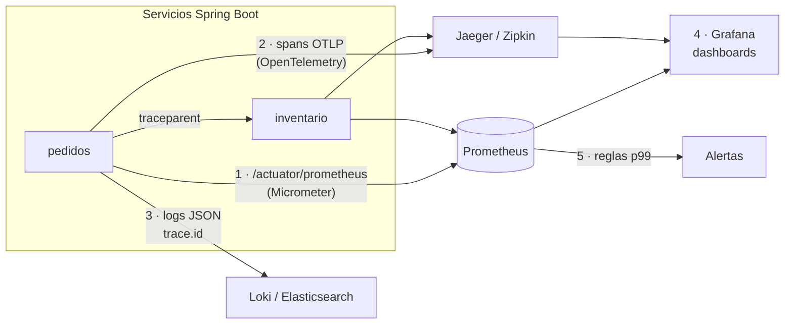
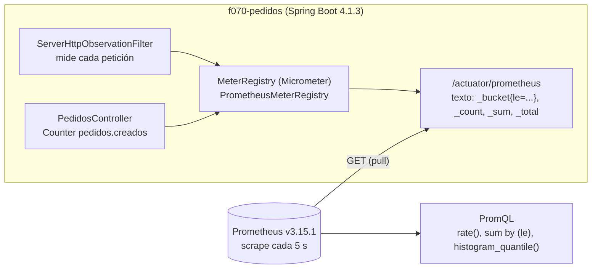
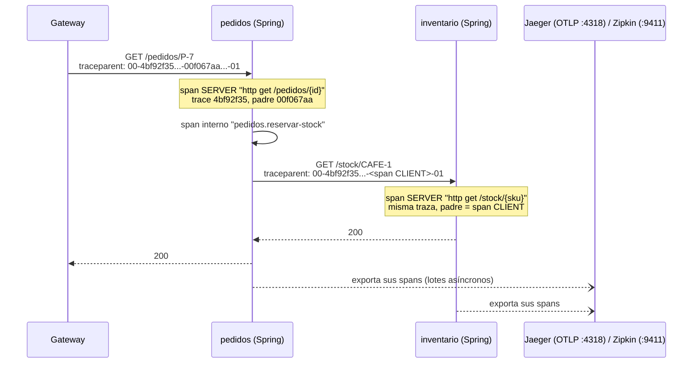
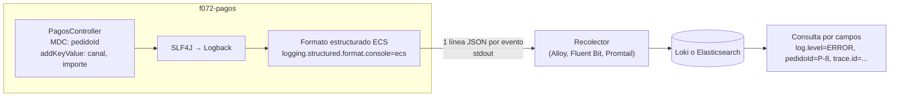
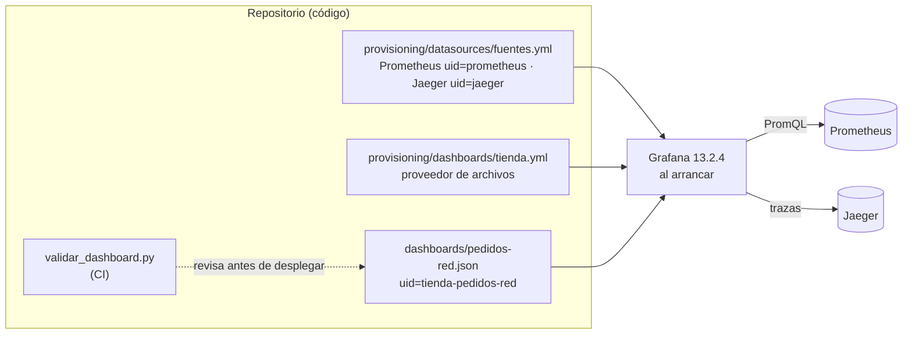
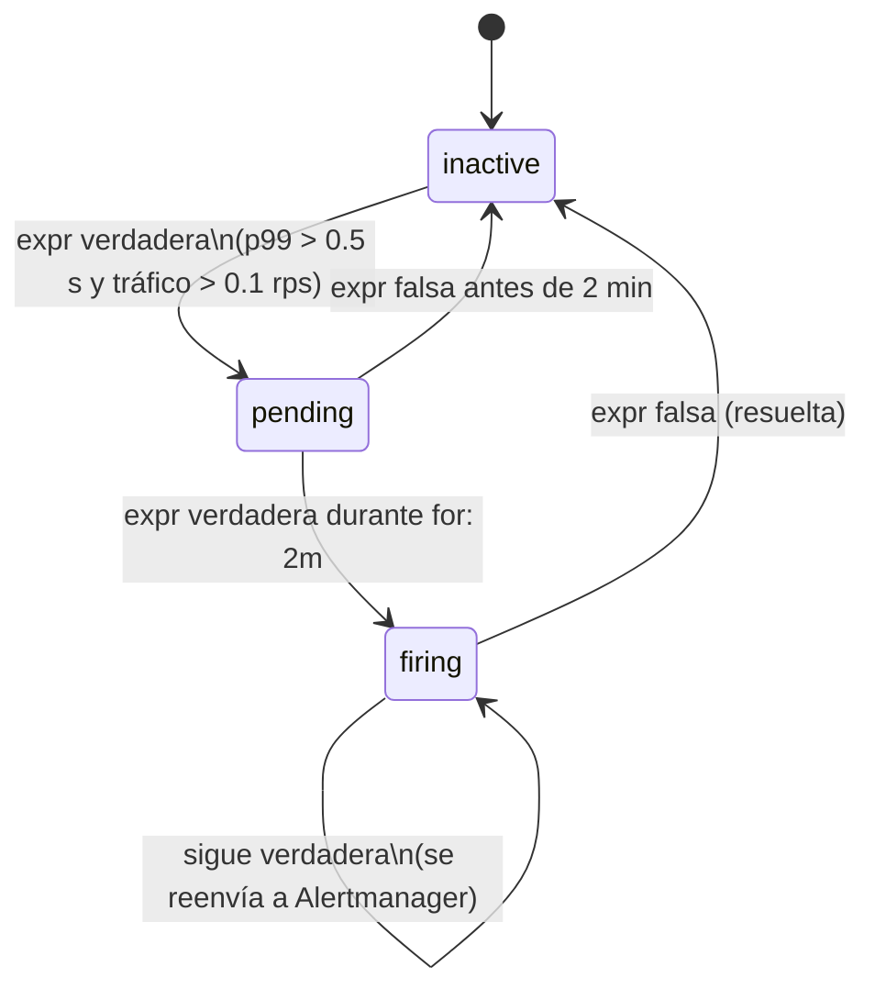

# Módulo 10 · Observabilidad

**Fase 1 · Spring Boot de cero a experto** (segunda mitad de la semana 10 de 12). **Duración:** 9 h (5 temas de
1,5–2 h). **Dificultad:** 3 de 5. **Dependencias:** Módulo 6 (servicios que se llaman entre sí con `RestClient`) y
Módulo 1 (configuración y perfiles); el tema de alertas usa los percentiles que aparecen en el Módulo 8 (presupuesto de
latencia). **Herramientas:**JDK 25 LTS (25.0.5)**, **Spring Boot 4.1.3** (Actuator, Micrometer 1.17.3, Micrometer
Tracing 1.7.3, OpenTelemetry 1.62.0, logging estructurado), **Prometheus v3.15.1**, **Grafana 13.2.4**, **Jaeger
2.22.0**, **Zipkin 3.6.1**, Python 3 y `curl`..

Un sistema de microservicios falla de formas que no se ven desde un solo servicio: una petición lenta puede deberse a
la tercera dependencia de la segunda llamada. Observar es poder responder **preguntas nuevas** sobre producción sin
desplegar código nuevo. Para eso cada servicio emite tres señales: **métricas** (números agregados: cuántas, cuán
rápido, cuántos errores), **trazas** (el recorrido de una petición concreta por todos los servicios) y **logs** (los
eventos con detalle). Encima construyes **paneles** para mirar y **alertas** que te despiertan solo cuando el usuario
lo nota.



**Texto alternativo:** los servicios pedidos e inventario, unidos por la cabecera traceparent, emiten tres señales:
métricas en /actuator/prometheus que Prometheus raspa (tema 1), spans por OTLP hacia Jaeger o Zipkin (tema 2) y logs en
JSON con el trace.id hacia Loki o Elasticsearch (tema 3). Grafana lee de Prometheus y de Jaeger para los dashboards
(tema 4) y Prometheus evalúa reglas sobre el p99 que generan alertas (tema 5).

**Cómo usar el laboratorio.** Cada tema empieza con una demostración de `jdk/` que muestra la idea sin dependencias
(qué es una serie de Prometheus, cómo viaja un `traceparent`, qué es un log estructurado, por qué el promedio engaña).
Después la haces con Spring Boot y la pila real: `docker compose up -d --wait` levanta Prometheus (`:9090`), Grafana
(`:3000`, usuario `admin`, clave `admin-solo-dev`), Jaeger (`:16686`) y Zipkin (`:9411`). Prometheus raspa la app
`f070` en `host.docker.internal:8080`, así que la app corre en tu máquina, no en Docker.

---


### Micrometer + Prometheus

<details open>
<summary><strong>Capa 1 — Lectura</strong></summary>

#### ► DE QUÉ TRATA
Instrumentar un servicio Spring Boot con Micrometer para publicar métricas RED (tasa, errores, duración) y una métrica de negocio en /actuator/prometheus, leer el formato de exposición (contador, histograma con le, _sum, _count) y evitar la explosión de cardinalidad, comprobándol…

#### ► LA IDEA EN UNA FRASE
**Instrumentar un servicio Spring Boot con Micrometer para publicar métricas RED (tasa, errores, duración) y una métrica de negocio en /actuator/prometheus, leer el formato de exposición (contador, histograma con le, _sum, _count) y evitar la explosión de cardinalidad, comprobándolo con 2 tests y con Prometheus raspando la app.**

#### ► POR QUÉ EXISTE ESTO
Una métrica es un número con nombre que tu servicio actualiza mientras trabaja: «peticiones atendidas», «pedidos creados», «cuánto tardó cada petición». Micrometer es la librería de Spring para registrar esos números sin casarte con una herramienta concreta, y Prometheus es una base de datos que cada pocos segundos visita tu servicio, lee todos los números y los guarda con la hora, para poder dibujarlos y hacer pregu…

#### ► LA ANALOGÍA
Piensa en micrometer + prometheus como una herramienta de taller: útil cuando conoces su propósito y sus límites.
**Dónde se rompe la analogía:** en software, los efectos dependen del contexto, la escala y los trade-offs.

#### ► CÓMO FUNCIONA


1. Una métrica es un número con nombre que tu servicio actualiza mientras trabaja: «peticiones atendidas», «pedidos creados», «cuánto tardó cada petición».
2. Micrometer es la librería de Spring para registrar esos números sin casarte con una herramienta concreta, y Prometheus es una base de datos que cada pocos segundos visita tu servicio, lee todos los números y los guarda con la hora, para poder dibujarlos y hacer preguntas como «¿cuántas peticiones por segundo tuvimos ayer a las 3?».

#### ► LO QUE PUEDE SALIR MAL
| Síntoma | Causa probable | Arreglo |
|---|---|---|
| Micrometer + Prometheus se aplica pero el resultado no mejora | Se usó sin medir el problema real | Mide antes y compara contra la alternativa simple |
| Aparece complejidad inesperada | Se adoptó la técnica sin comprender sus trade-offs | Vuelve a la sección de trade-offs y reduce el alcance |
| Falla en un caso límite | Se asumió un contexto que no se cumple | Prueba el caso límite y documenta cuándo NO usarlo |

#### ► TRADE-OFFS
| Opción | Cuándo usarla | Cuándo NO usarla |
|---|---|---|
| Usar Micrometer + Prometheus | Cuando el problema coincide con su propósito y el beneficio es observable | Cuando agrega complejidad sin resolver un problema real |
| Alternativa más simple | Cuando el contexto es pequeño, estable o fácil de razonar | Cuando ya demostró no escalar o no cumplir el requisito |
| Postergar la decisión | Cuando falta evidencia del problema | Cuando el costo de esperar es mayor que el costo de probar |

#### ► CUÁNDO NO USAR ESTO
Etiqueta con datos de alta cardinalidad:

#### ► DE VUELTA A LA ANALOGÍA
Volviendo a la analogía: micrometer + prometheus funciona como el modelo inicial, pero recuerda dónde se rompe: en producción importan la evidencia, la escala y el costo de equivocarte.

#### ► LO QUE DEBES RECORDAR
- Una métrica es un número con nombre que tu servicio actualiza mientras trabaja: «peticiones atendidas», «pedidos creados», «cuánto tardó cada petición».
- Micrometer es la librería de Spring para registrar esos números sin casarte con una herramienta concreta, y Prometheus es una base de datos que cada pocos segundos visita tu servicio, lee todos los números y los guarda con la hora, para poder dibujarlos y hacer preguntas como «¿cuántas peticiones por segundo tuvimos ayer a las 3?».

#### ► PREGUNTAS PARA PENSAR
1. ¿Qué problema concreto resuelve micrometer + prometheus en tu contexto?
2. ¿Cómo sabrías que micrometer + prometheus no está funcionando bien?
3. ¿Qué alternativa más simple considerarías antes de usar micrometer + prometheus?

</details>

<details>
<summary><strong>Capa 2 — Construcción</strong></summary>

#### Código de referencia / ejecutable
**Versiones:** JDK 25 LTS · Spring Boot 4.1.3 · `spring-boot-starter-actuator` · `io.micrometer:micrometer-registry-prometheus`
(versión del BOM de Boot, Micrometer 1.17.3) · `spring-boot-starter-micrometer-metrics-test` para `@AutoConfigureMetrics`
· Prometheus v3.15.1.

**Antes** — `jdk/MetricasPrometheus.java` registra la latencia con el id real en la etiqueta `uri`:

```java
MetricasPrometheus antes = new MetricasPrometheus();
for (int id = 1; id <= 1000; id++) antes.registrarPeticion("GET", "/pedidos/" + id, 200, latencia(id));
```

y en Spring el equivalente es construir un `Timer` a mano con el valor libre como etiqueta:

```java
Timer.builder("pedidos.latencia").tag("pedido", String.valueOf(id)).register(registro)   // una serie por pedido
```

**Después** — `f070-micrometer-prometheus/build.gradle.kts`:

```kotlin
// F070 · Micrometer + Prometheus: métricas RED y de negocio en /actuator/prometheus
plugins {
    java
    alias(libs.plugins.spring.boot)
    alias(libs.plugins.spring.dependency.management)
}

group = "academia.microservicios"
version = "1.0.0"

java {
    toolchain {
        languageVersion = JavaLanguageVersion.of(25)
    }
}

dependencies {
    // Spring MVC + Tomcat 11 + Jackson 3
    implementation(libs.spring.boot.starter.webmvc)
    // Actuator: /actuator/health, /actuator/prometheus
    implementation(libs.spring.boot.starter.actuator)
    // Registro Prometheus de Micrometer (versión del BOM de Boot)
    implementation(libs.micrometer.registry.prometheus)
    // MockMvc, JUnit Jupiter 6, AssertJ
    testImplementation(libs.spring.boot.starter.webmvc.test)
    // @AutoConfigureMetrics: registro Prometheus también en los tests
    testImplementation(libs.spring.boot.starter.micrometer.metrics.test)
    // Gradle 9 exige declarar el lanzador de JUnit Platform (ya no lo añade por su cuenta)
    testRuntimeOnly(libs.junit.platform.launcher)
}

tasks.withType<Test> {
    useJUnitPlatform()
    testLogging {
        events("passed", "skipped", "failed")   // una línea por test en la consola
        // el mensaje completo de cada fallo (valor esperado y obtenido), no solo el tipo de excepción
        exceptionFormat = org.gradle.api.tasks.testing.logging.TestExceptionFormat.FULL
    }
}
```

> **Build con Gradle (y su equivalencia en Maven).** Este laboratorio se construye con **Gradle 9.9.2** y Kotlin DSL
> mediante el wrapper `./gradlew` (no instalas Gradle). `settings.gradle.kts` lista los subproyectos (en Maven,
> `<modules>` del POM agregador), cada carpeta tiene su `build.gradle.kts` (su `pom.xml`) y
> `gradle/libs.versions.toml` es el **catálogo de versiones** (las `<properties>` y el `dependencyManagement`): por eso
> las dependencias se escriben `libs.…`. Equivalencias: `./mvnw test` → `./gradlew test` ·
> `./mvnw package -DskipTests` → `./gradlew bootJar` · `./mvnw spring-boot:run` → `./gradlew bootRun` ·
> `-Dtest=Clase` → `--tests Clase` · `target/` → `build/` (el jar queda en `build/libs/`). Gradle escribe una línea
> `PASSED` por test y termina con `BUILD SUCCESSFUL` (Maven: `Tests run: N` y `BUILD SUCCESS`).

`modulo-14/settings.gradle.kts`:

```kotlin
// Módulo 10 (modulo-14) · Build multi-proyecto: "./gradlew test" ejecuta los tests de F070, F071 (con OpenTelemetry) y F072.
// F073 (Grafana) y F074 (reglas de Prometheus) no tienen build de Gradle: sigue los pasos de la lección.
// Cada carpeta tiene su propio build.gradle.kts; las versiones viven en gradle/libs.versions.toml
// (catálogo "libs"). Equivale al POM agregador con <modules> de Maven.
pluginManagement {
    repositories {
        gradlePluginPortal()
        mavenCentral()
    }
}
// Sin esto, un alumno sin JDK 25 instalado ve el build morir en la configuración, antes de cualquier test.
plugins {
    id("org.gradle.toolchains.foojay-resolver-convention") version "1.0.0"
}

dependencyResolutionManagement {
    repositories {
        mavenCentral()
    }
}

rootProject.name = "modulo-14-laboratorios"

include(
    "f070-micrometer-prometheus",
    "f071-tracing",
    "f072-logging-estructurado",
)
```

`modulo-14/gradle/libs.versions.toml`:

```toml
# Módulo 10 (modulo-14)
# Catálogo de versiones del laboratorio: una sola fuente para plugins y librerías.
# Las librerías SIN versión las fija el BOM de Spring Boot (spring-boot-dependencies) o el BOM que importe el proyecto.

[versions]
spring-boot = "4.1.3"

[libraries]
spring-boot-starter-webmvc = { module = "org.springframework.boot:spring-boot-starter-webmvc" }
spring-boot-starter-actuator = { module = "org.springframework.boot:spring-boot-starter-actuator" }
micrometer-registry-prometheus = { module = "io.micrometer:micrometer-registry-prometheus" }
spring-boot-starter-webmvc-test = { module = "org.springframework.boot:spring-boot-starter-webmvc-test" }
spring-boot-starter-micrometer-metrics-test = { module = "org.springframework.boot:spring-boot-starter-micrometer-metrics-test" }
junit-platform-launcher = { module = "org.junit.platform:junit-platform-launcher" }
spring-boot-starter-restclient = { module = "org.springframework.boot:spring-boot-starter-restclient" }
spring-boot-starter-opentelemetry = { module = "org.springframework.boot:spring-boot-starter-opentelemetry" }
spring-boot-starter-opentelemetry-test = { module = "org.springframework.boot:spring-boot-starter-opentelemetry-test" }
spring-boot-starter-zipkin = { module = "org.springframework.boot:spring-boot-starter-zipkin" }
spring-boot-starter-zipkin-test = { module = "org.springframework.boot:spring-boot-starter-zipkin-test" }

[plugins]
spring-boot = { id = "org.springframework.boot", version.ref = "spring-boot" }
spring-dependency-management = { id = "io.spring.dependency-management", version = "1.1.7" }
```

`src/main/java/academia/observabilidad/metricas/PedidosController.java` (la clase `MetricasApp` es la habitual con
`@SpringBootApplication`):

```java
package academia.observabilidad.metricas;

import io.micrometer.core.instrument.Counter;
import io.micrometer.core.instrument.MeterRegistry;
import java.util.Map;
import java.util.Set;
import org.springframework.http.ResponseEntity;
import org.springframework.web.bind.annotation.GetMapping;
import org.springframework.web.bind.annotation.PathVariable;
import org.springframework.web.bind.annotation.PostMapping;
import org.springframework.web.bind.annotation.RequestParam;
import org.springframework.web.bind.annotation.RestController;

@RestController
class PedidosController {

    private static final Set<String> CANALES = Set.of("web", "app");
    private final MeterRegistry registro;

    PedidosController(MeterRegistry registro) {
        this.registro = registro;
    }

    /** http.server.requests lo mide Spring solo (uri="/pedidos/{id}", la plantilla, no el id). */
    @GetMapping("/pedidos/{id}")
    Map<String, Object> pedido(@PathVariable long id, @RequestParam(defaultValue = "false") boolean lento)
            throws InterruptedException {
        Thread.sleep(lento ? 600 : 20);                     // ?lento=true simula una dependencia que tarda
        return Map.of("id", id, "estado", "confirmado");
    }

    /** Métrica de negocio: pedidos creados por canal (valores acotados: web, app u otro). */
    @PostMapping("/pedidos")
    ResponseEntity<Void> crear(@RequestParam String canal) {
        String etiqueta = CANALES.contains(canal) ? canal : "otro";   // nunca un valor libre como etiqueta
        Counter.builder("pedidos.creados")
            .description("Pedidos creados por canal")
            .tag("canal", etiqueta)
            .register(registro)
            .increment();
        return ResponseEntity.status(201).build();
    }
}
```

`src/main/resources/application.properties`:

```properties
spring.application.name=f070-pedidos
# Solo health y prometheus por HTTP (el resto de endpoints de Actuator no se publica).
management.endpoints.web.exposure.include=health,prometheus
# Etiqueta común en todas las métricas.
management.metrics.tags.application=${spring.application.name}
# Buckets de histograma para http.server.requests (necesarios para histogram_quantile en Prometheus),
# acotados entre 5 ms y 5 s, más los límites exactos de los objetivos (SLO) 100 ms y 500 ms.
management.metrics.distribution.percentiles-histogram.http.server.requests=true
management.metrics.distribution.minimum-expected-value.http.server.requests=5ms
management.metrics.distribution.maximum-expected-value.http.server.requests=5s
management.metrics.distribution.slo.http.server.requests=100ms,500ms
```

`prometheus/prometheus.yml` del laboratorio:

```yaml
# Módulo 10 · Prometheus v3.15.1: raspa f070-pedidos (en tu máquina, :8080) cada 5 s y evalúa reglas.
global:
  scrape_interval: 5s
  evaluation_interval: 5s
rule_files:
  - /etc/prometheus/reglas.yml
scrape_configs:
  - job_name: f070-pedidos
    metrics_path: /actuator/prometheus
    static_configs:
      - targets: ["host.docker.internal:8080"]
  - job_name: prometheus
    static_configs:
      - targets: ["localhost:9090"]
```

#### Verificación
`f070-micrometer-prometheus/src/test/java/academia/observabilidad/metricas/ActuatorPrometheusTest.java`:

```java
package academia.observabilidad.metricas;

import static org.assertj.core.api.Assertions.assertThat;
import static org.springframework.test.web.servlet.request.MockMvcRequestBuilders.get;
import static org.springframework.test.web.servlet.request.MockMvcRequestBuilders.post;
import static org.springframework.test.web.servlet.result.MockMvcResultMatchers.status;

import org.junit.jupiter.api.Test;
import org.springframework.beans.factory.annotation.Autowired;
import org.springframework.boot.micrometer.metrics.test.autoconfigure.AutoConfigureMetrics;
import org.springframework.boot.test.context.SpringBootTest;
import org.springframework.boot.webmvc.test.autoconfigure.AutoConfigureMockMvc;
import org.springframework.test.web.servlet.MockMvc;

/** @AutoConfigureMetrics: en los tests Spring Boot no crea el registro Prometheus si no se lo pides. */
@SpringBootTest
@AutoConfigureMockMvc
@AutoConfigureMetrics
class ActuatorPrometheusTest {

    @Autowired MockMvc mvc;

    @Test
    void publicaRedYMetricaDeNegocioConEtiquetasAcotadas() throws Exception {
        mvc.perform(get("/pedidos/7")).andExpect(status().isOk());
        mvc.perform(get("/pedidos/8")).andExpect(status().isOk());
        mvc.perform(post("/pedidos").param("canal", "web")).andExpect(status().isCreated());
        mvc.perform(post("/pedidos").param("canal", "un-valor-inventado-123")).andExpect(status().isCreated());

        String scrape = mvc.perform(get("/actuator/prometheus")).andExpect(status().isOk())
            .andReturn().getResponse().getContentAsString();

        assertThat(scrape).containsPattern("http_server_requests_seconds_count\\{.*uri=\"/pedidos/\\{id\\}\".*\\} 2(\\.0)?\\n");
        assertThat(scrape).doesNotContain("uri=\"/pedidos/7\"");                    // la plantilla, nunca el id
        assertThat(scrape).containsPattern("http_server_requests_seconds_bucket\\{.*uri=\"/pedidos/\\{id\\}\".*le=\"0\\.5\"");
        assertThat(scrape).containsPattern("pedidos_creados_total\\{application=\"f070-pedidos\",canal=\"web\"\\} 1\\.0\\n");
        assertThat(scrape).containsPattern("pedidos_creados_total\\{.*canal=\"otro\".*\\} 1\\.0\\n");
        assertThat(scrape).doesNotContain("un-valor-inventado-123");
    }
}
```

`RegistroPrometheusTest` (en la misma carpeta) usa `PrometheusMeterRegistry` sin Spring: registra un contador y un
`Timer` con SLO de 100 y 500 ms, graba 80 ms y 700 ms y comprueba las líneas reales:
`pedidos_creados_total{canal="web"} 2.0`, `http_server_requests_seconds_bucket{uri="/pedidos/{id}",le="0.1"} 1`, lo mismo
para `le="0.5"` y `_count` en 2.

```bash
cd f070-micrometer-prometheus && ../gradlew test
```

**Output esperado:** 2 líneas `PASSED` (una por test) y `BUILD SUCCESSFUL` *(salida de Gradle pendiente de verificación en el Mac)*.

**Pregunta de comprobación:** en el paso 1, ¿por qué el bucket `le="0.25"` vale lo mismo que `le="0.1"` (980) y qué te
dice eso de la latencia?

<details>
<summary>Respuesta</summary>

Los buckets son **acumulados**: `le="0.25"` cuenta todo lo que tardó ≤ 0,25 s, incluido lo que ya contó `le="0.1"`. Que
valgan igual significa que ninguna petición tardó entre 0,1 y 0,25 s (ni entre 0,25 y 0,5); las 20 restantes están entre
0,5 y 1 s: son los pedidos lentos.
</details>

</details>

### OpenTelemetry + Zipkin/Jaeger

<details open>
<summary><strong>Capa 1 — Lectura</strong></summary>

#### ► DE QUÉ TRATA
Explicar qué son una traza, un span y el contexto W3C traceparent, activar trazas distribuidas en Spring Boot con Micrometer Tracing (puente OpenTelemetry, exportación OTLP a Jaeger, o Brave hacia Zipkin) y demostrar con un test que el trace-id entrante llega al servicio siguient…

#### ► LA IDEA EN UNA FRASE
**Explicar qué son una traza, un span y el contexto W3C traceparent, activar trazas distribuidas en Spring Boot con Micrometer Tracing (puente OpenTelemetry, exportación OTLP a Jaeger, o Brave hacia Zipkin) y demostrar con un test que el trace-id entrante llega al servicio siguiente con un span-id nuevo.**

#### ► POR QUÉ EXISTE ESTO
Una traza es la historia completa de una petición a través de todos los servicios que tocó. Cada tramo de trabajo («pedidos atendió la petición», «pedidos llamó a inventario», «inventario consultó la base») es un span, con hora de inicio, duración y quién es su padre. Para que los spans de distintos servicios se junten en la misma historia, cada llamada lleva una cabecera con el identificador de la traza. Herramienta…

#### ► LA ANALOGÍA
Piensa en opentelemetry + zipkin/jaeger como una herramienta de taller: útil cuando conoces su propósito y sus límites.
**Dónde se rompe la analogía:** en software, los efectos dependen del contexto, la escala y los trade-offs.

#### ► CÓMO FUNCIONA


1. Una traza es la historia completa de una petición a través de todos los servicios que tocó.
2. Cada tramo de trabajo («pedidos atendió la petición», «pedidos llamó a inventario», «inventario consultó la base») es un span, con hora de inicio, duración y quién es su padre.
3. Para que los spans de distintos servicios se junten en la misma historia, cada llamada lleva una cabecera con el identificador de la traza.
4. Herramientas como Jaeger o Zipkin reciben los spans y los dibujan como una línea de tiempo,…

#### ► LO QUE PUEDE SALIR MAL
| Síntoma | Causa probable | Arreglo |
|---|---|---|
| OpenTelemetry + Zipkin/Jaeger se aplica pero el resultado no mejora | Se usó sin medir el problema real | Mide antes y compara contra la alternativa simple |
| Aparece complejidad inesperada | Se adoptó la técnica sin comprender sus trade-offs | Vuelve a la sección de trade-offs y reduce el alcance |
| Falla en un caso límite | Se asumió un contexto que no se cumple | Prueba el caso límite y documenta cuándo NO usarlo |

#### ► TRADE-OFFS
| Opción | Cuándo usarla | Cuándo NO usarla |
|---|---|---|
| Usar OpenTelemetry + Zipkin/Jaeger | Cuando el problema coincide con su propósito y el beneficio es observable | Cuando agrega complejidad sin resolver un problema real |
| Alternativa más simple | Cuando el contexto es pequeño, estable o fácil de razonar | Cuando ya demostró no escalar o no cumplir el requisito |
| Postergar la decisión | Cuando falta evidencia del problema | Cuando el costo de esperar es mayor que el costo de probar |

#### ► CUÁNDO NO USAR ESTO
Un id de correlación «casero» por servicio en lugar del estándar:

#### ► DE VUELTA A LA ANALOGÍA
Volviendo a la analogía: opentelemetry + zipkin/jaeger funciona como el modelo inicial, pero recuerda dónde se rompe: en producción importan la evidencia, la escala y el costo de equivocarte.

#### ► LO QUE DEBES RECORDAR
- Una traza es la historia completa de una petición a través de todos los servicios que tocó.
- Cada tramo de trabajo («pedidos atendió la petición», «pedidos llamó a inventario», «inventario consultó la base») es un span, con hora de inicio, duración y quién es su padre.
- Para que los spans de distintos servicios se junten en la misma historia, cada llamada lleva una cabecera con el identificador de la traza.
- Herramientas como Jaeger o Zipkin reciben los spans y los dibujan como una línea de tiempo,…

#### ► PREGUNTAS PARA PENSAR
1. ¿Qué problema concreto resuelve opentelemetry + zipkin/jaeger en tu contexto?
2. ¿Cómo sabrías que opentelemetry + zipkin/jaeger no está funcionando bien?
3. ¿Qué alternativa más simple considerarías antes de usar opentelemetry + zipkin/jaeger?

</details>

<details>
<summary><strong>Capa 2 — Construcción</strong></summary>

#### Código de referencia / ejecutable
**Versiones:** JDK 25 LTS · Spring Boot 4.1.3 · `spring-boot-starter-opentelemetry` (Micrometer Tracing 1.7.3 +
OpenTelemetry 1.62.0, exportación OTLP/HTTP) o, con `-Ptrazas=zipkin`, `spring-boot-starter-zipkin` (Brave + Zipkin Reporter
3.5.3) · `spring-boot-starter-restclient` · Jaeger 2.22.0 · Zipkin 3.6.1.

**Antes** — sin propagación: el cliente HTTP se crea a mano (en `jdk/TrazasW3C.java`, con `propagar = false`
el cliente no añade la cabecera) y cada servicio empieza su propia traza:

```java
// ANTES: HttpClient propio, sin traceparent -> inventario no sabe a qué traza pertenece la llamada
var req = HttpRequest.newBuilder(URI.create("http://127.0.0.1:" + puertoInventario + "/stock/CAFE-1"));
if (propagar) req.header("traceparent", "00-" + ctx[0] + "-" + cliente + "-01");   // inyectar
```

En Spring, el mismo error es `RestClient.create(url)` en lugar de `RestClient.Builder` inyectado.

**Después** — `f071-tracing/build.gradle.kts`:

```kotlin
// F071 · OpenTelemetry + Zipkin/Jaeger: trazas distribuidas entre pedidos e inventario.
// Por defecto (-Ptrazas=otel): Micrometer Tracing + OpenTelemetry, exporta por OTLP a Jaeger.
// Con "-Ptrazas=zipkin": Micrometer Tracing + Brave, exporta a Zipkin. Nunca los dos a la vez.
// (En Maven eran los perfiles "otel", activo por defecto, y "zipkin" con -Pzipkin.)
plugins {
    java
    alias(libs.plugins.spring.boot)
    alias(libs.plugins.spring.dependency.management)
}

group = "academia.microservicios"
version = "1.0.0"

java {
    toolchain {
        languageVersion = JavaLanguageVersion.of(25)
    }
}

// Propiedad de proyecto que elige el puente de trazas: es el equivalente de un perfil de Maven
val trazas = providers.gradleProperty("trazas").getOrElse("otel")

dependencies {
    // Spring MVC + Tomcat 11 + Jackson 3
    implementation(libs.spring.boot.starter.webmvc)
    // RestClient.Builder autoconfigurado: propaga traceparent solo
    implementation(libs.spring.boot.starter.restclient)
    // Actuator: /actuator/health
    implementation(libs.spring.boot.starter.actuator)
    if (trazas == "zipkin") {
        // Micrometer Tracing + Brave + exportador a Zipkin
        implementation(libs.spring.boot.starter.zipkin)
        testImplementation(libs.spring.boot.starter.zipkin.test)
    } else {
        // Micrometer Tracing + OpenTelemetry + exportador OTLP
        implementation(libs.spring.boot.starter.opentelemetry)
        testImplementation(libs.spring.boot.starter.opentelemetry.test)
    }
    // MockMvc, JUnit Jupiter 6, AssertJ
    testImplementation(libs.spring.boot.starter.webmvc.test)
    // Gradle 9 exige declarar el lanzador de JUnit Platform (ya no lo añade por su cuenta)
    testRuntimeOnly(libs.junit.platform.launcher)
}

tasks.withType<Test> {
    useJUnitPlatform()
    testLogging {
        events("passed", "skipped", "failed")   // una línea por test en la consola
        // el mensaje completo de cada fallo (valor esperado y obtenido), no solo el tipo de excepción
        exceptionFormat = org.gradle.api.tasks.testing.logging.TestExceptionFormat.FULL
    }
}
```

`src/main/java/academia/observabilidad/trazas/PedidosController.java`:

```java
package academia.observabilidad.trazas;

import io.micrometer.observation.Observation;
import io.micrometer.observation.ObservationRegistry;
import java.util.Map;
import org.slf4j.Logger;
import org.slf4j.LoggerFactory;
import org.springframework.beans.factory.annotation.Value;
import org.springframework.web.bind.annotation.GetMapping;
import org.springframework.web.bind.annotation.PathVariable;
import org.springframework.web.bind.annotation.RestController;
import org.springframework.web.client.RestClient;

@RestController
class PedidosController {

    private static final Logger log = LoggerFactory.getLogger(PedidosController.class);
    private final RestClient inventario;
    private final ObservationRegistry observaciones;

    /** DESPUÉS: el RestClient sale del RestClient.Builder de Spring, que añade traceparent a cada llamada. */
    PedidosController(RestClient.Builder builder, ObservationRegistry observaciones,
                      @Value("${tienda.inventario.url}") String urlInventario) {
        this.inventario = builder.baseUrl(urlInventario).build();
        this.observaciones = observaciones;
    }

    @GetMapping("/pedidos/{id}")
    Map<String, Object> pedido(@PathVariable String id) {
        log.info("consultando pedido {}", id);                       // el log lleva [traceId-spanId]
        // Span propio para un paso interno; "pedido.id" es de alta cardinalidad: va a la traza, no a métricas.
        Map<?, ?> stock = Observation.createNotStarted("pedidos.reservar-stock", observaciones)
            .lowCardinalityKeyValue("operacion", "reserva")
            .highCardinalityKeyValue("pedido.id", id)
            .observe(() -> inventario.get().uri("/stock/{sku}", "CAFE-1").retrieve().body(Map.class));
        return Map.of("pedido", id, "estado", "confirmado", "stock", stock);
    }
}
```

`InventarioController.java` atiende `GET /stock/{sku}` (registra un log, espera 30 ms y devuelve
`{"sku":..., "stock": 12}`); la misma app hace de pedidos o de inventario según el nombre y el puerto con que la
arranques. `src/main/resources/application.properties`:

```properties
spring.application.name=pedidos
server.port=8081
tienda.inventario.url=${INVENTARIO_URL:http://localhost:8082}
# 100 % de las trazas en el laboratorio (por defecto Spring Boot muestrea el 10 %).
management.tracing.sampling.probability=1.0
# Con -Ptrazas=otel (por defecto): spans por OTLP/HTTP a Jaeger.
management.opentelemetry.tracing.export.otlp.endpoint=${OTLP_URL:http://localhost:4318/v1/traces}
# Con -Ptrazas=zipkin: spans a Zipkin.
management.tracing.export.zipkin.endpoint=${ZIPKIN_URL:http://localhost:9411/api/v2/spans}
```

`jdk/TrazasW3C.java` hace lo mismo a mano (crea y propaga `traceparent`, registra spans y, si defines `ZIPKIN_URL`, los
envía a Zipkin en su formato JSON v2 con `POST /api/v2/spans`).

#### Verificación
`f071-tracing/src/test/java/academia/observabilidad/trazas/PropagacionTest.java`:

```java
package academia.observabilidad.trazas;

import static org.assertj.core.api.Assertions.assertThat;
import static org.springframework.test.web.servlet.request.MockMvcRequestBuilders.get;
import static org.springframework.test.web.servlet.result.MockMvcResultMatchers.jsonPath;
import static org.springframework.test.web.servlet.result.MockMvcResultMatchers.status;

import com.sun.net.httpserver.HttpServer;
import java.io.IOException;
import java.net.InetSocketAddress;
import java.nio.charset.StandardCharsets;
import java.util.concurrent.atomic.AtomicReference;
import org.junit.jupiter.api.AfterAll;
import org.junit.jupiter.api.Test;
import org.springframework.beans.factory.annotation.Autowired;
import org.springframework.boot.micrometer.tracing.test.autoconfigure.AutoConfigureTracing;
import org.springframework.boot.test.context.SpringBootTest;
import org.springframework.boot.webmvc.test.autoconfigure.AutoConfigureMockMvc;
import org.springframework.test.context.DynamicPropertyRegistry;
import org.springframework.test.context.DynamicPropertySource;
import org.springframework.test.web.servlet.MockMvc;

/**
 * La petición entra con un traceparent conocido (como si viniera del gateway) y un HttpServer del JDK
 * hace de inventario y guarda el traceparent que recibe: debe tener el MISMO trace-id y un span-id nuevo.
 */
@SpringBootTest(properties = "management.tracing.sampling.probability=1.0")
@AutoConfigureMockMvc
@AutoConfigureTracing
class PropagacionTest {

    static final String TRAZA = "4bf92f3577b34da6a3ce929d0e0e4736";
    static final String SPAN_PADRE = "00f067aa0ba902b7";
    static final AtomicReference<String> recibido = new AtomicReference<>();
    static final HttpServer inventario = arrancar();

    static HttpServer arrancar() {
        try {
            HttpServer s = HttpServer.create(new InetSocketAddress("127.0.0.1", 0), 0);
            s.createContext("/stock", ex -> {
                recibido.set(ex.getRequestHeaders().getFirst("traceparent"));
                byte[] b = "{\"sku\":\"CAFE-1\",\"stock\":12}".getBytes(StandardCharsets.UTF_8);
                ex.getResponseHeaders().add("Content-Type", "application/json");
                ex.sendResponseHeaders(200, b.length);
                ex.getResponseBody().write(b);
                ex.close();
            });
            s.start();
            return s;
        } catch (IOException e) { throw new IllegalStateException(e); }
    }

    @DynamicPropertySource
    static void url(DynamicPropertyRegistry r) {
        r.add("tienda.inventario.url", () -> "http://127.0.0.1:" + inventario.getAddress().getPort());
    }

    @AfterAll
    static void parar() { inventario.stop(0); }

    @Autowired MockMvc mvc;

    @Test
    void elTraceIdEntranteLlegaAInventarioConOtroSpanId() throws Exception {
        mvc.perform(get("/pedidos/P-7").header("traceparent", "00-" + TRAZA + "-" + SPAN_PADRE + "-01"))
            .andExpect(status().isOk())
            .andExpect(jsonPath("$.stock.stock").value(12));

        String tp = recibido.get();
        assertThat(tp).matches("00-[0-9a-f]{32}-[0-9a-f]{16}-01");
        assertThat(tp).startsWith("00-" + TRAZA + "-");           // misma traza
        assertThat(tp).doesNotContain(SPAN_PADRE);                 // span nuevo (hijo), no el del gateway
    }
}
```

```bash
cd f071-tracing && ../gradlew test && ../gradlew -Ptrazas=zipkin test
```

**Output esperado:** dos veces 1 línea `PASSED` y `BUILD SUCCESSFUL` *(salida de Gradle pendiente de verificación en el Mac)* (OpenTelemetry y
Brave producen el mismo `traceparent` W3C).

**Pregunta de comprobación:** pedidos recibe una petición **sin** `traceparent`. ¿Qué `trace-id` lleva la llamada a
inventario y cuántas trazas verás en Jaeger?

<details>
<summary>Respuesta</summary>

Pedidos inicia una traza nueva (genera un `trace-id` aleatorio) y lo propaga a inventario: verás **una** traza con
pedidos como raíz. Solo se parte en dos si la llamada a inventario no lleva la cabecera.
</details>

</details>

### Logging estructurado

<details open>
<summary><strong>Capa 1 — Lectura</strong></summary>

#### ► DE QUÉ TRATA
Configurar Spring Boot para escribir cada evento como una línea JSON (formato ECS), añadir contexto con el MDC y con pares clave-valor de SLF4J, excluir datos personales y consultar los logs por campos, verificándolo con 2 tests que leen la salida real de la consola.

#### ► LA IDEA EN UNA FRASE
**Configurar Spring Boot para escribir cada evento como una línea JSON (formato ECS), añadir contexto con el MDC y con pares clave-valor de SLF4J, excluir datos personales y consultar los logs por campos, verificándolo con 2 tests que leen la salida real de la consola.**

#### ► POR QUÉ EXISTE ESTO
Un log es un mensaje que tu programa escribe cuando pasa algo («pedido confirmado»). Si escribes frases libres, leerlas está bien, pero buscarlas entre millones es muy difícil. Un log estructurado escribe cada evento como un objeto JSON con campos con nombre ("nivel": "ERROR", "pedido": "P-8"). Así una herramienta puede filtrar, contar y unir eventos de muchos servicios igual que una base de datos. Regla de oro: nunc…

#### ► LA ANALOGÍA
Piensa en logging estructurado como una herramienta de taller: útil cuando conoces su propósito y sus límites.
**Dónde se rompe la analogía:** en software, los efectos dependen del contexto, la escala y los trade-offs.

#### ► CÓMO FUNCIONA


1. Un log es un mensaje que tu programa escribe cuando pasa algo («pedido confirmado»).
2. Si escribes frases libres, leerlas está bien, pero buscarlas entre millones es muy difícil.
3. Un log estructurado escribe cada evento como un objeto JSON con campos con nombre ("nivel": "ERROR", "pedido": "P-8").
4. Así una herramienta puede filtrar, contar y unir eventos de muchos servicios igual que una base de datos.
5. Regla de oro: nunca escribas contraseñas, tokens ni datos personales en los logs.

#### ► LO QUE PUEDE SALIR MAL
| Síntoma | Causa probable | Arreglo |
|---|---|---|
| Logging estructurado se aplica pero el resultado no mejora | Se usó sin medir el problema real | Mide antes y compara contra la alternativa simple |
| Aparece complejidad inesperada | Se adoptó la técnica sin comprender sus trade-offs | Vuelve a la sección de trade-offs y reduce el alcance |
| Falla en un caso límite | Se asumió un contexto que no se cumple | Prueba el caso límite y documenta cuándo NO usarlo |

#### ► TRADE-OFFS
| Opción | Cuándo usarla | Cuándo NO usarla |
|---|---|---|
| Usar Logging estructurado | Cuando el problema coincide con su propósito y el beneficio es observable | Cuando agrega complejidad sin resolver un problema real |
| Alternativa más simple | Cuando el contexto es pequeño, estable o fácil de razonar | Cuando ya demostró no escalar o no cumplir el requisito |
| Postergar la decisión | Cuando falta evidencia del problema | Cuando el costo de esperar es mayor que el costo de probar |

#### ► CUÁNDO NO USAR ESTO
Registrar el objeto completo «por si acaso»:

#### ► DE VUELTA A LA ANALOGÍA
Volviendo a la analogía: logging estructurado funciona como el modelo inicial, pero recuerda dónde se rompe: en producción importan la evidencia, la escala y el costo de equivocarte.

#### ► LO QUE DEBES RECORDAR
- Un log es un mensaje que tu programa escribe cuando pasa algo («pedido confirmado»).
- Si escribes frases libres, leerlas está bien, pero buscarlas entre millones es muy difícil.
- Un log estructurado escribe cada evento como un objeto JSON con campos con nombre ("nivel": "ERROR", "pedido": "P-8").
- Así una herramienta puede filtrar, contar y unir eventos de muchos servicios igual que una base de datos.

#### ► PREGUNTAS PARA PENSAR
1. ¿Qué problema concreto resuelve logging estructurado en tu contexto?
2. ¿Cómo sabrías que logging estructurado no está funcionando bien?
3. ¿Qué alternativa más simple considerarías antes de usar logging estructurado?

</details>

<details>
<summary><strong>Capa 2 — Construcción</strong></summary>

#### Código de referencia / ejecutable
**Versiones:** JDK 25 LTS · Spring Boot 4.1.3 (logging estructurado integrado, Logback y SLF4J 2 gestionados por el
BOM) · `spring-boot-starter-webmvc` · `OutputCaptureExtension` de `spring-boot-test` para leer la consola en los tests.

**Antes** — `jdk/LogsEstructurados.java` (y el mismo estilo en Spring con `log.info("Pedido " + id + " de " + email +...)`):

```java
for (Evento e : EVENTOS) {
    System.out.println("  " + (e.falla() ? "ERROR " : "INFO ") + "Pedido " + e.pedido() + " de " + e.email()
            + (e.falla() ? " falló: " + e.motivo() : " confirmado"));
}
```

**Después** — `f072-logging-estructurado/src/main/java/academia/observabilidad/logs/PagosController.java`:

```java
package academia.observabilidad.logs;

import java.util.Map;
import org.slf4j.Logger;
import org.slf4j.LoggerFactory;
import org.slf4j.MDC;
import org.springframework.http.ResponseEntity;
import org.springframework.web.bind.annotation.PathVariable;
import org.springframework.web.bind.annotation.PostMapping;
import org.springframework.web.bind.annotation.RequestParam;
import org.springframework.web.bind.annotation.RestController;

@RestController
class PagosController {

    private static final Logger log = LoggerFactory.getLogger(PagosController.class);

    /**
     * DESPUÉS: un mensaje fijo y los datos como campos. pedidoId va al MDC (lo heredan todos los logs de la
     * petición) y canal/importe se añaden con la API fluida de SLF4J (addKeyValue). El correo nunca se registra.
     */
    @PostMapping("/pedidos/{id}/pagar")
    ResponseEntity<Map<String, String>> pagar(@PathVariable String id, @RequestParam String canal,
                                              @RequestParam long importe, @RequestParam String email) {
        try (MDC.MDCCloseable ignorado = MDC.putCloseable("pedidoId", id)) {
            if (importe > 5_000_000) {
                log.atWarn().addKeyValue("canal", canal).addKeyValue("importe", importe)
                    .log("pago rechazado por tope de importe");
                return ResponseEntity.unprocessableEntity().body(Map.of("estado", "rechazado"));
            }
            log.atInfo().addKeyValue("canal", canal).addKeyValue("importe", importe).log("pedido confirmado");
            return ResponseEntity.ok(Map.of("estado", "confirmado"));
        }
    }
}
```

`src/main/resources/application.properties` (el `build.gradle.kts` solo necesita `spring-boot-starter-webmvc` y, para tests,
`spring-boot-starter-webmvc-test`; plugin de Spring Boot 4.1.3 y toolchain de Java 25):

```properties
spring.application.name=f072-pagos
# Logs de consola en JSON con el formato Elastic Common Schema (también: logstash, gelf).
logging.structured.format.console=ecs
logging.structured.ecs.service.environment=laboratorio
```

La demostración `jdk/LogsEstructurados.java` construye el mismo tipo de línea a mano (escapando el JSON), seudonimiza el
correo con SHA-256 y una sal, y hace una «consulta» que agrupa los errores por pedido.

#### Verificación
`f072-logging-estructurado/src/test/java/academia/observabilidad/logs/LogsJsonTest.java`:

```java
package academia.observabilidad.logs;

import static org.assertj.core.api.Assertions.assertThat;
import static org.springframework.test.web.servlet.request.MockMvcRequestBuilders.post;
import static org.springframework.test.web.servlet.result.MockMvcResultMatchers.status;

import java.util.List;
import org.junit.jupiter.api.Test;
import org.junit.jupiter.api.extension.ExtendWith;
import org.springframework.beans.factory.annotation.Autowired;
import org.springframework.boot.test.context.SpringBootTest;
import org.springframework.boot.test.system.CapturedOutput;
import org.springframework.boot.test.system.OutputCaptureExtension;
import org.springframework.boot.webmvc.test.autoconfigure.AutoConfigureMockMvc;
import org.springframework.test.web.servlet.MockMvc;

@SpringBootTest
@AutoConfigureMockMvc
@ExtendWith(OutputCaptureExtension.class)
class LogsJsonTest {

    @Autowired MockMvc mvc;

    static String linea(CapturedOutput salida, String mensaje) {
        List<String> lineas = salida.getOut().lines().filter(l -> l.contains("\"message\":\"" + mensaje + "\"")).toList();
        assertThat(lineas).as("una línea JSON con message=%s", mensaje).hasSize(1);
        return lineas.getFirst();
    }

    @Test
    void cadaEventoEsUnaLineaJsonConCamposConNombre(CapturedOutput salida) throws Exception {
        mvc.perform(post("/pedidos/P-7/pagar").param("canal", "web").param("importe", "32000")
                .param("email", "ana@correo.com"))
            .andExpect(status().isOk());

        String l = linea(salida, "pedido confirmado");
        assertThat(l).startsWith("{").endsWith("}");
        assertThat(l).contains("\"log\":{\"level\":\"INFO\"");
        assertThat(l).contains("\"service\":{\"name\":\"f072-pagos\"");
        assertThat(l).contains("\"pedidoId\":\"P-7\"");          // del MDC
        assertThat(l).contains("\"canal\":\"web\"");             // de addKeyValue
        assertThat(l).doesNotContain("ana@correo.com");           // nunca datos personales
    }

    @Test
    void elRechazoSaleComoWarnConSusCampos(CapturedOutput salida) throws Exception {
        mvc.perform(post("/pedidos/P-9/pagar").param("canal", "app").param("importe", "9000000")
                .param("email", "luis@correo.com"))
            .andExpect(status().isUnprocessableEntity());

        String l = linea(salida, "pago rechazado por tope de importe");
        assertThat(l).contains("\"log\":{\"level\":\"WARN\"").contains("\"pedidoId\":\"P-9\"");
        assertThat(salida.getOut()).doesNotContain("luis@correo.com");
    }
}
```

```bash
../gradlew test
```

**Output esperado:** 2 líneas `PASSED` (una por test) y `BUILD SUCCESSFUL` *(salida de Gradle pendiente de verificación en el Mac)* (la salida de Gradle muestra
también las líneas JSON de arranque de Spring).

**Pregunta de comprobación:** ¿por qué `pedidoId` va al MDC y `canal` con `addKeyValue`?

<details>
<summary>Respuesta</summary>

El MDC es contexto de **la petición**: todos los logs que se escriban mientras dure (en el controlador, en servicios, en
clientes HTTP) llevarán `pedidoId`. `addKeyValue` añade un dato a **un** evento concreto. El `try`-con-recursos quita
`pedidoId` del MDC al terminar para que no se cuele en la siguiente petición atendida por el mismo hilo.
</details>

</details>

### Grafana: dashboards

<details open>
<summary><strong>Capa 1 — Lectura</strong></summary>

#### ► DE QUÉ TRATA
Construir un dashboard RED (tasa, errores, duración) con PromQL correcto, versionarlo como código y aprovisionarlo al arrancar Grafana (fuente de datos y panel sin clics), y validarlo antes de desplegar con un script que rechaza los errores típicos (promediar percentiles, paneles…

#### ► LA IDEA EN UNA FRASE
**Construir un dashboard RED (tasa, errores, duración) con PromQL correcto, versionarlo como código y aprovisionarlo al arrancar Grafana (fuente de datos y panel sin clics), y validarlo antes de desplegar con un script que rechaza los errores típicos (promediar percentiles, paneles sin unidad, fuentes por nombre).**

#### ► POR QUÉ EXISTE ESTO
Grafana es una aplicación web para dibujar paneles con datos de otras herramientas (Prometheus, Jaeger, bases de datos). Un dashboard es una página con varios gráficos; cada gráfico ejecuta una consulta (en PromQL para Prometheus) y la dibuja. Un buen dashboard responde rápido «¿está sano mi servicio?»: cuántas peticiones recibe, cuántas fallan y cuánto tardan.

#### ► LA ANALOGÍA
Piensa en grafana: dashboards como una herramienta de taller: útil cuando conoces su propósito y sus límites.
**Dónde se rompe la analogía:** en software, los efectos dependen del contexto, la escala y los trade-offs.

#### ► CÓMO FUNCIONA


1. Grafana es una aplicación web para dibujar paneles con datos de otras herramientas (Prometheus, Jaeger, bases de datos).
2. Un dashboard es una página con varios gráficos; cada gráfico ejecuta una consulta (en PromQL para Prometheus) y la dibuja.
3. Un buen dashboard responde rápido «¿está sano mi servicio?»: cuántas peticiones recibe, cuántas fallan y cuánto tardan.

#### ► LO QUE PUEDE SALIR MAL
| Síntoma | Causa probable | Arreglo |
|---|---|---|
| Grafana: dashboards se aplica pero el resultado no mejora | Se usó sin medir el problema real | Mide antes y compara contra la alternativa simple |
| Aparece complejidad inesperada | Se adoptó la técnica sin comprender sus trade-offs | Vuelve a la sección de trade-offs y reduce el alcance |
| Falla en un caso límite | Se asumió un contexto que no se cumple | Prueba el caso límite y documenta cuándo NO usarlo |

#### ► TRADE-OFFS
| Opción | Cuándo usarla | Cuándo NO usarla |
|---|---|---|
| Usar Grafana: dashboards | Cuando el problema coincide con su propósito y el beneficio es observable | Cuando agrega complejidad sin resolver un problema real |
| Alternativa más simple | Cuando el contexto es pequeño, estable o fácil de razonar | Cuando ya demostró no escalar o no cumplir el requisito |
| Postergar la decisión | Cuando falta evidencia del problema | Cuando el costo de esperar es mayor que el costo de probar |

#### ► CUÁNDO NO USAR ESTO
El «muro de gráficas»: 80 paneles por servicio, copiados a mano entre entornos, con promedios y sin unidades:

#### ► DE VUELTA A LA ANALOGÍA
Volviendo a la analogía: grafana: dashboards funciona como el modelo inicial, pero recuerda dónde se rompe: en producción importan la evidencia, la escala y el costo de equivocarte.

#### ► LO QUE DEBES RECORDAR
- Grafana es una aplicación web para dibujar paneles con datos de otras herramientas (Prometheus, Jaeger, bases de datos).
- Un dashboard es una página con varios gráficos; cada gráfico ejecuta una consulta (en PromQL para Prometheus) y la dibuja.
- Un buen dashboard responde rápido «¿está sano mi servicio?»: cuántas peticiones recibe, cuántas fallan y cuánto tardan.

#### ► PREGUNTAS PARA PENSAR
1. ¿Qué problema concreto resuelve grafana: dashboards en tu contexto?
2. ¿Cómo sabrías que grafana: dashboards no está funcionando bien?
3. ¿Qué alternativa más simple considerarías antes de usar grafana: dashboards?

</details>

<details>
<summary><strong>Capa 2 — Construcción</strong></summary>

#### Código y verificación


```json
{
  "title": "Pedidos (hecho a mano en la UI)",
  "panels": [
    {
      "id": 1,
      "type": "timeseries",
      "title": "Latencia promedio",
      "datasource": "Prometheus",
      "targets": [
        { "refId": "A", "expr": "sum(rate(http_server_requests_seconds_sum[1m])) / sum(rate(http_server_requests_seconds_count[1m]))" }
      ]
    },
    {
      "id": 2,
      "type": "timeseries",
      "title": "p99 (promedio de instancias)",
      "datasource": "Prometheus",
      "fieldConfig": { "defaults": { "unit": "s" } },
      "targets": [
        { "refId": "A", "expr": "avg(histogram_quantile(0.99, rate(http_server_requests_seconds_bucket[1m])))" }
      ]
    }
  ]
}
```

```yaml
# F073 · Fuentes de datos creadas al arrancar Grafana (sin clics). El uid fijo lo usan los paneles.
apiVersion: 1
datasources:
  - name: Prometheus
    uid: prometheus
    type: prometheus
    access: proxy
    url: http://prometheus:9090
    isDefault: true
  - name: Jaeger
    uid: jaeger
    type: jaeger
    access: proxy
    url: http://jaeger:16686
```

```yaml
# F073 · Dashboards como código: Grafana carga los JSON de /var/lib/grafana/dashboards.
apiVersion: 1
providers:
  - name: tienda
    folder: Tienda
    type: file
    disableDeletion: true
    allowUiUpdates: false
    options:
      path: /var/lib/grafana/dashboards
```

```json
{
  "uid": "tienda-pedidos-red",
  "title": "Pedidos · RED (tasa, errores, duración)",
  "tags": ["tienda", "f073"],
  "schemaVersion": 41,
  "refresh": "10s",
  "time": { "from": "now-15m", "to": "now" },
  "templating": {
    "list": [
      {
        "name": "job",
        "type": "query",
        "label": "Servicio",
        "datasource": { "type": "prometheus", "uid": "prometheus" },
        "query": { "query": "label_values(http_server_requests_seconds_count, job)", "refId": "Variable" },
        "refresh": 2
      }
    ]
  },
  "panels": [
    {
      "id": 5,
      "type": "timeseries",
      "title": "Latencia p50 / p95 / p99",
      "datasource": { "type": "prometheus", "uid": "prometheus" },
      "gridPos": { "x": 0, "y": 4, "w": 24, "h": 9 },
      "fieldConfig": {
        "defaults": {
          "unit": "s",
          "thresholds": { "mode": "absolute", "steps": [ { "color": "green", "value": null }, { "color": "red", "value": 0.5 } ] },
          "custom": { "thresholdsStyle": { "mode": "line" } }
        },
        "overrides": []
      },
      "targets": [
        { "refId": "A", "datasource": { "type": "prometheus", "uid": "prometheus" }, "legendFormat": "p50",
          "expr": "histogram_quantile(0.5, sum by (le) (rate(http_server_requests_seconds_bucket{job=\"$job\",uri!~\"/actuator.*\"}[$__rate_interval])))" },
        { "refId": "B", "datasource": { "type": "prometheus", "uid": "prometheus" }, "legendFormat": "p95",
          "expr": "histogram_quantile(0.95, sum by (le) (rate(http_server_requests_seconds_bucket{job=\"$job\",uri!~\"/actuator.*\"}[$__rate_interval])))" },
        { "refId": "C", "datasource": { "type": "prometheus", "uid": "prometheus" }, "legendFormat": "p99",
          "expr": "histogram_quantile(0.99, sum by (le) (rate(http_server_requests_seconds_bucket{job=\"$job\",uri!~\"/actuator.*\"}[$__rate_interval])))" }
      ]
    }
  ]
}
```

```python
#!/usr/bin/env python3
"""F073 · Revisa un dashboard de Grafana guardado como código antes de desplegarlo (sin Grafana).

Comprueba: uid y título; que cada panel use la fuente de datos aprovisionada (uid "prometheus");
que tenga unidad; que cada expresión tenga paréntesis balanceados; que los percentiles se calculen con
histogram_quantile sobre buckets sumados "by (le)" (y nunca promediando percentiles); y que el panel de
p99 marque el objetivo de 0.5 s.
Uso: python3 grafana/validar_dashboard.py grafana/dashboards/pedidos-red.json
"""
import json
import re
import sys

def balanceado(expr: str) -> bool:
    nivel = 0
    for c in expr:
        nivel += {"(": 1, ")": -1, "{": 1, "}": -1}.get(c, 0)
        if nivel < 0:
            return False
    return nivel == 0

def main(ruta: str) -> int:
    d = json.load(open(ruta, encoding="utf-8"))
    errores = []
    if not d.get("uid") or not d.get("title"):
        errores.append("falta uid o title")
    exprs = 0
    for p in d.get("panels", []):
        nombre = f'panel {p.get("id")} «{p.get("title")}»'
        ds = p.get("datasource")
        if not isinstance(ds, dict) or ds.get("uid") != "prometheus":   # un nombre suelto se rompe al renombrar
            errores.append(f"{nombre}: no usa la fuente aprovisionada uid=prometheus")
        if not p.get("fieldConfig", {}).get("defaults", {}).get("unit"):
            errores.append(f"{nombre}: sin unidad")
        for t in p.get("targets", []):
            e = t.get("expr", "")
            exprs += 1
            if not e or not balanceado(e):
                errores.append(f"{nombre}: expresión vacía o con paréntesis desbalanceados: {e}")
            if re.search(r"avg\s*(by\s*\([^)]*\)\s*)?\(\s*histogram_quantile", e):
                errores.append(f"{nombre}: promedia percentiles (no tiene sentido estadístico)")
            if "histogram_quantile" in e and not re.search(r"by \((\w+, )*le(, \w+)*\)", e):
                errores.append(f"{nombre}: histogram_quantile sin sumar por le")
    p99 = [p for p in d.get("panels", []) if any("histogram_quantile(0.99" in t.get("expr", "") for t in p.get("targets", []))]
    if not any(s.get("value") == 0.5 for p in p99
               for s in p.get("fieldConfig", {}).get("defaults", {}).get("thresholds", {}).get("steps", [])):
        errores.append("ningún panel de p99 marca el objetivo de 0.5 s")
    print(f'{d.get("title")} · uid={d.get("uid")} · {len(d.get("panels", []))} paneles · {exprs} expresiones PromQL')
    for e in errores:
        print("  ERROR:", e)
    print("OK: dashboard válido" if not errores else f"FALLA: {len(errores)} problema(s)")
    return 0 if not errores else 1

if __name__ == "__main__":
    sys.exit(main(sys.argv[1] if len(sys.argv) > 1 else "grafana/dashboards/pedidos-red.json"))
```

</details>

### Alerting basado en p99

<details open>
<summary><strong>Capa 1 — Lectura</strong></summary>

#### ► DE QUÉ TRATA
Explicar por qué se alerta sobre el p99 y no sobre el promedio, escribir una regla de Prometheus con regla de grabación, condición de tráfico mínimo y for:, probarla con promtool test rules (3 escenarios) y verla pasar por *pending* y *firing* con carga real.

#### ► LA IDEA EN UNA FRASE
**Explicar por qué se alerta sobre el p99 y no sobre el promedio, escribir una regla de Prometheus con regla de grabación, condición de tráfico mínimo y for:, probarla con promtool test rules (3 escenarios) y verla pasar por *pending* y *firing* con carga real.**

#### ► POR QUÉ EXISTE ESTO
Una alerta es una regla que vigila tus métricas y avisa a una persona cuando algo va mal para los usuarios. Para la velocidad no sirve el promedio: unas pocas peticiones lentísimas casi no lo mueven, pero esas personas sí lo sufren. Por eso se mira el percentil 99 (p99): ordena todas las peticiones de la más rápida a la más lenta y mira la que está en la posición 99 de cada 100. Si ese valor pasa de tu objetivo (por…

#### ► LA ANALOGÍA
Piensa en alerting basado en p99 como una herramienta de taller: útil cuando conoces su propósito y sus límites.
**Dónde se rompe la analogía:** en software, los efectos dependen del contexto, la escala y los trade-offs.

#### ► CÓMO FUNCIONA


1. Una alerta es una regla que vigila tus métricas y avisa a una persona cuando algo va mal para los usuarios.
2. Para la velocidad no sirve el promedio: unas pocas peticiones lentísimas casi no lo mueven, pero esas personas sí lo sufren.
3. Por eso se mira el percentil 99 (p99): ordena todas las peticiones de la más rápida a la más lenta y mira la que está en la posición 99 de cada 100.
4. Si ese valor pasa de tu objetivo (por ejemplo 500 ms) durante unos minutos seguidos, la alerta suena.

#### ► LO QUE PUEDE SALIR MAL
| Síntoma | Causa probable | Arreglo |
|---|---|---|
| Alerting basado en p99 se aplica pero el resultado no mejora | Se usó sin medir el problema real | Mide antes y compara contra la alternativa simple |
| Aparece complejidad inesperada | Se adoptó la técnica sin comprender sus trade-offs | Vuelve a la sección de trade-offs y reduce el alcance |
| Falla en un caso límite | Se asumió un contexto que no se cumple | Prueba el caso límite y documenta cuándo NO usarlo |

#### ► TRADE-OFFS
| Opción | Cuándo usarla | Cuándo NO usarla |
|---|---|---|
| Usar Alerting basado en p99 | Cuando el problema coincide con su propósito y el beneficio es observable | Cuando agrega complejidad sin resolver un problema real |
| Alternativa más simple | Cuando el contexto es pequeño, estable o fácil de razonar | Cuando ya demostró no escalar o no cumplir el requisito |
| Postergar la decisión | Cuando falta evidencia del problema | Cuando el costo de esperar es mayor que el costo de probar |

#### ► CUÁNDO NO USAR ESTO
Fatiga de alertas: decenas de reglas sobre causas, con umbrales sin probar y sin for, que despiertan por cualquier pico:

#### ► DE VUELTA A LA ANALOGÍA
Volviendo a la analogía: alerting basado en p99 funciona como el modelo inicial, pero recuerda dónde se rompe: en producción importan la evidencia, la escala y el costo de equivocarte.

#### ► LO QUE DEBES RECORDAR
- Una alerta es una regla que vigila tus métricas y avisa a una persona cuando algo va mal para los usuarios.
- Para la velocidad no sirve el promedio: unas pocas peticiones lentísimas casi no lo mueven, pero esas personas sí lo sufren.
- Por eso se mira el percentil 99 (p99): ordena todas las peticiones de la más rápida a la más lenta y mira la que está en la posición 99 de cada 100.
- Si ese valor pasa de tu objetivo (por ejemplo 500 ms) durante unos minutos seguidos, la alerta suena.

#### ► PREGUNTAS PARA PENSAR
1. ¿Qué problema concreto resuelve alerting basado en p99 en tu contexto?
2. ¿Cómo sabrías que alerting basado en p99 no está funcionando bien?
3. ¿Qué alternativa más simple considerarías antes de usar alerting basado en p99?

</details>

<details>
<summary><strong>Capa 2 — Construcción</strong></summary>

#### Código y verificación


```yaml
groups:
  - name: pedidos-antes
    rules:
      - alert: PedidosLentos
        # El promedio esconde la cola: con 2 % de peticiones de 1,5 s el promedio sigue en ~108 ms.
        expr: sum(rate(http_server_requests_seconds_sum[1m])) / sum(rate(http_server_requests_seconds_count[1m])) > 0.5
        labels:
          severity: page
```

```yaml
# F074 · Alerting basado en p99. Prometheus 3: las ventanas [5m] son abiertas por la izquierda.
groups:
  - name: pedidos-latencia
    rules:
      # Regla de grabación: el p99 por job se calcula una vez y se reutiliza (alertas y dashboards).
      - record: job:http_server_requests_seconds:p99_5m
        expr: >
          histogram_quantile(0.99,
            sum by (job, le) (rate(http_server_requests_seconds_bucket{uri!~"/actuator.*"}[5m])))
      # Tráfico por job, para no alertar con 3 peticiones por minuto.
      - record: job:http_server_requests:rate5m
        expr: sum by (job) (rate(http_server_requests_seconds_count{uri!~"/actuator.*"}[5m]))
      # DESPUÉS: p99 sostenido sobre el objetivo y con tráfico suficiente.
      - alert: PedidosLatenciaP99Alta
        expr: |
          job:http_server_requests_seconds:p99_5m > 0.5
          and on (job) job:http_server_requests:rate5m > 0.1
        for: 2m
        labels:
          severity: page
        annotations:
          summary: "p99 de {{ $labels.job }} por encima de 500 ms durante 2 minutos"
          runbook_url: "https://runbooks.tienda.local/pedidos/latencia-p99"
```

```java
// Igual que histogram_quantile de Prometheus: busca el bucket del rango q·total e interpola dentro de él.
static double histogramQuantile(double q, long[] acumulado) {
    double rango = q * acumulado[acumulado.length - 1];
    for (int i = 0; i < LE.length; i++) {
        if (acumulado[i] >= rango) {
            if (Double.isInfinite(LE[i])) return LE[i - 1];               // cae en +Inf: devuelve el último límite finito
            double inferior = i == 0 ? 0 : LE[i - 1];
            long antes = i == 0 ? 0 : acumulado[i - 1];
            return inferior + (LE[i] - inferior) * (rango - antes) / (acumulado[i] - antes);
        }
    }
    return Double.NaN;
}

// Regla: p99 > 500 ms durante 2 minutos (for: 2m), evaluada cada minuto.
for (int min = 0; min < p99PorMinuto.length; min++) {
    boolean condicion = p99PorMinuto[min] > 0.5;
    if (!condicion) { estado = activaDesde >= 0 && estado.equals("firing") ? "resuelta" : "inactive"; activaDesde = -1; }
    else {
        if (activaDesde < 0) activaDesde = min;
        estado = min - activaDesde >= 2 ? "firing" : "pending";
    }
    System.out.printf("  minuto %d  p99=%.2f s  -> %s%n", min, p99PorMinuto[min], estado);
}
```

```bash
java PercentilP99.java
```

```text
10 000 peticiones de la instancia A (2 % lentas):
  promedio    108 ms · p50     80 ms · p95    117 ms · p99   1555 ms
  histograma acumulado (le): [682, 8283, 9813, 9813, 9813, 10000, 10000]
  histogram_quantile(0.99)   1698 ms  (estimado desde los buckets 1.0 y 2.5)
Dos instancias (A con cola lenta, B sin ella):
  promedio de los p99 de cada una              841 ms   <- no es el p99 de nadie
  p99 real de todas las peticiones             141 ms
  histogram_quantile(0.99, suma de buckets)    249 ms   <- error por buckets anchos (0.1–0.25)
Regla PedidosLatenciaP99Alta: p99 > 0.5 s con for: 2m
  minuto 0  p99=0.21 s  -> inactive
  minuto 1  p99=0.24 s  -> inactive
  minuto 2  p99=0.62 s  -> pending
  minuto 3  p99=0.71 s  -> pending
  minuto 4  p99=0.66 s  -> firing
  minuto 5  p99=0.30 s  -> resuelta
  minuto 6  p99=0.58 s  -> pending
  minuto 7  p99=0.22 s  -> inactive
OK: el promedio oculta la cola; la alerta solo dispara tras 2 min sostenidos
```

</details>
