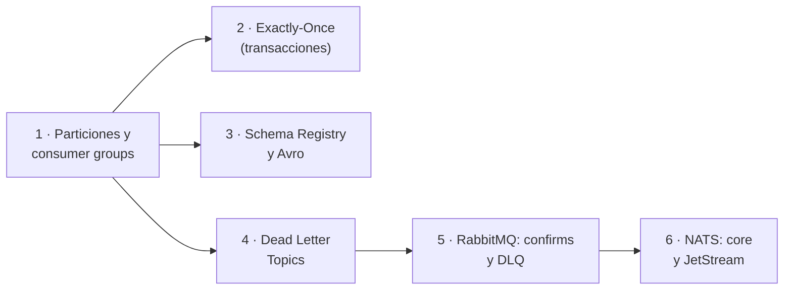
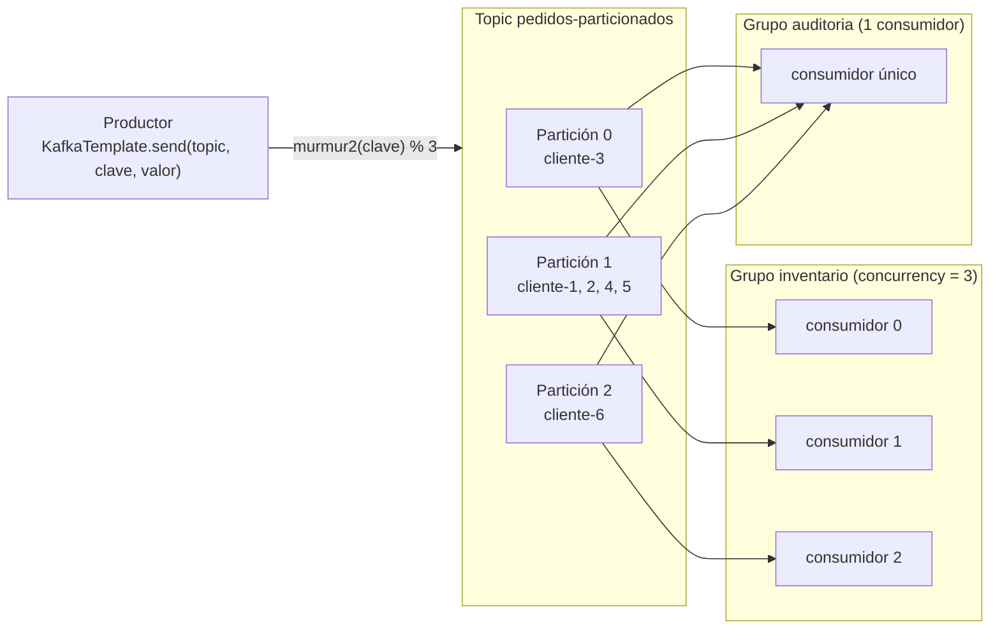
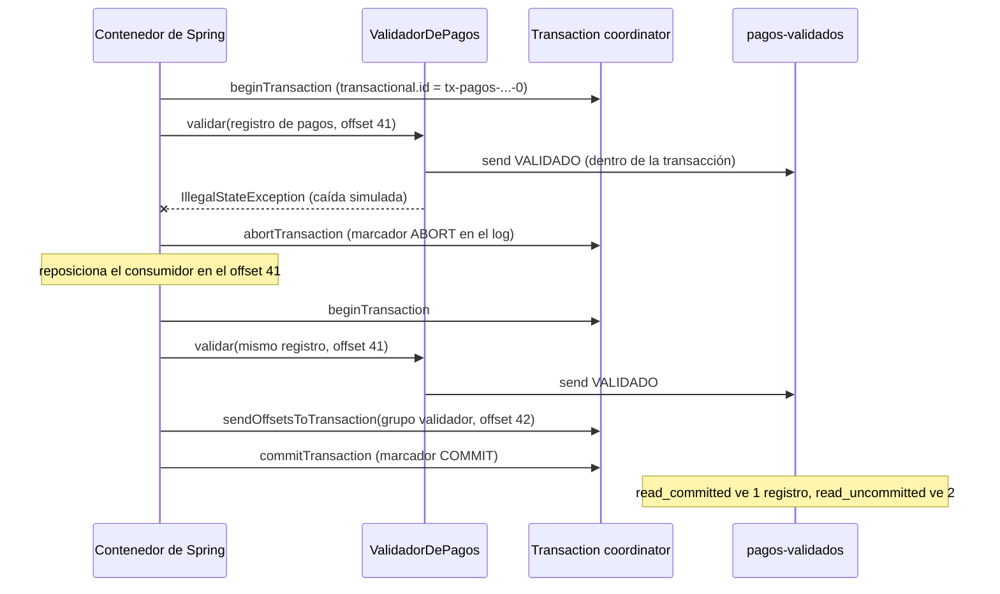
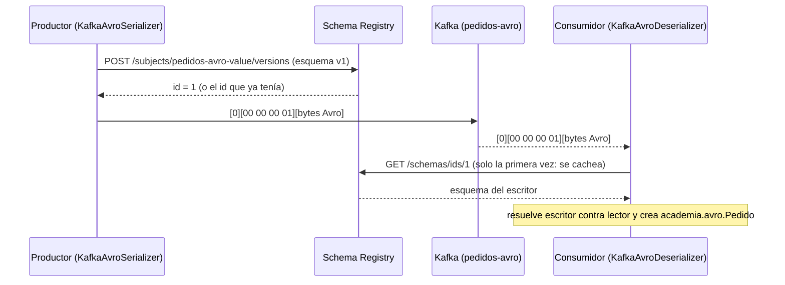
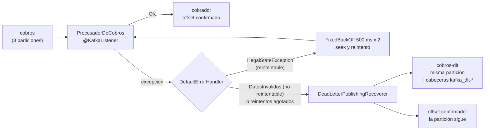
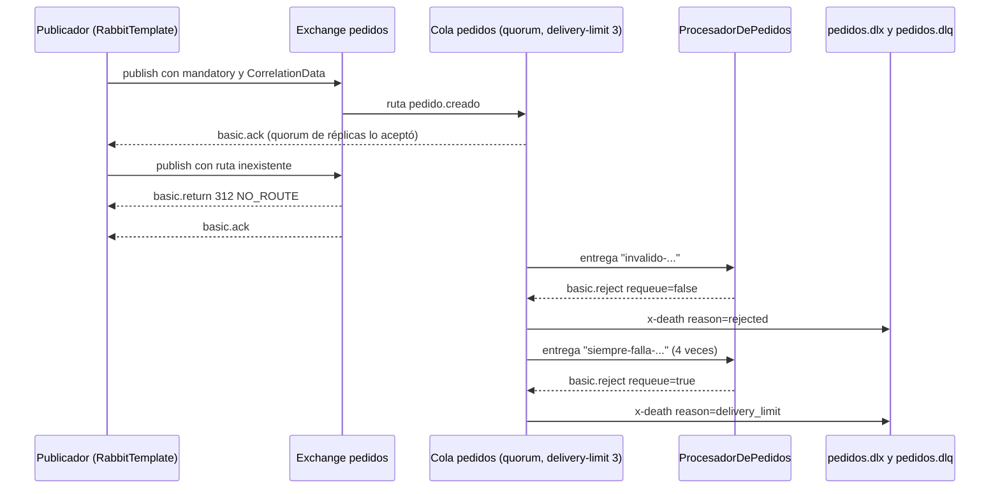
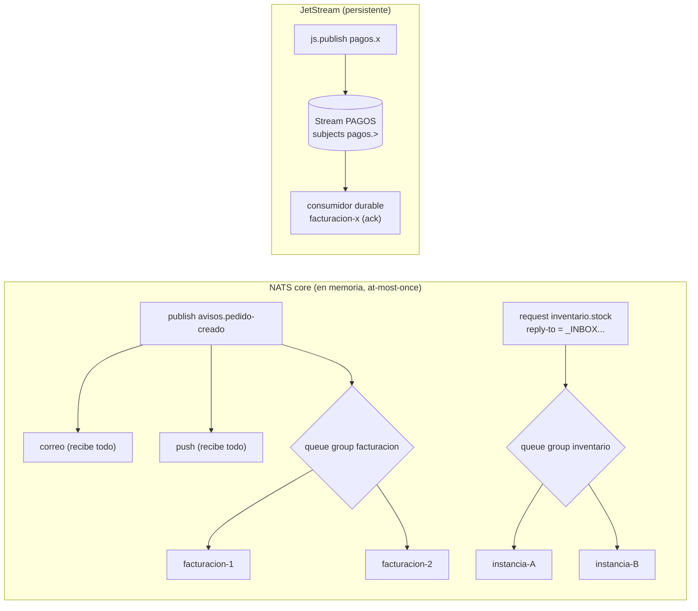

# Módulo 11 · Mensajería avanzada

**Fase 1 · Spring Boot de cero a experto** (semana 11 de 12). **Duración:** 18 h (6 temas de 2,5–3,5 h).
**Dificultad:** 4 de 5. **Dependencias:** Módulo 6 (la introducción a RabbitMQ y Kafka: exchange, cola, topic,
partición, clave y consumer group), Módulo 8 (reintentos y fallbacks) y, de la Fase 0, Docker básico y Docker
Compose. **Herramientas:**JDK 25 LTS**, **Spring Boot 4.1.3** (que gestiona Spring for Apache Kafka 4.1.3,
`kafka-clients` 4.2.2 y Spring AMQP 4.1.3), Apache Kafka 4.4.0 en modo KRaft, Confluent Schema Registry 8.4.1, Avro
1.12.2, RabbitMQ 4.4.1, NATS 2.15.3 con JetStream y el cliente jnats 2.26.4..yml` levanta los cuatro brokers y
los comandos de verificación indicados ejecuta todo).

En el Módulo 6 enviaste tu primer evento por RabbitMQ y por Kafka. Funcionaba en la demo. En producción aparecen las
preguntas difíciles: ¿por qué este consumidor no recibe nada?, ¿por qué el pedido 7 se procesó antes que el 6?,
¿por qué se cobró dos veces?, ¿quién rompió el formato del evento?, ¿dónde quedó el mensaje que nadie pudo procesar?
Este módulo responde cada una con una herramienta concreta: particiones y grupos, transacciones de Kafka (EOS),
Schema Registry con Avro, Dead Letter Topics, confirmaciones y colas de mensajes muertos en RabbitMQ, y NATS cuando
lo que necesitas es velocidad y simplicidad.



**Texto alternativo:** diagrama de izquierda a derecha. El tema 1 (particiones y consumer groups) es la base: de él
salen flechas al tema 2 (Exactly-Once con transacciones), al tema 3 (Schema Registry y Avro) y al tema 4 (Dead Letter
Topics). Del tema 4 se pasa al tema 5 (RabbitMQ con publisher confirms y DLQ), y de ahí al tema 6 (NATS core y
JetStream).

| Herramienta | Versión | Quién la fija |
|---|---|---|
| Spring for Apache Kafka / `kafka-clients` | 4.1.3 / 4.2.2 | BOM de Spring Boot 4.1.3 |
| Spring AMQP / cliente Java de RabbitMQ | 4.1.3 / 5.37.1 | BOM de Spring Boot 4.1.3 |
| Apache Kafka (broker, KRaft) | 4.4.0 (imagen `apache/kafka:4.4.0`) | `docker-compose.yml` |
| Confluent Schema Registry | 8.4.1 (imagen `confluentinc/cp-schema-registry:8.4.1`) | `docker-compose.yml` |
| Avro / `kafka-avro-serializer` | 1.12.2 / 8.4.1 | catálogo `gradle/libs.versions.toml` |
| RabbitMQ | 4.4.1 (imagen `rabbitmq:4.4.1-management`) | `docker-compose.yml` |
| NATS Server / jnats | 2.15.3 (imagen `nats:2.15.3-alpine`) / 2.26.4 | `docker-compose.yml` / catálogo `gradle/libs.versions.toml` |

El `docker-compose.yml` del módulo, que usan todos los temas:

`docker-compose.yml`:

```yaml
# Módulo 11 (modulo-15) · Mensajería avanzada: Kafka 4.4.0 + Schema Registry 8.4.1 + RabbitMQ 4.4.1 + NATS 2.15.3
# Arranca todo:  docker compose up -d --wait        (espera a que los 4 healthchecks estén "healthy")
# Solo Kafka:    docker compose up -d --wait kafka
# Detén:         docker compose down                (sin volúmenes: topics, colas y streams se borran a propósito)
# Puertos del host: 9092 Kafka · 8081 Schema Registry · 5672/15672 RabbitMQ · 4222/8222 NATS
# Si otro módulo ocupa esos puertos (p. ej. modulo-10), haz antes «docker compose down» allí.
services:
  kafka:
    image: apache/kafka:4.4.0
    hostname: kafka
    ports:
      - "9092:9092"
    environment:
      # Un solo nodo KRaft (broker + controlador) con DOS listeners:
      #  PLAINTEXT_HOST -> localhost:9092 para tus apps y tests en el host
      #  PLAINTEXT      -> kafka:19092 para otros contenedores (Schema Registry)
      KAFKA_NODE_ID: 1
      KAFKA_PROCESS_ROLES: "broker,controller"
      KAFKA_LISTENERS: "CONTROLLER://:29093,PLAINTEXT_HOST://:9092,PLAINTEXT://:19092"
      KAFKA_ADVERTISED_LISTENERS: "PLAINTEXT_HOST://localhost:9092,PLAINTEXT://kafka:19092"
      KAFKA_LISTENER_SECURITY_PROTOCOL_MAP: "CONTROLLER:PLAINTEXT,PLAINTEXT:PLAINTEXT,PLAINTEXT_HOST:PLAINTEXT"
      KAFKA_CONTROLLER_QUORUM_VOTERS: "1@kafka:29093"
      KAFKA_CONTROLLER_LISTENER_NAMES: "CONTROLLER"
      KAFKA_INTER_BROKER_LISTENER_NAME: "PLAINTEXT"
      CLUSTER_ID: "4L6g3nShT-eMCtK--X86sw"
      # Con un solo broker, los topics internos (offsets de grupos y estado de transacciones) necesitan RF 1.
      KAFKA_OFFSETS_TOPIC_REPLICATION_FACTOR: 1
      KAFKA_TRANSACTION_STATE_LOG_REPLICATION_FACTOR: 1
      KAFKA_TRANSACTION_STATE_LOG_MIN_ISR: 1
      KAFKA_SHARE_COORDINATOR_STATE_TOPIC_REPLICATION_FACTOR: 1
      KAFKA_SHARE_COORDINATOR_STATE_TOPIC_MIN_ISR: 1
      # Sin espera inicial de 3 s antes del primer rebalanceo de un grupo (solo laboratorio).
      KAFKA_GROUP_INITIAL_REBALANCE_DELAY_MS: 0
      KAFKA_LOG_DIRS: "/tmp/kraft-combined-logs"
    healthcheck:
      test: ["CMD-SHELL", "/opt/kafka/bin/kafka-topics.sh --bootstrap-server localhost:9092 --list >/dev/null"]
      interval: 5s
      timeout: 15s
      retries: 30

  schema-registry:
    image: confluentinc/cp-schema-registry:8.4.1
    hostname: schema-registry
    depends_on:
      kafka:
        condition: service_healthy
    ports:
      - "8081:8081"
    environment:
      SCHEMA_REGISTRY_HOST_NAME: schema-registry
      SCHEMA_REGISTRY_LISTENERS: "http://0.0.0.0:8081"
      # Los esquemas se guardan en el topic interno _schemas de este Kafka
      SCHEMA_REGISTRY_KAFKASTORE_BOOTSTRAP_SERVERS: "PLAINTEXT://kafka:19092"
      # Un solo broker: el topic interno _schemas con 1 réplica (por defecto pide 3).
      SCHEMA_REGISTRY_KAFKASTORE_TOPIC_REPLICATION_FACTOR: 1
    healthcheck:
      # 127.0.0.1 (no «localhost», que puede resolver a ::1). Si la imagen no trae curl, prueba el puerto con bash.
      test: ["CMD-SHELL", "curl -fs http://127.0.0.1:8081/subjects >/dev/null 2>&1 || bash -c 'exec 3<>/dev/tcp/127.0.0.1/8081' 2>/dev/null"]
      interval: 5s
      timeout: 10s
      retries: 40
      start_period: 60s

  rabbitmq:
    image: rabbitmq:4.4.1-management
    environment:
      RABBITMQ_DEFAULT_USER: academia
      RABBITMQ_DEFAULT_PASS: academia
    ports:
      - "5672:5672"     # AMQP 0-9-1
      - "15672:15672"   # consola web: http://localhost:15672 (academia / academia)
    healthcheck:
      test: ["CMD", "rabbitmq-diagnostics", "-q", "ping"]
      interval: 5s
      timeout: 10s
      retries: 30

  nats:
    # La variante alpine trae shell y wget para el healthcheck (la imagen «scratch» no tiene ni shell).
    image: nats:2.15.3-alpine
    command: ["-js", "-m", "8222"]   # -js activa JetStream; -m expone el monitoreo HTTP
    ports:
      - "4222:4222"     # clientes
      - "8222:8222"     # monitoreo: http://localhost:8222/healthz, /jsz, /connz
    healthcheck:
      test: ["CMD-SHELL", "wget -q -O- http://localhost:8222/healthz | grep -q ok"]
      interval: 3s
      timeout: 5s
      retries: 30
```

---


### Kafka profundo: particionamiento, consumer groups

<details open>
<summary><strong>Capa 1 — Lectura</strong></summary>

#### ► DE QUÉ TRATA
Predecir a qué partición irá cada mensaje con clave y qué consumidor de un grupo la leerá, y diseñar la clave y el número de particiones de un topic para conservar el orden por entidad y paralelizar el consumo; lo compruebas cuando el simulador calcula las mismas particiones que…

#### ► LA IDEA EN UNA FRASE
**Predecir a qué partición irá cada mensaje con clave y qué consumidor de un grupo la leerá, y diseñar la clave y el número de particiones de un topic para conservar el orden por entidad y paralelizar el consumo; lo compruebas cuando el simulador calcula las mismas particiones que el broker y los 3 tests de f075-kafka-particiones pasan (misma clave → misma partición, una partición → un solo consumidor del grupo, otro grupo → todos los mensajes).**

#### ► POR QUÉ EXISTE ESTO
Kafka guarda los mensajes en listas que solo crecen (como un cuaderno donde solo se escribe al final). Un topic es un tema («pedidos») y, para que muchos puedan trabajar a la vez, se parte en varias listas llamadas particiones. Cada mensaje tiene un número de posición dentro de su partición: el offset.

#### ► LA ANALOGÍA
Piensa en kafka profundo: particionamiento, consumer groups como una herramienta de taller: útil cuando conoces su propósito y sus límites.
**Dónde se rompe la analogía:** en software, los efectos dependen del contexto, la escala y los trade-offs.

#### ► CÓMO FUNCIONA


1. Cuando envías un mensaje con **clave** (por ejemplo, el id del cliente), Kafka hace una cuenta con esa clave y
2. Un **consumer group** es un equipo de programas que se reparten el trabajo. Kafka da cada partición a **un solo**
3. Dos equipos distintos **no compiten**: cada uno lee todos los mensajes y apunta por su cuenta hasta dónde llegó.

#### ► LO QUE PUEDE SALIR MAL
| Síntoma | Causa probable | Arreglo |
|---|---|---|
| Kafka profundo: particionamiento, consumer groups se aplica pero el resultado no mejora | Se usó sin medir el problema real | Mide antes y compara contra la alternativa simple |
| Aparece complejidad inesperada | Se adoptó la técnica sin comprender sus trade-offs | Vuelve a la sección de trade-offs y reduce el alcance |
| Falla en un caso límite | Se asumió un contexto que no se cumple | Prueba el caso límite y documenta cuándo NO usarlo |

#### ► TRADE-OFFS
| Opción | Cuándo usarla | Cuándo NO usarla |
|---|---|---|
| Usar Kafka profundo: particionamiento, consumer groups | Cuando el problema coincide con su propósito y el beneficio es observable | Cuando agrega complejidad sin resolver un problema real |
| Alternativa más simple | Cuando el contexto es pequeño, estable o fácil de razonar | Cuando ya demostró no escalar o no cumplir el requisito |
| Postergar la decisión | Cuando falta evidencia del problema | Cuando el costo de esperar es mayor que el costo de probar |

#### ► CUÁNDO NO USAR ESTO
Clave aleatoria o nula «para repartir mejor». Se ve así:

#### ► DE VUELTA A LA ANALOGÍA
Volviendo a la analogía: kafka profundo: particionamiento, consumer groups funciona como el modelo inicial, pero recuerda dónde se rompe: en producción importan la evidencia, la escala y el costo de equivocarte.

#### ► LO QUE DEBES RECORDAR
- Cuando envías un mensaje con **clave** (por ejemplo, el id del cliente), Kafka hace una cuenta con esa clave y
- Un **consumer group** es un equipo de programas que se reparten el trabajo. Kafka da cada partición a **un solo**
- Dos equipos distintos **no compiten**: cada uno lee todos los mensajes y apunta por su cuenta hasta dónde llegó.

#### ► PREGUNTAS PARA PENSAR
1. ¿Qué problema concreto resuelve kafka profundo: particionamiento, consumer groups en tu contexto?
2. ¿Cómo sabrías que kafka profundo: particionamiento, consumer groups no está funcionando bien?
3. ¿Qué alternativa más simple considerarías antes de usar kafka profundo: particionamiento, consumer groups?

</details>

<details>
<summary><strong>Capa 2 — Construcción</strong></summary>

#### Código de referencia / ejecutable
Versiones: **JDK 25**, **Spring Boot 4.1.3** con **Spring for Apache Kafka 4.1.3** y **kafka-clients 4.2.2**
(gestionados por el BOM), broker **Kafka 4.4.0**. Proyecto completo en
`f075-kafka-particiones`.

> **Build con Gradle (y su equivalencia en Maven).** Este laboratorio se construye con **Gradle 9.9.2** y Kotlin DSL
> mediante el wrapper `./gradlew` (no instalas Gradle). `settings.gradle.kts` lista los subproyectos (en Maven,
> `<modules>` del POM agregador), cada carpeta tiene su `build.gradle.kts` (su `pom.xml`) y
> `gradle/libs.versions.toml` es el **catálogo de versiones** (las `<properties>` y el `dependencyManagement`): por eso
> las dependencias se escriben `libs.…`. Equivalencias: `./mvnw test` → `./gradlew test` ·
> `./mvnw package -DskipTests` → `./gradlew bootJar` · `./mvnw spring-boot:run` → `./gradlew bootRun` ·
> `-Dtest=Clase` → `--tests Clase` · `target/` → `build/` (el jar queda en `build/libs/`). Gradle escribe una línea
> `PASSED` por test y termina con `BUILD SUCCESSFUL` (Maven: `Tests run: N` y `BUILD SUCCESS`).

`modulo-15/settings.gradle.kts`:

```kotlin
// Módulo 11 (modulo-15) · Build multi-proyecto: "./gradlew test" ejecuta los tests de las 6 fichas (F075–F080).
// Los tests usan los brokers de docker-compose.yml: arráncalos antes con "docker compose up -d --wait".
// Cada carpeta tiene su propio build.gradle.kts; las versiones viven en gradle/libs.versions.toml
// (catálogo "libs"). Equivale al POM agregador con <modules> de Maven.
pluginManagement {
    repositories {
        gradlePluginPortal()
        mavenCentral()
    }
}
// Sin esto, un alumno sin JDK 25 instalado ve el build morir en la configuración, antes de cualquier test.
plugins {
    id("org.gradle.toolchains.foojay-resolver-convention") version "1.0.0"
}

dependencyResolutionManagement {
    repositories {
        mavenCentral()
        // F077: el serializador de Confluent no está en Maven Central, vive en el repositorio de Confluent
        maven {
            name = "confluent"
            url = uri("https://packages.confluent.io/maven/")
        }
    }
}

rootProject.name = "modulo-15-laboratorios"

include(
    "f075-kafka-particiones",
    "f076-exactly-once",
    "f077-schema-registry-avro",
    "f078-dead-letter-topics",
    "f079-rabbitmq-confirms-dlq",
    "f080-nats",
)
```

`modulo-15/gradle/libs.versions.toml`:

```toml
# Módulo 11 (modulo-15)
# Catálogo de versiones del laboratorio: una sola fuente para plugins y librerías.
# Las librerías SIN versión las fija el BOM de Spring Boot (spring-boot-dependencies) o el BOM que importe el proyecto.

[versions]
# No los gestiona el BOM de Spring Boot: se fijan aquí
avro = "1.12.2"
confluent = "8.4.1"
# Spring Boot no tiene starter ni gestiona la versión de NATS: se fija aquí
jnats = "2.26.4"
spring-boot = "4.1.3"

[libraries]
spring-boot-starter-kafka = { module = "org.springframework.boot:spring-boot-starter-kafka" }
spring-boot-starter-test = { module = "org.springframework.boot:spring-boot-starter-test" }
junit-platform-launcher = { module = "org.junit.platform:junit-platform-launcher" }
avro = { module = "org.apache.avro:avro", version.ref = "avro" }
avro-tools = { module = "org.apache.avro:avro-tools", version.ref = "avro" }
kafka-avro-serializer = { module = "io.confluent:kafka-avro-serializer", version.ref = "confluent" }
spring-boot-starter-amqp = { module = "org.springframework.boot:spring-boot-starter-amqp" }
spring-boot-starter = { module = "org.springframework.boot:spring-boot-starter" }
jnats = { module = "io.nats:jnats", version.ref = "jnats" }

[plugins]
spring-boot = { id = "org.springframework.boot", version.ref = "spring-boot" }
spring-dependency-management = { id = "io.spring.dependency-management", version = "1.1.7" }
```

`f075-kafka-particiones/build.gradle.kts`:

```kotlin
// F075 · Kafka profundo: particionamiento y consumer groups (Spring Boot 4.1.3, JDK 25, Kafka 4.4.0)
plugins {
    java
    alias(libs.plugins.spring.boot)
    alias(libs.plugins.spring.dependency.management)
}

group = "academia.microservicios"
version = "1.0.0"

java {
    toolchain {
        languageVersion = JavaLanguageVersion.of(25)
    }
}

dependencies {
    // Spring for Apache Kafka 4.1.3 + kafka-clients 4.2.2 (versiones del BOM de Boot 4.1.3)
    implementation(libs.spring.boot.starter.kafka)
    // JUnit Jupiter 6.0.3 + AssertJ 3.27.7
    testImplementation(libs.spring.boot.starter.test)
    // Gradle 9 exige declarar el lanzador de JUnit Platform (ya no lo añade por su cuenta)
    testRuntimeOnly(libs.junit.platform.launcher)
}

tasks.withType<Test> {
    useJUnitPlatform()
    testLogging {
        events("passed", "skipped", "failed")   // una línea por test en la consola
        // el mensaje completo de cada fallo (valor esperado y obtenido), no solo el tipo de excepción
        exceptionFormat = org.gradle.api.tasks.testing.logging.TestExceptionFormat.FULL
    }
}
```

`f075-kafka-particiones/src/main/resources/application.properties`:

```properties
spring.application.name=f075-kafka-particiones
# Kafka 4.4.0 del docker-compose.yml del módulo (listener para el host en localhost:9092)
spring.kafka.bootstrap-servers=${KAFKA_BOOTSTRAP:localhost:9092}
# Un grupo nuevo empieza por el principio del topic; uno que ya existe sigue desde su offset confirmado.
spring.kafka.consumer.auto-offset-reset=earliest
# acks=all ya es el valor por defecto desde Kafka 3.0: el líder espera a las réplicas en sincronía.
spring.kafka.producer.acks=all
```

`f075-kafka-particiones/src/main/java/academia/particiones/ParticionesApp.java`:

```java
package academia.particiones;

import org.springframework.boot.SpringApplication;
import org.springframework.boot.autoconfigure.SpringBootApplication;

/** F075 · Un topic de 3 particiones, un productor con clave y dos consumer groups. */
@SpringBootApplication
public class ParticionesApp {

    public static void main(String[] args) {
        SpringApplication.run(ParticionesApp.class, args);
    }
}
```

`f075-kafka-particiones/src/main/java/academia/particiones/Topicos.java`:

```java
package academia.particiones;

import org.apache.kafka.clients.admin.NewTopic;
import org.springframework.context.annotation.Bean;
import org.springframework.context.annotation.Configuration;
import org.springframework.kafka.config.TopicBuilder;

/** KafkaAdmin (auto-configurado por Boot) crea el topic al arrancar si no existe. */
@Configuration
class Topicos {

    static final String PEDIDOS = "pedidos-particionados";

    @Bean
    NewTopic pedidosParticionados() {
        // 3 particiones = como máximo 3 consumidores trabajando en paralelo dentro de un grupo.
        // 1 réplica porque el laboratorio tiene un solo broker; en producción, 3 réplicas y min.insync.replicas=2.
        return TopicBuilder.name(PEDIDOS).partitions(3).replicas(1).build();
    }
}
```

`f075-kafka-particiones/src/main/java/academia/particiones/Recepcion.java`:

```java
package academia.particiones;

/** Qué hilo (consumidor) del grupo recibió qué registro, y de qué partición. */
public record Recepcion(String grupo, String hilo, int particion, String clave, String valor) {
}
```

`f075-kafka-particiones/src/main/java/academia/particiones/PublicadorPedidos.java`:

```java
package academia.particiones;

import java.util.concurrent.TimeUnit;

import org.springframework.kafka.core.KafkaTemplate;
import org.springframework.stereotype.Component;

@Component
public class PublicadorPedidos {

    private final KafkaTemplate<String, String> kafka;

    PublicadorPedidos(KafkaTemplate<String, String> kafka) {
        this.kafka = kafka;
    }

    /**
     * La CLAVE decide la partición: murmur2(clave) % particiones. Mismo cliente = misma partición = orden garantizado.
     * get(...) espera el acuse del broker y devuelve en qué partición y offset quedó el registro.
     */
    public int publicar(String clienteId, String pedido) throws Exception {
        var resultado = kafka.send(Topicos.PEDIDOS, clienteId, pedido).get(10, TimeUnit.SECONDS);
        return resultado.getRecordMetadata().partition();
    }
}
```

`f075-kafka-particiones/src/main/java/academia/particiones/Consumidores.java`:

```java
package academia.particiones;

import java.util.Queue;
import java.util.concurrent.ConcurrentLinkedQueue;

import org.apache.kafka.clients.consumer.ConsumerRecord;
import org.slf4j.Logger;
import org.slf4j.LoggerFactory;
import org.springframework.kafka.annotation.KafkaListener;
import org.springframework.stereotype.Component;

/**
 * Dos consumer groups sobre el MISMO topic:
 *  - «inventario» con concurrency=3: tres KafkaConsumer en el mismo grupo se REPARTEN las 3 particiones.
 *  - «auditoria» con un solo consumidor: recibe TODOS los registros (cada grupo tiene sus propios offsets).
 */
@Component
public class Consumidores {

    private static final Logger log = LoggerFactory.getLogger(Consumidores.class);

    final Queue<Recepcion> inventario = new ConcurrentLinkedQueue<>();
    final Queue<Recepcion> auditoria = new ConcurrentLinkedQueue<>();

    @KafkaListener(id = "inventario", groupId = "inventario", topics = Topicos.PEDIDOS, concurrency = "3")
    void inventario(ConsumerRecord<String, String> r) {
        inventario.add(recepcion("inventario", r));
        log.info("inventario hilo={} particion={} offset={} clave={}",
                Thread.currentThread().getName(), r.partition(), r.offset(), r.key());
    }

    @KafkaListener(id = "auditoria", groupId = "auditoria", topics = Topicos.PEDIDOS)
    void auditoria(ConsumerRecord<String, String> r) {
        auditoria.add(recepcion("auditoria", r));
    }

    private static Recepcion recepcion(String grupo, ConsumerRecord<String, String> r) {
        return new Recepcion(grupo, Thread.currentThread().getName(), r.partition(), r.key(), r.value());
    }
}
```

Test (usa el Kafka del `docker-compose.yml`):

`f075-kafka-particiones/src/test/java/academia/particiones/ParticionesTest.java`:

```java
package academia.particiones;

import static org.assertj.core.api.Assertions.assertThat;

import java.nio.charset.StandardCharsets;
import java.util.HashMap;
import java.util.HashSet;
import java.util.List;
import java.util.Map;
import java.util.Set;
import java.util.UUID;
import java.util.function.Supplier;

import org.apache.kafka.clients.admin.Admin;
import org.apache.kafka.clients.admin.AdminClientConfig;
import org.apache.kafka.clients.admin.ConsumerGroupDescription;
import org.apache.kafka.clients.admin.MemberDescription;
import org.apache.kafka.common.utils.Utils;
import org.junit.jupiter.api.Test;
import org.springframework.beans.factory.annotation.Autowired;
import org.springframework.beans.factory.annotation.Value;
import org.springframework.boot.test.context.SpringBootTest;

/**
 * Requiere el Kafka 4.4.0 del docker-compose.yml del módulo: docker compose up -d --wait kafka
 * Cada ejecución usa un identificador nuevo en el VALOR; las CLAVES (cliente-1..6) son siempre las mismas.
 */
@SpringBootTest
class ParticionesTest {

    static final int MENSAJES_POR_CLIENTE = 5;

    @Autowired PublicadorPedidos publicador;
    @Autowired Consumidores consumidores;
    @Value("${spring.kafka.bootstrap-servers}") String bootstrap;

    final String corrida = UUID.randomUUID().toString().substring(0, 8);

    /** Publica 6 clientes x 5 pedidos y devuelve, por cliente, las particiones donde quedaron. */
    Map<String, Set<Integer>> publicarTodo() throws Exception {
        Map<String, Set<Integer>> particiones = new HashMap<>();
        for (int n = 1; n <= MENSAJES_POR_CLIENTE; n++) {
            for (int c = 1; c <= 6; c++) {
                String cliente = "cliente-" + c;
                int p = publicador.publicar(cliente, corrida + ":pedido-" + n);
                particiones.computeIfAbsent(cliente, k -> new HashSet<>()).add(p);
            }
        }
        return particiones;
    }

    List<Recepcion> deEstaCorrida(Iterable<Recepcion> cola) {
        var lista = new java.util.ArrayList<Recepcion>();
        cola.forEach(r -> { if (r.valor().startsWith(corrida)) lista.add(r); });
        return lista;
    }

    static void esperar(Supplier<Boolean> condicion, int segundos) throws InterruptedException {
        long limite = System.currentTimeMillis() + segundos * 1000L;
        while (!condicion.get() && System.currentTimeMillis() < limite) {
            Thread.sleep(200);
        }
    }

    @Test
    void laMismaClaveSiempreVaALaMismaParticionYEsLaQueCalculaMurmur2() throws Exception {
        Map<String, Set<Integer>> particiones = publicarTodo();
        particiones.forEach((cliente, ps) -> {
            assertThat(ps).as("particiones de %s", cliente).hasSize(1);
            int esperada = Utils.toPositive(Utils.murmur2(cliente.getBytes(StandardCharsets.UTF_8))) % 3;
            assertThat(ps).containsExactly(esperada);
        });
        System.out.println("Partición por cliente: " + new java.util.TreeMap<>(particiones));
    }

    @Test
    void cadaParticionLaLeeUnSoloConsumidorDelGrupoYOtroGrupoLoRecibeTodo() throws Exception {
        publicarTodo();
        esperar(() -> deEstaCorrida(consumidores.inventario).size() == 30
                && deEstaCorrida(consumidores.auditoria).size() == 30, 60);

        List<Recepcion> inventario = deEstaCorrida(consumidores.inventario);
        assertThat(inventario).hasSize(30);
        Map<Integer, Set<String>> hilosPorParticion = new HashMap<>();
        inventario.forEach(r -> hilosPorParticion.computeIfAbsent(r.particion(), k -> new HashSet<>()).add(r.hilo()));
        // Dentro de un grupo, una partición la consume UN solo consumidor: por eso se conserva el orden por clave.
        hilosPorParticion.values().forEach(hilos -> assertThat(hilos).hasSize(1));
        assertThat(hilosPorParticion).hasSize(3);
        // El otro grupo recibe los 30 registros: los grupos no compiten entre sí.
        assertThat(deEstaCorrida(consumidores.auditoria)).hasSize(30);
        System.out.println("Hilos de «inventario» por partición: " + new java.util.TreeMap<>(hilosPorParticion));
    }

    @Test
    void elGrupoInventarioTieneTresMiembrosConUnaParticionCadaUno() throws Exception {
        try (Admin admin = Admin.create(Map.of(AdminClientConfig.BOOTSTRAP_SERVERS_CONFIG, bootstrap))) {
            ConsumerGroupDescription[] grupo = new ConsumerGroupDescription[1];
            esperar(() -> {
                try {
                    grupo[0] = admin.describeConsumerGroups(List.of("inventario"))
                            .describedGroups().get("inventario").get();
                    return grupo[0].members().size() == 3
                            && grupo[0].members().stream().allMatch(m -> m.assignment().topicPartitions().size() == 1);
                } catch (Exception e) {
                    return false;
                }
            }, 60);
            assertThat(grupo[0].members()).hasSize(3);
            for (MemberDescription m : grupo[0].members()) {
                assertThat(m.assignment().topicPartitions()).hasSize(1);
                System.out.println(m.clientId() + " -> " + m.assignment().topicPartitions());
            }
        }
    }
}
```

Simulador sin Kafka (solo JDK 25). Reproduce el particionador y RangeAssignor para que puedas **predecir** antes de
ejecutar:

`jdk/Particionador.java`:

```java
import java.nio.charset.StandardCharsets;
import java.util.ArrayList;
import java.util.List;
import java.util.Map;
import java.util.TreeMap;

/**
 * F075 · Simulador SIN Kafka (solo JDK 25): reproduce las dos decisiones que toma Kafka por ti.
 *
 * 1) A qué partición va un mensaje con clave: Utils.toPositive(Utils.murmur2(clave)) % particiones
 *    (BuiltInPartitioner.partitionForKey de kafka-clients 4.2.2; murmur2 copiado de
 *    clients/src/main/java/org/apache/kafka/common/utils/Utils.java, Apache License 2.0).
 * 2) Qué particiones recibe cada consumidor de un grupo con RangeAssignor (el primero de la lista
 *    por defecto de partition.assignment.strategy en el protocolo «classic»).
 *
 * Ejecuta:  java Particionador.java        (termina con código 1 si alguna comprobación falla)
 */
public class Particionador {

    /** murmur2 de Kafka: semilla 0x9747b28c, bloques de 4 bytes en little-endian. */
    static int murmur2(byte[] data) {
        int length = data.length;
        int seed = 0x9747b28c;
        final int m = 0x5bd1e995;
        final int r = 24;
        int h = seed ^ length;
        int length4 = length >> 2;
        for (int i = 0; i < length4; i++) {
            int i4 = i << 2;
            int k = (data[i4] & 0xff) + ((data[i4 + 1] & 0xff) << 8)
                    + ((data[i4 + 2] & 0xff) << 16) + ((data[i4 + 3] & 0xff) << 24);
            k *= m;
            k ^= k >>> r;
            k *= m;
            h *= m;
            h ^= k;
        }
        int index = length4 << 2;
        switch (length - index) {
            case 3:
                h ^= (data[index + 2] & 0xff) << 16;
            case 2:
                h ^= (data[index + 1] & 0xff) << 8;
            case 1:
                h ^= data[index] & 0xff;
                h *= m;
        }
        h ^= h >>> 13;
        h *= m;
        h ^= h >>> 15;
        return h;
    }

    static int particion(String clave, int particiones) {
        int hash = murmur2(clave.getBytes(StandardCharsets.UTF_8));
        return (hash & 0x7fffffff) % particiones;                 // Utils.toPositive(...) % n
    }

    /** RangeAssignor para UN topic: particiones en orden, consumidores en orden; los primeros reciben una extra. */
    static Map<String, List<Integer>> range(int particiones, List<String> consumidores) {
        Map<String, List<Integer>> asignacion = new TreeMap<>();
        List<String> ordenados = new ArrayList<>(consumidores);
        ordenados.sort(null);
        int porConsumidor = particiones / ordenados.size();
        int conExtra = particiones % ordenados.size();
        int siguiente = 0;
        for (int i = 0; i < ordenados.size(); i++) {
            int cuantas = porConsumidor + (i < conExtra ? 1 : 0);
            List<Integer> suyas = new ArrayList<>();
            for (int j = 0; j < cuantas; j++) {
                suyas.add(siguiente++);
            }
            asignacion.put(ordenados.get(i), suyas);
        }
        return asignacion;
    }

    public static void main(String[] args) {
        int fallos = 0;
        // Vectores de prueba de UtilsTest.testMurmur2 en apache/kafka 4.2.2: si coinciden, el hash es el de Kafka.
        Object[][] vectores = {{"21", -973932308}, {"foobar", -790332482}, {"abc", 479470107},
                {"a-little-bit-long-string", -985981536}};
        for (Object[] v : vectores) {
            int obtenido = murmur2(((String) v[0]).getBytes(StandardCharsets.UTF_8));
            boolean ok = obtenido == (int) v[1];
            fallos += ok ? 0 : 1;
            System.out.printf("murmur2(\"%s\") = %d %s%n", v[0], obtenido, ok ? "✔" : "✘ esperado " + v[1]);
        }

        System.out.println();
        System.out.println("Topic con 3 particiones · partición = toPositive(murmur2(clave)) % 3");
        Map<Integer, List<String>> porParticion = new TreeMap<>();
        for (int i = 1; i <= 6; i++) {
            String clave = "cliente-" + i;
            int p = particion(clave, 3);
            porParticion.computeIfAbsent(p, x -> new ArrayList<>()).add(clave);
            System.out.printf("  %-10s -> partición %d%n", clave, p);
        }
        if (porParticion.size() != 3) {
            System.out.println("✘ las 6 claves no cubren las 3 particiones");
            fallos++;
        }

        System.out.println();
        System.out.println("Si el topic pasa de 3 a 4 particiones, la misma clave puede cambiar de partición:");
        int cambian = 0;
        for (int i = 1; i <= 6; i++) {
            String clave = "cliente-" + i;
            int antes = particion(clave, 3);
            int despues = particion(clave, 4);
            cambian += antes != despues ? 1 : 0;
            System.out.printf("  %-10s 3 particiones -> %d · 4 particiones -> %d%s%n", clave, antes, despues,
                    antes != despues ? "   <- cambia" : "");
        }
        System.out.printf("  %d de 6 claves cambian de partición%n", cambian);

        System.out.println();
        System.out.println("RangeAssignor · topic de 3 particiones, grupo «inventario»:");
        for (int n = 1; n <= 4; n++) {
            List<String> consumidores = new ArrayList<>();
            for (int c = 0; c < n; c++) {
                consumidores.add("consumidor-" + c);
            }
            Map<String, List<Integer>> a = range(3, consumidores);
            System.out.printf("  %d consumidor(es): %s%n", n, a);
            int asignadas = a.values().stream().mapToInt(List::size).sum();
            if (asignadas != 3) {
                fallos++;
            }
        }
        System.out.println(fallos == 0 ? "\nSIMULADOR OK" : "\nSIMULADOR CON " + fallos + " FALLOS");
        System.exit(fallos == 0 ? 0 : 1);
    }
}
```

#### Verificación
Test que debe pasar:

```bash
./gradlew :f075-kafka-particiones:test
```

Resultado esperado: 3 líneas `PASSED` y `BUILD SUCCESSFUL` *(salida de Gradle pendiente de verificación en el Mac)*.

Reto: sin ejecutar nada, usa el simulador para responder: si el topic tuviera **2** particiones, ¿en qué partición
quedaría `cliente-6`? Luego añade a `ParticionesTest` este test, que usa el mismo cálculo que el broker, y ejecútalo:

```java
@Test
void conDosParticionesCliente6IriaALaParticionQuePredije() {
    int prediccion = 0; // <- escribe aquí tu respuesta del simulador
    int real = Utils.toPositive(Utils.murmur2("cliente-6".getBytes(StandardCharsets.UTF_8))) % 2;
    assertThat(real).isEqualTo(prediccion);
}
```

**Pregunta de comprobación:** tienes 3 particiones y el lag del grupo crece. Subes las réplicas del servicio de 3 a 6.
¿Baja el lag?

<details>
<summary>Respuesta</summary>

No. Un grupo nunca puede tener más consumidores **activos** que particiones: los 3 nuevos quedan ociosos. Para
consumir más rápido necesitas más particiones (con el coste de romper el orden de las claves existentes durante la
transición), procesar más rápido cada mensaje, o paralelizar dentro de la partición por clave.
</details>

</details>

### Exactly-Once Semantics (EOS)

<details open>
<summary><strong>Capa 1 — Lectura</strong></summary>

#### ► DE QUÉ TRATA
Implementar un flujo consumir-procesar-producir con transacciones de Kafka en Spring Boot y demostrar con un test que una caída después de escribir la salida no produce un duplicado visible para un consumidor read_committed; lo compruebas cuando ExactlyOnceTest pasa: el lector re…

#### ► LA IDEA EN UNA FRASE
**Implementar un flujo consumir-procesar-producir con transacciones de Kafka en Spring Boot y demostrar con un test que una caída después de escribir la salida no produce un duplicado visible para un consumidor read_committed; lo compruebas cuando ExactlyOnceTest pasa: el lector read_committed ve 1 registro y el read_uncommitted ve 2 (el abortado y el confirmado).**

#### ► POR QUÉ EXISTE ESTO
Cuando un programa lee un mensaje, hace algo y escribe un resultado, se puede caer en medio. Si se cae después de escribir pero antes de anotar «ya lo leí», al volver lo lee otra vez y escribe el resultado dos veces: un pago duplicado.

#### ► LA ANALOGÍA
Piensa en exactly-once semantics (eos) como una herramienta de taller: útil cuando conoces su propósito y sus límites.
**Dónde se rompe la analogía:** en software, los efectos dependen del contexto, la escala y los trade-offs.

#### ► CÓMO FUNCIONA


1. Cuando un programa lee un mensaje, hace algo y escribe un resultado, se puede caer en medio.
2. Si se cae después de escribir pero antes de anotar «ya lo leí», al volver lo lee otra vez y escribe el resultado dos veces: un pago duplicado.

#### ► LO QUE PUEDE SALIR MAL
| Síntoma | Causa probable | Arreglo |
|---|---|---|
| Exactly-Once Semantics (EOS) se aplica pero el resultado no mejora | Se usó sin medir el problema real | Mide antes y compara contra la alternativa simple |
| Aparece complejidad inesperada | Se adoptó la técnica sin comprender sus trade-offs | Vuelve a la sección de trade-offs y reduce el alcance |
| Falla en un caso límite | Se asumió un contexto que no se cumple | Prueba el caso límite y documenta cuándo NO usarlo |

#### ► TRADE-OFFS
| Opción | Cuándo usarla | Cuándo NO usarla |
|---|---|---|
| Usar Exactly-Once Semantics (EOS) | Cuando el problema coincide con su propósito y el beneficio es observable | Cuando agrega complejidad sin resolver un problema real |
| Alternativa más simple | Cuando el contexto es pequeño, estable o fácil de razonar | Cuando ya demostró no escalar o no cumplir el requisito |
| Postergar la decisión | Cuando falta evidencia del problema | Cuando el costo de esperar es mayor que el costo de probar |

#### ► CUÁNDO NO USAR ESTO
«Exactly-once» como etiqueta de marketing. Se ve así en un diagrama de arquitectura: una flecha de Kafka a «Servicio de pagos» con la anotación «EOS habilitado» y, dentro del servicio, esto:

#### ► DE VUELTA A LA ANALOGÍA
Volviendo a la analogía: exactly-once semantics (eos) funciona como el modelo inicial, pero recuerda dónde se rompe: en producción importan la evidencia, la escala y el costo de equivocarte.

#### ► LO QUE DEBES RECORDAR
- Cuando un programa lee un mensaje, hace algo y escribe un resultado, se puede caer en medio.
- Si se cae después de escribir pero antes de anotar «ya lo leí», al volver lo lee otra vez y escribe el resultado dos veces: un pago duplicado.

#### ► PREGUNTAS PARA PENSAR
1. ¿Qué problema concreto resuelve exactly-once semantics (eos) en tu contexto?
2. ¿Cómo sabrías que exactly-once semantics (eos) no está funcionando bien?
3. ¿Qué alternativa más simple considerarías antes de usar exactly-once semantics (eos)?

</details>

<details>
<summary><strong>Capa 2 — Construcción</strong></summary>

#### Construcción guiada
1. Ejecuta el test con Kafka arrancado:

```bash
docker compose up -d --wait kafka
./gradlew :f076-exactly-once:test
```

   **Output esperado** (extracto; la clave cambia en cada ejecución):

```text
... enviado VALIDADO:pago-3f9c1a2b-caida (transacción abierta)
... enviado VALIDADO:pago-3f9c1a2b-caida (transacción abierta)
read_committed   -> [VALIDADO:pago-3f9c1a2b-caida]
read_uncommitted -> [VALIDADO:pago-3f9c1a2b-caida, VALIDADO:pago-3f9c1a2b-caida]
…                      <- 2 líneas `PASSED` de Gradle (pendiente de verificación en el Mac)
BUILD SUCCESSFUL in …s
```

   **Captura comentada:** el listener se ejecutó **dos veces** (dos líneas «enviado»): la primera transacción se
   abortó por la excepción y la segunda se confirmó. El `get(...)` tras el `send` importa: sin esperar al broker, el
   registro del primer intento seguiría en el búfer del productor y el abort lo descartaría sin escribirlo (así
   ocurrió en la primera verificación en el Mac: `read_uncommitted` veía 1, no 2). En el log del topic hay **dos** registros, pero el lector
   `read_committed` solo entrega el confirmado. Entre ambas líneas verás además el error del listener
   (`ListenerExecutionFailedException` con la causa «Caída simulada procesando pago-…»).

2. Mira los marcadores de transacción con la herramienta de Kafka (lee el segmento de una partición de
   `pagos-validados`; busca la que tenga datos):

```bash
docker compose exec kafka sh -c 'ls /tmp/kraft-combined-logs | grep pagos-validados'
docker compose exec kafka /opt/kafka/bin/kafka-dump-log.sh --print-data-log \
  --files /tmp/kraft-combined-logs/pagos-validados-0/00000000000000000000.log | grep -E "isControl|payload|endTxnMarker"
```

   **Output esperado:** lotes con `isTransactional: true` y, entre ellos, lotes de control (`isControl: true`) con
   `endTxnMarker: ABORT` y `endTxnMarker: COMMIT`. Esos marcadores son los «sellos» de la analogía.

3. **Rómpelo a propósito.** En `application.properties` cambia `isolation-level=read-committed` por
   `read-uncommitted` **y** borra la línea `transaction-id-prefix`. Ejecuta el test otra vez.

   **Output esperado:** el test falla antes de llegar a la aserción, al publicar con `executeInTransaction`:
   `java.lang.IllegalStateException: Producer factory does not support transactions` (texto de `KafkaTemplate`). Si además cambias el test para
   publicar con `kafka.send(...)`, verás que el lector de salida recibe 2 registros también en `read_committed`: sin
   transacciones, la caída produce un **duplicado real**. Restaura el archivo.

#### Código de referencia / ejecutable
Versiones: **JDK 25**, **Spring Boot 4.1.3**, **Spring for Apache Kafka 4.1.3**, **kafka-clients 4.2.2**, broker
**Kafka 4.4.0** con el log de transacciones a 1 réplica (variables `KAFKA_TRANSACTION_STATE_LOG_*` del
`docker-compose.yml`). `f076-exactly-once/build.gradle.kts`:

```kotlin
// F076 · Exactly-Once Semantics: consume, procesa y produce en UNA transacción de Kafka (Spring Boot 4.1.3, JDK 25)
plugins {
    java
    alias(libs.plugins.spring.boot)
    alias(libs.plugins.spring.dependency.management)
}

group = "academia.microservicios"
version = "1.0.0"

java {
    toolchain {
        languageVersion = JavaLanguageVersion.of(25)
    }
}

dependencies {
    // Spring for Apache Kafka 4.1.3 (KafkaTransactionManager) + kafka-clients 4.2.2
    implementation(libs.spring.boot.starter.kafka)
    testImplementation(libs.spring.boot.starter.test)
    // Gradle 9 exige declarar el lanzador de JUnit Platform (ya no lo añade por su cuenta)
    testRuntimeOnly(libs.junit.platform.launcher)
}

tasks.withType<Test> {
    useJUnitPlatform()
    testLogging {
        events("passed", "skipped", "failed")   // una línea por test en la consola
        // el mensaje completo de cada fallo (valor esperado y obtenido), no solo el tipo de excepción
        exceptionFormat = org.gradle.api.tasks.testing.logging.TestExceptionFormat.FULL
    }
}
```

`f076-exactly-once/src/main/resources/application.properties`:

```properties
spring.application.name=f076-exactly-once
spring.kafka.bootstrap-servers=${KAFKA_BOOTSTRAP:localhost:9092}
spring.kafka.consumer.auto-offset-reset=earliest
# 1) Con este prefijo Boot crea una ProducerFactory TRANSACCIONAL y un KafkaTransactionManager, y lo conecta al
#    contenedor del @KafkaListener: cada registro se procesa dentro de una transacción de Kafka.
#    Debe ser ÚNICO por instancia (en Kubernetes, usa el nombre del pod: tx-${HOSTNAME}-).
spring.kafka.producer.transaction-id-prefix=tx-pagos-${random.uuid}-
# 2) El consumidor del listener solo ve registros de transacciones confirmadas.
spring.kafka.consumer.isolation-level=read-committed
# enable.idempotence=true y acks=all son obligatorios para transacciones (y ya son los valores por defecto).
spring.kafka.producer.acks=all
```

`f076-exactly-once/src/main/java/academia/eos/EosApp.java`:

```java
package academia.eos;

import org.springframework.boot.SpringApplication;
import org.springframework.boot.autoconfigure.SpringBootApplication;

/** F076 · Validador de pagos: lee «pagos», escribe «pagos-validados»; todo o nada. */
@SpringBootApplication
public class EosApp {

    public static void main(String[] args) {
        SpringApplication.run(EosApp.class, args);
    }
}
```

`f076-exactly-once/src/main/java/academia/eos/Topicos.java`:

```java
package academia.eos;

import org.apache.kafka.clients.admin.NewTopic;
import org.springframework.context.annotation.Bean;
import org.springframework.context.annotation.Configuration;
import org.springframework.kafka.config.TopicBuilder;

@Configuration
class Topicos {

    static final String PAGOS = "pagos";
    static final String VALIDADOS = "pagos-validados";

    @Bean
    NewTopic pagos() {
        return TopicBuilder.name(PAGOS).partitions(3).replicas(1).build();
    }

    @Bean
    NewTopic validados() {
        return TopicBuilder.name(VALIDADOS).partitions(3).replicas(1).build();
    }
}
```

`f076-exactly-once/src/main/java/academia/eos/ValidadorDePagos.java`:

```java
package academia.eos;

import java.util.Set;
import java.util.concurrent.ConcurrentHashMap;
import java.util.concurrent.TimeUnit;

import org.apache.kafka.clients.consumer.ConsumerRecord;
import org.slf4j.Logger;
import org.slf4j.LoggerFactory;
import org.springframework.kafka.annotation.KafkaListener;
import org.springframework.kafka.core.KafkaTemplate;
import org.springframework.stereotype.Component;

/**
 * Consume-procesa-produce. El contenedor abre la transacción ANTES de llamar al método; el send() de aquí se une a
 * ella; si el método termina bien, el contenedor añade el offset leído (sendOffsetsToTransaction) y confirma.
 * Si lanza una excepción, ABORTA: el registro escrito queda marcado como abortado y el offset no avanza.
 */
@Component
public class ValidadorDePagos {

    private static final Logger log = LoggerFactory.getLogger(ValidadorDePagos.class);

    private final KafkaTemplate<String, String> kafka;
    /** Pagos que ya «se cayeron» una vez (para simular la caída solo en el primer intento). */
    private final Set<String> yaFallaron = ConcurrentHashMap.newKeySet();

    ValidadorDePagos(KafkaTemplate<String, String> kafka) {
        this.kafka = kafka;
    }

    @KafkaListener(id = "validador", groupId = "validador", topics = Topicos.PAGOS)
    void validar(ConsumerRecord<String, String> pago) throws Exception {
        // get(...) espera a que el broker tenga el registro. Sin esperar, send() solo lo deja en el búfer del
        // productor, y un abort descarta los lotes que aún no salieron: no habría nada «a medias» que ver en el log.
        kafka.send(Topicos.VALIDADOS, pago.key(), "VALIDADO:" + pago.value()).get(10, TimeUnit.SECONDS);
        log.info("enviado VALIDADO:{} (transacción abierta)", pago.value());
        if (pago.value().contains("caida") && yaFallaron.add(pago.key())) {
            // Caída DESPUÉS de escribir la salida y ANTES de confirmar: el caso que rompe «at-least-once».
            throw new IllegalStateException("Caída simulada procesando " + pago.key());
        }
    }
}
```

Test:

`f076-exactly-once/src/test/java/academia/eos/ExactlyOnceTest.java`:

```java
package academia.eos;

import static org.assertj.core.api.Assertions.assertThat;

import java.time.Duration;
import java.util.ArrayList;
import java.util.List;
import java.util.Map;
import java.util.UUID;

import org.apache.kafka.clients.consumer.ConsumerConfig;
import org.apache.kafka.clients.consumer.ConsumerRecord;
import org.apache.kafka.clients.consumer.KafkaConsumer;
import org.apache.kafka.common.serialization.StringDeserializer;
import org.junit.jupiter.api.Test;
import org.springframework.beans.factory.annotation.Autowired;
import org.springframework.beans.factory.annotation.Value;
import org.springframework.boot.test.context.SpringBootTest;
import org.springframework.kafka.core.KafkaTemplate;

/** Requiere el Kafka 4.4.0 del docker-compose.yml del módulo (con el log de transacciones con RF 1). */
@SpringBootTest
class ExactlyOnceTest {

    @Autowired KafkaTemplate<String, String> kafka;
    @Value("${spring.kafka.bootstrap-servers}") String bootstrap;

    /** Lee TODO pagos-validados con el nivel de aislamiento indicado y devuelve los valores de esa clave. */
    List<String> leerSalida(String clave, String aislamiento, int esperados) {
        Map<String, Object> config = Map.of(
                ConsumerConfig.BOOTSTRAP_SERVERS_CONFIG, bootstrap,
                ConsumerConfig.GROUP_ID_CONFIG, "lector-" + UUID.randomUUID(),
                ConsumerConfig.AUTO_OFFSET_RESET_CONFIG, "earliest",
                ConsumerConfig.ISOLATION_LEVEL_CONFIG, aislamiento,
                ConsumerConfig.KEY_DESERIALIZER_CLASS_CONFIG, StringDeserializer.class,
                ConsumerConfig.VALUE_DESERIALIZER_CLASS_CONFIG, StringDeserializer.class);
        List<String> valores = new ArrayList<>();
        try (var consumidor = new KafkaConsumer<String, String>(config)) {
            consumidor.subscribe(List.of(Topicos.VALIDADOS));
            long limite = System.currentTimeMillis() + 30_000;
            while (System.currentTimeMillis() < limite && valores.size() < esperados) {
                for (ConsumerRecord<String, String> r : consumidor.poll(Duration.ofMillis(500))) {
                    if (r.key().equals(clave)) {
                        valores.add(r.value());
                    }
                }
            }
            // un poco más de tiempo por si aparece algún duplicado
            for (ConsumerRecord<String, String> r : consumidor.poll(Duration.ofSeconds(2))) {
                if (r.key().equals(clave)) {
                    valores.add(r.value());
                }
            }
        }
        return valores;
    }

    @Test
    void unaCaidaTrasEscribirNoDuplicaLaSalidaParaUnLectorReadCommitted() {
        String clave = "pago-" + UUID.randomUUID().toString().substring(0, 8);
        // Con un productor transaccional, publicar fuera de una transacción falla: se abre una a mano.
        kafka.executeInTransaction(t -> t.send(Topicos.PAGOS, clave, clave + "-caida"));

        List<String> confirmados = leerSalida(clave, "read_committed", 1);
        List<String> todos = leerSalida(clave, "read_uncommitted", 2);

        System.out.println("read_committed   -> " + confirmados);
        System.out.println("read_uncommitted -> " + todos);
        // El lector transaccional ve el resultado UNA vez...
        assertThat(confirmados).containsExactly("VALIDADO:" + clave + "-caida");
        // ...aunque en el log hay DOS escrituras: la del intento abortado y la del reintento confirmado.
        assertThat(todos).hasSize(2);
    }

    @Test
    void unPagoNormalSaleUnaSolaVez() {
        String clave = "pago-" + UUID.randomUUID().toString().substring(0, 8);
        kafka.executeInTransaction(t -> t.send(Topicos.PAGOS, clave, clave + "-normal"));
        assertThat(leerSalida(clave, "read_committed", 1)).containsExactly("VALIDADO:" + clave + "-normal");
        assertThat(leerSalida(clave, "read_uncommitted", 1)).hasSize(1);
    }
}
```

</details>

### Schema Registry y Avro

<details open>
<summary><strong>Capa 1 — Lectura</strong></summary>

#### ► DE QUÉ TRATA
Definir un evento con un esquema Avro, publicarlo y consumirlo con Spring Boot usando Schema Registry, y evaluar si un cambio de esquema es compatible antes de desplegarlo; lo compruebas cuando los 5 tests de f077-schema-registry-avro pasan, incluido el que pide al registro que a…

#### ► LA IDEA EN UNA FRASE
**Definir un evento con un esquema Avro, publicarlo y consumirlo con Spring Boot usando Schema Registry, y evaluar si un cambio de esquema es compatible antes de desplegarlo; lo compruebas cuando los 5 tests de f077-schema-registry-avro pasan, incluido el que pide al registro que acepte un campo nuevo con default y rechace uno sin default.**

#### ► POR QUÉ EXISTE ESTO
Cuando dos programas se mandan datos, tienen que estar de acuerdo en la forma de esos datos: qué campos hay y de qué tipo. Ese acuerdo se llama esquema.

#### ► LA ANALOGÍA
Piensa en schema registry y avro como una herramienta de taller: útil cuando conoces su propósito y sus límites.
**Dónde se rompe la analogía:** en software, los efectos dependen del contexto, la escala y los trade-offs.

#### ► CÓMO FUNCIONA


1. **Avro** es una forma de escribir datos en binario, muy compacta, que **siempre** necesita el esquema para leerse:
2. **Schema Registry** es un servicio que guarda los esquemas con un número. Cada mensaje lleva solo ese número; quien
3. Lo mejor: el registro **revisa** cada esquema nuevo. Si un cambio rompería a los programas que ya leen los datos, lo

#### ► LO QUE PUEDE SALIR MAL
| Síntoma | Causa probable | Arreglo |
|---|---|---|
| Schema Registry y Avro se aplica pero el resultado no mejora | Se usó sin medir el problema real | Mide antes y compara contra la alternativa simple |
| Aparece complejidad inesperada | Se adoptó la técnica sin comprender sus trade-offs | Vuelve a la sección de trade-offs y reduce el alcance |
| Falla en un caso límite | Se asumió un contexto que no se cumple | Prueba el caso límite y documenta cuándo NO usarlo |

#### ► TRADE-OFFS
| Opción | Cuándo usarla | Cuándo NO usarla |
|---|---|---|
| Usar Schema Registry y Avro | Cuando el problema coincide con su propósito y el beneficio es observable | Cuando agrega complejidad sin resolver un problema real |
| Alternativa más simple | Cuando el contexto es pequeño, estable o fácil de razonar | Cuando ya demostró no escalar o no cumplir el requisito |
| Postergar la decisión | Cuando falta evidencia del problema | Cuando el costo de esperar es mayor que el costo de probar |

#### ► CUÁNDO NO USAR ESTO
«Esquema» implícito en un Map o en JSON libre. Se ve así:

#### ► DE VUELTA A LA ANALOGÍA
Volviendo a la analogía: schema registry y avro funciona como el modelo inicial, pero recuerda dónde se rompe: en producción importan la evidencia, la escala y el costo de equivocarte.

#### ► LO QUE DEBES RECORDAR
- **Avro** es una forma de escribir datos en binario, muy compacta, que **siempre** necesita el esquema para leerse:
- **Schema Registry** es un servicio que guarda los esquemas con un número. Cada mensaje lleva solo ese número; quien
- Lo mejor: el registro **revisa** cada esquema nuevo. Si un cambio rompería a los programas que ya leen los datos, lo

#### ► PREGUNTAS PARA PENSAR
1. ¿Qué problema concreto resuelve schema registry y avro en tu contexto?
2. ¿Cómo sabrías que schema registry y avro no está funcionando bien?
3. ¿Qué alternativa más simple considerarías antes de usar schema registry y avro?

</details>

<details>
<summary><strong>Capa 2 — Construcción</strong></summary>

#### Construcción guiada
1. Arranca Kafka y el registro y ejecuta los tests:

```bash
docker compose up -d --wait kafka schema-registry
./gradlew :f077-schema-registry-avro:test
```

   **Output esperado** (extracto):

```text
Avro (11 bytes): 06 50 2d 31 06 61 6e 61 90 a1 0f
Leído con v2: {"id": "P-2", "cliente": "beto", "totalCentavos": 990, "canal": "web"}
Esquema 1 · 23 bytes en el topic (5 de cabecera)
…                      <- 5 líneas `PASSED` de Gradle (pendiente de verificación en el Mac)
BUILD SUCCESSFUL in …s
```

   **Captura comentada:** los 11 bytes y la lectura con v2 se comprobaron al escribir la ficha con `fastavro` 1.13.1
   (la codificación binaria de Avro es la misma en todos los lenguajes): `06` es la longitud 3 en zigzag, `50 2d 31`
   es «P-1», `90 a1 0f` es 125000. Al leer datos v1 con el esquema v2, `canal` toma su `default` («web»). En la tercera
   línea, el pedido (`id` de 10 caracteres, «beto» y 990) ocupa 18 bytes Avro + 5 de cabecera; el id del esquema
   puede no ser 1 si el registro ya tenía otros esquemas.

2. Pregunta al registro por HTTP:

```bash
curl -s http://localhost:8081/subjects; echo
curl -s http://localhost:8081/subjects/pedidos-avro-value/versions/latest; echo
curl -s http://localhost:8081/config; echo
```

   **Output esperado** (el id y el orden de los campos pueden variar):

```text
["pedidos-avro-value"]
{"subject":"pedidos-avro-value","version":1,"id":1,"schema":"{\"type\":\"record\",\"name\":\"Pedido\",...}"}
{"compatibilityLevel":"BACKWARD"}
```

3. Comprueba la compatibilidad de un cambio **antes** de desplegarlo, como haría tu pipeline de CI:

```bash
ESQUEMA=$(sed 's/"/\\"/g' f077-schema-registry-avro/src/test/resources/pedido-v2-incompatible.avsc)
curl -s -X POST -H "Content-Type: application/vnd.schemaregistry.v1+json" \
  --data "{\"schema\":\"$ESQUEMA\"}" \
  "http://localhost:8081/compatibility/subjects/pedidos-avro-value/versions/latest?verbose=true"; echo
```

   **Output esperado:** `"is_compatible":false` y, gracias a `verbose=true`, una lista `messages` que explica que el
   campo `canal` no tiene valor por defecto. Repite con `pedido-v2-compatible.avsc`: `{"is_compatible":true}`.

4. **Rómpelo a propósito.** En `AvroSinInfraestructuraTest`, cambia el recurso del lector por
   `/pedido-v2-incompatible.avsc` y ejecuta `./gradlew:f077-schema-registry-avro:test --tests AvroSinInfraestructuraTest`.

   **Output esperado:** falla con `org.apache.avro.AvroTypeException: Found academia.avro.Pedido, expecting
   academia.avro.Pedido, missing required field canal` (texto de `Resolver`/`ResolvingGrammarGenerator` de Avro
   1.12.2). Es exactamente lo que el registro evita que pase en producción. Restaura el recurso.

#### Código de referencia / ejecutable
Versiones: **JDK 25**, **Spring Boot 4.1.3** (Spring for Apache Kafka 4.1.3), **Avro 1.12.2** (librería y plugin),
**kafka-avro-serializer 8.4.1** (repositorio `https://packages.confluent.io/maven/`), **Schema Registry 8.4.1**
(Confluent Platform 8.4, basada en Kafka 4.4). Proyecto completo en
`f077-schema-registry-avro`.

`f077-schema-registry-avro/build.gradle.kts`:

```kotlin
// F077 · Schema Registry y Avro (Spring Boot 4.1.3, JDK 25, Confluent Platform 8.4.1, Avro 1.12.2)
plugins {
    java
    alias(libs.plugins.spring.boot)
    alias(libs.plugins.spring.dependency.management)
}

group = "academia.microservicios"
version = "1.0.0"

java {
    toolchain {
        languageVersion = JavaLanguageVersion.of(25)
    }
}

// Configuración aparte para la herramienta que genera código: no entra en el classpath de la aplicación.
// avro-tools es un jar autónomo (se ejecuta con java -jar), por eso no hacen falta sus dependencias transitivas.
val avroTools by configurations.creating {
    isTransitive = false
}

dependencies {
    avroTools(libs.avro.tools)
    implementation(libs.spring.boot.starter.kafka)
    // Avro: el formato binario y las clases generadas
    // Avro: el formato binario y las clases generadas
    implementation(libs.avro)
    // KafkaAvroSerializer / KafkaAvroDeserializer: hablan con Schema Registry
    // KafkaAvroSerializer / KafkaAvroDeserializer: hablan con Schema Registry
    implementation(libs.kafka.avro.serializer)
    testImplementation(libs.spring.boot.starter.test)
    // Gradle 9 exige declarar el lanzador de JUnit Platform (ya no lo añade por su cuenta)
    testRuntimeOnly(libs.junit.platform.launcher)
}

// Genera academia.avro.Pedido desde src/main/avro/pedido.avsc antes de compilar
// (en Maven: avro-maven-plugin, goal schema, fase generate-sources, stringType String).
val generarAvro by tasks.registering(JavaExec::class) {
    group = "build"
    description = "Genera las clases Java de los esquemas Avro de src/main/avro"
    classpath = avroTools
    mainClass = "org.apache.avro.tool.Main"
    val salida = layout.buildDirectory.dir("generated-sources/avro")
    inputs.dir("src/main/avro")
    outputs.dir(salida)
    // -string: los campos string se generan como java.lang.String (no CharSequence/Utf8)
    args("compile", "-string", "schema", "src/main/avro", salida.get().asFile.path)
}

sourceSets {
    main {
        java {
            srcDir(generarAvro)   // el código generado se compila con el resto y compileJava depende de generarAvro
        }
    }
}

tasks.withType<Test> {
    useJUnitPlatform()
    // Avro 1.12.2 solo carga por nombre las clases de paquetes de confianza (ClassSecurityValidator):
    // sin esta propiedad de sistema falla con SecurityException «Forbidden academia.avro.Pedido!».
    // Aquí para los tests; RegistroApp la fija en main() para la aplicación.
    systemProperty("org.apache.avro.SERIALIZABLE_PACKAGES", "academia.avro")
    testLogging {
        events("passed", "skipped", "failed")   // una línea por test en la consola
        // el mensaje completo de cada fallo (valor esperado y obtenido), no solo el tipo de excepción
        exceptionFormat = org.gradle.api.tasks.testing.logging.TestExceptionFormat.FULL
    }
}
```

El contrato:

`f077-schema-registry-avro/src/main/avro/pedido.avsc`:

```json
{
  "type": "record",
  "name": "Pedido",
  "namespace": "academia.avro",
  "doc": "Evento PedidoCreado, versión 1 del contrato",
  "fields": [
    {"name": "id", "type": "string"},
    {"name": "cliente", "type": "string"},
    {"name": "totalCentavos", "type": "long", "doc": "Dinero en centavos: nunca double"}
  ]
}
```

`f077-schema-registry-avro/src/main/resources/application.properties`:

```properties
spring.application.name=f077-schema-registry-avro
spring.kafka.bootstrap-servers=${KAFKA_BOOTSTRAP:localhost:9092}
spring.kafka.consumer.auto-offset-reset=earliest
# El VALOR viaja en Avro: el serializador registra el esquema (si es nuevo) y antepone su id a los bytes.
spring.kafka.producer.value-serializer=io.confluent.kafka.serializers.KafkaAvroSerializer
spring.kafka.producer.properties.schema.registry.url=${SCHEMA_REGISTRY:http://localhost:8081}
spring.kafka.consumer.value-deserializer=io.confluent.kafka.serializers.KafkaAvroDeserializer
spring.kafka.consumer.properties.schema.registry.url=${SCHEMA_REGISTRY:http://localhost:8081}
# Sin esto el deserializador devuelve GenericRecord en vez de la clase generada academia.avro.Pedido.
spring.kafka.consumer.properties.specific.avro.reader=true
```

`f077-schema-registry-avro/src/main/java/academia/registro/RegistroApp.java`:

```java
package academia.registro;

import org.springframework.boot.SpringApplication;
import org.springframework.boot.autoconfigure.SpringBootApplication;

/** F077 · Pedidos en Avro con el contrato guardado en Schema Registry. */
@SpringBootApplication
public class RegistroApp {

    public static void main(String[] args) {
        // Avro 1.12.2 solo confía en los paquetes que le indiques (protección contra clases arbitrarias en un
        // esquema). Debe fijarse ANTES de usar Avro; en producción, mejor como -D en el arranque de la JVM.
        if (System.getProperty("org.apache.avro.SERIALIZABLE_PACKAGES") == null) {
            System.setProperty("org.apache.avro.SERIALIZABLE_PACKAGES", "academia.avro");
        }
        SpringApplication.run(RegistroApp.class, args);
    }
}
```

`f077-schema-registry-avro/src/main/java/academia/registro/Topicos.java`:

```java
package academia.registro;

import org.apache.kafka.clients.admin.NewTopic;
import org.springframework.context.annotation.Bean;
import org.springframework.context.annotation.Configuration;
import org.springframework.kafka.config.TopicBuilder;

@Configuration
class Topicos {

    /** Con TopicNameStrategy (la estrategia por defecto) el subject del valor se llama «pedidos-avro-value». */
    static final String PEDIDOS = "pedidos-avro";

    @Bean
    NewTopic pedidosAvro() {
        return TopicBuilder.name(PEDIDOS).partitions(3).replicas(1).build();
    }
}
```

`f077-schema-registry-avro/src/main/java/academia/registro/Pedidos.java`:

```java
package academia.registro;

import java.util.concurrent.BlockingQueue;
import java.util.concurrent.LinkedBlockingQueue;
import java.util.concurrent.TimeUnit;

import academia.avro.Pedido;
import org.springframework.kafka.annotation.KafkaListener;
import org.springframework.kafka.core.KafkaTemplate;
import org.springframework.stereotype.Component;

/** Productor y consumidor tipados con la clase GENERADA desde pedido.avsc. */
@Component
public class Pedidos {

    private final KafkaTemplate<String, Pedido> kafka;
    final BlockingQueue<Pedido> recibidos = new LinkedBlockingQueue<>();

    Pedidos(KafkaTemplate<String, Pedido> kafka) {
        this.kafka = kafka;
    }

    public void publicar(Pedido pedido) throws Exception {
        kafka.send(Topicos.PEDIDOS, pedido.getId(), pedido).get(10, TimeUnit.SECONDS);
    }

    @KafkaListener(id = "facturacion-avro", groupId = "facturacion-avro", topics = Topicos.PEDIDOS)
    void alRecibir(Pedido pedido) {
        recibidos.add(pedido);
    }
}
```

Dos versiones candidatas del esquema (solo para los tests):

`f077-schema-registry-avro/src/test/resources/pedido-v2-compatible.avsc`:

```json
{"type":"record","name":"Pedido","namespace":"academia.avro","fields":[{"name":"id","type":"string"},{"name":"cliente","type":"string"},{"name":"totalCentavos","type":"long"},{"name":"canal","type":"string","default":"web"}]}
```

`f077-schema-registry-avro/src/test/resources/pedido-v2-incompatible.avsc`:

```json
{"type":"record","name":"Pedido","namespace":"academia.avro","fields":[{"name":"id","type":"string"},{"name":"cliente","type":"string"},{"name":"totalCentavos","type":"long"},{"name":"canal","type":"string"}]}
```

Tests sin infraestructura (Avro puro):

`f077-schema-registry-avro/src/test/java/academia/registro/AvroSinInfraestructuraTest.java`:

```java
package academia.registro;

import static org.assertj.core.api.Assertions.assertThat;

import java.io.ByteArrayOutputStream;
import java.io.InputStream;
import java.util.HexFormat;

import academia.avro.Pedido;
import org.apache.avro.Schema;
import org.apache.avro.generic.GenericData;
import org.apache.avro.generic.GenericDatumReader;
import org.apache.avro.generic.GenericRecord;
import org.apache.avro.io.BinaryEncoder;
import org.apache.avro.io.DecoderFactory;
import org.apache.avro.io.EncoderFactory;
import org.apache.avro.specific.SpecificDatumWriter;
import org.junit.jupiter.api.Test;

/** Avro puro (sin Kafka ni Schema Registry): cómo se ven los bytes y cómo se resuelve un esquema nuevo. */
class AvroSinInfraestructuraTest {

    static byte[] serializar(Pedido pedido) throws Exception {
        var salida = new ByteArrayOutputStream();
        BinaryEncoder encoder = EncoderFactory.get().binaryEncoder(salida, null);
        new SpecificDatumWriter<>(Pedido.class).write(pedido, encoder);
        encoder.flush();
        return salida.toByteArray();
    }

    @Test
    void losBytesNoLlevanNombresDeCampo() throws Exception {
        Pedido pedido = Pedido.newBuilder().setId("P-1").setCliente("ana").setTotalCentavos(125000L).build();
        byte[] bytes = serializar(pedido);
        System.out.println("Avro (" + bytes.length + " bytes): " + HexFormat.ofDelimiter(" ").formatHex(bytes));
        // 06 = longitud 3 (zigzag), "P-1"; 06 "ana"; 90 a1 0f = 125000 (zigzag + varint)
        assertThat(HexFormat.of().formatHex(bytes)).isEqualTo("06502d3106616e6190a10f");
        // El mismo dato en JSON ocupa 51 bytes: más de 4 veces más
        String json = "{\"id\":\"P-1\",\"cliente\":\"ana\",\"totalCentavos\":125000}";
        assertThat(json.length()).isEqualTo(51);
    }

    @Test
    void unLectorConElEsquemaV2LeeDatosEscritosConV1UsandoElDefault() throws Exception {
        Pedido v1 = Pedido.newBuilder().setId("P-2").setCliente("beto").setTotalCentavos(990L).build();
        Schema escritor = Pedido.getClassSchema();
        Schema lector;
        try (InputStream in = getClass().getResourceAsStream("/pedido-v2-compatible.avsc")) {
            lector = new Schema.Parser().parse(in);
        }
        var reader = new GenericDatumReader<GenericRecord>(escritor, lector, GenericData.get());
        GenericRecord leido = reader.read(null, DecoderFactory.get().binaryDecoder(serializar(v1), null));
        System.out.println("Leído con v2: " + leido);
        assertThat(leido.get("canal").toString()).isEqualTo("web");
        assertThat(leido.get("totalCentavos")).isEqualTo(990L);
    }
}
```

Tests con Kafka y Schema Registry:

`f077-schema-registry-avro/src/test/java/academia/registro/SchemaRegistryTest.java`:

```java
package academia.registro;

import static org.assertj.core.api.Assertions.assertThat;

import java.net.URI;
import java.net.http.HttpClient;
import java.net.http.HttpRequest;
import java.net.http.HttpResponse;
import java.nio.ByteBuffer;
import java.nio.charset.StandardCharsets;
import java.time.Duration;
import java.util.List;
import java.util.Map;
import java.util.UUID;
import java.util.concurrent.TimeUnit;

import academia.avro.Pedido;
import org.apache.kafka.clients.consumer.ConsumerConfig;
import org.apache.kafka.clients.consumer.ConsumerRecord;
import org.apache.kafka.clients.consumer.KafkaConsumer;
import org.apache.kafka.common.serialization.ByteArrayDeserializer;
import org.apache.kafka.common.serialization.StringDeserializer;
import org.junit.jupiter.api.Test;
import org.springframework.beans.factory.annotation.Autowired;
import org.springframework.beans.factory.annotation.Value;
import org.springframework.boot.test.context.SpringBootTest;

/** Requiere Kafka 4.4.0 y Schema Registry 8.4.1 del docker-compose.yml: docker compose up -d --wait kafka schema-registry */
@SpringBootTest
class SchemaRegistryTest {

    static final String SUBJECT = "pedidos-avro-value";

    @Autowired Pedidos pedidos;
    @Value("${spring.kafka.bootstrap-servers}") String bootstrap;
    @Value("${spring.kafka.producer.properties.schema.registry.url}") String registro;

    final HttpClient http = HttpClient.newHttpClient();

    String get(String ruta) throws Exception {
        return http.send(HttpRequest.newBuilder(URI.create(registro + ruta)).build(),
                HttpResponse.BodyHandlers.ofString()).body();
    }

    String compatibilidad(String recurso) throws Exception {
        String esquema = new String(getClass().getResourceAsStream(recurso).readAllBytes(), StandardCharsets.UTF_8).trim();
        String cuerpo = "{\"schema\":\"" + esquema.replace("\"", "\\\"") + "\"}";
        var peticion = HttpRequest.newBuilder(URI.create(registro + "/compatibility/subjects/" + SUBJECT + "/versions/latest"))
                .header("Content-Type", "application/vnd.schemaregistry.v1+json")
                .POST(HttpRequest.BodyPublishers.ofString(cuerpo))
                .build();
        // sin espacios: {"is_compatible": true} y {"is_compatible":true} cuentan igual
        return http.send(peticion, HttpResponse.BodyHandlers.ofString()).body().replace(" ", "");
    }

    @Test
    void elPedidoViajaEnAvroYElEsquemaQuedaRegistrado() throws Exception {
        String id = "P-" + UUID.randomUUID().toString().substring(0, 8);
        pedidos.publicar(Pedido.newBuilder().setId(id).setCliente("ana").setTotalCentavos(125000L).build());

        Pedido recibido;
        do {
            recibido = pedidos.recibidos.poll(30, TimeUnit.SECONDS);
        } while (recibido != null && !recibido.getId().equals(id));
        assertThat(recibido).isNotNull();
        assertThat(recibido.getTotalCentavos()).isEqualTo(125000L);
        assertThat(get("/subjects")).contains(SUBJECT);
    }

    @Test
    void cadaMensajeEmpiezaConElByteMagicoYElIdDelEsquema() throws Exception {
        String id = "P-" + UUID.randomUUID().toString().substring(0, 8);
        pedidos.publicar(Pedido.newBuilder().setId(id).setCliente("beto").setTotalCentavos(990L).build());
        String ultima = get("/subjects/" + SUBJECT + "/versions/latest");
        int idEsquema = Integer.parseInt(ultima.replace(" ", "").replaceAll(".*\"id\":(\\d+).*", "$1"));

        Map<String, Object> config = Map.of(
                ConsumerConfig.BOOTSTRAP_SERVERS_CONFIG, bootstrap,
                ConsumerConfig.GROUP_ID_CONFIG, "bytes-" + UUID.randomUUID(),
                ConsumerConfig.AUTO_OFFSET_RESET_CONFIG, "earliest",
                ConsumerConfig.KEY_DESERIALIZER_CLASS_CONFIG, StringDeserializer.class,
                ConsumerConfig.VALUE_DESERIALIZER_CLASS_CONFIG, ByteArrayDeserializer.class);
        byte[] valor = null;
        try (var consumidor = new KafkaConsumer<String, byte[]>(config)) {
            consumidor.subscribe(List.of(Topicos.PEDIDOS));
            long limite = System.currentTimeMillis() + 30_000;
            while (valor == null && System.currentTimeMillis() < limite) {
                for (ConsumerRecord<String, byte[]> r : consumidor.poll(Duration.ofMillis(500))) {
                    if (r.key().equals(id)) {
                        valor = r.value();
                    }
                }
            }
        }
        assertThat(valor).isNotNull();
        ByteBuffer buffer = ByteBuffer.wrap(valor);
        assertThat(buffer.get()).isEqualTo((byte) 0);          // byte mágico del formato de Confluent
        assertThat(buffer.getInt()).isEqualTo(idEsquema);       // 4 bytes big-endian: id del esquema
        System.out.println("Esquema " + idEsquema + " · " + valor.length + " bytes en el topic (5 de cabecera)");
    }

    @Test
    void elRegistroAceptaUnCampoNuevoConDefaultYRechazaUnoSinDefault() throws Exception {
        pedidos.publicar(Pedido.newBuilder().setId("P-compat").setCliente("ana").setTotalCentavos(1L).build());
        assertThat(get("/config")).contains("BACKWARD");
        assertThat(compatibilidad("/pedido-v2-compatible.avsc")).contains("\"is_compatible\":true");
        assertThat(compatibilidad("/pedido-v2-incompatible.avsc")).contains("\"is_compatible\":false");
    }
}
```

</details>

### Dead Letter Topics

<details open>
<summary><strong>Capa 1 — Lectura</strong></summary>

#### ► DE QUÉ TRATA
Configurar en Spring for Apache Kafka un manejador de errores que reintente los fallos transitorios y envíe los permanentes a un Dead Letter Topic sin bloquear la partición, y diagnosticar un mensaje muerto con sus cabeceras; lo compruebas cuando el test de f078-dead-letter-topic…

#### ► LA IDEA EN UNA FRASE
**Configurar en Spring for Apache Kafka un manejador de errores que reintente los fallos transitorios y envíe los permanentes a un Dead Letter Topic sin bloquear la partición, y diagnosticar un mensaje muerto con sus cabeceras; lo compruebas cuando el test de f078-dead-letter-topics pasa: el cobro inválido llega a cobros-dlt tras 1 intento, el transitorio se cobra al 3.º y el válido se cobra a la primera.**

#### ► POR QUÉ EXISTE ESTO
A veces un mensaje no se puede procesar. Hay dos tipos de problema:

#### ► LA ANALOGÍA
Piensa en dead letter topics como una herramienta de taller: útil cuando conoces su propósito y sus límites.
**Dónde se rompe la analogía:** en software, los efectos dependen del contexto, la escala y los trade-offs.

#### ► CÓMO FUNCIONA


1. **Pasajero** («la pasarela de pagos no responde»): si esperas un poco y lo intentas otra vez, funciona.
2. **Permanente** («el monto es negativo»): por muchas veces que lo intentes, seguirá mal.

#### ► LO QUE PUEDE SALIR MAL
| Síntoma | Causa probable | Arreglo |
|---|---|---|
| Dead Letter Topics se aplica pero el resultado no mejora | Se usó sin medir el problema real | Mide antes y compara contra la alternativa simple |
| Aparece complejidad inesperada | Se adoptó la técnica sin comprender sus trade-offs | Vuelve a la sección de trade-offs y reduce el alcance |
| Falla en un caso límite | Se asumió un contexto que no se cumple | Prueba el caso límite y documenta cuándo NO usarlo |

#### ► TRADE-OFFS
| Opción | Cuándo usarla | Cuándo NO usarla |
|---|---|---|
| Usar Dead Letter Topics | Cuando el problema coincide con su propósito y el beneficio es observable | Cuando agrega complejidad sin resolver un problema real |
| Alternativa más simple | Cuando el contexto es pequeño, estable o fácil de razonar | Cuando ya demostró no escalar o no cumplir el requisito |
| Postergar la decisión | Cuando falta evidencia del problema | Cuando el costo de esperar es mayor que el costo de probar |

#### ► CUÁNDO NO USAR ESTO
Tragarse la excepción. Se ve así:

#### ► DE VUELTA A LA ANALOGÍA
Volviendo a la analogía: dead letter topics funciona como el modelo inicial, pero recuerda dónde se rompe: en producción importan la evidencia, la escala y el costo de equivocarte.

#### ► LO QUE DEBES RECORDAR
- **Pasajero** («la pasarela de pagos no responde»): si esperas un poco y lo intentas otra vez, funciona.
- **Permanente** («el monto es negativo»): por muchas veces que lo intentes, seguirá mal.

#### ► PREGUNTAS PARA PENSAR
1. ¿Qué problema concreto resuelve dead letter topics en tu contexto?
2. ¿Cómo sabrías que dead letter topics no está funcionando bien?
3. ¿Qué alternativa más simple considerarías antes de usar dead letter topics?

</details>

<details>
<summary><strong>Capa 2 — Construcción</strong></summary>

#### Construcción guiada
1. Ejecuta el test:

```bash
docker compose up -d --wait kafka
./gradlew :f078-dead-letter-topics:test
```

   **Output esperado** (extracto; los sufijos y la partición cambian en cada ejecución):

```text
... cobro C1-5b2e9d10 intento 1 valor=monto=100
... cobro C2-5b2e9d10 intento 1 valor=monto=-5
... cobro C3-5b2e9d10 intento 1 valor=monto=70;pasarela-lenta
... cobro C3-5b2e9d10 intento 2 valor=monto=70;pasarela-lenta
... cobro C3-5b2e9d10 intento 3 valor=monto=70;pasarela-lenta
DLT -> C2-5b2e9d10 particion=1 origen=cobros causa=academia.dlt.DatosInvalidos
…                      <- 1 línea `PASSED` de Gradle (pendiente de verificación en el Mac)
BUILD SUCCESSFUL in …s
```

   **Captura comentada:** `C2` se intentó **una** vez (no reintentable) y fue al DLT. `C3` falló dos veces y se cobró
   al tercer intento, con unos 500 ms entre intentos. Verás además las trazas de las excepciones que registra el
   manejador de errores. La partición del DLT es la misma que tenía `C2` en `cobros`.

2. Lee el DLT con sus cabeceras:

```bash
docker compose exec kafka /opt/kafka/bin/kafka-console-consumer.sh --bootstrap-server localhost:9092 \
  --topic cobros-dlt --from-beginning --timeout-ms 5000 \
  --property print.key=true --property print.headers=true --property print.partition=true
```

   **Output esperado** (una línea por mensaje muerto; la traza `kafka_dlt-exception-stacktrace` es larga):

```text
Partition:1	kafka_dlt-exception-fqcn:org.springframework.kafka.listener.ListenerExecutionFailedException,
kafka_dlt-exception-cause-fqcn:academia.dlt.DatosInvalidos,kafka_dlt-exception-message:Listener method ...
Monto negativo en C2-5b2e9d10,...,kafka_dlt-original-topic:cobros,kafka_dlt-original-partition:...,
kafka_dlt-original-offset:...,kafka_dlt-original-consumer-group:cobros	C2-5b2e9d10	monto=-5
Processed a total of 1 messages
```

   **Captura comentada:** con estas cabeceras sabes **de dónde** vino (topic, partición, offset, grupo) y **por qué**
   murió (clase y mensaje de la excepción y de su causa raíz). Los valores numéricos se guardan en binario, así que en
   consola verás caracteres raros en `original-partition` y `original-offset`.

3. **Rómpelo a propósito: sin DLT.** Comenta el `@Bean manejadorDeErrores` y repite el test.

   **Output esperado:** el test falla (no aparece nada en el DLT) y en el log verás **10** líneas «cobro C2-… intento
   N» seguidas de un `ERROR` que dice que los reintentos se agotaron para ese registro: el manejador por defecto
   (`FixedBackOff(0L, 9)`) reintentó sin pausa y después **descartó** el mensaje. Restaura el bean.

#### Código de referencia / ejecutable
Versiones: **JDK 25**, **Spring Boot 4.1.3**, **Spring for Apache Kafka 4.1.3** (`DefaultErrorHandler`,
`DeadLetterPublishingRecoverer`), **kafka-clients 4.2.2**, broker **Kafka 4.4.0**. Proyecto completo en
`f078-dead-letter-topics`.

`f078-dead-letter-topics/build.gradle.kts`:

```kotlin
// F078 · Dead Letter Topics con DefaultErrorHandler + DeadLetterPublishingRecoverer (Spring Boot 4.1.3, JDK 25)
plugins {
    java
    alias(libs.plugins.spring.boot)
    alias(libs.plugins.spring.dependency.management)
}

group = "academia.microservicios"
version = "1.0.0"

java {
    toolchain {
        languageVersion = JavaLanguageVersion.of(25)
    }
}

dependencies {
    implementation(libs.spring.boot.starter.kafka)
    testImplementation(libs.spring.boot.starter.test)
    // Gradle 9 exige declarar el lanzador de JUnit Platform (ya no lo añade por su cuenta)
    testRuntimeOnly(libs.junit.platform.launcher)
}

tasks.withType<Test> {
    useJUnitPlatform()
    testLogging {
        events("passed", "skipped", "failed")   // una línea por test en la consola
        // el mensaje completo de cada fallo (valor esperado y obtenido), no solo el tipo de excepción
        exceptionFormat = org.gradle.api.tasks.testing.logging.TestExceptionFormat.FULL
    }
}
```

`f078-dead-letter-topics/src/main/resources/application.properties`:

```properties
spring.application.name=f078-dead-letter-topics
spring.kafka.bootstrap-servers=${KAFKA_BOOTSTRAP:localhost:9092}
spring.kafka.consumer.auto-offset-reset=earliest
```

`f078-dead-letter-topics/src/main/java/academia/dlt/DltApp.java`:

```java
package academia.dlt;

import org.springframework.boot.SpringApplication;
import org.springframework.boot.autoconfigure.SpringBootApplication;

/** F078 · Cobros: lo transitorio se reintenta, lo imposible va al Dead Letter Topic sin bloquear la partición. */
@SpringBootApplication
public class DltApp {

    public static void main(String[] args) {
        SpringApplication.run(DltApp.class, args);
    }
}
```

`f078-dead-letter-topics/src/main/java/academia/dlt/DatosInvalidos.java`:

```java
package academia.dlt;

/** Error PERMANENTE: reintentar no lo arregla (el mensaje está mal). */
public class DatosInvalidos extends RuntimeException {
    public DatosInvalidos(String mensaje) {
        super(mensaje);
    }
}
```

`f078-dead-letter-topics/src/main/java/academia/dlt/ManejoDeErrores.java`:

```java
package academia.dlt;

import org.apache.kafka.clients.admin.NewTopic;
import org.springframework.context.annotation.Bean;
import org.springframework.context.annotation.Configuration;
import org.springframework.kafka.config.TopicBuilder;
import org.springframework.kafka.core.KafkaTemplate;
import org.springframework.kafka.listener.DeadLetterPublishingRecoverer;
import org.springframework.kafka.listener.DefaultErrorHandler;
import org.springframework.util.backoff.FixedBackOff;

@Configuration
class ManejoDeErrores {

    static final String COBROS = "cobros";
    /** Nombre por defecto en Spring for Apache Kafka 4.x: <topic>-dlt, MISMA partición que el original. */
    static final String COBROS_DLT = "cobros-dlt";

    @Bean
    NewTopic cobros() {
        return TopicBuilder.name(COBROS).partitions(3).replicas(1).build();
    }

    @Bean
    NewTopic cobrosDlt() {
        // Al menos tantas particiones como el original: el recuperador publica en la misma partición.
        return TopicBuilder.name(COBROS_DLT).partitions(3).replicas(1).build();
    }

    /**
     * Boot conecta este CommonErrorHandler al contenedor de los @KafkaListener.
     * FixedBackOff(500 ms, 2): 1 intento + 2 reintentos. Al agotarse, el recuperador publica en cobros-dlt
     * (con cabeceras kafka_dlt-*) y el offset avanza: la partición NO se queda bloqueada.
     */
    @Bean
    DefaultErrorHandler manejadorDeErrores(KafkaTemplate<String, String> kafka) {
        var recuperador = new DeadLetterPublishingRecoverer(kafka);
        var manejador = new DefaultErrorHandler(recuperador, new FixedBackOff(500L, 2L));
        // Los errores permanentes van directo al DLT, sin reintentos.
        manejador.addNotRetryableExceptions(DatosInvalidos.class);
        return manejador;
    }
}
```

`f078-dead-letter-topics/src/main/java/academia/dlt/ProcesadorDeCobros.java`:

```java
package academia.dlt;

import java.util.Map;
import java.util.Queue;
import java.util.concurrent.ConcurrentHashMap;
import java.util.concurrent.ConcurrentLinkedQueue;
import java.util.concurrent.atomic.AtomicInteger;

import org.apache.kafka.clients.consumer.ConsumerRecord;
import org.slf4j.Logger;
import org.slf4j.LoggerFactory;
import org.springframework.kafka.annotation.KafkaListener;
import org.springframework.stereotype.Component;

@Component
public class ProcesadorDeCobros {

    private static final Logger log = LoggerFactory.getLogger(ProcesadorDeCobros.class);

    final Map<String, AtomicInteger> intentos = new ConcurrentHashMap<>();
    final Queue<String> cobrados = new ConcurrentLinkedQueue<>();

    @KafkaListener(id = "cobros", groupId = "cobros", topics = ManejoDeErrores.COBROS)
    void cobrar(ConsumerRecord<String, String> r) {
        int intento = intentos.computeIfAbsent(r.key(), k -> new AtomicInteger()).incrementAndGet();
        log.info("cobro {} intento {} valor={}", r.key(), intento, r.value());
        if (r.value().startsWith("monto=-")) {
            throw new DatosInvalidos("Monto negativo en " + r.key());           // permanente
        }
        if (r.value().contains("pasarela-lenta") && intento < 3) {
            throw new IllegalStateException("Pasarela no responde (intento " + intento + ")"); // transitorio
        }
        cobrados.add(r.key());
    }
}
```

Test:

`f078-dead-letter-topics/src/test/java/academia/dlt/DeadLetterTest.java`:

```java
package academia.dlt;

import static org.assertj.core.api.Assertions.assertThat;

import java.nio.charset.StandardCharsets;
import java.time.Duration;
import java.util.HashMap;
import java.util.List;
import java.util.Map;
import java.util.UUID;
import java.util.concurrent.TimeUnit;

import org.apache.kafka.clients.consumer.ConsumerConfig;
import org.apache.kafka.clients.consumer.ConsumerRecord;
import org.apache.kafka.clients.consumer.KafkaConsumer;
import org.apache.kafka.common.header.Header;
import org.apache.kafka.common.serialization.StringDeserializer;
import org.junit.jupiter.api.Test;
import org.springframework.beans.factory.annotation.Autowired;
import org.springframework.beans.factory.annotation.Value;
import org.springframework.boot.test.context.SpringBootTest;
import org.springframework.kafka.core.KafkaTemplate;
import org.springframework.kafka.support.KafkaHeaders;

/** Requiere el Kafka 4.4.0 del docker-compose.yml del módulo. */
@SpringBootTest
class DeadLetterTest {

    @Autowired KafkaTemplate<String, String> kafka;
    @Autowired ProcesadorDeCobros procesador;
    @Value("${spring.kafka.bootstrap-servers}") String bootstrap;

    final String corrida = UUID.randomUUID().toString().substring(0, 8);

    Map<String, ConsumerRecord<String, String>> leerDlt(int esperados) {
        Map<String, Object> config = Map.of(
                ConsumerConfig.BOOTSTRAP_SERVERS_CONFIG, bootstrap,
                ConsumerConfig.GROUP_ID_CONFIG, "revisor-dlt-" + corrida,
                ConsumerConfig.AUTO_OFFSET_RESET_CONFIG, "earliest",
                ConsumerConfig.KEY_DESERIALIZER_CLASS_CONFIG, StringDeserializer.class,
                ConsumerConfig.VALUE_DESERIALIZER_CLASS_CONFIG, StringDeserializer.class);
        Map<String, ConsumerRecord<String, String>> enDlt = new HashMap<>();
        try (var consumidor = new KafkaConsumer<String, String>(config)) {
            consumidor.subscribe(List.of(ManejoDeErrores.COBROS_DLT));
            long limite = System.currentTimeMillis() + 30_000;
            while (System.currentTimeMillis() < limite && enDlt.size() < esperados) {
                for (ConsumerRecord<String, String> r : consumidor.poll(Duration.ofMillis(500))) {
                    if (r.key().endsWith(corrida)) {
                        enDlt.put(r.key(), r);
                    }
                }
            }
            for (ConsumerRecord<String, String> r : consumidor.poll(Duration.ofSeconds(3))) {
                if (r.key().endsWith(corrida)) {
                    enDlt.put(r.key(), r);
                }
            }
        }
        return enDlt;
    }

    static String cabecera(ConsumerRecord<?, ?> r, String nombre) {
        Header h = r.headers().lastHeader(nombre);
        return h == null ? null : new String(h.value(), StandardCharsets.UTF_8);
    }

    @Test
    void loInvalidoVaAlDltSinReintentosYLoTransitorioSeRecupera() throws Exception {
        String ok = "C1-" + corrida, invalido = "C2-" + corrida, lento = "C3-" + corrida;
        kafka.send(ManejoDeErrores.COBROS, ok, "monto=100").get(10, TimeUnit.SECONDS);
        kafka.send(ManejoDeErrores.COBROS, invalido, "monto=-5").get(10, TimeUnit.SECONDS);
        kafka.send(ManejoDeErrores.COBROS, lento, "monto=70;pasarela-lenta").get(10, TimeUnit.SECONDS);

        Map<String, ConsumerRecord<String, String>> enDlt = leerDlt(1);

        // Solo el inválido está en el DLT, con la información para diagnosticarlo.
        assertThat(enDlt).containsOnlyKeys(invalido);
        ConsumerRecord<String, String> muerto = enDlt.get(invalido);
        assertThat(muerto.value()).isEqualTo("monto=-5");
        assertThat(cabecera(muerto, KafkaHeaders.DLT_ORIGINAL_TOPIC)).isEqualTo("cobros");
        assertThat(cabecera(muerto, KafkaHeaders.DLT_EXCEPTION_MESSAGE)).contains("Monto negativo");
        System.out.println("DLT -> " + muerto.key() + " particion=" + muerto.partition()
                + " origen=" + cabecera(muerto, KafkaHeaders.DLT_ORIGINAL_TOPIC)
                + " causa=" + cabecera(muerto, KafkaHeaders.DLT_EXCEPTION_CAUSE_FQCN));

        long limite = System.currentTimeMillis() + 20_000;
        while (!procesador.cobrados.contains(lento) && System.currentTimeMillis() < limite) {
            Thread.sleep(200);
        }
        // El inválido se intentó 1 vez (no reintentable); el lento, 3 veces y al final se cobró.
        assertThat(procesador.intentos.get(invalido).get()).isEqualTo(1);
        assertThat(procesador.intentos.get(lento).get()).isEqualTo(3);
        assertThat(procesador.cobrados).contains(ok, lento).doesNotContain(invalido);
    }
}
```

#### Verificación
Test que debe pasar:

```bash
./gradlew :f078-dead-letter-topics:test
```

Resultado esperado: 1 línea `PASSED` y `BUILD SUCCESSFUL` *(salida de Gradle pendiente de verificación en el Mac)*.

Reto: añade un cuarto cobro `"monto=10;pasarela-caida"` que **siempre** lance `IllegalStateException` y un test que
compruebe que acaba en `cobros-dlt` tras **3** intentos (1 + 2 reintentos) y con la cabecera
`kafka_dlt-exception-cause-fqcn` igual a `java.lang.IllegalStateException`.

**Pregunta de comprobación:** ¿por qué el DLT debe tener al menos tantas particiones como `cobros`?

<details>
<summary>Respuesta</summary>

Porque el resolvedor de destino por defecto publica el registro muerto en la **misma partición** que tenía en el
topic original. Si `cobros-dlt` tuviera 1 partición y el registro venía de la 2, la publicación fallaría. Puedes
cambiarlo pasando tu propia función de destino al `DeadLetterPublishingRecoverer`.
</details>

</details>

### RabbitMQ: publisher confirms, DLQ

<details open>
<summary><strong>Capa 1 — Lectura</strong></summary>

#### ► DE QUÉ TRATA
Garantizar que un mensaje publicado en RabbitMQ quedó bajo responsabilidad del broker (publisher confirms) y en una cola (returns), y configurar una Dead Letter Queue con quorum queues para mensajes rechazados o que superan el límite de entregas; lo compruebas cuando los 4 tests…

#### ► LA IDEA EN UNA FRASE
**Garantizar que un mensaje publicado en RabbitMQ quedó bajo responsabilidad del broker (publisher confirms) y en una cola (returns), y configurar una Dead Letter Queue con quorum queues para mensajes rechazados o que superan el límite de entregas; lo compruebas cuando los 4 tests de f079-rabbitmq-confirms-dlq pasan: ack del broker, devolución 312 NO_ROUTE, DLQ con razón rejected tras 1 intento y DLQ con razón delivery_limit tras 4 intentos.**

#### ► POR QUÉ EXISTE ESTO
Cuando un programa «envía» un mensaje a RabbitMQ, el mensaje viaja por la red. ¿Y si se pierde por el camino, o el broker se cae justo en ese momento? Si no preguntas, no lo sabes.

#### ► LA ANALOGÍA
Piensa en rabbitmq: publisher confirms, dlq como una herramienta de taller: útil cuando conoces su propósito y sus límites.
**Dónde se rompe la analogía:** en software, los efectos dependen del contexto, la escala y los trade-offs.

#### ► CÓMO FUNCIONA


1. **Publisher confirms** es pedirle a RabbitMQ un «recibido, ahora es mi responsabilidad» por cada mensaje.
2. **Returns** es pedirle «y si no lo puedes meter en ninguna cola, devuélvemelo», en lugar de tirarlo en silencio.
3. **DLQ** (Dead Letter Queue) es la cola donde terminan los mensajes que el consumidor no pudo o no quiso procesar,

#### ► LO QUE PUEDE SALIR MAL
| Síntoma | Causa probable | Arreglo |
|---|---|---|
| RabbitMQ: publisher confirms, DLQ se aplica pero el resultado no mejora | Se usó sin medir el problema real | Mide antes y compara contra la alternativa simple |
| Aparece complejidad inesperada | Se adoptó la técnica sin comprender sus trade-offs | Vuelve a la sección de trade-offs y reduce el alcance |
| Falla en un caso límite | Se asumió un contexto que no se cumple | Prueba el caso límite y documenta cuándo NO usarlo |

#### ► TRADE-OFFS
| Opción | Cuándo usarla | Cuándo NO usarla |
|---|---|---|
| Usar RabbitMQ: publisher confirms, DLQ | Cuando el problema coincide con su propósito y el beneficio es observable | Cuando agrega complejidad sin resolver un problema real |
| Alternativa más simple | Cuando el contexto es pequeño, estable o fácil de razonar | Cuando ya demostró no escalar o no cumplir el requisito |
| Postergar la decisión | Cuando falta evidencia del problema | Cuando el costo de esperar es mayor que el costo de probar |

#### ► CUÁNDO NO USAR ESTO
«Fire and forget» en un evento que importa. Se ve así:

#### ► DE VUELTA A LA ANALOGÍA
Volviendo a la analogía: rabbitmq: publisher confirms, dlq funciona como el modelo inicial, pero recuerda dónde se rompe: en producción importan la evidencia, la escala y el costo de equivocarte.

#### ► LO QUE DEBES RECORDAR
- **Publisher confirms** es pedirle a RabbitMQ un «recibido, ahora es mi responsabilidad» por cada mensaje.
- **Returns** es pedirle «y si no lo puedes meter en ninguna cola, devuélvemelo», en lugar de tirarlo en silencio.
- **DLQ** (Dead Letter Queue) es la cola donde terminan los mensajes que el consumidor no pudo o no quiso procesar,

#### ► PREGUNTAS PARA PENSAR
1. ¿Qué problema concreto resuelve rabbitmq: publisher confirms, dlq en tu contexto?
2. ¿Cómo sabrías que rabbitmq: publisher confirms, dlq no está funcionando bien?
3. ¿Qué alternativa más simple considerarías antes de usar rabbitmq: publisher confirms, dlq?

</details>

<details>
<summary><strong>Capa 2 — Construcción</strong></summary>

#### Construcción guiada
1. Ejecuta los tests:

```bash
docker compose up -d --wait rabbitmq
./gradlew :f079-rabbitmq-confirms-dlq:test
```

   **Output esperado** (extracto; el sufijo cambia en cada ejecución):

```text
Devuelto: 312 NO_ROUTE
... pedido siempre-falla-6c1d2e3f intento 1
... pedido siempre-falla-6c1d2e3f intento 2
... pedido siempre-falla-6c1d2e3f intento 3
... pedido siempre-falla-6c1d2e3f intento 4
siempre-falla-6c1d2e3f -> DLQ tras 4 intentos
…                      <- 4 líneas `PASSED` de Gradle (pendiente de verificación en el Mac)
BUILD SUCCESSFUL in …s
```

   **Captura comentada:** con `delivery-limit` 3, el mensaje se entrega 4 veces (1 + 3 reentregas fallidas) y a la
   siguiente devolución va a la DLQ con razón `delivery_limit`. Esta secuencia (4 intentos, `x-delivery-count` 1, 2 y
   3 en las reentregas, razones `rejected` y `delivery_limit`, y la devolución `312 NO_ROUTE`) se reprodujo al
   escribir la ficha con la misma topología en un RabbitMQ 3.12.1 local y un cliente `pika` que rechaza con
   `basic.reject`; en 4.4.1 queda pendiente de confirmar.

2. Abre la consola en `http://localhost:15672` (usuario `academia`, clave `academia`) → *Queues and Streams*.

   **Captura descrita:** `pedidos` y `pedidos.dlq` aparecen con *Type* `quorum`; `pedidos` muestra en *Features* `D`
   (durable), `DLX`, `DLK` y `Lim` (delivery limit); `pedidos.dlq` tiene los mensajes muertos de los tests
   (los que el test no consumió). En `pedidos.dlq` → *Get messages* verás la cabecera `x-death` con `reason`.

3. Desde la terminal:

```bash
docker compose exec rabbitmq rabbitmqctl -q list_queues name type messages
```

   **Output esperado** (el número de mensajes depende de cuántas veces ejecutaste los tests):

```text
name	type	messages
pedidos	quorum	0
pedidos.dlq	quorum	0
```

4. **Rómpelo a propósito: sin `mandatory`.** Borra `spring.rabbitmq.template.mandatory=true` y ejecuta
   `./gradlew:f079-rabbitmq-confirms-dlq:test --tests RabbitTest.unMensajeSinRutaSeDevuelveConNoRoute`.

   **Output esperado:** el test falla en `assertThat(r.devuelto()).isNotNull()`: el ack llegó (`r.ack()` es `true`)
   pero el mensaje **desapareció** sin devolución. Esa es la trampa: un ack no significa «está en una cola».
   Restaura la propiedad.

#### Código de referencia / ejecutable
Versiones: **JDK 25**, **Spring Boot 4.1.3** con **Spring AMQP 4.1.3** y el cliente Java de RabbitMQ **5.37.1**
(gestionados por el BOM), broker **RabbitMQ 4.4.1**. Proyecto completo en
`f079-rabbitmq-confirms-dlq`.

`f079-rabbitmq-confirms-dlq/build.gradle.kts`:

```kotlin
// F079 · RabbitMQ: publisher confirms, returns y DLQ con quorum queues (Spring Boot 4.1.3, JDK 25, RabbitMQ 4.4.1)
plugins {
    java
    alias(libs.plugins.spring.boot)
    alias(libs.plugins.spring.dependency.management)
}

group = "academia.microservicios"
version = "1.0.0"

java {
    toolchain {
        languageVersion = JavaLanguageVersion.of(25)
    }
}

dependencies {
    // Spring AMQP 4.1.3 + cliente Java de RabbitMQ 5.37.1 (gestionados por Boot)
    implementation(libs.spring.boot.starter.amqp)
    testImplementation(libs.spring.boot.starter.test)
    // Gradle 9 exige declarar el lanzador de JUnit Platform (ya no lo añade por su cuenta)
    testRuntimeOnly(libs.junit.platform.launcher)
}

tasks.withType<Test> {
    useJUnitPlatform()
    testLogging {
        events("passed", "skipped", "failed")   // una línea por test en la consola
        // el mensaje completo de cada fallo (valor esperado y obtenido), no solo el tipo de excepción
        exceptionFormat = org.gradle.api.tasks.testing.logging.TestExceptionFormat.FULL
    }
}
```

`f079-rabbitmq-confirms-dlq/src/main/resources/application.properties`:

```properties
spring.application.name=f079-rabbitmq-confirms-dlq
spring.rabbitmq.host=${RABBIT_HOST:localhost}
spring.rabbitmq.port=5672
spring.rabbitmq.username=academia
spring.rabbitmq.password=academia
# Publisher confirms: el broker responde ack/nack por cada mensaje; CORRELATED los asocia a un CorrelationData.
spring.rabbitmq.publisher-confirm-type=correlated
# Returns: si el exchange no encuentra ninguna cola, el broker DEVUELVE el mensaje (en vez de tirarlo en silencio)...
spring.rabbitmq.publisher-returns=true
# ...pero solo si el mensaje se publica con mandatory=true.
spring.rabbitmq.template.mandatory=true
```

`f079-rabbitmq-confirms-dlq/src/main/java/academia/rabbit/RabbitApp.java`:

```java
package academia.rabbit;

import org.springframework.boot.SpringApplication;
import org.springframework.boot.autoconfigure.SpringBootApplication;

/** F079 · Pedidos por RabbitMQ sin perder nada: confirmaciones al publicar y cola de mensajes muertos. */
@SpringBootApplication
public class RabbitApp {

    public static void main(String[] args) {
        SpringApplication.run(RabbitApp.class, args);
    }
}
```

`f079-rabbitmq-confirms-dlq/src/main/java/academia/rabbit/Topologia.java`:

```java
package academia.rabbit;

import org.springframework.amqp.core.Binding;
import org.springframework.amqp.core.BindingBuilder;
import org.springframework.amqp.core.DirectExchange;
import org.springframework.amqp.core.Queue;
import org.springframework.amqp.core.QueueBuilder;
import org.springframework.context.annotation.Bean;
import org.springframework.context.annotation.Configuration;

/**
 * pedidos (exchange) --pedido.creado--> pedidos (quorum queue)
 *                                          | rechazado sin requeue o delivery-limit superado
 *                                          v
 *                          pedidos.dlx (exchange) --muertos--> pedidos.dlq
 */
@Configuration
class Topologia {

    static final String EXCHANGE = "pedidos";
    static final String RUTA = "pedido.creado";
    static final String COLA = "pedidos";
    static final String DLX = "pedidos.dlx";
    static final String DLQ = "pedidos.dlq";

    @Bean
    DirectExchange pedidos() {
        return new DirectExchange(EXCHANGE);
    }

    @Bean
    Queue colaPedidos() {
        return QueueBuilder.durable(COLA)
                .quorum()                         // replicada con Raft; el tipo recomendado para datos importantes
                .deadLetterExchange(DLX)          // a dónde van los mensajes muertos
                .deadLetterRoutingKey("muertos")
                .deliveryLimit(3)                 // tras 3 entregas fallidas más, se da por muerto (por defecto 20)
                .build();
    }

    @Bean
    Binding pedidosACola(Queue colaPedidos, DirectExchange pedidos) {
        return BindingBuilder.bind(colaPedidos).to(pedidos).with(RUTA);
    }

    @Bean
    DirectExchange exchangeMuertos() {
        return new DirectExchange(DLX);
    }

    @Bean
    Queue colaMuertos() {
        return QueueBuilder.durable(DLQ).quorum().build();
    }

    @Bean
    Binding muertosACola(Queue colaMuertos, DirectExchange exchangeMuertos) {
        return BindingBuilder.bind(colaMuertos).to(exchangeMuertos).with("muertos");
    }
}
```

`f079-rabbitmq-confirms-dlq/src/main/java/academia/rabbit/Publicador.java`:

```java
package academia.rabbit;

import java.util.UUID;
import java.util.concurrent.TimeUnit;

import org.springframework.amqp.core.ReturnedMessage;
import org.springframework.amqp.rabbit.connection.CorrelationData;
import org.springframework.amqp.rabbit.core.RabbitTemplate;
import org.springframework.stereotype.Component;

@Component
public class Publicador {

    /** ack = el broker se hizo responsable; devuelto != null = no había ninguna cola para esa ruta. */
    public record Resultado(boolean ack, ReturnedMessage devuelto) {
    }

    private final RabbitTemplate rabbit;

    Publicador(RabbitTemplate rabbit) {
        this.rabbit = rabbit;
    }

    public Resultado publicar(String ruta, String cuerpo) throws Exception {
        var correlacion = new CorrelationData(UUID.randomUUID().toString());
        rabbit.convertAndSend(Topologia.EXCHANGE, ruta, cuerpo, correlacion);
        // Espera la confirmación del broker. En producción no bloquees por mensaje: usa whenComplete(...)
        // o publica en lotes y espera las confirmaciones del lote.
        CorrelationData.Confirm confirmacion = correlacion.getFuture().get(5, TimeUnit.SECONDS);
        // Spring garantiza que getReturned() ya está relleno cuando llega el ack de un mensaje devuelto.
        return new Resultado(confirmacion.isAck(), correlacion.getReturned());
    }
}
```

`f079-rabbitmq-confirms-dlq/src/main/java/academia/rabbit/ProcesadorDePedidos.java`:

```java
package academia.rabbit;

import java.util.Map;
import java.util.Queue;
import java.util.concurrent.ConcurrentHashMap;
import java.util.concurrent.ConcurrentLinkedQueue;
import java.util.concurrent.atomic.AtomicInteger;

import org.slf4j.Logger;
import org.slf4j.LoggerFactory;
import org.springframework.amqp.AmqpRejectAndDontRequeueException;
import org.springframework.amqp.rabbit.annotation.RabbitListener;
import org.springframework.stereotype.Component;

@Component
public class ProcesadorDePedidos {

    private static final Logger log = LoggerFactory.getLogger(ProcesadorDePedidos.class);

    final Map<String, AtomicInteger> intentos = new ConcurrentHashMap<>();
    final Queue<String> procesados = new ConcurrentLinkedQueue<>();

    @RabbitListener(queues = Topologia.COLA)
    void procesar(String pedido) {
        int intento = intentos.computeIfAbsent(pedido, k -> new AtomicInteger()).incrementAndGet();
        log.info("pedido {} intento {}", pedido, intento);
        if (pedido.startsWith("invalido")) {
            // Permanente: rechazo SIN reencolar -> el broker lo manda al DLX en el acto.
            throw new AmqpRejectAndDontRequeueException("Pedido mal formado: " + pedido);
        }
        if (pedido.startsWith("siempre-falla")) {
            // Cualquier otra excepción: Spring rechaza CON reencolado (basic.reject requeue=true).
            // La quorum queue cuenta la entrega fallida y, al superar delivery-limit, lo manda al DLX.
            throw new IllegalStateException("Inventario caído procesando " + pedido);
        }
        procesados.add(pedido);
    }
}
```

Test:

`f079-rabbitmq-confirms-dlq/src/test/java/academia/rabbit/RabbitTest.java`:

```java
package academia.rabbit;

import static org.assertj.core.api.Assertions.assertThat;

import java.nio.charset.StandardCharsets;
import java.util.List;
import java.util.Map;
import java.util.UUID;

import org.junit.jupiter.api.Test;
import org.springframework.amqp.core.Message;
import org.springframework.amqp.rabbit.core.RabbitTemplate;
import org.springframework.beans.factory.annotation.Autowired;
import org.springframework.boot.test.context.SpringBootTest;

/** Requiere el RabbitMQ 4.4.1 del docker-compose.yml del módulo: docker compose up -d --wait rabbitmq */
@SpringBootTest
class RabbitTest {

    @Autowired Publicador publicador;
    @Autowired ProcesadorDePedidos procesador;
    @Autowired RabbitTemplate rabbit;

    final String corrida = UUID.randomUUID().toString().substring(0, 8);

    /** Busca en la DLQ el mensaje con ese cuerpo (puede haber restos de ejecuciones anteriores). */
    Message buscarEnDlq(String cuerpo) {
        long limite = System.currentTimeMillis() + 20_000;
        while (System.currentTimeMillis() < limite) {
            Message m = rabbit.receive(Topologia.DLQ, 1000);
            if (m != null && new String(m.getBody(), StandardCharsets.UTF_8).equals(cuerpo)) {
                return m;
            }
        }
        return null;
    }

    @Test
    void unMensajeEnrutableRecibeAckYSeProcesa() throws Exception {
        var r = publicador.publicar(Topologia.RUTA, "ok-" + corrida);
        assertThat(r.ack()).isTrue();
        assertThat(r.devuelto()).isNull();
        long limite = System.currentTimeMillis() + 10_000;
        while (!procesador.procesados.contains("ok-" + corrida) && System.currentTimeMillis() < limite) {
            Thread.sleep(100);
        }
        assertThat(procesador.procesados).contains("ok-" + corrida);
    }

    @Test
    void unMensajeSinRutaSeDevuelveConNoRoute() throws Exception {
        var r = publicador.publicar("ruta.que.no.existe", "perdido-" + corrida);
        // El broker CONFIRMA (ack) incluso un mensaje que no llegó a ninguna cola: el ack no basta.
        assertThat(r.ack()).isTrue();
        assertThat(r.devuelto()).isNotNull();
        assertThat(r.devuelto().getReplyCode()).isEqualTo(312);
        assertThat(r.devuelto().getReplyText()).isEqualTo("NO_ROUTE");
        System.out.println("Devuelto: " + r.devuelto().getReplyCode() + " " + r.devuelto().getReplyText());
    }

    @Test
    void unMensajeInvalidoVaALaDlqConLaRazonRejected() throws Exception {
        String cuerpo = "invalido-" + corrida;
        assertThat(publicador.publicar(Topologia.RUTA, cuerpo).ack()).isTrue();
        Message muerto = buscarEnDlq(cuerpo);
        assertThat(muerto).isNotNull();
        List<Map<String, ?>> xDeath = muerto.getMessageProperties().getXDeathHeader();
        assertThat(xDeath.get(0).get("reason")).hasToString("rejected");
        assertThat(xDeath.get(0).get("queue")).hasToString("pedidos");
        assertThat(procesador.intentos.get(cuerpo).get()).isEqualTo(1);
    }

    @Test
    void unMensajeQueSiempreFallaAgotaElDeliveryLimit() throws Exception {
        String cuerpo = "siempre-falla-" + corrida;
        publicador.publicar(Topologia.RUTA, cuerpo);
        Message muerto = buscarEnDlq(cuerpo);
        assertThat(muerto).isNotNull();
        assertThat(muerto.getMessageProperties().getXDeathHeader().get(0).get("reason")).hasToString("delivery_limit");
        // delivery-limit=3: 1 entrega + 3 reentregas fallidas = 4 intentos (comprobado con basic.reject)
        assertThat(procesador.intentos.get(cuerpo).get()).isEqualTo(4);
        System.out.println(cuerpo + " -> DLQ tras " + procesador.intentos.get(cuerpo) + " intentos");
    }
}
```

</details>

### NATS

<details open>
<summary><strong>Capa 1 — Lectura</strong></summary>

#### ► DE QUÉ TRATA
Implementar con NATS y Spring Boot los cuatro patrones básicos (publicar/suscribir, queue groups, petición-respuesta y JetStream persistente) y elegir entre NATS core, JetStream, Kafka y RabbitMQ para un caso dado; lo compruebas cuando los 4 tests de f080-nats pasan: reparto entr…

#### ► LA IDEA EN UNA FRASE
**Implementar con NATS y Spring Boot los cuatro patrones básicos (publicar/suscribir, queue groups, petición-respuesta y JetStream persistente) y elegir entre NATS core, JetStream, Kafka y RabbitMQ para un caso dado; lo compruebas cuando los 4 tests de f080-nats pasan: reparto entre instancias del queue group, *fan-out* a suscriptores normales, petición sin respondedores que devuelve null al instante y lectura de JetStream después de publicar.**

#### ► POR QUÉ EXISTE ESTO
NATS es un servidor de mensajes muy ligero (un solo programa de unos pocos MB) y muy rápido. Los mensajes se envían a un subject, un nombre con puntos como pedidos.creado.

#### ► LA ANALOGÍA
Piensa en nats como una herramienta de taller: útil cuando conoces su propósito y sus límites.
**Dónde se rompe la analogía:** en software, los efectos dependen del contexto, la escala y los trade-offs.

#### ► CÓMO FUNCIONA


1. Por defecto, NATS **no guarda nada**: entrega el mensaje a quien esté escuchando en ese instante. Si nadie escucha,
2. Si varios programas se ponen en el mismo **queue group**, NATS reparte los mensajes entre ellos: perfecto para
3. **Petición-respuesta**: preguntas y esperas una respuesta, como una llamada HTTP pero por NATS.
4. **JetStream** es la parte de NATS que sí **guarda** los mensajes (en memoria o disco), para leerlos después y con

#### ► LO QUE PUEDE SALIR MAL
| Síntoma | Causa probable | Arreglo |
|---|---|---|
| NATS se aplica pero el resultado no mejora | Se usó sin medir el problema real | Mide antes y compara contra la alternativa simple |
| Aparece complejidad inesperada | Se adoptó la técnica sin comprender sus trade-offs | Vuelve a la sección de trade-offs y reduce el alcance |
| Falla en un caso límite | Se asumió un contexto que no se cumple | Prueba el caso límite y documenta cuándo NO usarlo |

#### ► TRADE-OFFS
| Opción | Cuándo usarla | Cuándo NO usarla |
|---|---|---|
| Usar NATS | Cuando el problema coincide con su propósito y el beneficio es observable | Cuando agrega complejidad sin resolver un problema real |
| Alternativa más simple | Cuando el contexto es pequeño, estable o fácil de razonar | Cuando ya demostró no escalar o no cumplir el requisito |
| Postergar la decisión | Cuando falta evidencia del problema | Cuando el costo de esperar es mayor que el costo de probar |

#### ► CUÁNDO NO USAR ESTO
Eventos de negocio por NATS core «porque es más rápido». Se ve así en un diagrama: Pedidos --(core) pagos.cobrar --> Pagos, sin JetStream ni acks. Durante un despliegue de Pagos (10 s sin suscriptores) los cobros publicados se pierden sin error para nadie:

#### ► DE VUELTA A LA ANALOGÍA
Volviendo a la analogía: nats funciona como el modelo inicial, pero recuerda dónde se rompe: en producción importan la evidencia, la escala y el costo de equivocarte.

#### ► LO QUE DEBES RECORDAR
- Por defecto, NATS **no guarda nada**: entrega el mensaje a quien esté escuchando en ese instante. Si nadie escucha,
- Si varios programas se ponen en el mismo **queue group**, NATS reparte los mensajes entre ellos: perfecto para
- **Petición-respuesta**: preguntas y esperas una respuesta, como una llamada HTTP pero por NATS.
- **JetStream** es la parte de NATS que sí **guarda** los mensajes (en memoria o disco), para leerlos después y con

#### ► PREGUNTAS PARA PENSAR
1. ¿Qué problema concreto resuelve nats en tu contexto?
2. ¿Cómo sabrías que nats no está funcionando bien?
3. ¿Qué alternativa más simple considerarías antes de usar nats?

</details>

<details>
<summary><strong>Capa 2 — Construcción</strong></summary>

#### Código de referencia / ejecutable
Versiones: **JDK 25**, **Spring Boot 4.1.3** (solo el núcleo, sin web), cliente **jnats 2.26.4** (`io.nats:jnats`),
servidor **NATS 2.15.3** con JetStream (`-js`). `f080-nats/build.gradle.kts`:

```kotlin
// F080 · NATS: pub/sub, queue groups, request-reply y JetStream con jnats 2.26.4 (Spring Boot 4.1.3, JDK 25)
plugins {
    java
    alias(libs.plugins.spring.boot)
    alias(libs.plugins.spring.dependency.management)
}

group = "academia.microservicios"
version = "1.0.0"

java {
    toolchain {
        languageVersion = JavaLanguageVersion.of(25)
    }
}

dependencies {
    // Solo el contenedor de Spring (sin web): la app vive mientras la conexión NATS está abierta
    implementation(libs.spring.boot.starter)
    // Cliente oficial de NATS para Java
    implementation(libs.jnats)
    testImplementation(libs.spring.boot.starter.test)
    // Gradle 9 exige declarar el lanzador de JUnit Platform (ya no lo añade por su cuenta)
    testRuntimeOnly(libs.junit.platform.launcher)
}

tasks.withType<Test> {
    useJUnitPlatform()
    testLogging {
        events("passed", "skipped", "failed")   // una línea por test en la consola
        // el mensaje completo de cada fallo (valor esperado y obtenido), no solo el tipo de excepción
        exceptionFormat = org.gradle.api.tasks.testing.logging.TestExceptionFormat.FULL
    }
}
```

`f080-nats/src/main/resources/application.properties`:

```properties
spring.application.name=f080-nats
# NATS 2.15.3 del docker-compose.yml del módulo, arrancado con JetStream (-js)
nats.url=${NATS_URL:nats://localhost:4222}
```

`f080-nats/src/main/java/academia/nats/NatsApp.java`:

```java
package academia.nats;

import org.springframework.boot.SpringApplication;
import org.springframework.boot.autoconfigure.SpringBootApplication;

/** F080 · Inventario responde por request-reply; avisos en fan-out y en queue group; pagos en JetStream. */
@SpringBootApplication
public class NatsApp {

    public static void main(String[] args) {
        SpringApplication.run(NatsApp.class, args);
    }
}
```

`f080-nats/src/main/java/academia/nats/NatsConfig.java`:

```java
package academia.nats;

import java.time.Duration;

import io.nats.client.Connection;
import io.nats.client.JetStreamManagement;
import io.nats.client.Nats;
import io.nats.client.Options;
import io.nats.client.api.StorageType;
import io.nats.client.api.StreamConfiguration;
import org.springframework.beans.factory.annotation.Value;
import org.springframework.context.annotation.Bean;
import org.springframework.context.annotation.Configuration;

@Configuration
class NatsConfig {

    static final String STREAM = "PAGOS";

    /** Una conexión por aplicación (es thread-safe). Spring la cierra al apagar (close drena y desconecta). */
    @Bean(destroyMethod = "close")
    Connection nats(@Value("${nats.url}") String url) throws Exception {
        Options opciones = new Options.Builder()
                .server(url)
                .connectionName("f080-inventario")
                .connectionTimeout(Duration.ofSeconds(5))
                .maxReconnects(-1)                       // reintenta para siempre si el servidor se cae
                .build();
        return Nats.connect(opciones);
    }

    /** JetStream: un STREAM guarda todo lo publicado en pagos.> (aquí en memoria; en producción, en disco). */
    @Bean
    StreamConfiguration streamPagos(Connection nats) throws Exception {
        StreamConfiguration config = StreamConfiguration.builder()
                .name(STREAM)
                .subjects("pagos.>")
                .storageType(StorageType.Memory)
                .build();
        JetStreamManagement jsm = nats.jetStreamManagement();
        jsm.addStream(config);                          // idempotente si la configuración es la misma
        return config;
    }
}
```

`f080-nats/src/main/java/academia/nats/Suscriptores.java`:

```java
package academia.nats;

import java.nio.charset.StandardCharsets;
import java.util.Map;
import java.util.concurrent.ConcurrentHashMap;
import java.util.concurrent.atomic.AtomicInteger;

import io.nats.client.Connection;
import io.nats.client.Dispatcher;
import org.springframework.stereotype.Component;

/**
 * NATS core (sin persistencia, «at-most-once»):
 *  - inventario.stock: request-reply con DOS respondedores en el queue group «inventario» (se reparten).
 *  - avisos.pedido-creado: «correo» y «push» reciben TODO (fan-out); «facturacion-1» y «facturacion-2»
 *    están en el queue group «facturacion» y se REPARTEN los mensajes.
 */
@Component
public class Suscriptores {

    final Map<String, AtomicInteger> recibidos = new ConcurrentHashMap<>();

    Suscriptores(Connection nats) {
        Dispatcher dispatcher = nats.createDispatcher();
        for (String instancia : new String[] {"instancia-A", "instancia-B"}) {
            dispatcher.subscribe("inventario.stock", "inventario", msg -> {
                contar(instancia);
                String sku = new String(msg.getData(), StandardCharsets.UTF_8);
                nats.publish(msg.getReplyTo(), (sku + "=7 (" + instancia + ")").getBytes(StandardCharsets.UTF_8));
            });
        }
        dispatcher.subscribe("avisos.pedido-creado", msg -> contar("correo"));
        dispatcher.subscribe("avisos.pedido-creado", msg -> contar("push"));
        dispatcher.subscribe("avisos.pedido-creado", "facturacion", msg -> contar("facturacion-1"));
        dispatcher.subscribe("avisos.pedido-creado", "facturacion", msg -> contar("facturacion-2"));
    }

    private void contar(String quien) {
        recibidos.computeIfAbsent(quien, k -> new AtomicInteger()).incrementAndGet();
    }

    int de(String quien) {
        AtomicInteger n = recibidos.get(quien);
        return n == null ? 0 : n.get();
    }
}
```

Test:

`f080-nats/src/test/java/academia/nats/NatsTest.java`:

```java
package academia.nats;

import static org.assertj.core.api.Assertions.assertThat;

import java.nio.charset.StandardCharsets;
import java.time.Duration;
import java.util.ArrayList;
import java.util.List;
import java.util.UUID;
import java.util.concurrent.atomic.AtomicInteger;

import io.nats.client.Connection;
import io.nats.client.ConsumerContext;
import io.nats.client.Dispatcher;
import io.nats.client.JetStream;
import io.nats.client.Message;
import io.nats.client.api.ConsumerConfiguration;
import io.nats.client.api.DeliverPolicy;
import io.nats.client.api.PublishAck;
import org.junit.jupiter.api.Test;
import org.springframework.beans.factory.annotation.Autowired;
import org.springframework.boot.test.context.SpringBootTest;

/** Requiere el NATS 2.15.3 (con -js) del docker-compose.yml del módulo: docker compose up -d --wait nats */
@SpringBootTest
class NatsTest {

    @Autowired Connection nats;
    @Autowired Suscriptores suscriptores;

    static byte[] b(String s) {
        return s.getBytes(StandardCharsets.UTF_8);
    }

    @Test
    void requestReplyRepartidoEntreLasInstanciasDelQueueGroup() throws Exception {
        Message respuesta = nats.request("inventario.stock", b("SKU-1"), Duration.ofSeconds(2));
        assertThat(new String(respuesta.getData(), StandardCharsets.UTF_8)).startsWith("SKU-1=7 (instancia-");
        for (int i = 0; i < 19; i++) {
            assertThat(nats.request("inventario.stock", b("SKU-" + i), Duration.ofSeconds(2))).isNotNull();
        }
        int a = suscriptores.de("instancia-A"), bb = suscriptores.de("instancia-B");
        System.out.println("Reparto del queue group: instancia-A=" + a + " instancia-B=" + bb);
        assertThat(a + bb).isGreaterThanOrEqualTo(20);   // cada petición la atiende UNA sola instancia
        assertThat(a).isPositive();
        assertThat(bb).isPositive();
    }

    @Test
    void fanOutParaLosSuscriptoresNormalesYRepartoEnElQueueGroup() throws Exception {
        int correo = suscriptores.de("correo"), push = suscriptores.de("push");
        int fact = suscriptores.de("facturacion-1") + suscriptores.de("facturacion-2");
        for (int i = 0; i < 10; i++) {
            nats.publish("avisos.pedido-creado", b("P-" + i));
        }
        nats.flush(Duration.ofSeconds(2));
        Thread.sleep(500);
        assertThat(suscriptores.de("correo") - correo).isEqualTo(10);
        assertThat(suscriptores.de("push") - push).isEqualTo(10);
        assertThat(suscriptores.de("facturacion-1") + suscriptores.de("facturacion-2") - fact).isEqualTo(10);
    }

    @Test
    void sinRespondedoresLaPeticionDevuelveNullAlInstante() throws Exception {
        long inicio = System.nanoTime();
        Message respuesta = nats.request("nadie.escucha", b("?"), Duration.ofSeconds(2));
        long ms = (System.nanoTime() - inicio) / 1_000_000;
        System.out.println("Sin respondedores: respuesta=" + respuesta + " en " + ms + " ms");
        assertThat(respuesta).isNull();
        assertThat(ms).isLessThan(1000);                 // el servidor avisa (estado 503): no espera los 2 s
    }

    @Test
    void coreNoGuardaNadaPeroJetStreamSi() throws Exception {
        String corrida = UUID.randomUUID().toString().substring(0, 8);
        // NATS core: publicar sin nadie suscrito = el mensaje se pierde.
        nats.publish("avisos.tarde." + corrida, b("antes"));
        nats.flush(Duration.ofSeconds(1));
        AtomicInteger tarde = new AtomicInteger();
        Dispatcher d = nats.createDispatcher(m -> tarde.incrementAndGet());
        d.subscribe("avisos.tarde." + corrida);
        Thread.sleep(500);
        assertThat(tarde.get()).isZero();

        // JetStream: el stream guarda; un consumidor DURABLE creado después lo lee desde el principio.
        JetStream js = nats.jetStream();
        List<Long> secuencias = new ArrayList<>();
        for (int i = 0; i < 3; i++) {
            PublishAck ack = js.publish("pagos." + corrida, b("pago-" + i));
            assertThat(ack.getStream()).isEqualTo(NatsConfig.STREAM);
            secuencias.add(ack.getSeqno());
        }
        ConsumerContext consumidor = nats.getStreamContext(NatsConfig.STREAM).createOrUpdateConsumer(
                ConsumerConfiguration.builder()
                        .durable("facturacion-" + corrida)
                        .filterSubject("pagos." + corrida)
                        .deliverPolicy(DeliverPolicy.All)
                        .build());
        List<String> leidos = new ArrayList<>();
        for (int i = 0; i < 3; i++) {
            Message m = consumidor.next(Duration.ofSeconds(2));
            leidos.add(new String(m.getData(), StandardCharsets.UTF_8));
            m.ack();                                     // sin ack, JetStream lo reentrega tras ack_wait (30 s)
        }
        System.out.println("JetStream secuencias=" + secuencias + " leídos=" + leidos);
        assertThat(leidos).containsExactly("pago-0", "pago-1", "pago-2");
    }
}
```

#### Verificación
Test que debe pasar:

```bash
./gradlew :f080-nats:test
```

Resultado esperado: 4 líneas `PASSED` y `BUILD SUCCESSFUL` *(salida de Gradle pendiente de verificación en el Mac)*.

Reto: en `coreNoGuardaNadaPeroJetStreamSi`, quita el `m.ack()`, cambia el consumidor a `.ackWait(Duration.ofSeconds(2))`
en el `ConsumerConfiguration` y comprueba con un test que, tras 3 s, `consumidor.next(...)` vuelve a entregar
`pago-0`: JetStream reentrega lo no confirmado.

**Pregunta de comprobación:** tienes 3 instancias de un servicio que procesa `pedidos.creado` por NATS core y quieres
que cada pedido lo procese **una** instancia. ¿Qué cambias? ¿Y si además no puedes perder pedidos durante un
despliegue?

<details>
<summary>Respuesta</summary>

Para repartir: que las 3 instancias se suscriban con el **mismo queue group**. Para no perder pedidos durante un
despliegue (cuando puede no haber ninguna instancia escuchando): usar JetStream con un consumidor durable compartido
(las 3 instancias leen del mismo consumer, que reparte y reentrega lo no confirmado), porque NATS core no guarda nada.
</details>

</details>
