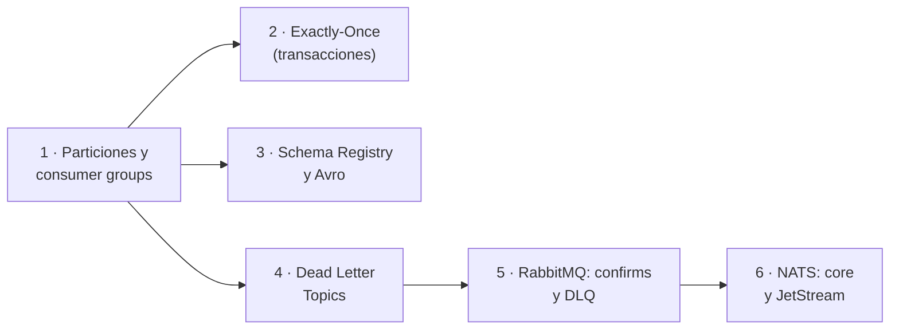
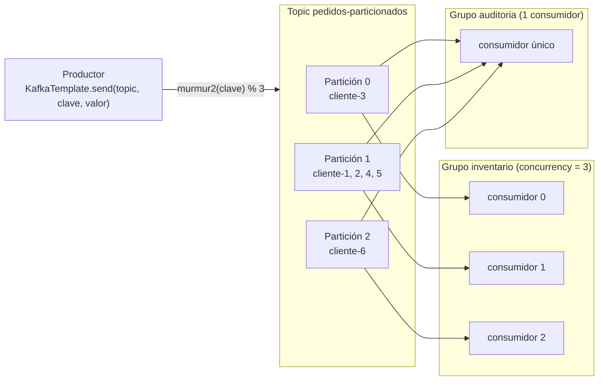
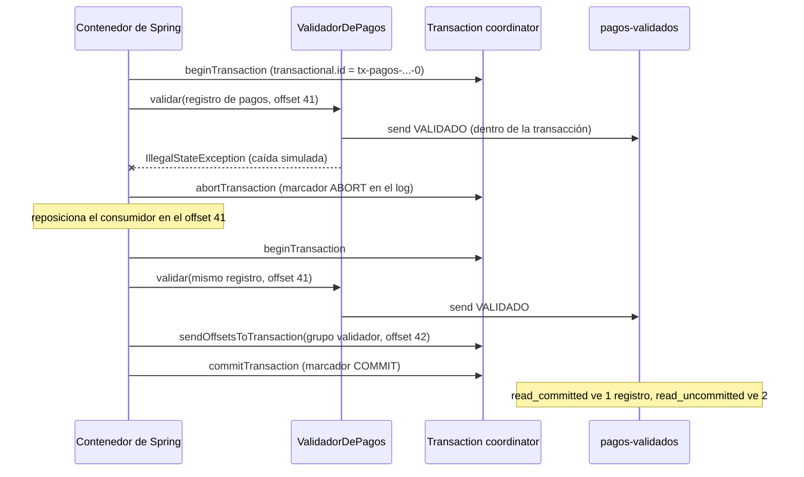
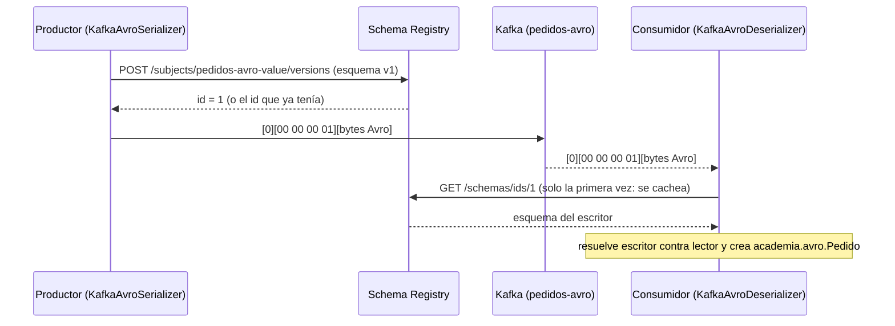
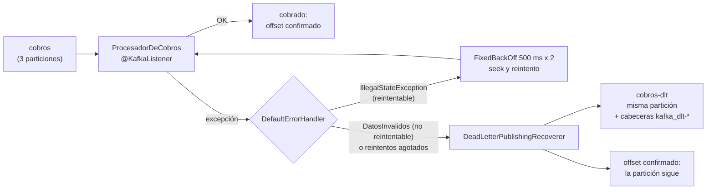
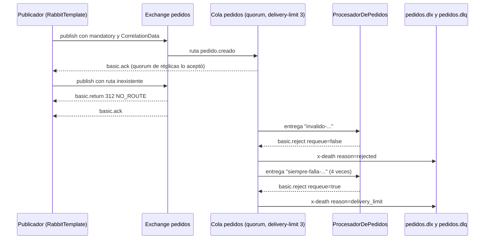
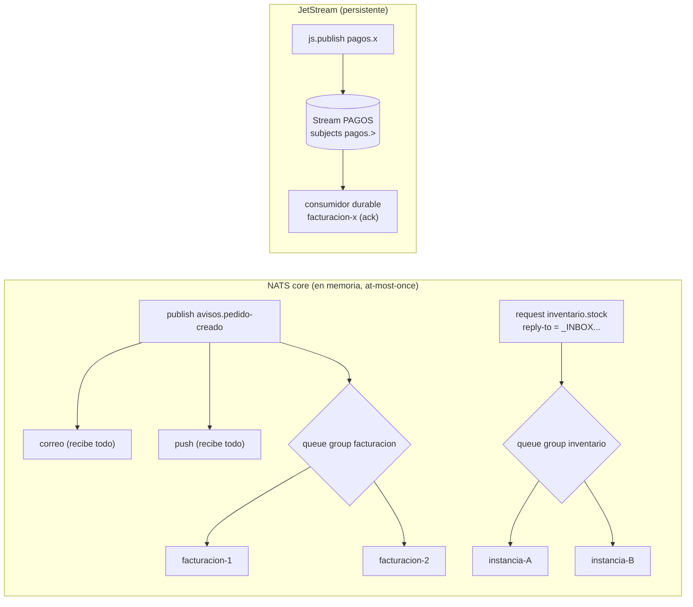

# Módulo 11 · Mensajería avanzada

**Fase 1 · Spring Boot de cero a experto** (semana 11 de 12). **Duración:** 18 h (6 temas de 2,5–3,5 h).
**Dificultad:** 4 de 5. **Dependencias:** Módulo 6 (la introducción a RabbitMQ y Kafka: exchange, cola, topic,
partición, clave y consumer group), Módulo 8 (reintentos y fallbacks) y, de la Fase 0, Docker básico y Docker
Compose. **Herramientas:** **JDK 25 LTS**, **Spring Boot 4.1.3** (que gestiona Spring for Apache Kafka 4.1.3,
`kafka-clients` 4.2.2 y Spring AMQP 4.1.3), Apache Kafka 4.4.0 en modo KRaft, Confluent Schema Registry 8.4.1, Avro
1.12.2, RabbitMQ 4.4.1, NATS 2.15.3 con JetStream y el cliente jnats 2.26.4. **Laboratorio:**
`examples/microservicios/modulo-15/` (una carpeta Maven por tema; `docker-compose.yml` levanta los cuatro brokers y
`./verificar.sh` ejecuta todo).

En el Módulo 6 enviaste tu primer evento por RabbitMQ y por Kafka. Funcionaba en la demo. En producción aparecen las
preguntas difíciles: ¿por qué este consumidor no recibe nada?, ¿por qué el pedido 7 se procesó antes que el 6?,
¿por qué se cobró dos veces?, ¿quién rompió el formato del evento?, ¿dónde quedó el mensaje que nadie pudo procesar?
Este módulo responde cada una con una herramienta concreta: particiones y grupos, transacciones de Kafka (EOS),
Schema Registry con Avro, Dead Letter Topics, confirmaciones y colas de mensajes muertos en RabbitMQ, y NATS cuando
lo que necesitas es velocidad y simplicidad.



**Texto alternativo:** diagrama de izquierda a derecha. El tema 1 (particiones y consumer groups) es la base: de él
salen flechas al tema 2 (Exactly-Once con transacciones), al tema 3 (Schema Registry y Avro) y al tema 4 (Dead Letter
Topics). Del tema 4 se pasa al tema 5 (RabbitMQ con publisher confirms y DLQ), y de ahí al tema 6 (NATS core y
JetStream).

**Cómo usar el laboratorio.** Entra en `examples/microservicios/modulo-15`, comprueba `java -version` (debe decir
`25`) y `docker compose version`, y arranca los brokers con `docker compose up -d --wait` (la primera vez descarga
unos 2 GB de imágenes). Cada tema tiene su carpeta (`f075-…` a `f080-…`); desde la carpeta del módulo ejecuta
`./mvnw -pl <carpeta> test`. Los tests se conectan a los brokers del `docker-compose.yml` (no a Testcontainers),
igual que harías con tu entorno local de desarrollo. Las salidas de Maven y de los contenedores de este módulo están
pendientes de confirmar en el Mac del dueño (`verificacion/microservicios/pendiente.md`): donde se escribió no hay
Maven Central ni Docker Hub. Sí se ejecutaron aquí, y su salida está pegada tal cual, el simulador de particiones con
JDK 25.0.5, la comprobación de murmur2 con la librería `kafka-python`, la codificación Avro con `fastavro`, la
topología de RabbitMQ en un RabbitMQ 3.12.1 local y los patrones de NATS en un nats-server 2.10.7 local.

| Herramienta | Versión | Quién la fija |
|---|---|---|
| Spring for Apache Kafka / `kafka-clients` | 4.1.3 / 4.2.2 | BOM de Spring Boot 4.1.3 |
| Spring AMQP / cliente Java de RabbitMQ | 4.1.3 / 5.37.1 | BOM de Spring Boot 4.1.3 |
| Apache Kafka (broker, KRaft) | 4.4.0 (imagen `apache/kafka:4.4.0`) | `docker-compose.yml` |
| Confluent Schema Registry | 8.4.1 (imagen `confluentinc/cp-schema-registry:8.4.1`) | `docker-compose.yml` |
| Avro / `kafka-avro-serializer` | 1.12.2 / 8.4.1 | `pom.xml` de F077 |
| RabbitMQ | 4.4.1 (imagen `rabbitmq:4.4.1-management`) | `docker-compose.yml` |
| NATS Server / jnats | 2.15.3 (imagen `nats:2.15.3-alpine`) / 2.26.4 | `docker-compose.yml` / `pom.xml` de F080 |

El `docker-compose.yml` del módulo, que usan todos los temas:

`docker-compose.yml`:

```yaml
# Módulo 11 (modulo-15) · Mensajería avanzada: Kafka 4.4.0 + Schema Registry 8.4.1 + RabbitMQ 4.4.1 + NATS 2.15.3
# Arranca todo:  docker compose up -d --wait        (espera a que los 4 healthchecks estén "healthy")
# Solo Kafka:    docker compose up -d --wait kafka
# Detén:         docker compose down                (sin volúmenes: topics, colas y streams se borran a propósito)
# Puertos del host: 9092 Kafka · 8081 Schema Registry · 5672/15672 RabbitMQ · 4222/8222 NATS
# Si otro módulo ocupa esos puertos (p. ej. modulo-10), haz antes «docker compose down» allí.
services:
  kafka:
    image: apache/kafka:4.4.0
    hostname: kafka
    ports:
      - "9092:9092"
    environment:
      # Un solo nodo KRaft (broker + controlador) con DOS listeners:
      #  PLAINTEXT_HOST -> localhost:9092 para tus apps y tests en el host
      #  PLAINTEXT      -> kafka:19092 para otros contenedores (Schema Registry)
      KAFKA_NODE_ID: 1
      KAFKA_PROCESS_ROLES: "broker,controller"
      KAFKA_LISTENERS: "CONTROLLER://:29093,PLAINTEXT_HOST://:9092,PLAINTEXT://:19092"
      KAFKA_ADVERTISED_LISTENERS: "PLAINTEXT_HOST://localhost:9092,PLAINTEXT://kafka:19092"
      KAFKA_LISTENER_SECURITY_PROTOCOL_MAP: "CONTROLLER:PLAINTEXT,PLAINTEXT:PLAINTEXT,PLAINTEXT_HOST:PLAINTEXT"
      KAFKA_CONTROLLER_QUORUM_VOTERS: "1@kafka:29093"
      KAFKA_CONTROLLER_LISTENER_NAMES: "CONTROLLER"
      KAFKA_INTER_BROKER_LISTENER_NAME: "PLAINTEXT"
      CLUSTER_ID: "4L6g3nShT-eMCtK--X86sw"
      # Con un solo broker, los topics internos (offsets de grupos y estado de transacciones) necesitan RF 1.
      KAFKA_OFFSETS_TOPIC_REPLICATION_FACTOR: 1
      KAFKA_TRANSACTION_STATE_LOG_REPLICATION_FACTOR: 1
      KAFKA_TRANSACTION_STATE_LOG_MIN_ISR: 1
      KAFKA_SHARE_COORDINATOR_STATE_TOPIC_REPLICATION_FACTOR: 1
      KAFKA_SHARE_COORDINATOR_STATE_TOPIC_MIN_ISR: 1
      # Sin espera inicial de 3 s antes del primer rebalanceo de un grupo (solo laboratorio).
      KAFKA_GROUP_INITIAL_REBALANCE_DELAY_MS: 0
      KAFKA_LOG_DIRS: "/tmp/kraft-combined-logs"
    healthcheck:
      test: ["CMD-SHELL", "/opt/kafka/bin/kafka-topics.sh --bootstrap-server localhost:9092 --list >/dev/null"]
      interval: 5s
      timeout: 15s
      retries: 30

  schema-registry:
    image: confluentinc/cp-schema-registry:8.4.1
    hostname: schema-registry
    depends_on:
      kafka:
        condition: service_healthy
    ports:
      - "8081:8081"
    environment:
      SCHEMA_REGISTRY_HOST_NAME: schema-registry
      SCHEMA_REGISTRY_LISTENERS: "http://0.0.0.0:8081"
      # Los esquemas se guardan en el topic interno _schemas de este Kafka
      SCHEMA_REGISTRY_KAFKASTORE_BOOTSTRAP_SERVERS: "PLAINTEXT://kafka:19092"
      # Un solo broker: el topic interno _schemas con 1 réplica (por defecto pide 3).
      SCHEMA_REGISTRY_KAFKASTORE_TOPIC_REPLICATION_FACTOR: 1
    healthcheck:
      # 127.0.0.1 (no «localhost», que puede resolver a ::1). Si la imagen no trae curl, prueba el puerto con bash.
      test: ["CMD-SHELL", "curl -fs http://127.0.0.1:8081/subjects >/dev/null 2>&1 || bash -c 'exec 3<>/dev/tcp/127.0.0.1/8081' 2>/dev/null"]
      interval: 5s
      timeout: 10s
      retries: 40
      start_period: 60s

  rabbitmq:
    image: rabbitmq:4.4.1-management
    environment:
      RABBITMQ_DEFAULT_USER: academia
      RABBITMQ_DEFAULT_PASS: academia
    ports:
      - "5672:5672"     # AMQP 0-9-1
      - "15672:15672"   # consola web: http://localhost:15672 (academia / academia)
    healthcheck:
      test: ["CMD", "rabbitmq-diagnostics", "-q", "ping"]
      interval: 5s
      timeout: 10s
      retries: 30

  nats:
    # La variante alpine trae shell y wget para el healthcheck (la imagen «scratch» no tiene ni shell).
    image: nats:2.15.3-alpine
    command: ["-js", "-m", "8222"]   # -js activa JetStream; -m expone el monitoreo HTTP
    ports:
      - "4222:4222"     # clientes
      - "8222:8222"     # monitoreo: http://localhost:8222/healthz, /jsz, /connz
    healthcheck:
      test: ["CMD-SHELL", "wget -q -O- http://localhost:8222/healthz | grep -q ok"]
      interval: 3s
      timeout: 5s
      retries: 30
```

---
### Kafka profundo: particionamiento, consumer groups

#### 1. UBICACIÓN

Módulo 11, Lección 1 de 6 · Fase 1 · 3,5 h · Laboratorio `examples/microservicios/modulo-15/f075-kafka-particiones/`
y el simulador `examples/microservicios/modulo-15/jdk/Particionador.java`.

#### 2. PRERREQUISITOS

- Módulo 6, tema «Mensajería asíncrona»: qué es un topic, una partición, un offset y un consumer group, y cómo se
  publica con `KafkaTemplate` y se consume con `@KafkaListener`.
- Módulo 1: records, `Map`, `Set` y colecciones concurrentes (`ConcurrentLinkedQueue`).
- Saber arrancar un servicio de Docker Compose y leer `docker compose ps`.

#### 3. OBJETIVO DE APRENDIZAJE

**Predecir** a qué partición irá cada mensaje con clave y qué consumidor de un grupo la leerá, y **diseñar** la clave
y el número de particiones de un topic para conservar el orden por entidad y paralelizar el consumo; lo compruebas
cuando el simulador calcula las mismas particiones que el broker y los 3 tests de `f075-kafka-particiones` pasan
(misma clave → misma partición, una partición → un solo consumidor del grupo, otro grupo → todos los mensajes).

#### 4. ANALOGÍA VISUAL

Dibuja una **oficina de correos con 3 ventanillas** (las particiones 0, 1 y 2). En la puerta, una **máquina que lee el
apellido** del sobre (la clave) y lo manda siempre a la misma ventanilla: todas las cartas de «García» van a la 1, en
el orden en que llegaron. Detrás de las ventanillas hay **dos equipos de carteros con chalecos de colores**: el equipo
azul («inventario») tiene 3 carteros y cada uno atiende **una** ventanilla; el equipo verde («auditoría») tiene un solo
cartero que recorre **las tres**. Cada equipo lleva su propia **libreta de «hasta qué carta llegué»** (los offsets).
Si llega un cuarto cartero azul, se queda **de brazos cruzados**: no hay una cuarta ventanilla. Un cartel dice:
«Más ventanillas = más carteros trabajando a la vez. Misma persona = misma ventanilla = mismo orden».

#### 5. DIAGRAMA TÉCNICO



**Texto alternativo:** a la izquierda, un productor envía cada registro con una clave; la flecha indica que la
partición se calcula como murmur2 de la clave módulo 3. En el centro, el topic «pedidos-particionados» con tres
particiones: la 0 recibe cliente-3, la 1 recibe cliente-1, 2, 4 y 5, y la 2 recibe cliente-6. A la derecha, dos
grupos: «inventario», con tres consumidores, cada uno conectado a una sola partición; y «auditoria», con un único
consumidor conectado a las tres particiones.

#### 6. EXPLICACIÓN NIVEL 0

Kafka guarda los mensajes en **listas que solo crecen** (como un cuaderno donde solo se escribe al final). Un
**topic** es un tema («pedidos») y, para que muchos puedan trabajar a la vez, se parte en varias listas llamadas
**particiones**. Cada mensaje tiene un número de posición dentro de su partición: el **offset**.

- Cuando envías un mensaje con **clave** (por ejemplo, el id del cliente), Kafka hace una cuenta con esa clave y
  elige la partición. La misma clave da siempre la misma cuenta: los mensajes de un cliente quedan **juntos y en
  orden**.
- Un **consumer group** es un equipo de programas que se reparten el trabajo. Kafka da cada partición a **un solo**
  miembro del equipo. Si el equipo tiene más miembros que particiones, sobran miembros.
- Dos equipos distintos **no compiten**: cada uno lee todos los mensajes y apunta por su cuenta hasta dónde llegó.

Esto contesta dos preguntas de negocio: «¿se procesan en orden los pedidos de un cliente?» (sí, si usas su id como
clave) y «¿cuántas copias de mi servicio pueden trabajar a la vez?» (tantas como particiones).

#### 7. EXPLICACIÓN INTERMEDIA

- **El particionador.** En `kafka-clients` 4.x, si el registro trae clave, la partición es
  `Utils.toPositive(Utils.murmur2(claveSerializada)) % numParticiones` (método `BuiltInPartitioner.partitionForKey`).
  Si la clave es `null`, el productor usa el reparto «pegajoso»: llena un lote en una partición y luego cambia a otra
  (KIP-794 lo hizo adaptativo: favorece a los brokers que responden más rápido). Las clases `DefaultPartitioner` y
  `UniformStickyPartitioner` se marcaron obsoletas en Kafka 3.3 y ya no se usan: el comportamiento vive en el propio
  productor. El simulador `jdk/Particionador.java` reproduce el cálculo con clave y lo valida contra los vectores de
  prueba de `UtilsTest` del código de Kafka.
- **El orden se garantiza solo dentro de una partición.** Entre particiones no hay orden global. Por eso la clave
  correcta es la **entidad cuyo orden importa** (el pedido, la cuenta, el cliente), no el tipo de evento.
- **Consumer groups y asignación.** Los consumidores con el mismo `group.id` se coordinan a través del *group
  coordinator* del broker. Con el protocolo clásico (`group.protocol=classic`, el valor por defecto del cliente 4.2.2),
  la lista por defecto de `partition.assignment.strategy` es `[RangeAssignor, CooperativeStickyAssignor]`: se usa el
  primero que todos los miembros soportan, `range`. Range ordena particiones y miembros y da a cada uno un bloque
  contiguo; si no divide exacto, los primeros reciben una más.
- **`concurrency` en Spring.** `@KafkaListener(concurrency = "3")` crea un `ConcurrentMessageListenerContainer` con 3
  `KafkaConsumer` (cada uno en su propio hilo) dentro del mismo grupo. Es lo mismo que tener 3 instancias del servicio
  con 1 consumidor cada una, pero en un solo proceso.
- **Offsets confirmados.** El contenedor de Spring confirma el offset (por defecto `AckMode.BATCH`: tras procesar lo
  que devolvió cada `poll`). Un grupo nuevo empieza según `auto.offset.reset` (`latest` por defecto; el laboratorio usa
  `earliest`). Un grupo existente continúa desde su último offset confirmado.
- **Rebalanceo.** Cuando entra o sale un miembro, o uno tarda más de `max.poll.interval.ms` (300 000 ms por defecto)
  entre dos `poll()`, el grupo reasigna particiones. Durante el rebalanceo clásico nadie del grupo consume.
- **Lag.** `LOG-END-OFFSET − CURRENT-OFFSET` por partición: cuántos mensajes le faltan al grupo. Es la métrica número
  uno para saber si necesitas más consumidores (o más particiones).

#### 8. EXPLICACIÓN MAESTRA

- **¿Cuántas particiones?** El paralelismo máximo de un grupo es el número de particiones; el rendimiento de una
  partición lo limita su consumidor más lento. Una regla práctica es `max(throughput_objetivo / throughput_por_consumidor,
  instancias_previstas)` con margen para 2–3 años. Pasarse también cuesta: cada partición son archivos, réplicas y
  metadatos en el clúster, y más particiones alargan los rebalanceos.
- **Añadir particiones rompe el orden por clave.** `kafka-topics.sh --alter --partitions 4` no mueve los datos viejos
  y cambia el módulo: el simulador muestra que 4 de 6 claves cambian de partición. Durante la transición, los eventos
  nuevos de un cliente pueden procesarse antes que los viejos. Alternativas: sobredimensionar desde el principio, o
  crear un topic nuevo y migrar con un corte controlado.
- **Particiones calientes.** Con las claves del laboratorio, 4 de los 6 clientes caen en la partición 1: un consumidor
  hace casi todo el trabajo. Si una clave concentra el tráfico (un cliente gigante), considera una clave compuesta
  (`cliente#subcuenta`) aceptando perder el orden global de ese cliente, o un topic dedicado.
- **Protocolo nuevo de grupos (KIP-848).** En Kafka 4.0 quedó disponible de forma general y activo en el broker; el
  cliente lo pide con `group.protocol=consumer`. Elimina los rebalanceos «stop-the-world»: el broker calcula la
  asignación y la aplica partición a partición. Con Spring: `spring.kafka.consumer.properties.group.protocol=consumer`.
  Alternativa en el protocolo clásico: `CooperativeStickyAssignor` (rebalanceo incremental) y `group.instance.id`
  (membresía estática: un reinicio rápido no dispara rebalanceo).
- **Alternativas a «un consumidor por partición».** (1) Más particiones: simple, pero ver el punto anterior.
  (2) Procesamiento en paralelo dentro de la partición por clave (por ejemplo, Confluent Parallel Consumer): más
  rendimiento sin más particiones, a cambio de una librería más y de gestionar offsets con cuidado. (3) *Share groups*
  (KIP-932, «colas para Kafka», presentados en Kafka 4.0 como *early access*): varios consumidores sobre la misma
  partición con confirmación por mensaje, como una cola; renuncias al orden.
- **Cuándo NO usar Kafka.** Si necesitas una cola de trabajo con prioridades, reintentos por mensaje y enrutamiento
  flexible, y no necesitas releer historia, RabbitMQ es más simple (tema 5). Si son pocos mensajes por segundo entre
  dos servicios del mismo equipo, una llamada HTTP con reintentos (Módulo 8) puede bastar.

#### 9. CÓDIGO EJECUTABLE

Versiones: **JDK 25**, **Spring Boot 4.1.3** con **Spring for Apache Kafka 4.1.3** y **kafka-clients 4.2.2**
(gestionados por el BOM), broker **Kafka 4.4.0**. Proyecto completo en
`examples/microservicios/modulo-15/f075-kafka-particiones/`.

`f075-kafka-particiones/pom.xml`:

```xml
<?xml version="1.0" encoding="UTF-8"?>
<!-- F075 · Kafka profundo: particionamiento y consumer groups (Spring Boot 4.1.3, JDK 25, Kafka 4.4.0) -->
<project xmlns="http://maven.apache.org/POM/4.0.0" xmlns:xsi="http://www.w3.org/2001/XMLSchema-instance"
         xsi:schemaLocation="http://maven.apache.org/POM/4.0.0 https://maven.apache.org/xsd/maven-4.0.0.xsd">
  <modelVersion>4.0.0</modelVersion>
  <parent>
    <groupId>org.springframework.boot</groupId>
    <artifactId>spring-boot-starter-parent</artifactId>
    <version>4.1.3</version>
    <relativePath/>
  </parent>
  <groupId>academia.microservicios</groupId>
  <artifactId>f075-kafka-particiones</artifactId>
  <version>1.0.0</version>
  <properties>
    <java.version>25</java.version>
  </properties>
  <dependencies>
    <!-- Spring for Apache Kafka 4.1.3 + kafka-clients 4.2.2 (versiones del BOM de Boot 4.1.3) -->
    <dependency>
      <groupId>org.springframework.boot</groupId>
      <artifactId>spring-boot-starter-kafka</artifactId>
    </dependency>
    <!-- JUnit Jupiter 6.0.3 + AssertJ 3.27.7 -->
    <dependency>
      <groupId>org.springframework.boot</groupId>
      <artifactId>spring-boot-starter-test</artifactId>
      <scope>test</scope>
    </dependency>
  </dependencies>
  <build>
    <plugins>
      <plugin>
        <groupId>org.springframework.boot</groupId>
        <artifactId>spring-boot-maven-plugin</artifactId>
      </plugin>
    </plugins>
  </build>
</project>
```

`f075-kafka-particiones/src/main/resources/application.properties`:

```properties
spring.application.name=f075-kafka-particiones
# Kafka 4.4.0 del docker-compose.yml del módulo (listener para el host en localhost:9092)
spring.kafka.bootstrap-servers=${KAFKA_BOOTSTRAP:localhost:9092}
# Un grupo nuevo empieza por el principio del topic; uno que ya existe sigue desde su offset confirmado.
spring.kafka.consumer.auto-offset-reset=earliest
# acks=all ya es el valor por defecto desde Kafka 3.0: el líder espera a las réplicas en sincronía.
spring.kafka.producer.acks=all
```

`f075-kafka-particiones/src/main/java/academia/particiones/ParticionesApp.java`:

```java
package academia.particiones;

import org.springframework.boot.SpringApplication;
import org.springframework.boot.autoconfigure.SpringBootApplication;

/** F075 · Un topic de 3 particiones, un productor con clave y dos consumer groups. */
@SpringBootApplication
public class ParticionesApp {

    public static void main(String[] args) {
        SpringApplication.run(ParticionesApp.class, args);
    }
}
```

`f075-kafka-particiones/src/main/java/academia/particiones/Topicos.java`:

```java
package academia.particiones;

import org.apache.kafka.clients.admin.NewTopic;
import org.springframework.context.annotation.Bean;
import org.springframework.context.annotation.Configuration;
import org.springframework.kafka.config.TopicBuilder;

/** KafkaAdmin (auto-configurado por Boot) crea el topic al arrancar si no existe. */
@Configuration
class Topicos {

    static final String PEDIDOS = "pedidos-particionados";

    @Bean
    NewTopic pedidosParticionados() {
        // 3 particiones = como máximo 3 consumidores trabajando en paralelo dentro de un grupo.
        // 1 réplica porque el laboratorio tiene un solo broker; en producción, 3 réplicas y min.insync.replicas=2.
        return TopicBuilder.name(PEDIDOS).partitions(3).replicas(1).build();
    }
}
```

`f075-kafka-particiones/src/main/java/academia/particiones/Recepcion.java`:

```java
package academia.particiones;

/** Qué hilo (consumidor) del grupo recibió qué registro, y de qué partición. */
public record Recepcion(String grupo, String hilo, int particion, String clave, String valor) {
}
```

`f075-kafka-particiones/src/main/java/academia/particiones/PublicadorPedidos.java`:

```java
package academia.particiones;

import java.util.concurrent.TimeUnit;

import org.springframework.kafka.core.KafkaTemplate;
import org.springframework.stereotype.Component;

@Component
public class PublicadorPedidos {

    private final KafkaTemplate<String, String> kafka;

    PublicadorPedidos(KafkaTemplate<String, String> kafka) {
        this.kafka = kafka;
    }

    /**
     * La CLAVE decide la partición: murmur2(clave) % particiones. Mismo cliente = misma partición = orden garantizado.
     * get(...) espera el acuse del broker y devuelve en qué partición y offset quedó el registro.
     */
    public int publicar(String clienteId, String pedido) throws Exception {
        var resultado = kafka.send(Topicos.PEDIDOS, clienteId, pedido).get(10, TimeUnit.SECONDS);
        return resultado.getRecordMetadata().partition();
    }
}
```

`f075-kafka-particiones/src/main/java/academia/particiones/Consumidores.java`:

```java
package academia.particiones;

import java.util.Queue;
import java.util.concurrent.ConcurrentLinkedQueue;

import org.apache.kafka.clients.consumer.ConsumerRecord;
import org.slf4j.Logger;
import org.slf4j.LoggerFactory;
import org.springframework.kafka.annotation.KafkaListener;
import org.springframework.stereotype.Component;

/**
 * Dos consumer groups sobre el MISMO topic:
 *  - «inventario» con concurrency=3: tres KafkaConsumer en el mismo grupo se REPARTEN las 3 particiones.
 *  - «auditoria» con un solo consumidor: recibe TODOS los registros (cada grupo tiene sus propios offsets).
 */
@Component
public class Consumidores {

    private static final Logger log = LoggerFactory.getLogger(Consumidores.class);

    final Queue<Recepcion> inventario = new ConcurrentLinkedQueue<>();
    final Queue<Recepcion> auditoria = new ConcurrentLinkedQueue<>();

    @KafkaListener(id = "inventario", groupId = "inventario", topics = Topicos.PEDIDOS, concurrency = "3")
    void inventario(ConsumerRecord<String, String> r) {
        inventario.add(recepcion("inventario", r));
        log.info("inventario hilo={} particion={} offset={} clave={}",
                Thread.currentThread().getName(), r.partition(), r.offset(), r.key());
    }

    @KafkaListener(id = "auditoria", groupId = "auditoria", topics = Topicos.PEDIDOS)
    void auditoria(ConsumerRecord<String, String> r) {
        auditoria.add(recepcion("auditoria", r));
    }

    private static Recepcion recepcion(String grupo, ConsumerRecord<String, String> r) {
        return new Recepcion(grupo, Thread.currentThread().getName(), r.partition(), r.key(), r.value());
    }
}
```

Test (usa el Kafka del `docker-compose.yml`):

`f075-kafka-particiones/src/test/java/academia/particiones/ParticionesTest.java`:

```java
package academia.particiones;

import static org.assertj.core.api.Assertions.assertThat;

import java.nio.charset.StandardCharsets;
import java.util.HashMap;
import java.util.HashSet;
import java.util.List;
import java.util.Map;
import java.util.Set;
import java.util.UUID;
import java.util.function.Supplier;

import org.apache.kafka.clients.admin.Admin;
import org.apache.kafka.clients.admin.AdminClientConfig;
import org.apache.kafka.clients.admin.ConsumerGroupDescription;
import org.apache.kafka.clients.admin.MemberDescription;
import org.apache.kafka.common.utils.Utils;
import org.junit.jupiter.api.Test;
import org.springframework.beans.factory.annotation.Autowired;
import org.springframework.beans.factory.annotation.Value;
import org.springframework.boot.test.context.SpringBootTest;

/**
 * Requiere el Kafka 4.4.0 del docker-compose.yml del módulo: docker compose up -d --wait kafka
 * Cada ejecución usa un identificador nuevo en el VALOR; las CLAVES (cliente-1..6) son siempre las mismas.
 */
@SpringBootTest
class ParticionesTest {

    static final int MENSAJES_POR_CLIENTE = 5;

    @Autowired PublicadorPedidos publicador;
    @Autowired Consumidores consumidores;
    @Value("${spring.kafka.bootstrap-servers}") String bootstrap;

    final String corrida = UUID.randomUUID().toString().substring(0, 8);

    /** Publica 6 clientes x 5 pedidos y devuelve, por cliente, las particiones donde quedaron. */
    Map<String, Set<Integer>> publicarTodo() throws Exception {
        Map<String, Set<Integer>> particiones = new HashMap<>();
        for (int n = 1; n <= MENSAJES_POR_CLIENTE; n++) {
            for (int c = 1; c <= 6; c++) {
                String cliente = "cliente-" + c;
                int p = publicador.publicar(cliente, corrida + ":pedido-" + n);
                particiones.computeIfAbsent(cliente, k -> new HashSet<>()).add(p);
            }
        }
        return particiones;
    }

    List<Recepcion> deEstaCorrida(Iterable<Recepcion> cola) {
        var lista = new java.util.ArrayList<Recepcion>();
        cola.forEach(r -> { if (r.valor().startsWith(corrida)) lista.add(r); });
        return lista;
    }

    static void esperar(Supplier<Boolean> condicion, int segundos) throws InterruptedException {
        long limite = System.currentTimeMillis() + segundos * 1000L;
        while (!condicion.get() && System.currentTimeMillis() < limite) {
            Thread.sleep(200);
        }
    }

    @Test
    void laMismaClaveSiempreVaALaMismaParticionYEsLaQueCalculaMurmur2() throws Exception {
        Map<String, Set<Integer>> particiones = publicarTodo();
        particiones.forEach((cliente, ps) -> {
            assertThat(ps).as("particiones de %s", cliente).hasSize(1);
            int esperada = Utils.toPositive(Utils.murmur2(cliente.getBytes(StandardCharsets.UTF_8))) % 3;
            assertThat(ps).containsExactly(esperada);
        });
        System.out.println("Partición por cliente: " + new java.util.TreeMap<>(particiones));
    }

    @Test
    void cadaParticionLaLeeUnSoloConsumidorDelGrupoYOtroGrupoLoRecibeTodo() throws Exception {
        publicarTodo();
        esperar(() -> deEstaCorrida(consumidores.inventario).size() == 30
                && deEstaCorrida(consumidores.auditoria).size() == 30, 60);

        List<Recepcion> inventario = deEstaCorrida(consumidores.inventario);
        assertThat(inventario).hasSize(30);
        Map<Integer, Set<String>> hilosPorParticion = new HashMap<>();
        inventario.forEach(r -> hilosPorParticion.computeIfAbsent(r.particion(), k -> new HashSet<>()).add(r.hilo()));
        // Dentro de un grupo, una partición la consume UN solo consumidor: por eso se conserva el orden por clave.
        hilosPorParticion.values().forEach(hilos -> assertThat(hilos).hasSize(1));
        assertThat(hilosPorParticion).hasSize(3);
        // El otro grupo recibe los 30 registros: los grupos no compiten entre sí.
        assertThat(deEstaCorrida(consumidores.auditoria)).hasSize(30);
        System.out.println("Hilos de «inventario» por partición: " + new java.util.TreeMap<>(hilosPorParticion));
    }

    @Test
    void elGrupoInventarioTieneTresMiembrosConUnaParticionCadaUno() throws Exception {
        try (Admin admin = Admin.create(Map.of(AdminClientConfig.BOOTSTRAP_SERVERS_CONFIG, bootstrap))) {
            ConsumerGroupDescription[] grupo = new ConsumerGroupDescription[1];
            esperar(() -> {
                try {
                    grupo[0] = admin.describeConsumerGroups(List.of("inventario"))
                            .describedGroups().get("inventario").get();
                    return grupo[0].members().size() == 3
                            && grupo[0].members().stream().allMatch(m -> m.assignment().topicPartitions().size() == 1);
                } catch (Exception e) {
                    return false;
                }
            }, 60);
            assertThat(grupo[0].members()).hasSize(3);
            for (MemberDescription m : grupo[0].members()) {
                assertThat(m.assignment().topicPartitions()).hasSize(1);
                System.out.println(m.clientId() + " -> " + m.assignment().topicPartitions());
            }
        }
    }
}
```

Simulador sin Kafka (solo JDK 25). Reproduce el particionador y RangeAssignor para que puedas **predecir** antes de
ejecutar:

`jdk/Particionador.java`:

```java
import java.nio.charset.StandardCharsets;
import java.util.ArrayList;
import java.util.List;
import java.util.Map;
import java.util.TreeMap;

/**
 * F075 · Simulador SIN Kafka (solo JDK 25): reproduce las dos decisiones que toma Kafka por ti.
 *
 * 1) A qué partición va un mensaje con clave: Utils.toPositive(Utils.murmur2(clave)) % particiones
 *    (BuiltInPartitioner.partitionForKey de kafka-clients 4.2.2; murmur2 copiado de
 *    clients/src/main/java/org/apache/kafka/common/utils/Utils.java, Apache License 2.0).
 * 2) Qué particiones recibe cada consumidor de un grupo con RangeAssignor (el primero de la lista
 *    por defecto de partition.assignment.strategy en el protocolo «classic»).
 *
 * Ejecuta:  java Particionador.java        (termina con código 1 si alguna comprobación falla)
 */
public class Particionador {

    /** murmur2 de Kafka: semilla 0x9747b28c, bloques de 4 bytes en little-endian. */
    static int murmur2(byte[] data) {
        int length = data.length;
        int seed = 0x9747b28c;
        final int m = 0x5bd1e995;
        final int r = 24;
        int h = seed ^ length;
        int length4 = length >> 2;
        for (int i = 0; i < length4; i++) {
            int i4 = i << 2;
            int k = (data[i4] & 0xff) + ((data[i4 + 1] & 0xff) << 8)
                    + ((data[i4 + 2] & 0xff) << 16) + ((data[i4 + 3] & 0xff) << 24);
            k *= m;
            k ^= k >>> r;
            k *= m;
            h *= m;
            h ^= k;
        }
        int index = length4 << 2;
        switch (length - index) {
            case 3:
                h ^= (data[index + 2] & 0xff) << 16;
            case 2:
                h ^= (data[index + 1] & 0xff) << 8;
            case 1:
                h ^= data[index] & 0xff;
                h *= m;
        }
        h ^= h >>> 13;
        h *= m;
        h ^= h >>> 15;
        return h;
    }

    static int particion(String clave, int particiones) {
        int hash = murmur2(clave.getBytes(StandardCharsets.UTF_8));
        return (hash & 0x7fffffff) % particiones;                 // Utils.toPositive(...) % n
    }

    /** RangeAssignor para UN topic: particiones en orden, consumidores en orden; los primeros reciben una extra. */
    static Map<String, List<Integer>> range(int particiones, List<String> consumidores) {
        Map<String, List<Integer>> asignacion = new TreeMap<>();
        List<String> ordenados = new ArrayList<>(consumidores);
        ordenados.sort(null);
        int porConsumidor = particiones / ordenados.size();
        int conExtra = particiones % ordenados.size();
        int siguiente = 0;
        for (int i = 0; i < ordenados.size(); i++) {
            int cuantas = porConsumidor + (i < conExtra ? 1 : 0);
            List<Integer> suyas = new ArrayList<>();
            for (int j = 0; j < cuantas; j++) {
                suyas.add(siguiente++);
            }
            asignacion.put(ordenados.get(i), suyas);
        }
        return asignacion;
    }

    public static void main(String[] args) {
        int fallos = 0;
        // Vectores de prueba de UtilsTest.testMurmur2 en apache/kafka 4.2.2: si coinciden, el hash es el de Kafka.
        Object[][] vectores = {{"21", -973932308}, {"foobar", -790332482}, {"abc", 479470107},
                {"a-little-bit-long-string", -985981536}};
        for (Object[] v : vectores) {
            int obtenido = murmur2(((String) v[0]).getBytes(StandardCharsets.UTF_8));
            boolean ok = obtenido == (int) v[1];
            fallos += ok ? 0 : 1;
            System.out.printf("murmur2(\"%s\") = %d %s%n", v[0], obtenido, ok ? "✔" : "✘ esperado " + v[1]);
        }

        System.out.println();
        System.out.println("Topic con 3 particiones · partición = toPositive(murmur2(clave)) % 3");
        Map<Integer, List<String>> porParticion = new TreeMap<>();
        for (int i = 1; i <= 6; i++) {
            String clave = "cliente-" + i;
            int p = particion(clave, 3);
            porParticion.computeIfAbsent(p, x -> new ArrayList<>()).add(clave);
            System.out.printf("  %-10s -> partición %d%n", clave, p);
        }
        if (porParticion.size() != 3) {
            System.out.println("✘ las 6 claves no cubren las 3 particiones");
            fallos++;
        }

        System.out.println();
        System.out.println("Si el topic pasa de 3 a 4 particiones, la misma clave puede cambiar de partición:");
        int cambian = 0;
        for (int i = 1; i <= 6; i++) {
            String clave = "cliente-" + i;
            int antes = particion(clave, 3);
            int despues = particion(clave, 4);
            cambian += antes != despues ? 1 : 0;
            System.out.printf("  %-10s 3 particiones -> %d · 4 particiones -> %d%s%n", clave, antes, despues,
                    antes != despues ? "   <- cambia" : "");
        }
        System.out.printf("  %d de 6 claves cambian de partición%n", cambian);

        System.out.println();
        System.out.println("RangeAssignor · topic de 3 particiones, grupo «inventario»:");
        for (int n = 1; n <= 4; n++) {
            List<String> consumidores = new ArrayList<>();
            for (int c = 0; c < n; c++) {
                consumidores.add("consumidor-" + c);
            }
            Map<String, List<Integer>> a = range(3, consumidores);
            System.out.printf("  %d consumidor(es): %s%n", n, a);
            int asignadas = a.values().stream().mapToInt(List::size).sum();
            if (asignadas != 3) {
                fallos++;
            }
        }
        System.out.println(fallos == 0 ? "\nSIMULADOR OK" : "\nSIMULADOR CON " + fallos + " FALLOS");
        System.exit(fallos == 0 ? 0 : 1);
    }
}
```

#### 10. MINI-LABORATORIO

1. Predice sin Kafka. Desde `examples/microservicios/modulo-15`:

```bash
java jdk/Particionador.java
```

   **Output esperado** (ejecutado con OpenJDK 25.0.5; si ves `?` en lugar de tildes, añade `-Dstdout.encoding=UTF-8`):

```text
murmur2("21") = -973932308 ✔
murmur2("foobar") = -790332482 ✔
murmur2("abc") = 479470107 ✔
murmur2("a-little-bit-long-string") = -985981536 ✔

Topic con 3 particiones · partición = toPositive(murmur2(clave)) % 3
  cliente-1  -> partición 1
  cliente-2  -> partición 1
  cliente-3  -> partición 0
  cliente-4  -> partición 1
  cliente-5  -> partición 1
  cliente-6  -> partición 2

Si el topic pasa de 3 a 4 particiones, la misma clave puede cambiar de partición:
  cliente-1  3 particiones -> 1 · 4 particiones -> 3   <- cambia
  cliente-2  3 particiones -> 1 · 4 particiones -> 2   <- cambia
  cliente-3  3 particiones -> 0 · 4 particiones -> 0
  cliente-4  3 particiones -> 1 · 4 particiones -> 0   <- cambia
  cliente-5  3 particiones -> 1 · 4 particiones -> 0   <- cambia
  cliente-6  3 particiones -> 2 · 4 particiones -> 2
  4 de 6 claves cambian de partición

RangeAssignor · topic de 3 particiones, grupo «inventario»:
  1 consumidor(es): {consumidor-0=[0, 1, 2]}
  2 consumidor(es): {consumidor-0=[0, 1], consumidor-1=[2]}
  3 consumidor(es): {consumidor-0=[0], consumidor-1=[1], consumidor-2=[2]}
  4 consumidor(es): {consumidor-0=[0], consumidor-1=[1], consumidor-2=[2], consumidor-3=[]}

SIMULADOR OK
```

   **Captura comentada:** los cuatro ✔ prueban que el hash es el de Kafka (son los vectores de su propio test). Las
   particiones de `cliente-1` … `cliente-6` coinciden con las que calcula la librería `kafka-python` 3.0.13 (comprobado
   al escribir esta ficha). Fíjate en el desequilibrio: la partición 1 se lleva 4 de 6 clientes. Con 4 consumidores,
   `consumidor-3` queda con `[]`: ocioso.

2. Arranca Kafka y ejecuta los tests:

```bash
docker compose up -d --wait kafka
./mvnw -pl f075-kafka-particiones test
```

   **Output esperado** (extracto; los nombres de los hilos y el orden de las líneas pueden variar):

```text
Partición por cliente: {cliente-1=[1], cliente-2=[1], cliente-3=[0], cliente-4=[1], cliente-5=[1], cliente-6=[2]}
Hilos de «inventario» por partición: {0=[inventario-0-C-1], 1=[inventario-1-C-1], 2=[inventario-2-C-1]}
consumer-inventario-1 -> [pedidos-particionados-0]
consumer-inventario-2 -> [pedidos-particionados-1]
consumer-inventario-3 -> [pedidos-particionados-2]
[INFO] Tests run: 3, Failures: 0, Errors: 0, Skipped: 0
[INFO] BUILD SUCCESS
```

   **Captura comentada:** la primera línea debe ser **idéntica** a la predicción del paso 1: el broker usa el mismo
   cálculo. Cada partición tiene un único hilo del grupo «inventario». Los `clientId` exactos los genera el cliente
   (`consumer-<grupo>-<n>`) y pueden no coincidir con el número de partición.

3. Mira el grupo desde fuera:

```bash
docker compose exec kafka /opt/kafka/bin/kafka-consumer-groups.sh \
  --bootstrap-server localhost:9092 --describe --group inventario
```

   **Output esperado** (con los tests ya terminados el grupo no tiene miembros activos, pero conserva sus offsets):

```text
Consumer group 'inventario' has no active members.

GROUP       TOPIC                  PARTITION  CURRENT-OFFSET  LOG-END-OFFSET  LAG  CONSUMER-ID  HOST  CLIENT-ID
inventario  pedidos-particionados  0          10              10              0    -            -     -
inventario  pedidos-particionados  1          40              40              0    -            -     -
inventario  pedidos-particionados  2          10              10              0    -            -     -
```

   **Captura comentada:** son los números de **una** ejecución de los tests: dos de los tres tests publican 30
   mensajes (6 clientes x 5), y la partición 1, con 4 clientes, recibe 4 x 5 x 2 = 40. `LAG 0` significa «el grupo
   está al día». Si ejecutas los tests otra vez, los números crecen; la proporción 1 : 4 : 1 no cambia.

4. **Rómpelo a propósito: un consumidor de más.** Cambia `concurrency = "3"` por `"4"` en `Consumidores.java`,
   arranca la app (`./mvnw -pl f075-kafka-particiones spring-boot:run`) y en otra terminal:

```bash
docker compose exec kafka /opt/kafka/bin/kafka-consumer-groups.sh \
  --bootstrap-server localhost:9092 --describe --group inventario --members
```

   **Output esperado:** cuatro filas de miembros; tres con `#PARTITIONS 1` y una con `#PARTITIONS 0`. Ese miembro
   consume memoria y conexiones sin hacer nada. Restaura `"3"`.

#### 11. VERIFICACIÓN

Test que debe pasar:

```bash
./mvnw -pl f075-kafka-particiones test
```

Resultado esperado: `Tests run: 3, Failures: 0, Errors: 0`.

Reto: sin ejecutar nada, usa el simulador para responder: si el topic tuviera **2** particiones, ¿en qué partición
quedaría `cliente-6`? Luego añade a `ParticionesTest` este test, que usa el mismo cálculo que el broker, y ejecútalo:

```java
@Test
void conDosParticionesCliente6IriaALaParticionQuePredije() {
    int prediccion = 0; // <- escribe aquí tu respuesta del simulador
    int real = Utils.toPositive(Utils.murmur2("cliente-6".getBytes(StandardCharsets.UTF_8))) % 2;
    assertThat(real).isEqualTo(prediccion);
}
```

**Pregunta de comprobación:** tienes 3 particiones y el lag del grupo crece. Subes las réplicas del servicio de 3 a 6.
¿Baja el lag?

<details>
<summary>Respuesta</summary>

No. Un grupo nunca puede tener más consumidores **activos** que particiones: los 3 nuevos quedan ociosos. Para
consumir más rápido necesitas más particiones (con el coste de romper el orden de las claves existentes durante la
transición), procesar más rápido cada mensaje, o paralelizar dentro de la partición por clave.
</details>

#### 12. ERROR COMÚN

**Síntoma:** el servicio procesa lento (por ejemplo, llama a un API externo por cada mensaje), el lag crece y en los
logs aparece cada pocos minutos un rebalanceo; algunos mensajes se procesan **dos veces**.

**Cómo se ve** (avisos del cliente de Kafka, texto de `AbstractCoordinator` y `CommitFailedException` en
`kafka-clients` 4.2.2):

```text
WARN ... consumer poll timeout has expired. This means the time between subsequent calls to poll() was longer
than the configured max.poll.interval.ms, which typically implies that the poll loop is spending too much time
processing messages. You can address this either by increasing max.poll.interval.ms or by reducing the maximum
size of batches returned in poll() with max.poll.records.
...
org.apache.kafka.clients.consumer.CommitFailedException: Commit cannot be completed since the group has already
rebalanced and assigned the partitions to another member. ...
```

**Diagnóstico visual:** dibuja una línea de tiempo con los `poll()` del consumidor. Si la distancia entre dos `poll`
supera `max.poll.interval.ms` (300 s por defecto), el consumidor «abandona» el grupo: otro miembro recibe la partición
y empieza desde el **último offset confirmado**, así que los mensajes del lote a medio procesar se procesan otra vez.
Mide cuánto tarda un mensaje (el log del listener) y multiplícalo por `max.poll.records` (500 por defecto).

**Arreglo:** baja `spring.kafka.consumer.max-poll-records` (por ejemplo a 50) para que cada lote quepa holgado en el
intervalo, o sube `spring.kafka.consumer.properties.max.poll.interval.ms` si el trabajo es lento por naturaleza. Y,
como los duplicados pueden ocurrir igualmente, haz el consumidor **idempotente** (Módulo 25).

#### 13. PREGUNTA DE ENTREVISTA

«¿Cómo garantizas que los eventos de un mismo pedido se procesen en orden con Kafka, y qué lo puede romper?»

**Respuesta modelo:** uso el id del pedido como clave: el productor calcula `murmur2(clave) % particiones`, así que
todos sus eventos caen en la misma partición, y dentro de un grupo cada partición la consume un único consumidor en
orden de offset. Lo puede romper: (1) cambiar el número de particiones, porque cambia el módulo; (2) productores con
reintentos sin idempotencia y `max.in.flight.requests.per.connection > 1` (desde Kafka 3.0 la idempotencia está activa
por defecto, lo que preserva el orden con hasta 5 peticiones en vuelo); (3) procesar en paralelo dentro del consumidor
sin respetar la clave; y (4) mandar a un DLT o a un topic de reintento un evento intermedio: los siguientes del mismo
pedido se procesan antes que él.

#### 14. ANTI-PATRÓN RELACIONADO

**Clave aleatoria o nula «para repartir mejor».** Se ve así:

```java
// MAL: reparte la carga... y destruye el orden de los eventos del mismo pedido
kafka.send("pedidos", UUID.randomUUID().toString(), evento);
kafka.send("pedidos", null, evento);
```

`PedidoPagado` puede llegar a otra partición y procesarse antes que `PedidoCreado`, y el consumidor tendrá que
inventar lógica para reordenar. Usa como clave la entidad cuyo orden importa; si una clave concentra demasiado tráfico,
resuélvelo de forma explícita (clave compuesta o topic dedicado), no con aleatoriedad.

---
### Exactly-Once Semantics (EOS)

#### 1. UBICACIÓN

Módulo 11, Lección 2 de 6 · Fase 1 · 3 h · Laboratorio `examples/microservicios/modulo-15/f076-exactly-once/`.

#### 2. PRERREQUISITOS

- Tema anterior: particiones, offsets confirmados y rebalanceo.
- Módulo 2: qué es una transacción (todo o nada) en una base de datos.
- Módulo 8: reintentos; saber que reintentar puede duplicar efectos.

#### 3. OBJETIVO DE APRENDIZAJE

**Implementar** un flujo consumir-procesar-producir con transacciones de Kafka en Spring Boot y **demostrar** con un
test que una caída después de escribir la salida no produce un duplicado visible para un consumidor `read_committed`;
lo compruebas cuando `ExactlyOnceTest` pasa: el lector `read_committed` ve **1** registro y el `read_uncommitted` ve
**2** (el abortado y el confirmado).

#### 4. ANALOGÍA VISUAL

Dibuja una **ventanilla de banco con una bandeja de cristal**. La cajera recibe tu cheque (consume), escribe el
depósito en una **hoja de calco** (produce) y marca en tu libreta «cheque 15 cobrado» (offset). Las tres cosas van en
la **misma bandeja** y solo cuando pulsa el **sello verde «CONFIRMADO»** salen juntas hacia el archivo. Si se va la
luz antes del sello, la bandeja entera se marca con un **sello rojo «ANULADO»**: la hoja queda en el archivo, tachada,
y tu cheque vuelve a la fila. Los **auditores con gafas verdes** (`read_committed`) solo leen hojas con sello verde;
los **curiosos sin gafas** (`read_uncommitted`) ven también las tachadas.

#### 5. DIAGRAMA TÉCNICO



**Texto alternativo:** diagrama de secuencia con cuatro participantes: el contenedor de Spring, el listener
ValidadorDePagos, el coordinador de transacciones de Kafka y el topic pagos-validados. El contenedor abre una
transacción y llama al listener con el registro de offset 41; el listener envía VALIDADO y lanza una excepción; el
contenedor aborta la transacción y reposiciona el consumidor en el offset 41. Abre otra transacción, el listener
vuelve a enviar VALIDADO, el contenedor añade el offset 42 del grupo a la transacción y la confirma. Nota final: un
lector read_committed ve un registro y uno read_uncommitted ve dos.

#### 6. EXPLICACIÓN NIVEL 0

Cuando un programa lee un mensaje, hace algo y escribe un resultado, se puede caer **en medio**. Si se cae después de
escribir pero antes de anotar «ya lo leí», al volver lo lee otra vez y escribe el resultado **dos veces**: un pago
duplicado.

«Exactly-once» (exactamente una vez) significa: aunque haya caídas y reintentos, **el efecto** aparece una sola vez.
Kafka lo consigue con **transacciones**: escribir el resultado y anotar «ya lo leí» se hace como un solo paquete. O se
guarda el paquete completo, o se anula completo. Los lectores que solo miran paquetes confirmados nunca ven el
resultado anulado.

Ojo con la letra pequeña: esto funciona cuando **lees de Kafka y escribes en Kafka**. Si además envías un correo o
escribes en una base de datos, esa parte no entra en la transacción de Kafka.

#### 7. EXPLICACIÓN INTERMEDIA

- **Tres piezas del lado de Kafka.** (1) Productor **idempotente** (`enable.idempotence=true`, por defecto desde Kafka
  3.0): el broker descarta reintentos duplicados de un mismo productor gracias a un id de productor y números de
  secuencia por partición. (2) **Transacciones**: un `transactional.id` estable permite escribir en varias particiones
  y confirmar o abortar todo junto; el *transaction coordinator* escribe marcadores COMMIT/ABORT en el log.
  (3) **`sendOffsetsToTransaction`**: el offset consumido se guarda en `__consumer_offsets` dentro de la misma
  transacción, así que «leído» y «escrito» se confirman a la vez.
- **El lector decide.** `isolation.level=read_committed` hace que el consumidor solo entregue registros de
  transacciones confirmadas (y salte los abortados). El valor por defecto del cliente es `read_uncommitted`.
- **Con Spring Boot es una propiedad.** `spring.kafka.producer.transaction-id-prefix` hace que Boot cree una
  `ProducerFactory` transaccional y un `KafkaTransactionManager` y lo conecte al contenedor de los `@KafkaListener`.
  Entonces el contenedor abre la transacción **antes** de llamar a tu método; el `KafkaTemplate` que usas dentro se une
  a ella; si el método termina bien, envía el offset a la transacción y confirma; si lanza una excepción, aborta y el
  `DefaultAfterRollbackProcessor` reposiciona el consumidor para reintentar (por defecto `FixedBackOff(0, 9)`: hasta
  10 intentos).
- **Modo V2.** Spring for Apache Kafka 3.0+ solo soporta `EOSMode.V2` (KIP-447, *fetch-offset-request fencing*): el
  broker detecta productores «zombi» usando los metadatos del grupo que viajan con los offsets, así que basta un
  productor por instancia y el prefijo debe ser **único por instancia** (en Kubernetes, usa el nombre del pod).
- **Kafka 4.0 y KIP-890.** La segunda fase de KIP-890 («transactions server-side defense»), completada en Kafka 4.0,
  reduce las «transacciones zombi» cuando un productor falla a mitad de camino. No cambia tu código.

#### 8. EXPLICACIÓN MAESTRA

- **Qué garantiza y qué no.** La documentación de Spring lo dice con precisión: en una secuencia
  leer → procesar → escribir, **la secuencia** se completa exactamente una vez; la lectura y el procesamiento siguen
  siendo *at-least-once*. Tu método puede ejecutarse dos veces (en el laboratorio se ejecuta dos veces): si dentro
  llamas a un API o escribes en PostgreSQL, ese efecto se repite.
- **Fuera de Kafka: idempotencia + outbox.** Para efectos externos, la respuesta madura es (1) consumidor idempotente
  con tabla de mensajes procesados en la misma transacción de la base de datos, o (2) Outbox + CDC (Módulo 25). Unir
  la transacción de Kafka con una de base de datos (`ChainedKafkaTransactionManager`) está obsoleto desde 2.7 y nunca
  fue un commit atómico de verdad (es *best effort*: se confirma una y luego la otra).
- **Qué queda en el log tras un abort.** Solo lo que ya salió del productor. `send()` es asíncrono: deja el registro
  en un búfer; `abortTransaction()` descarta los lotes no enviados y marca como abortados los que sí llegaron. Por eso
  el listener del laboratorio espera el `get(...)`: para reproducir de verdad «se cayó después de escribir».
- **Coste.** Cada transacción añade viajes al coordinador y marcadores en el log; los lectores `read_committed` no
  pueden leer más allá de la transacción abierta más antigua (LSO), así que una transacción larga **frena a todos los
  lectores** de esa partición. Mantén las transacciones cortas (un registro o un lote pequeño).
- **Alternativas.** (1) *At-least-once* + consumidor idempotente: más simple, funciona con cualquier destino; es lo
  que eligen la mayoría de equipos. (2) Kafka Streams con `processing.guarantee=exactly_once_v2`: el mismo mecanismo,
  configurado por la librería, si tu lógica es un flujo de transformación de topic a topic. (3) Transacciones de Kafka
  en Spring, como aquí: cuando el destino es otro topic y no quieres gestionar deduplicación.
- **Cuándo NO usarlo.** Si el consumidor final no usa `read_committed` (por ejemplo, un conector o un servicio en
  otro lenguaje configurado por defecto), verá los abortados y tus transacciones solo añaden latencia. Tampoco si el
  efecto importante ocurre fuera de Kafka.

#### 9. CÓDIGO EJECUTABLE

Versiones: **JDK 25**, **Spring Boot 4.1.3**, **Spring for Apache Kafka 4.1.3**, **kafka-clients 4.2.2**, broker
**Kafka 4.4.0** con el log de transacciones a 1 réplica (variables `KAFKA_TRANSACTION_STATE_LOG_*` del
`docker-compose.yml`). Proyecto completo en `examples/microservicios/modulo-15/f076-exactly-once/`.

`f076-exactly-once/pom.xml`:

```xml
<?xml version="1.0" encoding="UTF-8"?>
<!-- F076 · Exactly-Once Semantics: consume, procesa y produce en UNA transacción de Kafka (Spring Boot 4.1.3, JDK 25) -->
<project xmlns="http://maven.apache.org/POM/4.0.0" xmlns:xsi="http://www.w3.org/2001/XMLSchema-instance"
         xsi:schemaLocation="http://maven.apache.org/POM/4.0.0 https://maven.apache.org/xsd/maven-4.0.0.xsd">
  <modelVersion>4.0.0</modelVersion>
  <parent>
    <groupId>org.springframework.boot</groupId>
    <artifactId>spring-boot-starter-parent</artifactId>
    <version>4.1.3</version>
    <relativePath/>
  </parent>
  <groupId>academia.microservicios</groupId>
  <artifactId>f076-exactly-once</artifactId>
  <version>1.0.0</version>
  <properties>
    <java.version>25</java.version>
  </properties>
  <dependencies>
    <!-- Spring for Apache Kafka 4.1.3 (KafkaTransactionManager) + kafka-clients 4.2.2 -->
    <dependency>
      <groupId>org.springframework.boot</groupId>
      <artifactId>spring-boot-starter-kafka</artifactId>
    </dependency>
    <dependency>
      <groupId>org.springframework.boot</groupId>
      <artifactId>spring-boot-starter-test</artifactId>
      <scope>test</scope>
    </dependency>
  </dependencies>
  <build>
    <plugins>
      <plugin>
        <groupId>org.springframework.boot</groupId>
        <artifactId>spring-boot-maven-plugin</artifactId>
      </plugin>
    </plugins>
  </build>
</project>
```

`f076-exactly-once/src/main/resources/application.properties`:

```properties
spring.application.name=f076-exactly-once
spring.kafka.bootstrap-servers=${KAFKA_BOOTSTRAP:localhost:9092}
spring.kafka.consumer.auto-offset-reset=earliest
# 1) Con este prefijo Boot crea una ProducerFactory TRANSACCIONAL y un KafkaTransactionManager, y lo conecta al
#    contenedor del @KafkaListener: cada registro se procesa dentro de una transacción de Kafka.
#    Debe ser ÚNICO por instancia (en Kubernetes, usa el nombre del pod: tx-${HOSTNAME}-).
spring.kafka.producer.transaction-id-prefix=tx-pagos-${random.uuid}-
# 2) El consumidor del listener solo ve registros de transacciones confirmadas.
spring.kafka.consumer.isolation-level=read-committed
# enable.idempotence=true y acks=all son obligatorios para transacciones (y ya son los valores por defecto).
spring.kafka.producer.acks=all
```

`f076-exactly-once/src/main/java/academia/eos/EosApp.java`:

```java
package academia.eos;

import org.springframework.boot.SpringApplication;
import org.springframework.boot.autoconfigure.SpringBootApplication;

/** F076 · Validador de pagos: lee «pagos», escribe «pagos-validados»; todo o nada. */
@SpringBootApplication
public class EosApp {

    public static void main(String[] args) {
        SpringApplication.run(EosApp.class, args);
    }
}
```

`f076-exactly-once/src/main/java/academia/eos/Topicos.java`:

```java
package academia.eos;

import org.apache.kafka.clients.admin.NewTopic;
import org.springframework.context.annotation.Bean;
import org.springframework.context.annotation.Configuration;
import org.springframework.kafka.config.TopicBuilder;

@Configuration
class Topicos {

    static final String PAGOS = "pagos";
    static final String VALIDADOS = "pagos-validados";

    @Bean
    NewTopic pagos() {
        return TopicBuilder.name(PAGOS).partitions(3).replicas(1).build();
    }

    @Bean
    NewTopic validados() {
        return TopicBuilder.name(VALIDADOS).partitions(3).replicas(1).build();
    }
}
```

`f076-exactly-once/src/main/java/academia/eos/ValidadorDePagos.java`:

```java
package academia.eos;

import java.util.Set;
import java.util.concurrent.ConcurrentHashMap;
import java.util.concurrent.TimeUnit;

import org.apache.kafka.clients.consumer.ConsumerRecord;
import org.slf4j.Logger;
import org.slf4j.LoggerFactory;
import org.springframework.kafka.annotation.KafkaListener;
import org.springframework.kafka.core.KafkaTemplate;
import org.springframework.stereotype.Component;

/**
 * Consume-procesa-produce. El contenedor abre la transacción ANTES de llamar al método; el send() de aquí se une a
 * ella; si el método termina bien, el contenedor añade el offset leído (sendOffsetsToTransaction) y confirma.
 * Si lanza una excepción, ABORTA: el registro escrito queda marcado como abortado y el offset no avanza.
 */
@Component
public class ValidadorDePagos {

    private static final Logger log = LoggerFactory.getLogger(ValidadorDePagos.class);

    private final KafkaTemplate<String, String> kafka;
    /** Pagos que ya «se cayeron» una vez (para simular la caída solo en el primer intento). */
    private final Set<String> yaFallaron = ConcurrentHashMap.newKeySet();

    ValidadorDePagos(KafkaTemplate<String, String> kafka) {
        this.kafka = kafka;
    }

    @KafkaListener(id = "validador", groupId = "validador", topics = Topicos.PAGOS)
    void validar(ConsumerRecord<String, String> pago) throws Exception {
        // get(...) espera a que el broker tenga el registro. Sin esperar, send() solo lo deja en el búfer del
        // productor, y un abort descarta los lotes que aún no salieron: no habría nada «a medias» que ver en el log.
        kafka.send(Topicos.VALIDADOS, pago.key(), "VALIDADO:" + pago.value()).get(10, TimeUnit.SECONDS);
        log.info("enviado VALIDADO:{} (transacción abierta)", pago.value());
        if (pago.value().contains("caida") && yaFallaron.add(pago.key())) {
            // Caída DESPUÉS de escribir la salida y ANTES de confirmar: el caso que rompe «at-least-once».
            throw new IllegalStateException("Caída simulada procesando " + pago.key());
        }
    }
}
```

Test:

`f076-exactly-once/src/test/java/academia/eos/ExactlyOnceTest.java`:

```java
package academia.eos;

import static org.assertj.core.api.Assertions.assertThat;

import java.time.Duration;
import java.util.ArrayList;
import java.util.List;
import java.util.Map;
import java.util.UUID;

import org.apache.kafka.clients.consumer.ConsumerConfig;
import org.apache.kafka.clients.consumer.ConsumerRecord;
import org.apache.kafka.clients.consumer.KafkaConsumer;
import org.apache.kafka.common.serialization.StringDeserializer;
import org.junit.jupiter.api.Test;
import org.springframework.beans.factory.annotation.Autowired;
import org.springframework.beans.factory.annotation.Value;
import org.springframework.boot.test.context.SpringBootTest;
import org.springframework.kafka.core.KafkaTemplate;

/** Requiere el Kafka 4.4.0 del docker-compose.yml del módulo (con el log de transacciones con RF 1). */
@SpringBootTest
class ExactlyOnceTest {

    @Autowired KafkaTemplate<String, String> kafka;
    @Value("${spring.kafka.bootstrap-servers}") String bootstrap;

    /** Lee TODO pagos-validados con el nivel de aislamiento indicado y devuelve los valores de esa clave. */
    List<String> leerSalida(String clave, String aislamiento, int esperados) {
        Map<String, Object> config = Map.of(
                ConsumerConfig.BOOTSTRAP_SERVERS_CONFIG, bootstrap,
                ConsumerConfig.GROUP_ID_CONFIG, "lector-" + UUID.randomUUID(),
                ConsumerConfig.AUTO_OFFSET_RESET_CONFIG, "earliest",
                ConsumerConfig.ISOLATION_LEVEL_CONFIG, aislamiento,
                ConsumerConfig.KEY_DESERIALIZER_CLASS_CONFIG, StringDeserializer.class,
                ConsumerConfig.VALUE_DESERIALIZER_CLASS_CONFIG, StringDeserializer.class);
        List<String> valores = new ArrayList<>();
        try (var consumidor = new KafkaConsumer<String, String>(config)) {
            consumidor.subscribe(List.of(Topicos.VALIDADOS));
            long limite = System.currentTimeMillis() + 30_000;
            while (System.currentTimeMillis() < limite && valores.size() < esperados) {
                for (ConsumerRecord<String, String> r : consumidor.poll(Duration.ofMillis(500))) {
                    if (r.key().equals(clave)) {
                        valores.add(r.value());
                    }
                }
            }
            // un poco más de tiempo por si aparece algún duplicado
            for (ConsumerRecord<String, String> r : consumidor.poll(Duration.ofSeconds(2))) {
                if (r.key().equals(clave)) {
                    valores.add(r.value());
                }
            }
        }
        return valores;
    }

    @Test
    void unaCaidaTrasEscribirNoDuplicaLaSalidaParaUnLectorReadCommitted() {
        String clave = "pago-" + UUID.randomUUID().toString().substring(0, 8);
        // Con un productor transaccional, publicar fuera de una transacción falla: se abre una a mano.
        kafka.executeInTransaction(t -> t.send(Topicos.PAGOS, clave, clave + "-caida"));

        List<String> confirmados = leerSalida(clave, "read_committed", 1);
        List<String> todos = leerSalida(clave, "read_uncommitted", 2);

        System.out.println("read_committed   -> " + confirmados);
        System.out.println("read_uncommitted -> " + todos);
        // El lector transaccional ve el resultado UNA vez...
        assertThat(confirmados).containsExactly("VALIDADO:" + clave + "-caida");
        // ...aunque en el log hay DOS escrituras: la del intento abortado y la del reintento confirmado.
        assertThat(todos).hasSize(2);
    }

    @Test
    void unPagoNormalSaleUnaSolaVez() {
        String clave = "pago-" + UUID.randomUUID().toString().substring(0, 8);
        kafka.executeInTransaction(t -> t.send(Topicos.PAGOS, clave, clave + "-normal"));
        assertThat(leerSalida(clave, "read_committed", 1)).containsExactly("VALIDADO:" + clave + "-normal");
        assertThat(leerSalida(clave, "read_uncommitted", 1)).hasSize(1);
    }
}
```

#### 10. MINI-LABORATORIO

1. Ejecuta el test con Kafka arrancado:

```bash
docker compose up -d --wait kafka
./mvnw -pl f076-exactly-once test
```

   **Output esperado** (extracto; la clave cambia en cada ejecución):

```text
... enviado VALIDADO:pago-3f9c1a2b-caida (transacción abierta)
... enviado VALIDADO:pago-3f9c1a2b-caida (transacción abierta)
read_committed   -> [VALIDADO:pago-3f9c1a2b-caida]
read_uncommitted -> [VALIDADO:pago-3f9c1a2b-caida, VALIDADO:pago-3f9c1a2b-caida]
[INFO] Tests run: 2, Failures: 0, Errors: 0, Skipped: 0
[INFO] BUILD SUCCESS
```

   **Captura comentada:** el listener se ejecutó **dos veces** (dos líneas «enviado»): la primera transacción se
   abortó por la excepción y la segunda se confirmó. El `get(...)` tras el `send` importa: sin esperar al broker, el
   registro del primer intento seguiría en el búfer del productor y el abort lo descartaría sin escribirlo (así
   ocurrió en la primera verificación en el Mac: `read_uncommitted` veía 1, no 2). En el log del topic hay **dos** registros, pero el lector
   `read_committed` solo entrega el confirmado. Entre ambas líneas verás además el error del listener
   (`ListenerExecutionFailedException` con la causa «Caída simulada procesando pago-…»).

2. Mira los marcadores de transacción con la herramienta de Kafka (lee el segmento de una partición de
   `pagos-validados`; busca la que tenga datos):

```bash
docker compose exec kafka sh -c 'ls /tmp/kraft-combined-logs | grep pagos-validados'
docker compose exec kafka /opt/kafka/bin/kafka-dump-log.sh --print-data-log \
  --files /tmp/kraft-combined-logs/pagos-validados-0/00000000000000000000.log | grep -E "isControl|payload|endTxnMarker"
```

   **Output esperado:** lotes con `isTransactional: true` y, entre ellos, lotes de control (`isControl: true`) con
   `endTxnMarker: ABORT` y `endTxnMarker: COMMIT`. Esos marcadores son los «sellos» de la analogía.

3. **Rómpelo a propósito.** En `application.properties` cambia `isolation-level=read-committed` por
   `read-uncommitted` **y** borra la línea `transaction-id-prefix`. Ejecuta el test otra vez.

   **Output esperado:** el test falla antes de llegar a la aserción, al publicar con `executeInTransaction`:
   `java.lang.IllegalStateException: Producer factory does not support transactions` (texto de `KafkaTemplate`). Si además cambias el test para
   publicar con `kafka.send(...)`, verás que el lector de salida recibe 2 registros también en `read_committed`: sin
   transacciones, la caída produce un **duplicado real**. Restaura el archivo.

#### 11. VERIFICACIÓN

Test que debe pasar:

```bash
./mvnw -pl f076-exactly-once test
```

Resultado esperado: `Tests run: 2, Failures: 0, Errors: 0`.

Reto: añade a `ValidadorDePagos` un contador de llamadas al método y un test que compruebe que, para un pago con
«caida», el método se ejecutó **2** veces aunque la salida confirmada sea 1. Así demuestras con un test la frase «la
lectura y el procesamiento siguen siendo at-least-once».

**Pregunta de comprobación:** dentro de `validar(...)` añades una llamada HTTP a la pasarela de pagos. ¿La transacción
de Kafka evita el cobro duplicado?

<details>
<summary>Respuesta</summary>

No. La transacción solo cubre lo que se escribe en Kafka y los offsets. La llamada HTTP se ejecutaría en cada intento
(en el laboratorio, dos veces). Necesitas una clave de idempotencia en la pasarela (por ejemplo, el id del pago) o
mover la llamada a un consumidor idempotente de `pagos-validados`.
</details>

#### 12. ERROR COMÚN

**Síntoma:** activas `transaction-id-prefix` y un `@RestController` o un `@Scheduled` que publicaba con
`kafkaTemplate.send(...)` empieza a fallar.

**Cómo se ve** (mensaje de `KafkaTemplate` en Spring for Apache Kafka 4.1.3):

```text
java.lang.IllegalStateException: No transaction is in process; possible solutions: run the template operation
within the scope of a template.executeInTransaction() operation, start a transaction with @Transactional before
invoking the template method, run in a transaction started by a listener container when consuming a record
```

**Diagnóstico visual:** dibuja de dónde sale cada `send`. Los que salen de un `@KafkaListener` están dentro de la
«bandeja» del contenedor; los que salen de un controller no tienen bandeja. Con una `ProducerFactory` transaccional,
todo `send` necesita una.

**Arreglo:** envuelve el envío en `kafkaTemplate.executeInTransaction(t -> t.send(...))`, o anota el método con
`@Transactional` (con el `KafkaTransactionManager`), o usa un segundo `KafkaTemplate` no transaccional
(`setAllowNonTransactional(true)`) para los envíos que no lo necesitan.

**Segundo error frecuente:** dos instancias con el **mismo** `transaction-id-prefix` fijo (por ejemplo `tx-`). Una
«cerca» (fence) a la otra y verás `ProducerFencedException` en los logs. Por eso el laboratorio usa
`tx-pagos-${random.uuid}-`; en Kubernetes, `tx-${HOSTNAME}-`.

#### 13. PREGUNTA DE ENTREVISTA

«Kafka promete exactly-once. ¿Significa que tu consumidor nunca procesa un mensaje dos veces?»

**Respuesta modelo:** no. EOS en Kafka garantiza que el resultado de leer-procesar-escribir **entre topics de Kafka**
se confirma exactamente una vez: el productor idempotente evita duplicados por reintentos, la transacción une las
escrituras y el offset consumido (`sendOffsetsToTransaction`), y los lectores `read_committed` no ven lo abortado.
Pero el código del consumidor puede ejecutarse varias veces tras un rebalanceo o una caída; cualquier efecto fuera de
Kafka (base de datos, HTTP, correo) se repite. Para eso diseño consumidores idempotentes o uso outbox. Además, el
lector final debe usar `read_committed` y el `transactional.id` debe ser único por instancia.

#### 14. ANTI-PATRÓN RELACIONADO

**«Exactly-once» como etiqueta de marketing.** Se ve así en un diagrama de arquitectura: una flecha de Kafka a
«Servicio de pagos» con la anotación «EOS habilitado» y, dentro del servicio, esto:

```java
@KafkaListener(topics = "pagos")
void cobrar(Pago p) {
    pasarela.cobrar(p.tarjeta(), p.monto());   // efecto EXTERNO: se repite en cada reintento
    kafka.send("pagos-cobrados", p.id(), "OK");  // esto sí queda dentro de la transacción
}
```

El equipo cree que no hay duplicados porque «Kafka es exactly-once». Evítalo: escribe en el ADR qué parte cubre la
transacción y protege cada efecto externo con una clave de idempotencia.

---
### Schema Registry y Avro

#### 1. UBICACIÓN

Módulo 11, Lección 3 de 6 · Fase 1 · 3 h · Laboratorio `examples/microservicios/modulo-15/f077-schema-registry-avro/`.

#### 2. PRERREQUISITOS

- Tema 1 de este módulo: clave, valor y topic.
- Módulo 0.4: JSON; Módulo 2: DTOs y Jackson (para comparar con Avro).
- Módulo 3: Contract Testing (la idea de «contrato» entre productor y consumidor).

#### 3. OBJETIVO DE APRENDIZAJE

**Definir** un evento con un esquema Avro, **publicarlo y consumirlo** con Spring Boot usando Schema Registry, y
**evaluar** si un cambio de esquema es compatible antes de desplegarlo; lo compruebas cuando los 5 tests de
`f077-schema-registry-avro` pasan, incluido el que pide al registro que acepte un campo nuevo con `default` y rechace
uno sin `default`.

#### 4. ANALOGÍA VISUAL

Dibuja un **archivo municipal de formularios**. Cada formulario oficial («Pedido, versión 1») tiene un **número de
registro** sellado. Los ciudadanos no envían el formulario completo con todas las preguntas impresas: envían una
**tarjeta perforada pequeña** con solo las respuestas, en orden, y en la esquina el **número del formulario**. Quien
recibe la tarjeta va al archivo, saca el formulario con ese número y sabe qué significa cada perforación. Junto a la
ventanilla de alta de formularios nuevos hay un **revisor con una lupa**: si alguien intenta registrar una versión 2
que haría ilegibles las tarjetas viejas, pone un **sello rojo «INCOMPATIBLE»** y no la registra.

#### 5. DIAGRAMA TÉCNICO



**Texto alternativo:** diagrama de secuencia con productor, Schema Registry, Kafka y consumidor. El productor registra
el esquema v1 en el subject pedidos-avro-value y recibe su id. Publica en Kafka un mensaje formado por un byte mágico
cero, cuatro bytes con el id del esquema y los bytes Avro. El consumidor recibe ese mensaje, pide al registro el
esquema con ese id (solo la primera vez, luego lo guarda en caché) y resuelve el esquema del escritor contra el suyo
para crear un objeto Pedido.

#### 6. EXPLICACIÓN NIVEL 0

Cuando dos programas se mandan datos, tienen que estar de acuerdo en la **forma** de esos datos: qué campos hay y de
qué tipo. Ese acuerdo se llama **esquema**.

- **Avro** es una forma de escribir datos en binario, muy compacta, que **siempre** necesita el esquema para leerse:
  los bytes no llevan los nombres de los campos, solo los valores en orden.
- **Schema Registry** es un servicio que guarda los esquemas con un número. Cada mensaje lleva solo ese número; quien
  lo lee pide el esquema al registro.
- Lo mejor: el registro **revisa** cada esquema nuevo. Si un cambio rompería a los programas que ya leen los datos, lo
  rechaza **antes** de que llegue a producción.

#### 7. EXPLICACIÓN INTERMEDIA

- **Esquema `.avsc`.** JSON con `type: record`, `name`, `namespace` y `fields`. Los tipos básicos son `string`, `int`,
  `long`, `boolean`, `double`, `bytes`; también `null`, uniones (`["null","string"]` para opcionales), `enum`,
  `array`, `map` y tipos lógicos (`decimal`, `timestamp-millis`, `uuid`).
- **Codificación binaria.** `int` y `long` se escriben en *zigzag* + *varint* (los números pequeños ocupan 1 byte); un
  `string` es su longitud (también zigzag) seguida de los bytes UTF-8. El pedido `{"id":"P-1","cliente":"ana",
  "totalCentavos":125000}` ocupa **11 bytes** en Avro (`06 50 2d 31 06 61 6e 61 90 a1 0f`) y 51 en JSON.
- **Clases generadas.** `avro-maven-plugin` lee `src/main/avro/*.avsc` en la fase `generate-sources` y genera
  `academia.avro.Pedido` con *builder* (`Pedido.newBuilder()...build()`) y getters. Con `stringType=String`, los
  campos texto son `java.lang.String` (si no, `CharSequence`/`Utf8`).
- **Formato en el cable (Confluent).** `KafkaAvroSerializer` antepone 5 bytes: un **byte mágico 0** y el **id del
  esquema** en 4 bytes *big-endian*. El deserializador lee el id, pide el esquema (y lo cachea) y decodifica.
- **Subjects y estrategia de nombres.** Con `TopicNameStrategy` (la de por defecto) el esquema del valor del topic
  `pedidos-avro` vive en el subject `pedidos-avro-value`; cada esquema distinto registrado ahí es una **versión**.
- **Compatibilidad.** El nivel por defecto es `BACKWARD`: un esquema nuevo debe poder **leer** datos escritos con la
  versión anterior. Añadir un campo **con `default`** es compatible (al leer datos viejos se usa el default); añadir
  un campo **sin default**, no. `FORWARD` exige lo contrario (lo viejo lee lo nuevo) y `FULL`, ambas cosas; las
  variantes `_TRANSITIVE` comprueban contra **todas** las versiones, no solo la última.
- **Paquetes de confianza de Avro.** Avro 1.12.2 valida cada clase que carga por nombre
  (`ClassSecurityValidator`) y solo confía en un puñado de tipos de `java.lang` y `java.math`. Para tus clases
  generadas debes declarar el paquete en la propiedad de sistema `org.apache.avro.SERIALIZABLE_PACKAGES`
  (aquí `academia.avro`): el `pom.xml` la pasa a los tests con Surefire y `RegistroApp.main` la fija antes de arrancar.
- **Spring Boot.** Se configuran los (de)serializadores por propiedades y `schema.registry.url` en
  `spring.kafka.producer.properties.*` y `spring.kafka.consumer.properties.*`. `specific.avro.reader=true` hace que el
  consumidor devuelva la clase generada en lugar de `GenericRecord`.

#### 8. EXPLICACIÓN MAESTRA

- **El orden de despliegue lo dicta la compatibilidad.** Con `BACKWARD` se despliegan primero los **consumidores**
  (ya saben leer lo nuevo y lo viejo) y luego los productores. Con `FORWARD`, al revés. Si no puedes coordinar, usa
  `FULL_TRANSITIVE` y solo haz cambios aditivos con default.
- **`auto.register.schemas` en producción.** Por defecto el serializador registra el esquema si no existe: cómodo en
  desarrollo, peligroso en producción (cualquier servicio con un esquema roto lo registra). Práctica madura:
  `auto.register.schemas=false` y `use.latest.version=true` en los productores, y registrar desde CI con el plugin de
  Maven de Schema Registry, que también ejecuta la comprobación de compatibilidad.
- **Alternativas.** (1) **JSON sin esquema**: legible, sin infraestructura, pero cada consumidor descubre los cambios
  en producción. (2) **JSON Schema** o **Protobuf** en el mismo Schema Registry: Protobuf es tan compacto como Avro y
  encaja si ya usas gRPC (Módulo 6); JSON Schema conserva la legibilidad a costa de tamaño. (3) **Avro + registro**,
  como aquí: binario compacto, evolución con reglas y lectura con esquema de escritor y de lector.
- **Coste.** Una pieza más que operar (el registro guarda los esquemas en el topic `_schemas`; necesita alta
  disponibilidad), dependencia de librerías de Confluent (licencia *Confluent Community License* para el registro) y
  mensajes que no puedes leer con `kafka-console-consumer` sin el deserializador Avro.
- **Cuándo NO usarlo.** Un único productor y un único consumidor del mismo equipo, desplegados juntos, con poco
  volumen: JSON con tests de contrato (Módulo 3) es más barato. Eventos que salen a terceros por HTTP: ahí manda
  OpenAPI/JSON.

#### 9. CÓDIGO EJECUTABLE

Versiones: **JDK 25**, **Spring Boot 4.1.3** (Spring for Apache Kafka 4.1.3), **Avro 1.12.2** (librería y plugin),
**kafka-avro-serializer 8.4.1** (repositorio `https://packages.confluent.io/maven/`), **Schema Registry 8.4.1**
(Confluent Platform 8.4, basada en Kafka 4.4). Proyecto completo en
`examples/microservicios/modulo-15/f077-schema-registry-avro/`.

`f077-schema-registry-avro/pom.xml`:

```xml
<?xml version="1.0" encoding="UTF-8"?>
<!-- F077 · Schema Registry y Avro (Spring Boot 4.1.3, JDK 25, Confluent Platform 8.4.1, Avro 1.12.2) -->
<project xmlns="http://maven.apache.org/POM/4.0.0" xmlns:xsi="http://www.w3.org/2001/XMLSchema-instance"
         xsi:schemaLocation="http://maven.apache.org/POM/4.0.0 https://maven.apache.org/xsd/maven-4.0.0.xsd">
  <modelVersion>4.0.0</modelVersion>
  <parent>
    <groupId>org.springframework.boot</groupId>
    <artifactId>spring-boot-starter-parent</artifactId>
    <version>4.1.3</version>
    <relativePath/>
  </parent>
  <groupId>academia.microservicios</groupId>
  <artifactId>f077-schema-registry-avro</artifactId>
  <version>1.0.0</version>
  <properties>
    <java.version>25</java.version>
    <!-- No los gestiona el BOM de Spring Boot: se fijan aquí -->
    <avro.version>1.12.2</avro.version>
    <confluent.version>8.4.1</confluent.version>
  </properties>
  <!-- El serializador de Confluent no está en Maven Central: vive en el repositorio de Confluent -->
  <repositories>
    <repository>
      <id>confluent</id>
      <url>https://packages.confluent.io/maven/</url>
    </repository>
  </repositories>
  <dependencies>
    <dependency>
      <groupId>org.springframework.boot</groupId>
      <artifactId>spring-boot-starter-kafka</artifactId>
    </dependency>
    <!-- Avro: el formato binario y las clases generadas -->
    <dependency>
      <groupId>org.apache.avro</groupId>
      <artifactId>avro</artifactId>
      <version>${avro.version}</version>
    </dependency>
    <!-- KafkaAvroSerializer / KafkaAvroDeserializer: hablan con Schema Registry -->
    <dependency>
      <groupId>io.confluent</groupId>
      <artifactId>kafka-avro-serializer</artifactId>
      <version>${confluent.version}</version>
    </dependency>
    <dependency>
      <groupId>org.springframework.boot</groupId>
      <artifactId>spring-boot-starter-test</artifactId>
      <scope>test</scope>
    </dependency>
  </dependencies>
  <build>
    <plugins>
      <!-- Genera academia.avro.Pedido desde src/main/avro/pedido.avsc en la fase generate-sources -->
      <plugin>
        <groupId>org.apache.avro</groupId>
        <artifactId>avro-maven-plugin</artifactId>
        <version>${avro.version}</version>
        <executions>
          <execution>
            <phase>generate-sources</phase>
            <goals>
              <goal>schema</goal>
            </goals>
            <configuration>
              <sourceDirectory>${project.basedir}/src/main/avro/</sourceDirectory>
              <outputDirectory>${project.build.directory}/generated-sources/avro</outputDirectory>
              <stringType>String</stringType>
            </configuration>
          </execution>
        </executions>
      </plugin>
      <!-- Avro 1.12.2 solo carga por nombre las clases de paquetes de confianza (ClassSecurityValidator):
           sin esta propiedad de sistema falla con SecurityException «Forbidden academia.avro.Pedido!».
           Aquí para los tests; RegistroApp la fija en main() para la aplicación. -->
      <plugin>
        <groupId>org.apache.maven.plugins</groupId>
        <artifactId>maven-surefire-plugin</artifactId>
        <configuration>
          <systemPropertyVariables>
            <org.apache.avro.SERIALIZABLE_PACKAGES>academia.avro</org.apache.avro.SERIALIZABLE_PACKAGES>
          </systemPropertyVariables>
        </configuration>
      </plugin>
      <plugin>
        <groupId>org.springframework.boot</groupId>
        <artifactId>spring-boot-maven-plugin</artifactId>
      </plugin>
    </plugins>
  </build>
</project>
```

El contrato:

`f077-schema-registry-avro/src/main/avro/pedido.avsc`:

```json
{
  "type": "record",
  "name": "Pedido",
  "namespace": "academia.avro",
  "doc": "Evento PedidoCreado, versión 1 del contrato",
  "fields": [
    {"name": "id", "type": "string"},
    {"name": "cliente", "type": "string"},
    {"name": "totalCentavos", "type": "long", "doc": "Dinero en centavos: nunca double"}
  ]
}
```

`f077-schema-registry-avro/src/main/resources/application.properties`:

```properties
spring.application.name=f077-schema-registry-avro
spring.kafka.bootstrap-servers=${KAFKA_BOOTSTRAP:localhost:9092}
spring.kafka.consumer.auto-offset-reset=earliest
# El VALOR viaja en Avro: el serializador registra el esquema (si es nuevo) y antepone su id a los bytes.
spring.kafka.producer.value-serializer=io.confluent.kafka.serializers.KafkaAvroSerializer
spring.kafka.producer.properties.schema.registry.url=${SCHEMA_REGISTRY:http://localhost:8081}
spring.kafka.consumer.value-deserializer=io.confluent.kafka.serializers.KafkaAvroDeserializer
spring.kafka.consumer.properties.schema.registry.url=${SCHEMA_REGISTRY:http://localhost:8081}
# Sin esto el deserializador devuelve GenericRecord en vez de la clase generada academia.avro.Pedido.
spring.kafka.consumer.properties.specific.avro.reader=true
```

`f077-schema-registry-avro/src/main/java/academia/registro/RegistroApp.java`:

```java
package academia.registro;

import org.springframework.boot.SpringApplication;
import org.springframework.boot.autoconfigure.SpringBootApplication;

/** F077 · Pedidos en Avro con el contrato guardado en Schema Registry. */
@SpringBootApplication
public class RegistroApp {

    public static void main(String[] args) {
        // Avro 1.12.2 solo confía en los paquetes que le indiques (protección contra clases arbitrarias en un
        // esquema). Debe fijarse ANTES de usar Avro; en producción, mejor como -D en el arranque de la JVM.
        if (System.getProperty("org.apache.avro.SERIALIZABLE_PACKAGES") == null) {
            System.setProperty("org.apache.avro.SERIALIZABLE_PACKAGES", "academia.avro");
        }
        SpringApplication.run(RegistroApp.class, args);
    }
}
```

`f077-schema-registry-avro/src/main/java/academia/registro/Topicos.java`:

```java
package academia.registro;

import org.apache.kafka.clients.admin.NewTopic;
import org.springframework.context.annotation.Bean;
import org.springframework.context.annotation.Configuration;
import org.springframework.kafka.config.TopicBuilder;

@Configuration
class Topicos {

    /** Con TopicNameStrategy (la estrategia por defecto) el subject del valor se llama «pedidos-avro-value». */
    static final String PEDIDOS = "pedidos-avro";

    @Bean
    NewTopic pedidosAvro() {
        return TopicBuilder.name(PEDIDOS).partitions(3).replicas(1).build();
    }
}
```

`f077-schema-registry-avro/src/main/java/academia/registro/Pedidos.java`:

```java
package academia.registro;

import java.util.concurrent.BlockingQueue;
import java.util.concurrent.LinkedBlockingQueue;
import java.util.concurrent.TimeUnit;

import academia.avro.Pedido;
import org.springframework.kafka.annotation.KafkaListener;
import org.springframework.kafka.core.KafkaTemplate;
import org.springframework.stereotype.Component;

/** Productor y consumidor tipados con la clase GENERADA desde pedido.avsc. */
@Component
public class Pedidos {

    private final KafkaTemplate<String, Pedido> kafka;
    final BlockingQueue<Pedido> recibidos = new LinkedBlockingQueue<>();

    Pedidos(KafkaTemplate<String, Pedido> kafka) {
        this.kafka = kafka;
    }

    public void publicar(Pedido pedido) throws Exception {
        kafka.send(Topicos.PEDIDOS, pedido.getId(), pedido).get(10, TimeUnit.SECONDS);
    }

    @KafkaListener(id = "facturacion-avro", groupId = "facturacion-avro", topics = Topicos.PEDIDOS)
    void alRecibir(Pedido pedido) {
        recibidos.add(pedido);
    }
}
```

Dos versiones candidatas del esquema (solo para los tests):

`f077-schema-registry-avro/src/test/resources/pedido-v2-compatible.avsc`:

```json
{"type":"record","name":"Pedido","namespace":"academia.avro","fields":[{"name":"id","type":"string"},{"name":"cliente","type":"string"},{"name":"totalCentavos","type":"long"},{"name":"canal","type":"string","default":"web"}]}
```

`f077-schema-registry-avro/src/test/resources/pedido-v2-incompatible.avsc`:

```json
{"type":"record","name":"Pedido","namespace":"academia.avro","fields":[{"name":"id","type":"string"},{"name":"cliente","type":"string"},{"name":"totalCentavos","type":"long"},{"name":"canal","type":"string"}]}
```

Tests sin infraestructura (Avro puro):

`f077-schema-registry-avro/src/test/java/academia/registro/AvroSinInfraestructuraTest.java`:

```java
package academia.registro;

import static org.assertj.core.api.Assertions.assertThat;

import java.io.ByteArrayOutputStream;
import java.io.InputStream;
import java.util.HexFormat;

import academia.avro.Pedido;
import org.apache.avro.Schema;
import org.apache.avro.generic.GenericData;
import org.apache.avro.generic.GenericDatumReader;
import org.apache.avro.generic.GenericRecord;
import org.apache.avro.io.BinaryEncoder;
import org.apache.avro.io.DecoderFactory;
import org.apache.avro.io.EncoderFactory;
import org.apache.avro.specific.SpecificDatumWriter;
import org.junit.jupiter.api.Test;

/** Avro puro (sin Kafka ni Schema Registry): cómo se ven los bytes y cómo se resuelve un esquema nuevo. */
class AvroSinInfraestructuraTest {

    static byte[] serializar(Pedido pedido) throws Exception {
        var salida = new ByteArrayOutputStream();
        BinaryEncoder encoder = EncoderFactory.get().binaryEncoder(salida, null);
        new SpecificDatumWriter<>(Pedido.class).write(pedido, encoder);
        encoder.flush();
        return salida.toByteArray();
    }

    @Test
    void losBytesNoLlevanNombresDeCampo() throws Exception {
        Pedido pedido = Pedido.newBuilder().setId("P-1").setCliente("ana").setTotalCentavos(125000L).build();
        byte[] bytes = serializar(pedido);
        System.out.println("Avro (" + bytes.length + " bytes): " + HexFormat.ofDelimiter(" ").formatHex(bytes));
        // 06 = longitud 3 (zigzag), "P-1"; 06 "ana"; 90 a1 0f = 125000 (zigzag + varint)
        assertThat(HexFormat.of().formatHex(bytes)).isEqualTo("06502d3106616e6190a10f");
        // El mismo dato en JSON ocupa 51 bytes: más de 4 veces más
        String json = "{\"id\":\"P-1\",\"cliente\":\"ana\",\"totalCentavos\":125000}";
        assertThat(json.length()).isEqualTo(51);
    }

    @Test
    void unLectorConElEsquemaV2LeeDatosEscritosConV1UsandoElDefault() throws Exception {
        Pedido v1 = Pedido.newBuilder().setId("P-2").setCliente("beto").setTotalCentavos(990L).build();
        Schema escritor = Pedido.getClassSchema();
        Schema lector;
        try (InputStream in = getClass().getResourceAsStream("/pedido-v2-compatible.avsc")) {
            lector = new Schema.Parser().parse(in);
        }
        var reader = new GenericDatumReader<GenericRecord>(escritor, lector, GenericData.get());
        GenericRecord leido = reader.read(null, DecoderFactory.get().binaryDecoder(serializar(v1), null));
        System.out.println("Leído con v2: " + leido);
        assertThat(leido.get("canal").toString()).isEqualTo("web");
        assertThat(leido.get("totalCentavos")).isEqualTo(990L);
    }
}
```

Tests con Kafka y Schema Registry:

`f077-schema-registry-avro/src/test/java/academia/registro/SchemaRegistryTest.java`:

```java
package academia.registro;

import static org.assertj.core.api.Assertions.assertThat;

import java.net.URI;
import java.net.http.HttpClient;
import java.net.http.HttpRequest;
import java.net.http.HttpResponse;
import java.nio.ByteBuffer;
import java.nio.charset.StandardCharsets;
import java.time.Duration;
import java.util.List;
import java.util.Map;
import java.util.UUID;
import java.util.concurrent.TimeUnit;

import academia.avro.Pedido;
import org.apache.kafka.clients.consumer.ConsumerConfig;
import org.apache.kafka.clients.consumer.ConsumerRecord;
import org.apache.kafka.clients.consumer.KafkaConsumer;
import org.apache.kafka.common.serialization.ByteArrayDeserializer;
import org.apache.kafka.common.serialization.StringDeserializer;
import org.junit.jupiter.api.Test;
import org.springframework.beans.factory.annotation.Autowired;
import org.springframework.beans.factory.annotation.Value;
import org.springframework.boot.test.context.SpringBootTest;

/** Requiere Kafka 4.4.0 y Schema Registry 8.4.1 del docker-compose.yml: docker compose up -d --wait kafka schema-registry */
@SpringBootTest
class SchemaRegistryTest {

    static final String SUBJECT = "pedidos-avro-value";

    @Autowired Pedidos pedidos;
    @Value("${spring.kafka.bootstrap-servers}") String bootstrap;
    @Value("${spring.kafka.producer.properties.schema.registry.url}") String registro;

    final HttpClient http = HttpClient.newHttpClient();

    String get(String ruta) throws Exception {
        return http.send(HttpRequest.newBuilder(URI.create(registro + ruta)).build(),
                HttpResponse.BodyHandlers.ofString()).body();
    }

    String compatibilidad(String recurso) throws Exception {
        String esquema = new String(getClass().getResourceAsStream(recurso).readAllBytes(), StandardCharsets.UTF_8).trim();
        String cuerpo = "{\"schema\":\"" + esquema.replace("\"", "\\\"") + "\"}";
        var peticion = HttpRequest.newBuilder(URI.create(registro + "/compatibility/subjects/" + SUBJECT + "/versions/latest"))
                .header("Content-Type", "application/vnd.schemaregistry.v1+json")
                .POST(HttpRequest.BodyPublishers.ofString(cuerpo))
                .build();
        // sin espacios: {"is_compatible": true} y {"is_compatible":true} cuentan igual
        return http.send(peticion, HttpResponse.BodyHandlers.ofString()).body().replace(" ", "");
    }

    @Test
    void elPedidoViajaEnAvroYElEsquemaQuedaRegistrado() throws Exception {
        String id = "P-" + UUID.randomUUID().toString().substring(0, 8);
        pedidos.publicar(Pedido.newBuilder().setId(id).setCliente("ana").setTotalCentavos(125000L).build());

        Pedido recibido;
        do {
            recibido = pedidos.recibidos.poll(30, TimeUnit.SECONDS);
        } while (recibido != null && !recibido.getId().equals(id));
        assertThat(recibido).isNotNull();
        assertThat(recibido.getTotalCentavos()).isEqualTo(125000L);
        assertThat(get("/subjects")).contains(SUBJECT);
    }

    @Test
    void cadaMensajeEmpiezaConElByteMagicoYElIdDelEsquema() throws Exception {
        String id = "P-" + UUID.randomUUID().toString().substring(0, 8);
        pedidos.publicar(Pedido.newBuilder().setId(id).setCliente("beto").setTotalCentavos(990L).build());
        String ultima = get("/subjects/" + SUBJECT + "/versions/latest");
        int idEsquema = Integer.parseInt(ultima.replace(" ", "").replaceAll(".*\"id\":(\\d+).*", "$1"));

        Map<String, Object> config = Map.of(
                ConsumerConfig.BOOTSTRAP_SERVERS_CONFIG, bootstrap,
                ConsumerConfig.GROUP_ID_CONFIG, "bytes-" + UUID.randomUUID(),
                ConsumerConfig.AUTO_OFFSET_RESET_CONFIG, "earliest",
                ConsumerConfig.KEY_DESERIALIZER_CLASS_CONFIG, StringDeserializer.class,
                ConsumerConfig.VALUE_DESERIALIZER_CLASS_CONFIG, ByteArrayDeserializer.class);
        byte[] valor = null;
        try (var consumidor = new KafkaConsumer<String, byte[]>(config)) {
            consumidor.subscribe(List.of(Topicos.PEDIDOS));
            long limite = System.currentTimeMillis() + 30_000;
            while (valor == null && System.currentTimeMillis() < limite) {
                for (ConsumerRecord<String, byte[]> r : consumidor.poll(Duration.ofMillis(500))) {
                    if (r.key().equals(id)) {
                        valor = r.value();
                    }
                }
            }
        }
        assertThat(valor).isNotNull();
        ByteBuffer buffer = ByteBuffer.wrap(valor);
        assertThat(buffer.get()).isEqualTo((byte) 0);          // byte mágico del formato de Confluent
        assertThat(buffer.getInt()).isEqualTo(idEsquema);       // 4 bytes big-endian: id del esquema
        System.out.println("Esquema " + idEsquema + " · " + valor.length + " bytes en el topic (5 de cabecera)");
    }

    @Test
    void elRegistroAceptaUnCampoNuevoConDefaultYRechazaUnoSinDefault() throws Exception {
        pedidos.publicar(Pedido.newBuilder().setId("P-compat").setCliente("ana").setTotalCentavos(1L).build());
        assertThat(get("/config")).contains("BACKWARD");
        assertThat(compatibilidad("/pedido-v2-compatible.avsc")).contains("\"is_compatible\":true");
        assertThat(compatibilidad("/pedido-v2-incompatible.avsc")).contains("\"is_compatible\":false");
    }
}
```

#### 10. MINI-LABORATORIO

1. Arranca Kafka y el registro y ejecuta los tests:

```bash
docker compose up -d --wait kafka schema-registry
./mvnw -pl f077-schema-registry-avro test
```

   **Output esperado** (extracto):

```text
Avro (11 bytes): 06 50 2d 31 06 61 6e 61 90 a1 0f
Leído con v2: {"id": "P-2", "cliente": "beto", "totalCentavos": 990, "canal": "web"}
Esquema 1 · 23 bytes en el topic (5 de cabecera)
[INFO] Tests run: 5, Failures: 0, Errors: 0, Skipped: 0
[INFO] BUILD SUCCESS
```

   **Captura comentada:** los 11 bytes y la lectura con v2 se comprobaron al escribir la ficha con `fastavro` 1.13.1
   (la codificación binaria de Avro es la misma en todos los lenguajes): `06` es la longitud 3 en zigzag, `50 2d 31`
   es «P-1», `90 a1 0f` es 125000. Al leer datos v1 con el esquema v2, `canal` toma su `default` («web»). En la tercera
   línea, el pedido (`id` de 10 caracteres, «beto» y 990) ocupa 18 bytes Avro + 5 de cabecera; el id del esquema
   puede no ser 1 si el registro ya tenía otros esquemas.

2. Pregunta al registro por HTTP:

```bash
curl -s http://localhost:8081/subjects; echo
curl -s http://localhost:8081/subjects/pedidos-avro-value/versions/latest; echo
curl -s http://localhost:8081/config; echo
```

   **Output esperado** (el id y el orden de los campos pueden variar):

```text
["pedidos-avro-value"]
{"subject":"pedidos-avro-value","version":1,"id":1,"schema":"{\"type\":\"record\",\"name\":\"Pedido\",...}"}
{"compatibilityLevel":"BACKWARD"}
```

3. Comprueba la compatibilidad de un cambio **antes** de desplegarlo, como haría tu pipeline de CI:

```bash
ESQUEMA=$(sed 's/"/\\"/g' f077-schema-registry-avro/src/test/resources/pedido-v2-incompatible.avsc)
curl -s -X POST -H "Content-Type: application/vnd.schemaregistry.v1+json" \
  --data "{\"schema\":\"$ESQUEMA\"}" \
  "http://localhost:8081/compatibility/subjects/pedidos-avro-value/versions/latest?verbose=true"; echo
```

   **Output esperado:** `"is_compatible":false` y, gracias a `verbose=true`, una lista `messages` que explica que el
   campo `canal` no tiene valor por defecto. Repite con `pedido-v2-compatible.avsc`: `{"is_compatible":true}`.

4. **Rómpelo a propósito.** En `AvroSinInfraestructuraTest`, cambia el recurso del lector por
   `/pedido-v2-incompatible.avsc` y ejecuta `./mvnw -pl f077-schema-registry-avro test -Dtest=AvroSinInfraestructuraTest`.

   **Output esperado:** falla con `org.apache.avro.AvroTypeException: Found academia.avro.Pedido, expecting
   academia.avro.Pedido, missing required field canal` (texto de `Resolver`/`ResolvingGrammarGenerator` de Avro
   1.12.2). Es exactamente lo que el registro evita que pase en producción. Restaura el recurso.

#### 11. VERIFICACIÓN

Test que debe pasar:

```bash
./mvnw -pl f077-schema-registry-avro test
```

Resultado esperado: `Tests run: 5, Failures: 0, Errors: 0`.

Reto: crea `pedido-v2-sin-cliente.avsc` que **elimina** el campo `cliente` y añade a `SchemaRegistryTest` un test que
pida la compatibilidad. Antes de ejecutarlo, escribe tu predicción con `BACKWARD` (pista: ¿puede un lector nuevo, sin
`cliente`, leer datos viejos que sí lo tienen?).

<details>
<summary>Respuesta</summary>

Es compatible con `BACKWARD`: el lector nuevo simplemente ignora el campo que ya no conoce. Lo que **no** sería
compatible es con `FORWARD`: los consumidores viejos esperan `cliente` y, como no tiene `default` en v1, no podrían
leer los datos nuevos.
</details>

**Pregunta de comprobación:** ¿por qué con `BACKWARD` se despliegan primero los consumidores?

<details>
<summary>Respuesta</summary>

Porque `BACKWARD` garantiza que el esquema **nuevo** lee datos **viejos**. Si actualizas primero los consumidores,
leen tanto lo que ya hay en el topic como lo que llegue. Si actualizaras primero los productores, los consumidores
viejos recibirían datos nuevos, y eso solo está garantizado con `FORWARD`.
</details>

#### 12. ERROR COMÚN

**Síntoma:** el consumidor arranca, pero `alRecibir(Pedido pedido)` falla con un `ClassCastException`: recibe un
`org.apache.avro.generic.GenericData$Record`, no un `academia.avro.Pedido`.

**Cómo se ve** (la forma del mensaje de la JVM):

```text
java.lang.ClassCastException: class org.apache.avro.generic.GenericData$Record cannot be cast to class
academia.avro.Pedido (org.apache.avro.generic.GenericData$Record and academia.avro.Pedido are in unnamed module
of loader 'app')
```

**Diagnóstico visual:** dibuja la tarjeta perforada llegando al consumidor: el deserializador sabe leerla, pero si
nadie le dice «conviértela en el formulario impreso de la clase `Pedido`», entrega una tarjeta genérica.

**Arreglo:** `spring.kafka.consumer.properties.specific.avro.reader=true`. Comprueba también que la clase generada
existe en el classpath (`target/generated-sources/avro`) y que el `namespace` + `name` del esquema coinciden con el
paquete y la clase.

**Segundo error frecuente:** al publicar, `SerializationException: Error serializing Avro message` con esta causa
(mensaje real, obtenido en el Mac con Avro 1.12.2 antes de añadir la propiedad):

```text
java.lang.SecurityException: Forbidden academia.avro.Pedido! This class is not trusted to be included in Avro
schemas. You may either use the system properties org.apache.avro.SERIALIZABLE_CLASSES and
org.apache.avro.SERIALIZABLE_PACKAGES to set the comma separated list of the classes or packages you trust, or you
can set them via the API (see org.apache.avro.util.ClassSecurityValidator).
```

Arreglo: `-Dorg.apache.avro.SERIALIZABLE_PACKAGES=academia.avro` en la JVM (en el laboratorio, Surefire y
`RegistroApp.main`). No uses el comodín `*` fuera de un entorno controlado: desactiva la protección.

**Tercer error frecuente:** con `auto.register.schemas=true`, un productor publica un esquema incompatible y falla al
enviar con una `RestClientException` del registro con código **409** («Schema being registered is incompatible with an
earlier schema for subject…»). El 409 es el registro haciendo su trabajo: no lo «arregles» bajando la compatibilidad a
`NONE`.

#### 13. PREGUNTA DE ENTREVISTA

«Necesitas añadir un campo obligatorio `moneda` al evento `PedidoCreado`, que consumen cinco equipos. ¿Cómo lo
haces sin romper a nadie?»

**Respuesta modelo:** con Avro y Schema Registry en `BACKWARD` (o `FULL_TRANSITIVE` si no controlo el orden de
despliegue), añado `moneda` **con default** (por ejemplo «COP») para que los lectores nuevos puedan leer los eventos
viejos. Compruebo la compatibilidad en CI contra el registro antes de fusionar. Despliego primero los consumidores que
quieran usar el campo y después el productor. Cuando todo el histórico relevante tiene el campo, puedo decidir si el
default sigue teniendo sentido. Si de verdad no hay un default razonable, es un cambio incompatible: creo un evento o
un topic nuevo (`pedidos-v2`) y migro a los consumidores, en lugar de romper el contrato existente.

#### 14. ANTI-PATRÓN RELACIONADO

**«Esquema» implícito en un `Map` o en JSON libre.** Se ve así:

```java
// MAL: el contrato no existe; cada consumidor adivina los nombres y tipos
Map<String, Object> evento = Map.of("id", id, "total", 12.5, "cli", cliente);   // double para dinero, nombres cortos
kafka.send("pedidos", id, objectMapper.writeValueAsString(evento));
```

El día que alguien renombra `cli` a `cliente`, cinco servicios fallan en producción y nadie lo supo antes. Además,
`double` para dinero pierde precisión. Evítalo: contrato explícito (Avro, Protobuf o JSON Schema) en un registro con
reglas de compatibilidad, y dinero en enteros (centavos) o `decimal`.

---
### Dead Letter Topics

#### 1. UBICACIÓN

Módulo 11, Lección 4 de 6 · Fase 1 · 2,5 h · Laboratorio `examples/microservicios/modulo-15/f078-dead-letter-topics/`.

#### 2. PRERREQUISITOS

- Tema 1 de este módulo: offsets y por qué un consumidor procesa las particiones en orden.
- Módulo 8: reintentos, *backoff* y la diferencia entre errores transitorios y permanentes.
- Módulo 2: excepciones propias.

#### 3. OBJETIVO DE APRENDIZAJE

**Configurar** en Spring for Apache Kafka un manejador de errores que reintente los fallos transitorios y envíe los
permanentes a un Dead Letter Topic sin bloquear la partición, y **diagnosticar** un mensaje muerto con sus cabeceras;
lo compruebas cuando el test de `f078-dead-letter-topics` pasa: el cobro inválido llega a `cobros-dlt` tras **1**
intento, el transitorio se cobra al **3.º** y el válido se cobra a la primera.

#### 4. ANALOGÍA VISUAL

Dibuja una **cinta transportadora de una empacadora**. Cada caja (mensaje) pasa por una operaria. Si la caja está
**mojada** (fallo transitorio), la deja secar un momento y la vuelve a intentar, como mucho dos veces más. Si la caja
está **rota** (fallo permanente: datos inválidos), no pierde tiempo: la pone en un **carro rojo al costado** con una
**etiqueta** que dice de qué cinta vino, en qué posición estaba y por qué se apartó. La cinta **nunca se detiene** por
una caja rota. Al final del día, un supervisor revisa el carro rojo y decide: reparar y devolver a la cinta, o tirar.

#### 5. DIAGRAMA TÉCNICO



**Texto alternativo:** el topic cobros entrega al listener ProcesadorDeCobros. Si procesa bien, se confirma el offset.
Si lanza una excepción, decide el DefaultErrorHandler: para una IllegalStateException (reintentable) espera 500 ms y
reintenta, hasta dos veces; para DatosInvalidos (no reintentable) o cuando se agotan los reintentos, el
DeadLetterPublishingRecoverer publica el registro en cobros-dlt, en la misma partición y con cabeceras kafka_dlt, y
confirma el offset para que la partición siga avanzando.

#### 6. EXPLICACIÓN NIVEL 0

A veces un mensaje no se puede procesar. Hay dos tipos de problema:

- **Pasajero** («la pasarela de pagos no responde»): si esperas un poco y lo intentas otra vez, funciona.
- **Permanente** («el monto es negativo»): por muchas veces que lo intentes, seguirá mal.

Si un programa se queda reintentando para siempre un mensaje imposible, **todos los mensajes que vienen detrás se
quedan esperando**: en Kafka, la partición entera se bloquea. La solución es un **Dead Letter Topic** (DLT, «topic de
mensajes muertos»): un topic aparte donde se guardan los mensajes que no se pudieron procesar, con una nota de qué
pasó, para revisarlos después sin detener el resto.

#### 7. EXPLICACIÓN INTERMEDIA

- **`DefaultErrorHandler`.** Es el `CommonErrorHandler` por defecto de Spring for Apache Kafka. Ante una excepción del
  listener reposiciona (`seek`) el consumidor para volver a entregar el registro, esperando según un `BackOff`. Sin
  configuración, reintenta con `FixedBackOff(0L, 9)` (10 intentos sin espera) y, al agotarlos, **solo registra el
  error** y sigue: el mensaje se pierde.
- **`DeadLetterPublishingRecoverer`.** El «recuperador» que se ejecuta al agotar reintentos: publica el registro en
  `<topic>-dlt` (sufijo de Spring for Apache Kafka 4.x) y en la **misma partición**, así que el DLT necesita al menos
  tantas particiones como el original. Conserva las cabeceras y añade otras: `kafka_dlt-original-topic`,
  `kafka_dlt-original-partition`, `kafka_dlt-original-offset`, `kafka_dlt-original-consumer-group`,
  `kafka_dlt-exception-fqcn`, `kafka_dlt-exception-cause-fqcn`, `kafka_dlt-exception-message` y
  `kafka_dlt-exception-stacktrace` (constantes `KafkaHeaders.DLT_*`).
- **Clasificar excepciones.** `addNotRetryableExceptions(DatosInvalidos.class)` manda ese tipo directo al recuperador
  en el primer fallo. Spring ya trata como no reintentables `DeserializationException`, `MessageConversionException`,
  `ConversionException`, `MethodArgumentResolutionException`, `NoSuchMethodException` y `ClassCastException`. La
  clasificación recorre las causas (tu excepción llega envuelta en `ListenerExecutionFailedException`).
- **Boot lo conecta solo.** Si declaras un bean `DefaultErrorHandler` (un `CommonErrorHandler`), Boot lo asigna a la
  `ConcurrentKafkaListenerContainerFactory` auto-configurada.
- **Bloqueante frente a no bloqueante.** El reintento con `DefaultErrorHandler` **bloquea la partición** mientras
  dura el backoff (aquí, como mucho 1 s). La alternativa es `@RetryableTopic`: reenvía el registro a topics de
  reintento (`cobros-retry-0`, …) con retraso y termina en `-dlt`, sin bloquear; a cambio, **pierdes el orden** de esa
  clave.

#### 8. EXPLICACIÓN MAESTRA

- **El DLT no es una papelera: es una cola de trabajo humano o automático.** Define quién lo vigila (alerta si
  `cobros-dlt` recibe algo: métrica de offsets o un consumidor de alertas), cuánto se conserva (`retention.ms` más
  largo que el original) y cómo se **reprocesa** (una herramienta que relea el DLT y republique en el original tras
  corregir el error).
- **Orden.** Mandar al DLT un evento de un pedido y seguir con el siguiente evento **del mismo pedido** puede dejar la
  entidad en un estado imposible. Si el orden por clave es crítico, una opción es «aparcar» la clave: marcarla como
  bloqueada y desviar también sus eventos siguientes hasta resolver el primero.
- **Reintentos acotados en tiempo.** La suma de los backoffs debe quedar muy por debajo de `max.poll.interval.ms`, o
  provocarás el rebalanceo del tema 1. Para esperas largas (minutos), usa `@RetryableTopic` o un topic de reintento
  programado.
- **Venenos de deserialización.** Si un productor envía bytes que no se pueden deserializar, el fallo ocurre **antes**
  del listener. Envuelve el deserializador con `ErrorHandlingDeserializer` para que el error llegue al manejador como
  `DeserializationException` y el registro (con sus bytes originales) acabe en el DLT, en lugar de un bucle infinito.
- **Alternativas.** (1) DLT con `DefaultErrorHandler` (este tema): simple, orden preservado durante los reintentos.
  (2) `@RetryableTopic`: no bloqueante, más topics y sin orden. (3) Guardar el fallo en una tabla de base de datos:
  consultable con SQL y fácil de reprocesar, pero acopla el consumidor a la base de datos.
- **Cuándo NO usar un DLT.** Si un fallo significa que **todo** está mal (la base de datos caída), mandar miles de
  mensajes al DLT es destructivo: mejor detener el consumo (pausar el contenedor) hasta que vuelva la dependencia.
  Clasifica bien: «el mensaje está mal» va al DLT; «el mundo está mal» se reintenta o se pausa.

#### 9. CÓDIGO EJECUTABLE

Versiones: **JDK 25**, **Spring Boot 4.1.3**, **Spring for Apache Kafka 4.1.3** (`DefaultErrorHandler`,
`DeadLetterPublishingRecoverer`), **kafka-clients 4.2.2**, broker **Kafka 4.4.0**. Proyecto completo en
`examples/microservicios/modulo-15/f078-dead-letter-topics/`.

`f078-dead-letter-topics/pom.xml`:

```xml
<?xml version="1.0" encoding="UTF-8"?>
<!-- F078 · Dead Letter Topics con DefaultErrorHandler + DeadLetterPublishingRecoverer (Spring Boot 4.1.3, JDK 25) -->
<project xmlns="http://maven.apache.org/POM/4.0.0" xmlns:xsi="http://www.w3.org/2001/XMLSchema-instance"
         xsi:schemaLocation="http://maven.apache.org/POM/4.0.0 https://maven.apache.org/xsd/maven-4.0.0.xsd">
  <modelVersion>4.0.0</modelVersion>
  <parent>
    <groupId>org.springframework.boot</groupId>
    <artifactId>spring-boot-starter-parent</artifactId>
    <version>4.1.3</version>
    <relativePath/>
  </parent>
  <groupId>academia.microservicios</groupId>
  <artifactId>f078-dead-letter-topics</artifactId>
  <version>1.0.0</version>
  <properties>
    <java.version>25</java.version>
  </properties>
  <dependencies>
    <dependency>
      <groupId>org.springframework.boot</groupId>
      <artifactId>spring-boot-starter-kafka</artifactId>
    </dependency>
    <dependency>
      <groupId>org.springframework.boot</groupId>
      <artifactId>spring-boot-starter-test</artifactId>
      <scope>test</scope>
    </dependency>
  </dependencies>
  <build>
    <plugins>
      <plugin>
        <groupId>org.springframework.boot</groupId>
        <artifactId>spring-boot-maven-plugin</artifactId>
      </plugin>
    </plugins>
  </build>
</project>
```

`f078-dead-letter-topics/src/main/resources/application.properties`:

```properties
spring.application.name=f078-dead-letter-topics
spring.kafka.bootstrap-servers=${KAFKA_BOOTSTRAP:localhost:9092}
spring.kafka.consumer.auto-offset-reset=earliest
```

`f078-dead-letter-topics/src/main/java/academia/dlt/DltApp.java`:

```java
package academia.dlt;

import org.springframework.boot.SpringApplication;
import org.springframework.boot.autoconfigure.SpringBootApplication;

/** F078 · Cobros: lo transitorio se reintenta, lo imposible va al Dead Letter Topic sin bloquear la partición. */
@SpringBootApplication
public class DltApp {

    public static void main(String[] args) {
        SpringApplication.run(DltApp.class, args);
    }
}
```

`f078-dead-letter-topics/src/main/java/academia/dlt/DatosInvalidos.java`:

```java
package academia.dlt;

/** Error PERMANENTE: reintentar no lo arregla (el mensaje está mal). */
public class DatosInvalidos extends RuntimeException {
    public DatosInvalidos(String mensaje) {
        super(mensaje);
    }
}
```

`f078-dead-letter-topics/src/main/java/academia/dlt/ManejoDeErrores.java`:

```java
package academia.dlt;

import org.apache.kafka.clients.admin.NewTopic;
import org.springframework.context.annotation.Bean;
import org.springframework.context.annotation.Configuration;
import org.springframework.kafka.config.TopicBuilder;
import org.springframework.kafka.core.KafkaTemplate;
import org.springframework.kafka.listener.DeadLetterPublishingRecoverer;
import org.springframework.kafka.listener.DefaultErrorHandler;
import org.springframework.util.backoff.FixedBackOff;

@Configuration
class ManejoDeErrores {

    static final String COBROS = "cobros";
    /** Nombre por defecto en Spring for Apache Kafka 4.x: <topic>-dlt, MISMA partición que el original. */
    static final String COBROS_DLT = "cobros-dlt";

    @Bean
    NewTopic cobros() {
        return TopicBuilder.name(COBROS).partitions(3).replicas(1).build();
    }

    @Bean
    NewTopic cobrosDlt() {
        // Al menos tantas particiones como el original: el recuperador publica en la misma partición.
        return TopicBuilder.name(COBROS_DLT).partitions(3).replicas(1).build();
    }

    /**
     * Boot conecta este CommonErrorHandler al contenedor de los @KafkaListener.
     * FixedBackOff(500 ms, 2): 1 intento + 2 reintentos. Al agotarse, el recuperador publica en cobros-dlt
     * (con cabeceras kafka_dlt-*) y el offset avanza: la partición NO se queda bloqueada.
     */
    @Bean
    DefaultErrorHandler manejadorDeErrores(KafkaTemplate<String, String> kafka) {
        var recuperador = new DeadLetterPublishingRecoverer(kafka);
        var manejador = new DefaultErrorHandler(recuperador, new FixedBackOff(500L, 2L));
        // Los errores permanentes van directo al DLT, sin reintentos.
        manejador.addNotRetryableExceptions(DatosInvalidos.class);
        return manejador;
    }
}
```

`f078-dead-letter-topics/src/main/java/academia/dlt/ProcesadorDeCobros.java`:

```java
package academia.dlt;

import java.util.Map;
import java.util.Queue;
import java.util.concurrent.ConcurrentHashMap;
import java.util.concurrent.ConcurrentLinkedQueue;
import java.util.concurrent.atomic.AtomicInteger;

import org.apache.kafka.clients.consumer.ConsumerRecord;
import org.slf4j.Logger;
import org.slf4j.LoggerFactory;
import org.springframework.kafka.annotation.KafkaListener;
import org.springframework.stereotype.Component;

@Component
public class ProcesadorDeCobros {

    private static final Logger log = LoggerFactory.getLogger(ProcesadorDeCobros.class);

    final Map<String, AtomicInteger> intentos = new ConcurrentHashMap<>();
    final Queue<String> cobrados = new ConcurrentLinkedQueue<>();

    @KafkaListener(id = "cobros", groupId = "cobros", topics = ManejoDeErrores.COBROS)
    void cobrar(ConsumerRecord<String, String> r) {
        int intento = intentos.computeIfAbsent(r.key(), k -> new AtomicInteger()).incrementAndGet();
        log.info("cobro {} intento {} valor={}", r.key(), intento, r.value());
        if (r.value().startsWith("monto=-")) {
            throw new DatosInvalidos("Monto negativo en " + r.key());           // permanente
        }
        if (r.value().contains("pasarela-lenta") && intento < 3) {
            throw new IllegalStateException("Pasarela no responde (intento " + intento + ")"); // transitorio
        }
        cobrados.add(r.key());
    }
}
```

Test:

`f078-dead-letter-topics/src/test/java/academia/dlt/DeadLetterTest.java`:

```java
package academia.dlt;

import static org.assertj.core.api.Assertions.assertThat;

import java.nio.charset.StandardCharsets;
import java.time.Duration;
import java.util.HashMap;
import java.util.List;
import java.util.Map;
import java.util.UUID;
import java.util.concurrent.TimeUnit;

import org.apache.kafka.clients.consumer.ConsumerConfig;
import org.apache.kafka.clients.consumer.ConsumerRecord;
import org.apache.kafka.clients.consumer.KafkaConsumer;
import org.apache.kafka.common.header.Header;
import org.apache.kafka.common.serialization.StringDeserializer;
import org.junit.jupiter.api.Test;
import org.springframework.beans.factory.annotation.Autowired;
import org.springframework.beans.factory.annotation.Value;
import org.springframework.boot.test.context.SpringBootTest;
import org.springframework.kafka.core.KafkaTemplate;
import org.springframework.kafka.support.KafkaHeaders;

/** Requiere el Kafka 4.4.0 del docker-compose.yml del módulo. */
@SpringBootTest
class DeadLetterTest {

    @Autowired KafkaTemplate<String, String> kafka;
    @Autowired ProcesadorDeCobros procesador;
    @Value("${spring.kafka.bootstrap-servers}") String bootstrap;

    final String corrida = UUID.randomUUID().toString().substring(0, 8);

    Map<String, ConsumerRecord<String, String>> leerDlt(int esperados) {
        Map<String, Object> config = Map.of(
                ConsumerConfig.BOOTSTRAP_SERVERS_CONFIG, bootstrap,
                ConsumerConfig.GROUP_ID_CONFIG, "revisor-dlt-" + corrida,
                ConsumerConfig.AUTO_OFFSET_RESET_CONFIG, "earliest",
                ConsumerConfig.KEY_DESERIALIZER_CLASS_CONFIG, StringDeserializer.class,
                ConsumerConfig.VALUE_DESERIALIZER_CLASS_CONFIG, StringDeserializer.class);
        Map<String, ConsumerRecord<String, String>> enDlt = new HashMap<>();
        try (var consumidor = new KafkaConsumer<String, String>(config)) {
            consumidor.subscribe(List.of(ManejoDeErrores.COBROS_DLT));
            long limite = System.currentTimeMillis() + 30_000;
            while (System.currentTimeMillis() < limite && enDlt.size() < esperados) {
                for (ConsumerRecord<String, String> r : consumidor.poll(Duration.ofMillis(500))) {
                    if (r.key().endsWith(corrida)) {
                        enDlt.put(r.key(), r);
                    }
                }
            }
            for (ConsumerRecord<String, String> r : consumidor.poll(Duration.ofSeconds(3))) {
                if (r.key().endsWith(corrida)) {
                    enDlt.put(r.key(), r);
                }
            }
        }
        return enDlt;
    }

    static String cabecera(ConsumerRecord<?, ?> r, String nombre) {
        Header h = r.headers().lastHeader(nombre);
        return h == null ? null : new String(h.value(), StandardCharsets.UTF_8);
    }

    @Test
    void loInvalidoVaAlDltSinReintentosYLoTransitorioSeRecupera() throws Exception {
        String ok = "C1-" + corrida, invalido = "C2-" + corrida, lento = "C3-" + corrida;
        kafka.send(ManejoDeErrores.COBROS, ok, "monto=100").get(10, TimeUnit.SECONDS);
        kafka.send(ManejoDeErrores.COBROS, invalido, "monto=-5").get(10, TimeUnit.SECONDS);
        kafka.send(ManejoDeErrores.COBROS, lento, "monto=70;pasarela-lenta").get(10, TimeUnit.SECONDS);

        Map<String, ConsumerRecord<String, String>> enDlt = leerDlt(1);

        // Solo el inválido está en el DLT, con la información para diagnosticarlo.
        assertThat(enDlt).containsOnlyKeys(invalido);
        ConsumerRecord<String, String> muerto = enDlt.get(invalido);
        assertThat(muerto.value()).isEqualTo("monto=-5");
        assertThat(cabecera(muerto, KafkaHeaders.DLT_ORIGINAL_TOPIC)).isEqualTo("cobros");
        assertThat(cabecera(muerto, KafkaHeaders.DLT_EXCEPTION_MESSAGE)).contains("Monto negativo");
        System.out.println("DLT -> " + muerto.key() + " particion=" + muerto.partition()
                + " origen=" + cabecera(muerto, KafkaHeaders.DLT_ORIGINAL_TOPIC)
                + " causa=" + cabecera(muerto, KafkaHeaders.DLT_EXCEPTION_CAUSE_FQCN));

        long limite = System.currentTimeMillis() + 20_000;
        while (!procesador.cobrados.contains(lento) && System.currentTimeMillis() < limite) {
            Thread.sleep(200);
        }
        // El inválido se intentó 1 vez (no reintentable); el lento, 3 veces y al final se cobró.
        assertThat(procesador.intentos.get(invalido).get()).isEqualTo(1);
        assertThat(procesador.intentos.get(lento).get()).isEqualTo(3);
        assertThat(procesador.cobrados).contains(ok, lento).doesNotContain(invalido);
    }
}
```

#### 10. MINI-LABORATORIO

1. Ejecuta el test:

```bash
docker compose up -d --wait kafka
./mvnw -pl f078-dead-letter-topics test
```

   **Output esperado** (extracto; los sufijos y la partición cambian en cada ejecución):

```text
... cobro C1-5b2e9d10 intento 1 valor=monto=100
... cobro C2-5b2e9d10 intento 1 valor=monto=-5
... cobro C3-5b2e9d10 intento 1 valor=monto=70;pasarela-lenta
... cobro C3-5b2e9d10 intento 2 valor=monto=70;pasarela-lenta
... cobro C3-5b2e9d10 intento 3 valor=monto=70;pasarela-lenta
DLT -> C2-5b2e9d10 particion=1 origen=cobros causa=academia.dlt.DatosInvalidos
[INFO] Tests run: 1, Failures: 0, Errors: 0, Skipped: 0
[INFO] BUILD SUCCESS
```

   **Captura comentada:** `C2` se intentó **una** vez (no reintentable) y fue al DLT. `C3` falló dos veces y se cobró
   al tercer intento, con unos 500 ms entre intentos. Verás además las trazas de las excepciones que registra el
   manejador de errores. La partición del DLT es la misma que tenía `C2` en `cobros`.

2. Lee el DLT con sus cabeceras:

```bash
docker compose exec kafka /opt/kafka/bin/kafka-console-consumer.sh --bootstrap-server localhost:9092 \
  --topic cobros-dlt --from-beginning --timeout-ms 5000 \
  --property print.key=true --property print.headers=true --property print.partition=true
```

   **Output esperado** (una línea por mensaje muerto; la traza `kafka_dlt-exception-stacktrace` es larga):

```text
Partition:1	kafka_dlt-exception-fqcn:org.springframework.kafka.listener.ListenerExecutionFailedException,
kafka_dlt-exception-cause-fqcn:academia.dlt.DatosInvalidos,kafka_dlt-exception-message:Listener method ...
Monto negativo en C2-5b2e9d10,...,kafka_dlt-original-topic:cobros,kafka_dlt-original-partition:...,
kafka_dlt-original-offset:...,kafka_dlt-original-consumer-group:cobros	C2-5b2e9d10	monto=-5
Processed a total of 1 messages
```

   **Captura comentada:** con estas cabeceras sabes **de dónde** vino (topic, partición, offset, grupo) y **por qué**
   murió (clase y mensaje de la excepción y de su causa raíz). Los valores numéricos se guardan en binario, así que en
   consola verás caracteres raros en `original-partition` y `original-offset`.

3. **Rómpelo a propósito: sin DLT.** Comenta el `@Bean manejadorDeErrores` y repite el test.

   **Output esperado:** el test falla (no aparece nada en el DLT) y en el log verás **10** líneas «cobro C2-… intento
   N» seguidas de un `ERROR` que dice que los reintentos se agotaron para ese registro: el manejador por defecto
   (`FixedBackOff(0L, 9)`) reintentó sin pausa y después **descartó** el mensaje. Restaura el bean.

#### 11. VERIFICACIÓN

Test que debe pasar:

```bash
./mvnw -pl f078-dead-letter-topics test
```

Resultado esperado: `Tests run: 1, Failures: 0, Errors: 0`.

Reto: añade un cuarto cobro `"monto=10;pasarela-caida"` que **siempre** lance `IllegalStateException` y un test que
compruebe que acaba en `cobros-dlt` tras **3** intentos (1 + 2 reintentos) y con la cabecera
`kafka_dlt-exception-cause-fqcn` igual a `java.lang.IllegalStateException`.

**Pregunta de comprobación:** ¿por qué el DLT debe tener al menos tantas particiones como `cobros`?

<details>
<summary>Respuesta</summary>

Porque el resolvedor de destino por defecto publica el registro muerto en la **misma partición** que tenía en el
topic original. Si `cobros-dlt` tuviera 1 partición y el registro venía de la 2, la publicación fallaría. Puedes
cambiarlo pasando tu propia función de destino al `DeadLetterPublishingRecoverer`.
</details>

#### 12. ERROR COMÚN

**Síntoma:** un mensaje con datos inválidos detiene el procesamiento de su partición durante minutos y el lag de esa
partición no para de crecer, mientras las demás avanzan.

**Cómo se ve:** el mismo registro aparece una y otra vez en el log, y en `kafka-consumer-groups.sh --describe` una
sola partición acumula `LAG` con `CURRENT-OFFSET` congelado:

```text
GROUP   TOPIC   PARTITION  CURRENT-OFFSET  LOG-END-OFFSET  LAG
cobros  cobros  0          57              57              0
cobros  cobros  1          112             4980            4868     <- congelado
cobros  cobros  2          61              61              0
```

**Diagnóstico visual:** la cinta de la partición 1 está parada delante de una caja rota. Busca en el log el offset que
se repite y la excepción: si es un error **permanente** que se está tratando como transitorio (por ejemplo, un
`NumberFormatException` al leer el monto, con un backoff exponencial largo), cada intento retrasa la partición.

**Arreglo:** clasifica la excepción como no reintentable (`addNotRetryableExceptions(...)`), limita el backoff total
y asegúrate de que hay un `DeadLetterPublishingRecoverer`. Si el fallo es de deserialización, configura
`ErrorHandlingDeserializer`.

#### 13. PREGUNTA DE ENTREVISTA

«¿Qué diferencia hay entre reintentos bloqueantes y no bloqueantes en un consumidor de Kafka, y cuándo usas cada
uno?»

**Respuesta modelo:** con reintentos bloqueantes (`DefaultErrorHandler` con `BackOff`), el consumidor reposiciona el
offset y reintenta el mismo registro; la partición no avanza mientras tanto, así que se conserva el orden por clave,
pero un backoff largo detiene a todos los demás registros de la partición y puede superar `max.poll.interval.ms`. Con
reintentos no bloqueantes (`@RetryableTopic`), el registro se republica en topics de reintento con retraso y la
partición original sigue; escala mejor con esperas largas, pero pierde el orden de esa clave y añade topics. Uso
bloqueantes y cortos para fallos transitorios de segundos cuando el orden importa, no bloqueantes para esperas de
minutos sin requisito de orden, y en ambos casos DLT para los permanentes, con alertas y un proceso de reproceso.

#### 14. ANTI-PATRÓN RELACIONADO

**Tragarse la excepción.** Se ve así:

```java
@KafkaListener(topics = "cobros")
void cobrar(ConsumerRecord<String, String> r) {
    try {
        procesar(r);
    } catch (Exception e) {
        log.error("Falló el cobro", e);   // ...y el offset se confirma: el cobro desaparece sin rastro
    }
}
```

No hay reintento, no hay DLT y nadie se entera salvo quien lea ese log. Evítalo: deja que la excepción salga del
listener y que el `DefaultErrorHandler` decida (reintentar o mandar al DLT con toda la información).

---
### RabbitMQ: publisher confirms, DLQ

#### 1. UBICACIÓN

Módulo 11, Lección 5 de 6 · Fase 1 · 3 h · Laboratorio `examples/microservicios/modulo-15/f079-rabbitmq-confirms-dlq/`.

#### 2. PRERREQUISITOS

- Módulo 6: exchange, cola, *binding*, *routing key*, `RabbitTemplate` y `@RabbitListener`.
- Tema anterior: la idea de mensaje muerto y la diferencia entre fallo transitorio y permanente.
- Módulo 1: `CompletableFuture` y `get(timeout)`.

#### 3. OBJETIVO DE APRENDIZAJE

**Garantizar** que un mensaje publicado en RabbitMQ quedó bajo responsabilidad del broker (publisher confirms) y en
una cola (returns), y **configurar** una Dead Letter Queue con quorum queues para mensajes rechazados o que superan el
límite de entregas; lo compruebas cuando los 4 tests de `f079-rabbitmq-confirms-dlq` pasan: ack del broker, devolución
`312 NO_ROUTE`, DLQ con razón `rejected` tras 1 intento y DLQ con razón `delivery_limit` tras 4 intentos.

#### 4. ANALOGÍA VISUAL

Dibuja una **oficina de mensajería con acuse de recibo**. Tú (el productor) entregas un paquete en el mostrador y no
te vas hasta que el empleado te devuelve un **resguardo firmado** (el *confirm*). Si en la dirección pone un barrio que
no existe, el empleado firma el resguardo igualmente («el paquete ya es mi responsabilidad») pero antes te lo
**devuelve por la ventanilla de devoluciones** con una nota «NO_ROUTE». Dentro, cada repartidor tiene un **contador
de intentos de entrega** pegado al paquete; si un paquete vuelve 4 veces, o el destinatario lo rechaza diciendo
«esto no es para mí», va a la **estantería de paquetes muertos** con una etiqueta que dice de qué ruta vino y por qué.

#### 5. DIAGRAMA TÉCNICO



**Texto alternativo:** diagrama de secuencia con el publicador, el exchange pedidos, la cola quorum pedidos con
delivery-limit 3, el listener y el par pedidos.dlx y pedidos.dlq. Un mensaje con ruta válida llega a la cola y el
broker confirma con basic.ack. Un mensaje con ruta inexistente se devuelve con basic.return 312 NO_ROUTE y después se
confirma con basic.ack. Un mensaje inválido se rechaza sin reencolar y va a la DLQ con razón rejected. Un mensaje que
siempre falla se rechaza reencolando; tras cuatro entregas va a la DLQ con razón delivery_limit.

#### 6. EXPLICACIÓN NIVEL 0

Cuando un programa «envía» un mensaje a RabbitMQ, el mensaje viaja por la red. ¿Y si se pierde por el camino, o el
broker se cae justo en ese momento? Si no preguntas, **no lo sabes**.

- **Publisher confirms** es pedirle a RabbitMQ un «recibido, ahora es mi responsabilidad» por cada mensaje.
- **Returns** es pedirle «y si no lo puedes meter en ninguna cola, devuélvemelo», en lugar de tirarlo en silencio.
- **DLQ** (Dead Letter Queue) es la cola donde terminan los mensajes que el consumidor no pudo o no quiso procesar,
  para revisarlos después sin perderlos ni repetirlos para siempre.

#### 7. EXPLICACIÓN INTERMEDIA

- **Confirms.** Con `spring.rabbitmq.publisher-confirm-type=correlated`, el canal entra en *confirm mode* y cada
  publicación con un `CorrelationData` recibe un `Confirm` en `correlacion.getFuture()`. Según la documentación de
  RabbitMQ 4.4, para un mensaje persistente enrutado a colas durables el `basic.ack` llega cuando el mensaje se
  escribió en disco; en una **quorum queue**, cuando una mayoría de réplicas lo aceptó. Un `basic.nack` solo llega si
  falla internamente el proceso de la cola: entonces debes republicar.
- **Returns.** Con `publisher-returns=true` y `template.mandatory=true`, un mensaje que el exchange no puede enrutar se
  devuelve con `basic.return` (código 312, texto `NO_ROUTE`) **antes** del `basic.ack`. Atención: el ack llega
  igualmente (ack = «el broker ya decidió», no «está en una cola»). Spring rellena `correlacion.getReturned()` antes de
  completar el futuro.
- **Quorum queues.** Cola replicada con Raft, el tipo recomendado para datos que no puedes perder. Desde RabbitMQ 4.0
  tienen un **límite de entregas** por defecto de **20** (`x-delivery-limit`); al superarlo, el mensaje se descarta o,
  si hay DLX, se manda a la cola de muertos. La cola expone el contador en la cabecera `x-delivery-count`.
- **Dead lettering.** Una cola con `x-dead-letter-exchange` reenvía a ese exchange los mensajes (1) rechazados con
  `requeue=false`, (2) expirados por TTL, (3) expulsados por longitud máxima y (4) que superan el `delivery-limit`
  (solo quorum). El mensaje muerto lleva la cabecera `x-death` (lista, el evento más reciente primero) con `queue`,
  `reason` (`rejected`, `expired`, `maxlen`, `delivery_limit`), `count`, `time`, `exchange` y `routing-keys`, más
  `x-first-death-*` y `x-last-death-*`.
- **El listener de Spring.** Si el método lanza `AmqpRejectAndDontRequeueException`, Spring rechaza **sin**
  reencolar: va directo a la DLQ. Con cualquier otra excepción, por defecto rechaza **reencolando**. Spring AMQP 4.1.3
  usa `basic.reject` para una entrega individual precisamente para que cuente para el `delivery-limit` (lo explica un
  comentario en `BlockingQueueConsumer`).

#### 8. EXPLICACIÓN MAESTRA

- **El cambio de RabbitMQ 4.3 que muerde.** Desde 4.3, el límite de entregas se evalúa con `delivery-count`, y un
  `basic.nack` con `requeue=true` **ya no cuenta** (antes sí). Un consumidor que reencola con `basic.nack` y confiaba
  en el límite para mandar los mensajes venenosos a la DLQ los **reentregará para siempre**. Usa `basic.reject`
  (Spring AMQP 4.1.3 lo hace para entregas individuales) o rechaza sin reencolar.
- **Rendimiento de los confirms.** Esperar el confirm de **cada** mensaje (como en el laboratorio) serializa la
  publicación. Alternativas: (1) esperar confirms por lotes; (2) asíncrono con `whenComplete` y un mapa de pendientes
  para republicar los nack; (3) `publisher-confirm-type=simple` con `waitForConfirms` tras un lote. Más rendimiento,
  más código para gestionar fallos parciales.
- **At-most-once frente a at-least-once en el dead lettering.** Por defecto, el paso a la DLQ en quorum queues es
  *at-most-once*: si la DLQ no está disponible en ese momento, el mensaje se pierde. Para *at-least-once* hay que
  configurar `dead-letter-strategy=at-least-once` **y** `overflow=reject-publish` en la política.
- **Reintentos con espera.** RabbitMQ reencola al instante. Para «reintentar en 30 s» se usa una cola de espera con
  TTL cuyo DLX apunta de vuelta a la cola principal, o reintentos en memoria en el consumidor. Cuidado: los reintentos
  en memoria no sobreviven a un reinicio y pueden duplicar efectos.
- **Alternativas.** (1) RabbitMQ con confirms + DLQ (este tema): enrutamiento flexible, colas de trabajo, prioridad.
  (2) Kafka con DLT (tema anterior): historia releíble y orden por partición. (3) Streams de RabbitMQ: log releíble
  dentro de RabbitMQ, si ya lo operas y necesitas *replay*.
- **Cuándo NO usar confirms síncronos.** En rutas de alto volumen donde perder algún mensaje es aceptable (métricas,
  telemetría): ahí el coste de latencia no compensa.

#### 9. CÓDIGO EJECUTABLE

Versiones: **JDK 25**, **Spring Boot 4.1.3** con **Spring AMQP 4.1.3** y el cliente Java de RabbitMQ **5.37.1**
(gestionados por el BOM), broker **RabbitMQ 4.4.1**. Proyecto completo en
`examples/microservicios/modulo-15/f079-rabbitmq-confirms-dlq/`.

`f079-rabbitmq-confirms-dlq/pom.xml`:

```xml
<?xml version="1.0" encoding="UTF-8"?>
<!-- F079 · RabbitMQ: publisher confirms, returns y DLQ con quorum queues (Spring Boot 4.1.3, JDK 25, RabbitMQ 4.4.1) -->
<project xmlns="http://maven.apache.org/POM/4.0.0" xmlns:xsi="http://www.w3.org/2001/XMLSchema-instance"
         xsi:schemaLocation="http://maven.apache.org/POM/4.0.0 https://maven.apache.org/xsd/maven-4.0.0.xsd">
  <modelVersion>4.0.0</modelVersion>
  <parent>
    <groupId>org.springframework.boot</groupId>
    <artifactId>spring-boot-starter-parent</artifactId>
    <version>4.1.3</version>
    <relativePath/>
  </parent>
  <groupId>academia.microservicios</groupId>
  <artifactId>f079-rabbitmq-confirms-dlq</artifactId>
  <version>1.0.0</version>
  <properties>
    <java.version>25</java.version>
  </properties>
  <dependencies>
    <!-- Spring AMQP 4.1.3 + cliente Java de RabbitMQ 5.37.1 (gestionados por Boot) -->
    <dependency>
      <groupId>org.springframework.boot</groupId>
      <artifactId>spring-boot-starter-amqp</artifactId>
    </dependency>
    <dependency>
      <groupId>org.springframework.boot</groupId>
      <artifactId>spring-boot-starter-test</artifactId>
      <scope>test</scope>
    </dependency>
  </dependencies>
  <build>
    <plugins>
      <plugin>
        <groupId>org.springframework.boot</groupId>
        <artifactId>spring-boot-maven-plugin</artifactId>
      </plugin>
    </plugins>
  </build>
</project>
```

`f079-rabbitmq-confirms-dlq/src/main/resources/application.properties`:

```properties
spring.application.name=f079-rabbitmq-confirms-dlq
spring.rabbitmq.host=${RABBIT_HOST:localhost}
spring.rabbitmq.port=5672
spring.rabbitmq.username=academia
spring.rabbitmq.password=academia
# Publisher confirms: el broker responde ack/nack por cada mensaje; CORRELATED los asocia a un CorrelationData.
spring.rabbitmq.publisher-confirm-type=correlated
# Returns: si el exchange no encuentra ninguna cola, el broker DEVUELVE el mensaje (en vez de tirarlo en silencio)...
spring.rabbitmq.publisher-returns=true
# ...pero solo si el mensaje se publica con mandatory=true.
spring.rabbitmq.template.mandatory=true
```

`f079-rabbitmq-confirms-dlq/src/main/java/academia/rabbit/RabbitApp.java`:

```java
package academia.rabbit;

import org.springframework.boot.SpringApplication;
import org.springframework.boot.autoconfigure.SpringBootApplication;

/** F079 · Pedidos por RabbitMQ sin perder nada: confirmaciones al publicar y cola de mensajes muertos. */
@SpringBootApplication
public class RabbitApp {

    public static void main(String[] args) {
        SpringApplication.run(RabbitApp.class, args);
    }
}
```

`f079-rabbitmq-confirms-dlq/src/main/java/academia/rabbit/Topologia.java`:

```java
package academia.rabbit;

import org.springframework.amqp.core.Binding;
import org.springframework.amqp.core.BindingBuilder;
import org.springframework.amqp.core.DirectExchange;
import org.springframework.amqp.core.Queue;
import org.springframework.amqp.core.QueueBuilder;
import org.springframework.context.annotation.Bean;
import org.springframework.context.annotation.Configuration;

/**
 * pedidos (exchange) --pedido.creado--> pedidos (quorum queue)
 *                                          | rechazado sin requeue o delivery-limit superado
 *                                          v
 *                          pedidos.dlx (exchange) --muertos--> pedidos.dlq
 */
@Configuration
class Topologia {

    static final String EXCHANGE = "pedidos";
    static final String RUTA = "pedido.creado";
    static final String COLA = "pedidos";
    static final String DLX = "pedidos.dlx";
    static final String DLQ = "pedidos.dlq";

    @Bean
    DirectExchange pedidos() {
        return new DirectExchange(EXCHANGE);
    }

    @Bean
    Queue colaPedidos() {
        return QueueBuilder.durable(COLA)
                .quorum()                         // replicada con Raft; el tipo recomendado para datos importantes
                .deadLetterExchange(DLX)          // a dónde van los mensajes muertos
                .deadLetterRoutingKey("muertos")
                .deliveryLimit(3)                 // tras 3 entregas fallidas más, se da por muerto (por defecto 20)
                .build();
    }

    @Bean
    Binding pedidosACola(Queue colaPedidos, DirectExchange pedidos) {
        return BindingBuilder.bind(colaPedidos).to(pedidos).with(RUTA);
    }

    @Bean
    DirectExchange exchangeMuertos() {
        return new DirectExchange(DLX);
    }

    @Bean
    Queue colaMuertos() {
        return QueueBuilder.durable(DLQ).quorum().build();
    }

    @Bean
    Binding muertosACola(Queue colaMuertos, DirectExchange exchangeMuertos) {
        return BindingBuilder.bind(colaMuertos).to(exchangeMuertos).with("muertos");
    }
}
```

`f079-rabbitmq-confirms-dlq/src/main/java/academia/rabbit/Publicador.java`:

```java
package academia.rabbit;

import java.util.UUID;
import java.util.concurrent.TimeUnit;

import org.springframework.amqp.core.ReturnedMessage;
import org.springframework.amqp.rabbit.connection.CorrelationData;
import org.springframework.amqp.rabbit.core.RabbitTemplate;
import org.springframework.stereotype.Component;

@Component
public class Publicador {

    /** ack = el broker se hizo responsable; devuelto != null = no había ninguna cola para esa ruta. */
    public record Resultado(boolean ack, ReturnedMessage devuelto) {
    }

    private final RabbitTemplate rabbit;

    Publicador(RabbitTemplate rabbit) {
        this.rabbit = rabbit;
    }

    public Resultado publicar(String ruta, String cuerpo) throws Exception {
        var correlacion = new CorrelationData(UUID.randomUUID().toString());
        rabbit.convertAndSend(Topologia.EXCHANGE, ruta, cuerpo, correlacion);
        // Espera la confirmación del broker. En producción no bloquees por mensaje: usa whenComplete(...)
        // o publica en lotes y espera las confirmaciones del lote.
        CorrelationData.Confirm confirmacion = correlacion.getFuture().get(5, TimeUnit.SECONDS);
        // Spring garantiza que getReturned() ya está relleno cuando llega el ack de un mensaje devuelto.
        return new Resultado(confirmacion.isAck(), correlacion.getReturned());
    }
}
```

`f079-rabbitmq-confirms-dlq/src/main/java/academia/rabbit/ProcesadorDePedidos.java`:

```java
package academia.rabbit;

import java.util.Map;
import java.util.Queue;
import java.util.concurrent.ConcurrentHashMap;
import java.util.concurrent.ConcurrentLinkedQueue;
import java.util.concurrent.atomic.AtomicInteger;

import org.slf4j.Logger;
import org.slf4j.LoggerFactory;
import org.springframework.amqp.AmqpRejectAndDontRequeueException;
import org.springframework.amqp.rabbit.annotation.RabbitListener;
import org.springframework.stereotype.Component;

@Component
public class ProcesadorDePedidos {

    private static final Logger log = LoggerFactory.getLogger(ProcesadorDePedidos.class);

    final Map<String, AtomicInteger> intentos = new ConcurrentHashMap<>();
    final Queue<String> procesados = new ConcurrentLinkedQueue<>();

    @RabbitListener(queues = Topologia.COLA)
    void procesar(String pedido) {
        int intento = intentos.computeIfAbsent(pedido, k -> new AtomicInteger()).incrementAndGet();
        log.info("pedido {} intento {}", pedido, intento);
        if (pedido.startsWith("invalido")) {
            // Permanente: rechazo SIN reencolar -> el broker lo manda al DLX en el acto.
            throw new AmqpRejectAndDontRequeueException("Pedido mal formado: " + pedido);
        }
        if (pedido.startsWith("siempre-falla")) {
            // Cualquier otra excepción: Spring rechaza CON reencolado (basic.reject requeue=true).
            // La quorum queue cuenta la entrega fallida y, al superar delivery-limit, lo manda al DLX.
            throw new IllegalStateException("Inventario caído procesando " + pedido);
        }
        procesados.add(pedido);
    }
}
```

Test:

`f079-rabbitmq-confirms-dlq/src/test/java/academia/rabbit/RabbitTest.java`:

```java
package academia.rabbit;

import static org.assertj.core.api.Assertions.assertThat;

import java.nio.charset.StandardCharsets;
import java.util.List;
import java.util.Map;
import java.util.UUID;

import org.junit.jupiter.api.Test;
import org.springframework.amqp.core.Message;
import org.springframework.amqp.rabbit.core.RabbitTemplate;
import org.springframework.beans.factory.annotation.Autowired;
import org.springframework.boot.test.context.SpringBootTest;

/** Requiere el RabbitMQ 4.4.1 del docker-compose.yml del módulo: docker compose up -d --wait rabbitmq */
@SpringBootTest
class RabbitTest {

    @Autowired Publicador publicador;
    @Autowired ProcesadorDePedidos procesador;
    @Autowired RabbitTemplate rabbit;

    final String corrida = UUID.randomUUID().toString().substring(0, 8);

    /** Busca en la DLQ el mensaje con ese cuerpo (puede haber restos de ejecuciones anteriores). */
    Message buscarEnDlq(String cuerpo) {
        long limite = System.currentTimeMillis() + 20_000;
        while (System.currentTimeMillis() < limite) {
            Message m = rabbit.receive(Topologia.DLQ, 1000);
            if (m != null && new String(m.getBody(), StandardCharsets.UTF_8).equals(cuerpo)) {
                return m;
            }
        }
        return null;
    }

    @Test
    void unMensajeEnrutableRecibeAckYSeProcesa() throws Exception {
        var r = publicador.publicar(Topologia.RUTA, "ok-" + corrida);
        assertThat(r.ack()).isTrue();
        assertThat(r.devuelto()).isNull();
        long limite = System.currentTimeMillis() + 10_000;
        while (!procesador.procesados.contains("ok-" + corrida) && System.currentTimeMillis() < limite) {
            Thread.sleep(100);
        }
        assertThat(procesador.procesados).contains("ok-" + corrida);
    }

    @Test
    void unMensajeSinRutaSeDevuelveConNoRoute() throws Exception {
        var r = publicador.publicar("ruta.que.no.existe", "perdido-" + corrida);
        // El broker CONFIRMA (ack) incluso un mensaje que no llegó a ninguna cola: el ack no basta.
        assertThat(r.ack()).isTrue();
        assertThat(r.devuelto()).isNotNull();
        assertThat(r.devuelto().getReplyCode()).isEqualTo(312);
        assertThat(r.devuelto().getReplyText()).isEqualTo("NO_ROUTE");
        System.out.println("Devuelto: " + r.devuelto().getReplyCode() + " " + r.devuelto().getReplyText());
    }

    @Test
    void unMensajeInvalidoVaALaDlqConLaRazonRejected() throws Exception {
        String cuerpo = "invalido-" + corrida;
        assertThat(publicador.publicar(Topologia.RUTA, cuerpo).ack()).isTrue();
        Message muerto = buscarEnDlq(cuerpo);
        assertThat(muerto).isNotNull();
        List<Map<String, ?>> xDeath = muerto.getMessageProperties().getXDeathHeader();
        assertThat(xDeath.get(0).get("reason")).hasToString("rejected");
        assertThat(xDeath.get(0).get("queue")).hasToString("pedidos");
        assertThat(procesador.intentos.get(cuerpo).get()).isEqualTo(1);
    }

    @Test
    void unMensajeQueSiempreFallaAgotaElDeliveryLimit() throws Exception {
        String cuerpo = "siempre-falla-" + corrida;
        publicador.publicar(Topologia.RUTA, cuerpo);
        Message muerto = buscarEnDlq(cuerpo);
        assertThat(muerto).isNotNull();
        assertThat(muerto.getMessageProperties().getXDeathHeader().get(0).get("reason")).hasToString("delivery_limit");
        // delivery-limit=3: 1 entrega + 3 reentregas fallidas = 4 intentos (comprobado con basic.reject)
        assertThat(procesador.intentos.get(cuerpo).get()).isEqualTo(4);
        System.out.println(cuerpo + " -> DLQ tras " + procesador.intentos.get(cuerpo) + " intentos");
    }
}
```

#### 10. MINI-LABORATORIO

1. Ejecuta los tests:

```bash
docker compose up -d --wait rabbitmq
./mvnw -pl f079-rabbitmq-confirms-dlq test
```

   **Output esperado** (extracto; el sufijo cambia en cada ejecución):

```text
Devuelto: 312 NO_ROUTE
... pedido siempre-falla-6c1d2e3f intento 1
... pedido siempre-falla-6c1d2e3f intento 2
... pedido siempre-falla-6c1d2e3f intento 3
... pedido siempre-falla-6c1d2e3f intento 4
siempre-falla-6c1d2e3f -> DLQ tras 4 intentos
[INFO] Tests run: 4, Failures: 0, Errors: 0, Skipped: 0
[INFO] BUILD SUCCESS
```

   **Captura comentada:** con `delivery-limit` 3, el mensaje se entrega 4 veces (1 + 3 reentregas fallidas) y a la
   siguiente devolución va a la DLQ con razón `delivery_limit`. Esta secuencia (4 intentos, `x-delivery-count` 1, 2 y
   3 en las reentregas, razones `rejected` y `delivery_limit`, y la devolución `312 NO_ROUTE`) se reprodujo al
   escribir la ficha con la misma topología en un RabbitMQ 3.12.1 local y un cliente `pika` que rechaza con
   `basic.reject`; en 4.4.1 queda pendiente de confirmar.

2. Abre la consola en `http://localhost:15672` (usuario `academia`, clave `academia`) → *Queues and Streams*.

   **Captura descrita:** `pedidos` y `pedidos.dlq` aparecen con *Type* `quorum`; `pedidos` muestra en *Features* `D`
   (durable), `DLX`, `DLK` y `Lim` (delivery limit); `pedidos.dlq` tiene los mensajes muertos de los tests
   (los que el test no consumió). En `pedidos.dlq` → *Get messages* verás la cabecera `x-death` con `reason`.

3. Desde la terminal:

```bash
docker compose exec rabbitmq rabbitmqctl -q list_queues name type messages
```

   **Output esperado** (el número de mensajes depende de cuántas veces ejecutaste los tests):

```text
name	type	messages
pedidos	quorum	0
pedidos.dlq	quorum	0
```

4. **Rómpelo a propósito: sin `mandatory`.** Borra `spring.rabbitmq.template.mandatory=true` y ejecuta
   `./mvnw -pl f079-rabbitmq-confirms-dlq test -Dtest=RabbitTest#unMensajeSinRutaSeDevuelveConNoRoute`.

   **Output esperado:** el test falla en `assertThat(r.devuelto()).isNotNull()`: el ack llegó (`r.ack()` es `true`)
   pero el mensaje **desapareció** sin devolución. Esa es la trampa: un ack no significa «está en una cola».
   Restaura la propiedad.

#### 11. VERIFICACIÓN

Test que debe pasar:

```bash
./mvnw -pl f079-rabbitmq-confirms-dlq test
```

Resultado esperado: `Tests run: 4, Failures: 0, Errors: 0`.

Reto: añade a la topología una cola `pedidos.espera` con `x-message-ttl` de 2000 ms y `x-dead-letter-exchange`
apuntando al exchange `pedidos` con la ruta `pedido.creado`. Escribe un test que publique directamente en
`pedidos.espera` y compruebe que el listener lo recibe **después** de unos 2 s: acabas de construir un reintento con
espera sin código de temporizadores.

**Pregunta de comprobación:** recibiste `ack = true` para un mensaje. ¿Ya está seguro en una cola?

<details>
<summary>Respuesta</summary>

No necesariamente. El ack significa que el broker ya decidió qué hacer con él. Si no había ninguna cola para esa ruta,
el broker lo descarta y aun así confirma; solo te enteras si publicaste con `mandatory=true` y tienes returns
activados (`getReturned()` distinto de `null`). Por eso se usan los dos mecanismos juntos.
</details>

#### 12. ERROR COMÚN

**Síntoma:** un mensaje con un error permanente se procesa una y otra vez sin parar; el log se llena con la misma
excepción y la CPU del consumidor sube.

**Cómo se ve:** la misma traza repetida, con el mismo cuerpo, decenas de veces por segundo:

```text
WARN ... Execution of Rabbit message listener failed.
org.springframework.amqp.rabbit.support.ListenerExecutionFailedException: Listener method '...procesar...' threw exception
Caused by: java.lang.IllegalStateException: Inventario caído procesando siempre-falla-...
```

**Diagnóstico visual:** dibuja el paquete dando vueltas en la cinta del repartidor. Mira la cola en la consola: si es
una **cola clásica** (sin `delivery-limit`), nada lo detiene. Si es quorum con el límite por defecto (20), se detiene a
los 21 intentos, pero solo si el rechazo cuenta (`basic.reject`; en RabbitMQ 4.3+ un `basic.nack` reencolando no
cuenta).

**Arreglo:** distingue permanentes de transitorios: para los permanentes lanza `AmqpRejectAndDontRequeueException`
(o configura `spring.rabbitmq.listener.simple.default-requeue-rejected=false` para que ninguna excepción reencole), usa
quorum queues con un `delivery-limit` explícito y bajo y siempre con DLX.

#### 13. PREGUNTA DE ENTREVISTA

«¿Cómo te aseguras de no perder mensajes entre un productor y un consumidor en RabbitMQ?»

**Respuesta modelo:** en el lado productor, publisher confirms (correlacionados) para saber que el broker se hizo
responsable, `mandatory` con returns para detectar mensajes sin ruta, y mensajes persistentes; si llega un nack o un
timeout del confirm, republico (por eso el consumidor debe ser idempotente). En el broker, quorum queues replicadas
(el confirm llega cuando una mayoría tiene el mensaje). En el lado consumidor, acks manuales o automáticos de Spring
tras procesar (nunca antes), una DLQ con DLX para mensajes rechazados o que superan el `delivery-limit`, y alertas
sobre la DLQ. Y conozco el detalle de RabbitMQ 4.3: los `basic.nack` reencolando no cuentan para el límite.

#### 14. ANTI-PATRÓN RELACIONADO

**«Fire and forget» en un evento que importa.** Se ve así:

```java
// MAL: sin confirms ni mandatory; si el broker cae o la ruta tiene una errata, el pedido se pierde en silencio
rabbitTemplate.convertAndSend("pedidos", "pedido.creadoo", pedido);   // errata en la ruta
return ResponseEntity.ok("Pedido registrado");                         // el cliente cree que todo fue bien
```

Evítalo: confirms + mandatory para los eventos de negocio, y si la publicación debe ser atómica con tu base de datos,
patrón Outbox (Módulo 25).

---
### NATS

#### 1. UBICACIÓN

Módulo 11, Lección 6 de 6 · Fase 1 · 3 h · Laboratorio `examples/microservicios/modulo-15/f080-nats/`.

#### 2. PRERREQUISITOS

- Módulo 6: publicar/suscribir y la diferencia entre comunicación síncrona y asíncrona.
- Temas 1 y 5 de este módulo: grupos de consumidores y colas de trabajo, para comparar.
- Módulo 1: lambdas (los manejadores de mensajes de NATS son lambdas).

#### 3. OBJETIVO DE APRENDIZAJE

**Implementar** con NATS y Spring Boot los cuatro patrones básicos (publicar/suscribir, queue groups,
petición-respuesta y JetStream persistente) y **elegir** entre NATS core, JetStream, Kafka y RabbitMQ para un caso
dado; lo compruebas cuando los 4 tests de `f080-nats` pasan: reparto entre instancias del queue group, *fan-out* a
suscriptores normales, petición sin respondedores que devuelve `null` al instante y lectura de JetStream después de
publicar.

#### 4. ANALOGÍA VISUAL

Dibuja una **emisora de radio por canales** (los *subjects*: `avisos.pedido-creado`, `inventario.stock`). Quien tiene
la radio encendida en ese canal oye el mensaje; quien la enciende después, **no oye nada de lo anterior** (NATS core).
Un grupo de operadores con **un solo auricular compartido** (queue group) se reparte las llamadas: cada llamada la
atiende uno. Para preguntar algo, dejas tu **número de vuelta** en el mensaje (el *inbox* de la petición-respuesta).
Y al lado, una **grabadora con cinta** (JetStream) que graba ciertos canales: quien llega tarde puede rebobinar y
escuchar lo que se perdió, y marcar con un clip hasta dónde escuchó.

#### 5. DIAGRAMA TÉCNICO



**Texto alternativo:** dos zonas. En NATS core, una publicación en avisos.pedido-creado llega completa a los
suscriptores correo y push, y al queue group facturacion, que la entrega a uno solo de sus dos miembros. Una petición
a inventario.stock con dirección de respuesta llega al queue group inventario, que la entrega a la instancia A o a la
B. En JetStream, una publicación en pagos.x se guarda en el stream PAGOS (que captura los subjects pagos.>) y un
consumidor durable la lee y la confirma.

#### 6. EXPLICACIÓN NIVEL 0

**NATS** es un servidor de mensajes muy ligero (un solo programa de unos pocos MB) y muy rápido. Los mensajes se
envían a un **subject**, un nombre con puntos como `pedidos.creado`.

- Por defecto, NATS **no guarda nada**: entrega el mensaje a quien esté escuchando en ese instante. Si nadie escucha,
  se pierde. Es como la radio en directo.
- Si varios programas se ponen en el mismo **queue group**, NATS reparte los mensajes entre ellos: perfecto para
  tener varias copias de un servicio.
- **Petición-respuesta**: preguntas y esperas una respuesta, como una llamada HTTP pero por NATS.
- **JetStream** es la parte de NATS que sí **guarda** los mensajes (en memoria o disco), para leerlos después y con
  confirmación.

#### 7. EXPLICACIÓN INTERMEDIA

- **Subjects y comodines.** Jerárquicos con puntos; `*` sustituye un nivel (`pedidos.*.creado`) y `>` el resto
  (`pagos.>`). Los suscriptores eligen qué escuchar; el servidor no necesita que declares nada antes.
- **Core = at-most-once.** El servidor entrega a los suscriptores conectados y olvida. Sin acks, sin reentregas. A
  cambio, latencia mínima y nada que operar salvo el propio servidor.
- **Queue groups.** Suscribirse con el mismo nombre de cola (`dispatcher.subscribe(subject, "facturacion", handler)`)
  convierte al grupo en un consumidor competitivo: cada mensaje a **uno** de sus miembros. Los suscriptores sin grupo
  siguen recibiendo todo (fan-out).
- **Petición-respuesta.** `connection.request(subject, datos, timeout)` publica con un *reply-to* único (un subject
  `_INBOX.…`) y espera la primera respuesta. El respondedor contesta con `connection.publish(msg.getReplyTo(), ...)`.
  Si **no hay respondedores**, el servidor lo avisa con un estado 503 y jnats devuelve `null` al momento (no espera
  el timeout).
- **JetStream.** Un **stream** captura los subjects que declares (aquí `pagos.>`) y los guarda con su número de
  secuencia; `jetStream().publish(...)` devuelve un `PublishAck` con stream y secuencia (el equivalente al confirm de
  RabbitMQ). Un **consumer** (una vista sobre el stream) puede ser **durable** (recuerda por dónde va), con
  `DeliverPolicy` (`All`, `New`, `Last`, por secuencia o por tiempo) y con acks: sin `ack()`, el mensaje se reentrega
  tras `ack_wait` (30 s por defecto).
- **Con Spring Boot.** No hay starter oficial de NATS en Spring Boot 4.1: se declara la `Connection` como bean
  (`Nats.connect(options)`) con `destroyMethod = "close"`, y los suscriptores se registran con un `Dispatcher`.

#### 8. EXPLICACIÓN MAESTRA

- **NATS frente a Kafka frente a RabbitMQ.** NATS core: petición-respuesta y eventos efímeros de muy baja latencia
  (telemetría, invalidación de cachés, comandos a servicios que están vivos). JetStream: persistencia, *replay* y
  colas de trabajo con un único binario fácil de operar, también en el borde (IoT) o en clústeres multi-región con
  *leaf nodes*. Kafka: el log como fuente de verdad, retención larga, ecosistema (Connect, Streams, Schema Registry)
  y throughput sostenido muy alto. RabbitMQ: enrutamiento rico (exchanges *topic*, *headers*), prioridades y colas de
  trabajo clásicas.
- **Garantías de JetStream.** Al menos una vez por defecto; con deduplicación por cabecera `Nats-Msg-Id` en la ventana
  `duplicate_window` y acks de doble confirmación (`ackSync`) se acerca a exactly-once. Las réplicas (`replicas: 3`)
  usan Raft: igual que las quorum queues, un clúster de 3 tolera la caída de 1.
- **Petición-respuesta no es HTTP.** Ganas descubrimiento de servicios gratis (el subject es la dirección) y balanceo
  con queue groups, pero pierdes el ecosistema HTTP (gateways, OpenAPI, caches) y los navegadores no hablan NATS sin
  WebSocket. Úsalo entre servicios internos.
- **Alternativas para «Spring + NATS».** (1) jnats a mano (este tema): control total, poco código. (2) Spring Cloud
  Stream con un *binder* de NATS de la comunidad: modelo de programación común con Kafka/Rabbit a cambio de una capa y
  una dependencia sin soporte oficial. (3) Usar Kafka o RabbitMQ, que Spring soporta oficialmente, si tu organización ya
  los opera.
- **Cuándo NO usar NATS core.** Para cualquier evento de negocio que no puedas perder (un pago): usa JetStream con
  acks o un broker persistente.

#### 9. CÓDIGO EJECUTABLE

Versiones: **JDK 25**, **Spring Boot 4.1.3** (solo el núcleo, sin web), cliente **jnats 2.26.4** (`io.nats:jnats`),
servidor **NATS 2.15.3** con JetStream (`-js`). Proyecto completo en `examples/microservicios/modulo-15/f080-nats/`.

`f080-nats/pom.xml`:

```xml
<?xml version="1.0" encoding="UTF-8"?>
<!-- F080 · NATS: pub/sub, queue groups, request-reply y JetStream con jnats 2.26.4 (Spring Boot 4.1.3, JDK 25) -->
<project xmlns="http://maven.apache.org/POM/4.0.0" xmlns:xsi="http://www.w3.org/2001/XMLSchema-instance"
         xsi:schemaLocation="http://maven.apache.org/POM/4.0.0 https://maven.apache.org/xsd/maven-4.0.0.xsd">
  <modelVersion>4.0.0</modelVersion>
  <parent>
    <groupId>org.springframework.boot</groupId>
    <artifactId>spring-boot-starter-parent</artifactId>
    <version>4.1.3</version>
    <relativePath/>
  </parent>
  <groupId>academia.microservicios</groupId>
  <artifactId>f080-nats</artifactId>
  <version>1.0.0</version>
  <properties>
    <java.version>25</java.version>
    <!-- Spring Boot no tiene starter ni gestiona la versión de NATS: se fija aquí -->
    <jnats.version>2.26.4</jnats.version>
  </properties>
  <dependencies>
    <!-- Solo el contenedor de Spring (sin web): la app vive mientras la conexión NATS está abierta -->
    <dependency>
      <groupId>org.springframework.boot</groupId>
      <artifactId>spring-boot-starter</artifactId>
    </dependency>
    <!-- Cliente oficial de NATS para Java -->
    <dependency>
      <groupId>io.nats</groupId>
      <artifactId>jnats</artifactId>
      <version>${jnats.version}</version>
    </dependency>
    <dependency>
      <groupId>org.springframework.boot</groupId>
      <artifactId>spring-boot-starter-test</artifactId>
      <scope>test</scope>
    </dependency>
  </dependencies>
  <build>
    <plugins>
      <plugin>
        <groupId>org.springframework.boot</groupId>
        <artifactId>spring-boot-maven-plugin</artifactId>
      </plugin>
    </plugins>
  </build>
</project>
```

`f080-nats/src/main/resources/application.properties`:

```properties
spring.application.name=f080-nats
# NATS 2.15.3 del docker-compose.yml del módulo, arrancado con JetStream (-js)
nats.url=${NATS_URL:nats://localhost:4222}
```

`f080-nats/src/main/java/academia/nats/NatsApp.java`:

```java
package academia.nats;

import org.springframework.boot.SpringApplication;
import org.springframework.boot.autoconfigure.SpringBootApplication;

/** F080 · Inventario responde por request-reply; avisos en fan-out y en queue group; pagos en JetStream. */
@SpringBootApplication
public class NatsApp {

    public static void main(String[] args) {
        SpringApplication.run(NatsApp.class, args);
    }
}
```

`f080-nats/src/main/java/academia/nats/NatsConfig.java`:

```java
package academia.nats;

import java.time.Duration;

import io.nats.client.Connection;
import io.nats.client.JetStreamManagement;
import io.nats.client.Nats;
import io.nats.client.Options;
import io.nats.client.api.StorageType;
import io.nats.client.api.StreamConfiguration;
import org.springframework.beans.factory.annotation.Value;
import org.springframework.context.annotation.Bean;
import org.springframework.context.annotation.Configuration;

@Configuration
class NatsConfig {

    static final String STREAM = "PAGOS";

    /** Una conexión por aplicación (es thread-safe). Spring la cierra al apagar (close drena y desconecta). */
    @Bean(destroyMethod = "close")
    Connection nats(@Value("${nats.url}") String url) throws Exception {
        Options opciones = new Options.Builder()
                .server(url)
                .connectionName("f080-inventario")
                .connectionTimeout(Duration.ofSeconds(5))
                .maxReconnects(-1)                       // reintenta para siempre si el servidor se cae
                .build();
        return Nats.connect(opciones);
    }

    /** JetStream: un STREAM guarda todo lo publicado en pagos.> (aquí en memoria; en producción, en disco). */
    @Bean
    StreamConfiguration streamPagos(Connection nats) throws Exception {
        StreamConfiguration config = StreamConfiguration.builder()
                .name(STREAM)
                .subjects("pagos.>")
                .storageType(StorageType.Memory)
                .build();
        JetStreamManagement jsm = nats.jetStreamManagement();
        jsm.addStream(config);                          // idempotente si la configuración es la misma
        return config;
    }
}
```

`f080-nats/src/main/java/academia/nats/Suscriptores.java`:

```java
package academia.nats;

import java.nio.charset.StandardCharsets;
import java.util.Map;
import java.util.concurrent.ConcurrentHashMap;
import java.util.concurrent.atomic.AtomicInteger;

import io.nats.client.Connection;
import io.nats.client.Dispatcher;
import org.springframework.stereotype.Component;

/**
 * NATS core (sin persistencia, «at-most-once»):
 *  - inventario.stock: request-reply con DOS respondedores en el queue group «inventario» (se reparten).
 *  - avisos.pedido-creado: «correo» y «push» reciben TODO (fan-out); «facturacion-1» y «facturacion-2»
 *    están en el queue group «facturacion» y se REPARTEN los mensajes.
 */
@Component
public class Suscriptores {

    final Map<String, AtomicInteger> recibidos = new ConcurrentHashMap<>();

    Suscriptores(Connection nats) {
        Dispatcher dispatcher = nats.createDispatcher();
        for (String instancia : new String[] {"instancia-A", "instancia-B"}) {
            dispatcher.subscribe("inventario.stock", "inventario", msg -> {
                contar(instancia);
                String sku = new String(msg.getData(), StandardCharsets.UTF_8);
                nats.publish(msg.getReplyTo(), (sku + "=7 (" + instancia + ")").getBytes(StandardCharsets.UTF_8));
            });
        }
        dispatcher.subscribe("avisos.pedido-creado", msg -> contar("correo"));
        dispatcher.subscribe("avisos.pedido-creado", msg -> contar("push"));
        dispatcher.subscribe("avisos.pedido-creado", "facturacion", msg -> contar("facturacion-1"));
        dispatcher.subscribe("avisos.pedido-creado", "facturacion", msg -> contar("facturacion-2"));
    }

    private void contar(String quien) {
        recibidos.computeIfAbsent(quien, k -> new AtomicInteger()).incrementAndGet();
    }

    int de(String quien) {
        AtomicInteger n = recibidos.get(quien);
        return n == null ? 0 : n.get();
    }
}
```

Test:

`f080-nats/src/test/java/academia/nats/NatsTest.java`:

```java
package academia.nats;

import static org.assertj.core.api.Assertions.assertThat;

import java.nio.charset.StandardCharsets;
import java.time.Duration;
import java.util.ArrayList;
import java.util.List;
import java.util.UUID;
import java.util.concurrent.atomic.AtomicInteger;

import io.nats.client.Connection;
import io.nats.client.ConsumerContext;
import io.nats.client.Dispatcher;
import io.nats.client.JetStream;
import io.nats.client.Message;
import io.nats.client.api.ConsumerConfiguration;
import io.nats.client.api.DeliverPolicy;
import io.nats.client.api.PublishAck;
import org.junit.jupiter.api.Test;
import org.springframework.beans.factory.annotation.Autowired;
import org.springframework.boot.test.context.SpringBootTest;

/** Requiere el NATS 2.15.3 (con -js) del docker-compose.yml del módulo: docker compose up -d --wait nats */
@SpringBootTest
class NatsTest {

    @Autowired Connection nats;
    @Autowired Suscriptores suscriptores;

    static byte[] b(String s) {
        return s.getBytes(StandardCharsets.UTF_8);
    }

    @Test
    void requestReplyRepartidoEntreLasInstanciasDelQueueGroup() throws Exception {
        Message respuesta = nats.request("inventario.stock", b("SKU-1"), Duration.ofSeconds(2));
        assertThat(new String(respuesta.getData(), StandardCharsets.UTF_8)).startsWith("SKU-1=7 (instancia-");
        for (int i = 0; i < 19; i++) {
            assertThat(nats.request("inventario.stock", b("SKU-" + i), Duration.ofSeconds(2))).isNotNull();
        }
        int a = suscriptores.de("instancia-A"), bb = suscriptores.de("instancia-B");
        System.out.println("Reparto del queue group: instancia-A=" + a + " instancia-B=" + bb);
        assertThat(a + bb).isGreaterThanOrEqualTo(20);   // cada petición la atiende UNA sola instancia
        assertThat(a).isPositive();
        assertThat(bb).isPositive();
    }

    @Test
    void fanOutParaLosSuscriptoresNormalesYRepartoEnElQueueGroup() throws Exception {
        int correo = suscriptores.de("correo"), push = suscriptores.de("push");
        int fact = suscriptores.de("facturacion-1") + suscriptores.de("facturacion-2");
        for (int i = 0; i < 10; i++) {
            nats.publish("avisos.pedido-creado", b("P-" + i));
        }
        nats.flush(Duration.ofSeconds(2));
        Thread.sleep(500);
        assertThat(suscriptores.de("correo") - correo).isEqualTo(10);
        assertThat(suscriptores.de("push") - push).isEqualTo(10);
        assertThat(suscriptores.de("facturacion-1") + suscriptores.de("facturacion-2") - fact).isEqualTo(10);
    }

    @Test
    void sinRespondedoresLaPeticionDevuelveNullAlInstante() throws Exception {
        long inicio = System.nanoTime();
        Message respuesta = nats.request("nadie.escucha", b("?"), Duration.ofSeconds(2));
        long ms = (System.nanoTime() - inicio) / 1_000_000;
        System.out.println("Sin respondedores: respuesta=" + respuesta + " en " + ms + " ms");
        assertThat(respuesta).isNull();
        assertThat(ms).isLessThan(1000);                 // el servidor avisa (estado 503): no espera los 2 s
    }

    @Test
    void coreNoGuardaNadaPeroJetStreamSi() throws Exception {
        String corrida = UUID.randomUUID().toString().substring(0, 8);
        // NATS core: publicar sin nadie suscrito = el mensaje se pierde.
        nats.publish("avisos.tarde." + corrida, b("antes"));
        nats.flush(Duration.ofSeconds(1));
        AtomicInteger tarde = new AtomicInteger();
        Dispatcher d = nats.createDispatcher(m -> tarde.incrementAndGet());
        d.subscribe("avisos.tarde." + corrida);
        Thread.sleep(500);
        assertThat(tarde.get()).isZero();

        // JetStream: el stream guarda; un consumidor DURABLE creado después lo lee desde el principio.
        JetStream js = nats.jetStream();
        List<Long> secuencias = new ArrayList<>();
        for (int i = 0; i < 3; i++) {
            PublishAck ack = js.publish("pagos." + corrida, b("pago-" + i));
            assertThat(ack.getStream()).isEqualTo(NatsConfig.STREAM);
            secuencias.add(ack.getSeqno());
        }
        ConsumerContext consumidor = nats.getStreamContext(NatsConfig.STREAM).createOrUpdateConsumer(
                ConsumerConfiguration.builder()
                        .durable("facturacion-" + corrida)
                        .filterSubject("pagos." + corrida)
                        .deliverPolicy(DeliverPolicy.All)
                        .build());
        List<String> leidos = new ArrayList<>();
        for (int i = 0; i < 3; i++) {
            Message m = consumidor.next(Duration.ofSeconds(2));
            leidos.add(new String(m.getData(), StandardCharsets.UTF_8));
            m.ack();                                     // sin ack, JetStream lo reentrega tras ack_wait (30 s)
        }
        System.out.println("JetStream secuencias=" + secuencias + " leídos=" + leidos);
        assertThat(leidos).containsExactly("pago-0", "pago-1", "pago-2");
    }
}
```

#### 10. MINI-LABORATORIO

1. Ejecuta los tests:

```bash
docker compose up -d --wait nats
./mvnw -pl f080-nats test
```

   **Output esperado** (extracto; el reparto y los tiempos varían):

```text
Reparto del queue group: instancia-A=11 instancia-B=9
Sin respondedores: respuesta=null en 2 ms
JetStream secuencias=[1, 2, 3] leídos=[pago-0, pago-1, pago-2]
[INFO] Tests run: 4, Failures: 0, Errors: 0, Skipped: 0
[INFO] BUILD SUCCESS
```

   **Captura comentada:** las 20 peticiones se reparten entre las dos instancias (cada una atendida por **una**). La
   petición sin respondedores vuelve en milisegundos, no en los 2 s del timeout. Las secuencias de JetStream empiezan
   en 1 solo la primera vez: el stream está en memoria y vive mientras el contenedor siga arrancado. Los mismos
   patrones se reprodujeron al escribir la ficha con un nats-server 2.10.7 local y el cliente `nats-py` 2.17.0:
   reparto `{'A': 11, 'B': 9}` en 20 peticiones, *fan-out* `correo: 10, push: 10` frente a `fact-1: 3, fact-2: 7`
   en el queue group, `NoRespondersError` en 0,001 s, `PubAck` con secuencias 1, 2 y 3 y 0 mensajes para un
   suscriptor core que llegó tarde.

2. Mira JetStream desde el monitoreo HTTP del servidor:

```bash
curl -s "http://localhost:8222/jsz?streams=true" | grep -E '"name"|"messages"|"consumer_count"'
```

   **Output esperado** (extracto; los números dependen de cuántas veces ejecutaste los tests):

```text
      "name": "$G",
          "name": "PAGOS",
            "messages": 3,
            "consumer_count": 1,
```

   **Captura comentada:** `$G` es la cuenta global por defecto; dentro, el stream `PAGOS` con sus mensajes y
   consumidores durables (uno por ejecución del test).

3. **Rómpelo a propósito: NATS sin JetStream.** En `docker-compose.yml` quita `"-js",` del `command` del servicio
   `nats`, recrea el contenedor (`docker compose up -d --force-recreate --wait nats`) y ejecuta los tests.

   **Output esperado:** el contexto de Spring no arranca: el bean `streamPagos` falla al llamar a
   `jetStreamManagement()`/`addStream`, porque el servidor no tiene JetStream activo (en el log de NATS no aparece la
   línea «Starting JetStream»). Restaura `-js`.

#### 11. VERIFICACIÓN

Test que debe pasar:

```bash
./mvnw -pl f080-nats test
```

Resultado esperado: `Tests run: 4, Failures: 0, Errors: 0`.

Reto: en `coreNoGuardaNadaPeroJetStreamSi`, quita el `m.ack()`, cambia el consumidor a `.ackWait(Duration.ofSeconds(2))`
en el `ConsumerConfiguration` y comprueba con un test que, tras 3 s, `consumidor.next(...)` vuelve a entregar
`pago-0`: JetStream reentrega lo no confirmado.

**Pregunta de comprobación:** tienes 3 instancias de un servicio que procesa `pedidos.creado` por NATS core y quieres
que cada pedido lo procese **una** instancia. ¿Qué cambias? ¿Y si además no puedes perder pedidos durante un
despliegue?

<details>
<summary>Respuesta</summary>

Para repartir: que las 3 instancias se suscriban con el **mismo queue group**. Para no perder pedidos durante un
despliegue (cuando puede no haber ninguna instancia escuchando): usar JetStream con un consumidor durable compartido
(las 3 instancias leen del mismo consumer, que reparte y reentrega lo no confirmado), porque NATS core no guarda nada.
</details>

#### 12. ERROR COMÚN

**Síntoma:** el servicio que llama al inventario falla con un `NullPointerException` cuando el inventario está caído o
aún no arrancó.

**Cómo se ve** (mensaje de la JVM; reproducido con JDK 25.0.5 y una clase compilada con información de depuración,
como hace Maven por defecto):

```text
java.lang.NullPointerException: Cannot invoke "io.nats.client.Message.getData()" because "respuesta" is null
```

**Diagnóstico visual:** dibuja la petición saliendo hacia el canal `inventario.stock` y **nadie** escuchando: el
servidor responde «no hay respondedores» y `request(...)` devuelve `null` (jnats completa la espera en cuanto llega
ese aviso). El código asumía que siempre hay respuesta.

**Arreglo:** trata `null` como «servicio no disponible» (fallback o error 503 hacia tu cliente), igual que tratas un
timeout en HTTP (Módulo 8). Si prefieres una excepción, activa `Options.Builder().reportNoResponders()` y usa la
variante asíncrona `request(subject, datos)`, que completa el `CompletableFuture` con error.

#### 13. PREGUNTA DE ENTREVISTA

«¿Cuándo elegirías NATS en lugar de Kafka o RabbitMQ?»

**Respuesta modelo:** NATS core cuando necesito mensajería de muy baja latencia entre servicios vivos, sobre todo
petición-respuesta y eventos efímeros, con un servidor trivial de operar y balanceo con queue groups. JetStream cuando
además necesito persistencia, *replay* o colas de trabajo con acks y quiero un único binario sencillo, también en
entornos de borde o multi-región. Elijo Kafka si el log es la fuente de verdad, con retención larga, mucho throughput
y ecosistema (Connect, Streams, Schema Registry). Elijo RabbitMQ si necesito enrutamiento rico, prioridades o el
equipo ya lo opera. Y nunca uso NATS core para eventos que no puedo perder.

#### 14. ANTI-PATRÓN RELACIONADO

**Eventos de negocio por NATS core «porque es más rápido».** Se ve así en un diagrama: `Pedidos --(core) pagos.cobrar
--> Pagos`, sin JetStream ni acks. Durante un despliegue de Pagos (10 s sin suscriptores) los cobros publicados se
pierden sin error para nadie:

```java
nats.publish("pagos.cobrar", pedido.toBytes());   // si nadie escucha ahora mismo, el cobro no existe
```

Evítalo: lo que no se puede perder va por `jetStream().publish(...)` (y compruebas el `PublishAck`) o por un broker
persistente; NATS core para lo efímero.
