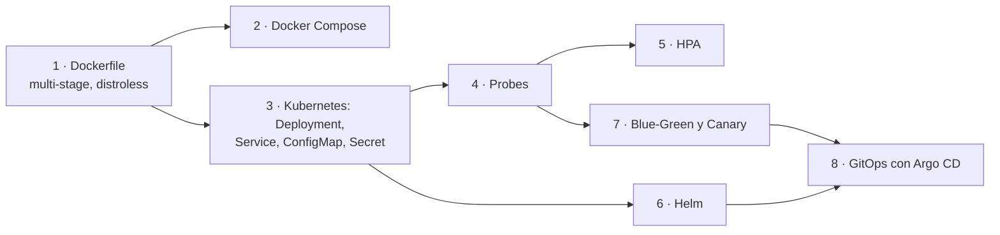
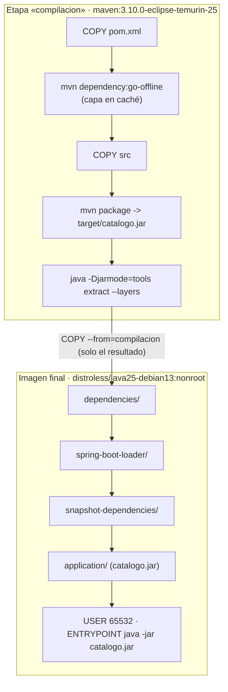
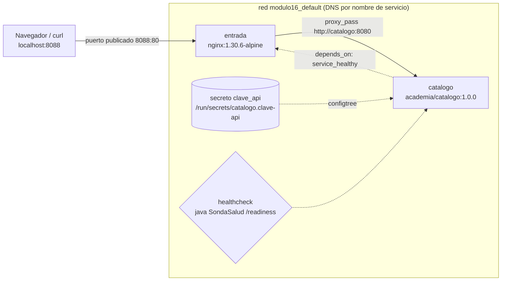
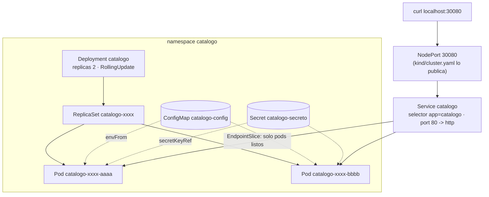
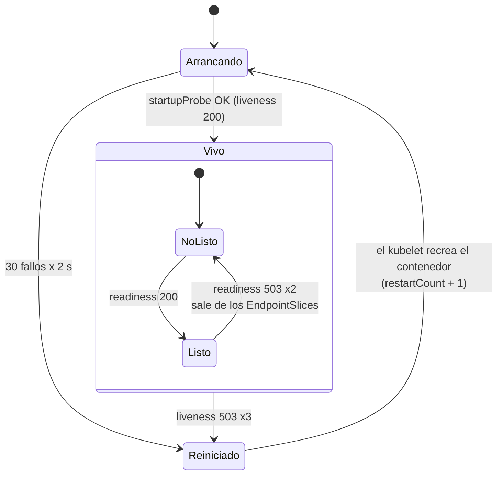
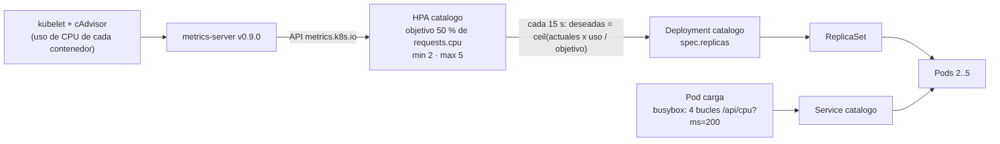
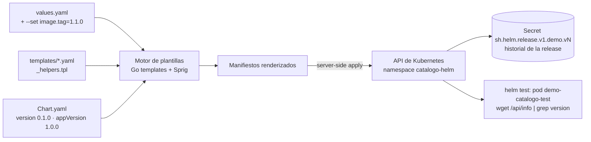
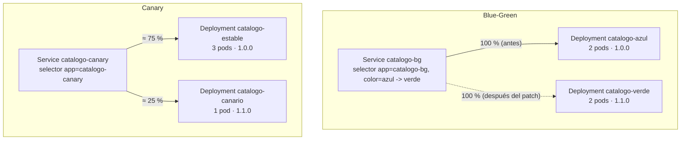
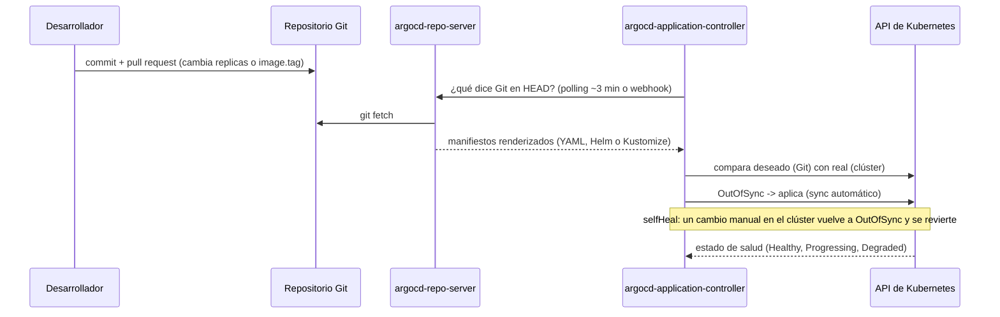

# Módulo 12 · Docker, Kubernetes y despliegue

**Fase 1 · Spring Boot de cero a experto** (semana 12 de 12). **Duración:** 22 h (8 temas de 2–3,5 h).
**Dificultad:** 4 de 5. **Dependencias:** Módulo 0.5 (Docker básico: imagen, contenedor, `docker run`), Módulo 1
(perfiles y configuración externalizada), Módulo 7 del curso (Spring Cloud: por qué un servicio necesita un nombre
estable) y Módulo 10 (Actuator y health). **Herramientas:** **JDK 25 LTS**, **Spring Boot 4.1.3**, Docker Engine 29 con
Compose v5, imágenes `maven:3.10.0-eclipse-temurin-25` y `gcr.io/distroless/java25-debian13:nonroot`, **kind v0.33.0**
con **Kubernetes 1.37.0**, kubectl 1.37, metrics-server v0.9.0, **Helm 4.3.1** y **Argo CD v3.5.6**.
**Laboratorio:** `examples/microservicios/modulo-16/` (una sola aplicación, `app/`, que recorre las 8 fichas;
`./verificar.sh` lo ejecuta todo y cada ficha tiene su prueba en `pruebas/fNNN-*.sh`).

Hasta ahora tus servicios corrían con `./mvnw spring-boot:run`. Producción es otra cosa: el código se empaqueta en una
**imagen** inmutable, varias imágenes se levantan juntas con **Compose** en tu máquina, y en el clúster
**Kubernetes** mantiene vivas las réplicas, les da un nombre estable, les inyecta configuración y secretos, sabe si
están sanas, las multiplica con la carga, y las actualiza sin cortar el servicio. **Helm** empaqueta todo eso y
**Argo CD** hace que Git sea la única fuente de verdad. En este módulo haces todo el recorrido con **un mismo
servicio**, el catálogo.



**Texto alternativo:** diagrama de izquierda a derecha. El tema 1 (Dockerfile multi-stage y distroless) lleva al tema
2 (Docker Compose) y al tema 3 (Kubernetes: Deployment, Service, ConfigMap y Secret). Del 3 salen el tema 4 (probes),
que lleva al 5 (HPA) y al 7 (Blue-Green y Canary), y el tema 6 (Helm). Los temas 6 y 7 confluyen en el 8 (GitOps con
Argo CD).

**Cómo usar el laboratorio.** Entra en `examples/microservicios/modulo-16`. Necesitas Docker Desktop con al menos
6 GB de RAM, y en macOS `brew install kind kubectl helm` (comprueba `kind version` → `v0.33.0`, `kubectl version
--client` → `v1.37.x`, `helm version` → `v4.3.x`). `./verificar.sh` construye las imágenes, prueba Compose, crea el
clúster kind `academia-m12` y ejecuta las pruebas de cada ficha (15–25 minutos la primera vez). Para trabajar ficha a
ficha: `./verificar.sh --conservar` deja el clúster creado, y luego ejecutas `./pruebas/f083-objetos.sh`, etc. Al
terminar: `kind delete cluster --name academia-m12`. En el entorno donde se escribió no hay Docker Hub, Maven Central
ni kind: aquí se validaron los manifiestos contra el esquema de Kubernetes 1.37 (`kubernetes-validate` 1.37.0, modo
estricto), los `docker-compose.yml` con `docker compose config`, los guiones con `shellcheck` y la clase `SondaSalud`
con JDK 25.0.5; lo demás está en `verificacion/microservicios/pendiente.md`.

| Herramienta | Versión | Dónde se fija |
|---|---|---|
| Spring Boot (Actuator, probes) | 4.1.3 | `app/pom.xml` |
| Imagen de compilación | `maven:3.10.0-eclipse-temurin-25` | `app/Dockerfile` |
| Imagen de ejecución | `gcr.io/distroless/java25-debian13:nonroot` (Temurin 25 sobre Debian 13) | `app/Dockerfile` |
| Docker Compose | v5 (especificación Compose) · `nginx:1.30.6-alpine` | `docker-compose.yml` |
| kind / nodo | v0.33.0 / `kindest/node:v1.37.0@sha256:a1ed56cf…` | `kind/cluster.yaml` |
| metrics-server | v0.9.0 | `pruebas/f085-hpa.sh` |
| Helm | 4.3.1 (chart `apiVersion: v2`) | `charts/catalogo/` |
| Argo CD | v3.5.6 | `pruebas/f088-argocd.sh` |

La aplicación que viaja por todo el módulo (`app/`): un catálogo con `/api/productos`, `/api/info` (qué versión,
color y pod responden, y si la clave del API está configurada, sin mostrarla), `/api/cpu?ms=` (genera carga para el
HPA), los endpoints de Actuator `/actuator/health/liveness` y `/actuator/health/readiness`, y tres endpoints
**solo de laboratorio** para cambiar a mano el estado de las probes.

`app/pom.xml`:

```xml
<?xml version="1.0" encoding="UTF-8"?>
<!-- Módulo 12 · Servicio «catalogo» que se empaqueta, se orquesta y se despliega (Spring Boot 4.1.3, JDK 25) -->
<project xmlns="http://maven.apache.org/POM/4.0.0" xmlns:xsi="http://www.w3.org/2001/XMLSchema-instance"
         xsi:schemaLocation="http://maven.apache.org/POM/4.0.0 https://maven.apache.org/xsd/maven-4.0.0.xsd">
  <modelVersion>4.0.0</modelVersion>
  <parent>
    <groupId>org.springframework.boot</groupId>
    <artifactId>spring-boot-starter-parent</artifactId>
    <version>4.1.3</version>
    <relativePath/>
  </parent>
  <groupId>academia.microservicios</groupId>
  <artifactId>catalogo</artifactId>
  <version>1.0.0</version>
  <properties>
    <java.version>25</java.version>
  </properties>
  <dependencies>
    <!-- Spring MVC 7 + Tomcat 11 + Jackson 3 -->
    <dependency>
      <groupId>org.springframework.boot</groupId>
      <artifactId>spring-boot-starter-webmvc</artifactId>
    </dependency>
    <!-- /actuator/health/liveness y /actuator/health/readiness para las probes de Kubernetes -->
    <dependency>
      <groupId>org.springframework.boot</groupId>
      <artifactId>spring-boot-starter-actuator</artifactId>
    </dependency>
    <dependency>
      <groupId>org.springframework.boot</groupId>
      <artifactId>spring-boot-starter-test</artifactId>
      <scope>test</scope>
    </dependency>
    <dependency>
      <groupId>org.springframework.boot</groupId>
      <artifactId>spring-boot-starter-webmvc-test</artifactId>
      <scope>test</scope>
    </dependency>
  </dependencies>
  <build>
    <!-- target/catalogo.jar: el Dockerfile lo busca con este nombre -->
    <finalName>catalogo</finalName>
    <plugins>
      <plugin>
        <groupId>org.springframework.boot</groupId>
        <artifactId>spring-boot-maven-plugin</artifactId>
      </plugin>
    </plugins>
  </build>
</project>
```

`app/src/main/resources/application.properties`:

```properties
spring.application.name=catalogo
server.port=8080
# Al recibir SIGTERM: deja de aceptar peticiones nuevas y termina las que están en curso (máx. 20 s).
server.shutdown=graceful
spring.lifecycle.timeout-per-shutdown-phase=20s
# Probes: /actuator/health/liveness y /actuator/health/readiness (Boot 4 las activa por defecto; se deja explícito).
management.endpoint.health.probes.enabled=true
management.endpoints.web.exposure.include=health,info
# Configuración del servicio. En contenedores llega por variables de entorno:
# CATALOGO_MENSAJE, CATALOGO_COLOR, CATALOGO_VERSION, CATALOGO_CLAVE_API (o un archivo con configtree).
catalogo.mensaje=Hola desde el catálogo
catalogo.color=sin-color
catalogo.version=desarrollo
catalogo.clave-api=
catalogo.arranque-lento-segundos=0
```

`app/src/main/java/academia/catalogo/CatalogoApp.java`:

```java
package academia.catalogo;

import org.springframework.boot.SpringApplication;
import org.springframework.boot.autoconfigure.SpringBootApplication;
import org.springframework.boot.context.properties.ConfigurationPropertiesScan;

/** Módulo 12 · El servicio «catalogo»: la misma imagen viaja de Docker a Compose, Kubernetes, Helm y Argo CD. */
@SpringBootApplication
@ConfigurationPropertiesScan
public class CatalogoApp {

    public static void main(String[] args) {
        SpringApplication.run(CatalogoApp.class, args);
    }
}
```

`app/src/main/java/academia/catalogo/CatalogoProperties.java`:

```java
package academia.catalogo;

import org.springframework.boot.context.properties.ConfigurationProperties;

/** catalogo.* · En Kubernetes: mensaje y color desde un ConfigMap, claveApi desde un Secret, version desde la imagen. */
@ConfigurationProperties("catalogo")
public record CatalogoProperties(String mensaje, String color, String version, String claveApi,
        int arranqueLentoSegundos) {
}
```

`app/src/main/java/academia/catalogo/CatalogoController.java`:

```java
package academia.catalogo;

import java.util.List;
import java.util.Map;

import org.springframework.web.bind.annotation.GetMapping;
import org.springframework.web.bind.annotation.RequestParam;
import org.springframework.web.bind.annotation.RestController;

@RestController
class CatalogoController {

    record Producto(String sku, String nombre, int precio) {
    }

    record Info(String version, String color, String mensaje, String pod, boolean claveApiConfigurada) {
    }

    private final CatalogoProperties props;

    CatalogoController(CatalogoProperties props) {
        this.props = props;
    }

    @GetMapping("/api/productos")
    List<Producto> productos() {
        return List.of(new Producto("A-1", "Teclado", 100), new Producto("A-2", "Ratón", 40));
    }

    /** Qué versión responde y desde qué pod: con esto se ven los Blue-Green, los Canary y los rollouts. */
    @GetMapping("/api/info")
    Info info() {
        String pod = System.getenv().getOrDefault("HOSTNAME", "local");
        boolean conClave = props.claveApi() != null && !props.claveApi().isBlank();
        // Nunca devuelvas el secreto: solo si está configurado.
        return new Info(props.version(), props.color(), props.mensaje(), pod, conClave);
    }

    /** Quema CPU durante «ms» milisegundos: genera la carga que hace escalar al HPA. */
    @GetMapping("/api/cpu")
    Map<String, Object> cpu(@RequestParam(defaultValue = "100") long ms) {
        long fin = System.nanoTime() + Math.min(ms, 2000) * 1_000_000;
        double x = 0;
        while (System.nanoTime() < fin) {
            x += Math.sqrt(x + 1);
        }
        return Map.of("ms", ms, "resultado", (long) x % 10);
    }
}
```

`app/src/main/java/academia/catalogo/DisponibilidadController.java`:

```java
package academia.catalogo;

import java.util.Map;

import org.springframework.boot.availability.AvailabilityChangeEvent;
import org.springframework.boot.availability.LivenessState;
import org.springframework.boot.availability.ReadinessState;
import org.springframework.context.ApplicationContext;
import org.springframework.web.bind.annotation.PostMapping;
import org.springframework.web.bind.annotation.RestController;

/**
 * SOLO PARA EL LABORATORIO: cambia a mano el estado que leen las probes de Kubernetes.
 * En una app real nadie expone esto: el estado lo cambia Spring (arranque, apagado) o tu código ante un fallo
 * interno irrecuperable (p. ej. un pool de hilos bloqueado).
 */
@RestController
class DisponibilidadController {

    private final ApplicationContext contexto;

    DisponibilidadController(ApplicationContext contexto) {
        this.contexto = contexto;
    }

    /** liveness -> DOWN (503): el kubelet reiniciará el contenedor tras failureThreshold fallos. */
    @PostMapping("/admin/liveness/romper")
    Map<String, String> romperLiveness() {
        AvailabilityChangeEvent.publish(contexto, LivenessState.BROKEN);
        return Map.of("liveness", "BROKEN");
    }

    /** readiness -> OUT_OF_SERVICE (503): el pod sale de los endpoints del Service, pero NO se reinicia. */
    @PostMapping("/admin/readiness/rechazar")
    Map<String, String> rechazarTrafico() {
        AvailabilityChangeEvent.publish(contexto, ReadinessState.REFUSING_TRAFFIC);
        return Map.of("readiness", "REFUSING_TRAFFIC");
    }

    @PostMapping("/admin/readiness/aceptar")
    Map<String, String> aceptarTrafico() {
        AvailabilityChangeEvent.publish(contexto, ReadinessState.ACCEPTING_TRAFFIC);
        return Map.of("readiness", "ACCEPTING_TRAFFIC");
    }
}
```

`app/src/main/java/academia/catalogo/ArranqueLento.java`:

```java
package academia.catalogo;

import org.slf4j.Logger;
import org.slf4j.LoggerFactory;
import org.springframework.boot.ApplicationArguments;
import org.springframework.boot.ApplicationRunner;
import org.springframework.stereotype.Component;

/**
 * Simula una tarea de arranque (calentar una caché, migrar datos). Mientras corre, la app está «viva» (liveness UP)
 * pero «no lista» (readiness todavía no es ACCEPTING_TRAFFIC): Spring publica ACCEPTING_TRAFFIC al terminar los runners.
 */
@Component
class ArranqueLento implements ApplicationRunner {

    private static final Logger log = LoggerFactory.getLogger(ArranqueLento.class);
    private final CatalogoProperties props;

    ArranqueLento(CatalogoProperties props) {
        this.props = props;
    }

    @Override
    public void run(ApplicationArguments args) throws Exception {
        if (props.arranqueLentoSegundos() > 0) {
            log.info("Calentando caché durante {} s...", props.arranqueLentoSegundos());
            Thread.sleep(props.arranqueLentoSegundos() * 1000L);
            log.info("Caché caliente");
        }
    }
}
```

`app/src/main/java/academia/catalogo/SondaSalud.java`:

```java
package academia.catalogo;

import java.net.URI;
import java.net.http.HttpClient;
import java.net.http.HttpRequest;
import java.net.http.HttpResponse;
import java.time.Duration;

/**
 * Healthcheck para imágenes distroless (no hay curl ni shell): «java -cp catalogo.jar academia.catalogo.SondaSalud URL».
 * Solo usa el JDK. Sale con 0 si la URL responde 200 y con 1 en cualquier otro caso.
 */
public final class SondaSalud {

    private SondaSalud() {
    }

    public static void main(String[] args) {
        String url = args.length > 0 ? args[0] : "http://localhost:8080/actuator/health/readiness";
        try {
            HttpResponse<Void> r = HttpClient.newBuilder().connectTimeout(Duration.ofSeconds(2)).build()
                    .send(HttpRequest.newBuilder(URI.create(url)).timeout(Duration.ofSeconds(2)).build(),
                            HttpResponse.BodyHandlers.discarding());
            System.exit(r.statusCode() == 200 ? 0 : 1);
        } catch (Exception e) {
            System.exit(1);
        }
    }
}
```

Sus tests (sin Docker ni clúster: `./mvnw test` desde `modulo-16`):

`app/src/test/java/academia/catalogo/CatalogoTest.java`:

```java
package academia.catalogo;

import static org.springframework.test.web.servlet.request.MockMvcRequestBuilders.get;
import static org.springframework.test.web.servlet.request.MockMvcRequestBuilders.post;
import static org.springframework.test.web.servlet.result.MockMvcResultMatchers.jsonPath;
import static org.springframework.test.web.servlet.result.MockMvcResultMatchers.status;

import org.junit.jupiter.api.Test;
import org.springframework.beans.factory.annotation.Autowired;
import org.springframework.boot.test.context.SpringBootTest;
import org.springframework.boot.webmvc.test.autoconfigure.AutoConfigureMockMvc;
import org.springframework.test.annotation.DirtiesContext;
import org.springframework.test.web.servlet.MockMvc;

/**
 * La configuración llega como la daría Kubernetes (variables ya convertidas a propiedades) y las probes
 * responden a los cambios de estado. Sin Docker ni clúster: corre en segundos.
 */
@SpringBootTest(properties = {"catalogo.color=azul", "catalogo.version=1.0.0", "catalogo.clave-api=secreta"})
@AutoConfigureMockMvc
class CatalogoTest {

    @Autowired MockMvc mvc;

    @Test
    void infoMuestraLaConfiguracionPeroNoElSecreto() throws Exception {
        mvc.perform(get("/api/info"))
                .andExpect(status().isOk())
                .andExpect(jsonPath("$.version").value("1.0.0"))
                .andExpect(jsonPath("$.color").value("azul"))
                .andExpect(jsonPath("$.claveApiConfigurada").value(true))
                .andExpect(jsonPath("$.claveApi").doesNotExist());
    }

    @Test
    void lasProbesEstanArribaAlArrancar() throws Exception {
        mvc.perform(get("/actuator/health/liveness")).andExpect(status().isOk())
                .andExpect(jsonPath("$.status").value("UP"));
        mvc.perform(get("/actuator/health/readiness")).andExpect(status().isOk())
                .andExpect(jsonPath("$.status").value("UP"));
    }

    @Test
    void readinessRechazandoTraficoDevuelve503YLivenessSigueArriba() throws Exception {
        mvc.perform(post("/admin/readiness/rechazar")).andExpect(status().isOk());
        mvc.perform(get("/actuator/health/readiness")).andExpect(status().isServiceUnavailable())
                .andExpect(jsonPath("$.status").value("OUT_OF_SERVICE"));
        mvc.perform(get("/actuator/health/liveness")).andExpect(status().isOk());
        mvc.perform(post("/admin/readiness/aceptar")).andExpect(status().isOk());
        mvc.perform(get("/actuator/health/readiness")).andExpect(status().isOk());
    }

    @Test
    @DirtiesContext   // la liveness queda rota: Spring descarta este contexto y los demás tests usan uno nuevo
    void livenessRotaDevuelve503() throws Exception {
        mvc.perform(post("/admin/liveness/romper")).andExpect(status().isOk());
        mvc.perform(get("/actuator/health/liveness")).andExpect(status().isServiceUnavailable())
                .andExpect(jsonPath("$.status").value("DOWN"));
    }

    @Test
    void cpuQuemaElTiempoPedido() throws Exception {
        mvc.perform(get("/api/cpu").param("ms", "50")).andExpect(status().isOk())
                .andExpect(jsonPath("$.ms").value(50));
    }
}
```

Las pruebas de las fichas comparten estas funciones (compatibles con bash 3.2 de macOS):

`pruebas/comun.sh`:

```bash
# Funciones compartidas por las pruebas del Módulo 12. Compatible con bash 3.2 (macOS): sin arrays ni «timeout».
# Se carga con:  . "$(dirname "$0")/comun.sh"
CLUSTER=academia-m12
K="kubectl --context kind-$CLUSTER"

ok() { echo "   ✔ $*"; }
mal() { echo "   ✘ $*"; return 1; }

# esperar SEGUNDOS "descripción" comando args...  -> repite el comando cada 2 s hasta que salga con 0
esperar() {
  limite=$((SECONDS + $1))
  descripcion=$2
  shift 2
  while [ "$SECONDS" -lt "$limite" ]; do
    if "$@" >/dev/null 2>&1; then
      ok "$descripcion"
      return 0
    fi
    sleep 2
  done
  mal "$descripcion (no ocurrió en el tiempo esperado)"
}

# contiene "texto" comando args...  -> el comando imprime algo que contiene el texto
contiene() {
  esperado=$1
  shift
  salida=$("$@" 2>&1)
  # JSON y YAML se comparan sin espacios: {"a": 1} y {"a":1} cuentan igual
  compacta=$(printf '%s' "$salida" | tr -d ' \t')
  buscado=$(printf '%s' "$esperado" | tr -d ' \t')
  case "$compacta" in
    *"$buscado"*) ok "contiene «${esperado}»"; return 0 ;;
    *) echo "$salida" | head -20; mal "no contiene «${esperado}»" ;;
  esac
}

# Cuántos endpoints LISTOS tiene un Service (EndpointSlices; Endpoints v1 está obsoleto desde Kubernetes 1.33).
endpoints_listos() {   # endpoints_listos namespace servicio
  $K -n "$1" get endpointslices -l "kubernetes.io/service-name=$2" \
    -o jsonpath='{range .items[*].endpoints[*]}{.conditions.ready}{"\n"}{end}' | grep -c true
}

# hay_endpoints namespace servicio N  -> exactamente N endpoints listos
hay_endpoints() {
  [ "$(endpoints_listos "$1" "$2")" -eq "$3" ]
}

# jsonpath_es namespace recurso jsonpath valor  -> el campo tiene exactamente ese valor
jsonpath_es() {
  [ "$($K -n "$1" get $2 -o jsonpath="$3")" = "$4" ]
}

# jsonpath_mayor namespace recurso jsonpath N  -> el campo (numérico) es mayor que N
jsonpath_mayor() {
  v=$($K -n "$1" get $2 -o jsonpath="$3")
  [ -n "$v" ] && [ "$v" -gt "$4" ]
}

# responde_con url texto  -> GET url contiene el texto
responde_con() {
  curl -s "$1" | tr -d ' \t' | grep -qF "$(printf '%s' "$2" | tr -d ' \t')"
}

# pods_vivos namespace selector  -> nombres de los pods que NO se están borrando (sin deletionTimestamp), uno por línea
pods_vivos() {
  $K -n "$1" get pods -l "$2" \
    -o jsonpath='{range .items[*]}{.metadata.name}{" "}{.metadata.deletionTimestamp}{"\n"}{end}' | awk 'NF == 1 {print $1}'
}

# pods_asentados namespace selector N  -> hay exactamente N pods, ninguno terminando (un rollout deja pods viejos
# en Terminating unos segundos: preStop + apagado ordenado) y el Service ya tiene N endpoints listos
pods_asentados() {
  total=$($K -n "$1" get pods -l "$2" -o name | wc -l | tr -d ' ')
  vivos=$(pods_vivos "$1" "$2" | wc -l | tr -d ' ')
  [ "$total" -eq "$3" ] && [ "$vivos" -eq "$3" ]
}
```

---
### Dockerfile multi-stage, distroless

#### 1. UBICACIÓN

Módulo 12, Lección 1 de 8 · Fase 1 · 3 h · Laboratorio `examples/microservicios/modulo-16/app/Dockerfile` y la prueba
`pruebas/f081-imagen.sh`.

#### 2. PRERREQUISITOS

- Módulo 0.5: `docker build`, `docker run`, imagen frente a contenedor, capas y caché.
- Módulo 1: cómo Spring Boot empaqueta un jar ejecutable con `spring-boot-maven-plugin`.
- Saber qué es un usuario `root` y por qué no conviene ejecutar servicios como root.

#### 3. OBJETIVO DE APRENDIZAJE

**Construir** una imagen de producción para un servicio Spring Boot con un Dockerfile **multi-stage** (compilar en
una etapa, ejecutar en otra) sobre una base **distroless**, y **justificar** cada decisión (capas, usuario,
`ENTRYPOINT`, memoria); lo compruebas cuando `pruebas/f081-imagen.sh` pasa: la imagen no corre como root, no tiene
shell, es más pequeña que la versión ingenua, responde `"version":"1.0.0"` y se apaga con código 143 al recibir
SIGTERM.

#### 4. ANALOGÍA VISUAL

Dibuja una **panadería con dos salas**. En la primera, el **obrador**: harina por todas partes, batidoras, hornos,
recetas, aprendices (el JDK, Maven, el código fuente, la caché de dependencias). En la segunda, la **vitrina de la
tienda**: solo el pan terminado sobre una bandeja limpia. Entre las dos salas hay una **ventanilla** por la que pasa
**solo el pan** (`COPY --from=compilacion`). El cliente nunca ve el obrador, y un ladrón que entre a la tienda no
encuentra cuchillos ni batidoras (sin shell, sin gestor de paquetes). El pan llega en **cajas apiladas**: abajo la
harina que nunca cambia (dependencias), arriba la decoración del día (tu código): si solo cambias la decoración, no
rehaces toda la pila.

#### 5. DIAGRAMA TÉCNICO



**Texto alternativo:** dos recuadros. Arriba, la etapa de compilación sobre la imagen de Maven con JDK 25: copia el
pom, descarga dependencias (una capa que queda en caché), copia el código, empaqueta el jar y lo extrae en capas.
Abajo, la imagen final distroless: cuatro capas apiladas (dependencias, loader de Spring Boot, dependencias snapshot y
aplicación con catalogo.jar) y la configuración de usuario 65532 y ENTRYPOINT java -jar. Una flecha indica que de la
etapa de compilación solo se copia el resultado.

#### 6. EXPLICACIÓN NIVEL 0

Un **Dockerfile** es la receta para crear una imagen: un paquete con tu programa y todo lo que necesita para correr.

- Para **compilar** un programa Java necesitas muchas herramientas (el JDK completo, Maven, el código fuente). Para
  **ejecutarlo** solo necesitas el programa compilado y Java.
- Un Dockerfile **multi-stage** tiene varias etapas: una compila, otra ejecuta. La imagen final solo contiene la
  última etapa, así que es **más pequeña** y tiene **menos cosas que un atacante pueda usar**.
- **Distroless** es una imagen base que trae solo lo imprescindible para ejecutar Java: sin terminal (`sh`), sin
  `apt`, sin `curl`. Si alguien entra, no tiene herramientas.

#### 7. EXPLICACIÓN INTERMEDIA

- **Etapas.** `FROM ... AS compilacion` nombra una etapa; `COPY --from=compilacion` copia archivos de ella. Solo la
  última `FROM` define la imagen que se publica.
- **Caché de capas.** Cada instrucción crea una capa; Docker reutiliza las capas mientras sus entradas no cambien.
  Copiar primero `pom.xml` y descargar dependencias, y **después** `src`, hace que un cambio de código no vuelva a
  descargar internet. (`dependency:go-offline` no resuelve el 100 % de los plugins; aun así ahorra la mayoría.)
- **Capas de Spring Boot.** `java -Djarmode=tools -jar app.jar extract --layers --destination extraido` (Spring Boot
  3.3+) separa el jar en `dependencies/`, `spring-boot-loader/`, `snapshot-dependencies/` y `application/`. Cada
  `COPY` es una capa: al cambiar tu código solo cambia la última, de pocos KB, y los registros solo suben y bajan esa.
  El `catalogo.jar` extraído **no es** el *uber-jar*: contiene tus clases y referencia los jars de `lib/`.
- **Distroless de Java.** `gcr.io/distroless/java25-debian13` trae Temurin OpenJDK 25 (JRE) sobre Debian 13; la
  etiqueta `:nonroot` fija el usuario 65532. No hay shell: el `ENTRYPOINT` debe ir en **forma exec** (JSON).
- **Forma exec y PID 1.** `ENTRYPOINT ["java","-jar","catalogo.jar"]` hace que `java` sea el proceso 1 del contenedor y
  reciba `SIGTERM` de `docker stop` o de Kubernetes. Con la forma *shell* (`CMD java -jar ...`), el proceso 1 es
  `/bin/sh` y la señal puede no llegar a Java: el contenedor muere a los 10 s por `SIGKILL`, sin apagado ordenado.
- **Memoria.** La JVM detecta el límite de memoria del contenedor (cgroups) y por defecto usa el 25 % para el heap.
  `-XX:MaxRAMPercentage=75` (vía `JAVA_TOOL_OPTIONS`) es un punto de partida habitual para un servicio que solo corre
  Java.
- **`ARG` y `ENV`.** `ARG VERSION` existe solo durante la construcción; `ENV CATALOGO_VERSION=${VERSION}` lo graba en
  la imagen como variable de entorno, que Spring lee como `catalogo.version`.

#### 8. EXPLICACIÓN MAESTRA

- **Superficie de ataque y CVE.** Cada paquete del sistema operativo es un posible CVE que tu escáner (Trivy, Módulo 9)
  reportará y que tendrás que justificar. Distroless reduce la lista a lo que Java necesita. El coste: no puedes hacer
  `docker exec ... sh` para depurar. Alternativas: la variante `:debug` (trae `busybox`) solo en entornos de prueba, o
  `kubectl debug` con un contenedor efímero que comparte el espacio de procesos del pod.
- **Alternativas de base.** (1) `eclipse-temurin:25-jre` (Ubuntu): con shell y `apt`, más fácil de depurar, más CVE.
  (2) Alpine (musl): pequeña, pero musl cambia detalles de DNS y rendimiento con algunas librerías nativas.
  (3) Distroless (este tema): mínima con glibc. (4) Imagen nativa con GraalVM (Módulo 1): arranque en milisegundos y
  poca memoria, a cambio de builds largos y configuración de reflexión. (5) **Buildpacks**
  (`./mvnw spring-boot:build-image`): sin Dockerfile, con capas y JRE elegidos por Paketo; menos control.
- **Arranque más rápido en Java 25.** Spring Boot documenta una variante con **AOT cache** de Java 25: un `RUN java
  -XX:AOTCacheOutput=app.aot -Dspring.context.exit=onRefresh -jar application.jar` de entrenamiento y
  `-XX:AOTCache=app.aot` al arrancar. En distroless no hay shell, así que ese `RUN` debe ir en forma exec y la caché
  debe generarse con la **misma** JVM que la ejecuta.
- **Reproducibilidad.** Fija la etiqueta exacta y, en producción, el **digest** (`@sha256:...`) de cada `FROM`; el
  `.dockerignore` evita copiar `target/` o secretos al contexto de construcción.
- **Cuándo NO usar multi-stage con compilación dentro.** Si tu CI ya compila y prueba el jar (con caché de Maven
  propia), compilar otra vez dentro de Docker duplica trabajo: copia el jar ya construido a una imagen de una etapa
  que solo extrae capas (como el ejemplo de la documentación de Spring Boot).

#### 9. CÓDIGO EJECUTABLE

Versiones: **JDK 25**, **Spring Boot 4.1.3**, base de compilación `maven:3.10.0-eclipse-temurin-25` (Maven 3.10.0 con
Temurin 25), base de ejecución `gcr.io/distroless/java25-debian13:nonroot`, Docker Engine 29 con BuildKit.

`app/Dockerfile`:

```dockerfile
# syntax=docker/dockerfile:1
# F081 · Dockerfile multi-stage + distroless para el servicio «catalogo» (Spring Boot 4.1.3, JDK 25)
# Construye desde examples/microservicios/modulo-16:
#   docker build -t academia/catalogo:1.0.0 app
#   docker build -t academia/catalogo:1.1.0 --build-arg VERSION=1.1.0 app

# ---------- Etapa 1: compilar (JDK completo + Maven; NO llega a la imagen final) ----------
FROM maven:3.10.0-eclipse-temurin-25 AS compilacion
WORKDIR /fuente
# 1) Solo el pom.xml: esta capa (las dependencias) se reutiliza mientras el pom no cambie.
COPY pom.xml .
RUN mvn -B -q dependency:go-offline
# 2) El código cambia a menudo: va DESPUÉS, para no invalidar la capa de dependencias.
COPY src ./src
RUN mvn -B -q package -DskipTests
# 3) Extrae el jar en capas: dependencias, loader, snapshots y aplicación (de menos a más cambiante).
RUN java -Djarmode=tools -jar target/catalogo.jar extract --layers --destination extraido

# ---------- Etapa 2: ejecutar (solo la JRE 25; sin shell, sin apt, usuario no root 65532) ----------
FROM gcr.io/distroless/java25-debian13:nonroot
WORKDIR /app
COPY --from=compilacion /fuente/extraido/dependencies/ ./
COPY --from=compilacion /fuente/extraido/spring-boot-loader/ ./
COPY --from=compilacion /fuente/extraido/snapshot-dependencies/ ./
COPY --from=compilacion /fuente/extraido/application/ ./
# La versión queda grabada en la imagen: /api/info la muestra (Blue-Green y Canary la usan para distinguir pods).
ARG VERSION=1.0.0
ENV CATALOGO_VERSION=${VERSION}
# La JVM respeta el límite de memoria del contenedor; 75 % para el heap, el resto para metaspace, hilos y buffers.
ENV JAVA_TOOL_OPTIONS="-XX:MaxRAMPercentage=75"
EXPOSE 8080
# Forma «exec» (JSON): java es el PID 1 y recibe SIGTERM directamente (apagado ordenado).
ENTRYPOINT ["java", "-jar", "catalogo.jar"]
```

`app/.dockerignore`:

```text
# El contexto de construcción es app/: no envíes al daemon lo que no hace falta (ni secretos).
target/
*.iml
.idea/
.env
```

La versión ingenua, solo para comparar:

`app/Dockerfile.ingenuo`:

```dockerfile
# F081 · ANTI-PATRÓN (solo para comparar tamaños y tiempos): una sola etapa con JDK + Maven + código fuente.
#   docker build -f app/Dockerfile.ingenuo -t academia/catalogo:ingenuo app
FROM maven:3.10.0-eclipse-temurin-25
WORKDIR /fuente
# Copia TODO de una vez: cualquier cambio en el código invalida la caché y vuelve a descargar las dependencias.
COPY . .
RUN mvn -B -q package -DskipTests
# Corre como root, con shell, Maven, el JDK completo y el código fuente dentro de la imagen.
CMD java -jar target/catalogo.jar
```

La prueba de la ficha:

`pruebas/f081-imagen.sh`:

```bash
#!/usr/bin/env bash
# F081 · Test de la imagen: multi-stage + distroless. Requiere haber construido academia/catalogo:1.0.0
# (y, para comparar, academia/catalogo:ingenuo).
set -u
. "$(dirname "$0")/comun.sh"
fallos=0
IMG=academia/catalogo:1.0.0
if ! docker image inspect "$IMG" >/dev/null 2>&1; then
  mal "no existe la imagen $IMG: constrúyela con «docker build -t $IMG app»"
  exit 1
fi

usuario=$(docker image inspect -f '{{.Config.User}}' "$IMG")
echo "   usuario de la imagen: «${usuario}»"
case "$usuario" in
  ""|0|root|0:0) mal "la imagen corre como root" || fallos=$((fallos + 1)) ;;
  *) ok "no corre como root" ;;
esac

if docker run --rm --entrypoint sh "$IMG" -c "echo hola" >/dev/null 2>&1; then
  mal "la imagen tiene shell (no es distroless)" || fallos=$((fallos + 1))
else
  ok "no hay shell dentro de la imagen"
fi

tam=$(docker image inspect -f '{{.Size}}' "$IMG")
echo "   tamaño distroless: $((tam / 1000000)) MB"
if docker image inspect academia/catalogo:ingenuo >/dev/null 2>&1; then
  tam_ing=$(docker image inspect -f '{{.Size}}' academia/catalogo:ingenuo)
  echo "   tamaño ingenuo:    $((tam_ing / 1000000)) MB"
  if [ "$tam" -lt "$tam_ing" ]; then ok "la imagen multi-stage es más pequeña"; else mal "no es más pequeña" || fallos=$((fallos + 1)); fi
fi

docker rm -f f081-prueba >/dev/null 2>&1
docker run -d --name f081-prueba -p 18081:8080 "$IMG" >/dev/null
esperar 60 "el contenedor responde en :18081" curl -fs http://localhost:18081/actuator/health/readiness || fallos=$((fallos + 1))
contiene '"version":"1.0.0"' curl -s http://localhost:18081/api/info || fallos=$((fallos + 1))
# SIGTERM -> apagado ordenado: docker stop debe terminar con código 143 (128 + 15) en menos de 10 s
inicio=$SECONDS
docker stop f081-prueba >/dev/null
codigo=$(docker inspect -f '{{.State.ExitCode}}' f081-prueba)
echo "   docker stop: código $codigo en $((SECONDS - inicio)) s"
if [ "$codigo" = "143" ] && [ $((SECONDS - inicio)) -lt 10 ]; then ok "java es PID 1 y atiende SIGTERM"; else mal "apagado no ordenado" || fallos=$((fallos + 1)); fi
docker rm f081-prueba >/dev/null
[ "$fallos" -eq 0 ]
```

#### 10. MINI-LABORATORIO

1. Construye las dos imágenes y compáralas (desde `examples/microservicios/modulo-16`):

```bash
docker build --provenance=false -t academia/catalogo:1.0.0 app
docker build --provenance=false -f app/Dockerfile.ingenuo -t academia/catalogo:ingenuo app
docker image ls academia/catalogo
```

   **Output esperado:** dos filas, `1.0.0` e `ingenuo`. La `ingenuo` incluye el JDK completo, Maven, el repositorio
   local de dependencias (`/root/.m2`) y el código fuente, así que es **mucho** más grande que la distroless; anota
   tus dos tamaños (pendiente de medir en el Mac del dueño). `--provenance=false` evita que BuildKit añada un
   manifiesto de atestación, que en Docker Desktop con el almacén de imágenes de containerd puede impedir después
   `kind load docker-image`.

2. Cambia una línea de `CatalogoController.java` (por ejemplo, el nombre de un producto) y reconstruye la `1.0.0`.

   **Output esperado:** BuildKit marca `CACHED` en `COPY pom.xml` y en `RUN mvn -B -q dependency:go-offline`; solo se
   repiten `COPY src`, `mvn package`, la extracción y la última capa `application/`. Reconstruye la `ingenuo` con el
   mismo cambio: descarga otra vez todas las dependencias, porque `COPY . .` invalidó la caché.

3. Pásale la prueba:

```bash
./pruebas/f081-imagen.sh
```

   **Output esperado** (los tamaños dependen de tu máquina y de las imágenes base del día):

```text
   usuario de la imagen: «65532»
   ✔ no corre como root
   ✔ no hay shell dentro de la imagen
   tamaño distroless: … MB
   tamaño ingenuo:    … MB
   ✔ la imagen multi-stage es más pequeña
   ✔ el contenedor responde en :18081
   ✔ contiene «"version":"1.0.0"»
   docker stop: código 143 en 1 s
   ✔ java es PID 1 y atiende SIGTERM
```

   **Captura comentada:** `143 = 128 + 15`: el proceso terminó por SIGTERM (señal 15) y Spring cerró de forma ordenada
   (`server.shutdown=graceful`). Si vieras `137` (128 + 9) tras 10 s, Docker habría tenido que matar el proceso con
   SIGKILL. El usuario puede aparecer como número (`65532`) según cómo se construyó la imagen base; lo importante es que
   no sea vacío, `0` ni `root`.

4. **Rómpelo a propósito: forma shell.** En `app/Dockerfile` cambia la última línea por
   `ENTRYPOINT java -jar catalogo.jar` y reconstruye.

   **Output esperado:** BuildKit avisa con la regla `JSONArgsRecommended` («JSON arguments recommended for
   ENTRYPOINT/CMD to prevent unintended behavior related to OS signals») y el contenedor **no arranca**: la forma
   shell ejecuta `/bin/sh -c ...` y distroless no tiene `/bin/sh`. Restaura la forma exec.

#### 11. VERIFICACIÓN

Test que debe pasar:

```bash
./pruebas/f081-imagen.sh
```

Resultado esperado: termina con código 0 (todas las líneas con ✔).

Reto: escribe un test JUnit en `app/src/test/java/academia/catalogo/` que lea `app/Dockerfile` (ruta relativa
`Dockerfile` desde el módulo `app`) y compruebe tres reglas: que hay al menos dos `FROM`, que la última `FROM` contiene
`distroless` y que el `ENTRYPOINT` empieza por `[`. Es una *fitness function* de imagen (Módulo 24):

```java
@Test
void elDockerfileCumpleLasReglasDeLaCasa() throws Exception {
    List<String> lineas = Files.readAllLines(Path.of("Dockerfile"));
    List<String> froms = lineas.stream().filter(l -> l.startsWith("FROM ")).toList();
    assertThat(froms).hasSizeGreaterThanOrEqualTo(2);
    assertThat(froms.getLast()).contains("distroless");
    assertThat(lineas).anyMatch(l -> l.startsWith("ENTRYPOINT ["));
}
```

**Pregunta de comprobación:** ¿por qué `COPY pom.xml .` va antes que `COPY src ./src`?

<details>
<summary>Respuesta</summary>

Porque Docker reutiliza una capa mientras no cambien sus entradas ni las de las capas anteriores. El `pom.xml` cambia
poco; el código, mucho. Si las dependencias se descargan en una capa que solo depende del `pom.xml`, un cambio de
código reutiliza esa capa y la construcción tarda segundos en lugar de minutos.
</details>

#### 12. ERROR COMÚN

**Síntoma:** necesitas investigar un contenedor en producción y `docker exec` no funciona.

**Cómo se ve** (forma del mensaje de Docker; el prefijo cambia según la versión del motor):

```text
$ docker exec -it <contenedor> sh
OCI runtime exec failed: exec failed: unable to start container process: exec: "sh": executable file not found in $PATH: unknown
```

**Diagnóstico visual:** vuelve a la vitrina de la panadería: no hay cuchillos. No es un fallo: es la imagen
distroless cumpliendo su promesa.

**Arreglo:** para depurar sin cambiar la imagen, en Kubernetes usa un contenedor efímero
(`kubectl debug -it <pod> --image=busybox:1.37.0 --target=catalogo`), que comparte el espacio de procesos; en Docker,
un contenedor auxiliar en la misma red (`docker run --rm -it --network container:<contenedor> busybox:1.37.0`). Para
salud dentro de la imagen, usa una sonda en Java como `SondaSalud` (ficha siguiente), no `curl`.

**Segundo error frecuente:** construir en un Mac con Apple Silicon y desplegar en nodos `amd64`: el pod falla con
`exec format error`. Construye para la plataforma del destino (`docker build --platform linux/amd64 ...`) o una imagen
multiplataforma con `docker buildx build --platform linux/amd64,linux/arm64`.

#### 13. PREGUNTA DE ENTREVISTA

«¿Cómo construirías la imagen Docker de un microservicio Spring Boot para producción y por qué?»

**Respuesta modelo:** Dockerfile multi-stage: una etapa con JDK y Maven que descarga dependencias en una capa propia
(antes de copiar el código, para aprovechar la caché) y empaqueta; luego extraigo el jar con `-Djarmode=tools extract
--layers` para que las dependencias y mi código vayan en capas separadas. La imagen final parte de una base mínima
(distroless de Java 25, usuario no root 65532), copia solo las capas extraídas y arranca con `ENTRYPOINT` en forma
exec para que Java sea el PID 1 y reciba SIGTERM. Ajusto la memoria con `MaxRAMPercentage`, fijo las bases por digest,
escaneo la imagen con Trivy en CI y añado `.dockerignore`. Como alternativas valoraría buildpacks si quiero menos
mantenimiento, o una imagen nativa con GraalVM si el arranque y la memoria son críticos.

#### 14. ANTI-PATRÓN RELACIONADO

**La imagen «todo en uno».** Se ve como `app/Dockerfile.ingenuo`: una sola etapa con el JDK, Maven, el código
fuente, la caché de Maven y `CMD` en forma shell, corriendo como root. Es lenta de construir (cualquier cambio vuelve
a descargar dependencias), pesada de distribuir, llena de CVE ajenos a tu código, con el código fuente dentro y sin
apagado ordenado. Evítala: multi-stage, base mínima, usuario no root y forma exec.

---
### Docker Compose

#### 1. UBICACIÓN

Módulo 12, Lección 2 de 8 · Fase 1 · 2,5 h · Laboratorio `examples/microservicios/modulo-16/docker-compose.yml`,
`compose/` y la prueba `pruebas/f082-compose.sh`.

#### 2. PRERREQUISITOS

- Tema anterior: la imagen `academia/catalogo:1.0.0` y la clase `SondaSalud`.
- Módulo 0.4: YAML y variables de entorno.
- Módulo 1: configuración externalizada de Spring Boot (variables de entorno que se convierten en propiedades).

#### 3. OBJETIVO DE APRENDIZAJE

**Orquestar** en local un servicio y su puerta de entrada con Docker Compose, con **healthcheck**, dependencia por
salud, configuración por variables y un **secreto montado como archivo**, y **explicar** qué hace Compose y qué no;
lo compruebas cuando `pruebas/f082-compose.sh` pasa: el catálogo queda `healthy`, nginx arranca después y
`/api/info` responde con el mensaje de Compose y `"claveApiConfigurada":true`.

#### 4. ANALOGÍA VISUAL

Dibuja la **hoja de servicio de un restaurante pequeño** pegada en la pared de la cocina: «Cocinero (catálogo):
entra a las 7:00, está listo cuando el horno marca 200 °C. Camarero (nginx): **no abre la puerta** hasta que el
cocinero esté listo. La receta secreta va en un **sobre cerrado** que solo abre el cocinero». Una sola orden («¡abrimos!»
= `docker compose up`) pone a todos en su sitio, en el orden correcto, en la misma **sala** (la red de Compose) donde
se llaman por su nombre.

#### 5. DIAGRAMA TÉCNICO



**Texto alternativo:** desde el navegador se entra por el puerto 8088 del host, publicado hacia el puerto 80 del
servicio entrada (nginx). Dentro de la red de Compose, nginx reenvía a catalogo:8080 por el nombre del servicio. El
catálogo lee un secreto montado como archivo en /run/secrets mediante configtree y tiene un healthcheck que ejecuta
SondaSalud contra la readiness. Una flecha punteada indica que nginx depende de que el catálogo esté healthy.

#### 6. EXPLICACIÓN NIVEL 0

Un sistema real tiene varias piezas: tu servicio, una base de datos, un proxy… Arrancarlas una por una con
`docker run` y acordarte de todas las opciones es tedioso y fácil de equivocar.

**Docker Compose** te deja describir todas las piezas en **un archivo** (`docker-compose.yml`) y levantarlas con
**un comando**. Compose crea una red donde los contenedores se encuentran **por su nombre** (nginx llama a
`catalogo`, no a una IP), arranca cada pieza con su configuración y espera a que estén sanas en el orden que le
digas.

#### 7. EXPLICACIÓN INTERMEDIA

- **Servicios, `build` e `image`.** Con ambos, `docker compose up --build` construye desde `./app` y etiqueta el
  resultado como `academia/catalogo:1.0.0`. `args` pasa `--build-arg`.
- **Red por defecto.** Compose crea `<proyecto>_default` (aquí `modulo16_default`, por el campo `name`) y registra
  cada servicio en su DNS interno. Solo `entrada` publica un puerto en el host (`8088:80`); el catálogo no tiene
  `ports`: es inaccesible desde fuera.
- **`environment`.** Las variables se convierten en propiedades de Spring por *relaxed binding*:
  `CATALOGO_MENSAJE` → `catalogo.mensaje`.
- **`secrets` + `configtree`.** El secreto `clave_api` se monta como archivo de solo lectura en
  `/run/secrets/catalogo.clave-api`. `SPRING_CONFIG_IMPORT=optional:configtree:/run/secrets/` le dice a Spring que
  cada archivo de esa carpeta es una propiedad cuyo nombre es el del archivo: `catalogo.clave-api`. El secreto no
  aparece en `docker inspect` ni en las variables de entorno del proceso.
- **`healthcheck` y `depends_on: condition: service_healthy`.** Compose ejecuta la prueba dentro del contenedor cada
  `interval`; `start_period` da margen al arranque. `entrada` no se crea hasta que `catalogo` esté `healthy`.
  `docker compose up --wait` espera a que todos estén `running`/`healthy`.
- **Healthcheck sin shell.** En distroless no hay `curl` ni `sh`, así que la prueba es `java -cp /app/catalogo.jar
  academia.catalogo.SondaSalud <url>`: una clase de tu propio jar que solo usa `java.net.http`. Se probó al escribir
  la ficha con JDK 25.0.5: sale con 0 ante un 200, y con 1 ante un 404 o sin servidor. Cada ejecución arranca una JVM
  pequeña (decenas de MB durante un instante): ajusta `interval` para no gastar de más.
- **`deploy.resources.limits.memory`.** Compose lo aplica como límite del contenedor; la JVM lo ve y calcula su heap
  con `MaxRAMPercentage`.

#### 8. EXPLICACIÓN MAESTRA

- **Compose no es un orquestador de producción.** Corre en **un** host: no reprograma contenedores si la máquina
  muere, no hace *rolling updates* con salud ni autoescalado. `restart: unless-stopped` solo reinicia en la misma
  máquina. Para producción: Kubernetes (siguientes temas) o un servicio gestionado.
- **Dónde brilla.** Entornos de desarrollo reproducibles (toda la infraestructura del Módulo 11 en un archivo), tests
  de integración en CI, demos. Spring Boot puede incluso arrancar el `compose.yaml` del proyecto con el módulo
  `spring-boot-docker-compose`, y Testcontainers puede usar un archivo Compose desde un test.
- **Orden de arranque ≠ resiliencia.** `depends_on: service_healthy` evita errores tontos al arrancar, pero si el
  catálogo se cae **después**, nginx no lo sabrá. El servicio que llama debe tolerar fallos (Módulo 8). No uses
  `depends_on` como sustituto de reintentos.
- **Secretos.** Los secretos de Compose basados en archivo son un *bind mount*: protegen contra filtrarlos en
  variables o en `docker inspect`, pero el archivo vive en tu disco. En producción, un gestor (Vault, Módulo 9) o los
  Secrets del orquestador con cifrado en reposo.
- **Alternativas para el entorno local.** (1) Compose (este tema). (2) kind/minikube con los mismos manifiestos de
  producción: más fiel, más pesado. (3) Testcontainers dentro de los tests: cada test levanta lo suyo, sin estado
  compartido; no sirve para «levantar el sistema y jugar».
- **Cuándo NO usar Compose.** Cuando necesitas probar comportamiento de Kubernetes (probes, HPA, políticas de red):
  ahí, kind.

#### 9. CÓDIGO EJECUTABLE

Versiones: **Docker Engine 29** con **Compose v5** (especificación Compose; no lleva campo `version`), imagen
`academia/catalogo:1.0.0` (Spring Boot 4.1.3, JDK 25) y `nginx:1.30.6-alpine`.

`docker-compose.yml`:

```yaml
# F082 · Docker Compose: el «catalogo» detrás de un nginx, con healthcheck, dependencia por salud,
# configuración por variables y un secreto montado como archivo.
# Arranca:   docker compose up -d --build --wait     -> http://localhost:8088/api/info
# Logs:      docker compose logs -f catalogo
# Detén:     docker compose down
name: modulo16
services:
  catalogo:
    build:
      context: ./app
      args:
        VERSION: "1.0.0"
    image: academia/catalogo:1.0.0
    environment:
      CATALOGO_MENSAJE: "Hola desde Docker Compose"
      CATALOGO_COLOR: "compose"
      # Lee cada archivo de /run/secrets como una propiedad: /run/secrets/catalogo.clave-api -> catalogo.clave-api
      SPRING_CONFIG_IMPORT: "optional:configtree:/run/secrets/"
    secrets:
      - source: clave_api
        target: catalogo.clave-api
    # Sin «ports»: el catálogo solo es accesible dentro de la red de Compose (nginx entra por el nombre del servicio).
    healthcheck:
      # La imagen distroless no tiene curl ni shell: la sonda es una clase Java dentro del jar.
      test: ["CMD", "java", "-cp", "/app/catalogo.jar", "academia.catalogo.SondaSalud",
             "http://localhost:8080/actuator/health/readiness"]
      interval: 10s
      timeout: 5s
      retries: 12
      start_period: 30s
    deploy:
      resources:
        limits:
          memory: 512m
    restart: unless-stopped

  entrada:
    image: nginx:1.30.6-alpine
    ports:
      - "8088:80"
    volumes:
      - ./compose/nginx.conf:/etc/nginx/conf.d/default.conf:ro
    depends_on:
      catalogo:
        condition: service_healthy   # nginx no arranca hasta que el catálogo esté LISTO, no solo «iniciado»
    healthcheck:
      # 127.0.0.1 y no «localhost»: en Alpine localhost resuelve primero a ::1 y nginx escucha solo en IPv4.
      test: ["CMD-SHELL", "wget -q -O- http://127.0.0.1/salud-entrada >/dev/null"]
      interval: 5s
      timeout: 3s
      retries: 10

secrets:
  clave_api:
    file: ./compose/clave-api.txt
```

`compose/nginx.conf`:

```nginx
# nginx como puerta de entrada: el nombre «catalogo» lo resuelve el DNS interno de Compose.
server {
    listen 80;

    location = /salud-entrada {
        return 200 "ok\n";
    }

    location / {
        proxy_pass http://catalogo:8080;
        proxy_set_header Host $host;
        proxy_set_header X-Forwarded-For $proxy_add_x_forwarded_for;
    }
}
```

`compose/clave-api.txt`:

```text
clave-de-laboratorio-no-es-secreta
```

La prueba de la ficha:

`pruebas/f082-compose.sh`:

```bash
#!/usr/bin/env bash
# F082 · Test de Docker Compose: nginx -> catalogo (healthy) con variables y secreto.
set -u
cd "$(dirname "$0")/.." || exit 1
. pruebas/comun.sh
fallos=0
docker compose up -d --build --wait || fallos=$((fallos + 1))
docker compose ps
contiene "healthy" docker compose ps catalogo || fallos=$((fallos + 1))
contiene '"mensaje":"Hola desde Docker Compose"' curl -s http://localhost:8088/api/info || fallos=$((fallos + 1))
contiene '"claveApiConfigurada":true' curl -s http://localhost:8088/api/info || fallos=$((fallos + 1))
# El catálogo NO publica puertos: solo se llega por nginx.
if curl -s -m 2 http://localhost:8080/api/info >/dev/null 2>&1; then
  echo "   (aviso: algo responde en :8080 del host; no debería ser el catálogo de Compose)"
fi
docker compose down
[ "$fallos" -eq 0 ]
```

#### 10. MINI-LABORATORIO

1. Levanta todo y espera a que esté sano:

```bash
docker compose up -d --build --wait
docker compose ps
```

   **Output esperado** (columnas abreviadas; tiempos y nombres de contenedor pueden variar):

```text
NAME                  IMAGE                     SERVICE    STATUS                    PORTS
modulo16-catalogo-1   academia/catalogo:1.0.0   catalogo   Up 40 seconds (healthy)   8080/tcp
modulo16-entrada-1    nginx:1.30.6-alpine       entrada    Up 10 seconds (healthy)   0.0.0.0:8088->80/tcp
```

   **Captura comentada:** `entrada` lleva menos tiempo arrancada que `catalogo`: esperó a que estuviera `healthy`. El
   catálogo muestra `8080/tcp` sin flecha: **no** está publicado en el host.

2. Prueba por la puerta de entrada:

```bash
curl -s localhost:8088/api/info; echo
```

   **Output esperado** (`pod` es el id corto del contenedor, distinto en tu máquina):

```text
{"version":"1.0.0","color":"compose","mensaje":"Hola desde Docker Compose","pod":"3f2a1b4c5d6e","claveApiConfigurada":true}
```

3. Comprueba que el secreto no está en las variables del contenedor:

```bash
docker compose exec entrada sh -c 'echo entrada ok'      # nginx-alpine sí tiene shell
docker inspect modulo16-catalogo-1 --format '{{range .Config.Env}}{{println .}}{{end}}' | grep -i clave || echo "sin clave en el entorno"
```

   **Output esperado:** `entrada ok` y `sin clave en el entorno`: la clave solo existe como archivo en
   `/run/secrets/`.

4. **Rómpelo a propósito: healthcheck con curl.** En `docker-compose.yml` cambia el `test` del healthcheck por
   `["CMD-SHELL", "curl -f http://localhost:8080/actuator/health/readiness"]` y ejecuta `docker compose up -d --wait`.

   **Output esperado:** el catálogo nunca llega a `healthy` (en distroless no hay shell ni curl), `--wait` termina con
   error tras los reintentos y `entrada` no arranca. `docker inspect --format '{{json .State.Health}}'
   modulo16-catalogo-1` muestra los intentos fallidos con su `Output`. Restaura el `test`.

5. Detén todo: `docker compose down`.

#### 11. VERIFICACIÓN

Test que debe pasar:

```bash
./pruebas/f082-compose.sh
```

Resultado esperado: termina con código 0.

Reto: añade un servicio `carga` con la imagen `busybox:1.37.0` que, con `depends_on: entrada: condition:
service_healthy`, haga 10 peticiones a `http://entrada/api/productos` y termine. Comprueba con `docker compose logs
carga` que hizo las 10 y con `docker compose ps -a` que salió con código 0.

**Pregunta de comprobación:** nginx llama a `http://catalogo:8080`. ¿Quién traduce `catalogo` a una IP, y funcionaría
`http://localhost:8080` desde nginx?

<details>
<summary>Respuesta</summary>

El DNS interno de la red de Compose, que registra cada servicio por su nombre. `localhost` dentro del contenedor de
nginx es el propio contenedor de nginx, donde no hay nada en el 8080: fallaría con conexión rechazada (nginx
respondería 502).
</details>

#### 12. ERROR COMÚN

**Síntoma:** `docker compose up` arranca todo, pero las primeras peticiones devuelven `502 Bad Gateway` o el servicio
que depende de la base de datos falla al arrancar con «connection refused».

**Cómo se ve:** en `docker compose logs entrada`, nginx registra `connect() failed (111: Connection refused) while
connecting to upstream`, y en el navegador `502 Bad Gateway`.

**Diagnóstico visual:** dibuja la línea de tiempo: `depends_on` sin condición solo espera a que el contenedor del
catálogo **exista**, no a que Spring haya terminado de arrancar (varios segundos). El camarero abrió la puerta con el
horno frío.

**Arreglo:** healthcheck real en el servicio del que dependes y `depends_on: <servicio>: condition: service_healthy`;
y, como el servicio puede caerse después, reintentos/timeouts en quien llama.

#### 13. PREGUNTA DE ENTREVISTA

«¿Usarías Docker Compose en producción para tus microservicios?»

**Respuesta modelo:** para un sistema de microservicios con requisitos de disponibilidad, no: Compose gestiona
contenedores en un único host y no ofrece reprogramación ante la caída del nodo, despliegues graduales con salud,
autoescalado ni gestión de secretos cifrados. Lo uso para desarrollo local, CI y demos, con los mismos healthchecks y
variables que en producción. En producción uso Kubernetes (o un servicio gestionado de contenedores), donde Deployment,
Service, probes y HPA cubren lo que Compose no. Para algo pequeño de un solo nodo, Compose con `restart` puede ser
aceptable si el negocio tolera la caída de esa máquina.

#### 14. ANTI-PATRÓN RELACIONADO

**El `docker-compose.yml` con secretos en claro y todos los puertos abiertos.** Se ve así:

```yaml
services:
  catalogo:
    image: academia/catalogo:latest        # latest: no sabes qué versión corre
    ports: ["8080:8080"]                   # expuesto al host sin necesidad
    environment:
      CATALOGO_CLAVE_API: "sk_live_9f8e7d"  # secreto real en el repositorio
```

El archivo acaba en Git y la clave en el historial para siempre. Evítalo: etiquetas exactas, solo los puertos de
entrada publicados, y secretos por archivo (`secrets:`) o variables que vienen de fuera (`.env` en `.gitignore`).

---
### Kubernetes: Deployments, Services, ConfigMaps, Secrets

#### 1. UBICACIÓN

Módulo 12, Lección 3 de 8 · Fase 1 · 3,5 h · Laboratorio `examples/microservicios/modulo-16/k8s/base/`,
`kind/cluster.yaml` y la prueba `pruebas/f083-objetos.sh`.

#### 2. PRERREQUISITOS

- Temas 1 y 2: la imagen del catálogo y la configuración por variables de entorno.
- Módulo 7 del curso: por qué los servicios necesitan un nombre estable (descubrimiento) y balanceo.
- Módulo 0.4: YAML (sangría, listas, mapas).

#### 3. OBJETIVO DE APRENDIZAJE

**Desplegar** un servicio Spring Boot en Kubernetes con un **Deployment**, exponerlo con un **Service**, y
**configurarlo** con un **ConfigMap** y un **Secret**, explicando qué controlador hace cada cosa; lo compruebas cuando
`pruebas/f083-objetos.sh` pasa: 2 réplicas listas detrás del Service, `/api/info` con el mensaje del ConfigMap y la
clave del Secret, y un cambio de ConfigMap que solo se ve tras un `rollout restart`.

#### 4. ANALOGÍA VISUAL

Dibuja un **parque de bomberos**. En la pared, la **orden del jefe** (Deployment): «Siempre 2 camiones listos, modelo
1.0.0». Un **sargento** (el controlador del ReplicaSet) cuenta camiones cada pocos segundos: si uno se avería, pide
otro. En la calle hay **un solo número de teléfono** (Service): da igual qué camión salga, el ciudadano marca siempre
el mismo y la centralita lo pasa a un camión **disponible**. En cada camión hay un **tablón** con las instrucciones del
día (ConfigMap) y una **caja fuerte pequeña** con las llaves (Secret). Si cambias el tablón de la central, los
camiones que ya salieron siguen con el tablón viejo hasta que vuelven a la base.

#### 5. DIAGRAMA TÉCNICO



**Texto alternativo:** una petición a localhost:30080 entra por el NodePort al Service catalogo, que selecciona los
pods con app=catalogo. Dentro del namespace catalogo, el Deployment crea un ReplicaSet que mantiene dos pods. El
ConfigMap llega a cada pod como variables de entorno con envFrom y el Secret con secretKeyRef. El Service envía
tráfico solo a los pods listos, que aparecen en su EndpointSlice.

#### 6. EXPLICACIÓN NIVEL 0

**Kubernetes** es un programa que administra contenedores en varias máquinas. Tú no le dices «arranca este
contenedor»; le dices **cómo quieres que esté el sistema** («quiero 2 copias del catálogo») y Kubernetes trabaja sin
parar para que la realidad se parezca a lo que pediste.

- **Pod:** la unidad mínima; normalmente, un contenedor.
- **Deployment:** «quiero N pods iguales con esta imagen»; si uno muere, crea otro; si cambias la imagen, los
  reemplaza poco a poco.
- **Service:** un nombre y una dirección **fijos** delante de los pods, que cambian de IP cada vez que se recrean.
- **ConfigMap:** configuración (texto) separada de la imagen.
- **Secret:** igual, pero para datos sensibles (claves, contraseñas).

#### 7. EXPLICACIÓN INTERMEDIA

- **Estado deseado y controladores.** `kubectl apply` guarda tus objetos en la API; los **controladores** comparan
  deseado y real y actúan. El del Deployment crea un **ReplicaSet** por versión de la plantilla del pod; el del
  ReplicaSet crea o borra pods; el *scheduler* elige nodo; el **kubelet** del nodo arranca los contenedores.
- **Selector y etiquetas.** El Deployment y el Service encuentran sus pods por etiquetas (`app: catalogo`). El
  `selector` de un Deployment es **inmutable**: elige etiquetas estables.
- **RollingUpdate.** Con `maxUnavailable: 0` y `maxSurge: 1`, al cambiar la imagen se crea 1 pod nuevo, se espera a
  que esté **listo** (readinessProbe, tema siguiente) y se retira 1 viejo. `kubectl rollout undo` vuelve al
  ReplicaSet anterior (se guardan `revisionHistoryLimit`).
- **Service.** `ClusterIP` (por defecto) da una IP virtual y un nombre DNS `catalogo.catalogo.svc.cluster.local`;
  `NodePort` además abre un puerto en cada nodo (30000–32767); `LoadBalancer` pide un balanceador al proveedor de
  nube. El Service envía tráfico solo a los endpoints **listos**, que Kubernetes publica en **EndpointSlices** (el
  recurso `Endpoints` v1 está obsoleto desde Kubernetes 1.33).
- **ConfigMap.** `envFrom.configMapRef` convierte cada clave en una variable de entorno (por eso las claves del
  laboratorio ya tienen forma de variable: `CATALOGO_MENSAJE`). También se puede montar como archivos en un volumen.
  Las variables se leen **al arrancar el contenedor**: cambiar el ConfigMap no cambia los pods en marcha.
- **Secret.** Se guarda en base64 (`data`) o en texto con `stringData`. `secretKeyRef` inyecta una clave concreta.
  **base64 no es cifrado**: cualquiera con permiso de lectura sobre Secrets del namespace lo lee.
- **`resources`.** `requests` es lo que el *scheduler* reserva (y la base del HPA); `limits.memory` es el máximo: si
  el contenedor lo supera, el kernel lo mata (`OOMKilled`).
- **kind.** Kubernetes dentro de contenedores Docker («Kubernetes IN Docker»). `kind load docker-image` copia tu
  imagen local al nodo, por eso el Deployment usa `imagePullPolicy: IfNotPresent` y una etiqueta exacta.

#### 8. EXPLICACIÓN MAESTRA

- **Secrets de verdad.** Activa el cifrado en reposo de etcd (`EncryptionConfiguration`) o usa el KMS del
  proveedor, limita con RBAC quién puede `get`/`list` Secrets, y no los guardes en Git: alternativas, de más simple a
  más completa, **Sealed Secrets** (cifrado con la clave del clúster, se puede guardar en Git), **SOPS** (cifrado con
  KMS/age en el repositorio) y **External Secrets Operator** (sincroniza desde Vault o el gestor de la nube; Módulo 9).
  Montar el Secret como **archivo** (y leerlo con `configtree`) evita que aparezca en `/proc/<pid>/environ` y en
  volcados de variables.
- **Recargar configuración.** Tres opciones: (1) `rollout restart` (o, con Helm, una anotación con el hash del
  ConfigMap, tema 6): simple y explícito; (2) montar como volumen: el kubelet actualiza el archivo en segundos, pero tu
  app tiene que volver a leerlo; (3) Spring Cloud Kubernetes con recarga: más piezas.
- **Kubernetes como Service Discovery.** El DNS del Service sustituye a Eureka/Consul (Módulo 7) en un clúster: tus
  clientes llaman a `http://catalogo.catalogo.svc.cluster.local` y kube-proxy balancea. Lo que pierdes es el balanceo
  en cliente con conocimiento de cada instancia.
- **Requests y límites de CPU.** Un límite de CPU provoca *throttling* que alarga la latencia p99 de una JVM (los
  hilos del GC también se frenan); muchos equipos fijan `requests` de CPU y solo límite de **memoria**, como aquí.
- **Alternativas para correr contenedores.** (1) Kubernetes autogestionado: control total, mucha operación.
  (2) Kubernetes gestionado (EKS, GKE, AKS): el plano de control lo opera el proveedor. (3) Plataformas sin clúster
  (Cloud Run, ECS Fargate, Azure Container Apps): menos conceptos, menos control (Módulo 28 compara costes).
- **Cuándo NO usar Kubernetes.** Un equipo pequeño con un monolito o 2–3 servicios, sin experiencia de operación:
  una plataforma gestionada de contenedores o un PaaS te da casi todo con una fracción de la complejidad.

#### 9. CÓDIGO EJECUTABLE

Versiones: **Kubernetes 1.37.0** (nodo de **kind v0.33.0**), **kubectl 1.37**, imagen `academia/catalogo:1.0.0`
(Spring Boot 4.1.3, JDK 25). Los manifiestos pasan la validación estricta contra el esquema OpenAPI de Kubernetes 1.37
(`kubernetes-validate -k 1.37.0 --strict`, ejecutado al escribir la ficha).

`kind/cluster.yaml`:

```yaml
# Clúster kind del Módulo 12: un nodo (control-plane que también ejecuta pods) con Kubernetes 1.37.0.
#   kind create cluster --config kind/cluster.yaml
# kind v0.33.0 · imagen fijada por digest (la que publica la release de kind).
kind: Cluster
apiVersion: kind.x-k8s.io/v1alpha4
name: academia-m12
nodes:
  - role: control-plane
    image: kindest/node:v1.37.0@sha256:a1ed56cfb0e7b93589bdf97c8cd566405a265939e3620fc4f5de89adff580ae5
    # Los NodePort del clúster se publican en el Mac: curl localhost:30080 llega al Service.
    extraPortMappings:
      - containerPort: 30080   # F083/F084 · catalogo
        hostPort: 30080
      - containerPort: 30082   # F087 · blue-green
        hostPort: 30082
      - containerPort: 30083   # F087 · canary
        hostPort: 30083
```

`k8s/base/namespace.yaml`:

```yaml
apiVersion: v1
kind: Namespace
metadata:
  name: catalogo
  labels:
    curso: microservicios
```

`k8s/base/configmap.yaml`:

```yaml
# F083 · Configuración NO secreta. Cada clave se convierte en una variable de entorno (envFrom).
apiVersion: v1
kind: ConfigMap
metadata:
  name: catalogo-config
  namespace: catalogo
data:
  CATALOGO_MENSAJE: "Hola desde Kubernetes"
  CATALOGO_COLOR: "k8s"
```

`k8s/base/secret.yaml`:

```yaml
# F083 · Secreto. stringData acepta texto plano; Kubernetes lo guarda en base64 (base64 NO es cifrado).
# En un repositorio real este archivo no existe: usa Sealed Secrets, External Secrets o SOPS.
apiVersion: v1
kind: Secret
metadata:
  name: catalogo-secreto
  namespace: catalogo
type: Opaque
stringData:
  clave-api: "clave-de-laboratorio-no-es-secreta"
```

`k8s/base/deployment.yaml`:

```yaml
# F083 + F084 · Deployment: 2 réplicas del catálogo, configuración desde ConfigMap y Secret, y las 3 probes.
apiVersion: apps/v1
kind: Deployment
metadata:
  name: catalogo
  namespace: catalogo
  labels:
    app: catalogo
spec:
  replicas: 2
  revisionHistoryLimit: 5
  selector:
    matchLabels:
      app: catalogo
  strategy:
    type: RollingUpdate
    rollingUpdate:
      maxUnavailable: 0     # nunca baja de 2 pods listos durante una actualización
      maxSurge: 1           # crea 1 pod nuevo, espera a que esté LISTO, retira 1 viejo
  template:
    metadata:
      labels:
        app: catalogo
    spec:
      terminationGracePeriodSeconds: 30
      containers:
        - name: catalogo
          image: academia/catalogo:1.0.0
          imagePullPolicy: IfNotPresent   # la imagen se cargó en kind con «kind load docker-image»
          ports:
            - name: http
              containerPort: 8080
          envFrom:
            - configMapRef:
                name: catalogo-config
          env:
            - name: CATALOGO_CLAVE_API
              valueFrom:
                secretKeyRef:
                  name: catalogo-secreto
                  key: clave-api
            - name: CATALOGO_ARRANQUE_LENTO_SEGUNDOS
              value: "5"
          resources:
            requests:
              cpu: 100m        # lo que el scheduler reserva; el HPA calcula el % sobre esto
              memory: 256Mi
            limits:
              memory: 512Mi    # si la JVM lo supera, el kernel mata el contenedor (OOMKilled)
          # F084 · startupProbe: protege el arranque (hasta 30 x 2 s = 60 s) antes de que empiece la liveness.
          startupProbe:
            httpGet:
              path: /actuator/health/liveness
              port: http
            periodSeconds: 2
            failureThreshold: 30
          # F084 · livenessProbe: ¿el proceso está sano? 3 fallos seguidos -> el kubelet REINICIA el contenedor.
          livenessProbe:
            httpGet:
              path: /actuator/health/liveness
              port: http
            periodSeconds: 5
            failureThreshold: 3
          # F084 · readinessProbe: ¿puede recibir tráfico? 2 fallos -> sale de los endpoints del Service (sin reinicio).
          readinessProbe:
            httpGet:
              path: /actuator/health/readiness
              port: http
            periodSeconds: 3
            failureThreshold: 2
          lifecycle:
            preStop:
              # Da 5 s a kube-proxy para retirar el pod de los endpoints antes del SIGTERM.
              # La acción «sleep» no necesita un binario sleep en la imagen (distroless no lo tiene).
              sleep:
                seconds: 5
```

`k8s/base/service.yaml`:

```yaml
# F083 · Service: un nombre y una IP estables delante de los pods con app=catalogo que estén LISTOS.
apiVersion: v1
kind: Service
metadata:
  name: catalogo
  namespace: catalogo
spec:
  type: NodePort
  selector:
    app: catalogo
  ports:
    - name: http
      port: 80            # dentro del clúster: http://catalogo.catalogo.svc.cluster.local
      targetPort: http    # el puerto con nombre «http» del contenedor (8080)
      nodePort: 30080     # fuera: http://localhost:30080 (kind/cluster.yaml lo publica en el Mac)
```

La prueba de la ficha:

`pruebas/f083-objetos.sh`:

```bash
#!/usr/bin/env bash
# F083 · Test de Deployment, Service, ConfigMap y Secret en kind.
set -u
cd "$(dirname "$0")/.." || exit 1
. pruebas/comun.sh
fallos=0
$K apply -f k8s/base/namespace.yaml
$K apply -f k8s/base/
$K -n catalogo rollout status deployment/catalogo --timeout=180s || fallos=$((fallos + 1))
$K -n catalogo get deploy,rs,pods,svc -o wide
contiene '"mensaje":"Hola desde Kubernetes"' curl -s http://localhost:30080/api/info || fallos=$((fallos + 1))
contiene '"claveApiConfigurada":true' curl -s http://localhost:30080/api/info || fallos=$((fallos + 1))
[ "$(endpoints_listos catalogo catalogo)" -eq 2 ] && ok "el Service tiene 2 endpoints listos" || { mal "endpoints"; fallos=$((fallos + 1)); }

# Cambiar el ConfigMap NO cambia los pods que ya corren (las variables se leen al arrancar)...
$K -n catalogo patch configmap catalogo-config --type merge -p '{"data":{"CATALOGO_MENSAJE":"Mensaje nuevo"}}'
contiene '"mensaje":"Hola desde Kubernetes"' curl -s http://localhost:30080/api/info || fallos=$((fallos + 1))
# ...hasta reiniciarlos con un rollout.
$K -n catalogo rollout restart deployment/catalogo
$K -n catalogo rollout status deployment/catalogo --timeout=180s || fallos=$((fallos + 1))
esperar 30 "los pods nuevos leen el ConfigMap nuevo" responde_con http://localhost:30080/api/info "Mensaje nuevo" || fallos=$((fallos + 1))
$K apply -f k8s/base/configmap.yaml
$K -n catalogo rollout restart deployment/catalogo
$K -n catalogo rollout status deployment/catalogo --timeout=180s
esperar 120 "el rollout terminó del todo: 2 pods, ninguno terminando" pods_asentados catalogo app=catalogo 2 || fallos=$((fallos + 1))
[ "$fallos" -eq 0 ]
```

#### 10. MINI-LABORATORIO

1. Crea el clúster y carga las imágenes (si no construiste las imágenes, vuelve al tema 1):

```bash
kind create cluster --config kind/cluster.yaml
kind load docker-image academia/catalogo:1.0.0 academia/catalogo:1.1.0 --name academia-m12
kubectl get nodes
```

   **Output esperado:** `kubectl get nodes` muestra `academia-m12-control-plane` en estado `Ready` con versión
   `v1.37.0` (el nodo tarda unos segundos en pasar a `Ready`).

2. Aplica los objetos y espera el despliegue:

```bash
kubectl apply -f k8s/base/namespace.yaml
kubectl apply -f k8s/base/
kubectl -n catalogo rollout status deployment/catalogo
kubectl -n catalogo get deploy,rs,pods,svc
```

   **Output esperado** (los sufijos de ReplicaSet y pods son aleatorios; la IP del Service cambia):

```text
deployment "catalogo" successfully rolled out
NAME                       READY   UP-TO-DATE   AVAILABLE   AGE
deployment.apps/catalogo   2/2     2            2           40s

NAME                                  DESIRED   CURRENT   READY   AGE
replicaset.apps/catalogo-5d8f7c9b6d   2         2         2       40s

NAME                            READY   STATUS    RESTARTS   AGE
pod/catalogo-5d8f7c9b6d-7xk2p   1/1     Running   0          40s
pod/catalogo-5d8f7c9b6d-q9m4t   1/1     Running   0          40s

NAME               TYPE       CLUSTER-IP     EXTERNAL-IP   PORT(S)        AGE
service/catalogo   NodePort   10.96.141.27   <none>        80:30080/TCP   40s
```

   **Captura comentada:** el `kubectl apply -f k8s/base/` puede quejarse la primera vez de que el namespace no existe
   si aplica los archivos en otro orden: por eso se aplica `namespace.yaml` primero. `READY 2/2` aparece unos segundos
   después de `Running`: el catálogo tarda en arrancar y además simula 5 s de calentamiento
   (`CATALOGO_ARRANQUE_LENTO_SEGUNDOS`).

3. Llama al Service desde tu máquina:

```bash
for i in 1 2 3 4; do curl -s localhost:30080/api/info; echo; done
```

   **Output esperado** (el campo `pod` alterna entre los dos pods):

```text
{"version":"1.0.0","color":"k8s","mensaje":"Hola desde Kubernetes","pod":"catalogo-5d8f7c9b6d-7xk2p","claveApiConfigurada":true}
{"version":"1.0.0","color":"k8s","mensaje":"Hola desde Kubernetes","pod":"catalogo-5d8f7c9b6d-q9m4t","claveApiConfigurada":true}
...
```

4. Mata un pod y mira cómo el ReplicaSet lo repone:

```bash
kubectl -n catalogo delete pod -l app=catalogo --wait=false | head -1
kubectl -n catalogo get pods -w      # Ctrl+C para salir
```

   **Output esperado:** el pod borrado pasa a `Terminating` y aparece otro con un nombre nuevo en `ContainerCreating`
   → `Running`; `READY` vuelve a `1/1` tras el arranque.

5. Lee el Secret como lo haría cualquiera con permisos:

```bash
kubectl -n catalogo get secret catalogo-secreto -o jsonpath='{.data.clave-api}' | base64 --decode; echo
```

   **Output esperado:** `clave-de-laboratorio-no-es-secreta`. Esto demuestra que base64 no protege nada.

6. Ejecuta la prueba completa: `./pruebas/f083-objetos.sh` (incluye el cambio de ConfigMap con `rollout restart`).

#### 11. VERIFICACIÓN

Test que debe pasar:

```bash
./pruebas/f083-objetos.sh
```

Resultado esperado: termina con código 0.

Reto: cambia la imagen a la `1.1.0` con `kubectl -n catalogo set image deployment/catalogo
catalogo=academia/catalogo:1.1.0`, observa con `kubectl -n catalogo get rs -w` cómo el ReplicaSet nuevo sube a 2
mientras el viejo baja a 0, comprueba con `curl` que responde `1.1.0` y vuelve atrás con `kubectl -n catalogo rollout
undo deployment/catalogo`. Añade las comprobaciones a una copia de `f083-objetos.sh` usando `contiene`.

**Pregunta de comprobación:** cambias `CATALOGO_COLOR` en el ConfigMap y aplicas. ¿Qué responde `/api/info` y por qué?

<details>
<summary>Respuesta</summary>

El color viejo. Las variables de entorno se fijan al crear el contenedor; el ConfigMap actualizado no afecta a los
pods en marcha. Necesitas recrear los pods (`kubectl rollout restart deployment/catalogo`) o que la plantilla del pod
cambie (por ejemplo, con una anotación con el hash del ConfigMap).
</details>

#### 12. ERROR COMÚN

**Síntoma:** los pods se quedan en `ErrImagePull` o `ImagePullBackOff` en kind, aunque `docker image ls` muestra la
imagen en tu Mac.

**Cómo se ve:**

```text
$ kubectl -n catalogo get pods
NAME                        READY   STATUS             RESTARTS   AGE
catalogo-5d8f7c9b6d-7xk2p   0/1     ImagePullBackOff   0          1m
$ kubectl -n catalogo describe pod catalogo-5d8f7c9b6d-7xk2p | tail -3
  Warning  Failed     ...  Failed to pull image "academia/catalogo:1.0.0": ... pull access denied, repository does not exist or may require authorization ...
```

**Diagnóstico visual:** dibuja dos almacenes: el de Docker en tu Mac y el de containerd **dentro** del nodo de kind.
El kubelet busca en el segundo; si no está y la política permite descargar, intenta Docker Hub, donde
`academia/catalogo` no existe.

**Arreglo:** `kind load docker-image academia/catalogo:1.0.0 --name academia-m12` (y otra vez cada vez que
reconstruyas). Evita la etiqueta `latest`: con ella, la política por defecto es `Always` y el kubelet intentará
descargar siempre. Si `kind load` falla con un error de *digest* no encontrado, reconstruye con `--provenance=false`.

#### 13. PREGUNTA DE ENTREVISTA

«¿Qué pasa, paso a paso, cuando haces `kubectl apply` de un Deployment con 2 réplicas?»

**Respuesta modelo:** kubectl envía el objeto al API server, que lo valida, lo pasa por los *admission controllers* y
lo guarda en etcd. El controlador de Deployments ve el objeto nuevo y crea un ReplicaSet con la plantilla del pod; el
controlador de ReplicaSets ve que faltan 2 pods y los crea en la API; el scheduler les asigna un nodo según
`requests`, afinidades y *taints*; el kubelet de ese nodo descarga la imagen y arranca el contenedor a través del
runtime (containerd), con las variables del ConfigMap y el Secret. Cuando la readinessProbe pasa, el pod se marca
listo y el controlador de EndpointSlices lo añade al Service, y kube-proxy programa las reglas para enviarle tráfico.
Si un pod muere, el ReplicaSet crea otro: es un bucle de reconciliación continuo.

#### 14. ANTI-PATRÓN RELACIONADO

**Pods «a mano» y configuración dentro de la imagen.** Se ve así:

```bash
kubectl run catalogo --image=academia/catalogo:latest --env="CATALOGO_CLAVE_API=sk_live_9f8e7d"
```

Un `Pod` suelto no se recrea si su nodo muere, no se actualiza de forma gradual y nadie sabe qué versión corre
(`latest`); la clave queda en el historial de tu terminal y en la especificación del pod. Evítalo: Deployment
declarativo en Git, etiqueta exacta, ConfigMap para configuración y Secret (gestionado fuera de Git) para claves.

---
### Readiness/Liveness Probes

#### 1. UBICACIÓN

Módulo 12, Lección 4 de 8 · Fase 1 · 2,5 h · Laboratorio `examples/microservicios/modulo-16/k8s/base/deployment.yaml`
(sección de probes), `app/.../DisponibilidadController.java` y la prueba `pruebas/f084-probes.sh`.

#### 2. PRERREQUISITOS

- Tema anterior: Deployment, Service y EndpointSlices.
- Módulo 10: Actuator y `/actuator/health`.
- Módulo 8: por qué un servicio caído debe dejar de recibir tráfico (y la diferencia con un servicio lento).

#### 3. OBJETIVO DE APRENDIZAJE

**Configurar** startup, liveness y readiness probes para un servicio Spring Boot usando los grupos de salud de
Actuator, y **predecir** qué hace Kubernetes cuando falla cada una; lo compruebas cuando `pruebas/f084-probes.sh`
pasa: con readiness en 503 el pod sale del Service **sin reiniciarse**, y con liveness en 503 el kubelet lo
**reinicia** (`restartCount` 1).

#### 4. ANALOGÍA VISUAL

Dibuja un **hospital con dos enfermeras de ronda** junto a cada cama-servidor. La primera, con un **estetoscopio**,
pregunta «¿está vivo?» (liveness): si tres rondas seguidas no hay latido, llama al **desfibrilador** (reinicio). La
segunda, con una **tablilla**, pregunta «¿puede recibir visitas?» (readiness): si el paciente está en una prueba, pone
un **cartel de «no molestar»** en la puerta y la recepción deja de mandarle visitas, pero **nadie lo desfibrila**.
Cuando el paciente acaba de llegar en ambulancia, una **tercera enfermera** (startup) le da tiempo de sobra antes de
que empiecen las otras rondas.

#### 5. DIAGRAMA TÉCNICO



**Texto alternativo:** diagrama de estados. El contenedor empieza en Arrancando; si la startupProbe obtiene un 200 de
liveness pasa a Vivo; si falla 30 veces cada 2 segundos, se reinicia. Dentro de Vivo hay dos subestados: NoListo y
Listo; pasa a Listo cuando la readiness responde 200 y vuelve a NoListo tras dos 503, saliendo de los EndpointSlices.
Desde Vivo, tres fallos de liveness provocan el reinicio; tras reiniciarse vuelve a Arrancando y el restartCount sube.

#### 6. EXPLICACIÓN NIVEL 0

Kubernetes no sabe si tu programa funciona bien solo porque el proceso exista. Por eso le das tres «preguntas» que
hace cada pocos segundos por HTTP:

- **startup:** «¿ya terminaste de arrancar?». Mientras no, las demás preguntas esperan.
- **liveness (vivacidad):** «¿estás vivo y sano?». Si dice que no varias veces seguidas, Kubernetes **reinicia** el
  contenedor.
- **readiness (disponibilidad):** «¿puedes atender clientes ahora?». Si dice que no, Kubernetes **deja de enviarle
  tráfico**, pero no lo reinicia.

Spring Boot ya responde estas preguntas en `/actuator/health/liveness` y `/actuator/health/readiness`.

#### 7. EXPLICACIÓN INTERMEDIA

- **Tres probes, tres consecuencias.** `startupProbe`: mientras no pase, liveness y readiness no se ejecutan; si
  supera `failureThreshold` × `periodSeconds` (aquí 30 × 2 s = 60 s), el contenedor se reinicia. `livenessProbe`:
  `failureThreshold` fallos seguidos (3 × 5 s) → reinicio del contenedor (no del pod). `readinessProbe`: fallos → el
  pod se marca no listo y se retira de los EndpointSlices de todos los Services que lo seleccionan.
- **Spring Boot y la disponibilidad.** `ApplicationAvailability` mantiene dos estados: `LivenessState` (`CORRECT` /
  `BROKEN`) y `ReadinessState` (`ACCEPTING_TRAFFIC` / `REFUSING_TRAFFIC`). Spring los cambia en el ciclo de vida: tras
  refrescar el contexto, liveness `CORRECT`; tras los `ApplicationRunner`/`CommandLineRunner`, readiness
  `ACCEPTING_TRAFFIC`; al recibir la señal de apagado, readiness `REFUSING_TRAFFIC`. Tu código puede publicar cambios
  con `AvailabilityChangeEvent.publish(contexto, estado)`.
- **Grupos de salud.** Actuator expone `/actuator/health/liveness` (indicador `livenessState`) y
  `/actuator/health/readiness` (`readinessState`). Responden 200 con `UP` y 503 con `DOWN` (liveness rota) u
  `OUT_OF_SERVICE` (readiness rechazando). En Spring Boot 4 los grupos de probes están activos por defecto
  (`management.endpoint.health.probes.enabled`, que en el laboratorio se deja explícito).
- **Arranque lento.** `ArranqueLento` duerme 5 s en un `ApplicationRunner`: durante ese tiempo liveness es `UP` pero
  readiness todavía no, así que el pod está `Running` con `READY 0/1`.
- **`rollout status` no espera a los pods viejos.** Termina cuando los nuevos están listos; los del ReplicaSet
  anterior pueden seguir en `Terminating` (el `preStop` más el apagado ordenado). Un guion que elija «el primer pod»
  justo después puede tomar uno que está a punto de desaparecer: `pruebas/comun.sh` lo evita con `pods_asentados` y
  `pods_vivos` (pods sin `deletionTimestamp`).
- **Apagado.** Al borrar un pod, Kubernetes lo retira de los endpoints **y a la vez** envía SIGTERM. El `preStop`
  `sleep` de 5 s da tiempo a que todos los nodos dejen de enviarle tráfico antes de que Spring empiece el apagado
  ordenado (`server.shutdown=graceful`).

#### 8. EXPLICACIÓN MAESTRA

- **La liveness no debe depender de otros.** Si la liveness comprueba la base de datos y la base de datos cae,
  Kubernetes reinicia **todas** las réplicas a la vez, en bucle, sin arreglar nada (un *outage* de la base de datos se
  convierte en uno tuyo). La documentación de Spring Boot lo dice expresamente: la liveness no debe incluir
  comprobaciones de sistemas externos. Liveness = «este proceso está roto y reiniciarlo lo arregla» (un
  *deadlock*, memoria corrupta).
- **Readiness con dependencias: decisión de diseño.** Incluir en la readiness una dependencia **compartida** por todas
  las instancias (la base de datos) saca a **todas** del balanceo a la vez: los clientes reciben errores del
  balanceador en lugar de una respuesta degradada tuya. Spring Boot no incluye comprobaciones externas en la
  readiness por defecto. Inclúyelas solo si no son compartidas (una caché local) y para lo demás usa *circuit
  breakers* (Módulo 8).
- **Parámetros.** `periodSeconds` bajo detecta antes pero carga más; `failureThreshold` alto evita falsos positivos
  por una pausa de GC; `timeoutSeconds` (1 s por defecto) debe cubrir la p99 del endpoint. Para la JVM, una
  `startupProbe` generosa es más segura que un `initialDelaySeconds` fijo en la liveness.
- **Alternativas al endpoint HTTP.** `tcpSocket` (solo comprueba que el puerto acepta conexiones), `exec` (un comando:
  imposible en distroless sin binarios) y `grpc` (para servicios gRPC con el protocolo estándar de salud). HTTP sobre
  los grupos de Actuator es lo más expresivo para Spring Boot. Si gestionas el puerto de Actuator aparte
  (`management.server.port`), puedes publicar las probes también en el puerto principal con
  `management.endpoint.health.probes.add-additional-paths=true` (`/livez` y `/readyz`).
- **Cuándo NO usar liveness.** Si no hay un modo de fallo que un reinicio arregle, una liveness mal ajustada solo
  añade reinicios espurios (por ejemplo, bajo carga extrema). Muchas aplicaciones van mejor con startup + readiness y
  una liveness muy tolerante.

#### 9. CÓDIGO EJECUTABLE

Versiones: **Spring Boot 4.1.3** (Actuator, `ApplicationAvailability`), **Kubernetes 1.37.0** en kind. Las probes
están en el Deployment del tema anterior (`k8s/base/deployment.yaml`, secciones `startupProbe`, `livenessProbe`,
`readinessProbe` y `lifecycle.preStop`); los endpoints de laboratorio están en `DisponibilidadController.java` y
`ArranqueLento.java`, y los tests de las probes sin clúster en `CatalogoTest.java` (cabecera del módulo).

El fragmento de las probes, para tenerlo delante:

```yaml
          startupProbe:
            httpGet: {path: /actuator/health/liveness, port: http}
            periodSeconds: 2
            failureThreshold: 30
          livenessProbe:
            httpGet: {path: /actuator/health/liveness, port: http}
            periodSeconds: 5
            failureThreshold: 3
          readinessProbe:
            httpGet: {path: /actuator/health/readiness, port: http}
            periodSeconds: 3
            failureThreshold: 2
          lifecycle:
            preStop:
              sleep:
                seconds: 5
```

La prueba de la ficha:

`pruebas/f084-probes.sh`:

```bash
#!/usr/bin/env bash
# F084 · Test de readiness y liveness: sacar un pod del Service sin reiniciarlo, y reiniciar uno «roto».
set -u
cd "$(dirname "$0")/.." || exit 1
. pruebas/comun.sh
fallos=0
$K -n catalogo rollout status deployment/catalogo --timeout=180s
# «rollout status» termina cuando los pods nuevos están listos, pero los del ReplicaSet anterior pueden seguir
# unos segundos en Terminating. Si eligieras uno de esos, desaparecería a mitad de la prueba.
esperar 120 "quedan exactamente 2 pods y ninguno terminando" pods_asentados catalogo app=catalogo 2 || fallos=$((fallos + 1))
esperar 60 "el Service tiene 2 endpoints listos" hay_endpoints catalogo catalogo 2 || fallos=$((fallos + 1))
POD=$(pods_vivos catalogo app=catalogo | head -1)
if [ -z "$POD" ]; then
  mal "no hay ningún pod vivo del catálogo"
  exit 1
fi
echo "   pod elegido: $POD"
# distroless no tiene curl: se habla con ESE pod a través de un port-forward.
$K -n catalogo port-forward "pod/$POD" 18084:8080 >/dev/null 2>&1 &
PF=$!
esperar 20 "port-forward listo" curl -fs http://localhost:18084/actuator/health/liveness || fallos=$((fallos + 1))

curl -s -X POST http://localhost:18084/admin/readiness/rechazar; echo
esperar 60 "readiness 503 -> el pod sale del Service (queda 1 endpoint listo)" hay_endpoints catalogo catalogo 1 \
  || fallos=$((fallos + 1))
reinicios=$($K -n catalogo get pod "$POD" -o jsonpath='{.status.containerStatuses[0].restartCount}')
[ "$reinicios" = "0" ] && ok "readiness NO reinicia el pod (restartCount=0)" || { mal "restartCount=$reinicios"; fallos=$((fallos + 1)); }
curl -s -X POST http://localhost:18084/admin/readiness/aceptar; echo
esperar 60 "vuelve a tener 2 endpoints listos" hay_endpoints catalogo catalogo 2 || fallos=$((fallos + 1))

curl -s -X POST http://localhost:18084/admin/liveness/romper; echo
kill "$PF" 2>/dev/null
esperar 90 "liveness 503 x3 -> el kubelet reinicia el contenedor (restartCount=1)" \
  jsonpath_mayor catalogo "pod/$POD" '{.status.containerStatuses[0].restartCount}' 0 || fallos=$((fallos + 1))
$K -n catalogo get events --field-selector "involvedObject.name=$POD" --sort-by=.lastTimestamp | tail -5
$K -n catalogo rollout status deployment/catalogo --timeout=120s
[ "$fallos" -eq 0 ]
```

#### 10. MINI-LABORATORIO

1. Ejecuta primero los tests sin clúster (comprueban los códigos 200/503 de las probes):

```bash
./mvnw -q test
```

   **Output esperado:** termina sin errores (`CatalogoTest`: 5 tests). Con `./mvnw test` (sin `-q`) verás
   `Tests run: 5, Failures: 0, Errors: 0`.

2. Con el despliegue del tema anterior en marcha, mira el arranque de un pod nuevo:

```bash
kubectl -n catalogo rollout restart deployment/catalogo
kubectl -n catalogo get pods -w      # Ctrl+C para salir
```

   **Output esperado:** los pods nuevos pasan por `Running` con `READY 0/1` durante varios segundos (arranque de Spring
   y los 5 s de `ArranqueLento`) antes de `1/1`. Los viejos no terminan hasta que hay uno nuevo listo
   (`maxUnavailable: 0`).

3. Saca un pod del balanceo sin reiniciarlo. Antes, espera a que `kubectl -n catalogo get pods` muestre **solo 2
   pods** (los del ReplicaSet anterior siguen unos segundos en `Terminating` tras el rollout; si eligieras uno de
   esos, desaparecería a mitad del ejercicio, como pasó en la primera verificación en el Mac):

```bash
POD=$(kubectl -n catalogo get pods -l app=catalogo -o jsonpath='{.items[0].metadata.name}')
kubectl -n catalogo port-forward "pod/$POD" 18084:8080 &
curl -s -X POST localhost:18084/admin/readiness/rechazar; echo
curl -s localhost:18084/actuator/health/readiness; echo
kubectl -n catalogo get pods
```

   **Output esperado:**

```text
{"readiness":"REFUSING_TRAFFIC"}
{"status":"OUT_OF_SERVICE"}
NAME                        READY   STATUS    RESTARTS   AGE
catalogo-6b7c8d9e0f-2hx4k   0/1     Running   0          2m
catalogo-6b7c8d9e0f-9pq7w   1/1     Running   0          2m
```

   **Captura comentada:** el pod sigue `Running` con `RESTARTS 0`, pero `READY 0/1`: el Service ya no le envía
   tráfico. Vuelve con `curl -s -X POST localhost:18084/admin/readiness/aceptar`.

4. Rompe la liveness y mira el reinicio:

```bash
curl -s -X POST localhost:18084/admin/liveness/romper; echo
kill %1                                   # cierra el port-forward
sleep 20; kubectl -n catalogo get pods
kubectl -n catalogo get events --field-selector "involvedObject.name=$POD" | tail -3
```

   **Output esperado:** `RESTARTS 1` en ese pod y eventos del kubelet como `Liveness probe failed: HTTP probe failed
   with statuscode: 503` y `Container catalogo failed liveness probe, will be restarted`.

#### 11. VERIFICACIÓN

Test que debe pasar:

```bash
./pruebas/f084-probes.sh
```

Resultado esperado: termina con código 0 (y `CatalogoTest` dentro de `./mvnw test`).

Reto: cambia `CATALOGO_ARRANQUE_LENTO_SEGUNDOS` a `"90"` en el Deployment, aplica y observa: ¿se reinicia el pod?
Antes de probarlo, calcula con los valores de las probes qué pasará. Después, sube el `failureThreshold` de la
`startupProbe` lo justo para que arranque y escribe en una prueba bash (con `jsonpath_mayor`) que el `restartCount`
queda en 0.

<details>
<summary>Respuesta</summary>

No se reinicia. En `SpringApplication.run` el orden es: refrescar el contexto (aquí arranca Tomcat), publicar
liveness `CORRECT`, ejecutar los runners y, al final, readiness `ACCEPTING_TRAFFIC`. `ArranqueLento` corre en un
`ApplicationRunner`, cuando el puerto ya responde y la liveness ya es `CORRECT`: la
startupProbe (que consulta la **liveness**) pasa enseguida, y la liveness sigue en 200 durante los 90 s. Lo que tarda
es la **readiness**: el pod estará `0/1` 90 s, y el rollout esperará. Por eso la startupProbe protege contra un
arranque lento **del contexto de Spring**, no contra tareas posteriores al arranque. Si quisieras reproducir el
reinicio, la espera tendría que ocurrir antes (por ejemplo, en el constructor de un bean).
</details>

**Pregunta de comprobación:** ¿qué endpoint usarías para la liveness si tu servicio depende de PostgreSQL, y por qué
no `/actuator/health`?

<details>
<summary>Respuesta</summary>

`/actuator/health/liveness`, que solo refleja el estado interno del proceso. `/actuator/health` agrega todos los
indicadores (incluido el de la base de datos): si PostgreSQL cae, devolvería 503 y Kubernetes reiniciaría todas las
réplicas sin resolver nada.
</details>

#### 12. ERROR COMÚN

**Síntoma:** un pod entra en `CrashLoopBackOff` y el contador de reinicios no para de subir, pero en los logs no hay
ninguna excepción: la aplicación arranca, imprime un par de líneas y se reinicia.

**Cómo se ve:**

```text
NAME                        READY   STATUS             RESTARTS      AGE
catalogo-7f8e9d0c1b-4kq2z   0/1     CrashLoopBackOff   5 (30s ago)   4m
...
Warning  Unhealthy  ...  Liveness probe failed: Get "http://10.244.0.12:8080/actuator/health/liveness": dial tcp 10.244.0.12:8080: connect: connection refused
Normal   Killing    ...  Container catalogo failed liveness probe, will be restarted
```

**Diagnóstico visual:** dibuja la línea de tiempo: la liveness empieza a preguntar a los pocos segundos, pero Spring
tarda más en abrir el puerto (arranque en frío, CPU limitada en el nodo). Tres fallos → reinicio → otra vez desde
cero. El desfibrilador actúa antes de que el paciente llegue a la cama.

**Arreglo:** añade una `startupProbe` con margen suficiente (`failureThreshold × periodSeconds` mayor que el peor
arranque observado) en lugar de aumentar `initialDelaySeconds` de la liveness. Revisa también que el `requests.cpu`
no sea tan bajo que la JVM arranque a cámara lenta.

#### 13. PREGUNTA DE ENTREVISTA

«¿Qué diferencia hay entre liveness y readiness, y qué comprobarías en cada una en un microservicio Spring Boot?»

**Respuesta modelo:** la liveness responde «¿hay que reiniciar este contenedor?» y su fallo provoca un reinicio; la
readiness responde «¿debe recibir tráfico ahora?» y su fallo lo saca de los endpoints del Service sin reiniciarlo.
En Spring Boot uso los grupos `/actuator/health/liveness` y `/actuator/health/readiness`, que reflejan
`ApplicationAvailability`. La liveness solo con el estado interno (nunca dependencias externas, para no provocar
reinicios en cascada); la readiness con el estado de arranque/apagado y, como mucho, dependencias no compartidas. Añado
una startupProbe para arranques lentos de la JVM, un `preStop` breve y `server.shutdown=graceful` para no perder
peticiones al desplegar.

#### 14. ANTI-PATRÓN RELACIONADO

**La liveness «completa».** Se ve así:

```yaml
livenessProbe:
  httpGet:
    path: /actuator/health        # agrega BD, Redis, disco, Kafka...
  initialDelaySeconds: 10
  periodSeconds: 5
  failureThreshold: 1             # un solo fallo = reinicio
```

Cuando Redis tiene un pico de latencia, todas las réplicas devuelven 503 y Kubernetes las reinicia a la vez: tu
servicio cae entero por un problema que no era suyo. Evítalo: liveness solo interna, umbrales tolerantes y
dependencias gestionadas con circuit breakers.

---
### HPA

#### 1. UBICACIÓN

Módulo 12, Lección 5 de 8 · Fase 1 · 2,5 h · Laboratorio `examples/microservicios/modulo-16/k8s/hpa/` y la prueba
`pruebas/f085-hpa.sh`.

#### 2. PRERREQUISITOS

- Tema 3: `resources.requests` y el Deployment del catálogo.
- Tema 4: readiness (las réplicas nuevas no reciben tráfico hasta estar listas).
- Módulo 10: métricas y percentiles.

#### 3. OBJETIVO DE APRENDIZAJE

**Configurar** un HorizontalPodAutoscaler `autoscaling/v2` por CPU para el catálogo y **calcular** cuántas réplicas
pedirá ante una carga dada; lo compruebas cuando `pruebas/f085-hpa.sh` pasa: con metrics-server instalado y el pod de
carga activo, el HPA sube el Deployment de 2 a más réplicas.

#### 4. ANALOGÍA VISUAL

Dibuja un **supermercado con cajas** y un **encargado con un contador de clic** en la mano. Cada 15 segundos mira
cuánto trabajan las cajeras **respecto a lo que se espera de ellas** (la CPU usada frente a la pedida). Si de media van
al 100 % y el objetivo es 50 %, abre el doble de cajas (hasta un máximo de 5). Cuando la cola baja, **no** cierra
cajas al instante: espera un rato por si vuelve la gente (la ventana de estabilización). Y nunca deja menos de 2 cajas
abiertas.

#### 5. DIAGRAMA TÉCNICO



**Texto alternativo:** el kubelet mide el uso de CPU de cada contenedor y metrics-server lo publica en la API
metrics.k8s.io. El HPA del catálogo, con objetivo 50 % de la CPU pedida y entre 2 y 5 réplicas, calcula cada 15
segundos las réplicas deseadas como el techo de réplicas actuales por uso entre objetivo, y cambia spec.replicas del
Deployment, que ajusta el ReplicaSet y los pods. Un pod de carga con cuatro bucles llama a /api/cpu a través del
Service.

#### 6. EXPLICACIÓN NIVEL 0

Cuando llegan muchos clientes, tus réplicas se cansan (más CPU, respuestas más lentas). El **HPA** (*Horizontal Pod
Autoscaler*, «autoescalador horizontal de pods») vigila el esfuerzo de tus pods y **añade copias** cuando trabajan de
más, y las **quita** cuando sobran, siempre entre un mínimo y un máximo que tú eliges. «Horizontal» significa más
copias, no copias más grandes.

#### 7. EXPLICACIÓN INTERMEDIA

- **Fórmula.** `réplicas deseadas = ceil(réplicas actuales × valor actual / valor objetivo)`. Con 2 réplicas al 150 %
  de CPU y objetivo 50 %: `ceil(2 × 150 / 50) = 6`, limitado a `maxReplicas: 5`. Hay una tolerancia (10 % por
  defecto) para no oscilar por variaciones pequeñas.
- **«Utilization» es sobre `requests`.** `averageUtilization: 50` significa el 50 % de `requests.cpu` (100m → 50m de
  media). Sin `requests` de CPU, el HPA no puede calcular el porcentaje y muestra `<unknown>`.
- **metrics-server.** Recoge la CPU y la memoria de los kubelets y las sirve en `metrics.k8s.io` (lo que usa `kubectl
  top`). En kind hay que añadir `--kubelet-insecure-tls`, porque los certificados de los kubelets no están firmados
  para sus IP; solo en laboratorio.
- **`autoscaling/v2`.** Métricas de tipo `Resource` (CPU, memoria), `Pods` y `Object` (métricas propias vía un
  adaptador, por ejemplo de Prometheus) y `External` (por ejemplo, el lag de Kafka). El bloque `behavior` controla la
  velocidad: `scaleDown.stabilizationWindowSeconds` (300 s por defecto) evita bajar y volver a subir.
- **El HPA es dueño de `replicas`.** Mientras exista, cambia `spec.replicas` del Deployment; si tú aplicas un
  manifiesto con `replicas: 2`, compites con él (en Helm, por eso el chart omite `replicas` si el HPA está activo).

#### 8. EXPLICACIÓN MAESTRA

- **La CPU no siempre es la señal correcta.** Un servicio limitado por E/S (espera a la base de datos) puede ir lento
  con la CPU baja: el HPA por CPU nunca escala. Señales mejores según el caso: peticiones por segundo por pod o
  latencia (con un adaptador de métricas), o el **lag** de un consumer group (con KEDA). Y nunca escales consumidores
  de Kafka por encima del número de particiones (Módulo 11).
- **JVM y escalado.** El arranque de la JVM consume mucha CPU: los pods nuevos pueden **disparar** más escalado. La
  `stabilizationWindowSeconds` de subida, una readiness correcta y las imágenes con AOT cache o nativas (tema 1)
  mitigan. La memoria es mala señal para escalar una JVM: el heap no baja aunque baje la carga.
- **Alternativas.** (1) HPA por CPU (este tema): nativo, sin piezas extra. (2) **KEDA**: escala por eventos (lag de
  Kafka, longitud de cola de RabbitMQ, cron) e incluso a 0 réplicas. (3) **VPA** (*Vertical Pod Autoscaler*): ajusta
  `requests` en lugar de réplicas; no se combina con un HPA sobre la misma métrica. (4) Autoescalado del **clúster**
  (Cluster Autoscaler, Karpenter): añade nodos cuando los pods no caben; el HPA sin nodos libres deja pods `Pending`.
- **Coste.** El HPA reduce coste fuera de los picos, pero `minReplicas` es tu suelo de gasto y de disponibilidad
  (al menos 2 para tolerar la caída de un pod). Módulo 28 lo relaciona con FinOps.
- **Cuándo NO usar HPA.** Trabajo con estado que no se reparte solo (un singleton, un líder) o cargas totalmente
  previsibles, donde un escalado programado es más simple.

#### 9. CÓDIGO EJECUTABLE

Versiones: **Kubernetes 1.37.0** (kind), `autoscaling/v2`, **metrics-server v0.9.0**
(`https://github.com/kubernetes-sigs/metrics-server/releases/download/v0.9.0/components.yaml`), `busybox:1.37.0`
para la carga.

`k8s/hpa/hpa.yaml`:

```yaml
# F085 · HorizontalPodAutoscaler (autoscaling/v2): entre 2 y 5 réplicas, objetivo 50 % de la CPU PEDIDA.
apiVersion: autoscaling/v2
kind: HorizontalPodAutoscaler
metadata:
  name: catalogo
  namespace: catalogo
spec:
  scaleTargetRef:
    apiVersion: apps/v1
    kind: Deployment
    name: catalogo
  minReplicas: 2
  maxReplicas: 5
  metrics:
    - type: Resource
      resource:
        name: cpu
        target:
          type: Utilization
          averageUtilization: 50
  behavior:
    scaleDown:
      # Por defecto espera 300 s antes de reducir; 30 s para que el laboratorio no sea eterno.
      stabilizationWindowSeconds: 30
```

`k8s/hpa/carga.yaml`:

```yaml
# F085 · Generador de carga: 4 bucles que piden 200 ms de CPU al catálogo sin parar.
apiVersion: v1
kind: Pod
metadata:
  name: carga
  namespace: catalogo
spec:
  restartPolicy: Never
  containers:
    - name: carga
      image: busybox:1.37.0
      command: ["/bin/sh", "-c"]
      args:
        - |
          for i in 1 2 3 4; do
            (while true; do wget -q -O /dev/null "http://catalogo/api/cpu?ms=200"; done) &
          done
          wait
```

La prueba de la ficha (instala metrics-server si falta):

`pruebas/f085-hpa.sh`:

```bash
#!/usr/bin/env bash
# F085 · Test del HPA: con carga, el Deployment pasa de 2 a más réplicas.
set -u
cd "$(dirname "$0")/.." || exit 1
. pruebas/comun.sh
fallos=0
METRICS=https://github.com/kubernetes-sigs/metrics-server/releases/download/v0.9.0/components.yaml
if ! $K -n kube-system get deployment metrics-server >/dev/null 2>&1; then
  $K apply -f "$METRICS"
  # kind usa certificados autofirmados en el kubelet: metrics-server debe aceptarlos (solo en laboratorio).
  $K -n kube-system patch deployment metrics-server --type=json \
    -p '[{"op":"add","path":"/spec/template/spec/containers/0/args/-","value":"--kubelet-insecure-tls"}]'
fi
$K -n kube-system rollout status deployment/metrics-server --timeout=180s || fallos=$((fallos + 1))
esperar 120 "kubectl top devuelve métricas" $K -n catalogo top pods || fallos=$((fallos + 1))
$K apply -f k8s/hpa/hpa.yaml
esperar 90 "el HPA lee la CPU (TARGETS deja de ser <unknown>)" \
  jsonpath_mayor catalogo hpa/catalogo '{.status.currentMetrics[0].resource.current.averageUtilization}' -1 \
  || fallos=$((fallos + 1))
$K -n catalogo get hpa catalogo
$K delete pod carga -n catalogo --ignore-not-found >/dev/null
$K apply -f k8s/hpa/carga.yaml
esperar 300 "con carga, el HPA sube a más de 2 réplicas" \
  jsonpath_mayor catalogo hpa/catalogo '{.status.desiredReplicas}' 2 || fallos=$((fallos + 1))
$K -n catalogo get hpa catalogo
$K -n catalogo describe hpa catalogo | tail -8
$K delete pod carga -n catalogo --ignore-not-found
$K delete -f k8s/hpa/hpa.yaml --ignore-not-found
$K -n catalogo scale deployment catalogo --replicas=2
[ "$fallos" -eq 0 ]
```

#### 10. MINI-LABORATORIO

1. Instala metrics-server y espera a que haya métricas:

```bash
kubectl apply -f https://github.com/kubernetes-sigs/metrics-server/releases/download/v0.9.0/components.yaml
kubectl -n kube-system patch deployment metrics-server --type=json \
  -p '[{"op":"add","path":"/spec/template/spec/containers/0/args/-","value":"--kubelet-insecure-tls"}]'
kubectl -n kube-system rollout status deployment/metrics-server
kubectl -n catalogo top pods
```

   **Output esperado** (tras 30–60 s; los valores varían):

```text
NAME                        CPU(cores)   MEMORY(bytes)
catalogo-5d8f7c9b6d-7xk2p   3m           180Mi
catalogo-5d8f7c9b6d-q9m4t   2m           175Mi
```

   Si sale `error: Metrics API not available`, espera un poco más.

2. Crea el HPA y la carga, y observa:

```bash
kubectl apply -f k8s/hpa/hpa.yaml
kubectl apply -f k8s/hpa/carga.yaml
kubectl -n catalogo get hpa catalogo -w      # Ctrl+C para salir
```

   **Output esperado** (los porcentajes dependen de la CPU de tu Mac):

```text
NAME       REFERENCE             TARGETS        MINPODS   MAXPODS   REPLICAS   AGE
catalogo   Deployment/catalogo   cpu: 2%/50%    2         5         2          20s
catalogo   Deployment/catalogo   cpu: 180%/50%  2         5         2          50s
catalogo   Deployment/catalogo   cpu: 180%/50%  2         5         5          65s
catalogo   Deployment/catalogo   cpu: 95%/50%   2         5         5          2m
```

   **Captura comentada:** con 2 réplicas al 180 %, la fórmula pide `ceil(2 × 180 / 50) = 8`, y el máximo lo deja en
   5. Mientras las réplicas nuevas arrancan, su CPU también cuenta.

3. Quita la carga y mira bajar (tras la ventana de estabilización de 30 s):

```bash
kubectl -n catalogo delete pod carga
kubectl -n catalogo get hpa catalogo -w
```

   **Output esperado:** `TARGETS` cae a pocos `%` y, pasada la ventana, `REPLICAS` vuelve a 2. `kubectl -n catalogo
   describe hpa catalogo` muestra eventos `SuccessfulRescale` con el motivo («cpu resource utilization (percentage of
   request) above target» al subir y «All metrics below target» al bajar).

4. **Rómpelo a propósito: sin `requests`.** Quita el bloque `resources.requests` del Deployment, aplícalo y mira el
   HPA.

   **Output esperado:** `TARGETS` muestra `cpu: <unknown>/50%` y `describe` registra que no puede calcular la
   utilización porque falta la petición de CPU (`FailedGetResourceMetric`). Restaura el Deployment.

#### 11. VERIFICACIÓN

Test que debe pasar:

```bash
./pruebas/f085-hpa.sh
```

Resultado esperado: termina con código 0.

Reto: calcula a mano y luego comprueba: con `minReplicas: 2`, `maxReplicas: 5`, objetivo 50 % y 3 réplicas al 70 %,
¿cuántas réplicas pide el HPA? Escribe la respuesta en una función bash y compárala con `kubectl get hpa` tras ajustar
la carga (por ejemplo, 2 bucles en lugar de 4 en `carga.yaml`).

<details>
<summary>Respuesta</summary>

`ceil(3 × 70 / 50) = ceil(4,2) = 5`. Está dentro del máximo, así que pide 5. La relación 70/50 = 1,4 supera la
tolerancia de 0,1, así que sí escala.
</details>

**Pregunta de comprobación:** tu servicio consume de Kafka un topic de 4 particiones y configuras un HPA con
`maxReplicas: 10`. ¿Qué pasa con la carga alta?

<details>
<summary>Respuesta</summary>

El HPA puede crear hasta 10 réplicas, pero solo 4 consumirán (una por partición); las otras 6 quedan ociosas
consumiendo recursos. Limita `maxReplicas` al número de particiones o escala por lag con KEDA, y si necesitas más
paralelismo, aumenta las particiones con cuidado.
</details>

#### 12. ERROR COMÚN

**Síntoma:** el HPA nunca escala; `kubectl get hpa` muestra `<unknown>` en `TARGETS`.

**Cómo se ve:**

```text
NAME       REFERENCE             TARGETS              MINPODS   MAXPODS   REPLICAS
catalogo   Deployment/catalogo   cpu: <unknown>/50%   2         5         2
```

y en `kubectl describe hpa catalogo`, eventos `FailedGetResourceMetric` / `FailedComputeMetricsReplicas` con un texto
que indica que no hay métricas de recursos (`unable to get metrics for resource cpu`) o que faltan las `requests`.

**Diagnóstico visual:** sigue la tubería del diagrama de izquierda a derecha y busca dónde se corta: ¿`kubectl top
pods` responde? (si no: metrics-server ausente o, en kind, sin `--kubelet-insecure-tls`). ¿El contenedor tiene
`requests.cpu`? ¿El nombre en `scaleTargetRef` es el del Deployment?

**Arreglo:** instala metrics-server (con el parámetro en kind), declara `requests.cpu` en **todos** los contenedores
del pod y corrige `scaleTargetRef`.

#### 13. PREGUNTA DE ENTREVISTA

«¿Cómo decide el HPA cuántas réplicas crear y qué precauciones tomas con servicios Java?»

**Respuesta modelo:** cada 15 s calcula `ceil(réplicas × métrica actual / objetivo)` para cada métrica y se queda con
el mayor, dentro de `minReplicas`/`maxReplicas` y con una tolerancia del 10 %; la utilización de CPU se mide sobre los
`requests`. El bloque `behavior` limita la velocidad y la ventana de estabilización evita oscilaciones al bajar. Con
Java tengo en cuenta que el arranque gasta mucha CPU (puede provocar escalado extra), que la memoria no es buena señal
porque el heap no se libera, y que las réplicas nuevas solo ayudan cuando la readiness pasa. Si el cuello de botella
no es la CPU, escalo por métricas de negocio (RPS, lag) con un adaptador o KEDA, y me aseguro de que el clúster tiene
capacidad (Cluster Autoscaler o Karpenter).

#### 14. ANTI-PATRÓN RELACIONADO

**HPA más `replicas` fijo en el manifiesto aplicado por CI.** Se ve así: el pipeline aplica un Deployment con
`replicas: 2` en cada despliegue mientras el HPA lo había subido a 5 por un pico. Resultado: cada despliegue en hora
punta **reduce** la capacidad a 2 y el HPA tarda en recuperarla. Evítalo: cuando hay HPA, el manifiesto no declara
`replicas` (o el chart lo omite con `{{- if not .Values.autoscaling.enabled }}`), y el HPA es el único dueño de esa
cifra.

---
### Helm

#### 1. UBICACIÓN

Módulo 12, Lección 6 de 8 · Fase 1 · 3 h · Laboratorio `examples/microservicios/modulo-16/charts/catalogo/` y la
prueba `pruebas/f086-helm.sh`.

#### 2. PRERREQUISITOS

- Temas 3 a 5: los manifiestos del catálogo (Deployment, Service, ConfigMap, Secret, HPA).
- Módulo 0.4: YAML; saber qué es una plantilla con huecos (`{{ }}`) que se rellenan.
- Tener `helm version` → `v4.3.x`.

#### 3. OBJETIVO DE APRENDIZAJE

**Empaquetar** el catálogo como un chart de Helm parametrizable, **instalarlo, actualizarlo y revertirlo** como una
*release* con historial, y **probarlo** con `helm test`; lo compruebas cuando `pruebas/f086-helm.sh` pasa: `lint` y
`template` correctos, `install` → `test` (1.0.0) → `upgrade` → `test` (1.1.0) → `rollback` → `test` (1.0.0).

#### 4. ANALOGÍA VISUAL

Dibuja un **molde de galletas con huecos** (las plantillas) y una **ficha de pedido** al lado (el `values.yaml`):
«réplicas: 2, sabor: 1.0.0, color: helm». El pastelero (Helm) rellena el molde con la ficha y hornea un **lote
numerado** (la *release* «demo», revisión 1). Cada cambio de ficha es un lote nuevo (revisión 2) y el pastelero guarda
en un **libro de lotes** qué ficha usó en cada uno. Si el lote 2 sale mal, abre el libro y vuelve a hornear con la ficha
del lote 1 (rollback, que crea la revisión 3). En la caja va un **termómetro de prueba** (`helm test`) que confirma que
la galleta está bien horneada.

#### 5. DIAGRAMA TÉCNICO



**Texto alternativo:** values.yaml (con los valores que se pasan por --set), las plantillas de templates y Chart.yaml
entran en el motor de plantillas de Helm, que produce manifiestos. Helm los aplica con server-side apply a la API de
Kubernetes en el namespace catalogo-helm, guarda cada revisión de la release en un Secret
sh.helm.release.v1.demo.vN, y helm test crea un pod que pide /api/info y comprueba la versión.

#### 6. EXPLICACIÓN NIVEL 0

Para desplegar el catálogo escribiste cinco archivos YAML. Si quieres el mismo servicio en desarrollo (1 réplica,
color «dev») y en producción (3 réplicas, otra versión), copiar y editar los archivos acaba en errores.

**Helm** es el gestor de paquetes de Kubernetes. Un **chart** es una carpeta con plantillas YAML con **huecos** y un
archivo de **valores** que los rellena. Con un comando instalas el paquete; Helm recuerda cada instalación (una
**release**) y sus versiones, para **actualizar** o **volver atrás** con otro comando.

#### 7. EXPLICACIÓN INTERMEDIA

- **Estructura.** `Chart.yaml` (nombre, `version` del chart y `appVersion` de la aplicación; `apiVersion: v2`),
  `values.yaml` (valores por defecto), `templates/` (manifiestos con plantillas; los que empiezan por `_` no se
  renderizan, solo definen funciones con `define`), `templates/NOTES.txt` (mensaje tras instalar) y
  `templates/tests/` (pods de prueba con la anotación `helm.sh/hook: test`).
- **Plantillas.** Lenguaje de plantillas de Go con funciones Sprig: `{{ .Values.image.tag | default .Chart.AppVersion }}`,
  `quote`, `b64enc`, `toYaml`, `nindent`, `include` (llama a un `define` y permite encadenar con `|`), `if`,
  `range`. Objetos disponibles: `.Values`, `.Chart`, `.Release` (nombre, namespace, revisión), `.Template`.
- **Ciclo de vida.** `helm install demo charts/catalogo -n ns --create-namespace --wait` crea la revisión 1;
  `helm upgrade ... --set image.tag=1.1.0` la 2; `helm history` las lista; `helm rollback demo 1` crea la 3 con la
  configuración de la 1. Helm guarda cada revisión en un Secret `sh.helm.release.v1.<release>.v<N>` del namespace.
- **Helm 4.** Según la documentación de Helm 4.3: los charts `apiVersion: v2` siguen funcionando igual; las
  instalaciones nuevas usan **server-side apply** por defecto (las actualizaciones siguen el método de la release);
  `--atomic` pasa a llamarse `--rollback-on-failure` y `--force` a `--force-replace` (los nombres viejos siguen con
  aviso); los *post-renderers* ahora son plugins.
- **Depurar.** `helm lint` (errores de estructura), `helm template` (renderiza sin clúster: ideal para revisar y para
  CI) y `helm install --dry-run=server`.
- **El hash del ConfigMap.** La anotación `checksum/config: {{ include (print $.Template.BasePath "/configmap.yaml") .
  | sha256sum }}` cambia cuando cambia el ConfigMap, y eso cambia la plantilla del pod: Kubernetes hace un rollout y
  los pods leen la configuración nueva (resuelve el problema del tema 3).

#### 8. EXPLICACIÓN MAESTRA

- **Valores por entorno.** Un `values.yaml` con valores seguros por defecto y archivos `values-dev.yaml`,
  `values-prod.yaml` que solo cambian lo necesario (`helm upgrade -f values-prod.yaml`). Valida la forma de los valores
  con `values.schema.json` (JSON Schema): un error de tipo falla en `lint`/`install` en lugar de en producción.
- **Secretos en charts.** Un Secret renderizado desde `values.yaml` acaba en texto en tu repositorio y en el Secret de
  la release. Alternativas: referenciar un Secret que gestiona otro (External Secrets, Sealed Secrets), o el plugin
  `helm-secrets` con SOPS.
- **Alternativas a Helm.** (1) **Kustomize** (integrado en `kubectl -k`): sin plantillas, *patches* sobre YAML base;
  más simple y legible, sin historial de releases ni paquetes versionados. (2) **Helm** (este tema): paquetes
  versionados, distribución en registros OCI, parámetros, historial y rollback. (3) Lenguajes de configuración (CUE,
  Jsonnet) o CDK8s: validación fuerte o programación real, curva de aprendizaje mayor. Es habitual combinar: Helm para
  terceros (Argo CD, Prometheus) y Kustomize o Helm propio para tus servicios.
- **Rollback no es magia.** `helm rollback` vuelve a aplicar los manifiestos viejos, pero no deshace migraciones de
  base de datos ni mensajes ya publicados: diseña cambios compatibles hacia atrás (*expand/contract*).
- **Cuándo NO crear un chart.** Un único servicio en un único entorno: los manifiestos planos (o Kustomize) son más
  fáciles de leer que plantillas llenas de `{{ if }}`.

#### 9. CÓDIGO EJECUTABLE

Versiones: **Helm 4.3.1** (chart `apiVersion: v2`, compatible con Helm 3), **Kubernetes 1.37.0** en kind, imágenes
`academia/catalogo:1.0.0` y `:1.1.0`, `busybox:1.37.0` para el test del chart.

`charts/catalogo/Chart.yaml`:

```yaml
# F086 · Chart de Helm del servicio «catalogo» (apiVersion v2: la que usan Helm 3 y Helm 4)
apiVersion: v2
name: catalogo
description: Servicio catálogo del curso de microservicios (Spring Boot 4.1.3, JDK 25)
type: application
version: 0.1.0          # versión del CHART (cámbiala cuando cambien las plantillas)
appVersion: "1.0.0"     # versión de la APLICACIÓN que despliega por defecto
```

`charts/catalogo/values.yaml`:

```yaml
# Valores por defecto. Se sobrescriben con -f otro-values.yaml o --set clave=valor.
replicaCount: 2

image:
  repository: academia/catalogo
  tag: ""               # vacío = usa .Chart.AppVersion
  pullPolicy: IfNotPresent

config:
  mensaje: "Hola desde Helm"
  color: "helm"

secret:
  claveApi: "clave-de-laboratorio-no-es-secreta"

service:
  type: ClusterIP
  port: 80

resources:
  requests:
    cpu: 100m
    memory: 256Mi
  limits:
    memory: 512Mi

autoscaling:
  enabled: false
  minReplicas: 2
  maxReplicas: 5
  targetCPUUtilizationPercentage: 50
```

`charts/catalogo/templates/_helpers.tpl`:

```text
{{/* Nombre completo: <release>-catalogo, recortado a 63 caracteres (límite de los nombres DNS). */}}
{{- define "catalogo.fullname" -}}
{{- printf "%s-%s" .Release.Name .Chart.Name | trunc 63 | trimSuffix "-" -}}
{{- end -}}

{{/* Etiquetas recomendadas por Kubernetes (app.kubernetes.io/*). */}}
{{- define "catalogo.labels" -}}
app.kubernetes.io/name: {{ .Chart.Name }}
app.kubernetes.io/instance: {{ .Release.Name }}
app.kubernetes.io/version: {{ .Values.image.tag | default .Chart.AppVersion | quote }}
app.kubernetes.io/managed-by: {{ .Release.Service }}
helm.sh/chart: {{ printf "%s-%s" .Chart.Name .Chart.Version }}
{{- end -}}

{{/* Selector: solo etiquetas que NUNCA cambian (el selector de un Deployment es inmutable). */}}
{{- define "catalogo.selector" -}}
app.kubernetes.io/name: {{ .Chart.Name }}
app.kubernetes.io/instance: {{ .Release.Name }}
{{- end -}}
```

`charts/catalogo/templates/configmap.yaml`:

```yaml
apiVersion: v1
kind: ConfigMap
metadata:
  name: {{ include "catalogo.fullname" . }}
  labels:
    {{- include "catalogo.labels" . | nindent 4 }}
data:
  CATALOGO_MENSAJE: {{ .Values.config.mensaje | quote }}
  CATALOGO_COLOR: {{ .Values.config.color | quote }}
```

`charts/catalogo/templates/secret.yaml`:

```yaml
apiVersion: v1
kind: Secret
metadata:
  name: {{ include "catalogo.fullname" . }}
  labels:
    {{- include "catalogo.labels" . | nindent 4 }}
type: Opaque
data:
  clave-api: {{ .Values.secret.claveApi | b64enc | quote }}
```

`charts/catalogo/templates/deployment.yaml`:

```yaml
apiVersion: apps/v1
kind: Deployment
metadata:
  name: {{ include "catalogo.fullname" . }}
  labels:
    {{- include "catalogo.labels" . | nindent 4 }}
spec:
  {{- if not .Values.autoscaling.enabled }}
  replicas: {{ .Values.replicaCount }}
  {{- end }}
  selector:
    matchLabels:
      {{- include "catalogo.selector" . | nindent 6 }}
  template:
    metadata:
      labels:
        {{- include "catalogo.selector" . | nindent 8 }}
      annotations:
        # Si cambia el ConfigMap, cambia este hash y Kubernetes reinicia los pods (las variables solo se leen al arrancar).
        checksum/config: {{ include (print $.Template.BasePath "/configmap.yaml") . | sha256sum }}
    spec:
      containers:
        - name: catalogo
          image: "{{ .Values.image.repository }}:{{ .Values.image.tag | default .Chart.AppVersion }}"
          imagePullPolicy: {{ .Values.image.pullPolicy }}
          ports:
            - name: http
              containerPort: 8080
          envFrom:
            - configMapRef:
                name: {{ include "catalogo.fullname" . }}
          env:
            - name: CATALOGO_CLAVE_API
              valueFrom:
                secretKeyRef:
                  name: {{ include "catalogo.fullname" . }}
                  key: clave-api
          startupProbe:
            httpGet: {path: /actuator/health/liveness, port: http}
            periodSeconds: 2
            failureThreshold: 30
          livenessProbe:
            httpGet: {path: /actuator/health/liveness, port: http}
            periodSeconds: 5
            failureThreshold: 3
          readinessProbe:
            httpGet: {path: /actuator/health/readiness, port: http}
            periodSeconds: 3
            failureThreshold: 2
          resources:
            {{- toYaml .Values.resources | nindent 12 }}
```

`charts/catalogo/templates/service.yaml`:

```yaml
apiVersion: v1
kind: Service
metadata:
  name: {{ include "catalogo.fullname" . }}
  labels:
    {{- include "catalogo.labels" . | nindent 4 }}
spec:
  type: {{ .Values.service.type }}
  selector:
    {{- include "catalogo.selector" . | nindent 4 }}
  ports:
    - name: http
      port: {{ .Values.service.port }}
      targetPort: http
```

`charts/catalogo/templates/hpa.yaml`:

```yaml
{{- if .Values.autoscaling.enabled }}
apiVersion: autoscaling/v2
kind: HorizontalPodAutoscaler
metadata:
  name: {{ include "catalogo.fullname" . }}
  labels:
    {{- include "catalogo.labels" . | nindent 4 }}
spec:
  scaleTargetRef:
    apiVersion: apps/v1
    kind: Deployment
    name: {{ include "catalogo.fullname" . }}
  minReplicas: {{ .Values.autoscaling.minReplicas }}
  maxReplicas: {{ .Values.autoscaling.maxReplicas }}
  metrics:
    - type: Resource
      resource:
        name: cpu
        target:
          type: Utilization
          averageUtilization: {{ .Values.autoscaling.targetCPUUtilizationPercentage }}
{{- end }}
```

`charts/catalogo/templates/NOTES.txt`:

```text
Catálogo {{ .Values.image.tag | default .Chart.AppVersion }} instalado como «{{ .Release.Name }}» en {{ .Release.Namespace }}.

Pruébalo:
  kubectl -n {{ .Release.Namespace }} port-forward svc/{{ include "catalogo.fullname" . }} 8085:{{ .Values.service.port }}
  curl -s localhost:8085/api/info

Test del chart:
  helm test {{ .Release.Name }} -n {{ .Release.Namespace }}
```

`charts/catalogo/templates/tests/test-conexion.yaml`:

```yaml
# «helm test» crea este pod y espera a que termine: exit 0 = el Service responde con la versión esperada.
apiVersion: v1
kind: Pod
metadata:
  name: {{ include "catalogo.fullname" . }}-test
  labels:
    # NO usa catalogo.labels: llevaría name+instance, el selector del Service, y el Service
    # le mandaría tráfico a este mismo pod de prueba (que no sirve nada en ese puerto).
    app.kubernetes.io/component: test
    app.kubernetes.io/managed-by: {{ .Release.Service }}
    helm.sh/chart: {{ printf "%s-%s" .Chart.Name .Chart.Version }}
  annotations:
    "helm.sh/hook": test
    "helm.sh/hook-delete-policy": before-hook-creation
spec:
  restartPolicy: Never
  containers:
    - name: wget
      image: busybox:1.37.0
      command: ["/bin/sh", "-c"]
      args:
        - for i in 1 2 3 4 5 6; do
            wget -q -T 5 -O- http://{{ include "catalogo.fullname" . }}:{{ .Values.service.port }}/api/info
            | tr -d ' ' | grep '"version":"{{ .Values.image.tag | default .Chart.AppVersion }}"' && exit 0;
            sleep 5;
          done; exit 1
```

**Ojo con las etiquetas del pod de prueba:** si lleva `app.kubernetes.io/name` e `instance` (las del selector del Service), el Service lo cuenta como un endpoint más y le manda tráfico a él mismo; en el Mac eso hizo fallar el `helm test` que va después del rollback. Por eso este pod usa solo etiquetas que el selector no mira.

La prueba de la ficha:

`pruebas/f086-helm.sh`:

```bash
#!/usr/bin/env bash
# F086 · Test del chart: lint, template, install, helm test, upgrade, history y rollback.
set -u
cd "$(dirname "$0")/.." || exit 1
. pruebas/comun.sh
fallos=0
H="helm --kube-context kind-$CLUSTER"
helm lint charts/catalogo || fallos=$((fallos + 1))
contiene "image: \"academia/catalogo:1.1.0\"" helm template demo charts/catalogo --set image.tag=1.1.0 || fallos=$((fallos + 1))
contiene "kind: HorizontalPodAutoscaler" helm template demo charts/catalogo --set autoscaling.enabled=true || fallos=$((fallos + 1))

$H uninstall demo -n catalogo-helm >/dev/null 2>&1
$H install demo charts/catalogo -n catalogo-helm --create-namespace --wait --timeout 5m || fallos=$((fallos + 1))
$H test demo -n catalogo-helm --logs || fallos=$((fallos + 1))
$H upgrade demo charts/catalogo -n catalogo-helm --set image.tag=1.1.0 --wait --timeout 5m || fallos=$((fallos + 1))
esperar 120 "tras el upgrade quedan 2 pods, ninguno terminando" pods_asentados catalogo-helm app.kubernetes.io/instance=demo,app.kubernetes.io/name=catalogo 2 || fallos=$((fallos + 1))
$H test demo -n catalogo-helm --logs || fallos=$((fallos + 1))
$H history demo -n catalogo-helm
contiene "1.1.0" $K -n catalogo-helm get deployment demo-catalogo -o jsonpath='{.spec.template.spec.containers[0].image}' || fallos=$((fallos + 1))
$H rollback demo 1 -n catalogo-helm --wait --timeout 5m || fallos=$((fallos + 1))
esperar 120 "tras el rollback quedan 2 pods, ninguno terminando" pods_asentados catalogo-helm app.kubernetes.io/instance=demo,app.kubernetes.io/name=catalogo 2 || fallos=$((fallos + 1))
$H test demo -n catalogo-helm --logs || fallos=$((fallos + 1))
contiene "academia/catalogo:1.0.0" $K -n catalogo-helm get deployment demo-catalogo -o jsonpath='{.spec.template.spec.containers[0].image}' || fallos=$((fallos + 1))
$H uninstall demo -n catalogo-helm
[ "$fallos" -eq 0 ]
```

#### 10. MINI-LABORATORIO

1. Valida y renderiza sin clúster:

```bash
helm lint charts/catalogo
helm template demo charts/catalogo --set image.tag=1.1.0 | grep -E "image:|replicas:|checksum"
```

   **Output esperado:**

```text
==> Linting charts/catalogo
[INFO] Chart.yaml: icon is recommended

1 chart(s) linted, 0 chart(s) failed
  replicas: 2
        checksum/config: 3b1f…
          image: "academia/catalogo:1.1.0"
```

   **Captura comentada:** el `[INFO]` sobre el icono es informativo, no un error. El hash cambia si cambias
   `config.mensaje` o `config.color` (pruébalo con `--set config.color=rojo`).

2. Instala, prueba, actualiza, prueba, revierte y prueba (el clúster del tema 3 sigue en marcha):

```bash
helm install demo charts/catalogo -n catalogo-helm --create-namespace --wait
helm test demo -n catalogo-helm
helm upgrade demo charts/catalogo -n catalogo-helm --set image.tag=1.1.0 --wait
helm test demo -n catalogo-helm
helm history demo -n catalogo-helm
helm rollback demo 1 -n catalogo-helm --wait
helm history demo -n catalogo-helm
```

   **Output esperado** (extracto; fechas omitidas; el formato exacto de las columnas depende de la versión de Helm):

```text
NAME: demo
NAMESPACE: catalogo-helm
STATUS: deployed
REVISION: 1
...
TEST SUITE:     demo-catalogo-test
Phase:          Succeeded
...
REVISION  STATUS      CHART           APP VERSION  DESCRIPTION
1         superseded  catalogo-0.1.0  1.0.0        Install complete
2         deployed    catalogo-0.1.0  1.0.0        Upgrade complete
...
REVISION  STATUS      CHART           APP VERSION  DESCRIPTION
1         superseded  catalogo-0.1.0  1.0.0        Install complete
2         superseded  catalogo-0.1.0  1.0.0        Upgrade complete
3         deployed    catalogo-0.1.0  1.0.0        Rollback to 1
```

   **Captura comentada:** `APP VERSION` es la del `Chart.yaml` (1.0.0) aunque la revisión 2 desplegara la imagen
   1.1.0: la etiqueta real está en los valores. El rollback **no borra** la revisión 2: crea la 3. Tras el rollback,
   `helm test` vuelve a pasar con la 1.0.0.

3. Mira el historial guardado en el clúster:

```bash
kubectl -n catalogo-helm get secrets -l owner=helm
```

   **Output esperado:** tres Secrets `sh.helm.release.v1.demo.v1`, `.v2` y `.v3` de tipo `helm.sh/release.v1`.

4. **Rómpelo a propósito.** En `templates/configmap.yaml` cambia `nindent 4` por `nindent 2` y ejecuta `helm lint
   charts/catalogo`.

   **Output esperado:** `lint` falla con un error de conversión de YAML a JSON en `templates/configmap.yaml` (las
   etiquetas quedan al nivel de `labels:` y el YAML deja de ser válido). Restaura `nindent 4`.

5. Limpia: `helm uninstall demo -n catalogo-helm`.

#### 11. VERIFICACIÓN

Test que debe pasar:

```bash
./pruebas/f086-helm.sh
```

Resultado esperado: termina con código 0 (incluye tres `helm test` en verde).

Reto: crea `charts/catalogo/values-prod.yaml` con `replicaCount: 3`, `config.color: prod` y `autoscaling.enabled:
true`, y añade a la prueba dos comprobaciones con `helm template ... -f charts/catalogo/values-prod.yaml`: que aparece
`kind: HorizontalPodAutoscaler` y que **no** aparece `replicas:` en el Deployment (el HPA es su dueño).

**Pregunta de comprobación:** ¿qué diferencia hay entre `version` y `appVersion` en `Chart.yaml`?

<details>
<summary>Respuesta</summary>

`version` es la versión del **chart** (las plantillas): súbela cuando cambies el paquete. `appVersion` es la versión
de la **aplicación** que despliega por defecto; en este chart se usa como etiqueta de imagen cuando `image.tag` está
vacío. Puedes desplegar la app 1.1.0 con el chart 0.1.0 pasando `--set image.tag=1.1.0`.
</details>

#### 12. ERROR COMÚN

**Síntoma:** `helm upgrade` falla al cambiar las etiquetas del chart con un error del API server sobre el selector.

**Cómo se ve** (forma del mensaje de Kubernetes):

```text
Error: UPGRADE FAILED: ... Deployment.apps "demo-catalogo" is invalid: spec.selector: Invalid value: ...:
field is immutable
```

**Diagnóstico visual:** compara `catalogo.selector` antes y después: si añadiste al selector una etiqueta que cambia
con cada versión (por ejemplo, `app.kubernetes.io/version`), el Deployment pediría seleccionar pods distintos, y
Kubernetes no permite cambiar el selector de un Deployment existente.

**Arreglo:** el selector solo con etiquetas estables (`name` e `instance`, como en `_helpers.tpl`); las que cambian
van en `labels`. Si ya está roto, hay que borrar el Deployment (con cuidado: corte de servicio) o crear uno con otro
nombre.

#### 13. PREGUNTA DE ENTREVISTA

«¿Helm o Kustomize para desplegar tus microservicios? Justifica.»

**Respuesta modelo:** depende de qué necesito. Kustomize, integrado en kubectl, aplica *patches* sobre YAML base sin
plantillas: lo elijo para servicios propios con pocas variaciones por entorno, porque los manifiestos se leen tal
cual y no hay lógica de plantillas. Helm lo elijo cuando necesito un **paquete** versionado y parametrizable para
distribuir (a otros equipos o como producto), historial de releases con rollback, hooks (tests, migraciones) y
registros OCI; y es la forma estándar de instalar software de terceros. En ambos casos el resultado debe estar en Git y
aplicarse con GitOps, y valido los valores (`values.schema.json` o tests de `helm template` en CI).

#### 14. ANTI-PATRÓN RELACIONADO

**El chart «configurable hasta el infinito».** Se ve así:

```yaml
{{- if .Values.deployment.enabled }}{{- if .Values.deployment.strategy.custom }}
strategy: {{ toYaml .Values.deployment.strategy.custom | nindent 2 }}
{{- else if eq .Values.entorno "prod" }}  ...  {{- end }}{{- end }}
```

Cada campo de Kubernetes se convierte en un valor y cada entorno en un `if`: el chart es más difícil de leer que el
YAML que genera y nadie sabe qué combinaciones funcionan. Evítalo: expón solo lo que de verdad cambia entre entornos,
valida con `values.schema.json` y prueba con `helm template` en CI.

---
### Blue-Green y Canary

#### 1. UBICACIÓN

Módulo 12, Lección 7 de 8 · Fase 1 · 3 h · Laboratorio `examples/microservicios/modulo-16/k8s/despliegues/` y la
prueba `pruebas/f087-despliegues.sh`.

#### 2. PRERREQUISITOS

- Tema 3: Deployments, Services y selectores; `RollingUpdate` y `rollout undo`.
- Tema 4: readiness (el tráfico solo va a pods listos).
- Módulo 10: métricas de errores y latencia (para decidir si una versión nueva es buena).

#### 3. OBJETIVO DE APRENDIZAJE

**Ejecutar** un despliegue Blue-Green (cambio instantáneo de todo el tráfico y vuelta atrás) y uno Canary (una
fracción del tráfico a la versión nueva) con objetos nativos de Kubernetes, y **elegir** la estrategia según riesgo,
coste y compatibilidad; lo compruebas cuando `pruebas/f087-despliegues.sh` pasa: 20 de 20 peticiones en verde tras el
cambio, vuelta al azul, y entre 5 y 50 de 100 peticiones al canario.

#### 4. ANALOGÍA VISUAL

**Blue-Green:** dibuja **dos escenarios de teatro idénticos**, uno con luces azules y otro con luces verdes. El
público está sentado frente al azul. Mientras la función sigue, en el verde se monta y ensaya la obra nueva. Cuando
está lista, se **gira la plataforma de butacas** (el selector del Service) y el público ve el verde. Si algo va mal,
se gira de vuelta en un segundo. **Canary:** dibuja una **mina con un canario en una jaula**: antes de que entren
todos los mineros, entra **uno de cada cuatro** con el canario; si el canario se encuentra bien un rato (métricas
sanas), entran más.

#### 5. DIAGRAMA TÉCNICO



**Texto alternativo:** dos zonas. En Blue-Green, el Service catalogo-bg selecciona los pods con color azul (el
Deployment azul, dos pods de la 1.0.0) y, tras cambiar el selector, los de color verde (dos pods de la 1.1.0): el 100 %
del tráfico pasa de uno a otro. En Canary, el Service catalogo-canary selecciona todos los pods con
app=catalogo-canary: tres pods estables de la 1.0.0 reciben cerca del 75 % y un pod canario de la 1.1.0 cerca del 25 %.

#### 6. EXPLICACIÓN NIVEL 0

Publicar una versión nueva siempre tiene riesgo. Dos estrategias para reducirlo:

- **Blue-Green (azul-verde):** tienes la versión actual (azul) y montas la nueva (verde) **completa al lado**. Cuando
  la verde está lista, mueves **todo** el tráfico de golpe. Si falla, lo devuelves a la azul en segundos.
- **Canary (canario):** envías la versión nueva a **una parte pequeña** de los usuarios. Si sus métricas son buenas,
  vas subiendo la proporción; si no, la retiras y casi nadie lo notó.

Las dos se pueden hacer con las piezas de Kubernetes que ya conoces: Deployments y un Service.

#### 7. EXPLICACIÓN INTERMEDIA

- **Blue-Green con un selector.** Dos Deployments con la misma etiqueta `app` y distinta `color`; el Service
  selecciona `color: azul`. `kubectl patch service catalogo-bg -p '{"spec":{"selector":{"app":"catalogo-bg","color":"verde"}}}'`
  cambia los endpoints del Service: las conexiones **nuevas** van al verde en cuanto kube-proxy actualiza las reglas.
  La vuelta atrás es el mismo patch al revés. Coste: el doble de pods mientras conviven.
- **Canary por proporción de réplicas.** El Service selecciona solo `app: catalogo-canary`; los pods estables y el
  canario comparten esa etiqueta. kube-proxy reparte las conexiones entre los endpoints de forma aproximadamente
  uniforme, así que la fracción al canario ≈ `réplicas canario / réplicas totales` (1/4 aquí). Es aproximada (por
  conexión, no por usuario) y su granularidad depende del número de pods: para un 1 % necesitarías 100.
- **RollingUpdate frente a estas dos.** El *rolling update* del Deployment (tema 3) es un canario automático **sin
  pausa para mirar métricas**: sustituye pods en cuanto la readiness pasa. Blue-Green y Canary añaden el paso de
  **decidir** con datos.
- **Qué mirar antes de promocionar.** Tasa de errores 5xx, latencia p99 (Módulo 10) y métricas de negocio del canario
  frente a las del estable, durante un tiempo suficiente.

#### 8. EXPLICACIÓN MAESTRA

- **Controladores de despliegue progresivo.** **Argo Rollouts** y **Flagger** automatizan esto: sustituyen al
  Deployment (o lo envuelven), mueven el tráfico por pasos (5 %, 25 %, 50 %…) usando un *ingress*, la Gateway API o
  una malla de servicios para porcentajes exactos, consultan Prometheus en cada paso (análisis) y revierten solos si
  las métricas empeoran. Alternativa sin controlador: la **Gateway API** con `HTTPRoute` y pesos (`weight`) por
  backend, para fijar porcentajes sin depender del número de réplicas.
- **Datos y compatibilidad.** Blue-Green y Canary suponen que **ambas versiones conviven** con la misma base de datos y
  los mismos mensajes. Los cambios de esquema deben ser *expand/contract*: primero añadir (compatible con ambas), luego
  migrar, y solo al final quitar. Los eventos (Módulo 11) deben ser compatibles hacia atrás (Schema Registry).
- **Sesiones y estado.** Con canario por conexión, un mismo usuario puede saltar entre versiones. Si eso es un
  problema, enruta por cabecera o *cookie* (posible con Gateway API, *ingress* o malla), no por proporción de pods.
- **Elegir.** Blue-Green: cambio atómico y vuelta inmediata, a cambio del doble de recursos durante el cambio y de
  exponer al 100 % de golpe. Canary: exposición limitada y decisión con datos, a cambio de más tiempo, más
  observabilidad y versiones mezcladas. Rolling: barato y automático, sin decisión intermedia. *Feature flags*:
  desacoplan desplegar de activar; complementan a cualquiera de los tres.
- **Cuándo NO usarlos.** Servicios internos de bajo riesgo con buenos tests y rollback rápido: el rolling update basta.
  Y no hagas canario sin métricas por versión: sería un rolling update lento.

#### 9. CÓDIGO EJECUTABLE

Versiones: **Kubernetes 1.37.0** (kind), imágenes `academia/catalogo:1.0.0` y `academia/catalogo:1.1.0` (la versión
se ve en `/api/info`).

`k8s/despliegues/namespace.yaml`:

```yaml
apiVersion: v1
kind: Namespace
metadata:
  name: despliegues
```

`k8s/despliegues/blue-green.yaml`:

```yaml
# F087 · Blue-Green: dos entornos completos (azul = 1.0.0, verde = 1.1.0) y UN Service que apunta a uno.
apiVersion: apps/v1
kind: Deployment
metadata:
  name: catalogo-azul
  namespace: despliegues
spec:
  replicas: 2
  selector:
    matchLabels: {app: catalogo-bg, color: azul}
  template:
    metadata:
      labels: {app: catalogo-bg, color: azul}
    spec:
      containers:
        - name: catalogo
          image: academia/catalogo:1.0.0
          env:
            - {name: CATALOGO_COLOR, value: azul}
          ports:
            - {name: http, containerPort: 8080}
          readinessProbe:
            httpGet: {path: /actuator/health/readiness, port: http}
            periodSeconds: 3
          resources:
            requests: {cpu: 50m, memory: 256Mi}
            limits: {memory: 512Mi}
---
apiVersion: apps/v1
kind: Deployment
metadata:
  name: catalogo-verde
  namespace: despliegues
spec:
  replicas: 2
  selector:
    matchLabels: {app: catalogo-bg, color: verde}
  template:
    metadata:
      labels: {app: catalogo-bg, color: verde}
    spec:
      containers:
        - name: catalogo
          image: academia/catalogo:1.1.0
          env:
            - {name: CATALOGO_COLOR, value: verde}
          ports:
            - {name: http, containerPort: 8080}
          readinessProbe:
            httpGet: {path: /actuator/health/readiness, port: http}
            periodSeconds: 3
          resources:
            requests: {cpu: 50m, memory: 256Mi}
            limits: {memory: 512Mi}
---
# El «interruptor»: cambiar color: azul -> verde en el selector mueve TODO el tráfico de golpe.
apiVersion: v1
kind: Service
metadata:
  name: catalogo-bg
  namespace: despliegues
spec:
  type: NodePort
  selector: {app: catalogo-bg, color: azul}
  ports:
    - {port: 80, targetPort: http, nodePort: 30082}
```

`k8s/despliegues/canary.yaml`:

```yaml
# F087 · Canary: 3 pods estables (1.0.0) + 1 canario (1.1.0) detrás del MISMO Service -> ~25 % al canario.
apiVersion: apps/v1
kind: Deployment
metadata:
  name: catalogo-estable
  namespace: despliegues
spec:
  replicas: 3
  selector:
    matchLabels: {app: catalogo-canary, pista: estable}
  template:
    metadata:
      labels: {app: catalogo-canary, pista: estable}
    spec:
      containers:
        - name: catalogo
          image: academia/catalogo:1.0.0
          ports:
            - {name: http, containerPort: 8080}
          readinessProbe:
            httpGet: {path: /actuator/health/readiness, port: http}
            periodSeconds: 3
          resources:
            requests: {cpu: 50m, memory: 256Mi}
            limits: {memory: 512Mi}
---
apiVersion: apps/v1
kind: Deployment
metadata:
  name: catalogo-canario
  namespace: despliegues
spec:
  replicas: 1
  selector:
    matchLabels: {app: catalogo-canary, pista: canario}
  template:
    metadata:
      labels: {app: catalogo-canary, pista: canario}
    spec:
      containers:
        - name: catalogo
          image: academia/catalogo:1.1.0
          ports:
            - {name: http, containerPort: 8080}
          readinessProbe:
            httpGet: {path: /actuator/health/readiness, port: http}
            periodSeconds: 3
          resources:
            requests: {cpu: 50m, memory: 256Mi}
            limits: {memory: 512Mi}
---
# El selector NO incluye «pista»: el Service reparte entre los 4 pods por igual.
apiVersion: v1
kind: Service
metadata:
  name: catalogo-canary
  namespace: despliegues
spec:
  type: NodePort
  selector: {app: catalogo-canary}
  ports:
    - {port: 80, targetPort: http, nodePort: 30083}
```

La prueba de la ficha:

`pruebas/f087-despliegues.sh`:

```bash
#!/usr/bin/env bash
# F087 · Test de Blue-Green (cambio de selector) y Canary (proporción de réplicas).
set -u
cd "$(dirname "$0")/.." || exit 1
. pruebas/comun.sh
fallos=0
$K apply -f k8s/despliegues/namespace.yaml
$K apply -f k8s/despliegues/blue-green.yaml
for d in catalogo-azul catalogo-verde; do
  $K -n despliegues rollout status "deployment/$d" --timeout=180s || fallos=$((fallos + 1))
done
contiene '"color":"azul"' curl -s http://localhost:30082/api/info || fallos=$((fallos + 1))
# El interruptor: el Service pasa a seleccionar los pods verdes. Sin redespliegue, sin pods nuevos.
$K -n despliegues patch service catalogo-bg -p '{"spec":{"selector":{"app":"catalogo-bg","color":"verde"}}}'
esperar 20 "todo el tráfico va a verde (1.1.0)" responde_con http://localhost:30082/api/info '"version":"1.1.0"' || fallos=$((fallos + 1))
verdes=0
i=0
while [ $i -lt 20 ]; do
  responde_con http://localhost:30082/api/info '"color":"verde"' && verdes=$((verdes + 1))
  i=$((i + 1))
done
[ "$verdes" -eq 20 ] && ok "20 de 20 peticiones en verde" || { mal "solo $verdes de 20 en verde"; fallos=$((fallos + 1)); }
# Rollback instantáneo: volver al azul
$K -n despliegues patch service catalogo-bg -p '{"spec":{"selector":{"app":"catalogo-bg","color":"azul"}}}'
esperar 20 "rollback: de vuelta en azul" responde_con http://localhost:30082/api/info '"color":"azul"' || fallos=$((fallos + 1))
$K delete -f k8s/despliegues/blue-green.yaml

$K apply -f k8s/despliegues/canary.yaml
for d in catalogo-estable catalogo-canario; do
  $K -n despliegues rollout status "deployment/$d" --timeout=180s || fallos=$((fallos + 1))
done
# rollout status solo dice que los pods están listos; el Service (EndpointSlice + kube-proxy) tarda un poco más
# en incluirlos. Sin esta espera, la muestra puede salir antes de que el canario reciba tráfico (0 de 100).
esperar 60 "el Service canary tiene los 4 pods como endpoints listos" hay_endpoints despliegues catalogo-canary 4 || fallos=$((fallos + 1))
esperar 30 "el canario ya responde a través del Service" responde_con http://localhost:30083/api/info '"version":"1.1.0"' || fallos=$((fallos + 1))
canario=0
i=0
while [ $i -lt 100 ]; do
  responde_con http://localhost:30083/api/info '"version":"1.1.0"' && canario=$((canario + 1))
  i=$((i + 1))
done
echo "   canario: $canario de 100 peticiones (esperado ≈ 25 con 1 de 4 pods)"
if [ "$canario" -ge 5 ] && [ "$canario" -le 50 ]; then ok "el canario recibe una fracción del tráfico"; else mal "proporción inesperada"; fallos=$((fallos + 1)); fi
$K delete namespace despliegues --wait=false
[ "$fallos" -eq 0 ]
```

#### 10. MINI-LABORATORIO

1. Blue-Green:

```bash
kubectl apply -f k8s/despliegues/namespace.yaml -f k8s/despliegues/blue-green.yaml
kubectl -n despliegues rollout status deployment/catalogo-verde
curl -s localhost:30082/api/info; echo
kubectl -n despliegues patch service catalogo-bg -p '{"spec":{"selector":{"app":"catalogo-bg","color":"verde"}}}'
sleep 2; curl -s localhost:30082/api/info; echo
```

   **Output esperado** (el campo `pod` cambia):

```text
{"version":"1.0.0","color":"azul","mensaje":"Hola desde el catálogo","pod":"catalogo-azul-7c9d8b6f5-x2k4m","claveApiConfigurada":false}
service/catalogo-bg patched
{"version":"1.1.0","color":"verde","mensaje":"Hola desde el catálogo","pod":"catalogo-verde-5b6c7d8e9-p8q2r","claveApiConfigurada":false}
```

   **Captura comentada:** sin pods nuevos ni reinicios, todo el tráfico pasó a la 1.1.0. `claveApiConfigurada` es
   `false` porque estos Deployments no montan el Secret (no lo necesitan para la demo). Vuelve atrás con el mismo
   patch y `color: azul`.

2. Canary:

```bash
kubectl apply -f k8s/despliegues/canary.yaml
kubectl -n despliegues rollout status deployment/catalogo-canario
for i in $(seq 1 100); do curl -s localhost:30083/api/info | grep -o '"version":"[0-9.]*"'; done | sort | uniq -c
```

   **Output esperado** (la proporción exacta cambia en cada ejecución):

```text
  76 "version":"1.0.0"
  24 "version":"1.1.0"
```

   **Captura comentada:** con 3 pods estables y 1 canario, alrededor de 1 de cada 4 peticiones va a la 1.1.0. Para
   promocionar el canario, escala `catalogo-canario` y reduce `catalogo-estable` por pasos; para abortarlo, escala el
   canario a 0.

3. **Rómpelo a propósito: el canario que no está listo.** Cambia en `canary.yaml` la `readinessProbe` del canario a
   la ruta `/no-existe` y aplica.

   **Output esperado:** el pod canario queda `Running` con `READY 0/1` y el bucle del paso 2 cuenta **100** de la
   1.0.0: un pod que no pasa la readiness no recibe tráfico. Es la red de seguridad que hace seguros estos
   despliegues. Restaura la ruta.

4. Limpia: `kubectl delete namespace despliegues`.

#### 11. VERIFICACIÓN

Test que debe pasar:

```bash
./pruebas/f087-despliegues.sh
```

Resultado esperado: termina con código 0.

Reto: convierte el canario en uno del 10 %. Calcula cuántas réplicas estables y canario necesitas, ajústalo con
`kubectl scale` y modifica la prueba para que acepte entre 2 y 25 de 100. ¿Qué coste en pods tiene un canario del 10 %
con este método? ¿Qué alternativa evita ese coste?

<details>
<summary>Respuesta</summary>

9 estables + 1 canario = 10 pods para un 10 %. Con este método la granularidad la marca el número de pods, lo que
encarece los porcentajes pequeños. La Gateway API con pesos en un `HTTPRoute`, un *ingress* que soporte pesos, una
malla de servicios o Argo Rollouts permiten un 10 % con, por ejemplo, 1 pod de cada versión.
</details>

**Pregunta de comprobación:** en Blue-Green, ¿qué pasa con las peticiones que estaban en curso en el azul cuando
cambias el selector?

<details>
<summary>Respuesta</summary>

Las conexiones ya establecidas siguen con los pods azules hasta terminar (kube-proxy solo cambia el destino de las
conexiones nuevas) y los pods azules no se borran con el cambio de selector. Por eso se mantiene el azul vivo un
tiempo, como vuelta atrás y para que terminen las peticiones en curso.
</details>

#### 12. ERROR COMÚN

**Síntoma:** cambias el selector del Service a `color: verde` y el tráfico **sigue** yendo a pods azules o se mezcla.

**Cómo se ve:** `curl` alterna respuestas `1.0.0` y `1.1.0` después del patch, y:

```text
$ kubectl -n despliegues get pods -l app=catalogo-bg,color=verde --show-labels
NAME                             READY   STATUS    LABELS
catalogo-azul-7c9d8b6f5-x2k4m    1/1     Running   app=catalogo-bg,color=verde,...
catalogo-verde-5b6c7d8e9-p8q2r   1/1     Running   app=catalogo-bg,color=verde,...
```

**Diagnóstico visual:** el Service no sabe de Deployments: elige **pods por etiquetas**. Si alguien copió el
Deployment azul para crear el verde y olvidó cambiar `color` en la plantilla de uno de ellos, el selector «verde»
recoge pods de las dos versiones. `kubectl get endpointslices -l kubernetes.io/service-name=catalogo-bg -o wide` muestra
qué IPs hay detrás.

**Arreglo:** revisa las etiquetas de la plantilla de **cada** Deployment (`kubectl get deploy -o yaml | grep -A3
labels`) y añade a la prueba una comprobación de que el Service con `color: verde` solo tiene pods con imagen 1.1.0.

#### 13. PREGUNTA DE ENTREVISTA

«¿Cuándo elegirías Blue-Green y cuándo Canary?»

**Respuesta modelo:** Blue-Green cuando necesito un cambio atómico (todas las peticiones con la misma versión a
partir de un instante) y una vuelta atrás inmediata, y puedo pagar el doble de capacidad durante el cambio; por
ejemplo, cambios difíciles de mezclar o validaciones previas con tráfico de prueba en el entorno verde. Canary cuando
el riesgo es alto y quiero exponer a pocos usuarios y decidir con métricas (errores, p99, negocio) antes de seguir;
idealmente automatizado con Argo Rollouts o Flagger y pesos exactos con Gateway API o una malla. En ambos casos exijo
compatibilidad hacia atrás de base de datos y eventos, porque las dos versiones conviven. Para servicios de bajo
riesgo, un rolling update con buena readiness es suficiente.

#### 14. ANTI-PATRÓN RELACIONADO

**«Canary» sin métricas por versión.** Se ve así en un panel: una sola gráfica de errores del servicio entero. El
canario recibe el 25 % del tráfico y falla en el 20 % de sus peticiones: el error global sube un 5 %, dentro del ruido,
y el equipo promociona. Evítalo: etiqueta las métricas con la versión (por ejemplo, la etiqueta `version` en
Micrometer o el label `app.kubernetes.io/version` del pod), compara canario contra estable y define de antemano el
criterio de aborto.

---
### GitOps con ArgoCD

#### 1. UBICACIÓN

Módulo 12, Lección 8 de 8 · Fase 1 · 3 h · Laboratorio `examples/microservicios/modulo-16/argocd/` y la prueba
`pruebas/f088-argocd.sh`.

#### 2. PRERREQUISITOS

- Temas 3 a 7: manifiestos, Helm y estrategias de despliegue.
- Módulo 0.4: Git (commit, push, ramas).
- Tener el clúster kind del módulo con ~2 GB de RAM libres para Argo CD.

#### 3. OBJETIVO DE APRENDIZAJE

**Instalar** Argo CD en el clúster, **declarar** una aplicación cuyo estado deseado vive en un repositorio Git, y
**demostrar** que el clúster converge a Git y revierte los cambios manuales (*self-heal*); lo compruebas cuando
`pruebas/f088-argocd.sh` pasa: la aplicación queda `Synced Healthy` y un `kubectl scale` manual se revierte solo a lo
que dice Git.

#### 4. ANALOGÍA VISUAL

Dibuja una **casa con un plano enmarcado en la entrada** (el repositorio Git) y un **mayordomo** (Argo CD) que cada
pocos minutos recorre la casa con el plano en la mano. Si alguien movió un sofá (un `kubectl scale` a mano), el
mayordomo lo **devuelve a su sitio** según el plano. Si quieres cambiar la casa, no mueves muebles: **cambias el
plano** (un commit revisado), y el mayordomo hace el resto. Nadie más tiene llave de la casa.

#### 5. DIAGRAMA TÉCNICO



**Texto alternativo:** diagrama de secuencia. El desarrollador hace commit en Git. El application controller de Argo
CD pregunta al repo-server qué dice Git; el repo-server hace git fetch y devuelve los manifiestos renderizados. El
controlador compara el estado deseado con el real en la API de Kubernetes y, si están desincronizados, aplica los
cambios. Nota: con selfHeal, un cambio manual en el clúster vuelve a desincronizar y se revierte. Kubernetes informa
al controlador del estado de salud.

#### 6. EXPLICACIÓN NIVEL 0

Hasta ahora tú ejecutabas `kubectl apply` o `helm upgrade` para cambiar el clúster. Con muchos servicios y personas,
nadie sabe quién cambió qué ni cuál es el estado «bueno».

**GitOps** es una regla simple: **el estado deseado del sistema está escrito en Git**, y un programa dentro del
clúster se encarga de que la realidad coincida con Git. Para cambiar algo, haces un commit (que se revisa como el
código); para volver atrás, reviertes el commit. **Argo CD** es ese programa.

#### 7. EXPLICACIÓN INTERMEDIA

- **Instalación.** Argo CD se instala en el namespace `argocd` con un único manifiesto. Su documentación indica
  `kubectl apply --server-side --force-conflicts`: algunos CRD (como el de ApplicationSet) superan el límite de tamaño
  de la anotación que usa el `apply` clásico. Componentes: `argocd-server` (API y web), `argocd-repo-server` (clona
  repositorios y renderiza Helm/Kustomize/YAML), `argocd-application-controller` (compara y sincroniza; es un
  StatefulSet), Redis (caché) y Dex (SSO, opcional).
- **Application.** Recurso `argoproj.io/v1alpha1` que une un **origen** (`repoURL`, `targetRevision`, `path`; si es
  un chart, `helm.parameters`/`valueFiles`) con un **destino** (`server`, `namespace`).
- **Estados.** *Sync*: `Synced` (clúster = Git) u `OutOfSync`. *Health*: `Healthy`, `Progressing`, `Degraded`,
  `Missing`… según el tipo de recurso (un Deployment está `Healthy` cuando sus réplicas están disponibles).
- **`syncPolicy.automated`.** Sin ella, Argo CD solo **avisa** de las diferencias y alguien pulsa *Sync*. Con ella,
  sincroniza solo. `prune: true` borra del clúster lo que se borró de Git; `selfHeal: true` revierte los cambios
  hechos a mano en el clúster. `syncOptions: [CreateNamespace=true]` crea el namespace destino.
- **Cómo se entera de Git.** Por defecto consulta el repositorio cada ~3 minutos; con un *webhook* del proveedor de
  Git, al instante.
- **El ejemplo.** El laboratorio usa la aplicación `guestbook` del repositorio público
  `https://github.com/argoproj/argocd-example-apps.git` (la misma de la guía de inicio de Argo CD), para no necesitar
  credenciales. `argocd/catalogo.yaml` es la versión para tu propio chart: cambia `repoURL` por tu fork.

#### 8. EXPLICACIÓN MAESTRA

- **Pull frente a push.** En el modelo *push* (CI ejecuta `kubectl apply`), el pipeline necesita credenciales de
  administrador del clúster y el clúster puede desviarse sin que nadie lo note. En el modelo *pull* (Argo CD), el
  clúster tira de Git: CI solo necesita escribir en Git, y las desviaciones se ven y se corrigen.
- **Repositorios.** Separar el **código** (la imagen la construye CI) de la **configuración de despliegue** (otro
  repositorio o carpeta): el pipeline de CI termina con un commit que cambia `image.tag`, revisable y reversible. Con
  muchos entornos o clústeres, **ApplicationSet** genera Applications desde una plantilla, y el patrón *app of apps*
  agrupa aplicaciones.
- **Secretos en GitOps.** Git no debe contener secretos en claro: Sealed Secrets, SOPS (con el plugin de Argo CD) o
  External Secrets Operator. El tema 3 explica las tres.
- **Riesgos de `prune` y `selfHeal`.** `prune` en un repositorio mal organizado puede borrar recursos con datos. Usa
  `Prune=false` por recurso para lo delicado, `syncOptions` como `PruneLast=true`, y protege la rama principal. El
  HPA y Argo CD pueden «pelear» por `replicas`: no declares `replicas` cuando hay HPA o usa `ignoreDifferences`.
- **Alternativas.** (1) **Argo CD** (este tema): interfaz web muy completa, multi-clúster, RBAC propio. (2) **Flux**:
  más «solo controladores», muy integrado con Helm y Kustomize, sin interfaz propia. (3) *Push* desde CI con
  `helm upgrade`: lo más simple para un equipo pequeño, a cambio de credenciales en CI y sin detección de derivas.
- **Cuándo NO usar GitOps.** Experimentos efímeros o un clúster de un solo desarrollador: el ciclo commit → sync es más
  lento que `kubectl apply`. Y recursos que cambian solos por diseño (réplicas del HPA, CRD gestionados por
  operadores) deben quedar fuera de la comparación.

#### 9. CÓDIGO EJECUTABLE

Versiones: **Argo CD v3.5.6** (manifiesto
`https://raw.githubusercontent.com/argoproj/argo-cd/v3.5.6/manifests/install.yaml`), **Kubernetes 1.37.0** (kind),
aplicación de ejemplo `guestbook` de `argoproj/argocd-example-apps` (imagen `gcr.io/google-samples/gb-frontend:v5`,
1 réplica en Git).

`argocd/guestbook.yaml`:

```yaml
# F088 · Application de Argo CD: «el estado deseado está en Git». Repositorio público de ejemplo de Argo CD.
apiVersion: argoproj.io/v1alpha1
kind: Application
metadata:
  name: guestbook
  namespace: argocd
spec:
  project: default
  source:
    repoURL: https://github.com/argoproj/argocd-example-apps.git
    targetRevision: HEAD
    path: guestbook
  destination:
    server: https://kubernetes.default.svc
    namespace: guestbook
  syncPolicy:
    automated:
      prune: true      # lo que se borra de Git se borra del clúster
      selfHeal: true   # lo que se cambia a mano en el clúster se revierte a lo que dice Git
    syncOptions:
      - CreateNamespace=true
```

Tu propio servicio con GitOps (cambia `repoURL`):

`argocd/catalogo.yaml`:

```yaml
# F088 · Tu propio servicio con GitOps: Argo CD instala el chart de Helm de este repositorio.
# Cambia repoURL por TU fork (público, o registra credenciales con «argocd repo add»).
apiVersion: argoproj.io/v1alpha1
kind: Application
metadata:
  name: catalogo
  namespace: argocd
spec:
  project: default
  source:
    repoURL: https://github.com/TU-USUARIO/The_Imperial_Book.git
    targetRevision: main
    path: examples/microservicios/modulo-16/charts/catalogo
    helm:
      valueFiles:
        - values.yaml
      parameters:
        - name: image.tag
          value: "1.0.0"
  destination:
    server: https://kubernetes.default.svc
    namespace: catalogo-gitops
  syncPolicy:
    automated:
      prune: true
      selfHeal: true
    syncOptions:
      - CreateNamespace=true
```

La prueba de la ficha:

`pruebas/f088-argocd.sh`:

```bash
#!/usr/bin/env bash
# F088 · Test de GitOps con Argo CD v3.5.6: sincroniza desde Git y revierte un cambio manual (selfHeal).
set -u
cd "$(dirname "$0")/.." || exit 1
. pruebas/comun.sh
fallos=0
ARGO=https://raw.githubusercontent.com/argoproj/argo-cd/v3.5.6/manifests/install.yaml
$K create namespace argocd --dry-run=client -o yaml | $K apply -f -
# --server-side: algunos CRD de Argo CD superan el límite de tamaño de la anotación del apply clásico.
$K apply -n argocd --server-side --force-conflicts -f "$ARGO" >/dev/null || fallos=$((fallos + 1))
for d in argocd-server argocd-repo-server argocd-redis; do
  $K -n argocd rollout status "deployment/$d" --timeout=300s || fallos=$((fallos + 1))
done
$K -n argocd rollout status statefulset/argocd-application-controller --timeout=300s || fallos=$((fallos + 1))

$K apply -f argocd/guestbook.yaml
esperar 300 "guestbook: Synced y Healthy" \
  jsonpath_es argocd application/guestbook '{.status.sync.status} {.status.health.status}' "Synced Healthy" \
  || fallos=$((fallos + 1))
$K -n argocd get application guestbook

# Deriva: alguien escala a mano. Git dice 1 réplica; selfHeal lo devuelve a 1.
$K -n guestbook scale deployment guestbook-ui --replicas=3
esperar 180 "selfHeal: Argo CD devuelve guestbook-ui a 1 réplica" \
  jsonpath_es guestbook deployment/guestbook-ui '{.spec.replicas}' 1 || fallos=$((fallos + 1))
$K -n argocd get application guestbook -o jsonpath='{.status.operationState.syncResult.revision}'; echo
$K delete -f argocd/guestbook.yaml --wait=true
[ "$fallos" -eq 0 ]
```

#### 10. MINI-LABORATORIO

1. Instala Argo CD y espera a que esté listo:

```bash
kubectl create namespace argocd
kubectl apply -n argocd --server-side --force-conflicts \
  -f https://raw.githubusercontent.com/argoproj/argo-cd/v3.5.6/manifests/install.yaml
kubectl -n argocd rollout status deployment/argocd-server
kubectl -n argocd get pods
```

   **Output esperado:** pods `Running` para `argocd-server`, `argocd-repo-server`, `argocd-redis`,
   `argocd-dex-server`, `argocd-notifications-controller`, `argocd-applicationset-controller` y
   `argocd-application-controller-0` (los sufijos cambian). La primera vez tarda unos minutos en descargar imágenes.

2. Crea la aplicación y mira cómo se sincroniza:

```bash
kubectl apply -f argocd/guestbook.yaml
kubectl -n argocd get application guestbook -w      # Ctrl+C cuando diga Synced / Healthy
```

   **Output esperado:**

```text
NAME        SYNC STATUS   HEALTH STATUS
guestbook   OutOfSync     Missing
guestbook   Synced        Progressing
guestbook   Synced        Healthy
```

3. Abre la interfaz web (opcional):

```bash
kubectl -n argocd get secret argocd-initial-admin-secret -o jsonpath='{.data.password}' | base64 --decode; echo
kubectl -n argocd port-forward svc/argocd-server 8443:443
```

   **Captura descrita:** en `https://localhost:8443` (acepta el certificado autofirmado; usuario `admin`), la tarjeta
   `guestbook` en verde con «Synced» y «Healthy»; al abrirla, el árbol Application → Service y Deployment →
   ReplicaSet → Pod.

4. Provoca una deriva y mira el *self-heal*:

```bash
kubectl -n guestbook scale deployment guestbook-ui --replicas=3
kubectl -n guestbook get deployment guestbook-ui -w    # Ctrl+C cuando vuelva a 1
```

   **Output esperado:** `READY` llega a mostrar `1/3` o `2/3` un instante y, en segundos, vuelve a `1/1`: Argo CD
   detectó la diferencia con Git (1 réplica) y la revirtió. En la interfaz, el historial de la aplicación muestra una
   sincronización nueva.

5. **Rómpelo a propósito: sin self-heal.** Edita `argocd/guestbook.yaml`, cambia `selfHeal: true` por `false`,
   aplícalo y repite el paso 4.

   **Output esperado:** el Deployment se queda en 3 réplicas y la aplicación aparece `OutOfSync` (con `Healthy`): Argo
   CD **ve** la deriva pero no la corrige. Pulsa *Sync* en la interfaz (o restaura `selfHeal: true`) para volver a 1.

6. Limpia: `kubectl delete -f argocd/guestbook.yaml` (Argo CD borra los recursos de la aplicación gracias al
   *finalizer* que añade a las Applications con sync automático).

#### 11. VERIFICACIÓN

Test que debe pasar:

```bash
./pruebas/f088-argocd.sh
```

Resultado esperado: termina con código 0.

Reto (GitOps de verdad): haz un fork público de este repositorio, cambia `repoURL` en `argocd/catalogo.yaml` y
aplícalo. Después cambia `config.color` en `charts/catalogo/values.yaml` en tu fork, haz commit y push, y escribe una
prueba bash que espere (con `esperar` y `jsonpath_es`) a que la Application `catalogo` vuelva a `Synced Healthy` y a
que el ConfigMap del namespace `catalogo-gitops` tenga el color nuevo. Pista: la imagen debe estar cargada en kind.

**Pregunta de comprobación:** con `selfHeal: true`, un compañero ejecuta en producción `kubectl set image` para
aplicar un parche urgente. ¿Qué pasa y cuál es la forma correcta?

<details>
<summary>Respuesta</summary>

Argo CD detecta que el clúster ya no coincide con Git y **revierte** la imagen a la que dice Git: el parche desaparece
a los pocos segundos. La forma correcta es cambiar la etiqueta de imagen en Git (un commit, aunque sea urgente y con
revisión rápida); si de verdad hay que intervenir a mano, se desactiva el sync automático de esa aplicación de forma
explícita y se deja constancia.
</details>

#### 12. ERROR COMÚN

**Síntoma:** la Application se queda en `Unknown` o `OutOfSync` con una condición de error y nunca sincroniza.

**Cómo se ve:**

```text
$ kubectl -n argocd get application catalogo
NAME       SYNC STATUS   HEALTH STATUS
catalogo   Unknown       Healthy
$ kubectl -n argocd get application catalogo -o jsonpath='{.status.conditions[*].message}'
Failed to load target state: failed to generate manifest for source 1 of 1: rpc error: ... repository not found
```

**Diagnóstico visual:** sigue el diagrama: el controlador pide los manifiestos al repo-server, y el repo-server **no
puede clonar** (`repoURL` con errata, repositorio privado sin credenciales, `targetRevision` que no existe o `path`
equivocado). El mensaje exacto lo da `.status.conditions` y los logs de `argocd-repo-server`.

**Arreglo:** corrige `repoURL`/`targetRevision`/`path`; para repositorios privados, registra credenciales con un
Secret de tipo repositorio (`argocd repo add ...` o un Secret con la etiqueta
`argocd.argoproj.io/secret-type: repository`). En `argocd/catalogo.yaml`, el valor `TU-USUARIO` provoca justo este
error hasta que lo cambies.

#### 13. PREGUNTA DE ENTREVISTA

«¿Qué es GitOps y qué problema resuelve frente a desplegar desde el pipeline de CI con `kubectl apply`?»

**Respuesta modelo:** GitOps declara el estado deseado del sistema en Git y usa un agente dentro del clúster (Argo CD
o Flux) que tira de Git y reconcilia continuamente. Frente al *push* desde CI: el clúster no expone credenciales de
administración al pipeline, cada cambio es un commit revisado con historial y reversión, y las derivas (cambios
manuales) se detectan y, con self-heal, se corrigen. El pipeline de CI construye y publica la imagen y termina
actualizando la etiqueta en el repositorio de configuración. Cuido los secretos (Sealed Secrets o External Secrets),
la convivencia con el HPA (`replicas` fuera de Git o `ignoreDifferences`) y el uso prudente de `prune`.

#### 14. ANTI-PATRÓN RELACIONADO

**GitOps «de fachada».** Se ve así: Argo CD instalado, pero el pipeline sigue haciendo esto en cada despliegue:

```bash
kubectl set image deployment/catalogo catalogo=registro/catalogo:$GIT_SHA   # el clúster cambia, Git no
```

Git dice una cosa y el clúster otra; si `selfHeal` está activo, Argo CD revierte el despliegue del pipeline, y si no,
la aplicación vive en `OutOfSync` permanente y nadie confía en el estado. Evítalo: la **única** vía de cambio es Git;
el pipeline hace commit de la nueva etiqueta (o usa Argo CD Image Updater) y Argo CD despliega.
