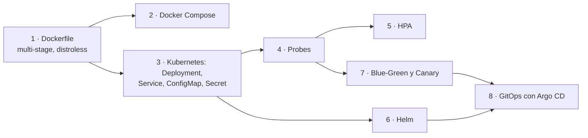
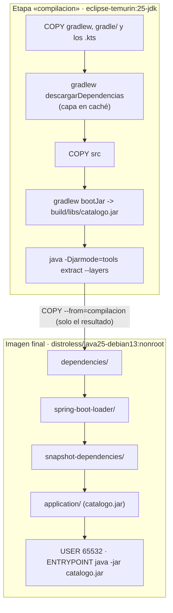
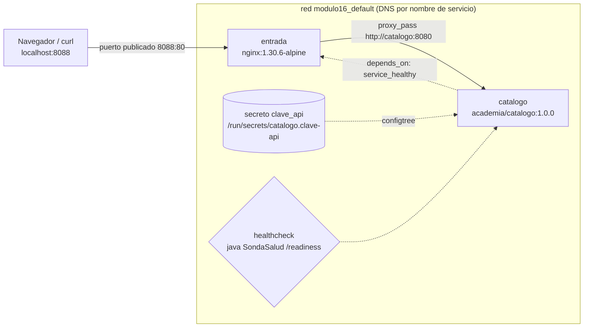
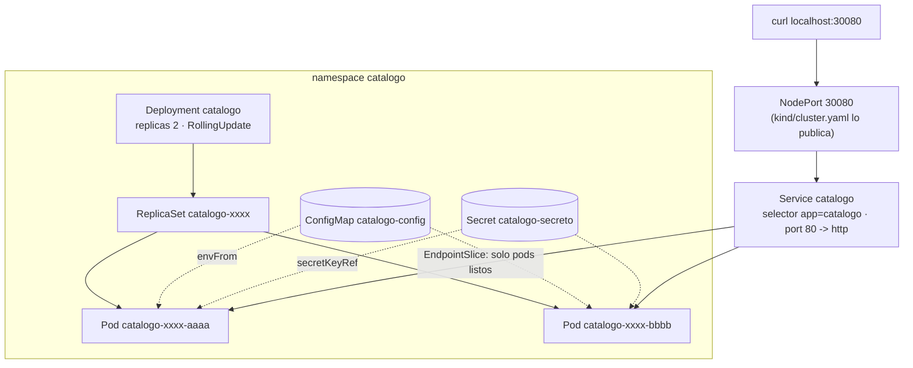
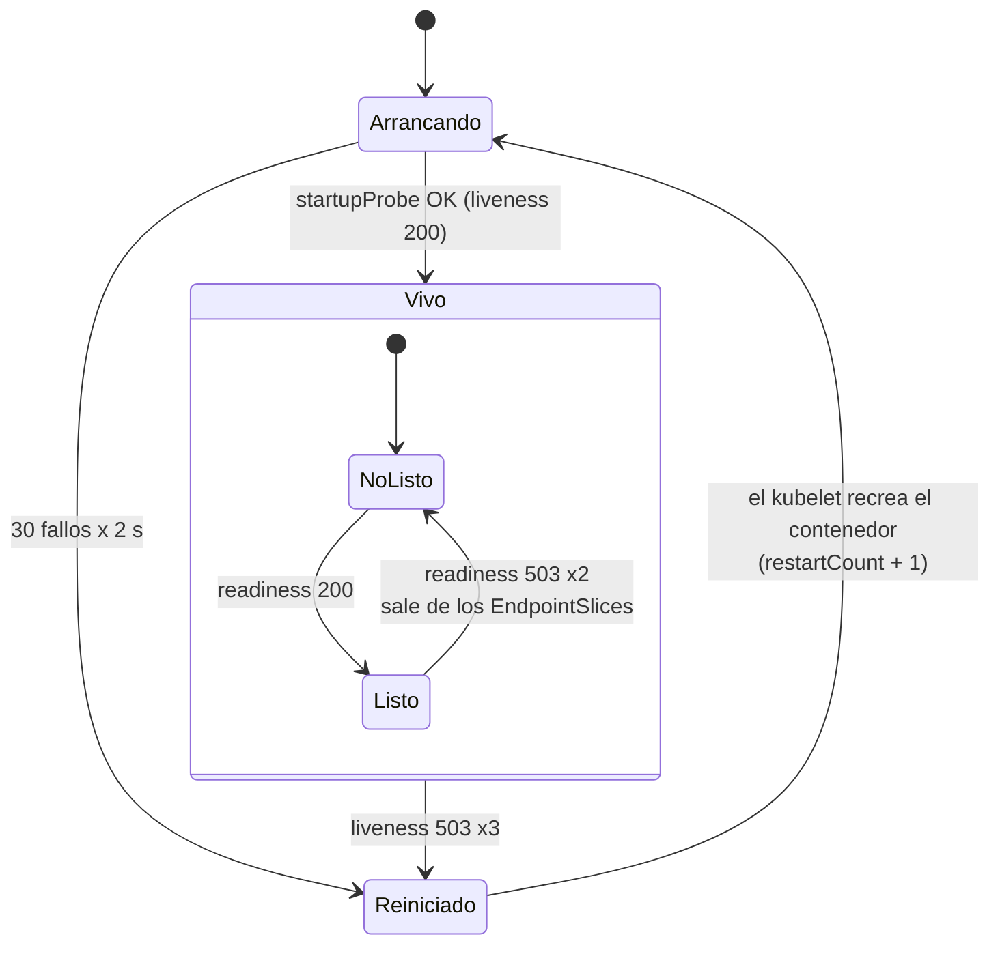
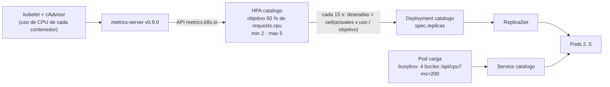
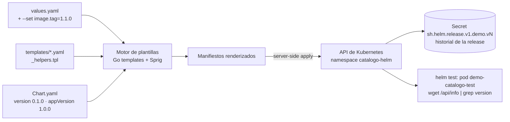
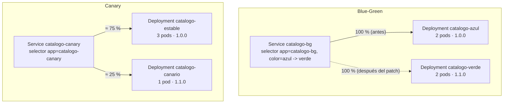
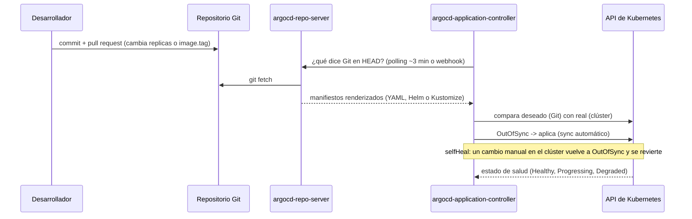

# Módulo 12 · Docker, Kubernetes y despliegue

**Fase 1 · Spring Boot de cero a experto** (semana 12 de 12). **Duración:** 22 h (8 temas de 2–3,5 h).
**Dificultad:** 4 de 5. **Dependencias:** Módulo 0.5 (Docker básico: imagen, contenedor, `docker run`), Módulo 1
(perfiles y configuración externalizada), Módulo 7 del curso (Spring Cloud: por qué un servicio necesita un nombre
estable) y Módulo 10 (Actuator y health). **Herramientas:**JDK 25 LTS**, **Spring Boot 4.1.3**, Docker Engine 29 con
Compose v5, imágenes `eclipse-temurin:25-jdk` y `gcr.io/distroless/java25-debian13:nonroot`, **kind v0.33.0**
con **Kubernetes 1.37.0**, kubectl 1.37, metrics-server v0.9.0, **Helm 4.3.1** y **Argo CD v3.5.6**..sh`).

Hasta ahora tus servicios corrían con `./gradlew bootRun`. Producción es otra cosa: el código se empaqueta en una
**imagen** inmutable, varias imágenes se levantan juntas con **Compose** en tu máquina, y en el clúster
**Kubernetes** mantiene vivas las réplicas, les da un nombre estable, les inyecta configuración y secretos, sabe si
están sanas, las multiplica con la carga, y las actualiza sin cortar el servicio. **Helm** empaqueta todo eso y
**Argo CD** hace que Git sea la única fuente de verdad. En este módulo haces todo el recorrido con **un mismo
servicio**, el catálogo.



**Texto alternativo:** diagrama de izquierda a derecha. El tema 1 (Dockerfile multi-stage y distroless) lleva al tema
2 (Docker Compose) y al tema 3 (Kubernetes: Deployment, Service, ConfigMap y Secret). Del 3 salen el tema 4 (probes),
que lleva al 5 (HPA) y al 7 (Blue-Green y Canary), y el tema 6 (Helm). Los temas 6 y 7 confluyen en el 8 (GitOps con
Argo CD).

| Herramienta | Versión | Dónde se fija |
|---|---|---|
| Spring Boot (Actuator, probes) | 4.1.3 | `app/gradle/libs.versions.toml` |
| Imagen de compilación | `eclipse-temurin:25-jdk` + Gradle 9.9.2 por el wrapper | `app/Dockerfile` |
| Imagen de ejecución | `gcr.io/distroless/java25-debian13:nonroot` (Temurin 25 sobre Debian 13) | `app/Dockerfile` |
| Docker Compose | v5 (especificación Compose) · `nginx:1.30.6-alpine` | `docker-compose.yml` |
| kind / nodo | v0.33.0 / `kindest/node:v1.37.0@sha256:a1ed56cf…` | `kind/cluster.yaml` |
| metrics-server | v0.9.0 | `pruebas/f085-hpa.sh` |
| Helm | 4.3.1 (chart `apiVersion: v2`) | `charts/catalogo/` |
| Argo CD | v3.5.6 | `pruebas/f088-argocd.sh` |

La aplicación que viaja por todo el módulo (`app/`): un catálogo con `/api/productos`, `/api/info` (qué versión,
color y pod responden, y si la clave del API está configurada, sin mostrarla), `/api/cpu?ms=` (genera carga para el
HPA), los endpoints de Actuator `/actuator/health/liveness` y `/actuator/health/readiness`, y tres endpoints
**solo de laboratorio** para cambiar a mano el estado de las probes.

> **Build con Gradle (y su equivalencia en Maven).** Este laboratorio se construye con **Gradle 9.9.2** y Kotlin DSL
> mediante el wrapper `./gradlew` (no instalas Gradle). `settings.gradle.kts` lista los subproyectos (en Maven,
> `<modules>` del POM agregador), cada carpeta tiene su `build.gradle.kts` (su `pom.xml`) y
> `gradle/libs.versions.toml` es el **catálogo de versiones** (las `<properties>` y el `dependencyManagement`): por eso
> las dependencias se escriben `libs.…`. Equivalencias: `./mvnw test` → `./gradlew test` ·
> `./mvnw package -DskipTests` → `./gradlew bootJar` · `./mvnw spring-boot:run` → `./gradlew bootRun` ·
> `-Dtest=Clase` → `--tests Clase` · `target/` → `build/` (el jar queda en `build/libs/`). Gradle escribe una línea
> `PASSED` por test y termina con `BUILD SUCCESSFUL` (Maven: `Tests run: N` y `BUILD SUCCESS`).
> Aquí el build es de **un solo proyecto** y vive entero en `app/` (wrapper incluido), porque `app/` es el contexto de
> `docker build`: los comandos de Gradle se ejecutan desde `app/`.

`modulo-16/app/settings.gradle.kts`:

```kotlin
// Módulo 12 (modulo-16) · Build de un solo proyecto: el servicio «catalogo», la misma imagen que usan las 8 fichas
// (Dockerfile, Compose, Kubernetes, probes, HPA, Helm, Blue-Green/Canary y Argo CD).
// El build completo (wrapper incluido) vive en app/ porque app/ es el contexto de "docker build".
pluginManagement {
    repositories {
        gradlePluginPortal()
        mavenCentral()
    }
}
// Sin esto, un alumno sin JDK 25 instalado ve el build morir en la configuración, antes de cualquier test.
plugins {
    id("org.gradle.toolchains.foojay-resolver-convention") version "1.0.0"
}

dependencyResolutionManagement {
    repositories {
        mavenCentral()
    }
}

rootProject.name = "catalogo"
```

`modulo-16/app/gradle/libs.versions.toml`:

```toml
# Módulo 12 (modulo-16) · Servicio «catalogo»
# Catálogo de versiones: una sola fuente para plugins y librerías.
# Las librerías SIN versión las fija el BOM de Spring Boot (spring-boot-dependencies).

[versions]
spring-boot = "4.1.3"

[libraries]
spring-boot-starter-webmvc = { module = "org.springframework.boot:spring-boot-starter-webmvc" }
spring-boot-starter-actuator = { module = "org.springframework.boot:spring-boot-starter-actuator" }
spring-boot-starter-test = { module = "org.springframework.boot:spring-boot-starter-test" }
spring-boot-starter-webmvc-test = { module = "org.springframework.boot:spring-boot-starter-webmvc-test" }
junit-platform-launcher = { module = "org.junit.platform:junit-platform-launcher" }

[plugins]
spring-boot = { id = "org.springframework.boot", version.ref = "spring-boot" }
spring-dependency-management = { id = "io.spring.dependency-management", version = "1.1.7" }
```

`app/build.gradle.kts`:

```kotlin
// Módulo 12 · Servicio «catalogo» que se empaqueta, se orquesta y se despliega (Spring Boot 4.1.3, JDK 25)
plugins {
    java
    alias(libs.plugins.spring.boot)
    alias(libs.plugins.spring.dependency.management)
}

group = "academia.microservicios"
version = "1.0.0"

java {
    toolchain {
        languageVersion = JavaLanguageVersion.of(25)
    }
}

dependencies {
    // Spring MVC 7 + Tomcat 11 + Jackson 3
    implementation(libs.spring.boot.starter.webmvc)
    // /actuator/health/liveness y /actuator/health/readiness para las probes de Kubernetes
    implementation(libs.spring.boot.starter.actuator)
    testImplementation(libs.spring.boot.starter.test)
    testImplementation(libs.spring.boot.starter.webmvc.test)
    // Gradle 9 exige declarar el lanzador de JUnit Platform (ya no lo añade por su cuenta)
    testRuntimeOnly(libs.junit.platform.launcher)
}

tasks.withType<Test> {
    useJUnitPlatform()
    testLogging {
        events("passed", "skipped", "failed")   // una línea por test en la consola
        // el mensaje completo de cada fallo (valor esperado y obtenido), no solo el tipo de excepción
        exceptionFormat = org.gradle.api.tasks.testing.logging.TestExceptionFormat.FULL
    }
}

// build/libs/catalogo.jar: el Dockerfile lo busca con este nombre (en Maven, <finalName>catalogo</finalName>)
tasks.bootJar {
    archiveFileName = "catalogo.jar"
}

// Descarga las dependencias sin compilar: en el Dockerfile, la capa que las contiene se reutiliza mientras
// no cambien los archivos de build (en Maven, dependency:go-offline).
tasks.register("descargarDependencias") {
    group = "build setup"
    description = "Resuelve y descarga las dependencias de compilación y de ejecución"
    val rutas = configurations.compileClasspath.get() + configurations.runtimeClasspath.get()
    doLast {
        println("Dependencias descargadas: ${rutas.files.size}")
    }
}
```

`app/src/main/resources/application.properties`:

```properties
spring.application.name=catalogo
server.port=8080
# Al recibir SIGTERM: deja de aceptar peticiones nuevas y termina las que están en curso (máx. 20 s).
server.shutdown=graceful
spring.lifecycle.timeout-per-shutdown-phase=20s
# Probes: /actuator/health/liveness y /actuator/health/readiness (Boot 4 las activa por defecto; se deja explícito).
management.endpoint.health.probes.enabled=true
management.endpoints.web.exposure.include=health,info
# Configuración del servicio. En contenedores llega por variables de entorno:
# CATALOGO_MENSAJE, CATALOGO_COLOR, CATALOGO_VERSION, CATALOGO_CLAVE_API (o un archivo con configtree).
catalogo.mensaje=Hola desde el catálogo
catalogo.color=sin-color
catalogo.version=desarrollo
catalogo.clave-api=
catalogo.arranque-lento-segundos=0
```

`app/src/main/java/academia/catalogo/CatalogoApp.java`:

```java
package academia.catalogo;

import org.springframework.boot.SpringApplication;
import org.springframework.boot.autoconfigure.SpringBootApplication;
import org.springframework.boot.context.properties.ConfigurationPropertiesScan;

/** Módulo 12 · El servicio «catalogo»: la misma imagen viaja de Docker a Compose, Kubernetes, Helm y Argo CD. */
@SpringBootApplication
@ConfigurationPropertiesScan
public class CatalogoApp {

    public static void main(String[] args) {
        SpringApplication.run(CatalogoApp.class, args);
    }
}
```

`app/src/main/java/academia/catalogo/CatalogoProperties.java`:

```java
package academia.catalogo;

import org.springframework.boot.context.properties.ConfigurationProperties;

/** catalogo.* · En Kubernetes: mensaje y color desde un ConfigMap, claveApi desde un Secret, version desde la imagen. */
@ConfigurationProperties("catalogo")
public record CatalogoProperties(String mensaje, String color, String version, String claveApi,
        int arranqueLentoSegundos) {
}
```

`app/src/main/java/academia/catalogo/CatalogoController.java`:

```java
package academia.catalogo;

import java.util.List;
import java.util.Map;

import org.springframework.web.bind.annotation.GetMapping;
import org.springframework.web.bind.annotation.RequestParam;
import org.springframework.web.bind.annotation.RestController;

@RestController
class CatalogoController {

    record Producto(String sku, String nombre, int precio) {
    }

    record Info(String version, String color, String mensaje, String pod, boolean claveApiConfigurada) {
    }

    private final CatalogoProperties props;

    CatalogoController(CatalogoProperties props) {
        this.props = props;
    }

    @GetMapping("/api/productos")
    List<Producto> productos() {
        return List.of(new Producto("A-1", "Teclado", 100), new Producto("A-2", "Ratón", 40));
    }

    /** Qué versión responde y desde qué pod: con esto se ven los Blue-Green, los Canary y los rollouts. */
    @GetMapping("/api/info")
    Info info() {
        String pod = System.getenv().getOrDefault("HOSTNAME", "local");
        boolean conClave = props.claveApi() != null && !props.claveApi().isBlank();
        // Nunca devuelvas el secreto: solo si está configurado.
        return new Info(props.version(), props.color(), props.mensaje(), pod, conClave);
    }

    /** Quema CPU durante «ms» milisegundos: genera la carga que hace escalar al HPA. */
    @GetMapping("/api/cpu")
    Map<String, Object> cpu(@RequestParam(defaultValue = "100") long ms) {
        long fin = System.nanoTime() + Math.min(ms, 2000) * 1_000_000;
        double x = 0;
        while (System.nanoTime() < fin) {
            x += Math.sqrt(x + 1);
        }
        return Map.of("ms", ms, "resultado", (long) x % 10);
    }
}
```

`app/src/main/java/academia/catalogo/DisponibilidadController.java`:

```java
package academia.catalogo;

import java.util.Map;

import org.springframework.boot.availability.AvailabilityChangeEvent;
import org.springframework.boot.availability.LivenessState;
import org.springframework.boot.availability.ReadinessState;
import org.springframework.context.ApplicationContext;
import org.springframework.web.bind.annotation.PostMapping;
import org.springframework.web.bind.annotation.RestController;

/**
 * SOLO PARA EL LABORATORIO: cambia a mano el estado que leen las probes de Kubernetes.
 * En una app real nadie expone esto: el estado lo cambia Spring (arranque, apagado) o tu código ante un fallo
 * interno irrecuperable (p. ej. un pool de hilos bloqueado).
 */
@RestController
class DisponibilidadController {

    private final ApplicationContext contexto;

    DisponibilidadController(ApplicationContext contexto) {
        this.contexto = contexto;
    }

    /** liveness -> DOWN (503): el kubelet reiniciará el contenedor tras failureThreshold fallos. */
    @PostMapping("/admin/liveness/romper")
    Map<String, String> romperLiveness() {
        AvailabilityChangeEvent.publish(contexto, LivenessState.BROKEN);
        return Map.of("liveness", "BROKEN");
    }

    /** readiness -> OUT_OF_SERVICE (503): el pod sale de los endpoints del Service, pero NO se reinicia. */
    @PostMapping("/admin/readiness/rechazar")
    Map<String, String> rechazarTrafico() {
        AvailabilityChangeEvent.publish(contexto, ReadinessState.REFUSING_TRAFFIC);
        return Map.of("readiness", "REFUSING_TRAFFIC");
    }

    @PostMapping("/admin/readiness/aceptar")
    Map<String, String> aceptarTrafico() {
        AvailabilityChangeEvent.publish(contexto, ReadinessState.ACCEPTING_TRAFFIC);
        return Map.of("readiness", "ACCEPTING_TRAFFIC");
    }
}
```

`app/src/main/java/academia/catalogo/ArranqueLento.java`:

```java
package academia.catalogo;

import org.slf4j.Logger;
import org.slf4j.LoggerFactory;
import org.springframework.boot.ApplicationArguments;
import org.springframework.boot.ApplicationRunner;
import org.springframework.stereotype.Component;

/**
 * Simula una tarea de arranque (calentar una caché, migrar datos). Mientras corre, la app está «viva» (liveness UP)
 * pero «no lista» (readiness todavía no es ACCEPTING_TRAFFIC): Spring publica ACCEPTING_TRAFFIC al terminar los runners.
 */
@Component
class ArranqueLento implements ApplicationRunner {

    private static final Logger log = LoggerFactory.getLogger(ArranqueLento.class);
    private final CatalogoProperties props;

    ArranqueLento(CatalogoProperties props) {
        this.props = props;
    }

    @Override
    public void run(ApplicationArguments args) throws Exception {
        if (props.arranqueLentoSegundos() > 0) {
            log.info("Calentando caché durante {} s...", props.arranqueLentoSegundos());
            Thread.sleep(props.arranqueLentoSegundos() * 1000L);
            log.info("Caché caliente");
        }
    }
}
```

`app/src/main/java/academia/catalogo/SondaSalud.java`:

```java
package academia.catalogo;

import java.net.URI;
import java.net.http.HttpClient;
import java.net.http.HttpRequest;
import java.net.http.HttpResponse;
import java.time.Duration;

/**
 * Healthcheck para imágenes distroless (no hay curl ni shell): «java -cp catalogo.jar academia.catalogo.SondaSalud URL».
 * Solo usa el JDK. Sale con 0 si la URL responde 200 y con 1 en cualquier otro caso.
 */
public final class SondaSalud {

    private SondaSalud() {
    }

    public static void main(String[] args) {
        String url = args.length > 0 ? args[0] : "http://localhost:8080/actuator/health/readiness";
        try {
            HttpResponse<Void> r = HttpClient.newBuilder().connectTimeout(Duration.ofSeconds(2)).build()
                    .send(HttpRequest.newBuilder(URI.create(url)).timeout(Duration.ofSeconds(2)).build(),
                            HttpResponse.BodyHandlers.discarding());
            System.exit(r.statusCode() == 200 ? 0 : 1);
        } catch (Exception e) {
            System.exit(1);
        }
    }
}
```

Sus tests (sin Docker ni clúster: `(cd app &&./gradlew test)` desde `modulo-16`):

`app/src/test/java/academia/catalogo/CatalogoTest.java`:

```java
package academia.catalogo;

import static org.springframework.test.web.servlet.request.MockMvcRequestBuilders.get;
import static org.springframework.test.web.servlet.request.MockMvcRequestBuilders.post;
import static org.springframework.test.web.servlet.result.MockMvcResultMatchers.jsonPath;
import static org.springframework.test.web.servlet.result.MockMvcResultMatchers.status;

import org.junit.jupiter.api.Test;
import org.springframework.beans.factory.annotation.Autowired;
import org.springframework.boot.test.context.SpringBootTest;
import org.springframework.boot.webmvc.test.autoconfigure.AutoConfigureMockMvc;
import org.springframework.test.annotation.DirtiesContext;
import org.springframework.test.web.servlet.MockMvc;

/**
 * La configuración llega como la daría Kubernetes (variables ya convertidas a propiedades) y las probes
 * responden a los cambios de estado. Sin Docker ni clúster: corre en segundos.
 */
@SpringBootTest(properties = {"catalogo.color=azul", "catalogo.version=1.0.0", "catalogo.clave-api=secreta"})
@AutoConfigureMockMvc
class CatalogoTest {

    @Autowired MockMvc mvc;

    @Test
    void infoMuestraLaConfiguracionPeroNoElSecreto() throws Exception {
        mvc.perform(get("/api/info"))
                .andExpect(status().isOk())
                .andExpect(jsonPath("$.version").value("1.0.0"))
                .andExpect(jsonPath("$.color").value("azul"))
                .andExpect(jsonPath("$.claveApiConfigurada").value(true))
                .andExpect(jsonPath("$.claveApi").doesNotExist());
    }

    @Test
    void lasProbesEstanArribaAlArrancar() throws Exception {
        mvc.perform(get("/actuator/health/liveness")).andExpect(status().isOk())
                .andExpect(jsonPath("$.status").value("UP"));
        mvc.perform(get("/actuator/health/readiness")).andExpect(status().isOk())
                .andExpect(jsonPath("$.status").value("UP"));
    }

    @Test
    void readinessRechazandoTraficoDevuelve503YLivenessSigueArriba() throws Exception {
        mvc.perform(post("/admin/readiness/rechazar")).andExpect(status().isOk());
        mvc.perform(get("/actuator/health/readiness")).andExpect(status().isServiceUnavailable())
                .andExpect(jsonPath("$.status").value("OUT_OF_SERVICE"));
        mvc.perform(get("/actuator/health/liveness")).andExpect(status().isOk());
        mvc.perform(post("/admin/readiness/aceptar")).andExpect(status().isOk());
        mvc.perform(get("/actuator/health/readiness")).andExpect(status().isOk());
    }

    @Test
    @DirtiesContext   // la liveness queda rota: Spring descarta este contexto y los demás tests usan uno nuevo
    void livenessRotaDevuelve503() throws Exception {
        mvc.perform(post("/admin/liveness/romper")).andExpect(status().isOk());
        mvc.perform(get("/actuator/health/liveness")).andExpect(status().isServiceUnavailable())
                .andExpect(jsonPath("$.status").value("DOWN"));
    }

    @Test
    void cpuQuemaElTiempoPedido() throws Exception {
        mvc.perform(get("/api/cpu").param("ms", "50")).andExpect(status().isOk())
                .andExpect(jsonPath("$.ms").value(50));
    }
}
```

Las pruebas de las fichas comparten estas funciones (compatibles con bash 3.2 de macOS):

`pruebas/comun.sh`:

```bash
# Funciones compartidas por las pruebas del Módulo 12. Compatible con bash 3.2 (macOS): sin arrays ni «timeout».
# Se carga con:  . "$(dirname "$0")/comun.sh"
CLUSTER=academia-m12
K="kubectl --context kind-$CLUSTER"

ok() { echo "   ✔ $*"; }
mal() { echo "   ✘ $*"; return 1; }

# esperar SEGUNDOS "descripción" comando args...  -> repite el comando cada 2 s hasta que salga con 0
esperar() {
  limite=$((SECONDS + $1))
  descripcion=$2
  shift 2
  while [ "$SECONDS" -lt "$limite" ]; do
    if "$@" >/dev/null 2>&1; then
      ok "$descripcion"
      return 0
    fi
    sleep 2
  done
  mal "$descripcion (no ocurrió en el tiempo esperado)"
}

# contiene "texto" comando args...  -> el comando imprime algo que contiene el texto
contiene() {
  esperado=$1
  shift
  salida=$("$@" 2>&1)
  # JSON y YAML se comparan sin espacios: {"a": 1} y {"a":1} cuentan igual
  compacta=$(printf '%s' "$salida" | tr -d ' \t')
  buscado=$(printf '%s' "$esperado" | tr -d ' \t')
  case "$compacta" in
    *"$buscado"*) ok "contiene «${esperado}»"; return 0 ;;
    *) echo "$salida" | head -20; mal "no contiene «${esperado}»" ;;
  esac
}

# Cuántos endpoints LISTOS tiene un Service (EndpointSlices; Endpoints v1 está obsoleto desde Kubernetes 1.33).
endpoints_listos() {   # endpoints_listos namespace servicio
  $K -n "$1" get endpointslices -l "kubernetes.io/service-name=$2" \
    -o jsonpath='{range .items[*].endpoints[*]}{.conditions.ready}{"\n"}{end}' | grep -c true
}

# hay_endpoints namespace servicio N  -> exactamente N endpoints listos
hay_endpoints() {
  [ "$(endpoints_listos "$1" "$2")" -eq "$3" ]
}

# jsonpath_es namespace recurso jsonpath valor  -> el campo tiene exactamente ese valor
jsonpath_es() {
  [ "$($K -n "$1" get $2 -o jsonpath="$3")" = "$4" ]
}

# jsonpath_mayor namespace recurso jsonpath N  -> el campo (numérico) es mayor que N
jsonpath_mayor() {
  v=$($K -n "$1" get $2 -o jsonpath="$3")
  [ -n "$v" ] && [ "$v" -gt "$4" ]
}

# responde_con url texto  -> GET url contiene el texto
responde_con() {
  curl -s "$1" | tr -d ' \t' | grep -qF "$(printf '%s' "$2" | tr -d ' \t')"
}

# pods_vivos namespace selector  -> nombres de los pods que NO se están borrando (sin deletionTimestamp), uno por línea
pods_vivos() {
  $K -n "$1" get pods -l "$2" \
    -o jsonpath='{range .items[*]}{.metadata.name}{" "}{.metadata.deletionTimestamp}{"\n"}{end}' | awk 'NF == 1 {print $1}'
}

# pods_asentados namespace selector N  -> hay exactamente N pods, ninguno terminando (un rollout deja pods viejos
# en Terminating unos segundos: preStop + apagado ordenado) y el Service ya tiene N endpoints listos
pods_asentados() {
  total=$($K -n "$1" get pods -l "$2" -o name | wc -l | tr -d ' ')
  vivos=$(pods_vivos "$1" "$2" | wc -l | tr -d ' ')
  [ "$total" -eq "$3" ] && [ "$vivos" -eq "$3" ]
}
```

---


### Dockerfile multi-stage, distroless

<details open>
<summary><strong>Capa 1 — Lectura</strong></summary>

#### ► DE QUÉ TRATA
Construir una imagen de producción para un servicio Spring Boot con un Dockerfile multi-stage (compilar en una etapa, ejecutar en otra) sobre una base distroless, y justificar cada decisión (capas, usuario, ENTRYPOINT, memoria); lo compruebas cuando pruebas/f081-imagen.sh pasa: l…

#### ► LA IDEA EN UNA FRASE
**Construir una imagen de producción para un servicio Spring Boot con un Dockerfile multi-stage (compilar en una etapa, ejecutar en otra) sobre una base distroless, y justificar cada decisión (capas, usuario, ENTRYPOINT, memoria); lo compruebas cuando pruebas/f081-imagen.sh pasa: la imagen no corre como root, no tiene shell, es más pequeña que la versión ingenua, responde "version":"1.0.0" y se apaga con código 143 al recibir SIGTERM.**

#### ► POR QUÉ EXISTE ESTO
Un Dockerfile es la receta para crear una imagen: un paquete con tu programa y todo lo que necesita para correr.

#### ► LA ANALOGÍA
Piensa en dockerfile multi-stage, distroless como una herramienta de taller: útil cuando conoces su propósito y sus límites.
**Dónde se rompe la analogía:** en software, los efectos dependen del contexto, la escala y los trade-offs.

#### ► CÓMO FUNCIONA


1. Para **compilar** un programa Java necesitas muchas herramientas (el JDK completo, Gradle, el código fuente). Para
2. Un Dockerfile **multi-stage** tiene varias etapas: una compila, otra ejecuta. La imagen final solo contiene la
3. **Distroless** es una imagen base que trae solo lo imprescindible para ejecutar Java: sin terminal (`sh`), sin

#### ► LO QUE PUEDE SALIR MAL
| Síntoma | Causa probable | Arreglo |
|---|---|---|
| Dockerfile multi-stage, distroless se aplica pero el resultado no mejora | Se usó sin medir el problema real | Mide antes y compara contra la alternativa simple |
| Aparece complejidad inesperada | Se adoptó la técnica sin comprender sus trade-offs | Vuelve a la sección de trade-offs y reduce el alcance |
| Falla en un caso límite | Se asumió un contexto que no se cumple | Prueba el caso límite y documenta cuándo NO usarlo |

#### ► TRADE-OFFS
| Opción | Cuándo usarla | Cuándo NO usarla |
|---|---|---|
| Usar Dockerfile multi-stage, distroless | Cuando el problema coincide con su propósito y el beneficio es observable | Cuando agrega complejidad sin resolver un problema real |
| Alternativa más simple | Cuando el contexto es pequeño, estable o fácil de razonar | Cuando ya demostró no escalar o no cumplir el requisito |
| Postergar la decisión | Cuando falta evidencia del problema | Cuando el costo de esperar es mayor que el costo de probar |

#### ► CUÁNDO NO USAR ESTO
La imagen «todo en uno». Se ve como app/Dockerfile.ingenuo: una sola etapa con el JDK, Gradle, el código fuente, la caché de Gradle y CMD en forma shell, corriendo como root. Es lenta de construir (cualquier cambio vuelve a descargar dependencias), pesada de distribuir, llena de CVE ajenos a tu código, con el código fuente dentro y sin apagado orde…

#### ► DE VUELTA A LA ANALOGÍA
Volviendo a la analogía: dockerfile multi-stage, distroless funciona como el modelo inicial, pero recuerda dónde se rompe: en producción importan la evidencia, la escala y el costo de equivocarte.

#### ► LO QUE DEBES RECORDAR
- Para **compilar** un programa Java necesitas muchas herramientas (el JDK completo, Gradle, el código fuente). Para
- Un Dockerfile **multi-stage** tiene varias etapas: una compila, otra ejecuta. La imagen final solo contiene la
- **Distroless** es una imagen base que trae solo lo imprescindible para ejecutar Java: sin terminal (`sh`), sin

#### ► PREGUNTAS PARA PENSAR
1. ¿Qué problema concreto resuelve dockerfile multi-stage, distroless en tu contexto?
2. ¿Cómo sabrías que dockerfile multi-stage, distroless no está funcionando bien?
3. ¿Qué alternativa más simple considerarías antes de usar dockerfile multi-stage, distroless?

</details>

<details>
<summary><strong>Capa 2 — Construcción</strong></summary>

#### Construcción guiada
1. Construye las dos imágenes y compáralas (desde el código de este tema):

```bash
docker build --provenance=false -t academia/catalogo:1.0.0 app
docker build --provenance=false -f app/Dockerfile.ingenuo -t academia/catalogo:ingenuo app
docker image ls academia/catalogo
```

   **Output esperado:** dos filas, `1.0.0` e `ingenuo`. La `ingenuo` incluye el JDK completo, Gradle, la caché
   de dependencias (`/root/.gradle`) y el código fuente, así que es **mucho** más grande que la distroless; anota
   tus dos tamaños (pendiente de medir en el Mac del dueño). `--provenance=false` evita que BuildKit añada un
   manifiesto de atestación, que en Docker Desktop con el almacén de imágenes de containerd puede impedir después
   `kind load docker-image`.

2. Cambia una línea de `CatalogoController.java` (por ejemplo, el nombre de un producto) y reconstruye la `1.0.0`.

   **Output esperado:** BuildKit marca `CACHED` en los `COPY` del wrapper y de los archivos de build y en
   `RUN./gradlew --no-daemon -q descargarDependencias` (pendiente de verificación en el Mac); solo se
   repiten `COPY src`, `gradlew bootJar`, la extracción y la última capa `application/`. Reconstruye la `ingenuo` con el
   mismo cambio: descarga otra vez todas las dependencias, porque `COPY..` invalidó la caché.

3. Pásale la prueba:

```bash
./pruebas/f081-imagen.sh
```

   **Output esperado** (los tamaños dependen de tu máquina y de las imágenes base del día):

```text
   usuario de la imagen: «65532»
   ✔ no corre como root
   ✔ no hay shell dentro de la imagen
   tamaño distroless: … MB
   tamaño ingenuo:    … MB
   ✔ la imagen multi-stage es más pequeña
   ✔ el contenedor responde en :18081
   ✔ contiene «"version":"1.0.0"»
   docker stop: código 143 en 1 s
   ✔ java es PID 1 y atiende SIGTERM
```

   **Captura comentada:** `143 = 128 + 15`: el proceso terminó por SIGTERM (señal 15) y Spring cerró de forma ordenada
   (`server.shutdown=graceful`). Si vieras `137` (128 + 9) tras 10 s, Docker habría tenido que matar el proceso con
   SIGKILL. El usuario puede aparecer como número (`65532`) según cómo se construyó la imagen base; lo importante es que
   no sea vacío, `0` ni `root`.

4. **Rómpelo a propósito: forma shell.** En `app/Dockerfile` cambia la última línea por
   `ENTRYPOINT java -jar catalogo.jar` y reconstruye.

   **Output esperado:** BuildKit avisa con la regla `JSONArgsRecommended` («JSON arguments recommended for
   ENTRYPOINT/CMD to prevent unintended behavior related to OS signals») y el contenedor **no arranca**: la forma
   shell ejecuta `/bin/sh -c...` y distroless no tiene `/bin/sh`. Restaura la forma exec.

#### Código de referencia / ejecutable
Versiones: **JDK 25**, **Spring Boot 4.1.3**, base de compilación `eclipse-temurin:25-jdk` (Gradle 9.9.2 lo
descarga el wrapper), base de ejecución `gcr.io/distroless/java25-debian13:nonroot`, Docker Engine 29 con BuildKit.

`app/Dockerfile`:

```dockerfile
# syntax=docker/dockerfile:1
# F081 · Dockerfile multi-stage + distroless para el servicio «catalogo» (Spring Boot 4.1.3, JDK 25)
#   docker build -t academia/catalogo:1.0.0 app
#   docker build -t academia/catalogo:1.1.0 --build-arg VERSION=1.1.0 app

# ---------- Etapa 1: compilar (JDK completo + Gradle por el wrapper; NO llega a la imagen final) ----------
FROM eclipse-temurin:25-jdk AS compilacion
WORKDIR /fuente
# 1) Solo el wrapper y los archivos de build: estas capas (Gradle y las dependencias) se reutilizan
#    mientras no cambien. --no-daemon: el contenedor de compilación se desecha, no hace falta el daemon.
COPY gradlew ./
COPY gradle ./gradle
RUN ./gradlew --no-daemon --version
COPY settings.gradle.kts build.gradle.kts ./
RUN ./gradlew --no-daemon -q descargarDependencias
# 2) El código cambia a menudo: va DESPUÉS, para no invalidar la capa de dependencias.
COPY src ./src
RUN ./gradlew --no-daemon -q bootJar
# 3) Extrae el jar en capas: dependencias, loader, snapshots y aplicación (de menos a más cambiante).
RUN java -Djarmode=tools -jar build/libs/catalogo.jar extract --layers --destination extraido

# ---------- Etapa 2: ejecutar (solo la JRE 25; sin shell, sin apt, usuario no root 65532) ----------
FROM gcr.io/distroless/java25-debian13:nonroot
WORKDIR /app
COPY --from=compilacion /fuente/extraido/dependencies/ ./
COPY --from=compilacion /fuente/extraido/spring-boot-loader/ ./
COPY --from=compilacion /fuente/extraido/snapshot-dependencies/ ./
COPY --from=compilacion /fuente/extraido/application/ ./
# La versión queda grabada en la imagen: /api/info la muestra (Blue-Green y Canary la usan para distinguir pods).
ARG VERSION=1.0.0
ENV CATALOGO_VERSION=${VERSION}
# La JVM respeta el límite de memoria del contenedor; 75 % para el heap, el resto para metaspace, hilos y buffers.
ENV JAVA_TOOL_OPTIONS="-XX:MaxRAMPercentage=75"
EXPOSE 8080
# Forma «exec» (JSON): java es el PID 1 y recibe SIGTERM directamente (apagado ordenado).
ENTRYPOINT ["java", "-jar", "catalogo.jar"]
```

`app/.dockerignore`:

```text
# El contexto de construcción es app/: no envíes al daemon lo que no hace falta (ni secretos).
build/
.gradle/
*.iml
.idea/
.env
```

La versión ingenua, solo para comparar:

`app/Dockerfile.ingenuo`:

```dockerfile
# F081 · ANTI-PATRÓN (solo para comparar tamaños y tiempos): una sola etapa con JDK + Gradle + código fuente.
#   docker build -f app/Dockerfile.ingenuo -t academia/catalogo:ingenuo app
FROM eclipse-temurin:25-jdk
WORKDIR /fuente
# Copia TODO de una vez: cualquier cambio en el código invalida la caché y vuelve a descargar las dependencias.
COPY . .
RUN ./gradlew --no-daemon -q bootJar
# Corre como root, con shell, Gradle, el JDK completo y el código fuente dentro de la imagen.
CMD java -jar build/libs/catalogo.jar
```

La prueba de la ficha:

`pruebas/f081-imagen.sh`:

```bash
#!/usr/bin/env bash
# F081 · Test de la imagen: multi-stage + distroless. Requiere haber construido academia/catalogo:1.0.0
# (y, para comparar, academia/catalogo:ingenuo).
set -u
. "$(dirname "$0")/comun.sh"
fallos=0
IMG=academia/catalogo:1.0.0
if ! docker image inspect "$IMG" >/dev/null 2>&1; then
  mal "no existe la imagen $IMG: constrúyela con «docker build -t $IMG app»"
  exit 1
fi

usuario=$(docker image inspect -f '{{.Config.User}}' "$IMG")
echo "   usuario de la imagen: «${usuario}»"
case "$usuario" in
  ""|0|root|0:0) mal "la imagen corre como root" || fallos=$((fallos + 1)) ;;
  *) ok "no corre como root" ;;
esac

if docker run --rm --entrypoint sh "$IMG" -c "echo hola" >/dev/null 2>&1; then
  mal "la imagen tiene shell (no es distroless)" || fallos=$((fallos + 1))
else
  ok "no hay shell dentro de la imagen"
fi

tam=$(docker image inspect -f '{{.Size}}' "$IMG")
echo "   tamaño distroless: $((tam / 1000000)) MB"
if docker image inspect academia/catalogo:ingenuo >/dev/null 2>&1; then
  tam_ing=$(docker image inspect -f '{{.Size}}' academia/catalogo:ingenuo)
  echo "   tamaño ingenuo:    $((tam_ing / 1000000)) MB"
  if [ "$tam" -lt "$tam_ing" ]; then ok "la imagen multi-stage es más pequeña"; else mal "no es más pequeña" || fallos=$((fallos + 1)); fi
fi

docker rm -f f081-prueba >/dev/null 2>&1
docker run -d --name f081-prueba -p 18081:8080 "$IMG" >/dev/null
esperar 60 "el contenedor responde en :18081" curl -fs http://localhost:18081/actuator/health/readiness || fallos=$((fallos + 1))
contiene '"version":"1.0.0"' curl -s http://localhost:18081/api/info || fallos=$((fallos + 1))
# SIGTERM -> apagado ordenado: docker stop debe terminar con código 143 (128 + 15) en menos de 10 s
inicio=$SECONDS
docker stop f081-prueba >/dev/null
codigo=$(docker inspect -f '{{.State.ExitCode}}' f081-prueba)
echo "   docker stop: código $codigo en $((SECONDS - inicio)) s"
if [ "$codigo" = "143" ] && [ $((SECONDS - inicio)) -lt 10 ]; then ok "java es PID 1 y atiende SIGTERM"; else mal "apagado no ordenado" || fallos=$((fallos + 1)); fi
docker rm f081-prueba >/dev/null
[ "$fallos" -eq 0 ]
```

#### Verificación
Test que debe pasar:

```bash
./pruebas/f081-imagen.sh
```

Resultado esperado: termina con código 0 (todas las líneas con ✔).

Reto: escribe un test JUnit en `app/src/test/java/academia/catalogo/` que lea `app/Dockerfile` (ruta relativa
`Dockerfile` desde el módulo `app`) y compruebe tres reglas: que hay al menos dos `FROM`, que la última `FROM` contiene
`distroless` y que el `ENTRYPOINT` empieza por `[`. Es una *fitness function* de imagen (Módulo 24):

```java
@Test
void elDockerfileCumpleLasReglasDeLaCasa() throws Exception {
    List<String> lineas = Files.readAllLines(Path.of("Dockerfile"));
    List<String> froms = lineas.stream().filter(l -> l.startsWith("FROM ")).toList();
    assertThat(froms).hasSizeGreaterThanOrEqualTo(2);
    assertThat(froms.getLast()).contains("distroless");
    assertThat(lineas).anyMatch(l -> l.startsWith("ENTRYPOINT ["));
}
```

**Pregunta de comprobación:** ¿por qué `COPY settings.gradle.kts build.gradle.kts./` va antes que `COPY src./src`?

<details>
<summary>Respuesta</summary>

Porque Docker reutiliza una capa mientras no cambien sus entradas ni las de las capas anteriores. Los archivos de build cambian
poco; el código, mucho. Si las dependencias se descargan en una capa que solo depende de esos archivos, un cambio de
código reutiliza esa capa y la construcción tarda segundos en lugar de minutos.
</details>

</details>

### Docker Compose

<details open>
<summary><strong>Capa 1 — Lectura</strong></summary>

#### ► DE QUÉ TRATA
Orquestar en local un servicio y su puerta de entrada con Docker Compose, con healthcheck, dependencia por salud, configuración por variables y un secreto montado como archivo, y explicar qué hace Compose y qué no; lo compruebas cuando pruebas/f082-compose.sh pasa: el catálogo qu…

#### ► LA IDEA EN UNA FRASE
**Orquestar en local un servicio y su puerta de entrada con Docker Compose, con healthcheck, dependencia por salud, configuración por variables y un secreto montado como archivo, y explicar qué hace Compose y qué no; lo compruebas cuando pruebas/f082-compose.sh pasa: el catálogo queda healthy, nginx arranca después y /api/info responde con el mensaje de Compose y "claveApiConfigurada":true.**

#### ► POR QUÉ EXISTE ESTO
Un sistema real tiene varias piezas: tu servicio, una base de datos, un proxy… Arrancarlas una por una con docker run y acordarte de todas las opciones es tedioso y fácil de equivocar.

#### ► LA ANALOGÍA
Piensa en docker compose como una herramienta de taller: útil cuando conoces su propósito y sus límites.
**Dónde se rompe la analogía:** en software, los efectos dependen del contexto, la escala y los trade-offs.

#### ► CÓMO FUNCIONA


1. Un sistema real tiene varias piezas: tu servicio, una base de datos, un proxy… Arrancarlas una por una con docker run y acordarte de todas las opciones es tedioso y fácil de equivocar.

#### ► LO QUE PUEDE SALIR MAL
| Síntoma | Causa probable | Arreglo |
|---|---|---|
| Docker Compose se aplica pero el resultado no mejora | Se usó sin medir el problema real | Mide antes y compara contra la alternativa simple |
| Aparece complejidad inesperada | Se adoptó la técnica sin comprender sus trade-offs | Vuelve a la sección de trade-offs y reduce el alcance |
| Falla en un caso límite | Se asumió un contexto que no se cumple | Prueba el caso límite y documenta cuándo NO usarlo |

#### ► TRADE-OFFS
| Opción | Cuándo usarla | Cuándo NO usarla |
|---|---|---|
| Usar Docker Compose | Cuando el problema coincide con su propósito y el beneficio es observable | Cuando agrega complejidad sin resolver un problema real |
| Alternativa más simple | Cuando el contexto es pequeño, estable o fácil de razonar | Cuando ya demostró no escalar o no cumplir el requisito |
| Postergar la decisión | Cuando falta evidencia del problema | Cuando el costo de esperar es mayor que el costo de probar |

#### ► CUÁNDO NO USAR ESTO
El docker-compose.yml con secretos en claro y todos los puertos abiertos. Se ve así:

#### ► DE VUELTA A LA ANALOGÍA
Volviendo a la analogía: docker compose funciona como el modelo inicial, pero recuerda dónde se rompe: en producción importan la evidencia, la escala y el costo de equivocarte.

#### ► LO QUE DEBES RECORDAR
- Un sistema real tiene varias piezas: tu servicio, una base de datos, un proxy… Arrancarlas una por una con docker run y acordarte de todas las opciones es tedioso y fácil de equivocar.

#### ► PREGUNTAS PARA PENSAR
1. ¿Qué problema concreto resuelve docker compose en tu contexto?
2. ¿Cómo sabrías que docker compose no está funcionando bien?
3. ¿Qué alternativa más simple considerarías antes de usar docker compose?

</details>

<details>
<summary><strong>Capa 2 — Construcción</strong></summary>

#### Código y verificación


```yaml
# F082 · Docker Compose: el «catalogo» detrás de un nginx, con healthcheck, dependencia por salud,
# configuración por variables y un secreto montado como archivo.
# Arranca:   docker compose up -d --build --wait     -> http://localhost:8088/api/info
# Logs:      docker compose logs -f catalogo
# Detén:     docker compose down
name: modulo16
services:
  catalogo:
    build:
      context: ./app
      args:
        VERSION: "1.0.0"
    image: academia/catalogo:1.0.0
    environment:
      CATALOGO_MENSAJE: "Hola desde Docker Compose"
      CATALOGO_COLOR: "compose"
      # Lee cada archivo de /run/secrets como una propiedad: /run/secrets/catalogo.clave-api -> catalogo.clave-api
      SPRING_CONFIG_IMPORT: "optional:configtree:/run/secrets/"
    secrets:
      - source: clave_api
        target: catalogo.clave-api
    # Sin «ports»: el catálogo solo es accesible dentro de la red de Compose (nginx entra por el nombre del servicio).
    healthcheck:
      # La imagen distroless no tiene curl ni shell: la sonda es una clase Java dentro del jar.
      test: ["CMD", "java", "-cp", "/app/catalogo.jar", "academia.catalogo.SondaSalud",
             "http://localhost:8080/actuator/health/readiness"]
      interval: 10s
      timeout: 5s
      retries: 12
      start_period: 30s
    deploy:
      resources:
        limits:
          memory: 512m
    restart: unless-stopped

  entrada:
    image: nginx:1.30.6-alpine
    ports:
      - "8088:80"
    volumes:
      - ./compose/nginx.conf:/etc/nginx/conf.d/default.conf:ro
    depends_on:
      catalogo:
        condition: service_healthy   # nginx no arranca hasta que el catálogo esté LISTO, no solo «iniciado»
    healthcheck:
      # 127.0.0.1 y no «localhost»: en Alpine localhost resuelve primero a ::1 y nginx escucha solo en IPv4.
      test: ["CMD-SHELL", "wget -q -O- http://127.0.0.1/salud-entrada >/dev/null"]
      interval: 5s
      timeout: 3s
      retries: 10

secrets:
  clave_api:
    file: ./compose/clave-api.txt
```

```nginx
# nginx como puerta de entrada: el nombre «catalogo» lo resuelve el DNS interno de Compose.
server {
    listen 80;

    location = /salud-entrada {
        return 200 "ok\n";
    }

    location / {
        proxy_pass http://catalogo:8080;
        proxy_set_header Host $host;
        proxy_set_header X-Forwarded-For $proxy_add_x_forwarded_for;
    }
}
```

```text
clave-de-laboratorio-no-es-secreta
```

```bash
#!/usr/bin/env bash
# F082 · Test de Docker Compose: nginx -> catalogo (healthy) con variables y secreto.
set -u
cd "$(dirname "$0")/.." || exit 1
. pruebas/comun.sh
fallos=0
docker compose up -d --build --wait || fallos=$((fallos + 1))
docker compose ps
contiene "healthy" docker compose ps catalogo || fallos=$((fallos + 1))
contiene '"mensaje":"Hola desde Docker Compose"' curl -s http://localhost:8088/api/info || fallos=$((fallos + 1))
contiene '"claveApiConfigurada":true' curl -s http://localhost:8088/api/info || fallos=$((fallos + 1))
# El catálogo NO publica puertos: solo se llega por nginx.
if curl -s -m 2 http://localhost:8080/api/info >/dev/null 2>&1; then
  echo "   (aviso: algo responde en :8080 del host; no debería ser el catálogo de Compose)"
fi
docker compose down
[ "$fallos" -eq 0 ]
```

```bash
docker compose up -d --build --wait
docker compose ps
```

</details>

### Kubernetes: Deployments, Services, ConfigMaps, Secrets

<details open>
<summary><strong>Capa 1 — Lectura</strong></summary>

#### ► DE QUÉ TRATA
Desplegar un servicio Spring Boot en Kubernetes con un Deployment, exponerlo con un Service, y configurarlo con un ConfigMap y un Secret, explicando qué controlador hace cada cosa; lo compruebas cuando pruebas/f083-objetos.sh pasa: 2 réplicas listas detrás del Service, /api/info…

#### ► LA IDEA EN UNA FRASE
**Desplegar un servicio Spring Boot en Kubernetes con un Deployment, exponerlo con un Service, y configurarlo con un ConfigMap y un Secret, explicando qué controlador hace cada cosa; lo compruebas cuando pruebas/f083-objetos.sh pasa: 2 réplicas listas detrás del Service, /api/info con el mensaje del ConfigMap y la clave del Secret, y un cambio de ConfigMap que solo se ve tras un rollout restart.**

#### ► POR QUÉ EXISTE ESTO
Kubernetes es un programa que administra contenedores en varias máquinas. Tú no le dices «arranca este contenedor»; le dices cómo quieres que esté el sistema («quiero 2 copias del catálogo») y Kubernetes trabaja sin parar para que la realidad se parezca a lo que pediste.

#### ► LA ANALOGÍA
Piensa en kubernetes: deployments, services, configmaps, secrets como una herramienta de taller: útil cuando conoces su propósito y sus límites.
**Dónde se rompe la analogía:** en software, los efectos dependen del contexto, la escala y los trade-offs.

#### ► CÓMO FUNCIONA


1. **Pod:** la unidad mínima; normalmente, un contenedor.
2. **Deployment:** «quiero N pods iguales con esta imagen»; si uno muere, crea otro; si cambias la imagen, los
3. **Service:** un nombre y una dirección **fijos** delante de los pods, que cambian de IP cada vez que se recrean.
4. **ConfigMap:** configuración (texto) separada de la imagen.
5. **Secret:** igual, pero para datos sensibles (claves, contraseñas).

#### ► LO QUE PUEDE SALIR MAL
| Síntoma | Causa probable | Arreglo |
|---|---|---|
| Kubernetes: Deployments, Services, ConfigMaps, Secrets se aplica pero el resultado no mejora | Se usó sin medir el problema real | Mide antes y compara contra la alternativa simple |
| Aparece complejidad inesperada | Se adoptó la técnica sin comprender sus trade-offs | Vuelve a la sección de trade-offs y reduce el alcance |
| Falla en un caso límite | Se asumió un contexto que no se cumple | Prueba el caso límite y documenta cuándo NO usarlo |

#### ► TRADE-OFFS
| Opción | Cuándo usarla | Cuándo NO usarla |
|---|---|---|
| Usar Kubernetes: Deployments, Services, ConfigMaps, Secrets | Cuando el problema coincide con su propósito y el beneficio es observable | Cuando agrega complejidad sin resolver un problema real |
| Alternativa más simple | Cuando el contexto es pequeño, estable o fácil de razonar | Cuando ya demostró no escalar o no cumplir el requisito |
| Postergar la decisión | Cuando falta evidencia del problema | Cuando el costo de esperar es mayor que el costo de probar |

#### ► CUÁNDO NO USAR ESTO
Pods «a mano» y configuración dentro de la imagen. Se ve así:

#### ► DE VUELTA A LA ANALOGÍA
Volviendo a la analogía: kubernetes: deployments, services, configmaps, secrets funciona como el modelo inicial, pero recuerda dónde se rompe: en producción importan la evidencia, la escala y el costo de equivocarte.

#### ► LO QUE DEBES RECORDAR
- **Pod:** la unidad mínima; normalmente, un contenedor.
- **Deployment:** «quiero N pods iguales con esta imagen»; si uno muere, crea otro; si cambias la imagen, los
- **Service:** un nombre y una dirección **fijos** delante de los pods, que cambian de IP cada vez que se recrean.
- **ConfigMap:** configuración (texto) separada de la imagen.

#### ► PREGUNTAS PARA PENSAR
1. ¿Qué problema concreto resuelve kubernetes: deployments, services, configmaps, secrets en tu contexto?
2. ¿Cómo sabrías que kubernetes: deployments, services, configmaps, secrets no está funcionando bien?
3. ¿Qué alternativa más simple considerarías antes de usar kubernetes: deployments, services, configmaps, secrets?

</details>

<details>
<summary><strong>Capa 2 — Construcción</strong></summary>

#### Código de referencia / ejecutable
Versiones: **Kubernetes 1.37.0** (nodo de **kind v0.33.0**), **kubectl 1.37**, imagen `academia/catalogo:1.0.0`
(Spring Boot 4.1.3, JDK 25). Los manifiestos pasan la validación estricta contra el esquema OpenAPI de Kubernetes 1.37
(`kubernetes-validate -k 1.37.0 --strict`, ejecutado al escribir la ficha).

`kind/cluster.yaml`:

```yaml
# Clúster kind del Módulo 12: un nodo (control-plane que también ejecuta pods) con Kubernetes 1.37.0.
#   kind create cluster --config kind/cluster.yaml
# kind v0.33.0 · imagen fijada por digest (la que publica la release de kind).
kind: Cluster
apiVersion: kind.x-k8s.io/v1alpha4
name: academia-m12
nodes:
  - role: control-plane
    image: kindest/node:v1.37.0@sha256:a1ed56cfb0e7b93589bdf97c8cd566405a265939e3620fc4f5de89adff580ae5
    # Los NodePort del clúster se publican en el Mac: curl localhost:30080 llega al Service.
    extraPortMappings:
      - containerPort: 30080   # F083/F084 · catalogo
        hostPort: 30080
      - containerPort: 30082   # F087 · blue-green
        hostPort: 30082
      - containerPort: 30083   # F087 · canary
        hostPort: 30083
```

`k8s/base/namespace.yaml`:

```yaml
apiVersion: v1
kind: Namespace
metadata:
  name: catalogo
  labels:
    curso: microservicios
```

`k8s/base/configmap.yaml`:

```yaml
# F083 · Configuración NO secreta. Cada clave se convierte en una variable de entorno (envFrom).
apiVersion: v1
kind: ConfigMap
metadata:
  name: catalogo-config
  namespace: catalogo
data:
  CATALOGO_MENSAJE: "Hola desde Kubernetes"
  CATALOGO_COLOR: "k8s"
```

`k8s/base/secret.yaml`:

```yaml
# F083 · Secreto. stringData acepta texto plano; Kubernetes lo guarda en base64 (base64 NO es cifrado).
# En un repositorio real este archivo no existe: usa Sealed Secrets, External Secrets o SOPS.
apiVersion: v1
kind: Secret
metadata:
  name: catalogo-secreto
  namespace: catalogo
type: Opaque
stringData:
  clave-api: "clave-de-laboratorio-no-es-secreta"
```

`k8s/base/deployment.yaml`:

```yaml
# F083 + F084 · Deployment: 2 réplicas del catálogo, configuración desde ConfigMap y Secret, y las 3 probes.
apiVersion: apps/v1
kind: Deployment
metadata:
  name: catalogo
  namespace: catalogo
  labels:
    app: catalogo
spec:
  replicas: 2
  revisionHistoryLimit: 5
  selector:
    matchLabels:
      app: catalogo
  strategy:
    type: RollingUpdate
    rollingUpdate:
      maxUnavailable: 0     # nunca baja de 2 pods listos durante una actualización
      maxSurge: 1           # crea 1 pod nuevo, espera a que esté LISTO, retira 1 viejo
  template:
    metadata:
      labels:
        app: catalogo
    spec:
      terminationGracePeriodSeconds: 30
      containers:
        - name: catalogo
          image: academia/catalogo:1.0.0
          imagePullPolicy: IfNotPresent   # la imagen se cargó en kind con «kind load docker-image»
          ports:
            - name: http
              containerPort: 8080
          envFrom:
            - configMapRef:
                name: catalogo-config
          env:
            - name: CATALOGO_CLAVE_API
              valueFrom:
                secretKeyRef:
                  name: catalogo-secreto
                  key: clave-api
            - name: CATALOGO_ARRANQUE_LENTO_SEGUNDOS
              value: "5"
          resources:
            requests:
              cpu: 100m        # lo que el scheduler reserva; el HPA calcula el % sobre esto
              memory: 256Mi
            limits:
              memory: 512Mi    # si la JVM lo supera, el kernel mata el contenedor (OOMKilled)
          # F084 · startupProbe: protege el arranque (hasta 30 x 2 s = 60 s) antes de que empiece la liveness.
          startupProbe:
            httpGet:
              path: /actuator/health/liveness
              port: http
            periodSeconds: 2
            failureThreshold: 30
          # F084 · livenessProbe: ¿el proceso está sano? 3 fallos seguidos -> el kubelet REINICIA el contenedor.
          livenessProbe:
            httpGet:
              path: /actuator/health/liveness
              port: http
            periodSeconds: 5
            failureThreshold: 3
          # F084 · readinessProbe: ¿puede recibir tráfico? 2 fallos -> sale de los endpoints del Service (sin reinicio).
          readinessProbe:
            httpGet:
              path: /actuator/health/readiness
              port: http
            periodSeconds: 3
            failureThreshold: 2
          lifecycle:
            preStop:
              # Da 5 s a kube-proxy para retirar el pod de los endpoints antes del SIGTERM.
              # La acción «sleep» no necesita un binario sleep en la imagen (distroless no lo tiene).
              sleep:
                seconds: 5
```

`k8s/base/service.yaml`:

```yaml
# F083 · Service: un nombre y una IP estables delante de los pods con app=catalogo que estén LISTOS.
apiVersion: v1
kind: Service
metadata:
  name: catalogo
  namespace: catalogo
spec:
  type: NodePort
  selector:
    app: catalogo
  ports:
    - name: http
      port: 80            # dentro del clúster: http://catalogo.catalogo.svc.cluster.local
      targetPort: http    # el puerto con nombre «http» del contenedor (8080)
      nodePort: 30080     # fuera: http://localhost:30080 (kind/cluster.yaml lo publica en el Mac)
```

La prueba de la ficha:

`pruebas/f083-objetos.sh`:

```bash
#!/usr/bin/env bash
# F083 · Test de Deployment, Service, ConfigMap y Secret en kind.
set -u
cd "$(dirname "$0")/.." || exit 1
. pruebas/comun.sh
fallos=0
$K apply -f k8s/base/namespace.yaml
$K apply -f k8s/base/
$K -n catalogo rollout status deployment/catalogo --timeout=180s || fallos=$((fallos + 1))
$K -n catalogo get deploy,rs,pods,svc -o wide
contiene '"mensaje":"Hola desde Kubernetes"' curl -s http://localhost:30080/api/info || fallos=$((fallos + 1))
contiene '"claveApiConfigurada":true' curl -s http://localhost:30080/api/info || fallos=$((fallos + 1))
[ "$(endpoints_listos catalogo catalogo)" -eq 2 ] && ok "el Service tiene 2 endpoints listos" || { mal "endpoints"; fallos=$((fallos + 1)); }

# Cambiar el ConfigMap NO cambia los pods que ya corren (las variables se leen al arrancar)...
$K -n catalogo patch configmap catalogo-config --type merge -p '{"data":{"CATALOGO_MENSAJE":"Mensaje nuevo"}}'
contiene '"mensaje":"Hola desde Kubernetes"' curl -s http://localhost:30080/api/info || fallos=$((fallos + 1))
# ...hasta reiniciarlos con un rollout.
$K -n catalogo rollout restart deployment/catalogo
$K -n catalogo rollout status deployment/catalogo --timeout=180s || fallos=$((fallos + 1))
esperar 30 "los pods nuevos leen el ConfigMap nuevo" responde_con http://localhost:30080/api/info "Mensaje nuevo" || fallos=$((fallos + 1))
$K apply -f k8s/base/configmap.yaml
$K -n catalogo rollout restart deployment/catalogo
$K -n catalogo rollout status deployment/catalogo --timeout=180s
esperar 120 "el rollout terminó del todo: 2 pods, ninguno terminando" pods_asentados catalogo app=catalogo 2 || fallos=$((fallos + 1))
[ "$fallos" -eq 0 ]
```

</details>

### Readiness/Liveness Probes

<details open>
<summary><strong>Capa 1 — Lectura</strong></summary>

#### ► DE QUÉ TRATA
Configurar startup, liveness y readiness probes para un servicio Spring Boot usando los grupos de salud de Actuator, y predecir qué hace Kubernetes cuando falla cada una; lo compruebas cuando pruebas/f084-probes.sh pasa: con readiness en 503 el pod sale del Service sin reiniciars…

#### ► LA IDEA EN UNA FRASE
**Configurar startup, liveness y readiness probes para un servicio Spring Boot usando los grupos de salud de Actuator, y predecir qué hace Kubernetes cuando falla cada una; lo compruebas cuando pruebas/f084-probes.sh pasa: con readiness en 503 el pod sale del Service sin reiniciarse, y con liveness en 503 el kubelet lo reinicia (restartCount 1).**

#### ► POR QUÉ EXISTE ESTO
Kubernetes no sabe si tu programa funciona bien solo porque el proceso exista. Por eso le das tres «preguntas» que hace cada pocos segundos por HTTP:

#### ► LA ANALOGÍA
Piensa en readiness/liveness probes como una herramienta de taller: útil cuando conoces su propósito y sus límites.
**Dónde se rompe la analogía:** en software, los efectos dependen del contexto, la escala y los trade-offs.

#### ► CÓMO FUNCIONA


1. **startup:** «¿ya terminaste de arrancar?». Mientras no, las demás preguntas esperan.
2. **liveness (vivacidad):** «¿estás vivo y sano?». Si dice que no varias veces seguidas, Kubernetes **reinicia** el
3. **readiness (disponibilidad):** «¿puedes atender clientes ahora?». Si dice que no, Kubernetes **deja de enviarle

#### ► LO QUE PUEDE SALIR MAL
| Síntoma | Causa probable | Arreglo |
|---|---|---|
| Readiness/Liveness Probes se aplica pero el resultado no mejora | Se usó sin medir el problema real | Mide antes y compara contra la alternativa simple |
| Aparece complejidad inesperada | Se adoptó la técnica sin comprender sus trade-offs | Vuelve a la sección de trade-offs y reduce el alcance |
| Falla en un caso límite | Se asumió un contexto que no se cumple | Prueba el caso límite y documenta cuándo NO usarlo |

#### ► TRADE-OFFS
| Opción | Cuándo usarla | Cuándo NO usarla |
|---|---|---|
| Usar Readiness/Liveness Probes | Cuando el problema coincide con su propósito y el beneficio es observable | Cuando agrega complejidad sin resolver un problema real |
| Alternativa más simple | Cuando el contexto es pequeño, estable o fácil de razonar | Cuando ya demostró no escalar o no cumplir el requisito |
| Postergar la decisión | Cuando falta evidencia del problema | Cuando el costo de esperar es mayor que el costo de probar |

#### ► CUÁNDO NO USAR ESTO
La liveness «completa». Se ve así:

#### ► DE VUELTA A LA ANALOGÍA
Volviendo a la analogía: readiness/liveness probes funciona como el modelo inicial, pero recuerda dónde se rompe: en producción importan la evidencia, la escala y el costo de equivocarte.

#### ► LO QUE DEBES RECORDAR
- **startup:** «¿ya terminaste de arrancar?». Mientras no, las demás preguntas esperan.
- **liveness (vivacidad):** «¿estás vivo y sano?». Si dice que no varias veces seguidas, Kubernetes **reinicia** el
- **readiness (disponibilidad):** «¿puedes atender clientes ahora?». Si dice que no, Kubernetes **deja de enviarle

#### ► PREGUNTAS PARA PENSAR
1. ¿Qué problema concreto resuelve readiness/liveness probes en tu contexto?
2. ¿Cómo sabrías que readiness/liveness probes no está funcionando bien?
3. ¿Qué alternativa más simple considerarías antes de usar readiness/liveness probes?

</details>

<details>
<summary><strong>Capa 2 — Construcción</strong></summary>

#### Ubicación y prerrequisitos
Módulo 12, Lección 4 de 8 · Fase 1 · 2,5 h
(sección de probes), `app/.../DisponibilidadController.java` y la prueba `pruebas/f084-probes.sh`.

#### Código de referencia / ejecutable
Versiones: **Spring Boot 4.1.3** (Actuator, `ApplicationAvailability`), **Kubernetes 1.37.0** en kind. Las probes
están en el Deployment del tema anterior (`k8s/base/deployment.yaml`, secciones `startupProbe`, `livenessProbe`,
`readinessProbe` y `lifecycle.preStop`); los endpoints de laboratorio están en `DisponibilidadController.java` y
`ArranqueLento.java`, y los tests de las probes sin clúster en `CatalogoTest.java` (cabecera del módulo).

El fragmento de las probes, para tenerlo delante:

```yaml
          startupProbe:
            httpGet: {path: /actuator/health/liveness, port: http}
            periodSeconds: 2
            failureThreshold: 30
          livenessProbe:
            httpGet: {path: /actuator/health/liveness, port: http}
            periodSeconds: 5
            failureThreshold: 3
          readinessProbe:
            httpGet: {path: /actuator/health/readiness, port: http}
            periodSeconds: 3
            failureThreshold: 2
          lifecycle:
            preStop:
              sleep:
                seconds: 5
```

La prueba de la ficha:

`pruebas/f084-probes.sh`:

```bash
#!/usr/bin/env bash
# F084 · Test de readiness y liveness: sacar un pod del Service sin reiniciarlo, y reiniciar uno «roto».
set -u
cd "$(dirname "$0")/.." || exit 1
. pruebas/comun.sh
fallos=0
$K -n catalogo rollout status deployment/catalogo --timeout=180s
# «rollout status» termina cuando los pods nuevos están listos, pero los del ReplicaSet anterior pueden seguir
# unos segundos en Terminating. Si eligieras uno de esos, desaparecería a mitad de la prueba.
esperar 120 "quedan exactamente 2 pods y ninguno terminando" pods_asentados catalogo app=catalogo 2 || fallos=$((fallos + 1))
esperar 60 "el Service tiene 2 endpoints listos" hay_endpoints catalogo catalogo 2 || fallos=$((fallos + 1))
POD=$(pods_vivos catalogo app=catalogo | head -1)
if [ -z "$POD" ]; then
  mal "no hay ningún pod vivo del catálogo"
  exit 1
fi
echo "   pod elegido: $POD"
# distroless no tiene curl: se habla con ESE pod a través de un port-forward.
$K -n catalogo port-forward "pod/$POD" 18084:8080 >/dev/null 2>&1 &
PF=$!
esperar 20 "port-forward listo" curl -fs http://localhost:18084/actuator/health/liveness || fallos=$((fallos + 1))

curl -s -X POST http://localhost:18084/admin/readiness/rechazar; echo
esperar 60 "readiness 503 -> el pod sale del Service (queda 1 endpoint listo)" hay_endpoints catalogo catalogo 1 \
  || fallos=$((fallos + 1))
reinicios=$($K -n catalogo get pod "$POD" -o jsonpath='{.status.containerStatuses[0].restartCount}')
[ "$reinicios" = "0" ] && ok "readiness NO reinicia el pod (restartCount=0)" || { mal "restartCount=$reinicios"; fallos=$((fallos + 1)); }
curl -s -X POST http://localhost:18084/admin/readiness/aceptar; echo
esperar 60 "vuelve a tener 2 endpoints listos" hay_endpoints catalogo catalogo 2 || fallos=$((fallos + 1))

curl -s -X POST http://localhost:18084/admin/liveness/romper; echo
kill "$PF" 2>/dev/null
esperar 90 "liveness 503 x3 -> el kubelet reinicia el contenedor (restartCount=1)" \
  jsonpath_mayor catalogo "pod/$POD" '{.status.containerStatuses[0].restartCount}' 0 || fallos=$((fallos + 1))
$K -n catalogo get events --field-selector "involvedObject.name=$POD" --sort-by=.lastTimestamp | tail -5
$K -n catalogo rollout status deployment/catalogo --timeout=120s
[ "$fallos" -eq 0 ]
```

</details>

### HPA

<details open>
<summary><strong>Capa 1 — Lectura</strong></summary>

#### ► DE QUÉ TRATA
Configurar un HorizontalPodAutoscaler autoscaling/v2 por CPU para el catálogo y calcular cuántas réplicas pedirá ante una carga dada; lo compruebas cuando pruebas/f085-hpa.sh pasa: con metrics-server instalado y el pod de carga activo, el HPA sube el Deployment de 2 a más réplica…

#### ► LA IDEA EN UNA FRASE
**Configurar un HorizontalPodAutoscaler autoscaling/v2 por CPU para el catálogo y calcular cuántas réplicas pedirá ante una carga dada; lo compruebas cuando pruebas/f085-hpa.sh pasa: con metrics-server instalado y el pod de carga activo, el HPA sube el Deployment de 2 a más réplicas.**

#### ► POR QUÉ EXISTE ESTO
Cuando llegan muchos clientes, tus réplicas se cansan (más CPU, respuestas más lentas). El HPA (*Horizontal Pod Autoscaler*, «autoescalador horizontal de pods») vigila el esfuerzo de tus pods y añade copias cuando trabajan de más, y las quita cuando sobran, siempre entre un mínimo y un máximo que tú eliges. «Horizontal» significa más copias, no copias más grandes.

#### ► LA ANALOGÍA
Piensa en hpa como una herramienta de taller: útil cuando conoces su propósito y sus límites.
**Dónde se rompe la analogía:** en software, los efectos dependen del contexto, la escala y los trade-offs.

#### ► CÓMO FUNCIONA


1. Cuando llegan muchos clientes, tus réplicas se cansan (más CPU, respuestas más lentas).
2. El HPA (*Horizontal Pod Autoscaler*, «autoescalador horizontal de pods») vigila el esfuerzo de tus pods y añade copias cuando trabajan de más, y las quita cuando sobran, siempre entre un mínimo y un máximo que tú eliges.
3. «Horizontal» significa más copias, no copias más grandes.

#### ► LO QUE PUEDE SALIR MAL
| Síntoma | Causa probable | Arreglo |
|---|---|---|
| HPA se aplica pero el resultado no mejora | Se usó sin medir el problema real | Mide antes y compara contra la alternativa simple |
| Aparece complejidad inesperada | Se adoptó la técnica sin comprender sus trade-offs | Vuelve a la sección de trade-offs y reduce el alcance |
| Falla en un caso límite | Se asumió un contexto que no se cumple | Prueba el caso límite y documenta cuándo NO usarlo |

#### ► TRADE-OFFS
| Opción | Cuándo usarla | Cuándo NO usarla |
|---|---|---|
| Usar HPA | Cuando el problema coincide con su propósito y el beneficio es observable | Cuando agrega complejidad sin resolver un problema real |
| Alternativa más simple | Cuando el contexto es pequeño, estable o fácil de razonar | Cuando ya demostró no escalar o no cumplir el requisito |
| Postergar la decisión | Cuando falta evidencia del problema | Cuando el costo de esperar es mayor que el costo de probar |

#### ► CUÁNDO NO USAR ESTO
HPA más replicas fijo en el manifiesto aplicado por CI. Se ve así: el pipeline aplica un Deployment con replicas: 2 en cada despliegue mientras el HPA lo había subido a 5 por un pico. Resultado: cada despliegue en hora punta reduce la capacidad a 2 y el HPA tarda en recuperarla. Evítalo: cuando hay HPA, el manifiesto no declara replicas (o el chart…

#### ► DE VUELTA A LA ANALOGÍA
Volviendo a la analogía: hpa funciona como el modelo inicial, pero recuerda dónde se rompe: en producción importan la evidencia, la escala y el costo de equivocarte.

#### ► LO QUE DEBES RECORDAR
- Cuando llegan muchos clientes, tus réplicas se cansan (más CPU, respuestas más lentas).
- El HPA (*Horizontal Pod Autoscaler*, «autoescalador horizontal de pods») vigila el esfuerzo de tus pods y añade copias cuando trabajan de más, y las quita cuando sobran, siempre entre un mínimo y un máximo que tú eliges.
- «Horizontal» significa más copias, no copias más grandes.

#### ► PREGUNTAS PARA PENSAR
1. ¿Qué problema concreto resuelve hpa en tu contexto?
2. ¿Cómo sabrías que hpa no está funcionando bien?
3. ¿Qué alternativa más simple considerarías antes de usar hpa?

</details>

<details>
<summary><strong>Capa 2 — Construcción</strong></summary>

#### Objetivo observable
**Configurar** un HorizontalPodAutoscaler `autoscaling/v2` por CPU para el catálogo y **calcular** cuántas réplicas
pedirá ante una carga dada; lo compruebas cuando `pruebas/f085-hpa.sh` pasa: con metrics-server instalado y el pod de
carga activo, el HPA sube el Deployment de 2 a más réplicas.

#### Construcción guiada
1. Asegura la imagen de metrics-server **dentro del nodo** (el nodo no la baja si el host trabaja con proxy) y después instala y espera las métricas:

```bash
NODO=$(kind get nodes --name academia-m12 | head -1)
docker pull registry.k8s.io/metrics-server/metrics-server:v0.9.0
docker save registry.k8s.io/metrics-server/metrics-server:v0.9.0 | docker exec -i "$NODO" ctr -n k8s.io images import -
docker exec "$NODO" crictl images | grep metrics
kubectl apply -f https://github.com/kubernetes-sigs/metrics-server/releases/download/v0.9.0/components.yaml
kubectl -n kube-system patch deployment metrics-server --type=json \
  -p '[{"op":"add","path":"/spec/template/spec/containers/0/args/-","value":"--kubelet-insecure-tls"}]'
kubectl -n kube-system rollout status deployment/metrics-server
kubectl -n catalogo top pods
```

   **Output esperado** (verificado el 2026-11-21 en el clúster `academia-m12`, Kubernetes 1.37.0; los valores varían):

```text
registry.k8s.io/metrics-server/metrics-server   v0.9.0   37ceda8805d2e   20.9MB
NAME                        CPU(cores)   MEMORY(bytes)
catalogo-8cd8f47dc-djjdk   4m           150Mi
catalogo-8cd8f47dc-fpmcv   4m           149Mi
```

   Si sale `error: Metrics API not available`, espera: el pod tarda unos 60 s en servir `metrics.k8s.io` (medido:
   `1/1 Running` a los 66 s). Si se queda en `ImagePullBackOff` con
   `proxyconnect tcp: dial tcp 127.0.0.1:…: connect: connection refused`, el que no puede descargar es el nodo:
   aplica el `docker save | … ctr images import -` de arriba y borra los pods viejos
   (`kubectl -n kube-system delete pod -l k8s-app=metrics-server`).

2. Crea el HPA y la carga, y observa:

```bash
kubectl apply -f k8s/hpa/hpa.yaml
kubectl apply -f k8s/hpa/carga.yaml
kubectl -n catalogo get hpa catalogo -w      # Ctrl+C para salir
```

   **Output esperado** (los porcentajes dependen de la CPU de tu Mac):

```text
NAME       REFERENCE             TARGETS        MINPODS   MAXPODS   REPLICAS   AGE
catalogo   Deployment/catalogo   cpu: 2%/50%    2         5         2          20s
catalogo   Deployment/catalogo   cpu: 180%/50%  2         5         2          50s
catalogo   Deployment/catalogo   cpu: 180%/50%  2         5         5          65s
catalogo   Deployment/catalogo   cpu: 95%/50%   2         5         5          2m
```

   **Captura comentada:** con 2 réplicas al 180 %, la fórmula pide `ceil(2 × 180 / 50) = 8`, y el máximo lo deja en
   5. Mientras las réplicas nuevas arrancan, su CPU también cuenta.

3. Quita la carga y mira bajar (tras la ventana de estabilización de 30 s):

```bash
kubectl -n catalogo delete pod carga
kubectl -n catalogo get hpa catalogo -w
```

   **Output esperado:** `TARGETS` cae a pocos `%` y, pasada la ventana, `REPLICAS` vuelve a 2. `kubectl -n catalogo
   describe hpa catalogo` muestra eventos `SuccessfulRescale` con el motivo («cpu resource utilization (percentage of
   request) above target» al subir y «All metrics below target» al bajar).

4. **Rómpelo a propósito: sin `requests`.** Quita el bloque `resources.requests` del Deployment, aplícalo y mira el
   HPA.

   **Output esperado:** `TARGETS` muestra `cpu: <unknown>/50%` y `describe` registra que no puede calcular la
   utilización porque falta la petición de CPU (`FailedGetResourceMetric`). Restaura el Deployment.

#### Código de referencia / ejecutable
Versiones: **Kubernetes 1.37.0** (kind), `autoscaling/v2`, **metrics-server v0.9.0**
(`https://github.com/kubernetes-sigs/metrics-server/releases/download/v0.9.0/components.yaml`), `busybox:1.37.0`
para la carga.

`k8s/hpa/hpa.yaml`:

```yaml
# F085 · HorizontalPodAutoscaler (autoscaling/v2): entre 2 y 5 réplicas, objetivo 50 % de la CPU PEDIDA.
apiVersion: autoscaling/v2
kind: HorizontalPodAutoscaler
metadata:
  name: catalogo
  namespace: catalogo
spec:
  scaleTargetRef:
    apiVersion: apps/v1
    kind: Deployment
    name: catalogo
  minReplicas: 2
  maxReplicas: 5
  metrics:
    - type: Resource
      resource:
        name: cpu
        target:
          type: Utilization
          averageUtilization: 50
  behavior:
    scaleDown:
      # Por defecto espera 300 s antes de reducir; 30 s para que el laboratorio no sea eterno.
      stabilizationWindowSeconds: 30
```

`k8s/hpa/carga.yaml`:

```yaml
# F085 · Generador de carga: 4 bucles que piden 200 ms de CPU al catálogo sin parar.
apiVersion: v1
kind: Pod
metadata:
  name: carga
  namespace: catalogo
spec:
  restartPolicy: Never
  containers:
    - name: carga
      image: busybox:1.37.0
      command: ["/bin/sh", "-c"]
      args:
        - |
          for i in 1 2 3 4; do
            (while true; do wget -q -O /dev/null "http://catalogo/api/cpu?ms=200"; done) &
          done
          wait
```

La prueba de la ficha (asegura la imagen en el nodo e instala metrics-server si falta):

`pruebas/f085-hpa.sh`:

```bash
#!/usr/bin/env bash
# F085 · Test del HPA: con carga, el Deployment pasa de 2 a más réplicas.
set -u
cd "$(dirname "$0")/.." || exit 1
. pruebas/comun.sh
fallos=0
METRICS=https://github.com/kubernetes-sigs/metrics-server/releases/download/v0.9.0/components.yaml
IMG=registry.k8s.io/metrics-server/metrics-server:v0.9.0
NODO=$(kind get nodes --name "$CLUSTER" | head -1)
# El nodo kind no descarga solo cuando el host trabaja con proxy: dentro del nodo 127.0.0.1 es el propio
# nodo y allí el proxy no escucha (ErrImagePull · proxyconnect tcp · connection refused). La imagen se
# baja en el host y se inyecta en el nodo. No se usa «kind load docker-image»: con el almacén containerd
# de Docker Desktop ejecuta «ctr images import --all-platforms» y falla (ctr: content digest
# sha256:25d291fd…: not found) porque el host solo tiene la plataforma local, linux/arm64.
if docker exec "$NODO" crictl images 2>/dev/null | grep -q "metrics-server *${IMG##*:}"; then
  ok "metrics-server ya está en el nodo $NODO"
elif docker pull "$IMG" > logs/metrics-pull.log 2>&1 &&
     docker save "$IMG" | docker exec -i "$NODO" ctr -n k8s.io images import - >> logs/metrics-pull.log 2>&1; then
  ok "metrics-server cargado en el nodo $NODO desde el host"
else
  fallos=$((fallos + 1)); mal "no se pudo cargar $IMG en el nodo $NODO (mira logs/metrics-pull.log)"
fi
if ! $K -n kube-system get deployment metrics-server >/dev/null 2>&1; then
  $K apply -f "$METRICS"
  # kind usa certificados autofirmados en el kubelet: metrics-server debe aceptarlos (solo en laboratorio).
  $K -n kube-system patch deployment metrics-server --type=json \
    -p '[{"op":"add","path":"/spec/template/spec/containers/0/args/-","value":"--kubelet-insecure-tls"}]'
fi
$K -n kube-system rollout status deployment/metrics-server --timeout=180s || fallos=$((fallos + 1))
esperar 120 "kubectl top devuelve métricas" $K -n catalogo top pods || fallos=$((fallos + 1))
$K apply -f k8s/hpa/hpa.yaml
esperar 90 "el HPA lee la CPU (TARGETS deja de ser <unknown>)" \
  jsonpath_mayor catalogo hpa/catalogo '{.status.currentMetrics[0].resource.current.averageUtilization}' -1 \
  || fallos=$((fallos + 1))
$K -n catalogo get hpa catalogo
$K delete pod carga -n catalogo --ignore-not-found >/dev/null
$K apply -f k8s/hpa/carga.yaml
esperar 300 "con carga, el HPA sube a más de 2 réplicas" \
  jsonpath_mayor catalogo hpa/catalogo '{.status.desiredReplicas}' 2 || fallos=$((fallos + 1))
$K -n catalogo get hpa catalogo
$K -n catalogo describe hpa catalogo | tail -8
$K delete pod carga -n catalogo --ignore-not-found
$K delete -f k8s/hpa/hpa.yaml --ignore-not-found
$K -n catalogo scale deployment catalogo --replicas=2
[ "$fallos" -eq 0 ]
```

</details>

### Helm

<details open>
<summary><strong>Capa 1 — Lectura</strong></summary>

#### ► DE QUÉ TRATA
Empaquetar el catálogo como un chart de Helm parametrizable, instalarlo, actualizarlo y revertirlo como una *release* con historial, y probarlo con helm test; lo compruebas cuando pruebas/f086-helm.sh pasa: lint y template correctos, install → test (1.0.0) → upgrade → test (1.1.0…

#### ► LA IDEA EN UNA FRASE
**Empaquetar el catálogo como un chart de Helm parametrizable, instalarlo, actualizarlo y revertirlo como una *release* con historial, y probarlo con helm test; lo compruebas cuando pruebas/f086-helm.sh pasa: lint y template correctos, install → test (1.0.0) → upgrade → test (1.1.0) → rollback → test (1.0.0).**

#### ► POR QUÉ EXISTE ESTO
Para desplegar el catálogo escribiste cinco archivos YAML. Si quieres el mismo servicio en desarrollo (1 réplica, color «dev») y en producción (3 réplicas, otra versión), copiar y editar los archivos acaba en errores.

#### ► LA ANALOGÍA
Piensa en helm como una herramienta de taller: útil cuando conoces su propósito y sus límites.
**Dónde se rompe la analogía:** en software, los efectos dependen del contexto, la escala y los trade-offs.

#### ► CÓMO FUNCIONA


1. Para desplegar el catálogo escribiste cinco archivos YAML.
2. Si quieres el mismo servicio en desarrollo (1 réplica, color «dev») y en producción (3 réplicas, otra versión), copiar y editar los archivos acaba en errores.

#### ► LO QUE PUEDE SALIR MAL
| Síntoma | Causa probable | Arreglo |
|---|---|---|
| Helm se aplica pero el resultado no mejora | Se usó sin medir el problema real | Mide antes y compara contra la alternativa simple |
| Aparece complejidad inesperada | Se adoptó la técnica sin comprender sus trade-offs | Vuelve a la sección de trade-offs y reduce el alcance |
| Falla en un caso límite | Se asumió un contexto que no se cumple | Prueba el caso límite y documenta cuándo NO usarlo |

#### ► TRADE-OFFS
| Opción | Cuándo usarla | Cuándo NO usarla |
|---|---|---|
| Usar Helm | Cuando el problema coincide con su propósito y el beneficio es observable | Cuando agrega complejidad sin resolver un problema real |
| Alternativa más simple | Cuando el contexto es pequeño, estable o fácil de razonar | Cuando ya demostró no escalar o no cumplir el requisito |
| Postergar la decisión | Cuando falta evidencia del problema | Cuando el costo de esperar es mayor que el costo de probar |

#### ► CUÁNDO NO USAR ESTO
El chart «configurable hasta el infinito». Se ve así:

#### ► DE VUELTA A LA ANALOGÍA
Volviendo a la analogía: helm funciona como el modelo inicial, pero recuerda dónde se rompe: en producción importan la evidencia, la escala y el costo de equivocarte.

#### ► LO QUE DEBES RECORDAR
- Para desplegar el catálogo escribiste cinco archivos YAML.
- Si quieres el mismo servicio en desarrollo (1 réplica, color «dev») y en producción (3 réplicas, otra versión), copiar y editar los archivos acaba en errores.

#### ► PREGUNTAS PARA PENSAR
1. ¿Qué problema concreto resuelve helm en tu contexto?
2. ¿Cómo sabrías que helm no está funcionando bien?
3. ¿Qué alternativa más simple considerarías antes de usar helm?

</details>

<details>
<summary><strong>Capa 2 — Construcción</strong></summary>

#### Código de referencia / ejecutable
Versiones: **Helm 4.3.1** (chart `apiVersion: v2`, compatible con Helm 3), **Kubernetes 1.37.0** en kind, imágenes
`academia/catalogo:1.0.0` y `:1.1.0`, `busybox:1.37.0` para el test del chart.

`charts/catalogo/Chart.yaml`:

```yaml
# F086 · Chart de Helm del servicio «catalogo» (apiVersion v2: la que usan Helm 3 y Helm 4)
apiVersion: v2
name: catalogo
description: Servicio catálogo del curso de microservicios (Spring Boot 4.1.3, JDK 25)
type: application
version: 0.1.0          # versión del CHART (cámbiala cuando cambien las plantillas)
appVersion: "1.0.0"     # versión de la APLICACIÓN que despliega por defecto
```

`charts/catalogo/values.yaml`:

```yaml
# Valores por defecto. Se sobrescriben con -f otro-values.yaml o --set clave=valor.
replicaCount: 2

image:
  repository: academia/catalogo
  tag: ""               # vacío = usa .Chart.AppVersion
  pullPolicy: IfNotPresent

config:
  mensaje: "Hola desde Helm"
  color: "helm"

secret:
  claveApi: "clave-de-laboratorio-no-es-secreta"

service:
  type: ClusterIP
  port: 80

resources:
  requests:
    cpu: 100m
    memory: 256Mi
  limits:
    memory: 512Mi

autoscaling:
  enabled: false
  minReplicas: 2
  maxReplicas: 5
  targetCPUUtilizationPercentage: 50
```

`charts/catalogo/templates/_helpers.tpl`:

```text
{{/* Nombre completo: <release>-catalogo, recortado a 63 caracteres (límite de los nombres DNS). */}}
{{- define "catalogo.fullname" -}}
{{- printf "%s-%s" .Release.Name .Chart.Name | trunc 63 | trimSuffix "-" -}}
{{- end -}}

{{/* Etiquetas recomendadas por Kubernetes (app.kubernetes.io/*). */}}
{{- define "catalogo.labels" -}}
app.kubernetes.io/name: {{ .Chart.Name }}
app.kubernetes.io/instance: {{ .Release.Name }}
app.kubernetes.io/version: {{ .Values.image.tag | default .Chart.AppVersion | quote }}
app.kubernetes.io/managed-by: {{ .Release.Service }}
helm.sh/chart: {{ printf "%s-%s" .Chart.Name .Chart.Version }}
{{- end -}}

{{/* Selector: solo etiquetas que NUNCA cambian (el selector de un Deployment es inmutable). */}}
{{- define "catalogo.selector" -}}
app.kubernetes.io/name: {{ .Chart.Name }}
app.kubernetes.io/instance: {{ .Release.Name }}
{{- end -}}
```

`charts/catalogo/templates/configmap.yaml`:

```yaml
apiVersion: v1
kind: ConfigMap
metadata:
  name: {{ include "catalogo.fullname" . }}
  labels:
    {{- include "catalogo.labels" . | nindent 4 }}
data:
  CATALOGO_MENSAJE: {{ .Values.config.mensaje | quote }}
  CATALOGO_COLOR: {{ .Values.config.color | quote }}
```

`charts/catalogo/templates/secret.yaml`:

```yaml
apiVersion: v1
kind: Secret
metadata:
  name: {{ include "catalogo.fullname" . }}
  labels:
    {{- include "catalogo.labels" . | nindent 4 }}
type: Opaque
data:
  clave-api: {{ .Values.secret.claveApi | b64enc | quote }}
```

`charts/catalogo/templates/deployment.yaml`:

```yaml
apiVersion: apps/v1
kind: Deployment
metadata:
  name: {{ include "catalogo.fullname" . }}
  labels:
    {{- include "catalogo.labels" . | nindent 4 }}
spec:
  {{- if not .Values.autoscaling.enabled }}
  replicas: {{ .Values.replicaCount }}
  {{- end }}
  selector:
    matchLabels:
      {{- include "catalogo.selector" . | nindent 6 }}
  template:
    metadata:
      labels:
        {{- include "catalogo.selector" . | nindent 8 }}
      annotations:
        # Si cambia el ConfigMap, cambia este hash y Kubernetes reinicia los pods (las variables solo se leen al arrancar).
        checksum/config: {{ include (print $.Template.BasePath "/configmap.yaml") . | sha256sum }}
    spec:
      containers:
        - name: catalogo
          image: "{{ .Values.image.repository }}:{{ .Values.image.tag | default .Chart.AppVersion }}"
          imagePullPolicy: {{ .Values.image.pullPolicy }}
          ports:
            - name: http
              containerPort: 8080
          envFrom:
            - configMapRef:
                name: {{ include "catalogo.fullname" . }}
          env:
            - name: CATALOGO_CLAVE_API
              valueFrom:
                secretKeyRef:
                  name: {{ include "catalogo.fullname" . }}
                  key: clave-api
          startupProbe:
            httpGet: {path: /actuator/health/liveness, port: http}
            periodSeconds: 2
            failureThreshold: 30
          livenessProbe:
            httpGet: {path: /actuator/health/liveness, port: http}
            periodSeconds: 5
            failureThreshold: 3
          readinessProbe:
            httpGet: {path: /actuator/health/readiness, port: http}
            periodSeconds: 3
            failureThreshold: 2
          resources:
            {{- toYaml .Values.resources | nindent 12 }}
```

`charts/catalogo/templates/service.yaml`:

```yaml
apiVersion: v1
kind: Service
metadata:
  name: {{ include "catalogo.fullname" . }}
  labels:
    {{- include "catalogo.labels" . | nindent 4 }}
spec:
  type: {{ .Values.service.type }}
  selector:
    {{- include "catalogo.selector" . | nindent 4 }}
  ports:
    - name: http
      port: {{ .Values.service.port }}
      targetPort: http
```

`charts/catalogo/templates/hpa.yaml`:

```yaml
{{- if .Values.autoscaling.enabled }}
apiVersion: autoscaling/v2
kind: HorizontalPodAutoscaler
metadata:
  name: {{ include "catalogo.fullname" . }}
  labels:
    {{- include "catalogo.labels" . | nindent 4 }}
spec:
  scaleTargetRef:
    apiVersion: apps/v1
    kind: Deployment
    name: {{ include "catalogo.fullname" . }}
  minReplicas: {{ .Values.autoscaling.minReplicas }}
  maxReplicas: {{ .Values.autoscaling.maxReplicas }}
  metrics:
    - type: Resource
      resource:
        name: cpu
        target:
          type: Utilization
          averageUtilization: {{ .Values.autoscaling.targetCPUUtilizationPercentage }}
{{- end }}
```

`charts/catalogo/templates/NOTES.txt`:

```text
Catálogo {{ .Values.image.tag | default .Chart.AppVersion }} instalado como «{{ .Release.Name }}» en {{ .Release.Namespace }}.

Pruébalo:
  kubectl -n {{ .Release.Namespace }} port-forward svc/{{ include "catalogo.fullname" . }} 8085:{{ .Values.service.port }}
  curl -s localhost:8085/api/info

Test del chart:
  helm test {{ .Release.Name }} -n {{ .Release.Namespace }}
```

`charts/catalogo/templates/tests/test-conexion.yaml`:

```yaml
# «helm test» crea este pod y espera a que termine: exit 0 = el Service responde con la versión esperada.
apiVersion: v1
kind: Pod
metadata:
  name: {{ include "catalogo.fullname" . }}-test
  labels:
    # NO usa catalogo.labels: llevaría name+instance, el selector del Service, y el Service
    # le mandaría tráfico a este mismo pod de prueba (que no sirve nada en ese puerto).
    app.kubernetes.io/component: test
    app.kubernetes.io/managed-by: {{ .Release.Service }}
    helm.sh/chart: {{ printf "%s-%s" .Chart.Name .Chart.Version }}
  annotations:
    "helm.sh/hook": test
    "helm.sh/hook-delete-policy": before-hook-creation
spec:
  restartPolicy: Never
  containers:
    - name: wget
      image: busybox:1.37.0
      command: ["/bin/sh", "-c"]
      args:
        - for i in 1 2 3 4 5 6; do
            wget -q -T 5 -O- http://{{ include "catalogo.fullname" . }}:{{ .Values.service.port }}/api/info
            | tr -d ' ' | grep '"version":"{{ .Values.image.tag | default .Chart.AppVersion }}"' && exit 0;
            sleep 5;
          done; exit 1
```

**Ojo con las etiquetas del pod de prueba:** si lleva `app.kubernetes.io/name` e `instance` (las del selector del Service), el Service lo cuenta como un endpoint más y le manda tráfico a él mismo; en el Mac eso hizo fallar el `helm test` que va después del rollback. Por eso este pod usa solo etiquetas que el selector no mira.

La prueba de la ficha:

`pruebas/f086-helm.sh`:

```bash
#!/usr/bin/env bash
# F086 · Test del chart: lint, template, install, helm test, upgrade, history y rollback.
set -u
cd "$(dirname "$0")/.." || exit 1
. pruebas/comun.sh
fallos=0
H="helm --kube-context kind-$CLUSTER"
helm lint charts/catalogo || fallos=$((fallos + 1))
contiene "image: \"academia/catalogo:1.1.0\"" helm template demo charts/catalogo --set image.tag=1.1.0 || fallos=$((fallos + 1))
contiene "kind: HorizontalPodAutoscaler" helm template demo charts/catalogo --set autoscaling.enabled=true || fallos=$((fallos + 1))

$H uninstall demo -n catalogo-helm >/dev/null 2>&1
$H install demo charts/catalogo -n catalogo-helm --create-namespace --wait --timeout 5m || fallos=$((fallos + 1))
$H test demo -n catalogo-helm --logs || fallos=$((fallos + 1))
$H upgrade demo charts/catalogo -n catalogo-helm --set image.tag=1.1.0 --wait --timeout 5m || fallos=$((fallos + 1))
esperar 120 "tras el upgrade quedan 2 pods, ninguno terminando" pods_asentados catalogo-helm app.kubernetes.io/instance=demo,app.kubernetes.io/name=catalogo 2 || fallos=$((fallos + 1))
$H test demo -n catalogo-helm --logs || fallos=$((fallos + 1))
$H history demo -n catalogo-helm
contiene "1.1.0" $K -n catalogo-helm get deployment demo-catalogo -o jsonpath='{.spec.template.spec.containers[0].image}' || fallos=$((fallos + 1))
$H rollback demo 1 -n catalogo-helm --wait --timeout 5m || fallos=$((fallos + 1))
esperar 120 "tras el rollback quedan 2 pods, ninguno terminando" pods_asentados catalogo-helm app.kubernetes.io/instance=demo,app.kubernetes.io/name=catalogo 2 || fallos=$((fallos + 1))
$H test demo -n catalogo-helm --logs || fallos=$((fallos + 1))
contiene "academia/catalogo:1.0.0" $K -n catalogo-helm get deployment demo-catalogo -o jsonpath='{.spec.template.spec.containers[0].image}' || fallos=$((fallos + 1))
$H uninstall demo -n catalogo-helm
[ "$fallos" -eq 0 ]
```

#### Verificación
Test que debe pasar:

```bash
./pruebas/f086-helm.sh
```

Resultado esperado: termina con código 0 (incluye tres `helm test` en verde).

Reto: crea `charts/catalogo/values-prod.yaml` con `replicaCount: 3`, `config.color: prod` y `autoscaling.enabled:
true`, y añade a la prueba dos comprobaciones con `helm template... -f charts/catalogo/values-prod.yaml`: que aparece
`kind: HorizontalPodAutoscaler` y que **no** aparece `replicas:` en el Deployment (el HPA es su dueño).

**Pregunta de comprobación:** ¿qué diferencia hay entre `version` y `appVersion` en `Chart.yaml`?

<details>
<summary>Respuesta</summary>

`version` es la versión del **chart** (las plantillas): súbela cuando cambies el paquete. `appVersion` es la versión
de la **aplicación** que despliega por defecto; en este chart se usa como etiqueta de imagen cuando `image.tag` está
vacío. Puedes desplegar la app 1.1.0 con el chart 0.1.0 pasando `--set image.tag=1.1.0`.
</details>

</details>

### Blue-Green y Canary

<details open>
<summary><strong>Capa 1 — Lectura</strong></summary>

#### ► DE QUÉ TRATA
Ejecutar un despliegue Blue-Green (cambio instantáneo de todo el tráfico y vuelta atrás) y uno Canary (una fracción del tráfico a la versión nueva) con objetos nativos de Kubernetes, y elegir la estrategia según riesgo, coste y compatibilidad; lo compruebas cuando pruebas/f087-de…

#### ► LA IDEA EN UNA FRASE
**Ejecutar un despliegue Blue-Green (cambio instantáneo de todo el tráfico y vuelta atrás) y uno Canary (una fracción del tráfico a la versión nueva) con objetos nativos de Kubernetes, y elegir la estrategia según riesgo, coste y compatibilidad; lo compruebas cuando pruebas/f087-despliegues.sh pasa: 20 de 20 peticiones en verde tras el cambio, vuelta al azul, y entre 5 y 50 de 100 peticiones al canario.**

#### ► POR QUÉ EXISTE ESTO
Publicar una versión nueva siempre tiene riesgo. Dos estrategias para reducirlo:

#### ► LA ANALOGÍA
Piensa en blue-green y canary como una herramienta de taller: útil cuando conoces su propósito y sus límites.
**Dónde se rompe la analogía:** en software, los efectos dependen del contexto, la escala y los trade-offs.

#### ► CÓMO FUNCIONA


1. **Blue-Green (azul-verde):** tienes la versión actual (azul) y montas la nueva (verde) **completa al lado**. Cuando
2. **Canary (canario):** envías la versión nueva a **una parte pequeña** de los usuarios. Si sus métricas son buenas,

#### ► LO QUE PUEDE SALIR MAL
| Síntoma | Causa probable | Arreglo |
|---|---|---|
| Blue-Green y Canary se aplica pero el resultado no mejora | Se usó sin medir el problema real | Mide antes y compara contra la alternativa simple |
| Aparece complejidad inesperada | Se adoptó la técnica sin comprender sus trade-offs | Vuelve a la sección de trade-offs y reduce el alcance |
| Falla en un caso límite | Se asumió un contexto que no se cumple | Prueba el caso límite y documenta cuándo NO usarlo |

#### ► TRADE-OFFS
| Opción | Cuándo usarla | Cuándo NO usarla |
|---|---|---|
| Usar Blue-Green y Canary | Cuando el problema coincide con su propósito y el beneficio es observable | Cuando agrega complejidad sin resolver un problema real |
| Alternativa más simple | Cuando el contexto es pequeño, estable o fácil de razonar | Cuando ya demostró no escalar o no cumplir el requisito |
| Postergar la decisión | Cuando falta evidencia del problema | Cuando el costo de esperar es mayor que el costo de probar |

#### ► CUÁNDO NO USAR ESTO
«Canary» sin métricas por versión. Se ve así en un panel: una sola gráfica de errores del servicio entero. El canario recibe el 25 % del tráfico y falla en el 20 % de sus peticiones: el error global sube un 5 %, dentro del ruido, y el equipo promociona. Evítalo: etiqueta las métricas con la versión (por ejemplo, la etiqueta version en Micrometer o…

#### ► DE VUELTA A LA ANALOGÍA
Volviendo a la analogía: blue-green y canary funciona como el modelo inicial, pero recuerda dónde se rompe: en producción importan la evidencia, la escala y el costo de equivocarte.

#### ► LO QUE DEBES RECORDAR
- **Blue-Green (azul-verde):** tienes la versión actual (azul) y montas la nueva (verde) **completa al lado**. Cuando
- **Canary (canario):** envías la versión nueva a **una parte pequeña** de los usuarios. Si sus métricas son buenas,

#### ► PREGUNTAS PARA PENSAR
1. ¿Qué problema concreto resuelve blue-green y canary en tu contexto?
2. ¿Cómo sabrías que blue-green y canary no está funcionando bien?
3. ¿Qué alternativa más simple considerarías antes de usar blue-green y canary?

</details>

<details>
<summary><strong>Capa 2 — Construcción</strong></summary>

#### Código y verificación


```yaml
apiVersion: v1
kind: Namespace
metadata:
  name: despliegues
```

```yaml
# F087 · Blue-Green: dos entornos completos (azul = 1.0.0, verde = 1.1.0) y UN Service que apunta a uno.
apiVersion: apps/v1
kind: Deployment
metadata:
  name: catalogo-azul
  namespace: despliegues
spec:
  replicas: 2
  selector:
    matchLabels: {app: catalogo-bg, color: azul}
  template:
    metadata:
      labels: {app: catalogo-bg, color: azul}
    spec:
      containers:
        - name: catalogo
          image: academia/catalogo:1.0.0
          env:
            - {name: CATALOGO_COLOR, value: azul}
          ports:
            - {name: http, containerPort: 8080}
          readinessProbe:
            httpGet: {path: /actuator/health/readiness, port: http}
            periodSeconds: 3
          resources:
            requests: {cpu: 50m, memory: 256Mi}
            limits: {memory: 512Mi}
---
apiVersion: apps/v1
kind: Deployment
metadata:
  name: catalogo-verde
  namespace: despliegues
spec:
  replicas: 2
  selector:
    matchLabels: {app: catalogo-bg, color: verde}
  template:
    metadata:
      labels: {app: catalogo-bg, color: verde}
    spec:
      containers:
        - name: catalogo
          image: academia/catalogo:1.1.0
          env:
            - {name: CATALOGO_COLOR, value: verde}
          ports:
            - {name: http, containerPort: 8080}
          readinessProbe:
            httpGet: {path: /actuator/health/readiness, port: http}
            periodSeconds: 3
          resources:
            requests: {cpu: 50m, memory: 256Mi}
            limits: {memory: 512Mi}
---
# El «interruptor»: cambiar color: azul -> verde en el selector mueve TODO el tráfico de golpe.
apiVersion: v1
kind: Service
metadata:
  name: catalogo-bg
  namespace: despliegues
spec:
  type: NodePort
  selector: {app: catalogo-bg, color: azul}
  ports:
    - {port: 80, targetPort: http, nodePort: 30082}
```

```yaml
# F087 · Canary: 3 pods estables (1.0.0) + 1 canario (1.1.0) detrás del MISMO Service -> ~25 % al canario.
apiVersion: apps/v1
kind: Deployment
metadata:
  name: catalogo-estable
  namespace: despliegues
spec:
  replicas: 3
  selector:
    matchLabels: {app: catalogo-canary, pista: estable}
  template:
    metadata:
      labels: {app: catalogo-canary, pista: estable}
    spec:
      containers:
        - name: catalogo
          image: academia/catalogo:1.0.0
          ports:
            - {name: http, containerPort: 8080}
          readinessProbe:
            httpGet: {path: /actuator/health/readiness, port: http}
            periodSeconds: 3
          resources:
            requests: {cpu: 50m, memory: 256Mi}
            limits: {memory: 512Mi}
---
apiVersion: apps/v1
kind: Deployment
metadata:
  name: catalogo-canario
  namespace: despliegues
spec:
  replicas: 1
  selector:
    matchLabels: {app: catalogo-canary, pista: canario}
  template:
    metadata:
      labels: {app: catalogo-canary, pista: canario}
    spec:
      containers:
        - name: catalogo
          image: academia/catalogo:1.1.0
          ports:
            - {name: http, containerPort: 8080}
          readinessProbe:
            httpGet: {path: /actuator/health/readiness, port: http}
            periodSeconds: 3
          resources:
            requests: {cpu: 50m, memory: 256Mi}
            limits: {memory: 512Mi}
---
# El selector NO incluye «pista»: el Service reparte entre los 4 pods por igual.
apiVersion: v1
kind: Service
metadata:
  name: catalogo-canary
  namespace: despliegues
spec:
  type: NodePort
  selector: {app: catalogo-canary}
  ports:
    - {port: 80, targetPort: http, nodePort: 30083}
```

```bash
#!/usr/bin/env bash
# F087 · Test de Blue-Green (cambio de selector) y Canary (proporción de réplicas).
set -u
cd "$(dirname "$0")/.." || exit 1
. pruebas/comun.sh
fallos=0
$K apply -f k8s/despliegues/namespace.yaml
$K apply -f k8s/despliegues/blue-green.yaml
for d in catalogo-azul catalogo-verde; do
  $K -n despliegues rollout status "deployment/$d" --timeout=180s || fallos=$((fallos + 1))
done
contiene '"color":"azul"' curl -s http://localhost:30082/api/info || fallos=$((fallos + 1))
# El interruptor: el Service pasa a seleccionar los pods verdes. Sin redespliegue, sin pods nuevos.
$K -n despliegues patch service catalogo-bg -p '{"spec":{"selector":{"app":"catalogo-bg","color":"verde"}}}'
esperar 20 "todo el tráfico va a verde (1.1.0)" responde_con http://localhost:30082/api/info '"version":"1.1.0"' || fallos=$((fallos + 1))
verdes=0
i=0
while [ $i -lt 20 ]; do
  responde_con http://localhost:30082/api/info '"color":"verde"' && verdes=$((verdes + 1))
  i=$((i + 1))
done
[ "$verdes" -eq 20 ] && ok "20 de 20 peticiones en verde" || { mal "solo $verdes de 20 en verde"; fallos=$((fallos + 1)); }
# Rollback instantáneo: volver al azul
$K -n despliegues patch service catalogo-bg -p '{"spec":{"selector":{"app":"catalogo-bg","color":"azul"}}}'
esperar 20 "rollback: de vuelta en azul" responde_con http://localhost:30082/api/info '"color":"azul"' || fallos=$((fallos + 1))
$K delete -f k8s/despliegues/blue-green.yaml

$K apply -f k8s/despliegues/canary.yaml
for d in catalogo-estable catalogo-canario; do
  $K -n despliegues rollout status "deployment/$d" --timeout=180s || fallos=$((fallos + 1))
done
# rollout status solo dice que los pods están listos; el Service (EndpointSlice + kube-proxy) tarda un poco más
# en incluirlos. Sin esta espera, la muestra puede salir antes de que el canario reciba tráfico (0 de 100).
esperar 60 "el Service canary tiene los 4 pods como endpoints listos" hay_endpoints despliegues catalogo-canary 4 || fallos=$((fallos + 1))
esperar 30 "el canario ya responde a través del Service" responde_con http://localhost:30083/api/info '"version":"1.1.0"' || fallos=$((fallos + 1))
canario=0
i=0
while [ $i -lt 100 ]; do
  responde_con http://localhost:30083/api/info '"version":"1.1.0"' && canario=$((canario + 1))
  i=$((i + 1))
done
echo "   canario: $canario de 100 peticiones (esperado ≈ 25 con 1 de 4 pods)"
if [ "$canario" -ge 5 ] && [ "$canario" -le 50 ]; then ok "el canario recibe una fracción del tráfico"; else mal "proporción inesperada"; fallos=$((fallos + 1)); fi
$K delete namespace despliegues --wait=false
[ "$fallos" -eq 0 ]
```

```bash
kubectl apply -f k8s/despliegues/namespace.yaml -f k8s/despliegues/blue-green.yaml
kubectl -n despliegues rollout status deployment/catalogo-verde
curl -s localhost:30082/api/info; echo
kubectl -n despliegues patch service catalogo-bg -p '{"spec":{"selector":{"app":"catalogo-bg","color":"verde"}}}'
sleep 2; curl -s localhost:30082/api/info; echo
```

</details>

### GitOps con ArgoCD

<details open>
<summary><strong>Capa 1 — Lectura</strong></summary>

#### ► DE QUÉ TRATA
Instalar Argo CD en el clúster, declarar una aplicación cuyo estado deseado vive en un repositorio Git, y demostrar que el clúster converge a Git y revierte los cambios manuales (*self-heal*); lo compruebas cuando pruebas/f088-argocd.sh pasa: la aplicación queda Synced Healthy y…

#### ► LA IDEA EN UNA FRASE
**Instalar Argo CD en el clúster, declarar una aplicación cuyo estado deseado vive en un repositorio Git, y demostrar que el clúster converge a Git y revierte los cambios manuales (*self-heal*); lo compruebas cuando pruebas/f088-argocd.sh pasa: la aplicación queda Synced Healthy y un kubectl scale manual se revierte solo a lo que dice Git.**

#### ► POR QUÉ EXISTE ESTO
Hasta ahora tú ejecutabas kubectl apply o helm upgrade para cambiar el clúster. Con muchos servicios y personas, nadie sabe quién cambió qué ni cuál es el estado «bueno».

#### ► LA ANALOGÍA
Piensa en gitops con argocd como una herramienta de taller: útil cuando conoces su propósito y sus límites.
**Dónde se rompe la analogía:** en software, los efectos dependen del contexto, la escala y los trade-offs.

#### ► CÓMO FUNCIONA


1. Hasta ahora tú ejecutabas kubectl apply o helm upgrade para cambiar el clúster.
2. Con muchos servicios y personas, nadie sabe quién cambió qué ni cuál es el estado «bueno».

#### ► LO QUE PUEDE SALIR MAL
| Síntoma | Causa probable | Arreglo |
|---|---|---|
| GitOps con ArgoCD se aplica pero el resultado no mejora | Se usó sin medir el problema real | Mide antes y compara contra la alternativa simple |
| Aparece complejidad inesperada | Se adoptó la técnica sin comprender sus trade-offs | Vuelve a la sección de trade-offs y reduce el alcance |
| Falla en un caso límite | Se asumió un contexto que no se cumple | Prueba el caso límite y documenta cuándo NO usarlo |

#### ► TRADE-OFFS
| Opción | Cuándo usarla | Cuándo NO usarla |
|---|---|---|
| Usar GitOps con ArgoCD | Cuando el problema coincide con su propósito y el beneficio es observable | Cuando agrega complejidad sin resolver un problema real |
| Alternativa más simple | Cuando el contexto es pequeño, estable o fácil de razonar | Cuando ya demostró no escalar o no cumplir el requisito |
| Postergar la decisión | Cuando falta evidencia del problema | Cuando el costo de esperar es mayor que el costo de probar |

#### ► CUÁNDO NO USAR ESTO
GitOps «de fachada». Se ve así: Argo CD instalado, pero el pipeline sigue haciendo esto en cada despliegue:

#### ► DE VUELTA A LA ANALOGÍA
Volviendo a la analogía: gitops con argocd funciona como el modelo inicial, pero recuerda dónde se rompe: en producción importan la evidencia, la escala y el costo de equivocarte.

#### ► LO QUE DEBES RECORDAR
- Hasta ahora tú ejecutabas kubectl apply o helm upgrade para cambiar el clúster.
- Con muchos servicios y personas, nadie sabe quién cambió qué ni cuál es el estado «bueno».

#### ► PREGUNTAS PARA PENSAR
1. ¿Qué problema concreto resuelve gitops con argocd en tu contexto?
2. ¿Cómo sabrías que gitops con argocd no está funcionando bien?
3. ¿Qué alternativa más simple considerarías antes de usar gitops con argocd?

</details>

<details>
<summary><strong>Capa 2 — Construcción</strong></summary>

#### Código y verificación


```yaml
# F088 · Application de Argo CD: «el estado deseado está en Git». Repositorio público de ejemplo de Argo CD.
apiVersion: argoproj.io/v1alpha1
kind: Application
metadata:
  name: guestbook
  namespace: argocd
spec:
  project: default
  source:
    repoURL: https://github.com/argoproj/argocd-example-apps.git
    targetRevision: HEAD
    path: guestbook
  destination:
    server: https://kubernetes.default.svc
    namespace: guestbook
  syncPolicy:
    automated:
      prune: true      # lo que se borra de Git se borra del clúster
      selfHeal: true   # lo que se cambia a mano en el clúster se revierte a lo que dice Git
    syncOptions:
      - CreateNamespace=true
```

```yaml
# F088 · Tu propio servicio con GitOps: Argo CD instala el chart de Helm de este repositorio.
# Cambia repoURL por TU fork (público, o registra credenciales con «argocd repo add»).
apiVersion: argoproj.io/v1alpha1
kind: Application
metadata:
  name: catalogo
  namespace: argocd
spec:
  project: default
  source:
    repoURL: https://github.com/TU-USUARIO/The_Imperial_Book.git
    targetRevision: main
    path: catalogo
    helm:
      valueFiles:
        - values.yaml
      parameters:
        - name: image.tag
          value: "1.0.0"
  destination:
    server: https://kubernetes.default.svc
    namespace: catalogo-gitops
  syncPolicy:
    automated:
      prune: true
      selfHeal: true
    syncOptions:
      - CreateNamespace=true
```

```bash
#!/usr/bin/env bash
# F088 · Test de GitOps con Argo CD v3.5.6: sincroniza desde Git y revierte un cambio manual (selfHeal).
set -u
cd "$(dirname "$0")/.." || exit 1
. pruebas/comun.sh
fallos=0
ARGO=https://raw.githubusercontent.com/argoproj/argo-cd/v3.5.6/manifests/install.yaml
$K create namespace argocd --dry-run=client -o yaml | $K apply -f -
# --server-side: algunos CRD de Argo CD superan el límite de tamaño de la anotación del apply clásico.
$K apply -n argocd --server-side --force-conflicts -f "$ARGO" >/dev/null || fallos=$((fallos + 1))
for d in argocd-server argocd-repo-server argocd-redis; do
  $K -n argocd rollout status "deployment/$d" --timeout=300s || fallos=$((fallos + 1))
done
$K -n argocd rollout status statefulset/argocd-application-controller --timeout=300s || fallos=$((fallos + 1))

$K apply -f argocd/guestbook.yaml
esperar 300 "guestbook: Synced y Healthy" \
  jsonpath_es argocd application/guestbook '{.status.sync.status} {.status.health.status}' "Synced Healthy" \
  || fallos=$((fallos + 1))
$K -n argocd get application guestbook

# Deriva: alguien escala a mano. Git dice 1 réplica; selfHeal lo devuelve a 1.
$K -n guestbook scale deployment guestbook-ui --replicas=3
esperar 180 "selfHeal: Argo CD devuelve guestbook-ui a 1 réplica" \
  jsonpath_es guestbook deployment/guestbook-ui '{.spec.replicas}' 1 || fallos=$((fallos + 1))
$K -n argocd get application guestbook -o jsonpath='{.status.operationState.syncResult.revision}'; echo
$K delete -f argocd/guestbook.yaml --wait=true
[ "$fallos" -eq 0 ]
```

```bash
kubectl create namespace argocd
kubectl apply -n argocd --server-side --force-conflicts \
  -f https://raw.githubusercontent.com/argoproj/argo-cd/v3.5.6/manifests/install.yaml
kubectl -n argocd rollout status deployment/argocd-server
kubectl -n argocd get pods
```

```bash
kubectl apply -f argocd/guestbook.yaml
kubectl -n argocd get application guestbook -w      # Ctrl+C cuando diga Synced / Healthy
```

</details>
