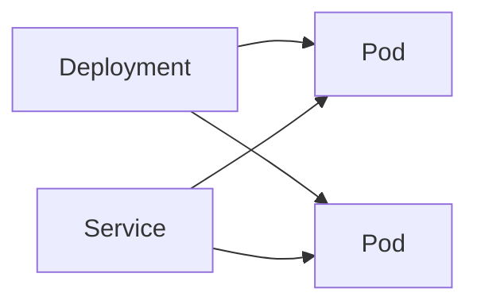

# Módulo 2.8 · Contenedores y Kubernetes

Los microservicios se empaquetan como contenedores y suelen orquestarse con Kubernetes. Este módulo cubre imágenes, Compose, objetos K8s básicos, probes, HPA, Helm, despliegues progresivos y GitOps.

**Entorno de referencia verificado (2026-05-22):** Docker 29.9.3. Kubernetes/Helm/ArgoCD se describen con labs reproducibles; no se finge cluster en ejecución.

## Aprende construyendo

### Tema 1: Dockerfile multi-stage, distroless · Intermedio · 120 min

Caso guía: imagen pequeña y con menos superficie de ataque.

#### Multi-stage

**Definición formal.** Dockerfile con varias etapas: build en una, runtime mínimo en otra.

**Ejemplo mínimo.**

```dockerfile
FROM node:24-alpine AS build
WORKDIR /app
COPY . .
RUN npm ci --omit=dev
FROM gcr.io/distroless/nodejs24-debian12
WORKDIR /app
COPY --from=build /app /app
CMD ["server.js"]
```

**Error común.** Imagen de build en producción. Corrección: multi-stage.

### Tema 2: Docker Compose · Básico · 90 min

Caso guía: app + db local.

#### Compose

**Definición formal.** Declaración YAML de servicios locales interconectados.

**Error común.** Usar Compose para prod sin entender límites. Corrección: dev/integration.

### Tema 3: Kubernetes: Deployments, Services, ConfigMaps, Secrets · Avanzado · 180 min

Caso guía: desplegar servicio con config y secreto.

#### Objetos básicos

**Definición formal.** Deployment gestiona replicas; Service expone; ConfigMap configura; Secret guarda material sensible (codificado, no cifrado por defecto).



**Error común.** Meter secretos en ConfigMap. Corrección: Secret + cifrado/gestión externa.

### Tema 4: Readiness/Liveness Probes · Intermedio · 90 min

Caso guía: no enviar tráfico antes de estar listo.

#### Probes

**Definición formal.** Liveness detecta proceso irrecuperable; readiness detecta si puede recibir tráfico.

**Error común.** Liveness consultando DB. Corrección: readiness para dependencias.

### Tema 5: HPA · Intermedio · 90 min

Caso guía: escalar por CPU/latencia.

#### HPA

**Definición formal.** Horizontal Pod Autoscaler ajusta réplicas según métricas.

**Error común.** Autoscalar sin límites/recursos definidos. Corrección: requests/limits y métricas adecuadas.

### Tema 6: Helm · Intermedio · 90 min

Caso guía: empaquetar manifests reutilizables.

#### Helm

**Definición formal.** Gestor de paquetes para Kubernetes; charts parametrizan manifests.

**Error común.** Templates Helm demasiado complejos. Corrección: valores claros, charts simples.

### Tema 7: Blue-Green y Canary · Avanzado · 120 min

Caso guía: liberar sin tumbar a todos.

#### Estrategias de despliegue

**Definición formal.** Blue-green mantiene dos entornos y cambia tráfico; canary libera a un subconjunto gradual.

**Error común.** Canary sin métricas de rollback. Corrección: SLOs y rollback automático/manual definido.

### Tema 8: GitOps con ArgoCD · Avanzado · 90 min

Caso guía: estado del cluster desde Git.

#### GitOps

**Definición formal.** Git como fuente de verdad declarativa; un controlador reconcilia el cluster al estado deseado.

**Error común.** Cambios manuales en cluster fuera de Git. Corrección: reconciliación y disciplina de PRs.

## Cierre

Kubernetes no es requisito inicial, pero es el lenguaje común de operación para microservicios a escala. Aprende los objetos básicos antes de la magia.

## Checklist

- Imágenes pequeñas y reproducibles.
- Probes correctas.
- Config/Secret separados.
- Despliegue progresivo con métricas.
- GitOps para estado declarativo.
