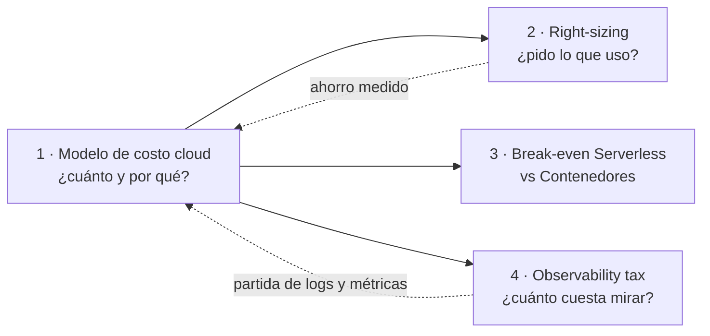
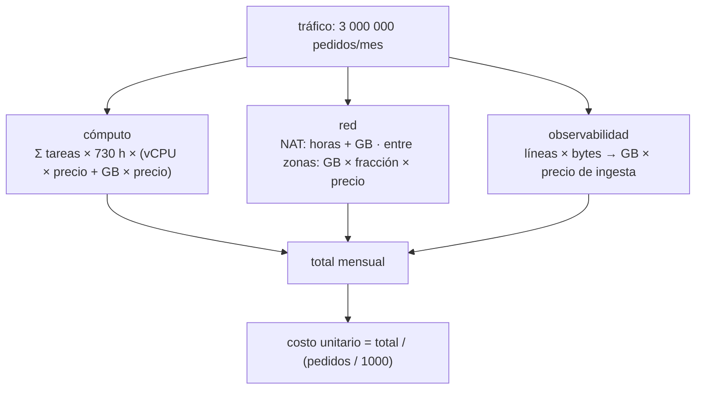
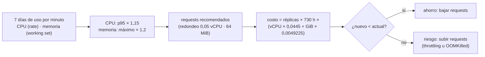
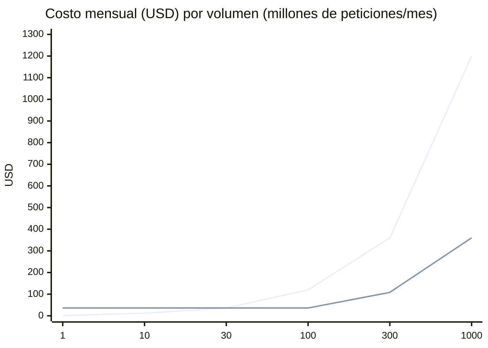
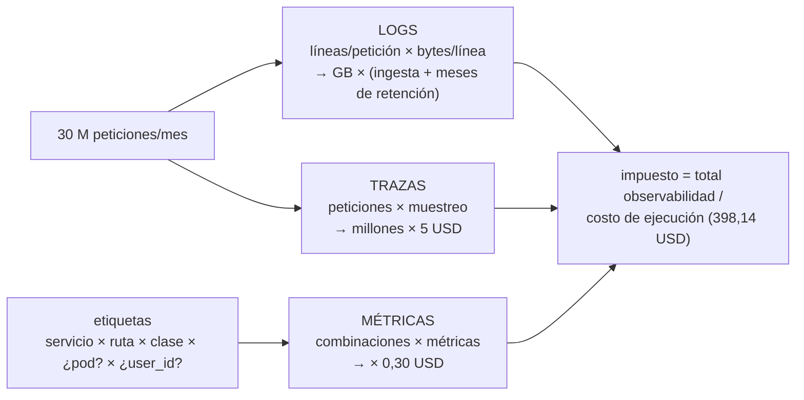

# Módulo 17 · FinOps y costo de arquitectura

**Fase 3 · Nivel maestro: arquitectura avanzada** (media semana de 8). **Duración:** 6 h (4 temas de unos 75 min y 1 h
de laboratorio integrador). **Dificultad:** 4 de 5. **Dependencias:** Módulo 12 o 23 (Kubernetes: requests, limits,
HPA), Módulo 10 o 21 (observabilidad: logs, métricas y trazas) y Módulo 27 (la malla, que también cuesta). Viene bien
haber leído `docs/microservicios/09-costos.md`. **Herramientas:**Node.js 26.13.1 LTS** sin dependencias y los
precios oficiales de **AWS** (Fargate, Lambda, NAT gateway, CloudWatch, X-Ray, EKS) y **GKE Autopilot**, consultados el
2026-11-19 y el 2026-11-20. 
y los scripts de las cuatro fichas; no necesita Docker ni cuenta en ninguna nube).

Una arquitectura no está terminada cuando funciona: está terminada cuando sabes **cuánto cuesta** y **por qué**. En
microservicios la factura crece por sitios que no aparecen en el diagrama: el tráfico entre zonas, los NAT gateways, los
logs de treinta servicios, la memoria pedida «por si acaso», una etiqueta de métrica que explota. FinOps es la práctica
de que ingeniería, finanzas y negocio decidan con esos números a la vista. En este módulo construyes un **modelo de
costo** con precios reales, ajustas los recursos a lo que se usa (**right-sizing**), calculas cuándo conviene
**serverless** o **contenedores** y le pones precio a ver el sistema (**observability tax**).



**Texto alternativo:** mapa del módulo. El modelo de costo (tema 1) responde cuánto cuesta y por qué, y lleva a los
otros tres: right-sizing (tema 2, si se pide lo que se usa), el break-even entre serverless y contenedores (tema 3) y el
impuesto de observabilidad (tema 4). Dos flechas punteadas vuelven al tema 1: el ahorro medido del right-sizing y la
partida de logs y métricas del tema 4 actualizan el modelo.

**Qué se ejecutó aquí.** Todo: los 18 tests y los scripts de las cuatro fichas se ejecutaron con Node 26.13.1 y sus
salidas están pegadas tal cual. Los datos de uso del right-sizing son **sintéticos** (generados con una semilla fija para
que obtengas los mismos números); los precios son **reales**, de las páginas oficiales, y cada uno lleva su URL en
`comun/precios.js`. Los de AWS se contrastaron el 2026-11-20 con sus páginas oficiales de precios (EKS, Lambda,
Fargate, CloudWatch, X-Ray y el tráfico entre zonas, que AWS cobra en **cada sentido**). Queda **por confirmar** solo el
NAT gateway: la página lo da en un ejemplo de US East (Ohio), no en la tabla de N. Virginia; está anotado en
`verificacion/microservicios/pendiente.md`.

**Cómo usar el laboratorio.** Con Node 26:

```bash
npm ci
  # 18 tests + scripts de las 4 fichas → «RESULTADO: OK»
```

`README.md` tiene el mapa de carpetas.

`package.json` del laboratorio (sin dependencias; el `package-lock.json` existe para que `npm ci` funcione igual que en
los demás módulos):

```json
{
  "name": "modulo-28-finops",
  "version": "1.0.0",
  "private": true,
  "description": "Módulo 28 (Fase 3): FinOps y costo de arquitectura (modelo de costo cloud, right-sizing, break-even serverless vs contenedores y observability tax).",
  "type": "module",
  "engines": {
    "node": ">=26.13.1"
  },
  "scripts": {
    "test": "node --test --test-concurrency=1 'f1*/*.test.js'"
  }
}
```

Los precios de todo el módulo (`comun/precios.js`). Un mes son **730 horas**, la convención de las calculadoras de AWS
y Google:

```javascript
// Módulo 28 · precios unitarios en USD, bajo demanda, sin impuestos ni descuentos. Consultados en las páginas oficiales
// el 2026-11-19 y el 2026-11-20 (ver «fuente»). Los precios cambian: vuelve a mirarlos antes de decidir con ellos.
export const HORAS_MES = 730; // convención de AWS y Google para «un mes» en sus calculadoras (24 × 365 / 12)

export const PRECIOS = {
  eksPlanoControlHora: { usd: 0.10, fuente: 'https://aws.amazon.com/eks/pricing/' },
  autopilotVcpuHora: { usd: 0.0445, fuente: 'https://cloud.google.com/kubernetes-engine/pricing (Autopilot, uso general, us-central1)' },
  autopilotGibHora: { usd: 0.0049225, fuente: 'https://cloud.google.com/kubernetes-engine/pricing (Autopilot, uso general, us-central1)' },
  fargateVcpuSegundo: { usd: 0.000011244, fuente: 'https://aws.amazon.com/fargate/pricing/ (Linux/x86, US East N. Virginia, ejemplo 1)' },
  fargateGbSegundo: { usd: 0.000001235, fuente: 'https://aws.amazon.com/fargate/pricing/ (Linux/x86, US East N. Virginia, ejemplo 1)' },
  lambdaMillonPeticiones: { usd: 0.20, fuente: 'https://aws.amazon.com/lambda/pricing/ (US East N. Virginia)' },
  lambdaGbSegundo: { usd: 0.0000166667, fuente: 'https://aws.amazon.com/lambda/pricing/ (x86, primer tramo)' },
  lambdaGratisPeticiones: { cantidad: 1_000_000, fuente: 'https://aws.amazon.com/lambda/pricing/ (capa gratuita mensual)' },
  lambdaGratisGbSegundo: { cantidad: 400_000, fuente: 'https://aws.amazon.com/lambda/pricing/ (capa gratuita mensual)' },
  natHora: { usd: 0.045, fuente: 'https://aws.amazon.com/vpc/pricing/ (ejemplo de NAT gateway, US East Ohio; por confirmar en la tabla de N. Virginia)' },
  natGb: { usd: 0.045, fuente: 'https://aws.amazon.com/vpc/pricing/ (ejemplo de NAT gateway, US East Ohio; por confirmar en la tabla de N. Virginia)' },
  entreZonasGb: { usd: 0.01, fuente: 'https://aws.amazon.com/vpc/pricing/ (datos que cruzan zonas de disponibilidad en la misma región: por GB y en CADA sentido, entrada y salida)' },
  logsIngestaGb: { usd: 0.50, fuente: 'https://aws.amazon.com/cloudwatch/pricing/ (Logs, ingesta; ejemplos de la página, basados en US East N. Virginia)' },
  logsAlmacenGbMes: { usd: 0.03, fuente: 'https://aws.amazon.com/cloudwatch/pricing/ (almacenamiento de logs; ejemplos de la página, basados en US East N. Virginia)' },
  metricaMes: { usd: 0.30, fuente: 'https://aws.amazon.com/cloudwatch/pricing/ (métricas personalizadas, primeras 10 000; ejemplos de la página, basados en US East N. Virginia)' },
  millonTrazas: { usd: 5.00, fuente: 'https://aws.amazon.com/cloudwatch/pricing/ (X-Ray, 0.000005 USD por traza registrada en los ejemplos; primeras 100 000 gratis al mes)' },
};

export const usd = (n, decimales = 2) => `${n.toLocaleString('en-US', { minimumFractionDigits: decimales, maximumFractionDigits: decimales })} USD`;
export const p = (clave) => PRECIOS[clave].usd;
```

---


### Modelo de costo cloud

<details open>
<summary><strong>Capa 1 — Lectura</strong></summary>

#### ► DE QUÉ TRATA
Construir un modelo de costo mensual de una arquitectura con partidas de cómputo, red y observabilidad a precios reales, calcular el costo unitario (USD por cada 1000 pedidos) y comparar un monolito modular con seis microservicios para el mismo tráfico. Lo compruebas cuando node…

#### ► LA IDEA EN UNA FRASE
**Construir un modelo de costo mensual de una arquitectura con partidas de cómputo, red y observabilidad a precios reales, calcular el costo unitario (USD por cada 1000 pedidos) y comparar un monolito modular con seis microservicios para el mismo tráfico.**

#### ► POR QUÉ EXISTE ESTO
Resuelve un problema real de diseño o implementación y evita decisiones a ciegas.

#### ► LA ANALOGÍA
Piensa en modelo de costo cloud como una herramienta de taller: útil cuando conoces su propósito y sus límites.
**Dónde se rompe la analogía:** en software, los efectos dependen del contexto, la escala y los trade-offs.

#### ► CÓMO FUNCIONA


1. En la nube no compras máquinas: **alquilas por horas** (o por segundos) potencia de cálculo, memoria, tráfico y
2. La factura tiene muchas líneas. Algunas dependen de **cuánto trabajas** (tráfico, logs) y otras de **cuánto tiempo
3. Un **modelo de costo** es una hoja de cálculo honesta: cada línea con su precio real y su cantidad, para saber cuánto
4. El número que más importa no es el total, sino el **costo por unidad de negocio** (por pedido, por usuario): si el

#### ► LO QUE PUEDE SALIR MAL
| Síntoma | Causa probable | Arreglo |
|---|---|---|
| Modelo de costo cloud se aplica pero el resultado no mejora | Se usó sin medir el problema real | Mide antes y compara contra la alternativa simple |
| Aparece complejidad inesperada | Se adoptó la técnica sin comprender sus trade-offs | Vuelve a la sección de trade-offs y reduce el alcance |
| Falla en un caso límite | Se asumió un contexto que no se cumple | Prueba el caso límite y documenta cuándo NO usarlo |

#### ► TRADE-OFFS
| Opción | Cuándo usarla | Cuándo NO usarla |
|---|---|---|
| Usar Modelo de costo cloud | Cuando el problema coincide con su propósito y el beneficio es observable | Cuando agrega complejidad sin resolver un problema real |
| Alternativa más simple | Cuando el contexto es pequeño, estable o fácil de razonar | Cuando ya demostró no escalar o no cumplir el requisito |
| Postergar la decisión | Cuando falta evidencia del problema | Cuando el costo de esperar es mayor que el costo de probar |

#### ► CUÁNDO NO USAR ESTO
Arquitectura sin dueño del costo: decidir la topología (un servicio por entidad, réplicas en tres zonas, un NAT por zona, logs en DEBUG) sin que ninguna decisión lleve su número, y descubrir la factura un mes después.

#### ► DE VUELTA A LA ANALOGÍA
Volviendo a la analogía: modelo de costo cloud funciona como el modelo inicial, pero recuerda dónde se rompe: en producción importan la evidencia, la escala y el costo de equivocarte.

#### ► LO QUE DEBES RECORDAR
- En la nube no compras máquinas: **alquilas por horas** (o por segundos) potencia de cálculo, memoria, tráfico y
- La factura tiene muchas líneas. Algunas dependen de **cuánto trabajas** (tráfico, logs) y otras de **cuánto tiempo
- Un **modelo de costo** es una hoja de cálculo honesta: cada línea con su precio real y su cantidad, para saber cuánto
- El número que más importa no es el total, sino el **costo por unidad de negocio** (por pedido, por usuario): si el

#### ► PREGUNTAS PARA PENSAR
1. ¿Qué problema concreto resuelve modelo de costo cloud en tu contexto?
2. ¿Cómo sabrías que modelo de costo cloud no está funcionando bien?
3. ¿Qué alternativa más simple considerarías antes de usar modelo de costo cloud?

</details>

<details>
<summary><strong>Capa 2 — Construcción</strong></summary>

#### Código de referencia / ejecutable
Versiones: **Node.js 26.13.1 LTS**, sin dependencias; precios de `comun/precios.js` (consultados 2026-11-19/20).

`f165-modelo-costo/modelo.js`:

```javascript
// Módulo 28 · F165 · Modelo de costo cloud de una arquitectura: cómputo + red + observabilidad, y costo por unidad.
// Proveedor del ejemplo: AWS con ECS sobre Fargate (se paga vCPU y GB pedidos por cada tarea, por segundo).
// Uso: node f165-modelo-costo/modelo.js f165-modelo-costo/microservicios.json [--solo-computo]
import { readFileSync } from 'node:fs';
import { pathToFileURL } from 'node:url';
import { HORAS_MES, p, usd } from '../comun/precios.js';

const SEG_MES = HORAS_MES * 3600;
const GB = 1024 ** 3;
const SENTIDOS_COBRADOS = 2;

/** Devuelve las partidas mensuales en USD y el costo por cada 1000 pedidos. */
export function costear(arq, { soloComputo = false } = {}) {
  const partidas = {};
  partidas['cómputo (Fargate)'] = arq.servicios.reduce((s, sv) =>
    s + sv.tareas * SEG_MES * (sv.vcpu * p('fargateVcpuSegundo') + sv.gb * p('fargateGbSegundo')), 0);
  if (!soloComputo) {
    const r = arq.red;
    partidas['NAT gateway (horas)'] = r.natGateways * HORAS_MES * p('natHora');
    partidas['NAT gateway (GB)'] = r.gbSalientesMes * p('natGb');
    const gbInternos = arq.pedidosMes * r.llamadasInternasPorPedido * r.kbPorLlamada * 1024 / GB;
    // AWS cobra el GB que cruza de zona dos veces: al que lo envía (salida) y al que lo recibe (entrada).
    partidas['tráfico entre zonas'] = gbInternos * r.fraccionEntreZonas * p('entreZonasGb') * SENTIDOS_COBRADOS;
    const gbLogs = arq.pedidosMes * arq.logs.lineasPorPedido * arq.logs.bytesPorLinea / GB;
    partidas['logs (ingesta)'] = gbLogs * p('logsIngestaGb');
  }
  const total = Object.values(partidas).reduce((a, b) => a + b, 0);
  return { partidas, total, por1000: total / (arq.pedidosMes / 1000) };
}

export function informe(arq, opciones) {
  const { partidas, total, por1000 } = costear(arq, opciones);
  const lineas = [`${arq.nombre} · ${arq.pedidosMes.toLocaleString('en-US')} pedidos/mes`];
  for (const [k, v] of Object.entries(partidas)) {
    lineas.push(`  ${k.padEnd(22)} ${usd(v).padStart(14)}  ${((v / total) * 100).toFixed(1).padStart(5)} %`);
  }
  lineas.push(`  ${'TOTAL'.padEnd(22)} ${usd(total).padStart(14)}`);
  lineas.push(`  costo unitario: ${usd(por1000, 4)} por cada 1000 pedidos`);
  return lineas.join('\n');
}

if (import.meta.url === pathToFileURL(process.argv[1]).href) {
  const arq = JSON.parse(readFileSync(process.argv[2], 'utf8'));
  console.log(informe(arq, { soloComputo: process.argv.includes('--solo-computo') }));
}
```

Las dos arquitecturas, con el mismo tráfico (`monolito.json` y `microservicios.json`):

```json
{
  "nombre": "Monolito modular (2 tareas)",
  "pedidosMes": 3000000,
  "servicios": [
    { "nombre": "tienda", "tareas": 2, "vcpu": 1, "gb": 2 }
  ],
  "red": { "natGateways": 1, "gbSalientesMes": 50, "llamadasInternasPorPedido": 0, "kbPorLlamada": 0, "fraccionEntreZonas": 0 },
  "logs": { "lineasPorPedido": 4, "bytesPorLinea": 300 }
}
```

```json
{
  "nombre": "Microservicios (6 servicios, 3 zonas)",
  "pedidosMes": 3000000,
  "servicios": [
    { "nombre": "gateway",    "tareas": 3, "vcpu": 0.5,  "gb": 1 },
    { "nombre": "pedidos",    "tareas": 3, "vcpu": 0.5,  "gb": 1 },
    { "nombre": "pagos",      "tareas": 3, "vcpu": 0.5,  "gb": 1 },
    { "nombre": "inventario", "tareas": 3, "vcpu": 0.5,  "gb": 1 },
    { "nombre": "catalogo",   "tareas": 3, "vcpu": 0.25, "gb": 0.5 },
    { "nombre": "envios",     "tareas": 3, "vcpu": 0.25, "gb": 0.5 }
  ],
  "red": { "natGateways": 3, "gbSalientesMes": 150, "llamadasInternasPorPedido": 12, "kbPorLlamada": 8, "fraccionEntreZonas": 0.67 },
  "logs": { "lineasPorPedido": 30, "bytesPorLinea": 450 }
}
```

</details>

### Right-sizing

<details open>
<summary><strong>Capa 1 — Lectura</strong></summary>

#### ► DE QUÉ TRATA
Calcular requests de CPU (p95 con margen) y de memoria (máximo con margen) a partir de una semana de uso medido, cuantificar el ahorro con precios de GKE Autopilot (que cobra por lo pedido) y detectar tanto servicios sobredimensionados como infradimensionados. Lo compruebas cuand…

#### ► LA IDEA EN UNA FRASE
**Calcular requests de CPU (p95 con margen) y de memoria (máximo con margen) a partir de una semana de uso medido, cuantificar el ahorro con precios de GKE Autopilot (que cobra por lo pedido) y detectar tanto servicios sobredimensionados como infradimensionados.**

#### ► POR QUÉ EXISTE ESTO
Resuelve un problema real de diseño o implementación y evita decisiones a ciegas.

#### ► LA ANALOGÍA
Piensa en right-sizing como una herramienta de taller: útil cuando conoces su propósito y sus límites.
**Dónde se rompe la analogía:** en software, los efectos dependen del contexto, la escala y los trade-offs.

#### ► CÓMO FUNCIONA


1. Cuando despliegas un servicio, le dices a Kubernetes cuánta CPU y memoria **reservar** para él. Si reservas de más,
2. **Right-sizing** es mirar cuánto usa de verdad durante una semana y ajustar la reserva a eso, con un margen.
3. Para la CPU basta cubrir casi todos los momentos (el 95 %): si un instante falta, va un poco más lento. Para la

#### ► LO QUE PUEDE SALIR MAL
| Síntoma | Causa probable | Arreglo |
|---|---|---|
| Right-sizing se aplica pero el resultado no mejora | Se usó sin medir el problema real | Mide antes y compara contra la alternativa simple |
| Aparece complejidad inesperada | Se adoptó la técnica sin comprender sus trade-offs | Vuelve a la sección de trade-offs y reduce el alcance |
| Falla en un caso límite | Se asumió un contexto que no se cumple | Prueba el caso límite y documenta cuándo NO usarlo |

#### ► TRADE-OFFS
| Opción | Cuándo usarla | Cuándo NO usarla |
|---|---|---|
| Usar Right-sizing | Cuando el problema coincide con su propósito y el beneficio es observable | Cuando agrega complejidad sin resolver un problema real |
| Alternativa más simple | Cuando el contexto es pequeño, estable o fácil de razonar | Cuando ya demostró no escalar o no cumplir el requisito |
| Postergar la decisión | Cuando falta evidencia del problema | Cuando el costo de esperar es mayor que el costo de probar |

#### ► CUÁNDO NO USAR ESTO
Requests copiados de la plantilla: todos los servicios con cpu: "1" y memory: 2Gi porque así venía el Helm chart de ejemplo, sin medir nunca.

#### ► DE VUELTA A LA ANALOGÍA
Volviendo a la analogía: right-sizing funciona como el modelo inicial, pero recuerda dónde se rompe: en producción importan la evidencia, la escala y el costo de equivocarte.

#### ► LO QUE DEBES RECORDAR
- Cuando despliegas un servicio, le dices a Kubernetes cuánta CPU y memoria **reservar** para él. Si reservas de más,
- **Right-sizing** es mirar cuánto usa de verdad durante una semana y ajustar la reserva a eso, con un margen.
- Para la CPU basta cubrir casi todos los momentos (el 95 %): si un instante falta, va un poco más lento. Para la

#### ► PREGUNTAS PARA PENSAR
1. ¿Qué problema concreto resuelve right-sizing en tu contexto?
2. ¿Cómo sabrías que right-sizing no está funcionando bien?
3. ¿Qué alternativa más simple considerarías antes de usar right-sizing?

</details>

<details>
<summary><strong>Capa 2 — Construcción</strong></summary>

#### Código y verificación


```javascript
// Módulo 28 · F166 · uso medido de 7 días, minuto a minuto (10 080 muestras por servicio), generado con una semilla fija
// para que la salida sea idéntica en cada máquina. Imita lo que darían `container_cpu_usage_seconds_total` (rate) y
// `container_memory_working_set_bytes` de Prometheus: ciclo diario, ruido y algún pico.
function mulberry32(semilla) {
  let a = semilla;
  return () => { a |= 0; a = (a + 0x6d2b79f5) | 0; let t = Math.imul(a ^ (a >>> 15), 1 | a); t = (t + Math.imul(t ^ (t >>> 7), 61 | t)) ^ t; return ((t ^ (t >>> 14)) >>> 0) / 4294967296; };
}

/** perfil: { cpuBase, cpuDia, memBase, memDia, picos } -> { cpu: [vCPU], mem: [MiB] } */
export function generarUso(perfil, semilla = 2026) {
  const azar = mulberry32(semilla);
  const cpu = [], mem = [];
  for (let m = 0; m < 7 * 1440; m++) {
    const dia = Math.max(0, Math.sin(((m % 1440) / 1440) * 2 * Math.PI - Math.PI / 2)); // 0 de noche, 1 a mediodía
    const pico = azar() < perfil.picos ? 1.8 : 1;
    cpu.push(+(Math.max(0.01, (perfil.cpuBase + perfil.cpuDia * dia) * pico * (0.9 + azar() * 0.2))).toFixed(4));
    mem.push(Math.round((perfil.memBase + perfil.memDia * dia) * (0.97 + azar() * 0.06) + (pico > 1 ? perfil.memDia * 0.5 : 0)));
  }
  return { cpu, mem };
}

/** Los tres servicios del ejemplo, con lo que piden hoy (requests) y cómo se comportan de verdad. */
export const SERVICIOS = [
  { nombre: 'pedidos', replicas: 3, pide: { vcpu: 1, mib: 2048 }, perfil: { cpuBase: 0.05, cpuDia: 0.18, memBase: 380, memDia: 120, picos: 0.004 } },
  { nombre: 'catalogo', replicas: 3, pide: { vcpu: 0.5, mib: 1024 }, perfil: { cpuBase: 0.03, cpuDia: 0.06, memBase: 210, memDia: 40, picos: 0.002 } },
  { nombre: 'pagos', replicas: 2, pide: { vcpu: 0.25, mib: 512 }, perfil: { cpuBase: 0.08, cpuDia: 0.14, memBase: 300, memDia: 90, picos: 0.004 } },
];
```

```javascript
// Módulo 28 · F166 · Right-sizing: recomendar requests de CPU y memoria a partir del uso medido y calcular el ahorro.
//   CPU (comprimible: si falta, el contenedor se ralentiza)   -> request = p95 × 1,15
//   memoria (no comprimible: si falta, OOMKilled)              -> request = límite = máximo × 1,2
// Precio: GKE Autopilot cobra por lo que PIDEN los pods (vCPU-hora y GiB-hora), así que el ahorro es directo.
// Uso: node f166-right-sizing/rightsizing.js
import { pathToFileURL } from 'node:url';
import { HORAS_MES, p, usd } from '../comun/precios.js';
import { generarUso, SERVICIOS } from './uso.js';

export function percentil(valores, q) {
  const v = [...valores].sort((a, b) => a - b);
  return v[Math.min(v.length - 1, Math.ceil(q * v.length) - 1)];
}
const arriba = (x, paso) => Math.ceil(x / paso - 1e-9) * paso;

export function recomendar(uso, { qCpu = 0.95, margenCpu = 1.15, margenMem = 1.2 } = {}) {
  return {
    vcpu: +arriba(percentil(uso.cpu, qCpu) * margenCpu, 0.05).toFixed(2),
    mib: arriba(Math.max(...uso.mem) * margenMem, 64),
  };
}

export const costoMes = ({ vcpu, mib }, replicas) =>
  replicas * HORAS_MES * (vcpu * p('autopilotVcpuHora') + (mib / 1024) * p('autopilotGibHora'));

export function informe(servicios = SERVICIOS) {
  let antes = 0, despues = 0;
  const filas = ['servicio  réplicas  pide hoy           p95 CPU  máx mem   recomendado        costo hoy     costo nuevo'];
  servicios.forEach((s, i) => {
    const uso = generarUso(s.perfil, 2026 + i);
    const r = recomendar(uso);
    const a = costoMes(s.pide, s.replicas), d = costoMes(r, s.replicas);
    antes += a; despues += d;
    filas.push(`${s.nombre.padEnd(9)} ${String(s.replicas).padStart(8)}  ${`${s.pide.vcpu} vCPU/${s.pide.mib} MiB`.padEnd(18)} ${percentil(uso.cpu, 0.95).toFixed(3).padStart(7)}  ${`${Math.max(...uso.mem)} MiB`.padStart(8)}  ${`${r.vcpu} vCPU/${r.mib} MiB`.padEnd(18)} ${usd(a).padStart(12)}  ${usd(d).padStart(12)}`);
  });
  filas.push(`TOTAL al mes: ${usd(antes)} -> ${usd(despues)} · ahorro ${usd(antes - despues)} (${(((antes - despues) / antes) * 100).toFixed(1)} %)`);
  return filas.join('\n');
}

if (import.meta.url === pathToFileURL(process.argv[1]).href) console.log(informe());
```

```bash
node f166-right-sizing/rightsizing.js
```

```text
servicio  réplicas  pide hoy           p95 CPU  máx mem   recomendado        costo hoy     costo nuevo
pedidos          3  1 vCPU/2048 MiB      0.231   559 MiB  0.3 vCPU/704 MiB     119.02 USD     36.65 USD
catalogo         3  0.5 vCPU/1024 MiB    0.091   268 MiB  0.15 vCPU/384 MiB     59.51 USD     18.66 USD
pagos            2  0.25 vCPU/512 MiB    0.223   437 MiB  0.3 vCPU/576 MiB      19.84 USD     23.53 USD
TOTAL al mes: 198.36 USD -> 78.84 USD · ahorro 119.52 USD (60.3 %)
```

```javascript
// Módulo 28 · F166 · tests: node --test f166-right-sizing/rightsizing.test.js
import { test } from 'node:test';
import assert from 'node:assert/strict';
import { generarUso, SERVICIOS } from './uso.js';
import { recomendar, percentil, costoMes } from './rightsizing.js';

test('percentil: p95 de 1..100 es 95', () => {
  assert.equal(percentil(Array.from({ length: 100 }, (_, i) => i + 1), 0.95), 95);
});

test('la memoria recomendada nunca queda por debajo del uso medido (0 OOMKilled)', () => {
  SERVICIOS.forEach((s, i) => {
    const uso = generarUso(s.perfil, 2026 + i);
    const r = recomendar(uso);
    assert.equal(uso.mem.filter((m) => m > r.mib).length, 0, s.nombre);
  });
});

test('pedidos está sobredimensionado y pagos infradimensionado', () => {
  const [pedidos, , pagos] = SERVICIOS;
  assert.ok(recomendar(generarUso(pedidos.perfil, 2026)).vcpu < pedidos.pide.vcpu);
  assert.ok(recomendar(generarUso(pagos.perfil, 2028)).vcpu > pagos.pide.vcpu);
});

test('costo Autopilot: 1 vCPU y 1 GiB, 1 réplica, 730 h', () => {
  assert.ok(Math.abs(costoMes({ vcpu: 1, mib: 1024 }, 1) - 730 * (0.0445 + 0.0049225)) < 1e-9);
});

test('el uso generado es reproducible (misma semilla, mismos datos)', () => {
  assert.deepEqual(generarUso(SERVICIOS[0].perfil, 7).mem.slice(0, 5), generarUso(SERVICIOS[0].perfil, 7).mem.slice(0, 5));
});
```

</details>

### Break-even Serverless vs Contenedores

<details open>
<summary><strong>Capa 1 — Lectura</strong></summary>

#### ► DE QUÉ TRATA
Calcular el costo mensual de una API en AWS Lambda y en ECS sobre Fargate en función del volumen, encontrar el punto de equilibrio (break-even) y explicar cómo lo mueven la duración, la memoria, el pico y la alta disponibilidad. Lo compruebas cuando node --test f167-break-even/br…

#### ► LA IDEA EN UNA FRASE
**Calcular el costo mensual de una API en AWS Lambda y en ECS sobre Fargate en función del volumen, encontrar el punto de equilibrio (break-even) y explicar cómo lo mueven la duración, la memoria, el pico y la alta disponibilidad.**

#### ► POR QUÉ EXISTE ESTO
Resuelve un problema real de diseño o implementación y evita decisiones a ciegas.

#### ► LA ANALOGÍA
Piensa en break-even serverless vs contenedores como una herramienta de taller: útil cuando conoces su propósito y sus límites.
**Dónde se rompe la analogía:** en software, los efectos dependen del contexto, la escala y los trade-offs.

#### ► CÓMO FUNCIONA


1. **Serverless** (por ejemplo AWS Lambda): subes tu código y la nube lo ejecuta cada vez que llega una petición. Pagas
2. **Contenedores** (por ejemplo Fargate): tienes tu servicio **siempre encendido**, esperando peticiones. Pagas por las
3. Con poco tráfico gana serverless; con mucho tráfico constante, el contenedor. El **break-even** es el volumen en el que

#### ► LO QUE PUEDE SALIR MAL
| Síntoma | Causa probable | Arreglo |
|---|---|---|
| Break-even Serverless vs Contenedores se aplica pero el resultado no mejora | Se usó sin medir el problema real | Mide antes y compara contra la alternativa simple |
| Aparece complejidad inesperada | Se adoptó la técnica sin comprender sus trade-offs | Vuelve a la sección de trade-offs y reduce el alcance |
| Falla en un caso límite | Se asumió un contexto que no se cumple | Prueba el caso límite y documenta cuándo NO usarlo |

#### ► TRADE-OFFS
| Opción | Cuándo usarla | Cuándo NO usarla |
|---|---|---|
| Usar Break-even Serverless vs Contenedores | Cuando el problema coincide con su propósito y el beneficio es observable | Cuando agrega complejidad sin resolver un problema real |
| Alternativa más simple | Cuando el contexto es pequeño, estable o fácil de razonar | Cuando ya demostró no escalar o no cumplir el requisito |
| Postergar la decisión | Cuando falta evidencia del problema | Cuando el costo de esperar es mayor que el costo de probar |

#### ► CUÁNDO NO USAR ESTO
Elegir por moda y no por números: «todo serverless» o «todo Kubernetes» como norma de empresa, sin mirar el volumen ni la forma del tráfico de cada servicio.

#### ► DE VUELTA A LA ANALOGÍA
Volviendo a la analogía: break-even serverless vs contenedores funciona como el modelo inicial, pero recuerda dónde se rompe: en producción importan la evidencia, la escala y el costo de equivocarte.

#### ► LO QUE DEBES RECORDAR
- **Serverless** (por ejemplo AWS Lambda): subes tu código y la nube lo ejecuta cada vez que llega una petición. Pagas
- **Contenedores** (por ejemplo Fargate): tienes tu servicio **siempre encendido**, esperando peticiones. Pagas por las
- Con poco tráfico gana serverless; con mucho tráfico constante, el contenedor. El **break-even** es el volumen en el que

#### ► PREGUNTAS PARA PENSAR
1. ¿Qué problema concreto resuelve break-even serverless vs contenedores en tu contexto?
2. ¿Cómo sabrías que break-even serverless vs contenedores no está funcionando bien?
3. ¿Qué alternativa más simple considerarías antes de usar break-even serverless vs contenedores?

</details>

<details>
<summary><strong>Capa 2 — Construcción</strong></summary>

#### Código de referencia / ejecutable
Versiones: **Node.js 26.13.1 LTS**, sin dependencias; precios de Lambda y Fargate (US East N. Virginia) de
`comun/precios.js`.

`f167-break-even/breakeven.js`:

```javascript
// Módulo 28 · F167 · Break-even Serverless (AWS Lambda) vs Contenedores (ECS sobre Fargate) para la API de catálogo.
// Lambda: paga por petición + GB-segundo de ejecución (con capa gratuita mensual).
// Fargate: paga por tarea encendida (vCPU y GB por segundo), haya tráfico o no; mínimo 2 tareas para alta disponibilidad
// y más tareas cuando el pico supera la capacidad de cada una.
// Uso: node f167-break-even/breakeven.js
import { pathToFileURL } from 'node:url';
import { HORAS_MES, PRECIOS, p, usd } from '../comun/precios.js';

export const CARGA = { duracionMs: 120, memoriaMb: 512, factorPico: 3 };
export const TAREA = { vcpu: 0.5, gb: 1, rpsPorTarea: 60, minimo: 2 };
const SEG_MES = HORAS_MES * 3600;

export function costoLambda(peticiones, { duracionMs, memoriaMb } = CARGA, { capaGratuita = false } = {}) {
  let pet = peticiones, gbs = peticiones * (duracionMs / 1000) * (memoriaMb / 1024);
  if (capaGratuita) { pet = Math.max(0, pet - PRECIOS.lambdaGratisPeticiones.cantidad); gbs = Math.max(0, gbs - PRECIOS.lambdaGratisGbSegundo.cantidad); }
  return (pet / 1e6) * p('lambdaMillonPeticiones') + gbs * p('lambdaGbSegundo');
}

export function tareasNecesarias(peticiones, carga = CARGA, tarea = TAREA) {
  const rpsPico = (peticiones / SEG_MES) * carga.factorPico;
  return Math.max(tarea.minimo, Math.ceil(rpsPico / tarea.rpsPorTarea));
}

export function costoFargate(peticiones, carga = CARGA, tarea = TAREA) {
  return tareasNecesarias(peticiones, carga, tarea) * SEG_MES * (tarea.vcpu * p('fargateVcpuSegundo') + tarea.gb * p('fargateGbSegundo'));
}

/** Volumen mensual a partir del cual Fargate (mínimo de tareas) sale más barato que Lambda. */
export function breakEven(carga = CARGA, tarea = TAREA) {
  const porPeticion = costoLambda(1, carga);
  const fijo = tarea.minimo * SEG_MES * (tarea.vcpu * p('fargateVcpuSegundo') + tarea.gb * p('fargateGbSegundo'));
  return fijo / porPeticion;
}

export function tabla(volumenes = [1e5, 1e6, 1e7, 3e7, 1e8, 3e8, 1e9]) {
  const filas = ['peticiones/mes   Lambda        Fargate (tareas)      más barato'];
  for (const n of volumenes) {
    const l = costoLambda(n), f = costoFargate(n);
    filas.push(`${n.toExponential(0).padStart(14)}  ${usd(l).padStart(12)}  ${usd(f).padStart(12)} (${String(tareasNecesarias(n)).padStart(2)})   ${l < f ? 'Lambda' : 'Fargate'}`);
  }
  const be = breakEven();
  filas.push(`break-even: ${Math.round(be).toLocaleString('en-US')} peticiones/mes (${(be / SEG_MES).toFixed(1)} peticiones/s de media)`);
  return filas.join('\n');
}

if (import.meta.url === pathToFileURL(process.argv[1]).href) {
  console.log(`Carga: ${CARGA.duracionMs} ms y ${CARGA.memoriaMb} MB por petición en Lambda · Fargate: tareas de ${TAREA.vcpu} vCPU/${TAREA.gb} GB, ${TAREA.rpsPorTarea} pet/s cada una, mínimo ${TAREA.minimo}, pico = media × ${CARGA.factorPico}`);
  console.log(tabla());
}
```

</details>

### Observability tax

<details open>
<summary><strong>Capa 1 — Lectura</strong></summary>

#### ► DE QUÉ TRATA
Estimar la factura mensual de logs, métricas y trazas a partir del tráfico y de las decisiones de instrumentación, calcular la cardinalidad de un histograma con sus etiquetas, y reducir el impuesto de observabilidad con niveles de log, muestreo de trazas y etiquetas acotadas sin…

#### ► LA IDEA EN UNA FRASE
**Estimar la factura mensual de logs, métricas y trazas a partir del tráfico y de las decisiones de instrumentación, calcular la cardinalidad de un histograma con sus etiquetas, y reducir el impuesto de observabilidad con niveles de log, muestreo de trazas y etiquetas acotadas sin perder la capacidad de diagnosticar.**

#### ► POR QUÉ EXISTE ESTO
Resuelve un problema real de diseño o implementación y evita decisiones a ciegas.

#### ► LA ANALOGÍA
Piensa en observability tax como una herramienta de taller: útil cuando conoces su propósito y sus límites.
**Dónde se rompe la analogía:** en software, los efectos dependen del contexto, la escala y los trade-offs.

#### ► CÓMO FUNCIONA


1. Para saber qué pasa dentro de un sistema, los servicios escriben **logs** (un diario), publican **métricas** (números
2. Todo eso se guarda y se paga: por cada GB de logs, por cada métrica distinta, por cada traza.
3. Si registras todo, siempre y para siempre, ver el sistema puede costar **más** que ejecutarlo. Eso es el «impuesto de
4. La solución no es dejar de mirar: es mirar **con criterio** (qué guardar, cuánto tiempo y con cuánto detalle).

#### ► LO QUE PUEDE SALIR MAL
| Síntoma | Causa probable | Arreglo |
|---|---|---|
| Observability tax se aplica pero el resultado no mejora | Se usó sin medir el problema real | Mide antes y compara contra la alternativa simple |
| Aparece complejidad inesperada | Se adoptó la técnica sin comprender sus trade-offs | Vuelve a la sección de trade-offs y reduce el alcance |
| Falla en un caso límite | Se asumió un contexto que no se cumple | Prueba el caso límite y documenta cuándo NO usarlo |

#### ► TRADE-OFFS
| Opción | Cuándo usarla | Cuándo NO usarla |
|---|---|---|
| Usar Observability tax | Cuando el problema coincide con su propósito y el beneficio es observable | Cuando agrega complejidad sin resolver un problema real |
| Alternativa más simple | Cuando el contexto es pequeño, estable o fácil de razonar | Cuando ya demostró no escalar o no cumplir el requisito |
| Postergar la decisión | Cuando falta evidencia del problema | Cuando el costo de esperar es mayor que el costo de probar |

#### ► CUÁNDO NO USAR ESTO
Instrumentar «por si acaso» sin presupuesto: cada equipo añade etiquetas, niveles DEBUG y retención infinita porque «la observabilidad es buena», y nadie mira cuánto cuesta.

#### ► DE VUELTA A LA ANALOGÍA
Volviendo a la analogía: observability tax funciona como el modelo inicial, pero recuerda dónde se rompe: en producción importan la evidencia, la escala y el costo de equivocarte.

#### ► LO QUE DEBES RECORDAR
- Para saber qué pasa dentro de un sistema, los servicios escriben **logs** (un diario), publican **métricas** (números
- Todo eso se guarda y se paga: por cada GB de logs, por cada métrica distinta, por cada traza.
- Si registras todo, siempre y para siempre, ver el sistema puede costar **más** que ejecutarlo. Eso es el «impuesto de
- La solución no es dejar de mirar: es mirar **con criterio** (qué guardar, cuánto tiempo y con cuánto detalle).

#### ► PREGUNTAS PARA PENSAR
1. ¿Qué problema concreto resuelve observability tax en tu contexto?
2. ¿Cómo sabrías que observability tax no está funcionando bien?
3. ¿Qué alternativa más simple considerarías antes de usar observability tax?

</details>

<details>
<summary><strong>Capa 2 — Construcción</strong></summary>

#### Código de referencia / ejecutable
Versiones: **Node.js 26.13.1 LTS**, sin dependencias; precios de CloudWatch Logs, métricas personalizadas y X-Ray de
`comun/precios.js`.

`f168-observability-tax/observabilidad.js`:

```javascript
// Módulo 28 · F168 · Observability tax: cuánto cuesta ver el sistema (logs, métricas y trazas) frente a lo que cuesta
// ejecutarlo. Precios de CloudWatch Logs, métricas personalizadas y X-Ray (comun/precios.js).
// Uso: node f168-observability-tax/observabilidad.js
import { pathToFileURL } from 'node:url';
import { p, usd } from '../comun/precios.js';

const GB = 1024 ** 3;

/** Bytes reales de una línea de log JSON como la que escribe pino (Módulo 21), medidos con Buffer.byteLength. */
export function bytesPorLinea(extra = {}) {
  const linea = {
    level: 30, time: 1795147884123, pid: 1, hostname: 'pedidos-7d9c6b5f4-x2k8q', servicio: 'pedidos',
    trace_id: '4bf92f3577b34da6a3ce929d0e0e4736', span_id: '00f067aa0ba902b7',
    req: { method: 'POST', url: '/pedidos', id: 'req-1b2c' }, res: { statusCode: 201 }, responseTime: 37, msg: 'request completed',
    ...extra,
  };
  return Buffer.byteLength(JSON.stringify(linea) + '\n');
}

/**
 * Series temporales de un histograma de Prometheus: por cada combinación de etiquetas, un _bucket por cada límite
 * más el +Inf, un _sum y un _count.
 */
export function seriesHistograma(cardinalidades, buckets) {
  const combinaciones = Object.values(cardinalidades).reduce((a, b) => a * b, 1);
  return combinaciones * (buckets + 1 + 2);
}

/** Combinaciones de etiquetas (dimensiones): el producto de cuántos valores distintos toma cada una. */
export const combinaciones = (dims) => Object.values(dims).reduce((a, b) => a * b, 1);

/**
 * Factura mensual de observabilidad. Métricas al precio del PRIMER tramo de CloudWatch (0.30 USD por métrica y mes):
 * por encima de 10 000 métricas el precio por métrica baja, así que para el escenario grande es una cota superior.
 */
export function factura({ peticionesMes, lineasPorPeticion, bytesLinea, retencionMeses, dimensiones, metricasPorCombinacion, muestreoTrazas }) {
  const gbLogs = (peticionesMes * lineasPorPeticion * bytesLinea) / GB;
  return {
    'logs: ingesta': gbLogs * p('logsIngestaGb'),
    'logs: almacenamiento': gbLogs * retencionMeses * p('logsAlmacenGbMes'),
    'métricas': combinaciones(dimensiones) * metricasPorCombinacion * p('metricaMes'),
    'trazas': ((peticionesMes * muestreoTrazas) / 1e6) * p('millonTrazas'),
  };
}

export const ESCENARIOS = {
  ingenuo: {
    nombre: 'Por defecto: INFO en todo, 100 % de trazas, etiqueta pod y código exacto',
    peticionesMes: 30_000_000, lineasPorPeticion: 12, bytesLinea: bytesPorLinea({ user_id: 'u-1029384', body: { items: 3, total: 129900 } }),
    retencionMeses: 12,
    dimensiones: { servicio: 6, ruta: 12, codigo: 5, pod: 60 }, metricasPorCombinacion: 2,
    muestreoTrazas: 1,
  },
  disciplinado: {
    nombre: 'Disciplinado: 1 línea por petición + WARN, 10 % de trazas, sin pod, clase de código',
    peticionesMes: 30_000_000, lineasPorPeticion: 1.2, bytesLinea: bytesPorLinea(),
    retencionMeses: 1,
    dimensiones: { servicio: 6, ruta: 12, clase: 3 }, metricasPorCombinacion: 2,
    muestreoTrazas: 0.1,
  },
};

export function informe(computoMes = 398.14) {
  const lineas = [];
  for (const e of Object.values(ESCENARIOS)) {
    const f = factura(e);
    const total = Object.values(f).reduce((a, b) => a + b, 0);
    lineas.push(`${e.nombre}`);
    lineas.push(`  ${e.bytesLinea} bytes/línea · ${(combinaciones(e.dimensiones) * e.metricasPorCombinacion).toLocaleString('en-US')} métricas · muestreo ${e.muestreoTrazas * 100} % · en Prometheus: ${seriesHistograma(e.dimensiones, 10).toLocaleString('en-US')} series del histograma de latencia`);
    for (const [k, v] of Object.entries(f)) lineas.push(`  ${k.padEnd(22)} ${usd(v).padStart(14)}`);
    lineas.push(`  ${'TOTAL'.padEnd(22)} ${usd(total).padStart(14)}  -> ${((total / computoMes) * 100).toFixed(0)} % de lo que cuesta ejecutar el sistema (${usd(computoMes)}, F165)`);
  }
  return lineas.join('\n');
}

if (import.meta.url === pathToFileURL(process.argv[1]).href) console.log(informe());
```

</details>
