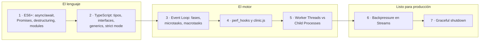
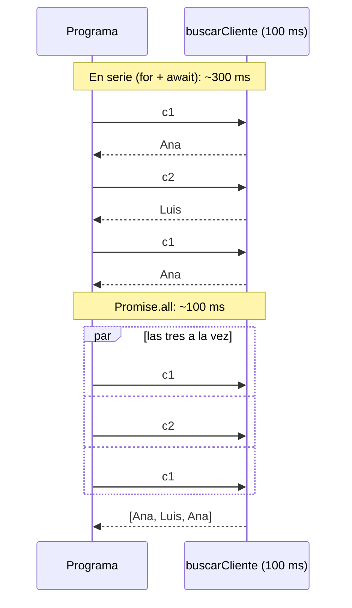
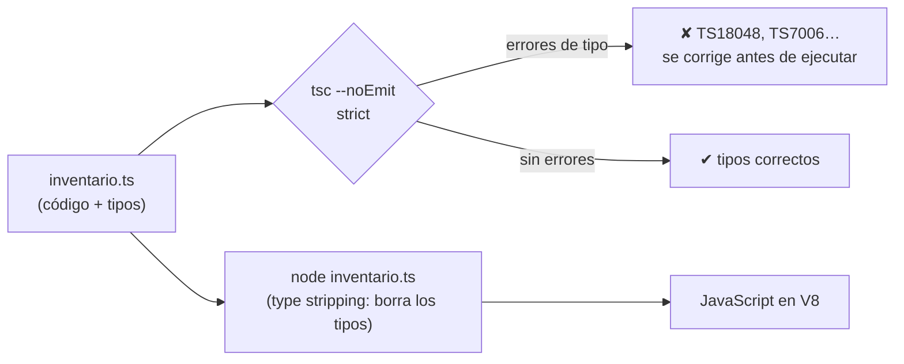
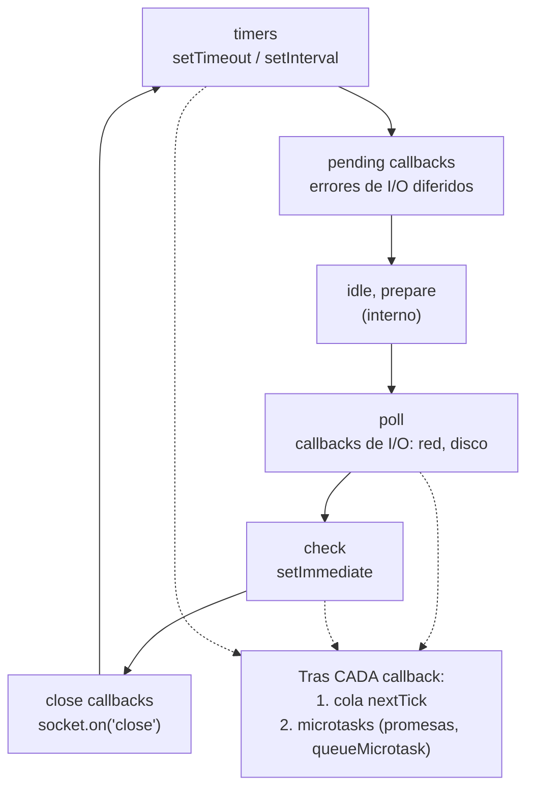
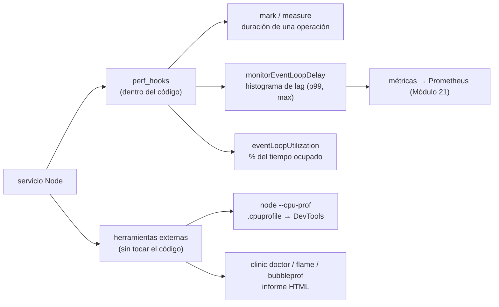
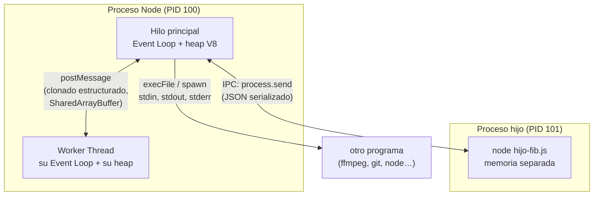
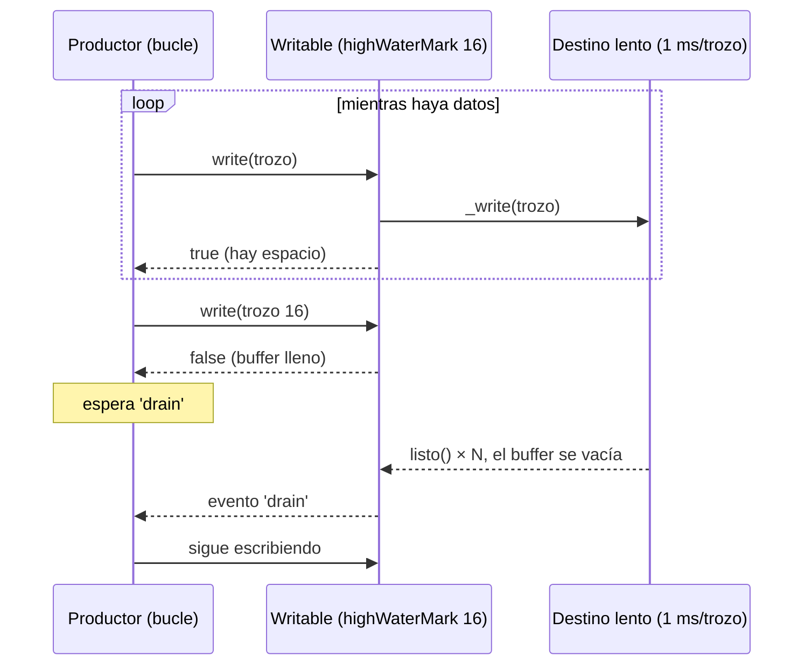
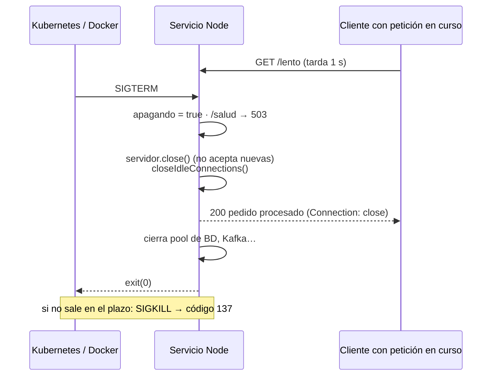

# Módulo 13 · JavaScript/TypeScript moderno y Node.js esencial

**Fase 2 · Node.js de cero a experto** (semanas 1 y 2 de 12). **Duración:** 15 h (7 temas de 2 h y 1 h de
laboratorio integrador). **Dificultad:** 2 de 5 en ES6+ y TypeScript, 3 de 5 en Event Loop, perfiles, hilos, streams
y apagado. **Dependencias:** Fase 0 (Módulo 0.3: ejecutar Node y leer un test; Módulo 0.4: terminal, HTTP, JSON y
variables de entorno; Módulo 0.5: Docker básico). Esta fase **no** necesita la Fase 1: todo lo de Node se explica
aquí desde cero. **Herramientas:** **Node.js 26.13.1 LTS**, **TypeScript 6.0.3**, `@types/node` 26.6.6 y, solo para
el tema de perfiles, **clinic 13.0.0** por `npx`. **Laboratorio:** `examples/microservicios/modulo-17/` (una carpeta
por tema; `./verificar.sh` instala con `npm ci`, comprueba tipos, ejecuta los 24 tests y cada programa).

Un microservicio en Node.js es **un solo hilo de JavaScript** que atiende a miles de clientes a la vez sin
bloquearse. Este módulo te da el lenguaje (JavaScript moderno y TypeScript), te muestra la máquina por dentro (el
Event Loop), cómo medirla (perf_hooks, perfiles y clinic.js), cómo sacar el trabajo pesado del hilo principal
(Worker Threads y procesos hijos), cómo mover datos sin reventar la memoria (backpressure) y cómo apagar el servicio
sin perder peticiones (graceful shutdown).



**Texto alternativo:** mapa del módulo en tres bloques conectados en orden. «El lenguaje» contiene el tema 1 (ES6+)
y el tema 2 (TypeScript). «El motor» contiene el tema 3 (Event Loop), el tema 4 (perf_hooks y clinic.js) y el tema 5
(Worker Threads vs Child Processes). «Listo para producción» contiene el tema 6 (backpressure en Streams) y el tema 7
(graceful shutdown). Una flecha recorre los siete temas del 1 al 7.

**Cómo usar el laboratorio.** Instala Node 26 (`nvm install 26 && nvm use 26`, o el instalador de nodejs.org) y
ejecuta:

```bash
cd examples/microservicios/modulo-17
./verificar.sh              # npm ci + tsc + 24 tests + programas de cada ficha → «RESULTADO: OK»
./verificar.sh --clinic     # además, clinic doctor (descarga clinic 13.0.0 con npx la primera vez)
```

Todas las órdenes de las fichas se ejecutan **desde `examples/microservicios/modulo-17`** después de `npm ci`.
El `package.json` del laboratorio, compartido por las siete fichas, es este (y `package-lock.json` fija el árbol
completo):

```json
{
  "name": "modulo-13-node-esencial",
  "version": "1.0.0",
  "private": true,
  "description": "Módulo 13 (Fase 2): JavaScript/TypeScript moderno y Node.js esencial.",
  "type": "module",
  "engines": {
    "node": ">=26.13.1"
  },
  "scripts": {
    "typecheck": "tsc -p f090-typescript",
    "test": "node --test --test-concurrency=1"
  },
  "devDependencies": {
    "@types/node": "26.6.6",
    "typescript": "6.0.3"
  }
}
```

---

### ES6+: async/await, Promises, destructuring, modules

#### 1. UBICACIÓN

Módulo 13, Lección 1 de 7 · Fase 2 · Laboratorio `examples/microservicios/modulo-17/f089-es6/`.

#### 2. PRERREQUISITOS

- Ejecutar un archivo con `node archivo.js` y leer la salida de `node --test` (Módulo 0.3).
- Variables, funciones, objetos y arreglos en JavaScript (Módulos 0.2 y 0.3).
- Saber qué es una petición HTTP que tarda (Módulo 0.4): aquí la simulamos con `setTimeout`.

#### 3. OBJETIVO DE APRENDIZAJE

**Escribir** un módulo ES que exporte funciones, **usar** destructuring, rest y spread para leer y copiar objetos,
**encadenar** operaciones asíncronas con `async/await` y **elegir** entre ejecución en serie, `Promise.all` y
`Promise.allSettled`; lo compruebas cuando `node --test f089-es6/pedidos.test.js` pasa 5 de 5 y explicas por qué la versión en
paralelo tarda ~100 ms y la de serie ~300 ms.

#### 4. ANALOGÍA VISUAL

Dibuja la **barra de una cafetería**. Tú (el programa) haces tres pedidos. En la escena de la **izquierda** (en
serie) pides un café, te quedas mirando la máquina hasta que sale, y solo entonces pides el segundo: tres tazas en
fila con un reloj encima que marca **3 minutos**. En la escena de la **derecha** (`Promise.all`) dejas los tres
pedidos al mismo tiempo y recibes **tres fichas numeradas** (las *promesas*): cada ficha está en gris («pendiente»),
y se pone verde («cumplida», con la taza) o roja («rechazada», con una nota «se acabó la leche»). El reloj marca
**1 minuto**. Encima de la barra, un **organizador de cubiertos** con compartimentos etiquetados (el destructuring):
sacas solo el tenedor y la cuchara del cajón sin vaciarlo entero. Al fondo, una **estantería de cajas con etiqueta**
(los módulos): cada caja `export`a herramientas y otra persona las toma con `import` por su nombre.

#### 5. DIAGRAMA TÉCNICO



**Texto alternativo:** diagrama de secuencia entre el programa y la función buscarCliente, que tarda 100 ms. En la
primera parte, «en serie», el programa pide c1, espera «Ana», pide c2, espera «Luis», pide c1 y espera «Ana»: unos
300 ms. En la segunda parte, «Promise.all», las tres peticiones salen a la vez en paralelo y vuelve un solo arreglo
[Ana, Luis, Ana] a los 100 ms.

#### 6. EXPLICACIÓN NIVEL 0

- **ES6+** es el nombre del JavaScript moderno (de la edición de 2015 en adelante). Node 26 entiende todo lo de
  esta ficha sin instalar nada.
- Una **promesa** es una ficha que representa un resultado que todavía no llegó. Tiene tres estados: pendiente,
  cumplida (con un valor) o rechazada (con un error).
- **`await`** significa «espera aquí a que esta ficha se ponga verde y dame la taza». Solo se usa dentro de una
  función `async` o en el nivel superior de un módulo. Si la ficha se pone roja, `await` **lanza** el error, y lo
  atrapas con `try/catch`.
- **Destructuring** es sacar partes de un objeto o arreglo en una línea: `const { nombre } = cliente` en lugar de
  `const nombre = cliente.nombre`.
- **Rest y spread** (`...`) son los tres puntos: «el resto» al leer (`const { id, ...resto } = cliente`) y
  «copia todo esto» al construir (`{ ...cliente, ciudad: 'Cali' }`).
- Un **módulo** es un archivo que comparte cosas con `export` y usa cosas de otros con `import`. Para que Node
  trate los `.js` como módulos ES, el `package.json` dice `"type": "module"`.

#### 7. EXPLICACIÓN INTERMEDIA

- **Promise** se crea con `new Promise((resolve, reject) => …)`; casi siempre la recibes hecha (de `fetch`, de
  `fs/promises`, de un driver de base de datos). `then/catch/finally` y `async/await` son dos sintaxis para lo mismo:
  una función `async` **siempre** devuelve una promesa.
- **Combinadores:** `Promise.all` (todas o falla con el primer rechazo), `Promise.allSettled` (todas, nunca falla:
  `{status, value | reason}` por cada una), `Promise.race` (la primera que termine, bien o mal) y `Promise.any` (la
  primera que se cumpla; falla con `AggregateError` si todas fallan).
- **En serie vs en paralelo:** un `await` dentro de un `for` espera cada vuelta. Si las llamadas no dependen entre sí,
  lanza todas y espera con `Promise.all`: el tiempo total es el de la **más lenta**, no la suma.
- **Rechazo no manejado:** desde Node 15 una promesa rechazada que nadie captura **termina el proceso** con código 1.
  Es lo que quieres: un error silencioso es peor que una caída visible.
- **Destructuring** acepta valores por defecto (`{ descuento = 0 }`), renombrar (`{ nombre: n }`) y anidamiento
  (`{ direccion: { ciudad } }`). En parámetros de función documenta qué campos usa la función.
- **Módulos ES vs CommonJS:** ESM usa `import/export`, se carga de forma asíncrona, permite `await` en el nivel
  superior y da `import.meta.filename` e `import.meta.main`. CommonJS (`require/module.exports`) es el formato
  antiguo de Node; ambos conviven, pero en un servicio nuevo usa ESM.

#### 8. EXPLICACIÓN MAESTRA

- **Concurrencia acotada.** `Promise.all` sobre 10 000 ids abre 10 000 conexiones a la vez y tumba a tu base de
  datos. Alternativas: lotes (`for` de lotes de 20 con `Promise.all` dentro, como hace `servidor-lento.js` en la
  ficha de perf_hooks), una librería de cola con límite (`p-limit`), o un stream con `Readable.from(...).map(fn,
  { concurrency: 20 })`. Trade-off: más concurrencia = menos latencia total, pero más presión sobre el servicio de
  abajo.
- **`all` vs `allSettled` es una decisión de negocio.** En un checkout, si falla el cálculo de impuestos debes
  abortar (`all`); en una página de inicio que agrega 5 widgets, mejor `allSettled` y mostrar los que llegaron
  (degradación elegante, Módulo 19).
- **Cancelación.** Una promesa no se puede cancelar; lo que se cancela es la operación, con `AbortController` y
  `AbortSignal.timeout(ms)` (lo usa `fetch`). Sin timeouts, un `await` puede esperar para siempre (Módulo 19).
- **Callbacks, promesas o streams.** Callbacks: solo en APIs antiguas (`fs.readFile(cb)`); promesas: una respuesta;
  streams o `for await`: muchos datos o datos infinitos (ficha 6).
- **Cuándo NO usar `async`:** en funciones puramente síncronas (como `calcularTotal`): marcarlas `async` obliga a
  todos los que las llaman a usar `await` sin ganar nada y añade una vuelta de microtask.

#### 9. CÓDIGO EJECUTABLE

Versiones: **Node.js 26.13.1 LTS** (también funciona desde Node 22), sin dependencias; usa el `package.json` del
laboratorio (`"type": "module"`).

`examples/microservicios/modulo-17/f089-es6/pedidos.js`:

```javascript
// Módulo 13 · F089 · ES6+: async/await, Promises, destructuring, modules.
// Requisitos: Node.js 26.13.1 LTS (funciona desde Node 22). Sin dependencias.
// Este archivo es un MÓDULO ES: exporta con `export` y se importa con `import` (package.json: "type": "module").

export const IVA = 0.19; // export con nombre

// Destructuring en los parámetros: sacamos `items` y `descuento` del objeto (con valor por defecto 0).
export function calcularTotal({ items, descuento = 0 }) {
  // Destructuring dentro del callback: de cada item solo nos interesan precio y cantidad.
  const subtotal = items.reduce((acc, { precio, cantidad }) => acc + precio * cantidad, 0);
  return Math.round(subtotal * (1 - descuento) * (1 + IVA));
}

// Simula un servicio remoto: devuelve una PROMESA que se cumple (resolve) o se rechaza (reject) tras `ms`.
const clientes = { c1: { id: 'c1', nombre: 'Ana', ciudad: 'Bogotá' }, c2: { id: 'c2', nombre: 'Luis', ciudad: 'Lima' } };
export function buscarCliente(id, ms = 100) {
  return new Promise((resolve, reject) => {
    setTimeout(() => {
      const cliente = clientes[id];
      if (cliente) resolve(cliente);
      else reject(new Error(`Cliente ${id} no existe`));
    }, ms);
  });
}

// async/await en SECUENCIA: cada await espera al anterior (3 llamadas de 100 ms ≈ 300 ms).
export async function nombresEnSerie(ids) {
  const nombres = [];
  for (const id of ids) {
    const { nombre } = await buscarCliente(id); // destructuring del resultado
    nombres.push(nombre);
  }
  return nombres;
}

// async/await en PARALELO: Promise.all lanza todas a la vez y espera a todas (≈ 100 ms).
// Si UNA se rechaza, Promise.all se rechaza con ese error.
export async function nombresEnParalelo(ids) {
  const clientesEncontrados = await Promise.all(ids.map((id) => buscarCliente(id)));
  return clientesEncontrados.map(({ nombre }) => nombre);
}

// Promise.allSettled nunca se rechaza: devuelve el estado de cada promesa.
export async function informe(ids) {
  const resultados = await Promise.allSettled(ids.map((id) => buscarCliente(id, 10)));
  return resultados.map((r, i) => (r.status === 'fulfilled' ? `${ids[i]}: ${r.value.nombre}` : `${ids[i]}: ERROR ${r.reason.message}`));
}

// Spread y rest: copiar sin mutar el original.
export function conCiudad(cliente, ciudad) {
  const { id, ...resto } = cliente; // rest: todo menos id
  return { id, ...resto, ciudad }; // spread: copia y sobrescribe ciudad
}
```

`examples/microservicios/modulo-17/f089-es6/demo.js`:

```javascript
// Ejecuta: node f089-es6/demo.js   (desde examples/microservicios/modulo-17)
import { calcularTotal, nombresEnSerie, nombresEnParalelo, informe, conCiudad, buscarCliente } from './pedidos.js';

const pedido = { items: [{ precio: 10000, cantidad: 2 }, { precio: 5000, cantidad: 1 }], descuento: 0.1 };
console.log('Total con IVA:', calcularTotal(pedido));

let t = performance.now();
console.log('En serie:', await nombresEnSerie(['c1', 'c2', 'c1']), `${Math.round((performance.now() - t) / 100) * 100} ms aprox.`);
t = performance.now();
console.log('En paralelo:', await nombresEnParalelo(['c1', 'c2', 'c1']), `${Math.round((performance.now() - t) / 100) * 100} ms aprox.`);

console.log('allSettled:', await informe(['c1', 'zz']));

try {
  await nombresEnParalelo(['c1', 'zz']);
} catch (error) {
  console.log('Promise.all rechazada:', error.message);
}

const ana = await buscarCliente('c1');
const anaEnMedellin = conCiudad(ana, 'Medellín');
console.log('Copia:', anaEnMedellin, '| original intacto:', ana.ciudad);
```

#### 10. MINI-LABORATORIO

1. Instala las dependencias fijadas del laboratorio (una sola vez para todo el módulo):
   ```bash
   cd examples/microservicios/modulo-17
   npm ci
   ```
2. Ejecuta la demo y compara los tiempos en serie y en paralelo:
   ```bash
   node f089-es6/demo.js
   ```
3. Rompe el código a propósito: ejecuta `f089-es6/sin-await.js`, que olvida un `await` y deja una promesa
   rechazada sin capturar:
   ```bash
   node f089-es6/sin-await.js; echo "código de salida: $?"
   ```

**Output esperado** (paso 2, ejecutado con Node 26.13.1):

```text
Total con IVA: 26775
En serie: [ 'Ana', 'Luis', 'Ana' ] 300 ms aprox.
En paralelo: [ 'Ana', 'Luis', 'Ana' ] 100 ms aprox.
allSettled: [ 'c1: Ana', 'zz: ERROR Cliente zz no existe' ]
Promise.all rechazada: Cliente zz no existe
Copia: { id: 'c1', nombre: 'Ana', ciudad: 'Medellín' } | original intacto: Bogotá
```

**Captura comentada:** `26775` sale de (20 000 + 5 000) × 0,9 × 1,19 = 26 775. Las dos líneas de nombres dan el
mismo arreglo, pero en **un tercio del tiempo** con `Promise.all`. `allSettled` reporta el éxito y el error sin
rechazarse; `Promise.all` con el mismo `zz` sí se rechaza, y el `catch` lo atrapa. La copia cambió de ciudad y el
original sigue en Bogotá: spread no muta.

#### 11. VERIFICACIÓN

```bash
node --test --test-reporter=spec f089-es6/pedidos.test.js
```

Salida real (los milisegundos cambian):

```text
✔ destructuring con valor por defecto calcula el total con IVA (0.739556ms)
✔ una promesa rechazada se captura con assert.rejects (o try/catch) (4.985479ms)
✔ Promise.all en paralelo tarda como la llamada más lenta, no como la suma (403.24039ms)
✔ Promise.allSettled informa cada resultado sin rechazarse (10.588334ms)
✔ rest y spread copian sin mutar el original (0.399031ms)
ℹ tests 5
ℹ pass 5
ℹ fail 0
```

El test (`f089-es6/pedidos.test.js`):

```javascript
// Verificación F089: node --test f089-es6/pedidos.test.js
import { test } from 'node:test';
import assert from 'node:assert/strict';
import { calcularTotal, buscarCliente, nombresEnSerie, nombresEnParalelo, informe, conCiudad } from './pedidos.js';

test('destructuring con valor por defecto calcula el total con IVA', () => {
  assert.equal(calcularTotal({ items: [{ precio: 10000, cantidad: 2 }, { precio: 5000, cantidad: 1 }], descuento: 0.1 }), 26775);
  assert.equal(calcularTotal({ items: [{ precio: 100, cantidad: 1 }] }), 119); // descuento = 0 por defecto
});

test('una promesa rechazada se captura con assert.rejects (o try/catch)', async () => {
  await assert.rejects(buscarCliente('zz', 1), { message: 'Cliente zz no existe' });
});

test('Promise.all en paralelo tarda como la llamada más lenta, no como la suma', async () => {
  let t = performance.now();
  assert.deepEqual(await nombresEnSerie(['c1', 'c2', 'c1']), ['Ana', 'Luis', 'Ana']);
  const serie = performance.now() - t;
  t = performance.now();
  assert.deepEqual(await nombresEnParalelo(['c1', 'c2', 'c1']), ['Ana', 'Luis', 'Ana']);
  const paralelo = performance.now() - t;
  assert.ok(serie >= 290, `en serie tardó ${serie} ms`);
  assert.ok(paralelo < serie - 100, `en paralelo tardó ${paralelo} ms y en serie ${serie} ms`);
});

test('Promise.allSettled informa cada resultado sin rechazarse', async () => {
  assert.deepEqual(await informe(['c1', 'zz']), ['c1: Ana', 'zz: ERROR Cliente zz no existe']);
});

test('rest y spread copian sin mutar el original', () => {
  const original = { id: 'c1', nombre: 'Ana', ciudad: 'Bogotá' };
  const copia = conCiudad(original, 'Cali');
  assert.deepEqual(copia, { id: 'c1', nombre: 'Ana', ciudad: 'Cali' });
  assert.equal(original.ciudad, 'Bogotá');
});
```

**Pregunta de comprobación:** si `buscarCliente` tardara 100, 200 y 300 ms para tres ids, ¿cuánto tardarían
`nombresEnSerie` y `nombresEnParalelo`? (Respuesta: ~600 ms y ~300 ms: la suma frente a la más lenta.)

#### 12. ERROR COMÚN

**Síntoma:** imprimes un dato y sale `Promise { <pending> }` o `undefined`, y poco después el proceso muere.
`f089-es6/sin-await.js`:

```javascript
import { buscarCliente } from './pedidos.js';
const cliente = buscarCliente('c1');      // falta await
console.log('Cliente:', cliente);
console.log('Nombre:', cliente.nombre);
buscarCliente('zz');                      // rechazo que nadie captura
```

**Cómo se ve** (salida real, Node 26.13.1):

```text
Cliente: Promise { <pending> }
Nombre: undefined
file:///…/modulo-17/f089-es6/pedidos.js:21
      else reject(new Error(`Cliente ${id} no existe`));
                  ^

Error: Cliente zz no existe
    at Timeout._onTimeout (file:///…/modulo-17/f089-es6/pedidos.js:21:19)
    at listOnTimeout (node:internal/timers:685:17)
    at process.processTimers (node:internal/timers:618:7)

Node.js v26.13.1
código de salida: 1
```

**Diagnóstico visual:** `Promise { <pending> }` es la ficha gris del dibujo: pediste el café y te llevaste la ficha,
no la taza. `undefined` aparece porque la ficha no tiene propiedad `nombre`. El error con código 1 es el rechazo que
nadie capturó. **Arreglo:** `const cliente = await buscarCliente('c1')`, y envuelve en `try/catch` (o encadena
`.catch`) toda promesa que pueda fallar.

Otro error frecuente: usar `import` en un proyecto sin `"type": "module"`. Node 26 lo detecta y vuelve a leer el
archivo como ESM, pero avisa (salida real):

```text
(node:27987) [MODULE_TYPELESS_PACKAGE_JSON] Warning: Module type of file:///tmp/cjs/app.js is not specified and it doesn't parse as CommonJS.
Reparsing as ES module because module syntax was detected. This incurs a performance overhead.
To eliminate this warning, add "type": "module" to /tmp/cjs/package.json.
```

#### 13. PREGUNTA DE ENTREVISTA

«Tienes que consultar el perfil, los pedidos y las recomendaciones de un usuario en tres servicios distintos para
armar su página. ¿Cómo lo escribes con async/await?»

**Respuesta modelo:** como las tres llamadas no dependen entre sí, las lanzo a la vez y espero con
`Promise.allSettled` (o `Promise.all` si sin cualquiera de ellas la página no tiene sentido). Así la latencia es la de
la llamada más lenta y no la suma. A cada llamada le pongo un timeout con `AbortSignal.timeout`, y si recomendaciones
falla muestro la página sin esa sección (degradación elegante). Si fueran miles de llamadas, limitaría la
concurrencia por lotes para no saturar al servicio de abajo. Evito el `await` dentro de un `for` porque serializa
llamadas independientes.

#### 14. ANTI-PATRÓN RELACIONADO

**«Await en cascada» (waterfall accidental):** cada `await` espera al anterior aunque no haya dependencia.

```javascript
// ❌ 3 × 100 ms = 300 ms
const perfil = await perfilDe(id);
const pedidos = await pedidosDe(id);
const recomendaciones = await recomendacionesDe(id);

// ✅ ~100 ms: lanzar todo y esperar una vez
const [perfil, pedidos, recomendaciones] = await Promise.all([perfilDe(id), pedidosDe(id), recomendacionesDe(id)]);
```

En una traza distribuida (Módulo 21) se ve como una **escalera**: tres barras una detrás de otra en vez de tres
barras apiladas que empiezan a la vez. El anti-patrón opuesto, `Promise.all` sobre miles de elementos sin límite, se ve
como una pared de conexiones simultáneas y errores `ECONNRESET` en el servicio de abajo.

---

### TypeScript: tipos, interfaces, generics, strict mode

#### 1. UBICACIÓN

Módulo 13, Lección 2 de 7 · Fase 2 · Laboratorio `examples/microservicios/modulo-17/f090-typescript/`.

#### 2. PRERREQUISITOS

- Ficha anterior (ES6+: módulos, destructuring, promesas).
- `npm ci` hecho en `examples/microservicios/modulo-17` (instala `typescript` 6.0.3 y `@types/node` 26.6.6).

#### 3. OBJETIVO DE APRENDIZAJE

**Declarar** tipos, uniones e interfaces, **escribir** una clase y una función genéricas con restricciones,
**activar** el modo `strict` y **corregir** los errores que detecta (`possibly 'undefined'`, `implicitly has an 'any'
type`); lo compruebas cuando `npx tsc -p f090-typescript` termina sin errores y `node --test f090-typescript/src/inventario.test.ts` pasa
4 de 4.

#### 4. ANALOGÍA VISUAL

Dibuja una **línea de empaque** con moldes. Cada caja que llega trae una **etiqueta de forma** (el tipo): «libro»,
«curso». Un **inspector con lupa** (el compilador `tsc`) está *antes* de la cinta: mira los planos, no las cajas, y
para la línea si un plano dice que una caja «puede venir vacía» y alguien quiere sacarle el contenido sin revisar. La
**plantilla de cartón** colgada en la pared (la interfaz `Producto`) muestra los huecos obligatorios y uno punteado
(`stock?`, opcional). Al lado, una **caja universal con ventana** (el genérico `Repositorio<T>`): sirve para guardar
lo que sea, pero la ventana muestra qué tipo hay dentro, así que nadie mete un zapato en la caja de libros. Cuando la
línea arranca (Node ejecutando), las etiquetas se **despegan** y caen a una papelera: en ejecución ya no existen.

#### 5. DIAGRAMA TÉCNICO



**Texto alternativo:** el archivo inventario.ts, con código y tipos, sigue dos caminos. Por arriba pasa por el
comprobador «tsc --noEmit strict»: si hay errores de tipo termina en una caja roja «TS18048, TS7006… se corrige antes de
ejecutar»; si no, en una caja verde «tipos correctos». Por abajo va directo a «node inventario.ts», que borra los tipos
(type stripping) y entrega JavaScript a V8.

#### 6. EXPLICACIÓN NIVEL 0

- **TypeScript** es JavaScript con **etiquetas de tipo**: `precio: number` dice «aquí solo va un número». Las
  etiquetas sirven para que una herramienta (`tsc`) encuentre errores **antes** de ejecutar.
- Un **tipo** puede ser simple (`string`, `number`, `boolean`) o una lista de valores permitidos:
  `'libro' | 'curso' | 'licencia'`.
- Una **interfaz** es la plantilla de un objeto: qué propiedades tiene y de qué tipo. `stock?: number` significa «puede
  no estar».
- Un **genérico** (`<T>`) es un hueco para un tipo: `Repositorio<Producto>` es un repositorio de productos;
  `Repositorio<Cliente>`, de clientes. Escribes la clase una vez.
- **Strict mode** es el inspector exigente: no te deja usar algo que podría ser `undefined` sin revisarlo antes.
- Node 26 puede ejecutar un `.ts` directamente: borra las etiquetas y ejecuta lo demás. Por eso **comprobar tipos**
  (`tsc`) y **ejecutar** (`node`) son dos pasos distintos.

#### 7. EXPLICACIÓN INTERMEDIA

- **`type` vs `interface`:** ambas describen objetos; `interface` se puede extender y fusionar, `type` además
  expresa uniones, tuplas y tipos calculados. Regla práctica: `interface` para formas de objetos públicos, `type` para
  uniones.
- **Unión discriminada:** `Resultado<T>` = `{ ok: true; valor: T } | { ok: false; error: string }`. Tras `if (r.ok)`
  el compilador **estrecha** el tipo y te deja usar `r.valor`. Es la forma tipada de devolver errores esperables sin
  lanzar excepciones.
- **Generics con restricción:** `Repositorio<T extends { readonly id: Id }>` acepta cualquier tipo que tenga `id`.
  `primero<T>(lista: readonly T[]): T | undefined` conserva el tipo de entrada.
- **`never` y exhaustividad:** en el `default` de un `switch`, asignar a `never` hace que agregar una categoría nueva
  sin su `case` sea un **error de compilación**.
- **`strict: true`** activa, entre otras, `strictNullChecks` (null y undefined son tipos aparte) y `noImplicitAny`
  (todo parámetro necesita tipo). `noUncheckedIndexedAccess` hace que `lista[0]` sea `T | undefined`.
- **Type stripping en Node 26:** solo sabe **borrar** sintaxis de tipos. Por eso el `tsconfig.json` activa
  `erasableSyntaxOnly` (prohíbe `enum`, `namespace` y *parameter properties*, que generan código) y
  `verbatimModuleSyntax` (los imports de solo tipos se escriben `import type`). Los imports llevan la extensión
  `.ts`, como pide Node (`allowImportingTsExtensions`).

`examples/microservicios/modulo-17/f090-typescript/tsconfig.json`:

```jsonc
{
  // Módulo 13 · F090 · TypeScript 6.0.3 en modo estricto. Solo comprueba tipos (noEmit):
  // Node.js 26 ejecuta los .ts directamente quitando los tipos (type stripping).
  "compilerOptions": {
    "target": "es2024",
    "module": "nodenext",
    "strict": true,                       // activa strictNullChecks, noImplicitAny, strictFunctionTypes…
    "noUncheckedIndexedAccess": true,     // arr[i] y obj[clave] pueden ser undefined
    "exactOptionalPropertyTypes": true,
    "erasableSyntaxOnly": true,           // prohíbe enum, namespace y parameter properties: Node no los sabe quitar
    "verbatimModuleSyntax": true,         // obliga a `import type` para los tipos
    "allowImportingTsExtensions": true,   // import './inventario.ts' (como lo pide Node)
    "noEmit": true,
    "types": ["node"],
    "skipLibCheck": true
  },
  "include": ["src"]
}
```

#### 8. EXPLICACIÓN MAESTRA

- **Tres formas de ejecutar TypeScript en un servicio:** (1) **type stripping de Node** (`node app.ts`): cero
  dependencias de ejecución y arranque rápido, pero sin decoradores ni `enum`; (2) **compilar con `tsc`** a `dist/`:
  necesario cuando usas decoradores con metadatos (NestJS, Módulo 14) y da el JavaScript exacto que irá a producción;
  (3) **transpiladores rápidos** (esbuild, swc, tsx): compilan sin comprobar tipos, útiles en desarrollo. En los tres
  casos `tsc --noEmit` debe correr en CI: es el único que **comprueba**.
- **¿Por qué TypeScript 6.0.3 y no 7?** El curso fija 6.0.3 porque `@nestjs/cli` 12 y `ts-jest` 29 aún no aceptan
  TypeScript 7 (decisión registrada en `docs/microservicios/08-herramientas-y-versiones.md`); toda la Fase 2 usa el
  mismo compilador.
- **Tipos en tiempo de compilación ≠ validación en ejecución.** Una interfaz no protege de un JSON malicioso que llega
  por HTTP: en ejecución ya no existe. En los bordes del servicio se valida con Zod o class-validator (Módulo 14) y se
  **deriva** el tipo del esquema (`z.infer`) para no mantener dos definiciones.
- **Trade-offs del modo estricto:** más ruido al principio (hay que tratar cada `undefined`), a cambio de eliminar
  la familia de errores `Cannot read properties of undefined`, la más común en producción. Alternativa gradual para
  código heredado: activar `strict` por carpeta o usar `// @ts-expect-error` con fecha de retiro.
- **Cuándo NO usar TypeScript:** guiones de pocas líneas, prototipos que se tiran o equipos sin CI que ejecute
  `tsc`: sin comprobación, los tipos solo dan una falsa sensación de seguridad. Puedes usar JSDoc + `checkJs` como
  punto intermedio.

#### 9. CÓDIGO EJECUTABLE

Versiones: **Node.js 26.13.1 LTS** (ejecuta `.ts` sin compilar), **typescript 6.0.3** y **@types/node 26.6.6**
(devDependencies del `package.json` del laboratorio).

`examples/microservicios/modulo-17/f090-typescript/src/inventario.ts`:

```typescript
// Módulo 13 · F090 · TypeScript: tipos, interfaces, generics, strict mode.
// Requisitos: Node.js 26.13.1 LTS (ejecuta .ts sin compilar) y typescript 6.0.3 (solo para `tsc --noEmit`).

// 1. TIPOS: alias, uniones de literales y tipos primitivos.
export type Categoria = 'libro' | 'curso' | 'licencia';
export type Id = string;

// 2. INTERFACES: la forma que debe tener un objeto. `?` = opcional, readonly = no se puede reasignar.
export interface Producto {
  readonly id: Id;
  nombre: string;
  precio: number;
  categoria: Categoria;
  stock?: number;
}

// Unión discriminada: el campo `ok` le dice al compilador qué otros campos existen.
export type Resultado<T, E = string> = { ok: true; valor: T } | { ok: false; error: E };

// 3. GENERICS: una sola implementación que conserva el tipo que le pases.
// `T extends { id: Id }` es una RESTRICCIÓN: solo acepta objetos con id.
export class Repositorio<T extends { readonly id: Id }> {
  #items = new Map<Id, T>(); // campo privado de JavaScript (#), no `private` de TS

  guardar(item: T): T {
    this.#items.set(item.id, item);
    return item;
  }

  buscar(id: Id): Resultado<T> {
    const item = this.#items.get(id); // tipo: T | undefined
    // 4. STRICT MODE: sin este if, `item.nombre` no compila (item puede ser undefined).
    if (item === undefined) return { ok: false, error: `No existe ${id}` };
    return { ok: true, valor: item };
  }

  filtrar(predicado: (item: T) => boolean): T[] {
    return [...this.#items.values()].filter(predicado);
  }
}

export function primero<T>(lista: readonly T[]): T | undefined {
  return lista[0]; // con noUncheckedIndexedAccess el tipo ya es T | undefined
}

export function valorDeInventario(productos: readonly Producto[]): number {
  // stock es opcional: `?? 0` cubre el undefined (strict no deja multiplicar por undefined).
  return productos.reduce((total, p) => total + p.precio * (p.stock ?? 0), 0);
}

// Exhaustividad: si mañana agregas una categoría y olvidas el caso, `never` hace fallar la compilación.
export function iva(categoria: Categoria): number {
  switch (categoria) {
    case 'libro':
      return 0;
    case 'curso':
    case 'licencia':
      return 0.19;
    default: {
      const imposible: never = categoria;
      throw new Error(`Categoría desconocida: ${String(imposible)}`);
    }
  }
}
```

`examples/microservicios/modulo-17/f090-typescript/src/demo.ts`:

```typescript
// Ejecuta: node f090-typescript/src/demo.ts   (Node 26 quita los tipos y ejecuta)
import { Repositorio, valorDeInventario, iva, primero } from './inventario.ts';
import type { Producto } from './inventario.ts';

const repo = new Repositorio<Producto>();
repo.guardar({ id: 'p1', nombre: 'Clean Architecture', precio: 120000, categoria: 'libro', stock: 3 });
repo.guardar({ id: 'p2', nombre: 'Curso de Node', precio: 300000, categoria: 'curso' });

const r = repo.buscar('p1');
if (r.ok) console.log('Encontrado:', r.valor.nombre, '| IVA:', iva(r.valor.categoria));
const r2 = repo.buscar('p9');
if (!r2.ok) console.log('Error tipado:', r2.error);

const todos = repo.filtrar(() => true);
console.log('Valor del inventario:', valorDeInventario(todos));
console.log('Primero:', primero(todos)?.id, '| primero de []:', primero([]));
```

#### 10. MINI-LABORATORIO

1. Comprueba los tipos y ejecuta el `.ts` directamente:
   ```bash
   npx tsc -p f090-typescript && echo "tipos OK"
   node f090-typescript/src/demo.ts
   ```
2. Rompe el modo estricto: crea `f090-typescript/src/roto.ts` con este contenido y vuelve a ejecutar `tsc` y `node`:
   ```typescript
   import type { Producto } from './inventario.ts';

   export function nombreEnMayusculas(productos: Producto[], id: string): string {
     const p = productos.find((x) => x.id === id);
     return p.nombre.toUpperCase();
   }

   export function total(precios) {
     return precios.reduce((a, b) => a + b, 0);
   }

   export enum Estado { Activo, Inactivo }
   ```
   ```bash
   npx tsc -p f090-typescript; node f090-typescript/src/roto.ts
   ```
3. Arregla `roto.ts` (`if (!p) throw new Error('no existe')`, `precios: number[]`, y cambia el `enum` por
   `type Estado = 'activo' | 'inactivo'`) hasta que `tsc` no muestre nada. Después bórralo.

**Output esperado** (paso 1):

```text
tipos OK
Encontrado: Clean Architecture | IVA: 0
Error tipado: No existe p9
Valor del inventario: 360000
Primero: p1 | primero de []: undefined
```

Paso 2 (salida real de `tsc` 6.0.3; después, el error de Node):

```text
f090-typescript/src/roto.ts(5,10): error TS18048: 'p' is possibly 'undefined'.
f090-typescript/src/roto.ts(8,23): error TS7006: Parameter 'precios' implicitly has an 'any' type.
f090-typescript/src/roto.ts(9,26): error TS7006: Parameter 'a' implicitly has an 'any' type.
f090-typescript/src/roto.ts(9,29): error TS7006: Parameter 'b' implicitly has an 'any' type.
f090-typescript/src/roto.ts(12,13): error TS1294: This syntax is not allowed when 'erasableSyntaxOnly' is enabled.
…
SyntaxError [ERR_UNSUPPORTED_TYPESCRIPT_SYNTAX]: TypeScript enum is not supported in strip-only mode
```

**Captura comentada:** `tsc` da archivo, (línea, columna), código y mensaje. Fíjate en que Node **no** se queja de
`p.nombre` (no comprueba tipos: lo habría ejecutado y fallado en producción), pero sí del `enum`, porque no sabe
borrarlo. `valorDeInventario` da 360 000 porque el curso no tiene `stock` y cuenta como 0.

#### 11. VERIFICACIÓN

```bash
npx tsc -p f090-typescript && node --test --test-reporter=spec f090-typescript/src/inventario.test.ts
```

Salida real:

```text
✔ el repositorio genérico guarda y busca con un Resultado discriminado (1.027662ms)
✔ stock opcional cuenta como 0 en el valor del inventario (0.156774ms)
✔ iva cubre todas las categorías (0.118971ms)
✔ primero es genérico y respeta undefined (0.080001ms)
ℹ tests 4
ℹ pass 4
ℹ fail 0
```

El test (`f090-typescript/src/inventario.test.ts`, que Node ejecuta sin compilar):

```typescript
// Verificación F090: npx tsc -p f090-typescript && node --test f090-typescript/src/inventario.test.ts
import { test } from 'node:test';
import assert from 'node:assert/strict';
import { Repositorio, valorDeInventario, iva, primero } from './inventario.ts';
import type { Producto } from './inventario.ts';

const libro: Producto = { id: 'p1', nombre: 'Clean Architecture', precio: 120000, categoria: 'libro', stock: 3 };
const curso: Producto = { id: 'p2', nombre: 'Curso de Node', precio: 300000, categoria: 'curso' };

test('el repositorio genérico guarda y busca con un Resultado discriminado', () => {
  const repo = new Repositorio<Producto>();
  repo.guardar(libro);
  const r = repo.buscar('p1');
  assert.equal(r.ok, true);
  if (r.ok) assert.equal(r.valor.nombre, 'Clean Architecture'); // r.valor solo existe si ok === true
  assert.deepEqual(repo.buscar('p9'), { ok: false, error: 'No existe p9' });
});

test('stock opcional cuenta como 0 en el valor del inventario', () => {
  assert.equal(valorDeInventario([libro, curso]), 360000);
});

test('iva cubre todas las categorías', () => {
  assert.deepEqual([iva('libro'), iva('curso'), iva('licencia')], [0, 0.19, 0.19]);
});

test('primero es genérico y respeta undefined', () => {
  assert.equal(primero(['a', 'b']), 'a');
  assert.equal(primero([]), undefined);
});
```

**Pregunta de comprobación:** ¿por qué `node demo.ts` funciona aunque el código tenga un error de tipos, y qué paso
de tu CI lo evitaría? (Respuesta: Node solo borra los tipos, no los comprueba; `tsc --noEmit` en CI.)

#### 12. ERROR COMÚN

**Síntoma:** en producción, `TypeError: Cannot read properties of undefined (reading 'nombre')` en una línea que
«siempre funcionó». **Causa:** `find`, `Map.get` o un índice devolvieron `undefined` y el proyecto no tenía `strict`.
**Cómo se ve con strict** (antes de desplegar):

```text
f090-typescript/src/roto.ts(5,10): error TS18048: 'p' is possibly 'undefined'.
```

**Diagnóstico visual:** en el editor, `p` aparece subrayado en rojo; al pasar el ratón, el tipo es
`Producto | undefined`. **Arreglo:** tratar el caso (`if (!p) return …`, `?.`, `??`) o devolver un `Resultado` como
`buscar()`. No uses `p!.nombre` (el operador `!` apaga el inspector) salvo que puedas demostrar que nunca es
`undefined`.

#### 13. PREGUNTA DE ENTREVISTA

«¿Qué diferencia hay entre los tipos de TypeScript y la validación de datos, y cuál necesitas en un microservicio?»

**Respuesta modelo:** los tipos existen solo en compilación: `tsc` comprueba que **mi código** sea coherente y
después se borran. La validación ocurre en ejecución y comprueba que **los datos de fuera** (HTTP, colas, variables de
entorno) tengan la forma esperada. Un microservicio necesita ambas: tipos estrictos dentro y validación en cada
frontera. Para no duplicar, defino el esquema una vez (Zod) y derivo el tipo con `z.infer`, o uso clases DTO con
decoradores en NestJS. Y en CI corro `tsc --noEmit` con `strict`.

#### 14. ANTI-PATRÓN RELACIONADO

**`any` por todas partes (TypeScript «decorativo»):**

```typescript
// ❌ compila siempre… y no protege de nada
function procesar(datos: any): any {
  return datos.items.map((x: any) => x.precio * x.cantidad);
}
const r = JSON.parse(cuerpo) as Pedido; // ❌ «as» no valida: solo le miente al compilador
```

Se ve en el código como una nube de `any`, `as` y `!`; en las métricas, como un `tsconfig` sin `strict` y errores
`undefined` en producción. Sustitúyelo por `unknown` + validación (Zod), tipos explícitos y `strict: true`.

---

### Event Loop: fases, microtasks, macrotasks

#### 1. UBICACIÓN

Módulo 13, Lección 3 de 7 · Fase 2 · Laboratorio `examples/microservicios/modulo-17/f091-event-loop/`.

#### 2. PRERREQUISITOS

- Promesas y `async/await` (ficha 1 de este módulo).
- Servidor HTTP mínimo con `node:http` y `curl` (Módulo 0.4).

#### 3. OBJETIVO DE APRENDIZAJE

**Predecir** el orden en que Node ejecuta código síncrono, `process.nextTick`, promesas, `setImmediate` y
`setTimeout`, **nombrar** las fases del Event Loop y **demostrar** que un cálculo síncrono congela todas las
peticiones; lo compruebas cuando `node --test f091-event-loop/orden.test.js` pasa 2 de 2 y predices la salida de `orden.js` antes
de ejecutarlo.

#### 4. ANALOGÍA VISUAL

Dibuja un **restaurante con un solo mesero** (el hilo de JavaScript) que da vueltas por un **circuito de seis
estaciones** marcado en el piso: *temporizadores* (alarmas de cocina), *callbacks pendientes*, *preparación*,
*sondeo* (la ventana de la cocina donde salen platos: el I/O), *check* (la campana de «inmediato») y *cierres*. En el
bolsillo del mesero hay **dos libretas pequeñas**: una roja (`nextTick`) y una azul (microtasks: promesas). Regla de
oro dibujada en un cartel: **cada vez que termina una tarea, el mesero vacía primero la libreta roja, luego la azul, y
solo entonces camina a la siguiente estación**. En una esquina, una mesa donde un cliente le pide al mesero que pele
1 000 papas él mismo (código síncrono pesado): mientras pela, nadie más es atendido y los platos se enfrían en la
ventana.

#### 5. DIAGRAMA TÉCNICO



**Texto alternativo:** un ciclo de seis fases que se repite: timers (setTimeout y setInterval), pending callbacks,
idle/prepare (interno), poll (callbacks de I/O de red y disco), check (setImmediate) y close callbacks, que vuelve a
timers. Una caja aparte, unida con líneas punteadas a timers, poll y check, dice: «Tras cada callback: primero la cola
nextTick, luego las microtasks (promesas, queueMicrotask)».

#### 6. EXPLICACIÓN NIVEL 0

- Node ejecuta tu JavaScript en **un solo hilo**: hace una cosa a la vez.
- Aun así atiende a miles de clientes porque **no espera sentado**: cuando pide algo lento (leer un archivo, llamar a
  otro servicio), deja anotado «avísame cuando esté» y sigue con otra cosa. Ese «seguir con otra cosa» en círculos es
  el **Event Loop** (bucle de eventos).
- Las tareas grandes que esperan turno se llaman **macrotasks** (un temporizador que venció, una respuesta de red,
  un `setImmediate`). Las tareas pequeñas y urgentes se llaman **microtasks** (lo que sigue a un `await` o a un
  `.then`). Las microtasks **siempre** se atienden antes de pasar a la siguiente macrotask.
- Si tu código hace un cálculo largo **sin soltar el hilo**, el bucle no da vueltas: nadie más recibe respuesta.

#### 7. EXPLICACIÓN INTERMEDIA

- **Las seis fases (libuv):** timers → pending callbacks → idle/prepare → **poll** (espera y ejecuta I/O) →
  **check** (`setImmediate`) → close callbacks. Una vuelta completa es un *tick* del loop.
- **Entre callbacks** Node vacía la cola de `process.nextTick` y después la de microtasks (promesas y
  `queueMicrotask`). Una microtask que crea otra microtask se ejecuta en la **misma** pasada (por eso aparece `5b`
  antes de `6` en el laboratorio).
- **`setImmediate` vs `setTimeout(fn, 0)`:** dentro de un callback de I/O, `setImmediate` siempre va primero (check
  viene justo después de poll). Desde el script principal el orden **no está garantizado**: depende de cuánto tardó el
  arranque. Por eso `orden.js` arranca todo dentro de un `readFile`.
- **`setTimeout(fn, 10)` significa «no antes de 10 ms»**, no «a los 10 ms». Si el hilo está ocupado 200 ms, el
  temporizador se ejecuta a los ~200 ms.
- **Qué bloquea:** bucles largos, `JSON.parse`/`stringify` de cuerpos enormes, expresiones regulares catastróficas,
  criptografía síncrona (`pbkdf2Sync`), cualquier `*Sync` de `fs` dentro de una petición.
- **Qué no bloquea:** el I/O de red y disco (lo hacen el sistema operativo y el *thread pool* de libuv, de 4 hilos
  por defecto, configurable con `UV_THREADPOOL_SIZE`).

#### 8. EXPLICACIÓN MAESTRA

- **El modelo encaja con servicios I/O-bound** (la mayoría de microservicios: reciben, consultan, responden). Para
  CPU-bound (imágenes, PDFs, criptografía masiva) tienes tres alternativas: Worker Threads (ficha 5), un servicio en
  otro lenguaje o una cola con *workers* dedicados. Trade-off: más paralelismo a cambio de serialización de mensajes y
  más complejidad operativa.
- **`process.nextTick` puede matar de hambre al loop:** un `nextTick` recursivo nunca deja llegar a la fase poll.
  Prefiere `queueMicrotask` o `setImmediate` para ceder el turno. `nextTick` existe para emitir eventos después de que
  el llamador haya registrado sus *listeners*.
- **Partir el trabajo (yield):** un cálculo largo se puede trocear en lotes con `await setImmediate()` entre lotes
  (`import { setImmediate } from 'node:timers/promises'`) para que el loop respire. Es más simple que un worker, pero
  alarga el tiempo total del cálculo.
- **Observabilidad:** el retraso del Event Loop (*event loop lag*) es la métrica número uno de salud de un servicio
  Node; se mide con `monitorEventLoopDelay` (ficha 4) y se alerta sobre su p99 (Módulo 21).
- **Cuándo NO pelear con el Event Loop:** si el 80 % del trabajo de un servicio es CPU, Node no es la herramienta;
  un servicio en Java o Go con hilos reales puede ser más simple que llenar el código de workers.

#### 9. CÓDIGO EJECUTABLE

Versiones: **Node.js 26.13.1 LTS** (también desde Node 22), sin dependencias.

`examples/microservicios/modulo-17/f091-event-loop/orden.js`:

```javascript
// Módulo 13 · F091 · Event Loop: fases, microtasks y macrotasks.
// Requisitos: Node.js 26.13.1 LTS (funciona desde Node 22). Sin dependencias.
// Ejecuta: node f091-event-loop/orden.js
import { readFile } from 'node:fs';

// Devuelve el orden en que Node ejecuta cada tipo de callback. Todo arranca DENTRO de un callback de I/O
// (fase "poll"), así el orden es determinista: después de poll viene "check" (setImmediate) y luego,
// en la siguiente vuelta, "timers" (setTimeout).
export function ordenDeEjecucion() {
  return new Promise((resolve) => {
    const orden = [];
    readFile(import.meta.filename, () => {
      orden.push('1 síncrono (callback de I/O, fase poll)');
      setTimeout(() => orden.push('6 setTimeout 0 (macrotask, fase timers)'), 0);
      setImmediate(() => {
        orden.push('5 setImmediate (macrotask, fase check)');
        Promise.resolve().then(() => orden.push('5b microtask creada en check: corre antes de pasar a la siguiente macrotask'));
      });
      Promise.resolve().then(() => orden.push('3 Promise.then (microtask)'));
      queueMicrotask(() => orden.push('4 queueMicrotask (microtask, misma cola que las promesas)'));
      process.nextTick(() => orden.push('2 process.nextTick (cola nextTick, antes que las promesas)'));
      orden.push('1b síncrono: sigue el mismo callback');
      setTimeout(() => resolve(orden), 20);
    });
  });
}

// Bloquear el hilo principal retrasa TODO lo demás (temporizadores incluidos).
export function retrasoDeUnTimer(msDeBloqueo) {
  return new Promise((resolve) => {
    const inicio = performance.now();
    setTimeout(() => resolve(Math.round(performance.now() - inicio)), 10); // pedimos 10 ms…
    const fin = inicio + msDeBloqueo;
    while (performance.now() < fin); // …pero este bucle síncrono no suelta el hilo
  });
}

if (import.meta.main) {
  for (const paso of await ordenDeEjecucion()) console.log(paso);
  console.log(`setTimeout(10) sin bloqueo llegó a los ~${await retrasoDeUnTimer(0)} ms`);
  console.log(`setTimeout(10) con 200 ms de bucle síncrono llegó a los ~${await retrasoDeUnTimer(200)} ms`);
}
```

#### 10. MINI-LABORATORIO

1. **Predice** primero: escribe en un papel el orden de las líneas `1`, `1b`, `2`, `3`, `4`, `5`, `5b`, `6`.
2. Ejecuta y compara con tu predicción:
   ```bash
   node f091-event-loop/orden.js
   ```
3. Compara con el orden desde el script principal (sin I/O), varias veces:
   ```bash
   for i in 1 2 3 4 5; do node -e "setTimeout(()=>console.log('timeout'),0);setImmediate(()=>console.log('immediate'))" | tr '\n' ' '; echo; done
   ```
4. Bloquea el loop a propósito y mira cómo muere el health check:
   ```bash
   node f091-event-loop/bloqueo.js
   ```

**Output esperado** (paso 2, salida real con Node 26.13.1):

```text
1 síncrono (callback de I/O, fase poll)
1b síncrono: sigue el mismo callback
2 process.nextTick (cola nextTick, antes que las promesas)
3 Promise.then (microtask)
4 queueMicrotask (microtask, misma cola que las promesas)
5 setImmediate (macrotask, fase check)
5b microtask creada en check: corre antes de pasar a la siguiente macrotask
6 setTimeout 0 (macrotask, fase timers)
setTimeout(10) sin bloqueo llegó a los ~10 ms
setTimeout(10) con 200 ms de bucle síncrono llegó a los ~200 ms
```

Paso 3 (salida real de cinco ejecuciones seguidas; en tu máquina la mezcla será otra):

```text
immediate timeout
immediate timeout
timeout immediate
timeout immediate
immediate timeout
```

Fuera de un callback de I/O el orden entre `setTimeout(fn, 0)` y `setImmediate` **no está garantizado**.

Paso 4 (salida real):

```text
salud: TimeoutError: The operation was aborted due to timeout (tras 304 ms)
reporte listo
```

**Captura comentada:** todo lo síncrono (`1`, `1b`) termina antes que cualquier callback; luego la libreta roja
(`2`), la azul (`3`, `4`); la campana de check (`5`) y su microtask (`5b`) antes de volver a timers (`6`). En el paso
4, `/salud` debería tardar 1 ms, pero espera detrás del bucle de 1 s de `/reporte`: con un timeout de 300 ms, el health
check de Kubernetes daría el pod por muerto.

`examples/microservicios/modulo-17/f091-event-loop/bloqueo.js`:

```javascript
// F091 · Error común: un cálculo síncrono en un handler congela TODAS las peticiones del proceso.
// Ejecuta: node f091-event-loop/bloqueo.js
// El servidor corre en un proceso hijo (fork) para que el cliente tenga su propio Event Loop.
import http from 'node:http';
import { fork } from 'node:child_process';

if (process.argv[2] === '--servidor') {
  const servidor = http.createServer((req, res) => {
    if (req.url === '/reporte') {
      const fin = Date.now() + 1000;
      while (Date.now() < fin); // 1 s de CPU sin soltar el hilo (un JSON enorme, un bucle, un hash…)
      return res.end('reporte listo\n');
    }
    res.end('ok\n'); // /salud: debería responder en 1 ms
  });
  servidor.listen(0, () => process.send(servidor.address().port));
} else {
  const hijo = fork(import.meta.filename, ['--servidor']);
  const puerto = await new Promise((r) => hijo.once('message', r));
  const base = `http://localhost:${puerto}`;
  const reporte = fetch(`${base}/reporte`); // lo lanzamos sin esperar
  await new Promise((r) => setTimeout(r, 100));
  const inicio = performance.now();
  try {
    await fetch(`${base}/salud`, { signal: AbortSignal.timeout(300) }); // el health check de Kubernetes
    console.log('salud: ok');
  } catch (error) {
    console.log(`salud: ${error.name}: ${error.message} (tras ${Math.round(performance.now() - inicio)} ms)`);
  }
  console.log((await (await reporte).text()).trim());
  hijo.kill();
}
```

#### 11. VERIFICACIÓN

```bash
node --test --test-reporter=spec f091-event-loop/orden.test.js
```

Salida real:

```text
✔ síncrono → nextTick → microtasks → check → timers (24.278875ms)
✔ un bucle síncrono de 200 ms retrasa un setTimeout de 10 ms (211.548045ms)
ℹ tests 2
ℹ pass 2
ℹ fail 0
```

```javascript
// Verificación F091: node --test f091-event-loop/orden.test.js
import { test } from 'node:test';
import assert from 'node:assert/strict';
import { ordenDeEjecucion, retrasoDeUnTimer } from './orden.js';

test('síncrono → nextTick → microtasks → check → timers', async () => {
  const orden = (await ordenDeEjecucion()).map((linea) => linea.split(' ')[0]);
  assert.deepEqual(orden, ['1', '1b', '2', '3', '4', '5', '5b', '6']);
});

test('un bucle síncrono de 200 ms retrasa un setTimeout de 10 ms', async () => {
  const libre = await retrasoDeUnTimer(0);
  const bloqueado = await retrasoDeUnTimer(200);
  assert.ok(bloqueado >= 200, `bloqueado: ${bloqueado} ms`);
  assert.ok(bloqueado > libre, `libre: ${libre} ms, bloqueado: ${bloqueado} ms`);
});
```

**Pregunta de comprobación:** dentro de un `.then`, programas un `setTimeout(a, 0)`, un `setImmediate(b)` y un
`queueMicrotask(c)`. ¿Cuál corre primero con seguridad? (Respuesta: `c`, porque es microtask y se vacía antes de pasar
a cualquier macrotask; el orden entre `a` y `b` depende de en qué fase estés.)

#### 12. ERROR COMÚN

**Síntoma:** el servicio «se cuelga» a ratos; las métricas muestran CPU al 100 % en un solo núcleo y los health
checks fallan aunque el proceso está vivo. **Cómo se ve** (salida real de `bloqueo.js`):

```text
salud: TimeoutError: The operation was aborted due to timeout (tras 304 ms)
```

**Diagnóstico visual:** un gráfico de latencia donde **todas** las rutas, también las triviales como `/salud`, suben a
la vez al mismo valor (el tiempo del bloqueo). Si fuera la base de datos, solo subirían las rutas que la usan. Mide el
retraso del loop con `monitorEventLoopDelay` (ficha 4) y localiza la función con un perfil de CPU. **Arreglo:** mover
el cálculo a un Worker Thread (ficha 5), trocearlo, o hacerlo asíncrono (por ejemplo `crypto.pbkdf2` en lugar de
`pbkdf2Sync`).

#### 13. PREGUNTA DE ENTREVISTA

«Si Node.js tiene un solo hilo, ¿cómo atiende 10 000 conexiones simultáneas? ¿Y en qué caso deja de hacerlo bien?»

**Respuesta modelo:** porque el hilo de JavaScript nunca espera el I/O: las operaciones de red las vigila el sistema
operativo (epoll, kqueue) y las de disco o DNS el thread pool de libuv; cuando terminan, su callback entra en la fase
correspondiente del Event Loop. El hilo solo trabaja mientras hay JavaScript que ejecutar, así que con tareas cortas
atiende muchísimas conexiones. Deja de hacerlo bien cuando una tarea es CPU-bound o síncrona: bloquea el loop y todas
las peticiones esperan. Ahí mido el lag del loop, perfilo y muevo ese trabajo a Worker Threads, a otro servicio o lo
troceo.

#### 14. ANTI-PATRÓN RELACIONADO

**Código síncrono en la ruta caliente:**

```javascript
// ❌ cada petición lee el disco de forma síncrona y hashea con la versión bloqueante
app.post('/login', (req, res) => {
  const config = JSON.parse(fs.readFileSync('config.json', 'utf8'));
  const hash = crypto.pbkdf2Sync(req.body.clave, config.sal, 600_000, 64, 'sha512');
  …
});
```

Se ve en un perfil de CPU como una **meseta**: una sola función ocupa casi todo el ancho del *flame graph*. Lee la
configuración una vez al arrancar y usa las versiones asíncronas (`fs/promises`, `crypto.pbkdf2` con callback o
promisificado).

---

### perf_hooks y clinic.js

#### 1. UBICACIÓN

Módulo 13, Lección 4 de 7 · Fase 2 · Laboratorio `examples/microservicios/modulo-17/f092-perf/`.

#### 2. PRERREQUISITOS

- Event Loop: fases y bloqueo (ficha anterior).
- Saber abrir un archivo HTML en el navegador y usar `npx` (viene con npm).

#### 3. OBJETIVO DE APRENDIZAJE

**Medir** la duración de una operación con `performance.mark/measure` y `timerify`, **cuantificar** el retraso y el
uso del Event Loop con `monitorEventLoopDelay` y `eventLoopUtilization`, y **generar** e **interpretar** un perfil de
CPU con `node --cpu-prof` y un diagnóstico con `clinic doctor`; lo compruebas cuando `node --test f092-perf/medir.test.js` pasa 4
de 4 y `resumir-perfil.js` señala las funciones de `node:crypto` como las más costosas.

#### 4. ANALOGÍA VISUAL

Dibuja el **taller de un mecánico** con un auto en el elevador. En la pared, tres instrumentos: un **cronómetro de
mano** con dos botones etiquetados `mark` (inicio y fin) para medir cuánto tarda cambiar una rueda; un **tacómetro**
con una aguja y una zona roja (el retraso del Event Loop: si la aguja pasa los 100 ms, el motor está ahogado); y un
**velocímetro de porcentaje** (utilización del loop: 1 % al ralentí, 100 % a fondo). En la mesa, un **escáner OBD**
conectado al auto (clinic.js / perfil de CPU) que imprime una tira con un **gráfico de llamas**: barras apiladas cuyo
ancho dice cuánto tiempo pasó el motor en cada pieza; la barra más ancha es por donde empezar.

#### 5. DIAGRAMA TÉCNICO



**Texto alternativo:** un servicio Node con dos caminos de medición. Por dentro del código, perf_hooks ofrece tres
instrumentos: mark/measure para la duración de una operación, monitorEventLoopDelay para el histograma de retraso
(p99, máximo) y eventLoopUtilization para el porcentaje de tiempo ocupado; el histograma alimenta métricas para
Prometheus (Módulo 21). Por fuera, sin tocar el código, node --cpu-prof genera un .cpuprofile para DevTools y clinic
(doctor, flame, bubbleprof) genera un informe HTML.

#### 6. EXPLICACIÓN NIVEL 0

- **Medir antes de optimizar:** la intuición sobre «qué es lo lento» falla casi siempre. Primero mides, luego cambias,
  luego vuelves a medir.
- **`perf_hooks`** es un módulo que ya viene con Node. Te da un cronómetro de alta precisión (`performance.now()`,
  en milisegundos con decimales) y marcas con nombre (`mark` y `measure`).
- **Retraso del Event Loop:** cuánto se atrasa el mesero de la ficha anterior en volver a cada estación. Sano: unos
  pocos milisegundos. Enfermo: cientos.
- **Perfil de CPU:** una grabación de en qué funciones pasó el tiempo el programa. Node la genera con
  `--cpu-prof`.
- **clinic.js** es un conjunto de herramientas que corre tu servicio, lo observa y te entrega un informe HTML con
  gráficos y una recomendación.

#### 7. EXPLICACIÓN INTERMEDIA

- **`performance.mark(nombre)` + `performance.measure(nombre, inicio, fin)`** devuelven una entrada con `duration`.
  Limpia con `clearMarks/clearMeasures`: se acumulan en memoria. Las marcas también aparecen en los perfiles.
- **`performance.timerify(fn)`** envuelve una función; un `PerformanceObserver` con `entryTypes: ['function']`
  recibe una entrada por llamada (de forma asíncrona, por eso el test espera un `setImmediate`).
- **`monitorEventLoopDelay({ resolution: 10 })`** devuelve un histograma en **nanosegundos** (`min`, `max`, `mean`,
  `percentile(99)`); divide entre 1e6 para milisegundos. Activa con `enable()`, apaga con `disable()`.
- **`performance.eventLoopUtilization(anterior)`** devuelve `utilization` entre 0 y 1 para el intervalo desde la
  medición anterior. Es mejor señal de saturación que la CPU del proceso (que incluye GC y hilos de libuv).
- **`node --cpu-prof --cpu-prof-dir=perfiles app.js`** escribe un `.cpuprofile` al salir; ábrelo en Chrome DevTools
  (Performance → Load profile) o en VS Code. `resumir-perfil.js` lo resume en texto.
- **clinic 13.0.0:** `clinic doctor` (diagnóstico general: CPU, memoria, lag, handles), `clinic flame` (flame graph,
  usa 0x) y `clinic bubbleprof` (tiempo esperando operaciones asíncronas). Se ejecuta como
  `clinic doctor -- node app.js`, con el servicio recibiendo carga mientras tanto.
- **clinic.js con Node 26 (comprobado el 2026-11-19 con Node 26.13.1):** su última versión es la 13.0.0, publicada el
  2023-06-28. **Funciona**: `doctor`, `flame` y `bubbleprof` generaron sus informes HTML. Pero tiene un fallo: la
  primera vez pregunta si puede enviar estadísticas de uso y, si la terminal no es interactiva (CI, scripts, este
  laboratorio), **termina sin hacer nada y con código 0**, mostrando solo un aviso `[DEP0174] DeprecationWarning`.
  Solución: exportar `NO_INSIGHT=1` (opta por no enviar estadísticas y salta la pregunta). Como no se mantiene desde
  2023, la alternativa integrada y mantenida es `perf_hooks` + `node --cpu-prof` (y `--heap-prof` para memoria).

#### 8. EXPLICACIÓN MAESTRA

- **Muestreo vs instrumentación.** `--cpu-prof` y clinic flame **muestrean** la pila cada ~1 ms: bajo coste, ven
  todo, pero las funciones muy cortas pueden no salir. `timerify`/`measure` **instrumentan**: exactos para lo que
  marcas, ciegos para lo demás. En producción: métricas continuas (lag p99, ELU) y perfiles bajo demanda.
- **Tiempo propio vs tiempo total.** El resumen muestra **tiempo propio** (la función estaba en la cima de la pila).
  En el laboratorio, `hashCaro` casi no aparece: el tiempo propio está en `Hash`, `digest` y `update` de `node:crypto`,
  que `hashCaro` llama 20 000 veces por petición. En el flame graph se ve como una barra ancha de `hashCaro` con hijos.
- **El recolector de basura cuenta.** `(garbage collector)` con un 28 % indica muchas asignaciones cortas (aquí, un
  string hexadecimal por iteración). Reducir asignaciones a veces rinde más que optimizar el algoritmo.
- **Alternativas:** Chrome DevTools conectado con `node --inspect`; `0x` (flame graphs, lo usa clinic flame);
  APMs comerciales (Datadog, New Relic) y OpenTelemetry con perfiles continuos (Pyroscope/Grafana). Trade-off:
  herramientas locales gratis y precisas pero puntuales; APM continuo con coste y algo de overhead.
- **Cuándo NO perfilar:** si el cuello de botella es una dependencia externa (la base de datos tarda 800 ms), el perfil
  de CPU saldrá «vacío» (el proceso está esperando). Ahí sirven las trazas distribuidas (Módulo 21) o `clinic
  bubbleprof`.

#### 9. CÓDIGO EJECUTABLE

Versiones: **Node.js 26.13.1 LTS** (también desde Node 22), sin dependencias; **clinic 13.0.0** solo por `npx` en el
laboratorio.

`examples/microservicios/modulo-17/f092-perf/medir.js`:

```javascript
// Módulo 13 · F092 · perf_hooks: medir duración, retraso del Event Loop y uso del Event Loop.
// Requisitos: Node.js 26.13.1 LTS (funciona desde Node 22). Sin dependencias.
// Ejecuta: node f092-perf/medir.js
import { performance, monitorEventLoopDelay, PerformanceObserver } from 'node:perf_hooks';

// Trabajo de CPU de ejemplo: ordenar un arreglo grande.
export function ordenarAleatorios(n) {
  const datos = Array.from({ length: n }, (_, i) => (i * 7919) % n);
  return datos.sort((a, b) => a - b).length;
}

// 1. mark + measure: cronómetro con nombre que aparece también en los perfiles (--cpu-prof, clinic).
export function medirConMarcas(n) {
  performance.mark('ordenar:inicio');
  ordenarAleatorios(n);
  performance.mark('ordenar:fin');
  const medida = performance.measure('ordenar', 'ordenar:inicio', 'ordenar:fin');
  performance.clearMarks();
  performance.clearMeasures();
  return medida.duration; // milisegundos con decimales
}

// 2. monitorEventLoopDelay: histograma de cuánto se retrasa el Event Loop (en nanosegundos).
// 3. eventLoopUtilization: fracción del tiempo que el loop estuvo ocupado (0 = ocioso, 1 = saturado).
export async function retrasoDelLoop(msDeBloqueo) {
  const h = monitorEventLoopDelay({ resolution: 10 });
  h.enable();
  const elu0 = performance.eventLoopUtilization();
  await new Promise((r) => setTimeout(r, 50));
  const fin = Date.now() + msDeBloqueo;
  while (Date.now() < fin); // bloqueo artificial
  await new Promise((r) => setTimeout(r, 50));
  h.disable();
  const elu = performance.eventLoopUtilization(elu0);
  return { maxMs: h.max / 1e6, p99Ms: h.percentile(99) / 1e6, utilizacion: elu.utilization };
}

// 4. timerify + PerformanceObserver: mide cada llamada a una función sin tocar su código.
export async function llamadasMedidas() {
  const duraciones = [];
  const obs = new PerformanceObserver((lista) => lista.getEntries().forEach((e) => duraciones.push(e.duration)));
  obs.observe({ entryTypes: ['function'] });
  const ordenarMedido = performance.timerify(ordenarAleatorios);
  ordenarMedido(10_000);
  ordenarMedido(100_000);
  await new Promise((r) => setImmediate(r)); // las entradas se entregan de forma asíncrona
  obs.disconnect();
  return duraciones;
}

if (import.meta.main) {
  console.log(`ordenar 1 000 000 números: ${medirConMarcas(1_000_000).toFixed(0)} ms`);
  const sano = await retrasoDelLoop(0);
  const bloqueado = await retrasoDelLoop(200);
  console.log(`loop sano:     max ${sano.maxMs.toFixed(0)} ms · p99 ${sano.p99Ms.toFixed(0)} ms · ocupado ${(sano.utilizacion * 100).toFixed(0)} %`);
  console.log(`loop bloqueado: max ${bloqueado.maxMs.toFixed(0)} ms · p99 ${bloqueado.p99Ms.toFixed(0)} ms · ocupado ${(bloqueado.utilizacion * 100).toFixed(0)} %`);
  console.log(`timerify: ${(await llamadasMedidas()).length} llamadas medidas`);
}
```

`examples/microservicios/modulo-17/f092-perf/servidor-lento.js` (lo que vamos a perfilar):

```javascript
// F092 · Servidor con un endpoint que bloquea el Event Loop, para perfilarlo con clinic.js o con --cpu-prof.
// Hace 200 peticiones a sí mismo y se cierra, así el perfil se genera sin herramientas de carga.
// Ejecuta: node --cpu-prof --cpu-prof-dir=perfiles f092-perf/servidor-lento.js
//      o:  NO_INSIGHT=1 npx clinic doctor -- node f092-perf/servidor-lento.js
import http from 'node:http';
import { createHash } from 'node:crypto';

function hashCaro(texto) {
  let h = texto;
  for (let i = 0; i < 20_000; i++) h = createHash('sha256').update(h).digest('hex'); // CPU síncrona
  return h;
}

const servidor = http.createServer((req, res) => res.end(hashCaro(req.url).slice(0, 8) + '\n'));
servidor.listen(0, async () => {
  const url = `http://localhost:${servidor.address().port}/pedido`;
  const inicio = performance.now();
  for (let lote = 0; lote < 20; lote++) await Promise.all(Array.from({ length: 10 }, () => fetch(url).then((r) => r.text())));
  console.log(`200 peticiones en ${Math.round(performance.now() - inicio)} ms`);
  servidor.close();
});
```

`examples/microservicios/modulo-17/f092-perf/resumir-perfil.js`:

```javascript
// F092 · Lee un .cpuprofile (generado con node --cpu-prof) y muestra las 5 funciones con más tiempo propio.
// Ejecuta: node f092-perf/resumir-perfil.js perfiles/*.cpuprofile
// Para verlo gráfico: abre el archivo en Chrome DevTools (pestaña Performance → Load profile) o en VS Code.
import { readFileSync } from 'node:fs';

export function topFunciones(perfil, n = 5) {
  const porId = new Map(perfil.nodes.map((nodo) => [nodo.id, nodo]));
  const muestras = new Map();
  for (const id of perfil.samples) muestras.set(id, (muestras.get(id) ?? 0) + 1);
  const porFuncion = new Map();
  for (const [id, cuenta] of muestras) {
    const { functionName, url, lineNumber } = porId.get(id).callFrame; // destructuring del marco de llamada
    const clave = `${functionName || '(anónima)'} ${url.split('/').pop()}:${lineNumber + 1}`;
    porFuncion.set(clave, (porFuncion.get(clave) ?? 0) + cuenta);
  }
  const total = perfil.samples.length;
  return [...porFuncion].sort((a, b) => b[1] - a[1]).slice(0, n).map(([f, c]) => ({ funcion: f, porcentaje: Math.round((c / total) * 100) }));
}

if (import.meta.main) {
  const archivo = process.argv[2];
  if (!archivo) throw new Error('Uso: node f092-perf/resumir-perfil.js <archivo.cpuprofile>');
  for (const { funcion, porcentaje } of topFunciones(JSON.parse(readFileSync(archivo, 'utf8')))) {
    console.log(`${String(porcentaje).padStart(3)} %  ${funcion}`);
  }
}
```

#### 10. MINI-LABORATORIO

1. Mide con perf_hooks:
   ```bash
   node f092-perf/medir.js
   ```
2. Genera un perfil de CPU del servidor lento y resúmelo:
   ```bash
   rm -rf perfiles
   node --cpu-prof --cpu-prof-dir=perfiles f092-perf/servidor-lento.js
   node f092-perf/resumir-perfil.js perfiles/*.cpuprofile
   ```
3. Diagnóstico con clinic doctor (la primera vez `npx` descarga clinic 13.0.0 y unos 690 paquetes):
   ```bash
   NO_INSIGHT=1 npx -y clinic@13.0.0 doctor --no-open -- node f092-perf/servidor-lento.js
   open .clinic/*.clinic-doctor.html     # en Linux: xdg-open
   ```
4. Opcional: `NO_INSIGHT=1 npx -y clinic@13.0.0 flame --no-open -- node f092-perf/servidor-lento.js` y abre el HTML.

**Output esperado** (paso 1; los milisegundos cambian según tu máquina):

```text
ordenar 1 000 000 números: 402 ms
loop sano:     max 11 ms · p99 11 ms · ocupado 1 %
loop bloqueado: max 209 ms · p99 209 ms · ocupado 67 %
timerify: 2 llamadas medidas
```

Paso 2 (salida real; el nombre del archivo lleva fecha y PID):

```text
200 peticiones en 3473 ms
 28 %  (garbage collector) :0
 27 %  Hash hash:105
 18 %  digest hash:197
 13 %  update hash:179
  3 %  createHash node:crypto:150
```

Paso 3 (salida real con Node 26.13.1):

```text
To generate the report press: Ctrl + C
200 peticiones en 3408 ms
Analysing data
Generated HTML file is file:///…/modulo-17/.clinic/28675.clinic-doctor.html
```

**Captura comentada:** con 200 ms de bucle, el histograma pasa de ~11 ms (la resolución de muestreo) a ~209 ms y la
utilización del loop de 1 % a 67 %. En el perfil, casi el 60 % del tiempo es hashing de `node:crypto` (las llamadas de
`hashCaro`) y un 28 % el recolector de basura. El informe de clinic doctor abre con un panel de cuatro gráficos (CPU,
memoria, *Event Loop delay* y *active handles*); en la ejecución de este entorno marcó como problemas el retraso del
Event Loop y el `heapUsed`, con la categoría de diagnóstico «gc» (presión del recolector de basura), coherente con el
28 % del perfil.

#### 11. VERIFICACIÓN

```bash
node --test --test-reporter=spec f092-perf/medir.test.js
```

Salida real:

```text
✔ performance.measure devuelve una duración positiva en milisegundos (42.287366ms)
✔ monitorEventLoopDelay detecta un bloqueo de 200 ms (401.928773ms)
✔ timerify mide cada llamada a la función (20.731193ms)
✔ resumir-perfil ordena las funciones por tiempo propio (2.631706ms)
ℹ tests 4
ℹ pass 4
ℹ fail 0
```

```javascript
// Verificación F092: node --test f092-perf/medir.test.js
import { test } from 'node:test';
import assert from 'node:assert/strict';
import { medirConMarcas, retrasoDelLoop, llamadasMedidas } from './medir.js';

test('performance.measure devuelve una duración positiva en milisegundos', () => {
  const ms = medirConMarcas(100_000);
  assert.ok(ms > 0 && ms < 5000, `duración ${ms}`);
});

test('monitorEventLoopDelay detecta un bloqueo de 200 ms', async () => {
  const sano = await retrasoDelLoop(0);
  const bloqueado = await retrasoDelLoop(200);
  assert.ok(bloqueado.maxMs >= 180, `bloqueado: ${bloqueado.maxMs} ms`);
  assert.ok(bloqueado.maxMs > sano.maxMs, `sano: ${sano.maxMs} ms`);
  assert.ok(bloqueado.utilizacion > sano.utilizacion);
});

test('timerify mide cada llamada a la función', async () => {
  assert.equal((await llamadasMedidas()).length, 2);
});

test('resumir-perfil ordena las funciones por tiempo propio', async () => {
  const { topFunciones } = await import('./resumir-perfil.js');
  const perfil = {
    nodes: [
      { id: 1, callFrame: { functionName: '(root)', url: '', lineNumber: -1 } },
      { id: 2, callFrame: { functionName: 'hashCaro', url: 'file:///x/servidor-lento.js', lineNumber: 9 } },
    ],
    samples: [2, 2, 2, 1],
  };
  assert.deepEqual(topFunciones(perfil, 1), [{ funcion: 'hashCaro servidor-lento.js:10', porcentaje: 75 }]);
});
```

**Pregunta de comprobación:** el p99 del retraso del loop de tu servicio es 450 ms y la CPU del proceso está al 30 %.
¿Qué buscas primero? (Respuesta: una operación síncrona larga y esporádica; con `--cpu-prof` durante un pico verás la
función. CPU media baja con lag alto = bloqueos cortos pero intensos.)

#### 12. ERROR COMÚN

**Síntoma:** ejecutas `npx clinic doctor -- node app.js` en un script o en CI y **no pasa nada**: no arranca el
servicio, no hay carpeta `.clinic` y el código de salida es 0. **Cómo se ve** (salida real, Node 26.13.1 y también
22.23.5, sin terminal interactiva):

```text
(node:27619) [DEP0174] DeprecationWarning: Calling promisify on a function that returns a Promise is likely a mistake.
(Use `node --trace-deprecation ...` to show where the warning was created)
```

**Diagnóstico:** con `node --trace-deprecation` la pila apunta a `Insight.askPermission` en
`node_modules/clinic/bin.js`: clinic está esperando la respuesta a «May Clinic.js report anonymous usage statistics…?»
y, sin terminal, la promesa nunca se resuelve y Node sale porque no queda nada pendiente. **Arreglo:** `NO_INSIGHT=1`
delante del comando (o contestar la pregunta una vez en una terminal interactiva). Otro error típico de esta ficha es
leer el histograma como milisegundos: `h.max` está en **nanosegundos** (209 000 000 = 209 ms).

#### 13. PREGUNTA DE ENTREVISTA

«Un servicio Node responde lento solo en hora pico. ¿Cómo lo investigas?»

**Respuesta modelo:** primero separo «espera» de «trabajo»: miro el retraso del Event Loop (p99 de
`monitorEventLoopDelay`) y la utilización del loop. Si el lag sube con la carga, el proceso está ocupado en CPU:
reproduzco la carga en local y saco un perfil con `node --cpu-prof` o `clinic flame` para ver la función más ancha. Si
el lag está sano pero la latencia es alta, el tiempo se va esperando dependencias: lo confirmo con trazas distribuidas
o `clinic bubbleprof` y reviso pools de conexiones y timeouts. Después del cambio, vuelvo a medir con la misma carga.

#### 14. ANTI-PATRÓN RELACIONADO

**Optimizar a ciegas / medir con `console.time` en producción:**

```javascript
// ❌ «seguro que el lento es el JSON», reescrito sin medir; y console.time por todas partes
console.time('pedido');
const pedido = JSON.parse(texto);
console.timeEnd('pedido'); // ensucia los logs, no es agregable ni tiene percentiles
```

Se ve como horas de refactor sin mejora en el p99 y logs llenos de `pedido: 0.12ms`. Usa histogramas (perf_hooks →
Prometheus) para lo continuo y perfiles para lo puntual.

---

### Worker Threads vs Child Processes

#### 1. UBICACIÓN

Módulo 13, Lección 5 de 7 · Fase 2 · Laboratorio `examples/microservicios/modulo-17/f093-workers/`.

#### 2. PRERREQUISITOS

- Event Loop y bloqueo (ficha 3); medición con perf_hooks (ficha 4).
- Qué es un proceso y un PID (Módulo 0.4, terminal).

#### 3. OBJETIVO DE APRENDIZAJE

**Ejecutar** un cálculo CPU-bound en un Worker Thread y en un proceso hijo, **demostrar** que el Event Loop principal
sigue respondiendo en ambos casos y **elegir** entre `worker_threads`, `child_process` (`fork`, `execFile`, `spawn`) y
`cluster` según aislamiento, coste y comunicación; lo compruebas cuando `node --test f093-workers/comparar.test.js` pasa 4 de 4.

#### 4. ANALOGÍA VISUAL

Dibuja una **oficina** con un recepcionista (hilo principal) que atiende el teléfono. Llega un encargo pesado:
calcular a mano una tabla enorme. Tres viñetas:

1. **El recepcionista lo hace él mismo:** el teléfono suena y suena (el contador de «latidos» marca 0).
2. **Worker Thread:** un **compañero en el escritorio de al lado**, en la misma oficina. Comparten el edificio
   (proceso), pero cada uno tiene su propia mesa y papeles (su Event Loop y su memoria). Se pasan **notas por una
   ranura** (`postMessage`). Contratarlo es rápido.
3. **Proceso hijo:** una **oficina en otro edificio** con su propia dirección (otro PID). Se comunican por un **tubo
   neumático** (IPC). Abrir otra oficina cuesta más, pero si allí hay un incendio (un crash), el edificio principal
   no se entera.

#### 5. DIAGRAMA TÉCNICO



**Texto alternativo:** a la izquierda, un proceso Node con PID 100 que contiene el hilo principal (Event Loop y heap de
V8) y un Worker Thread con su propio Event Loop y heap; se comunican con postMessage mediante clonado estructurado o
SharedArrayBuffer. A la derecha, un proceso hijo con PID 101 que ejecuta hijo-fib.js con memoria separada; se comunica
con el hilo principal por IPC con process.send y JSON serializado. Abajo, el hilo principal lanza otro programa con
execFile o spawn y lee su stdin, stdout y stderr.

#### 6. EXPLICACIÓN NIVEL 0

- Por defecto, tu JavaScript corre en **un hilo**. Si le das un cálculo de medio segundo, nadie más es atendido
  durante ese medio segundo.
- Un **Worker Thread** es otro hilo **dentro del mismo programa**: corre otro archivo JavaScript en paralelo y te
  manda el resultado con un mensaje.
- Un **proceso hijo** es **otro programa completo** que tu servicio arranca. Puede ser otro Node o cualquier
  ejecutable (por ejemplo `ffmpeg` para video).
- En ambos casos, el hilo principal sigue libre para atender peticiones mientras el trabajo pesado se hace en otro lado.

#### 7. EXPLICACIÓN INTERMEDIA

- **`new Worker(url, { workerData })`**: el worker lee `workerData` y responde con `parentPort.postMessage`. El
  padre escucha `message`, `error` (excepción no capturada en el worker) y `exit`. Los mensajes se copian con el
  **algoritmo de clonado estructurado**: objetos, arreglos, `Map`, `Date`, buffers sí; **funciones y clases no**.
  Para no copiar: `transferList` (mueve un `ArrayBuffer`) o `SharedArrayBuffer` + `Atomics` (memoria compartida).
- **`child_process`** tiene cuatro formas: `spawn` (programa + streams de E/S, para salidas grandes), `exec` (por
  shell, salida en un búfer: cuidado con la inyección de comandos), `execFile` (sin shell, más seguro) y `fork`
  (otro Node con canal IPC: `process.send` / `on('message')`, mensajes serializados).
- **Coste de arranque:** un worker tarda decenas de milisegundos y algunos MB; un proceso hijo, más (un V8 entero y
  un proceso del sistema). Por eso en producción se usa un **pool** de workers reutilizables (por ejemplo
  `piscina`), no un worker por petición.
- **`cluster`** (y el modo cluster de PM2) hace `fork` de N copias del servidor que comparten el puerto, para usar
  todos los núcleos. En contenedores se prefiere **un proceso por contenedor** y escalar réplicas (Módulo 23).

#### 8. EXPLICACIÓN MAESTRA

| Criterio | Worker Thread | Proceso hijo (`fork`) | Otra réplica / servicio |
|---|---|---|---|
| Aislamiento ante crash o fuga de memoria | bajo (mismo proceso; un `abort` nativo tumba todo) | alto | total |
| Coste de arranque y memoria | bajo | medio | alto |
| Comunicación | clonado estructurado, memoria compartida | IPC serializado | red (HTTP, colas) |
| Ejecutar binarios que no son Node | no | sí (`spawn`/`execFile`) | sí |
| Escala más allá de una máquina | no | no | sí |

- **Elige Worker Threads** para CPU-bound en JavaScript con datos medianos (comprimir, parsear, hashear, generar
  imágenes con librerías JS), con un pool de tamaño ≈ núcleos − 1.
- **Elige proceso hijo** para código no confiable o que puede fugar memoria, para ejecutar herramientas externas, o
  cuando necesitas matar el trabajo sin riesgo (`kill`).
- **Elige otro servicio o una cola** cuando el trabajo es largo (minutos) o debe sobrevivir a un reinicio: un worker
  muere con tu proceso.
- **Cuándo NO usar ninguno:** para I/O (consultas, llamadas HTTP). El I/O ya es asíncrono; un worker solo añade
  serialización y complejidad.

#### 9. CÓDIGO EJECUTABLE

Versiones: **Node.js 26.13.1 LTS** (también desde Node 22), sin dependencias.

`examples/microservicios/modulo-17/f093-workers/fibonacci.js`, `worker-fib.js` e `hijo-fib.js`:

```javascript
// F093 · Trabajo de CPU puro (recursivo a propósito para que tarde): fib(32) ≈ 30–60 ms, fib(36) ≈ 200–500 ms.
export function fib(n) {
  return n < 2 ? n : fib(n - 1) + fib(n - 2);
}
```

```javascript
// F093 · Código que corre DENTRO de un Worker Thread: mismo proceso, otro hilo, otro Event Loop y otro heap.
import { parentPort, workerData } from 'node:worker_threads';
import { fib } from './fibonacci.js';

parentPort.postMessage({ n: workerData.n, resultado: fib(workerData.n) });
```

```javascript
// F093 · Código que corre en un PROCESO HIJO (fork): otro proceso, otro PID, memoria totalmente separada.
// Se comunica con el padre por IPC (process.send / process.on('message')), serializando los mensajes.
import { fib } from './fibonacci.js';

process.on('message', ({ n }) => {
  process.send({ n, resultado: fib(n), pid: process.pid });
  process.disconnect(); // cerramos el canal: el hijo termina cuando no le queda nada pendiente
});
```

`examples/microservicios/modulo-17/f093-workers/comparar.js`:

```javascript
// Módulo 13 · F093 · Worker Threads vs Child Processes.
// Requisitos: Node.js 26.13.1 LTS (funciona desde Node 22). Sin dependencias.
// Ejecuta: node f093-workers/comparar.js
import { Worker } from 'node:worker_threads';
import { fork, execFile } from 'node:child_process';
import { promisify } from 'node:util';
import { fib } from './fibonacci.js';

const aqui = (archivo) => new URL(archivo, import.meta.url);

// Cuenta cuántas veces se ejecuta un setInterval de 10 ms mientras corre `trabajo`:
// si el hilo principal está bloqueado, el contador no avanza.
export async function latidosDurante(trabajo) {
  let latidos = 0;
  const intervalo = setInterval(() => latidos++, 10);
  const resultado = await trabajo();
  clearInterval(intervalo);
  return { latidos, resultado };
}

export const enHiloPrincipal = (n) => Promise.resolve().then(() => fib(n)); // bloquea el loop

export function enWorker(n) {
  return new Promise((resolve, reject) => {
    const worker = new Worker(aqui('./worker-fib.js'), { workerData: { n } });
    worker.once('message', ({ resultado }) => resolve(resultado));
    worker.once('error', reject); // una excepción dentro del worker llega aquí
  });
}

export function enProcesoHijo(n) {
  return new Promise((resolve, reject) => {
    const hijo = fork(aqui('./hijo-fib.js'));
    hijo.once('message', ({ resultado, pid }) => resolve({ resultado, pid }));
    hijo.once('error', reject);
    hijo.send({ n });
  });
}

// Child process también ejecuta OTROS programas (no solo Node): aquí, el propio binario de node.
export async function versionConExecFile() {
  const { stdout } = await promisify(execFile)(process.execPath, ['--version']);
  return stdout.trim();
}

if (import.meta.main) {
  const N = 36;
  for (const [nombre, fn] of [['hilo principal', enHiloPrincipal], ['worker thread', enWorker], ['proceso hijo', enProcesoHijo]]) {
    const inicio = performance.now();
    const { latidos, resultado } = await latidosDurante(() => fn(N));
    const valor = typeof resultado === 'object' ? `${resultado.resultado} (PID hijo ${resultado.pid === process.pid ? 'igual' : 'distinto'})` : resultado;
    console.log(`${nombre.padEnd(15)} fib(${N}) = ${valor} · ${Math.round(performance.now() - inicio)} ms · latidos del loop: ${latidos}`);
  }
  console.log(`execFile ejecutó: node ${await versionConExecFile()}`);
}
```

#### 10. MINI-LABORATORIO

1. Compara las tres formas con `fib(36)`:
   ```bash
   node f093-workers/comparar.js
   ```
2. Mientras corre, en otra terminal mira los procesos (verás dos `node` durante el caso «proceso hijo»):
   ```bash
   ps -o pid,ppid,command -C node      # en macOS: ps -o pid,ppid,command | grep node
   ```
3. Rompe el worker: pásale una función en `workerData` y lee el error (guárdalo como `f093-workers/roto.js`):
   ```javascript
   import { Worker } from 'node:worker_threads';
   const w = new Worker('setTimeout(()=>{},10)', { eval: true, workerData: { calcular: (n) => n * 2 } });
   ```
   ```bash
   node f093-workers/roto.js; rm f093-workers/roto.js
   ```

**Output esperado** (paso 1; los milisegundos y latidos cambian según tu máquina, el **0** del hilo principal no):

```text
hilo principal  fib(36) = 14930352 · 176 ms · latidos del loop: 0
worker thread   fib(36) = 14930352 · 130 ms · latidos del loop: 12
proceso hijo    fib(36) = 14930352 (PID hijo distinto) · 192 ms · latidos del loop: 18
execFile ejecutó: node v26.13.1
```

**Captura comentada:** mismo resultado en los tres casos. En el hilo principal, el `setInterval` de 10 ms **no latió
ni una vez**: el loop estuvo congelado. Con worker y proceso hijo el loop siguió latiendo (12 y 18 veces). El proceso
hijo tarda algo más por arrancar un Node completo; su PID es distinto del padre.

#### 11. VERIFICACIÓN

```bash
node --test --test-reporter=spec f093-workers/comparar.test.js
```

Salida real:

```text
✔ en el hilo principal el Event Loop se congela (0 latidos) (64.544609ms)
✔ en un Worker Thread el loop sigue latiendo (77.269637ms)
✔ en un proceso hijo el loop sigue latiendo y el PID es otro (68.202775ms)
✔ execFile ejecuta otro programa y captura su salida (10.345108ms)
ℹ tests 4
ℹ pass 4
ℹ fail 0
```

```javascript
// Verificación F093: node --test f093-workers/comparar.test.js
import { test } from 'node:test';
import assert from 'node:assert/strict';
import { latidosDurante, enHiloPrincipal, enWorker, enProcesoHijo, versionConExecFile } from './comparar.js';

const N = 34; // ≈ 100–200 ms de CPU

test('en el hilo principal el Event Loop se congela (0 latidos)', async () => {
  const { latidos, resultado } = await latidosDurante(() => enHiloPrincipal(N));
  assert.equal(resultado, 5702887);
  assert.equal(latidos, 0);
});

test('en un Worker Thread el loop sigue latiendo', async () => {
  const { latidos, resultado } = await latidosDurante(() => enWorker(N));
  assert.equal(resultado, 5702887);
  assert.ok(latidos > 0, `latidos: ${latidos}`);
});

test('en un proceso hijo el loop sigue latiendo y el PID es otro', async () => {
  const { latidos, resultado } = await latidosDurante(() => enProcesoHijo(N));
  assert.equal(resultado.resultado, 5702887);
  assert.notEqual(resultado.pid, process.pid);
  assert.ok(latidos > 0, `latidos: ${latidos}`);
});

test('execFile ejecuta otro programa y captura su salida', async () => {
  assert.equal(await versionConExecFile(), process.version);
});
```

**Pregunta de comprobación:** un servicio genera PDFs con una librería JavaScript y cada PDF tarda 300 ms de CPU.
¿Worker Thread, proceso hijo o cola? (Respuesta: pool de Worker Threads si el PDF se devuelve en la misma petición; cola
con workers dedicados si puede ser asíncrono o tarda mucho más.)

#### 12. ERROR COMÚN

**Síntoma:** al crear el worker, el proceso termina con un error de clonado. **Cómo se ve** (salida real, Node
26.13.1):

```text
DOMException [DataCloneError]: (n) => n * 2 could not be cloned.
    at new DOMException (node:internal/per_context/domexception:79:18)
    at new Worker (node:internal/worker:359:17)
    at file:///…/modulo-17/f093-workers/roto.js:2:11
```

**Diagnóstico visual:** el mensaje nombra el valor que no se pudo copiar (aquí, una función flecha). Las funciones,
las instancias con métodos y los sockets no cruzan la ranura de notas. **Arreglo:** envía **datos** (números, texto,
objetos planos) y pon la lógica en el archivo del worker (`worker-fib.js` importa `fib`). Otro error típico: crear un
worker por petición; bajo carga verás cientos de hilos y la memoria subir sin parar. Usa un pool.

#### 13. PREGUNTA DE ENTREVISTA

«¿Cuál es la diferencia entre Worker Threads, `child_process` y `cluster` en Node.js?»

**Respuesta modelo:** Worker Threads son hilos dentro del mismo proceso, cada uno con su Event Loop e *isolate* de
V8; se comunican con mensajes clonados o memoria compartida y sirven para paralelizar CPU en JavaScript. `child_process`
crea procesos del sistema: `fork` para otro Node con IPC, `spawn`/`execFile` para cualquier binario; dan aislamiento
total a cambio de más coste. `cluster` es un `fork` especializado para tener varias copias del servidor compartiendo
un puerto. En Kubernetes casi nunca uso `cluster`: escalo réplicas de un proceso; uso un pool de workers para CPU
puntual y procesos hijos para herramientas externas o código no confiable.

#### 14. ANTI-PATRÓN RELACIONADO

**Worker por petición (y para I/O):**

```javascript
// ❌ un hilo nuevo en cada petición, ¡para hacer una consulta que ya era asíncrona!
app.get('/clientes/:id', (req, res) => {
  const w = new Worker('./consulta-db.js', { workerData: req.params.id });
  w.once('message', (c) => res.json(c));
});
```

Se ve en las métricas como un pico de hilos (`ps -T`) y de memoria que acompaña a cada pico de tráfico, y latencias
peores que sin worker. Para I/O, `await` directo; para CPU, un pool fijo creado al arrancar.

---

### Backpressure en Streams

#### 1. UBICACIÓN

Módulo 13, Lección 6 de 7 · Fase 2 · Laboratorio `examples/microservicios/modulo-17/f094-backpressure/`.

#### 2. PRERREQUISITOS

- Promesas, `async/await` y eventos (`once`) (ficha 1).
- Event Loop (ficha 3) y medición de memoria (ficha 4).

#### 3. OBJETIVO DE APRENDIZAJE

**Explicar** qué es backpressure, **detectar** cuándo `write()` devuelve `false`, **respetarlo** esperando `'drain'` y
**conectar** streams con `pipeline()`; lo compruebas cuando `node --test f094-backpressure/backpressure.test.js` pasa 3 de 3 y el buffer
se queda en 15 trozos en lugar de 1000.

#### 4. ANALOGÍA VISUAL

Dibuja una **manguera llenando un embudo** sobre una botella de cuello estrecho. La manguera (el productor) puede
echar 10 litros por segundo; el cuello de la botella (el consumidor lento) solo deja pasar 1. El embudo tiene una
**raya roja** a cierta altura (el `highWaterMark`). Escena 1: nadie mira la raya, el embudo rebosa y el agua inunda el
suelo (la memoria). Escena 2: hay un **operario con la mano en la llave**: cuando el agua toca la raya roja, el embudo
grita «¡para!» (`write()` devuelve `false`); el operario cierra la llave y la abre solo cuando oye «¡ya bajó!» (el
evento `'drain'`). Escena 3: una **tubería con válvula automática** (`pipeline`) que hace eso sola.

#### 5. DIAGRAMA TÉCNICO



**Texto alternativo:** diagrama de secuencia entre un productor (un bucle), un Writable con highWaterMark de 16 y un
destino lento que tarda 1 ms por trozo. Mientras hay espacio, cada write devuelve true y el Writable pasa los trozos al
destino. Cuando llega el trozo 16, write devuelve false porque el buffer está lleno; el productor espera el evento
'drain'. El destino termina trozos, el buffer se vacía, el Writable emite 'drain' y el productor sigue escribiendo.

#### 6. EXPLICACIÓN NIVEL 0

- Un **stream** es un dato que llega **por partes** (trozos o *chunks*) en lugar de entero: un archivo de 5 GB, la
  respuesta de una consulta de un millón de filas, un video.
- Hay streams de **lectura** (de donde sale), de **escritura** (a donde entra) y de **transformación** (en medio).
- **Backpressure** («contrapresión») es cuando el que recibe va más lento que el que envía. Si el que envía no frena,
  los trozos se acumulan en memoria hasta que el programa se queda sin ella.
- Node avisa: `write()` devuelve `false` cuando su depósito está lleno. Quien escribe debe **esperar** el aviso
  `'drain'` antes de seguir.

#### 7. EXPLICACIÓN INTERMEDIA

- **`highWaterMark`** es el umbral del buffer interno: en Node 26 es **65 536 bytes** para streams de bytes y **16
  objetos** en `objectMode` (comprobado con `stream.getDefaultHighWaterMark`). No es un límite duro: `write()` sigue
  aceptando datos por encima; solo devuelve `false` para pedirte que pares.
- **`writable.writableLength`** dice cuánto hay en el buffer; `readable.readableLength`, lo mismo en lectura.
- **Readable** tiene dos modos: *flowing* (eventos `data`) y *paused* (`read()`); `for await (const trozo of
  readable)` es la forma moderna y respeta backpressure sola.
- **`pipeline(origen, ...transformaciones, destino)`** (de `node:stream/promises`) conecta los streams, aplica
  backpressure de punta a punta, propaga el primer error y **destruye todos** los streams si uno falla. `a.pipe(b)`
  aplica backpressure pero **no** propaga errores ni limpia.
- En HTTP, `res` es un Writable y `req` un Readable: enviar un archivo grande es `pipeline(fs.createReadStream(ruta),
  res)`; si el cliente tiene mala red, el disco se lee al ritmo del cliente.

#### 8. EXPLICACIÓN MAESTRA

- **Backpressure entre servicios.** Dentro de un proceso la resuelven los streams; entre servicios la resuelven los
  protocolos: control de flujo de TCP y HTTP/2, `prefetch` en RabbitMQ, `max.poll.records` y pausa de particiones en
  Kafka, `request(n)` en gRPC y Reactive Streams. El principio es el mismo: **el consumidor marca el ritmo**.
- **Alternativas cuando no puedes frenar al productor** (eventos de usuarios, webhooks): (1) **buffer acotado + rechazo**
  (429 o `nack`), (2) **descartar** (muestreo de métricas), (3) **cola duradera** en medio (Kafka) para absorber picos.
  Trade-off: pérdida de datos frente a latencia frente a coste de infraestructura.
- **Tamaño del highWaterMark:** subirlo mejora el rendimiento con consumidores rápidos y sube la memoria por conexión;
  con 10 000 conexiones, 64 KiB por stream son ~640 MB.
- **Cuándo NO usar streams:** datos pequeños (un JSON de 2 KB): `await res.json()` es más simple y no cambia nada.
  Los streams pagan su complejidad con datos grandes, infinitos o con productores y consumidores de velocidades
  distintas.

#### 9. CÓDIGO EJECUTABLE

Versiones: **Node.js 26.13.1 LTS** (también desde Node 22), sin dependencias.

`examples/microservicios/modulo-17/f094-backpressure/backpressure.js`:

```javascript
// Módulo 13 · F094 · Backpressure en Streams.
// Requisitos: Node.js 26.13.1 LTS (funciona desde Node 22). Sin dependencias.
// Ejecuta: node f094-backpressure/backpressure.js
import { Writable, Readable, Transform } from 'node:stream';
import { pipeline } from 'node:stream/promises';
import { setTimeout as esperar } from 'node:timers/promises';

// Un destino LENTO: tarda 1 ms por trozo (como un disco ocupado o un cliente HTTP con mala red).
// highWaterMark = 16 trozos: el tamaño del "embudo" antes de pedir que el productor pare.
export function destinoLento(recibidos = []) {
  return new Writable({
    objectMode: true,
    highWaterMark: 16,
    async write(trozo, _codificacion, listo) {
      await esperar(1);
      recibidos.push(trozo);
      listo();
    },
  });
}

// ❌ SIN backpressure: ignora el `false` que devuelve write() y llena la memoria del buffer.
export function escribirSinRespetar(destino, total) {
  let maxEnBuffer = 0;
  for (let i = 0; i < total; i++) {
    destino.write(i); // devuelve false a partir del trozo 16… y lo ignoramos
    maxEnBuffer = Math.max(maxEnBuffer, destino.writableLength);
  }
  destino.end();
  return maxEnBuffer;
}

// ✅ CON backpressure manual: si write() devuelve false, esperamos el evento 'drain'.
export async function escribirRespetando(destino, total) {
  let maxEnBuffer = 0;
  let pausas = 0;
  for (let i = 0; i < total; i++) {
    if (!destino.write(i)) {
      pausas++;
      await new Promise((resolve) => destino.once('drain', resolve));
    }
    maxEnBuffer = Math.max(maxEnBuffer, destino.writableLength);
  }
  destino.end();
  return { maxEnBuffer, pausas };
}

// ✅ La forma recomendada: pipeline() conecta los streams, respeta backpressure y propaga errores y cierres.
export async function conPipeline(total, recibidos = []) {
  const origen = Readable.from((function* () { for (let i = 0; i < total; i++) yield i; })());
  const doble = new Transform({ objectMode: true, transform(n, _c, listo) { listo(null, n * 2); } });
  await pipeline(origen, doble, destinoLento(recibidos));
  return recibidos.length;
}

if (import.meta.main) {
  const TOTAL = 1000;
  console.log(`sin respetar write(): máximo en buffer = ${escribirSinRespetar(destinoLento(), TOTAL)} trozos`);
  const { maxEnBuffer, pausas } = await escribirRespetando(destinoLento(), TOTAL);
  console.log(`esperando 'drain':     máximo en buffer = ${maxEnBuffer} trozos (${pausas} pausas)`);
  console.log(`pipeline():            ${await conPipeline(TOTAL)} trozos entregados, sin tocar la memoria a mano`);
}
```

#### 10. MINI-LABORATORIO

1. Compara las tres formas de escribir 1000 trozos en un destino lento:
   ```bash
   node f094-backpressure/backpressure.js
   ```
2. Ahora sin freno y con poca memoria (heap de 64 MB), hasta que el proceso muera:
   ```bash
   node --max-old-space-size=64 f094-backpressure/sin-freno.js; echo "código de salida: $?"
   ```

**Output esperado** (paso 1, salida real):

```text
sin respetar write(): máximo en buffer = 1000 trozos
esperando 'drain':     máximo en buffer = 15 trozos (62 pausas)
pipeline():            1000 trozos entregados, sin tocar la memoria a mano
```

Paso 2 (salida real, recortada; el número de líneas cambia):

```text
en buffer: 50 eventos · heap: 8 MiB
en buffer: 100 eventos · heap: 11 MiB
…
en buffer: 743 eventos · heap: 52 MiB

<--- Last few GCs --->
[3634:0x2d33a000]      134 ms: Incremental Mark-Compact 49.6 (71.1) -> 47.5 (70.6) MB, …
FATAL ERROR: Reached heap limit Allocation failed - JavaScript heap out of memory
…
código de salida: 134
```

**Captura comentada:** sin respetar `write()`, los 1000 trozos quedan en memoria a la vez. Esperando `'drain'`, el
buffer nunca pasa de 15 (por debajo del highWaterMark de 16) a costa de 62 pausas. En el paso 2, el buffer crece en
cada línea porque el productor mete 50 eventos cada 5 ms y el destino solo saca uno cada 10 ms; el proceso muere en
menos de un segundo con `FATAL ERROR … heap out of memory` y código 134 (`SIGABRT`).

#### 11. VERIFICACIÓN

```bash
node --test --test-reporter=spec f094-backpressure/backpressure.test.js
```

Salida real:

```text
✔ ignorar write() deja crecer el buffer hasta todo el lote (579.249205ms)
✔ esperar 'drain' mantiene el buffer en el highWaterMark (16) (576.081106ms)
✔ pipeline entrega todo en orden y transformado (112.406801ms)
ℹ tests 3
ℹ pass 3
ℹ fail 0
```

```javascript
// Verificación F094: node --test f094-backpressure/backpressure.test.js
import { test } from 'node:test';
import assert from 'node:assert/strict';
import { finished } from 'node:stream/promises';
import { destinoLento, escribirSinRespetar, escribirRespetando, conPipeline } from './backpressure.js';

test('ignorar write() deja crecer el buffer hasta todo el lote', async () => {
  const destino = destinoLento();
  assert.equal(escribirSinRespetar(destino, 500), 500);
  await finished(destino);
});

test("esperar 'drain' mantiene el buffer en el highWaterMark (16)", async () => {
  const recibidos = [];
  const destino = destinoLento(recibidos);
  const { maxEnBuffer, pausas } = await escribirRespetando(destino, 500);
  await finished(destino);
  assert.ok(maxEnBuffer <= 16, `máximo ${maxEnBuffer}`);
  assert.ok(pausas > 0);
  assert.equal(recibidos.length, 500);
});

test('pipeline entrega todo en orden y transformado', async () => {
  const recibidos = [];
  assert.equal(await conPipeline(100, recibidos), 100);
  assert.deepEqual(recibidos.slice(0, 3), [0, 2, 4]);
});
```

**Pregunta de comprobación:** si `write()` devuelve `false`, ¿se perdió el trozo que acabas de escribir? (Respuesta:
no; quedó en el buffer. `false` significa «para después de este».)

#### 12. ERROR COMÚN

**Síntoma:** un servicio que exporta reportes o reenvía eventos sube de memoria con cada petición grande hasta que
Kubernetes lo reinicia con `OOMKilled`, o Node muere con:

```text
FATAL ERROR: Reached heap limit Allocation failed - JavaScript heap out of memory
```

`examples/microservicios/modulo-17/f094-backpressure/sin-freno.js`:

```javascript
// F094 · Error común: productor rápido + consumidor lento + ignorar write() = memoria sin límite.
// Ejecuta (con un heap pequeño para verlo rápido): node --max-old-space-size=64 f094-backpressure/sin-freno.js
import { Writable } from 'node:stream';

const lento = new Writable({
  objectMode: true,
  write(evento, _c, listo) { setTimeout(listo, 10); }, // 10 ms por evento
});
let escritos = 0;
const intervalo = setInterval(() => {
  // 50 eventos de ~64 KiB cada 5 ms; write() devuelve false desde el evento 16, pero lo ignoramos.
  for (let i = 0; i < 50; i++) lento.write({ id: escritos++, datos: new Array(8192).fill(escritos) });
  console.log(`en buffer: ${lento.writableLength} eventos · heap: ${(process.memoryUsage().heapUsed / 1024 / 1024).toFixed(0)} MiB`);
}, 5);
setTimeout(() => clearInterval(intervalo), 10_000).unref();
```

**Diagnóstico visual:** el gráfico de memoria (heap o RSS) del pod sube en **diente de sierra cada vez más alto** o en
rampa recta, y `writableLength` crece sin bajar. **Arreglo:** respetar el `false` de `write()` (esperar `'drain'`) o,
mejor, reemplazar el bucle por `pipeline()` / `for await`.

#### 13. PREGUNTA DE ENTREVISTA

«Tienes que exportar 5 millones de filas de PostgreSQL a un CSV que el cliente descarga por HTTP. ¿Cómo lo haces sin
quedarte sin memoria?»

**Respuesta modelo:** con streams de punta a punta y backpressure: un cursor o stream de la base de datos (por ejemplo
`pg-query-stream`) como Readable, un Transform que convierte cada fila en una línea CSV y la respuesta HTTP como
Writable, conectados con `pipeline`. Así se lee de la base al ritmo al que el cliente descarga; si el cliente se
desconecta, `pipeline` destruye el cursor y libera la conexión. Nunca cargaría las 5 millones de filas en un arreglo.
Si el archivo fuera para muchos usuarios, lo generaría una vez en almacenamiento de objetos con una tarea asíncrona.

#### 14. ANTI-PATRÓN RELACIONADO

**Cargar todo en memoria / `.pipe()` sin manejo de errores:**

```javascript
// ❌ lee el archivo entero antes de responder (2 GB en memoria por petición)
const datos = await fs.promises.readFile('export.csv');
res.end(datos);

// ❌ si el cliente corta, el ReadStream queda abierto (fuga de descriptores)
fs.createReadStream('export.csv').pipe(res);

// ✅ ritmo del cliente y limpieza automática
await pipeline(fs.createReadStream('export.csv'), res);
```

Se ve como picos de memoria proporcionales al tamaño de los archivos y, a la larga, `EMFILE: too many open files`.

---

### Graceful shutdown

#### 1. UBICACIÓN

Módulo 13, Lección 7 de 7 · Fase 2 · Laboratorio `examples/microservicios/modulo-17/f095-graceful/`.

#### 2. PRERREQUISITOS

- Servidor HTTP con `node:http` y `curl` (Módulo 0.4); procesos, PID y `kill` (Módulo 0.4, terminal).
- Docker básico: `docker run`, `docker stop` (Módulo 0.5).
- Event Loop (ficha 3): un proceso Node termina cuando no le quedan tareas pendientes.

#### 3. OBJETIVO DE APRENDIZAJE

**Implementar** un apagado ordenado que, al recibir `SIGTERM`, deje de aceptar conexiones, termine las peticiones en
curso, cierre recursos y salga con código 0 dentro de un plazo, y **diagnosticar** por qué un contenedor tarda 10 s en
pararse y sale con 137; lo compruebas cuando `node --test f095-graceful/servidor.test.js` pasa 2 de 2.

#### 4. ANALOGÍA VISUAL

Dibuja un **restaurante a la hora de cierre**. Escena 1 (sin graceful): a las 22:00 en punto se apagan las luces y
echan a todos, incluso a quien tiene la sopa a medio comer (peticiones cortadas). Escena 2 (con graceful): a las 22:00
el portero **voltea el cartel a «CERRADO»** (deja de aceptar conexiones y el health check responde 503), los meseros
**terminan de servir** las mesas ocupadas, cuando la última mesa paga se **apaga la cocina y se cierra la caja**
(pool de base de datos, productores de Kafka) y se apagan las luces. Encima, un **reloj de pared** con el plazo
máximo: si a las 22:30 todavía hay alguien, se le acompaña a la puerta (salida forzada).

#### 5. DIAGRAMA TÉCNICO



**Texto alternativo:** diagrama de secuencia. El cliente envía GET /lento, que tarda 1 segundo. Kubernetes o Docker
envía SIGTERM al servicio. El servicio marca «apagando», hace que /salud responda 503, llama a servidor.close para no
aceptar conexiones nuevas y cierra las conexiones ociosas. Responde al cliente 200 «pedido procesado» con Connection:
close, cierra la base de datos y Kafka y sale con código 0. Una nota indica que si no sale en el plazo, recibe SIGKILL
y termina con código 137.

#### 6. EXPLICACIÓN NIVEL 0

- Los servicios se apagan **muchas veces al día**: cada despliegue, cada escalado hacia abajo, cada cambio de nodo.
- Para pedirle a un programa que termine, el sistema le envía una **señal** llamada `SIGTERM` («termina, por
  favor»). Si no termina a tiempo, envía `SIGKILL` («fin, sin discusión»), que no se puede atrapar.
- Si tu servicio no hace nada especial, Node muere al instante con `SIGTERM` y **corta** las peticiones que estaba
  atendiendo: el cliente recibe un error aunque no hizo nada mal.
- **Graceful shutdown** («apagado elegante») es escuchar `SIGTERM` y cerrar en orden: dejar de recibir, terminar lo
  pendiente, cerrar conexiones y salir.

#### 7. EXPLICACIÓN INTERMEDIA

- **`process.on('SIGTERM', fn)`** reemplaza el comportamiento por defecto (morir). `SIGINT` es Ctrl+C.
- **`server.close(cb)`** deja de aceptar conexiones nuevas y llama a `cb` cuando se cerraron todas las existentes.
  Las conexiones **keep-alive** ociosas mantienen vivo el servidor hasta su `keepAliveTimeout` (5 s por defecto en
  Node 26): `server.closeIdleConnections()` las cierra ya, y responder con `Connection: close` durante el apagado evita
  que una conexión recién usada quede abierta (sin esa cabecera, el test tardaba ~4,2 s en vez de ~1,2 s).
- **Plazo con `setTimeout(...).unref()`**: `unref` hace que el temporizador no mantenga vivo el proceso; si salta,
  `process.exit(1)` deja constancia de un apagado sucio.
- **Orden de cierre:** inverso al de arranque: primero la entrada (HTTP, consumidores de colas), luego lo que usan
  las peticiones (pools de BD, clientes de caché), por último la telemetría (vaciar trazas y logs).
- **PID 1 en contenedores:** el proceso con PID 1 **no tiene manejadores de señal por defecto**: si Node es PID 1 y
  no escucha `SIGTERM`, la señal se **ignora**, Docker espera 10 s y manda `SIGKILL` (código 137). Con `CMD ["npm",
  "start"]`, npm es PID 1 y puede no reenviar la señal. Usa `CMD ["node", "app.js"]`, `docker run --init` o `tini`.
- **Kubernetes:** envía `SIGTERM` y espera `terminationGracePeriodSeconds` (30 s por defecto); a la vez retira el pod
  de los Endpoints, pero esa propagación tarda: un `preStop` con una pausa corta o seguir aceptando tráfico unos
  segundos evita errores 502 en el balanceador (Módulo 23).

#### 8. EXPLICACIÓN MAESTRA

- **Readiness antes que close.** En Kubernetes, lo ideal es: (1) marcar readiness como 503, (2) esperar unos segundos a
  que los balanceadores lo noten, (3) `server.close()`. Cerrar el socket de inmediato provoca conexiones rechazadas
  mientras los Endpoints aún apuntan al pod. Trade-off: apagados más lentos a cambio de cero errores.
- **Trabajo en segundo plano:** un consumidor de Kafka debe dejar de hacer `poll`, terminar el lote, confirmar
  offsets y desconectarse; un worker de cola debe hacer `nack`/devolver lo que no terminará. Lo que no termine dentro
  del plazo debe ser **idempotente** para reprocesarse (Módulos 22 y 25).
- **Alternativas:** librerías como `@godaddy/terminus` o `close-with-grace`, `app.enableShutdownHooks()` en NestJS
  (Módulo 14, los *lifecycle hooks* `onModuleDestroy`/`beforeApplicationShutdown`), o un *sidecar* que drena
  conexiones (service mesh). La lógica de fondo es la misma.
- **Plazo coherente:** plazo interno < `terminationGracePeriodSeconds` < timeout del balanceador. Un plazo interno
  mayor que el de Kubernetes es inútil: llega el `SIGKILL` antes.
- **Cuándo NO bastan:** procesos que hacen trabajos de horas (migraciones, lotes) no deben depender del apagado
  elegante: necesitan *checkpoints* para reanudar.

#### 9. CÓDIGO EJECUTABLE

Versiones: **Node.js 26.13.1 LTS** (también desde Node 22), sin dependencias.

`examples/microservicios/modulo-17/f095-graceful/servidor.js`:

```javascript
// Módulo 13 · F095 · Graceful shutdown: apagar sin cortar las peticiones en curso.
// Requisitos: Node.js 26.13.1 LTS (funciona desde Node 22). Sin dependencias.
// Ejecuta: node f095-graceful/servidor.js   y en otra terminal: curl localhost:3095/lento & kill -TERM <PID>
import http from 'node:http';
import { setTimeout as esperar } from 'node:timers/promises';

const PUERTO = Number(process.env.PORT ?? 3095);
const PLAZO_MS = Number(process.env.PLAZO_MS ?? 10_000); // menor que terminationGracePeriodSeconds (30 s en Kubernetes)
let apagando = false;

const servidor = http.createServer(async (req, res) => {
  if (req.url === '/salud') {
    // Readiness: en cuanto empieza el apagado respondemos 503 para que el balanceador deje de enviarnos tráfico.
    res.writeHead(apagando ? 503 : 200).end(apagando ? 'apagando\n' : 'ok\n');
    return;
  }
  if (req.url === '/lento') await esperar(1000); // simula una consulta de 1 s
  // Si empezó el apagado mientras trabajábamos, pedimos al cliente que no reutilice la conexión (keep-alive):
  // así server.close() no tiene que esperar a que caduque.
  if (apagando) res.setHeader('Connection', 'close');
  res.end('pedido procesado\n');
});

async function apagar(senal) {
  if (apagando) return; // una segunda señal no reinicia el proceso de apagado
  apagando = true;
  console.log(`${senal} recibida: dejo de aceptar conexiones y espero las peticiones en curso`);

  // Red de seguridad: si algo no termina en PLAZO_MS, salimos con error (unref: no mantiene vivo el proceso).
  setTimeout(() => {
    console.error(`plazo de ${PLAZO_MS} ms agotado: salida forzada`);
    process.exit(1);
  }, PLAZO_MS).unref();

  servidor.close(() => {
    // Aquí cerrarías el pool de la base de datos, el productor de Kafka, etc. (en orden inverso al arranque).
    console.log('peticiones terminadas; recursos cerrados; adiós');
    process.exit(0);
  });
  servidor.closeIdleConnections(); // cierra ya las conexiones keep-alive que no tienen petición activa
}

process.on('SIGTERM', () => apagar('SIGTERM')); // la que envían Docker, Kubernetes y systemd
process.on('SIGINT', () => apagar('SIGINT'));   // Ctrl + C en la terminal

servidor.listen(PUERTO, () => console.log(`escuchando en ${PUERTO} (PID ${process.pid})`));
```

`examples/microservicios/modulo-17/f095-graceful/sin-graceful.js` (el contraejemplo):

```javascript
// F095 · Anti-patrón: el mismo servidor SIN manejar SIGTERM. Node muere al instante y corta lo que estaba en curso.
import http from 'node:http';
import { setTimeout as esperar } from 'node:timers/promises';

const servidor = http.createServer(async (req, res) => {
  if (req.url === '/lento') await esperar(1000);
  res.end('pedido procesado\n');
});
servidor.listen(Number(process.env.PORT ?? 3096), () => console.log(`escuchando (PID ${process.pid})`));
```

#### 10. MINI-LABORATORIO

1. Arranca el servidor con apagado elegante, lanza una petición lenta y envía `SIGTERM` mientras está en curso:
   ```bash
   node f095-graceful/servidor.js & PID=$!; sleep 0.5
   curl -s -i localhost:3095/lento & sleep 0.2
   kill -TERM $PID; wait $PID; echo "servidor salió con $?"
   ```
2. Repite con el servidor sin manejador:
   ```bash
   node f095-graceful/sin-graceful.js & PID=$!; sleep 0.5
   curl -sS localhost:3096/lento & sleep 0.2
   kill -TERM $PID; wait $PID; echo "servidor salió con $?"
   ```
3. Con Docker (Docker Desktop en el Mac), compara cuánto tarda `docker stop` con cada versión siendo Node el PID 1:
   ```bash
   for f in sin-graceful servidor; do
     docker run -d --name pid1-$f -v "$PWD/f095-graceful:/app:ro" node:26-alpine node /app/$f.js
     sleep 1; inicio=$(date +%s); docker stop pid1-$f >/dev/null
     echo "$f: docker stop tardó $(( $(date +%s) - inicio )) s, código $(docker inspect -f '{{.State.ExitCode}}' pid1-$f)"
     docker rm pid1-$f >/dev/null
   done
   ```

**Output esperado** (paso 1, salida real; la fecha cambia):

```text
escuchando en 3095 (PID 29554)
SIGTERM recibida: dejo de aceptar conexiones y espero las peticiones en curso
HTTP/1.1 200 OK
Connection: close
Date: Fri, 20 Nov 2026 03:18:26 GMT
Content-Length: 17

pedido procesado
peticiones terminadas; recursos cerrados; adiós
servidor salió con 0
```

Paso 2:

```text
escuchando (PID 29567)
curl: (52) Empty reply from server
servidor salió con 143
```

Paso 3 (en este entorno se ejecutó con el binario de Node 26.13.1 montado en `ubuntu:24.04`, porque no hay acceso a
Docker Hub; con `node:26-alpine` el resultado esperado es el mismo):

```text
sin-graceful: docker stop tardó 10 s, código 137
servidor: docker stop tardó 0 s, código 0
```

**Captura comentada:** con manejador, la petición en curso recibe su 200 (con `Connection: close`) y el proceso sale
con 0 después de responder. Sin manejador, curl recibe una respuesta vacía (`52`) y el shell informa 143 = 128 + 15
(`SIGTERM`). En Docker, sin manejador y como PID 1, Node **ignora** `SIGTERM`: `docker stop` espera los 10 s por
defecto y lo mata con `SIGKILL` (137 = 128 + 9).

#### 11. VERIFICACIÓN

```bash
node --test --test-reporter=spec f095-graceful/servidor.test.js
```

Salida real:

```text
✔ con graceful shutdown, la petición en curso termina y el proceso sale con 0 (1168.064973ms)
✔ sin manejador, SIGTERM corta la petición en curso (328.013361ms)
ℹ tests 2
ℹ pass 2
ℹ fail 0
```

```javascript
// Verificación F095: node --test f095-graceful/servidor.test.js
import { test } from 'node:test';
import assert from 'node:assert/strict';
import { spawn } from 'node:child_process';
import { once } from 'node:events';
import { setTimeout as esperar } from 'node:timers/promises';

function arrancar(archivo, puerto) {
  const proceso = spawn(process.execPath, [new URL(archivo, import.meta.url).pathname], { env: { ...process.env, PORT: String(puerto) } });
  let salida = '';
  proceso.stdout.on('data', (d) => (salida += d));
  proceso.stderr.on('data', (d) => (salida += d));
  return { proceso, salida: () => salida };
}

async function listo(puerto) {
  for (let i = 0; i < 50; i++) {
    try { return await fetch(`http://localhost:${puerto}/salud`); } catch { await esperar(100); }
  }
  throw new Error('el servidor no arrancó');
}

test('con graceful shutdown, la petición en curso termina y el proceso sale con 0', async () => {
  const { proceso, salida } = arrancar('./servidor.js', 3195);
  await listo(3195);
  const enCurso = fetch('http://localhost:3195/lento');
  await esperar(200);
  proceso.kill('SIGTERM');
  const respuesta = await enCurso;
  assert.equal(respuesta.status, 200);
  assert.equal(await respuesta.text(), 'pedido procesado\n');
  const [codigo] = await once(proceso, 'exit');
  assert.equal(codigo, 0);
  assert.match(salida(), /SIGTERM recibida/);
  assert.match(salida(), /adiós/);
  await assert.rejects(fetch('http://localhost:3195/salud'), /fetch failed/); // ya no acepta conexiones
});

test('sin manejador, SIGTERM corta la petición en curso', async () => {
  const { proceso } = arrancar('./sin-graceful.js', 3196);
  await listo(3196);
  const enCurso = fetch('http://localhost:3196/lento');
  await esperar(200);
  proceso.kill('SIGTERM');
  await assert.rejects(enCurso, /fetch failed/);
  const [codigo, senal] = await once(proceso, 'exit');
  assert.equal(codigo, null);
  assert.equal(senal, 'SIGTERM');
});
```

**Pregunta de comprobación:** quitas la línea `res.setHeader('Connection', 'close')`. ¿Falla el test? ¿Qué cambia?
(Respuesta: sigue pasando, pero el primer test tarda ~4 s más: `server.close()` espera a que caduque la conexión
keep-alive que quedó abierta tras la respuesta.)

#### 12. ERROR COMÚN

**Síntoma:** cada despliegue tarda 10 s (o 30 s en Kubernetes) por pod, y los pods terminan con `Exit Code: 137` /
`Reason: Error` en lugar de `Completed`; en los logs del cliente aparecen errores 502 o `ECONNRESET` durante el
despliegue. **Cómo se ve** (salida real del paso 3):

```text
sin-graceful: docker stop tardó 10 s, código 137
```

**Diagnóstico visual:** en `docker ps` el contenedor sigue `Up` durante los 10 s del `docker stop`; en `kubectl get
pods -w` el pod pasa largo rato en `Terminating`. Comprueba quién es PID 1 con `docker exec <id> ps -o pid,comm`
(si es `npm` o `sh`, la señal no llega a Node) y si el código registra `process.on('SIGTERM')`. **Arreglo:** manejador
de `SIGTERM` como en `servidor.js`, `CMD ["node", "app.js"]` (forma exec, no shell) y, si el código no se puede tocar,
`docker run --init`.

#### 13. PREGUNTA DE ENTREVISTA

«¿Cómo implementas un graceful shutdown en un servicio Node que corre en Kubernetes?»

**Respuesta modelo:** registro un manejador de `SIGTERM` que, una sola vez: pone readiness en 503, espera unos segundos
(o uso un `preStop`) para que el pod salga de los Endpoints, llama a `server.close()` y `closeIdleConnections()`,
espera las peticiones en curso, detiene consumidores de colas confirmando lo procesado, cierra pools y vacía la
telemetría, y sale con 0. Todo con un plazo interno menor que `terminationGracePeriodSeconds`, tras el cual salgo con 1.
Me aseguro de que Node sea PID 1 con la forma exec del `CMD` o uso `tini`, y de que las operaciones que puedan cortarse
sean idempotentes.

#### 14. ANTI-PATRÓN RELACIONADO

**`process.exit()` inmediato en el manejador de señales:**

```javascript
// ❌ «apagado» que corta todo igual que si no hubiera manejador, y encima oculta el problema
process.on('SIGTERM', () => {
  console.log('adiós');
  process.exit(0);
});
```

Se ve como despliegues «limpios» (código 0) con un pico de errores 5xx en el cliente en cada despliegue. El anti-patrón
gemelo es no poner plazo: un `server.close()` que espera una conexión colgada para siempre hasta el `SIGKILL`.
