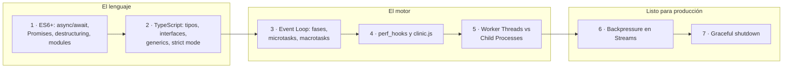
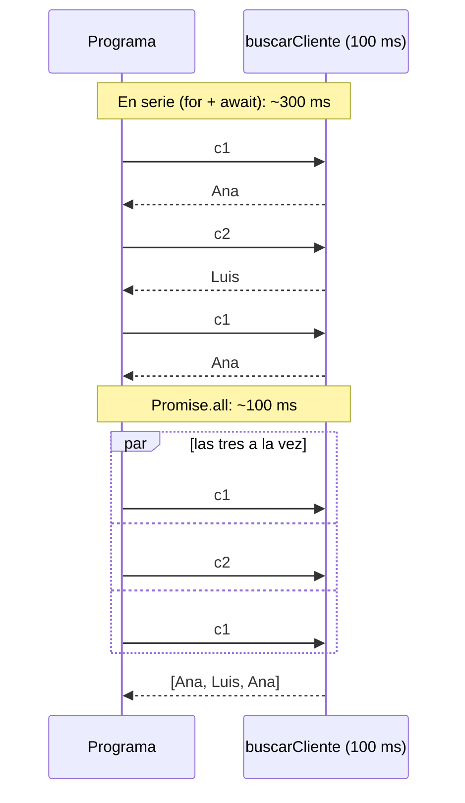
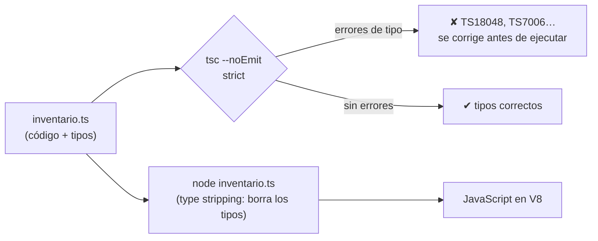
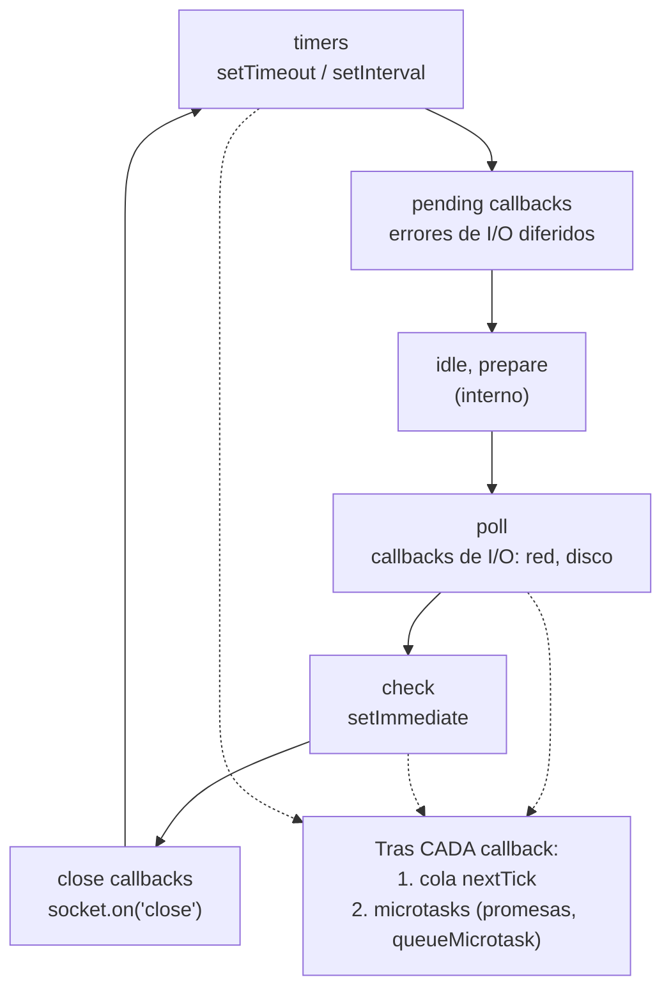
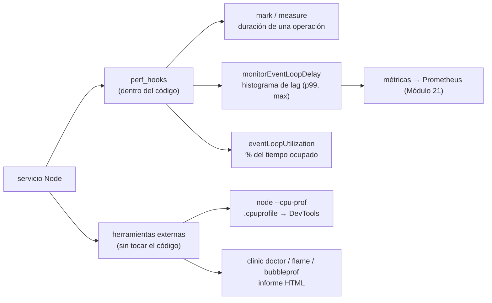
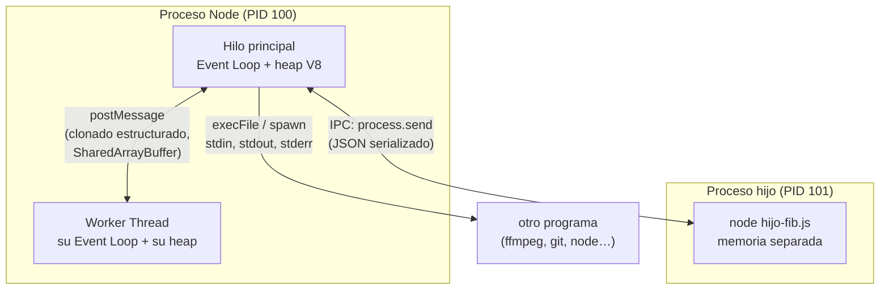
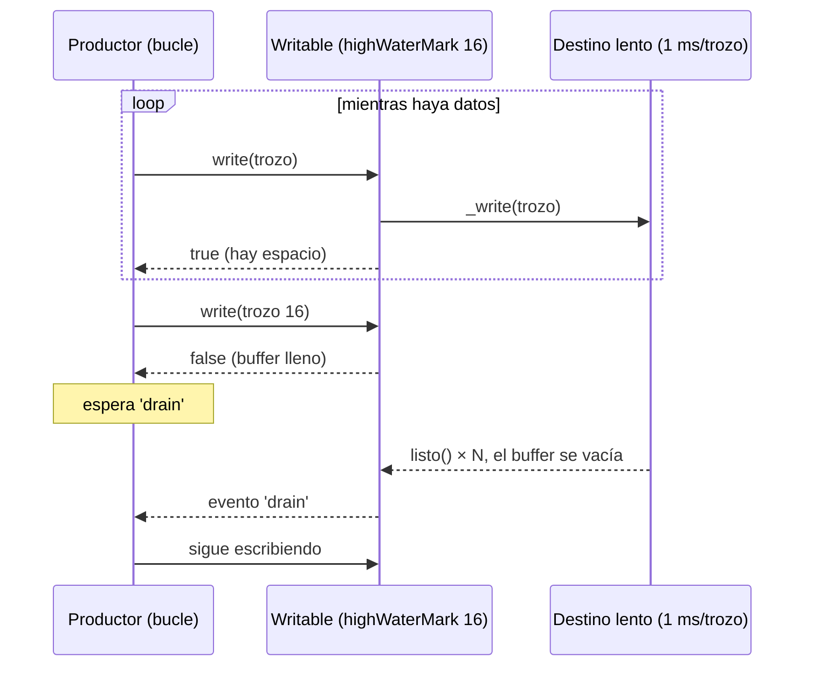
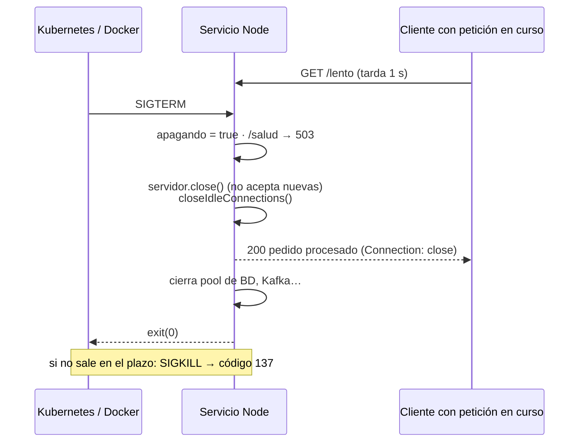

# Módulo 13 · JavaScript/TypeScript moderno y Node.js esencial

**Fase 2 · Node.js de cero a experto** (semanas 1 y 2 de 12). **Duración:** 15 h (7 temas de 2 h y 1 h de
laboratorio integrador). **Dificultad:** 2 de 5 en ES6+ y TypeScript, 3 de 5 en Event Loop, perfiles, hilos, streams
y apagado. **Dependencias:** Fase 0 (Módulo 0.3: ejecutar Node y leer un test; Módulo 0.4: terminal, HTTP, JSON y
variables de entorno; Módulo 0.5: Docker básico). Esta fase **no** necesita la Fase 1: todo lo de Node se explica
aquí desde cero. **Herramientas:** **Node.js 26.13.1 LTS**, **TypeScript 6.0.3**, `@types/node` 26.6.6 y, solo para
el tema de perfiles, **clinic 13.0.0** por `npx`..

Un microservicio en Node.js es **un solo hilo de JavaScript** que atiende a miles de clientes a la vez sin
bloquearse. Este módulo te da el lenguaje (JavaScript moderno y TypeScript), te muestra la máquina por dentro (el
Event Loop), cómo medirla (perf_hooks, perfiles y clinic.js), cómo sacar el trabajo pesado del hilo principal
(Worker Threads y procesos hijos), cómo mover datos sin reventar la memoria (backpressure) y cómo apagar el servicio
sin perder peticiones (graceful shutdown).



**Texto alternativo:** mapa del módulo en tres bloques conectados en orden. «El lenguaje» contiene el tema 1 (ES6+)
y el tema 2 (TypeScript). «El motor» contiene el tema 3 (Event Loop), el tema 4 (perf_hooks y clinic.js) y el tema 5
(Worker Threads vs Child Processes). «Listo para producción» contiene el tema 6 (backpressure en Streams) y el tema 7
(graceful shutdown). Una flecha recorre los siete temas del 1 al 7.

**Cómo usar el laboratorio.** Instala Node 26 (`nvm install 26 && nvm use 26`, o el instalador de nodejs.org) y
ejecuta:

```bash
  # npm ci + tsc + 24 tests + programas de cada ficha → «RESULTADO: OK»
los comandos de verificación indicados     # además, clinic doctor (descarga clinic 13.0.0 con npx la primera vez)
```

Todas las órdenes de las fichas se ejecutan **desde `modulo-17`** después de `npm ci`.
El `package.json` del laboratorio, compartido por las siete fichas, es este (y `package-lock.json` fija el árbol
completo):

```json
{
  "name": "modulo-13-node-esencial",
  "version": "1.0.0",
  "private": true,
  "description": "Módulo 13 (Fase 2): JavaScript/TypeScript moderno y Node.js esencial.",
  "type": "module",
  "engines": {
    "node": ">=26.13.1"
  },
  "scripts": {
    "typecheck": "tsc -p f090-typescript",
    "test": "node --test --test-concurrency=1"
  },
  "devDependencies": {
    "@types/node": "26.6.6",
    "typescript": "6.0.3"
  }
}
```

---


### ES6+: async/await, Promises, destructuring, modules

<details open>
<summary><strong>Capa 1 — Lectura</strong></summary>

#### ► DE QUÉ TRATA
Escribir un módulo ES que exporte funciones, usar destructuring, rest y spread para leer y copiar objetos, encadenar operaciones asíncronas con async/await y elegir entre ejecución en serie, Promise.all y Promise.allSettled; lo compruebas cuando node --test f089-es6/pedidos.test.…

#### ► LA IDEA EN UNA FRASE
**Escribir un módulo ES que exporte funciones, usar destructuring, rest y spread para leer y copiar objetos, encadenar operaciones asíncronas con async/await y elegir entre ejecución en serie, Promise.all y Promise.allSettled; lo compruebas cuando node --test f089-es6/pedidos.test.js pasa 5 de 5 y explicas por qué la versión en paralelo tarda ~100 ms y la de serie ~300 ms.**

#### ► POR QUÉ EXISTE ESTO
Resuelve un problema real de diseño o implementación y evita decisiones a ciegas.

#### ► LA ANALOGÍA
Piensa en es6+: async/await, promises, destructuring, modules como una herramienta de taller: útil cuando conoces su propósito y sus límites.
**Dónde se rompe la analogía:** en software, los efectos dependen del contexto, la escala y los trade-offs.

#### ► CÓMO FUNCIONA


1. **ES6+** es el nombre del JavaScript moderno (de la edición de 2015 en adelante). Node 26 entiende todo lo de
2. Una **promesa** es una ficha que representa un resultado que todavía no llegó. Tiene tres estados: pendiente,
3. **`await`** significa «espera aquí a que esta ficha se ponga verde y dame la taza». Solo se usa dentro de una
4. **Destructuring** es sacar partes de un objeto o arreglo en una línea: `const { nombre } = cliente` en lugar de
5. **Rest y spread** (`...`) son los tres puntos: «el resto» al leer (`const { id, ...resto } = cliente`) y

#### ► LO QUE PUEDE SALIR MAL
| Síntoma | Causa probable | Arreglo |
|---|---|---|
| ES6+: async/await, Promises, destructuring, modules se aplica pero el resultado no mejora | Se usó sin medir el problema real | Mide antes y compara contra la alternativa simple |
| Aparece complejidad inesperada | Se adoptó la técnica sin comprender sus trade-offs | Vuelve a la sección de trade-offs y reduce el alcance |
| Falla en un caso límite | Se asumió un contexto que no se cumple | Prueba el caso límite y documenta cuándo NO usarlo |

#### ► TRADE-OFFS
| Opción | Cuándo usarla | Cuándo NO usarla |
|---|---|---|
| Usar ES6+: async/await, Promises, destructuring, modules | Cuando el problema coincide con su propósito y el beneficio es observable | Cuando agrega complejidad sin resolver un problema real |
| Alternativa más simple | Cuando el contexto es pequeño, estable o fácil de razonar | Cuando ya demostró no escalar o no cumplir el requisito |
| Postergar la decisión | Cuando falta evidencia del problema | Cuando el costo de esperar es mayor que el costo de probar |

#### ► CUÁNDO NO USAR ESTO
«Await en cascada» (waterfall accidental): cada await espera al anterior aunque no haya dependencia.

#### ► DE VUELTA A LA ANALOGÍA
Volviendo a la analogía: es6+: async/await, promises, destructuring, modules funciona como el modelo inicial, pero recuerda dónde se rompe: en producción importan la evidencia, la escala y el costo de equivocarte.

#### ► LO QUE DEBES RECORDAR
- **ES6+** es el nombre del JavaScript moderno (de la edición de 2015 en adelante). Node 26 entiende todo lo de
- Una **promesa** es una ficha que representa un resultado que todavía no llegó. Tiene tres estados: pendiente,
- **`await`** significa «espera aquí a que esta ficha se ponga verde y dame la taza». Solo se usa dentro de una
- **Destructuring** es sacar partes de un objeto o arreglo en una línea: `const { nombre } = cliente` en lugar de

#### ► PREGUNTAS PARA PENSAR
1. ¿Qué problema concreto resuelve es6+: async/await, promises, destructuring, modules en tu contexto?
2. ¿Cómo sabrías que es6+: async/await, promises, destructuring, modules no está funcionando bien?
3. ¿Qué alternativa más simple considerarías antes de usar es6+: async/await, promises, destructuring, modules?

</details>

<details>
<summary><strong>Capa 2 — Construcción</strong></summary>

#### Código y verificación


```javascript
// Módulo 13 · F089 · ES6+: async/await, Promises, destructuring, modules.
// Requisitos: Node.js 26.13.1 LTS (funciona desde Node 22). Sin dependencias.
// Este archivo es un MÓDULO ES: exporta con `export` y se importa con `import` (package.json: "type": "module").

export const IVA = 0.19; // export con nombre

// Destructuring en los parámetros: sacamos `items` y `descuento` del objeto (con valor por defecto 0).
export function calcularTotal({ items, descuento = 0 }) {
  // Destructuring dentro del callback: de cada item solo nos interesan precio y cantidad.
  const subtotal = items.reduce((acc, { precio, cantidad }) => acc + precio * cantidad, 0);
  return Math.round(subtotal * (1 - descuento) * (1 + IVA));
}

// Simula un servicio remoto: devuelve una PROMESA que se cumple (resolve) o se rechaza (reject) tras `ms`.
const clientes = { c1: { id: 'c1', nombre: 'Ana', ciudad: 'Bogotá' }, c2: { id: 'c2', nombre: 'Luis', ciudad: 'Lima' } };
export function buscarCliente(id, ms = 100) {
  return new Promise((resolve, reject) => {
    setTimeout(() => {
      const cliente = clientes[id];
      if (cliente) resolve(cliente);
      else reject(new Error(`Cliente ${id} no existe`));
    }, ms);
  });
}

// async/await en SECUENCIA: cada await espera al anterior (3 llamadas de 100 ms ≈ 300 ms).
export async function nombresEnSerie(ids) {
  const nombres = [];
  for (const id of ids) {
    const { nombre } = await buscarCliente(id); // destructuring del resultado
    nombres.push(nombre);
  }
  return nombres;
}

// async/await en PARALELO: Promise.all lanza todas a la vez y espera a todas (≈ 100 ms).
// Si UNA se rechaza, Promise.all se rechaza con ese error.
export async function nombresEnParalelo(ids) {
  const clientesEncontrados = await Promise.all(ids.map((id) => buscarCliente(id)));
  return clientesEncontrados.map(({ nombre }) => nombre);
}

// Promise.allSettled nunca se rechaza: devuelve el estado de cada promesa.
export async function informe(ids) {
  const resultados = await Promise.allSettled(ids.map((id) => buscarCliente(id, 10)));
  return resultados.map((r, i) => (r.status === 'fulfilled' ? `${ids[i]}: ${r.value.nombre}` : `${ids[i]}: ERROR ${r.reason.message}`));
}

// Spread y rest: copiar sin mutar el original.
export function conCiudad(cliente, ciudad) {
  const { id, ...resto } = cliente; // rest: todo menos id
  return { id, ...resto, ciudad }; // spread: copia y sobrescribe ciudad
}
```

```javascript
// Ejecuta: node f089-es6/demo.js   (desde modulo-17)
import { calcularTotal, nombresEnSerie, nombresEnParalelo, informe, conCiudad, buscarCliente } from './pedidos.js';

const pedido = { items: [{ precio: 10000, cantidad: 2 }, { precio: 5000, cantidad: 1 }], descuento: 0.1 };
console.log('Total con IVA:', calcularTotal(pedido));

let t = performance.now();
console.log('En serie:', await nombresEnSerie(['c1', 'c2', 'c1']), `${Math.round((performance.now() - t) / 100) * 100} ms aprox.`);
t = performance.now();
console.log('En paralelo:', await nombresEnParalelo(['c1', 'c2', 'c1']), `${Math.round((performance.now() - t) / 100) * 100} ms aprox.`);

console.log('allSettled:', await informe(['c1', 'zz']));

try {
  await nombresEnParalelo(['c1', 'zz']);
} catch (error) {
  console.log('Promise.all rechazada:', error.message);
}

const ana = await buscarCliente('c1');
const anaEnMedellin = conCiudad(ana, 'Medellín');
console.log('Copia:', anaEnMedellin, '| original intacto:', ana.ciudad);
```

```bash
   npm ci
   ```

```bash
   node f089-es6/demo.js
   ```

```bash
   node f089-es6/sin-await.js; echo "código de salida: $?"
   ```

</details>

### TypeScript: tipos, interfaces, generics, strict mode

<details open>
<summary><strong>Capa 1 — Lectura</strong></summary>

#### ► DE QUÉ TRATA
Declarar tipos, uniones e interfaces, escribir una clase y una función genéricas con restricciones, activar el modo strict y corregir los errores que detecta (possibly 'undefined', implicitly has an 'any' type); lo compruebas cuando npx tsc -p f090-typescript termina sin errores…

#### ► LA IDEA EN UNA FRASE
**Declarar tipos, uniones e interfaces, escribir una clase y una función genéricas con restricciones, activar el modo strict y corregir los errores que detecta (possibly 'undefined', implicitly has an 'any' type); lo compruebas cuando npx tsc -p f090-typescript termina sin errores y node --test f090-typescript/src/inventario.test.ts pasa 4 de 4.**

#### ► POR QUÉ EXISTE ESTO
Resuelve un problema real de diseño o implementación y evita decisiones a ciegas.

#### ► LA ANALOGÍA
Piensa en typescript: tipos, interfaces, generics, strict mode como una herramienta de taller: útil cuando conoces su propósito y sus límites.
**Dónde se rompe la analogía:** en software, los efectos dependen del contexto, la escala y los trade-offs.

#### ► CÓMO FUNCIONA


1. **TypeScript** es JavaScript con **etiquetas de tipo**: `precio: number` dice «aquí solo va un número». Las
2. Un **tipo** puede ser simple (`string`, `number`, `boolean`) o una lista de valores permitidos:
3. Una **interfaz** es la plantilla de un objeto: qué propiedades tiene y de qué tipo. `stock?: number` significa «puede
4. Un **genérico** (`<T>`) es un hueco para un tipo: `Repositorio<Producto>` es un repositorio de productos;
5. **Strict mode** es el inspector exigente: no te deja usar algo que podría ser `undefined` sin revisarlo antes.

#### ► LO QUE PUEDE SALIR MAL
| Síntoma | Causa probable | Arreglo |
|---|---|---|
| TypeScript: tipos, interfaces, generics, strict mode se aplica pero el resultado no mejora | Se usó sin medir el problema real | Mide antes y compara contra la alternativa simple |
| Aparece complejidad inesperada | Se adoptó la técnica sin comprender sus trade-offs | Vuelve a la sección de trade-offs y reduce el alcance |
| Falla en un caso límite | Se asumió un contexto que no se cumple | Prueba el caso límite y documenta cuándo NO usarlo |

#### ► TRADE-OFFS
| Opción | Cuándo usarla | Cuándo NO usarla |
|---|---|---|
| Usar TypeScript: tipos, interfaces, generics, strict mode | Cuando el problema coincide con su propósito y el beneficio es observable | Cuando agrega complejidad sin resolver un problema real |
| Alternativa más simple | Cuando el contexto es pequeño, estable o fácil de razonar | Cuando ya demostró no escalar o no cumplir el requisito |
| Postergar la decisión | Cuando falta evidencia del problema | Cuando el costo de esperar es mayor que el costo de probar |

#### ► CUÁNDO NO USAR ESTO
any por todas partes (TypeScript «decorativo»):

#### ► DE VUELTA A LA ANALOGÍA
Volviendo a la analogía: typescript: tipos, interfaces, generics, strict mode funciona como el modelo inicial, pero recuerda dónde se rompe: en producción importan la evidencia, la escala y el costo de equivocarte.

#### ► LO QUE DEBES RECORDAR
- **TypeScript** es JavaScript con **etiquetas de tipo**: `precio: number` dice «aquí solo va un número». Las
- Un **tipo** puede ser simple (`string`, `number`, `boolean`) o una lista de valores permitidos:
- Una **interfaz** es la plantilla de un objeto: qué propiedades tiene y de qué tipo. `stock?: number` significa «puede
- Un **genérico** (`<T>`) es un hueco para un tipo: `Repositorio<Producto>` es un repositorio de productos;

#### ► PREGUNTAS PARA PENSAR
1. ¿Qué problema concreto resuelve typescript: tipos, interfaces, generics, strict mode en tu contexto?
2. ¿Cómo sabrías que typescript: tipos, interfaces, generics, strict mode no está funcionando bien?
3. ¿Qué alternativa más simple considerarías antes de usar typescript: tipos, interfaces, generics, strict mode?

</details>

<details>
<summary><strong>Capa 2 — Construcción</strong></summary>

#### Código de referencia / ejecutable
Versiones: **Node.js 26.13.1 LTS** (ejecuta `.ts` sin compilar), **typescript 6.0.3** y **@types/node 26.6.6**
(devDependencies del `package.json` del laboratorio).

`inventario.ts`:

```typescript
// Módulo 13 · F090 · TypeScript: tipos, interfaces, generics, strict mode.
// Requisitos: Node.js 26.13.1 LTS (ejecuta .ts sin compilar) y typescript 6.0.3 (solo para `tsc --noEmit`).

// 1. TIPOS: alias, uniones de literales y tipos primitivos.
export type Categoria = 'libro' | 'curso' | 'licencia';
export type Id = string;

// 2. INTERFACES: la forma que debe tener un objeto. `?` = opcional, readonly = no se puede reasignar.
export interface Producto {
  readonly id: Id;
  nombre: string;
  precio: number;
  categoria: Categoria;
  stock?: number;
}

// Unión discriminada: el campo `ok` le dice al compilador qué otros campos existen.
export type Resultado<T, E = string> = { ok: true; valor: T } | { ok: false; error: E };

// 3. GENERICS: una sola implementación que conserva el tipo que le pases.
// `T extends { id: Id }` es una RESTRICCIÓN: solo acepta objetos con id.
export class Repositorio<T extends { readonly id: Id }> {
  #items = new Map<Id, T>(); // campo privado de JavaScript (#), no `private` de TS

  guardar(item: T): T {
    this.#items.set(item.id, item);
    return item;
  }

  buscar(id: Id): Resultado<T> {
    const item = this.#items.get(id); // tipo: T | undefined
    // 4. STRICT MODE: sin este if, `item.nombre` no compila (item puede ser undefined).
    if (item === undefined) return { ok: false, error: `No existe ${id}` };
    return { ok: true, valor: item };
  }

  filtrar(predicado: (item: T) => boolean): T[] {
    return [...this.#items.values()].filter(predicado);
  }
}

export function primero<T>(lista: readonly T[]): T | undefined {
  return lista[0]; // con noUncheckedIndexedAccess el tipo ya es T | undefined
}

export function valorDeInventario(productos: readonly Producto[]): number {
  // stock es opcional: `?? 0` cubre el undefined (strict no deja multiplicar por undefined).
  return productos.reduce((total, p) => total + p.precio * (p.stock ?? 0), 0);
}

// Exhaustividad: si mañana agregas una categoría y olvidas el caso, `never` hace fallar la compilación.
export function iva(categoria: Categoria): number {
  switch (categoria) {
    case 'libro':
      return 0;
    case 'curso':
    case 'licencia':
      return 0.19;
    default: {
      const imposible: never = categoria;
      throw new Error(`Categoría desconocida: ${String(imposible)}`);
    }
  }
}
```

`demo.ts`:

```typescript
// Ejecuta: node f090-typescript/src/demo.ts   (Node 26 quita los tipos y ejecuta)
import { Repositorio, valorDeInventario, iva, primero } from './inventario.ts';
import type { Producto } from './inventario.ts';

const repo = new Repositorio<Producto>();
repo.guardar({ id: 'p1', nombre: 'Clean Architecture', precio: 120000, categoria: 'libro', stock: 3 });
repo.guardar({ id: 'p2', nombre: 'Curso de Node', precio: 300000, categoria: 'curso' });

const r = repo.buscar('p1');
if (r.ok) console.log('Encontrado:', r.valor.nombre, '| IVA:', iva(r.valor.categoria));
const r2 = repo.buscar('p9');
if (!r2.ok) console.log('Error tipado:', r2.error);

const todos = repo.filtrar(() => true);
console.log('Valor del inventario:', valorDeInventario(todos));
console.log('Primero:', primero(todos)?.id, '| primero de []:', primero([]));
```

</details>

### Event Loop: fases, microtasks, macrotasks

<details open>
<summary><strong>Capa 1 — Lectura</strong></summary>

#### ► DE QUÉ TRATA
Predecir el orden en que Node ejecuta código síncrono, process.nextTick, promesas, setImmediate y setTimeout, nombrar las fases del Event Loop y demostrar que un cálculo síncrono congela todas las peticiones; lo compruebas cuando node --test f091-event-loop/orden.test.js pasa 2 d…

#### ► LA IDEA EN UNA FRASE
**Predecir el orden en que Node ejecuta código síncrono, process.nextTick, promesas, setImmediate y setTimeout, nombrar las fases del Event Loop y demostrar que un cálculo síncrono congela todas las peticiones; lo compruebas cuando node --test f091-event-loop/orden.test.js pasa 2 de 2 y predices la salida de orden.js antes de ejecutarlo.**

#### ► POR QUÉ EXISTE ESTO
Resuelve un problema real de diseño o implementación y evita decisiones a ciegas.

#### ► LA ANALOGÍA
Piensa en event loop: fases, microtasks, macrotasks como una herramienta de taller: útil cuando conoces su propósito y sus límites.
**Dónde se rompe la analogía:** en software, los efectos dependen del contexto, la escala y los trade-offs.

#### ► CÓMO FUNCIONA


1. Node ejecuta tu JavaScript en **un solo hilo**: hace una cosa a la vez.
2. Aun así atiende a miles de clientes porque **no espera sentado**: cuando pide algo lento (leer un archivo, llamar a
3. Las tareas grandes que esperan turno se llaman **macrotasks** (un temporizador que venció, una respuesta de red,
4. Si tu código hace un cálculo largo **sin soltar el hilo**, el bucle no da vueltas: nadie más recibe respuesta.

#### ► LO QUE PUEDE SALIR MAL
| Síntoma | Causa probable | Arreglo |
|---|---|---|
| Event Loop: fases, microtasks, macrotasks se aplica pero el resultado no mejora | Se usó sin medir el problema real | Mide antes y compara contra la alternativa simple |
| Aparece complejidad inesperada | Se adoptó la técnica sin comprender sus trade-offs | Vuelve a la sección de trade-offs y reduce el alcance |
| Falla en un caso límite | Se asumió un contexto que no se cumple | Prueba el caso límite y documenta cuándo NO usarlo |

#### ► TRADE-OFFS
| Opción | Cuándo usarla | Cuándo NO usarla |
|---|---|---|
| Usar Event Loop: fases, microtasks, macrotasks | Cuando el problema coincide con su propósito y el beneficio es observable | Cuando agrega complejidad sin resolver un problema real |
| Alternativa más simple | Cuando el contexto es pequeño, estable o fácil de razonar | Cuando ya demostró no escalar o no cumplir el requisito |
| Postergar la decisión | Cuando falta evidencia del problema | Cuando el costo de esperar es mayor que el costo de probar |

#### ► CUÁNDO NO USAR ESTO
Código síncrono en la ruta caliente:

#### ► DE VUELTA A LA ANALOGÍA
Volviendo a la analogía: event loop: fases, microtasks, macrotasks funciona como el modelo inicial, pero recuerda dónde se rompe: en producción importan la evidencia, la escala y el costo de equivocarte.

#### ► LO QUE DEBES RECORDAR
- Node ejecuta tu JavaScript en **un solo hilo**: hace una cosa a la vez.
- Aun así atiende a miles de clientes porque **no espera sentado**: cuando pide algo lento (leer un archivo, llamar a
- Las tareas grandes que esperan turno se llaman **macrotasks** (un temporizador que venció, una respuesta de red,
- Si tu código hace un cálculo largo **sin soltar el hilo**, el bucle no da vueltas: nadie más recibe respuesta.

#### ► PREGUNTAS PARA PENSAR
1. ¿Qué problema concreto resuelve event loop: fases, microtasks, macrotasks en tu contexto?
2. ¿Cómo sabrías que event loop: fases, microtasks, macrotasks no está funcionando bien?
3. ¿Qué alternativa más simple considerarías antes de usar event loop: fases, microtasks, macrotasks?

</details>

<details>
<summary><strong>Capa 2 — Construcción</strong></summary>

#### Código y verificación


```javascript
// Módulo 13 · F091 · Event Loop: fases, microtasks y macrotasks.
// Requisitos: Node.js 26.13.1 LTS (funciona desde Node 22). Sin dependencias.
// Ejecuta: node f091-event-loop/orden.js
import { readFile } from 'node:fs';

// Devuelve el orden en que Node ejecuta cada tipo de callback. Todo arranca DENTRO de un callback de I/O
// (fase "poll"), así el orden es determinista: después de poll viene "check" (setImmediate) y luego,
// en la siguiente vuelta, "timers" (setTimeout).
export function ordenDeEjecucion() {
  return new Promise((resolve) => {
    const orden = [];
    readFile(import.meta.filename, () => {
      orden.push('1 síncrono (callback de I/O, fase poll)');
      setTimeout(() => orden.push('6 setTimeout 0 (macrotask, fase timers)'), 0);
      setImmediate(() => {
        orden.push('5 setImmediate (macrotask, fase check)');
        Promise.resolve().then(() => orden.push('5b microtask creada en check: corre antes de pasar a la siguiente macrotask'));
      });
      Promise.resolve().then(() => orden.push('3 Promise.then (microtask)'));
      queueMicrotask(() => orden.push('4 queueMicrotask (microtask, misma cola que las promesas)'));
      process.nextTick(() => orden.push('2 process.nextTick (cola nextTick, antes que las promesas)'));
      orden.push('1b síncrono: sigue el mismo callback');
      setTimeout(() => resolve(orden), 20);
    });
  });
}

// Bloquear el hilo principal retrasa TODO lo demás (temporizadores incluidos).
export function retrasoDeUnTimer(msDeBloqueo) {
  return new Promise((resolve) => {
    const inicio = performance.now();
    setTimeout(() => resolve(Math.round(performance.now() - inicio)), 10); // pedimos 10 ms…
    const fin = inicio + msDeBloqueo;
    while (performance.now() < fin); // …pero este bucle síncrono no suelta el hilo
  });
}

if (import.meta.main) {
  for (const paso of await ordenDeEjecucion()) console.log(paso);
  console.log(`setTimeout(10) sin bloqueo llegó a los ~${await retrasoDeUnTimer(0)} ms`);
  console.log(`setTimeout(10) con 200 ms de bucle síncrono llegó a los ~${await retrasoDeUnTimer(200)} ms`);
}
```

```bash
   node f091-event-loop/orden.js
   ```

```bash
   for i in 1 2 3 4 5; do node -e "setTimeout(()=>console.log('timeout'),0);setImmediate(()=>console.log('immediate'))" | tr '\n' ' '; echo; done
   ```

```bash
   node f091-event-loop/bloqueo.js
   ```

```text
1 síncrono (callback de I/O, fase poll)
1b síncrono: sigue el mismo callback
2 process.nextTick (cola nextTick, antes que las promesas)
3 Promise.then (microtask)
4 queueMicrotask (microtask, misma cola que las promesas)
5 setImmediate (macrotask, fase check)
5b microtask creada en check: corre antes de pasar a la siguiente macrotask
6 setTimeout 0 (macrotask, fase timers)
setTimeout(10) sin bloqueo llegó a los ~10 ms
setTimeout(10) con 200 ms de bucle síncrono llegó a los ~200 ms
```

</details>

### perf_hooks y clinic.js

<details open>
<summary><strong>Capa 1 — Lectura</strong></summary>

#### ► DE QUÉ TRATA
Medir la duración de una operación con performance.mark/measure y timerify, cuantificar el retraso y el uso del Event Loop con monitorEventLoopDelay y eventLoopUtilization, y generar e interpretar un perfil de CPU con node --cpu-prof y un diagnóstico con clinic doctor; lo comprue…

#### ► LA IDEA EN UNA FRASE
**Medir la duración de una operación con performance.mark/measure y timerify, cuantificar el retraso y el uso del Event Loop con monitorEventLoopDelay y eventLoopUtilization, y generar e interpretar un perfil de CPU con node --cpu-prof y un diagnóstico con clinic doctor; lo compruebas cuando node --test f092-perf/medir.test.js pasa 4 de 4 y resumir-perfil.js señala las funciones de node:crypto como las más costosas.**

#### ► POR QUÉ EXISTE ESTO
Resuelve un problema real de diseño o implementación y evita decisiones a ciegas.

#### ► LA ANALOGÍA
Piensa en perf_hooks y clinic.js como una herramienta de taller: útil cuando conoces su propósito y sus límites.
**Dónde se rompe la analogía:** en software, los efectos dependen del contexto, la escala y los trade-offs.

#### ► CÓMO FUNCIONA


1. **Medir antes de optimizar:** la intuición sobre «qué es lo lento» falla casi siempre. Primero mides, luego cambias,
2. **`perf_hooks`** es un módulo que ya viene con Node. Te da un cronómetro de alta precisión (`performance.now()`,
3. **Retraso del Event Loop:** cuánto se atrasa el mesero de la ficha anterior en volver a cada estación. Sano: unos
4. **Perfil de CPU:** una grabación de en qué funciones pasó el tiempo el programa. Node la genera con
5. **clinic.js** es un conjunto de herramientas que corre tu servicio, lo observa y te entrega un informe HTML con

#### ► LO QUE PUEDE SALIR MAL
| Síntoma | Causa probable | Arreglo |
|---|---|---|
| perf_hooks y clinic.js se aplica pero el resultado no mejora | Se usó sin medir el problema real | Mide antes y compara contra la alternativa simple |
| Aparece complejidad inesperada | Se adoptó la técnica sin comprender sus trade-offs | Vuelve a la sección de trade-offs y reduce el alcance |
| Falla en un caso límite | Se asumió un contexto que no se cumple | Prueba el caso límite y documenta cuándo NO usarlo |

#### ► TRADE-OFFS
| Opción | Cuándo usarla | Cuándo NO usarla |
|---|---|---|
| Usar perf_hooks y clinic.js | Cuando el problema coincide con su propósito y el beneficio es observable | Cuando agrega complejidad sin resolver un problema real |
| Alternativa más simple | Cuando el contexto es pequeño, estable o fácil de razonar | Cuando ya demostró no escalar o no cumplir el requisito |
| Postergar la decisión | Cuando falta evidencia del problema | Cuando el costo de esperar es mayor que el costo de probar |

#### ► CUÁNDO NO USAR ESTO
Optimizar a ciegas / medir con console.time en producción:

#### ► DE VUELTA A LA ANALOGÍA
Volviendo a la analogía: perf_hooks y clinic.js funciona como el modelo inicial, pero recuerda dónde se rompe: en producción importan la evidencia, la escala y el costo de equivocarte.

#### ► LO QUE DEBES RECORDAR
- **Medir antes de optimizar:** la intuición sobre «qué es lo lento» falla casi siempre. Primero mides, luego cambias,
- **`perf_hooks`** es un módulo que ya viene con Node. Te da un cronómetro de alta precisión (`performance.now()`,
- **Retraso del Event Loop:** cuánto se atrasa el mesero de la ficha anterior en volver a cada estación. Sano: unos
- **Perfil de CPU:** una grabación de en qué funciones pasó el tiempo el programa. Node la genera con

#### ► PREGUNTAS PARA PENSAR
1. ¿Qué problema concreto resuelve perf_hooks y clinic.js en tu contexto?
2. ¿Cómo sabrías que perf_hooks y clinic.js no está funcionando bien?
3. ¿Qué alternativa más simple considerarías antes de usar perf_hooks y clinic.js?

</details>

<details>
<summary><strong>Capa 2 — Construcción</strong></summary>

#### Objetivo observable
**Medir** la duración de una operación con `performance.mark/measure` y `timerify`, **cuantificar** el retraso y el
uso del Event Loop con `monitorEventLoopDelay` y `eventLoopUtilization`, y **generar** e **interpretar** un perfil de
CPU con `node --cpu-prof` y un diagnóstico con `clinic doctor`; lo compruebas cuando `node --test f092-perf/medir.test.js` pasa 4
de 4 y `resumir-perfil.js` señala las funciones de `node:crypto` como las más costosas.

#### Código de referencia / ejecutable
Versiones: **Node.js 26.13.1 LTS** (también desde Node 22), sin dependencias; **clinic 13.0.0** solo por `npx` en el
laboratorio.

`medir.js`:

```javascript
// Módulo 13 · F092 · perf_hooks: medir duración, retraso del Event Loop y uso del Event Loop.
// Requisitos: Node.js 26.13.1 LTS (funciona desde Node 22). Sin dependencias.
// Ejecuta: node f092-perf/medir.js
import { performance, monitorEventLoopDelay, PerformanceObserver } from 'node:perf_hooks';

// Trabajo de CPU de ejemplo: ordenar un arreglo grande.
export function ordenarAleatorios(n) {
  const datos = Array.from({ length: n }, (_, i) => (i * 7919) % n);
  return datos.sort((a, b) => a - b).length;
}

// 1. mark + measure: cronómetro con nombre que aparece también en los perfiles (--cpu-prof, clinic).
export function medirConMarcas(n) {
  performance.mark('ordenar:inicio');
  ordenarAleatorios(n);
  performance.mark('ordenar:fin');
  const medida = performance.measure('ordenar', 'ordenar:inicio', 'ordenar:fin');
  performance.clearMarks();
  performance.clearMeasures();
  return medida.duration; // milisegundos con decimales
}

// 2. monitorEventLoopDelay: histograma de cuánto se retrasa el Event Loop (en nanosegundos).
// 3. eventLoopUtilization: fracción del tiempo que el loop estuvo ocupado (0 = ocioso, 1 = saturado).
export async function retrasoDelLoop(msDeBloqueo) {
  const h = monitorEventLoopDelay({ resolution: 10 });
  h.enable();
  const elu0 = performance.eventLoopUtilization();
  await new Promise((r) => setTimeout(r, 50));
  const fin = Date.now() + msDeBloqueo;
  while (Date.now() < fin); // bloqueo artificial
  await new Promise((r) => setTimeout(r, 50));
  h.disable();
  const elu = performance.eventLoopUtilization(elu0);
  return { maxMs: h.max / 1e6, p99Ms: h.percentile(99) / 1e6, utilizacion: elu.utilization };
}

// 4. timerify + PerformanceObserver: mide cada llamada a una función sin tocar su código.
export async function llamadasMedidas() {
  const duraciones = [];
  const obs = new PerformanceObserver((lista) => lista.getEntries().forEach((e) => duraciones.push(e.duration)));
  obs.observe({ entryTypes: ['function'] });
  const ordenarMedido = performance.timerify(ordenarAleatorios);
  ordenarMedido(10_000);
  ordenarMedido(100_000);
  await new Promise((r) => setImmediate(r)); // las entradas se entregan de forma asíncrona
  obs.disconnect();
  return duraciones;
}

if (import.meta.main) {
  console.log(`ordenar 1 000 000 números: ${medirConMarcas(1_000_000).toFixed(0)} ms`);
  const sano = await retrasoDelLoop(0);
  const bloqueado = await retrasoDelLoop(200);
  console.log(`loop sano:     max ${sano.maxMs.toFixed(0)} ms · p99 ${sano.p99Ms.toFixed(0)} ms · ocupado ${(sano.utilizacion * 100).toFixed(0)} %`);
  console.log(`loop bloqueado: max ${bloqueado.maxMs.toFixed(0)} ms · p99 ${bloqueado.p99Ms.toFixed(0)} ms · ocupado ${(bloqueado.utilizacion * 100).toFixed(0)} %`);
  console.log(`timerify: ${(await llamadasMedidas()).length} llamadas medidas`);
}
```

`servidor-lento.js` (lo que vamos a perfilar):

```javascript
// F092 · Servidor con un endpoint que bloquea el Event Loop, para perfilarlo con clinic.js o con --cpu-prof.
// Hace 200 peticiones a sí mismo y se cierra, así el perfil se genera sin herramientas de carga.
// Ejecuta: node --cpu-prof --cpu-prof-dir=perfiles f092-perf/servidor-lento.js
//      o:  NO_INSIGHT=1 npx clinic doctor -- node f092-perf/servidor-lento.js
import http from 'node:http';
import { createHash } from 'node:crypto';

function hashCaro(texto) {
  let h = texto;
  for (let i = 0; i < 20_000; i++) h = createHash('sha256').update(h).digest('hex'); // CPU síncrona
  return h;
}

const servidor = http.createServer((req, res) => res.end(hashCaro(req.url).slice(0, 8) + '\n'));
servidor.listen(0, async () => {
  const url = `http://localhost:${servidor.address().port}/pedido`;
  const inicio = performance.now();
  for (let lote = 0; lote < 20; lote++) await Promise.all(Array.from({ length: 10 }, () => fetch(url).then((r) => r.text())));
  console.log(`200 peticiones en ${Math.round(performance.now() - inicio)} ms`);
  servidor.close();
});
```

`resumir-perfil.js`:

```javascript
// F092 · Lee un .cpuprofile (generado con node --cpu-prof) y muestra las 5 funciones con más tiempo propio.
// Ejecuta: node f092-perf/resumir-perfil.js perfiles/*.cpuprofile
// Para verlo gráfico: abre el archivo en Chrome DevTools (pestaña Performance → Load profile) o en VS Code.
import { readFileSync } from 'node:fs';

export function topFunciones(perfil, n = 5) {
  const porId = new Map(perfil.nodes.map((nodo) => [nodo.id, nodo]));
  const muestras = new Map();
  for (const id of perfil.samples) muestras.set(id, (muestras.get(id) ?? 0) + 1);
  const porFuncion = new Map();
  for (const [id, cuenta] of muestras) {
    const { functionName, url, lineNumber } = porId.get(id).callFrame; // destructuring del marco de llamada
    const clave = `${functionName || '(anónima)'} ${url.split('/').pop()}:${lineNumber + 1}`;
    porFuncion.set(clave, (porFuncion.get(clave) ?? 0) + cuenta);
  }
  const total = perfil.samples.length;
  return [...porFuncion].sort((a, b) => b[1] - a[1]).slice(0, n).map(([f, c]) => ({ funcion: f, porcentaje: Math.round((c / total) * 100) }));
}

if (import.meta.main) {
  const archivo = process.argv[2];
  if (!archivo) throw new Error('Uso: node f092-perf/resumir-perfil.js <archivo.cpuprofile>');
  for (const { funcion, porcentaje } of topFunciones(JSON.parse(readFileSync(archivo, 'utf8')))) {
    console.log(`${String(porcentaje).padStart(3)} %  ${funcion}`);
  }
}
```

#### Verificación
```bash
node --test --test-reporter=spec f092-perf/medir.test.js
```

Salida real:

```text
✔ performance.measure devuelve una duración positiva en milisegundos (42.287366ms)
✔ monitorEventLoopDelay detecta un bloqueo de 200 ms (401.928773ms)
✔ timerify mide cada llamada a la función (20.731193ms)
✔ resumir-perfil ordena las funciones por tiempo propio (2.631706ms)
ℹ tests 4
ℹ pass 4
ℹ fail 0
```

```javascript
// Verificación F092: node --test f092-perf/medir.test.js
import { test } from 'node:test';
import assert from 'node:assert/strict';
import { medirConMarcas, retrasoDelLoop, llamadasMedidas } from './medir.js';

test('performance.measure devuelve una duración positiva en milisegundos', () => {
  const ms = medirConMarcas(100_000);
  assert.ok(ms > 0 && ms < 5000, `duración ${ms}`);
});

test('monitorEventLoopDelay detecta un bloqueo de 200 ms', async () => {
  const sano = await retrasoDelLoop(0);
  const bloqueado = await retrasoDelLoop(200);
  assert.ok(bloqueado.maxMs >= 180, `bloqueado: ${bloqueado.maxMs} ms`);
  assert.ok(bloqueado.maxMs > sano.maxMs, `sano: ${sano.maxMs} ms`);
  assert.ok(bloqueado.utilizacion > sano.utilizacion);
});

test('timerify mide cada llamada a la función', async () => {
  assert.equal((await llamadasMedidas()).length, 2);
});

test('resumir-perfil ordena las funciones por tiempo propio', async () => {
  const { topFunciones } = await import('./resumir-perfil.js');
  const perfil = {
    nodes: [
      { id: 1, callFrame: { functionName: '(root)', url: '', lineNumber: -1 } },
      { id: 2, callFrame: { functionName: 'hashCaro', url: 'file:///x/servidor-lento.js', lineNumber: 9 } },
    ],
    samples: [2, 2, 2, 1],
  };
  assert.deepEqual(topFunciones(perfil, 1), [{ funcion: 'hashCaro servidor-lento.js:10', porcentaje: 75 }]);
});
```

**Pregunta de comprobación:** el p99 del retraso del loop de tu servicio es 450 ms y la CPU del proceso está al 30 %.
¿Qué buscas primero? (Respuesta: una operación síncrona larga y esporádica; con `--cpu-prof` durante un pico verás la
función. CPU media baja con lag alto = bloqueos cortos pero intensos.)

</details>

### Worker Threads vs Child Processes

<details open>
<summary><strong>Capa 1 — Lectura</strong></summary>

#### ► DE QUÉ TRATA
Ejecutar un cálculo CPU-bound en un Worker Thread y en un proceso hijo, demostrar que el Event Loop principal sigue respondiendo en ambos casos y elegir entre worker_threads, child_process (fork, execFile, spawn) y cluster según aislamiento, coste y comunicación; lo compruebas cu…

#### ► LA IDEA EN UNA FRASE
**Ejecutar un cálculo CPU-bound en un Worker Thread y en un proceso hijo, demostrar que el Event Loop principal sigue respondiendo en ambos casos y elegir entre worker_threads, child_process (fork, execFile, spawn) y cluster según aislamiento, coste y comunicación; lo compruebas cuando node --test f093-workers/comparar.test.js pasa 4 de 4.**

#### ► POR QUÉ EXISTE ESTO
Resuelve un problema real de diseño o implementación y evita decisiones a ciegas.

#### ► LA ANALOGÍA
Piensa en worker threads vs child processes como una herramienta de taller: útil cuando conoces su propósito y sus límites.
**Dónde se rompe la analogía:** en software, los efectos dependen del contexto, la escala y los trade-offs.

#### ► CÓMO FUNCIONA


1. Por defecto, tu JavaScript corre en **un hilo**. Si le das un cálculo de medio segundo, nadie más es atendido
2. Un **Worker Thread** es otro hilo **dentro del mismo programa**: corre otro archivo JavaScript en paralelo y te
3. Un **proceso hijo** es **otro programa completo** que tu servicio arranca. Puede ser otro Node o cualquier
4. En ambos casos, el hilo principal sigue libre para atender peticiones mientras el trabajo pesado se hace en otro lado.

#### ► LO QUE PUEDE SALIR MAL
| Síntoma | Causa probable | Arreglo |
|---|---|---|
| Worker Threads vs Child Processes se aplica pero el resultado no mejora | Se usó sin medir el problema real | Mide antes y compara contra la alternativa simple |
| Aparece complejidad inesperada | Se adoptó la técnica sin comprender sus trade-offs | Vuelve a la sección de trade-offs y reduce el alcance |
| Falla en un caso límite | Se asumió un contexto que no se cumple | Prueba el caso límite y documenta cuándo NO usarlo |

#### ► TRADE-OFFS
| Opción | Cuándo usarla | Cuándo NO usarla |
|---|---|---|
| Usar Worker Threads vs Child Processes | Cuando el problema coincide con su propósito y el beneficio es observable | Cuando agrega complejidad sin resolver un problema real |
| Alternativa más simple | Cuando el contexto es pequeño, estable o fácil de razonar | Cuando ya demostró no escalar o no cumplir el requisito |
| Postergar la decisión | Cuando falta evidencia del problema | Cuando el costo de esperar es mayor que el costo de probar |

#### ► CUÁNDO NO USAR ESTO
Worker por petición (y para I/O):

#### ► DE VUELTA A LA ANALOGÍA
Volviendo a la analogía: worker threads vs child processes funciona como el modelo inicial, pero recuerda dónde se rompe: en producción importan la evidencia, la escala y el costo de equivocarte.

#### ► LO QUE DEBES RECORDAR
- Por defecto, tu JavaScript corre en **un hilo**. Si le das un cálculo de medio segundo, nadie más es atendido
- Un **Worker Thread** es otro hilo **dentro del mismo programa**: corre otro archivo JavaScript en paralelo y te
- Un **proceso hijo** es **otro programa completo** que tu servicio arranca. Puede ser otro Node o cualquier
- En ambos casos, el hilo principal sigue libre para atender peticiones mientras el trabajo pesado se hace en otro lado.

#### ► PREGUNTAS PARA PENSAR
1. ¿Qué problema concreto resuelve worker threads vs child processes en tu contexto?
2. ¿Cómo sabrías que worker threads vs child processes no está funcionando bien?
3. ¿Qué alternativa más simple considerarías antes de usar worker threads vs child processes?

</details>

<details>
<summary><strong>Capa 2 — Construcción</strong></summary>

#### Código y verificación


```javascript
// F093 · Trabajo de CPU puro (recursivo a propósito para que tarde): fib(32) ≈ 30–60 ms, fib(36) ≈ 200–500 ms.
export function fib(n) {
  return n < 2 ? n : fib(n - 1) + fib(n - 2);
}
```

```javascript
// F093 · Código que corre DENTRO de un Worker Thread: mismo proceso, otro hilo, otro Event Loop y otro heap.
import { parentPort, workerData } from 'node:worker_threads';
import { fib } from './fibonacci.js';

parentPort.postMessage({ n: workerData.n, resultado: fib(workerData.n) });
```

```javascript
// F093 · Código que corre en un PROCESO HIJO (fork): otro proceso, otro PID, memoria totalmente separada.
// Se comunica con el padre por IPC (process.send / process.on('message')), serializando los mensajes.
import { fib } from './fibonacci.js';

process.on('message', ({ n }) => {
  process.send({ n, resultado: fib(n), pid: process.pid });
  process.disconnect(); // cerramos el canal: el hijo termina cuando no le queda nada pendiente
});
```

```javascript
// Módulo 13 · F093 · Worker Threads vs Child Processes.
// Requisitos: Node.js 26.13.1 LTS (funciona desde Node 22). Sin dependencias.
// Ejecuta: node f093-workers/comparar.js
import { Worker } from 'node:worker_threads';
import { fork, execFile } from 'node:child_process';
import { promisify } from 'node:util';
import { fib } from './fibonacci.js';

const aqui = (archivo) => new URL(archivo, import.meta.url);

// Cuenta cuántas veces se ejecuta un setInterval de 10 ms mientras corre `trabajo`:
// si el hilo principal está bloqueado, el contador no avanza.
export async function latidosDurante(trabajo) {
  let latidos = 0;
  const intervalo = setInterval(() => latidos++, 10);
  const resultado = await trabajo();
  clearInterval(intervalo);
  return { latidos, resultado };
}

export const enHiloPrincipal = (n) => Promise.resolve().then(() => fib(n)); // bloquea el loop

export function enWorker(n) {
  return new Promise((resolve, reject) => {
    const worker = new Worker(aqui('./worker-fib.js'), { workerData: { n } });
    worker.once('message', ({ resultado }) => resolve(resultado));
    worker.once('error', reject); // una excepción dentro del worker llega aquí
  });
}

export function enProcesoHijo(n) {
  return new Promise((resolve, reject) => {
    const hijo = fork(aqui('./hijo-fib.js'));
    hijo.once('message', ({ resultado, pid }) => resolve({ resultado, pid }));
    hijo.once('error', reject);
    hijo.send({ n });
  });
}

// Child process también ejecuta OTROS programas (no solo Node): aquí, el propio binario de node.
export async function versionConExecFile() {
  const { stdout } = await promisify(execFile)(process.execPath, ['--version']);
  return stdout.trim();
}

if (import.meta.main) {
  const N = 36;
  for (const [nombre, fn] of [['hilo principal', enHiloPrincipal], ['worker thread', enWorker], ['proceso hijo', enProcesoHijo]]) {
    const inicio = performance.now();
    const { latidos, resultado } = await latidosDurante(() => fn(N));
    const valor = typeof resultado === 'object' ? `${resultado.resultado} (PID hijo ${resultado.pid === process.pid ? 'igual' : 'distinto'})` : resultado;
    console.log(`${nombre.padEnd(15)} fib(${N}) = ${valor} · ${Math.round(performance.now() - inicio)} ms · latidos del loop: ${latidos}`);
  }
  console.log(`execFile ejecutó: node ${await versionConExecFile()}`);
}
```

```bash
   node f093-workers/comparar.js
   ```

</details>

### Backpressure en Streams

<details open>
<summary><strong>Capa 1 — Lectura</strong></summary>

#### ► DE QUÉ TRATA
Explicar qué es backpressure, detectar cuándo write() devuelve false, respetarlo esperando 'drain' y conectar streams con pipeline(); lo compruebas cuando node --test f094-backpressure/backpressure.test.js pasa 3 de 3 y el buffer se queda en 15 trozos en lugar de 1000.

#### ► LA IDEA EN UNA FRASE
**Explicar qué es backpressure, detectar cuándo write() devuelve false, respetarlo esperando 'drain' y conectar streams con pipeline(); lo compruebas cuando node --test f094-backpressure/backpressure.test.js pasa 3 de 3 y el buffer se queda en 15 trozos en lugar de 1000.**

#### ► POR QUÉ EXISTE ESTO
Resuelve un problema real de diseño o implementación y evita decisiones a ciegas.

#### ► LA ANALOGÍA
Piensa en backpressure en streams como una herramienta de taller: útil cuando conoces su propósito y sus límites.
**Dónde se rompe la analogía:** en software, los efectos dependen del contexto, la escala y los trade-offs.

#### ► CÓMO FUNCIONA


1. Un **stream** es un dato que llega **por partes** (trozos o *chunks*) en lugar de entero: un archivo de 5 GB, la
2. Hay streams de **lectura** (de donde sale), de **escritura** (a donde entra) y de **transformación** (en medio).
3. **Backpressure** («contrapresión») es cuando el que recibe va más lento que el que envía. Si el que envía no frena,
4. Node avisa: `write()` devuelve `false` cuando su depósito está lleno. Quien escribe debe **esperar** el aviso

#### ► LO QUE PUEDE SALIR MAL
| Síntoma | Causa probable | Arreglo |
|---|---|---|
| Backpressure en Streams se aplica pero el resultado no mejora | Se usó sin medir el problema real | Mide antes y compara contra la alternativa simple |
| Aparece complejidad inesperada | Se adoptó la técnica sin comprender sus trade-offs | Vuelve a la sección de trade-offs y reduce el alcance |
| Falla en un caso límite | Se asumió un contexto que no se cumple | Prueba el caso límite y documenta cuándo NO usarlo |

#### ► TRADE-OFFS
| Opción | Cuándo usarla | Cuándo NO usarla |
|---|---|---|
| Usar Backpressure en Streams | Cuando el problema coincide con su propósito y el beneficio es observable | Cuando agrega complejidad sin resolver un problema real |
| Alternativa más simple | Cuando el contexto es pequeño, estable o fácil de razonar | Cuando ya demostró no escalar o no cumplir el requisito |
| Postergar la decisión | Cuando falta evidencia del problema | Cuando el costo de esperar es mayor que el costo de probar |

#### ► CUÁNDO NO USAR ESTO
Cargar todo en memoria / .pipe() sin manejo de errores:

#### ► DE VUELTA A LA ANALOGÍA
Volviendo a la analogía: backpressure en streams funciona como el modelo inicial, pero recuerda dónde se rompe: en producción importan la evidencia, la escala y el costo de equivocarte.

#### ► LO QUE DEBES RECORDAR
- Un **stream** es un dato que llega **por partes** (trozos o *chunks*) en lugar de entero: un archivo de 5 GB, la
- Hay streams de **lectura** (de donde sale), de **escritura** (a donde entra) y de **transformación** (en medio).
- **Backpressure** («contrapresión») es cuando el que recibe va más lento que el que envía. Si el que envía no frena,
- Node avisa: `write()` devuelve `false` cuando su depósito está lleno. Quien escribe debe **esperar** el aviso

#### ► PREGUNTAS PARA PENSAR
1. ¿Qué problema concreto resuelve backpressure en streams en tu contexto?
2. ¿Cómo sabrías que backpressure en streams no está funcionando bien?
3. ¿Qué alternativa más simple considerarías antes de usar backpressure en streams?

</details>

<details>
<summary><strong>Capa 2 — Construcción</strong></summary>

#### Código y verificación


```javascript
// Módulo 13 · F094 · Backpressure en Streams.
// Requisitos: Node.js 26.13.1 LTS (funciona desde Node 22). Sin dependencias.
// Ejecuta: node f094-backpressure/backpressure.js
import { Writable, Readable, Transform } from 'node:stream';
import { pipeline } from 'node:stream/promises';
import { setTimeout as esperar } from 'node:timers/promises';

// Un destino LENTO: tarda 1 ms por trozo (como un disco ocupado o un cliente HTTP con mala red).
// highWaterMark = 16 trozos: el tamaño del "embudo" antes de pedir que el productor pare.
export function destinoLento(recibidos = []) {
  return new Writable({
    objectMode: true,
    highWaterMark: 16,
    async write(trozo, _codificacion, listo) {
      await esperar(1);
      recibidos.push(trozo);
      listo();
    },
  });
}

// ❌ SIN backpressure: ignora el `false` que devuelve write() y llena la memoria del buffer.
export function escribirSinRespetar(destino, total) {
  let maxEnBuffer = 0;
  for (let i = 0; i < total; i++) {
    destino.write(i); // devuelve false a partir del trozo 16… y lo ignoramos
    maxEnBuffer = Math.max(maxEnBuffer, destino.writableLength);
  }
  destino.end();
  return maxEnBuffer;
}

// ✅ CON backpressure manual: si write() devuelve false, esperamos el evento 'drain'.
export async function escribirRespetando(destino, total) {
  let maxEnBuffer = 0;
  let pausas = 0;
  for (let i = 0; i < total; i++) {
    if (!destino.write(i)) {
      pausas++;
      await new Promise((resolve) => destino.once('drain', resolve));
    }
    maxEnBuffer = Math.max(maxEnBuffer, destino.writableLength);
  }
  destino.end();
  return { maxEnBuffer, pausas };
}

// ✅ La forma recomendada: pipeline() conecta los streams, respeta backpressure y propaga errores y cierres.
export async function conPipeline(total, recibidos = []) {
  const origen = Readable.from((function* () { for (let i = 0; i < total; i++) yield i; })());
  const doble = new Transform({ objectMode: true, transform(n, _c, listo) { listo(null, n * 2); } });
  await pipeline(origen, doble, destinoLento(recibidos));
  return recibidos.length;
}

if (import.meta.main) {
  const TOTAL = 1000;
  console.log(`sin respetar write(): máximo en buffer = ${escribirSinRespetar(destinoLento(), TOTAL)} trozos`);
  const { maxEnBuffer, pausas } = await escribirRespetando(destinoLento(), TOTAL);
  console.log(`esperando 'drain':     máximo en buffer = ${maxEnBuffer} trozos (${pausas} pausas)`);
  console.log(`pipeline():            ${await conPipeline(TOTAL)} trozos entregados, sin tocar la memoria a mano`);
}
```

```bash
   node f094-backpressure/backpressure.js
   ```

```bash
   node --max-old-space-size=64 f094-backpressure/sin-freno.js; echo "código de salida: $?"
   ```

```text
sin respetar write(): máximo en buffer = 1000 trozos
esperando 'drain':     máximo en buffer = 15 trozos (62 pausas)
pipeline():            1000 trozos entregados, sin tocar la memoria a mano
```

```text
en buffer: 50 eventos · heap: 8 MiB
en buffer: 100 eventos · heap: 11 MiB
…
en buffer: 743 eventos · heap: 52 MiB

<--- Last few GCs --->
[3634:0x2d33a000]      134 ms: Incremental Mark-Compact 49.6 (71.1) -> 47.5 (70.6) MB, …
FATAL ERROR: Reached heap limit Allocation failed - JavaScript heap out of memory
…
código de salida: 134
```

</details>

### Graceful shutdown

<details open>
<summary><strong>Capa 1 — Lectura</strong></summary>

#### ► DE QUÉ TRATA
Implementar un apagado ordenado que, al recibir SIGTERM, deje de aceptar conexiones, termine las peticiones en curso, cierre recursos y salga con código 0 dentro de un plazo, y diagnosticar por qué un contenedor tarda 10 s en pararse y sale con 137; lo compruebas cuando node --te…

#### ► LA IDEA EN UNA FRASE
**Implementar un apagado ordenado que, al recibir SIGTERM, deje de aceptar conexiones, termine las peticiones en curso, cierre recursos y salga con código 0 dentro de un plazo, y diagnosticar por qué un contenedor tarda 10 s en pararse y sale con 137; lo compruebas cuando node --test f095-graceful/servidor.test.js pasa 2 de 2.**

#### ► POR QUÉ EXISTE ESTO
Resuelve un problema real de diseño o implementación y evita decisiones a ciegas.

#### ► LA ANALOGÍA
Piensa en graceful shutdown como una herramienta de taller: útil cuando conoces su propósito y sus límites.
**Dónde se rompe la analogía:** en software, los efectos dependen del contexto, la escala y los trade-offs.

#### ► CÓMO FUNCIONA


1. Los servicios se apagan **muchas veces al día**: cada despliegue, cada escalado hacia abajo, cada cambio de nodo.
2. Para pedirle a un programa que termine, el sistema le envía una **señal** llamada `SIGTERM` («termina, por
3. Si tu servicio no hace nada especial, Node muere al instante con `SIGTERM` y **corta** las peticiones que estaba
4. **Graceful shutdown** («apagado elegante») es escuchar `SIGTERM` y cerrar en orden: dejar de recibir, terminar lo

#### ► LO QUE PUEDE SALIR MAL
| Síntoma | Causa probable | Arreglo |
|---|---|---|
| Graceful shutdown se aplica pero el resultado no mejora | Se usó sin medir el problema real | Mide antes y compara contra la alternativa simple |
| Aparece complejidad inesperada | Se adoptó la técnica sin comprender sus trade-offs | Vuelve a la sección de trade-offs y reduce el alcance |
| Falla en un caso límite | Se asumió un contexto que no se cumple | Prueba el caso límite y documenta cuándo NO usarlo |

#### ► TRADE-OFFS
| Opción | Cuándo usarla | Cuándo NO usarla |
|---|---|---|
| Usar Graceful shutdown | Cuando el problema coincide con su propósito y el beneficio es observable | Cuando agrega complejidad sin resolver un problema real |
| Alternativa más simple | Cuando el contexto es pequeño, estable o fácil de razonar | Cuando ya demostró no escalar o no cumplir el requisito |
| Postergar la decisión | Cuando falta evidencia del problema | Cuando el costo de esperar es mayor que el costo de probar |

#### ► CUÁNDO NO USAR ESTO
process.exit() inmediato en el manejador de señales:

#### ► DE VUELTA A LA ANALOGÍA
Volviendo a la analogía: graceful shutdown funciona como el modelo inicial, pero recuerda dónde se rompe: en producción importan la evidencia, la escala y el costo de equivocarte.

#### ► LO QUE DEBES RECORDAR
- Los servicios se apagan **muchas veces al día**: cada despliegue, cada escalado hacia abajo, cada cambio de nodo.
- Para pedirle a un programa que termine, el sistema le envía una **señal** llamada `SIGTERM` («termina, por
- Si tu servicio no hace nada especial, Node muere al instante con `SIGTERM` y **corta** las peticiones que estaba
- **Graceful shutdown** («apagado elegante») es escuchar `SIGTERM` y cerrar en orden: dejar de recibir, terminar lo

#### ► PREGUNTAS PARA PENSAR
1. ¿Qué problema concreto resuelve graceful shutdown en tu contexto?
2. ¿Cómo sabrías que graceful shutdown no está funcionando bien?
3. ¿Qué alternativa más simple considerarías antes de usar graceful shutdown?

</details>

<details>
<summary><strong>Capa 2 — Construcción</strong></summary>

#### Código de referencia / ejecutable
Versiones: **Node.js 26.13.1 LTS** (también desde Node 22), sin dependencias.

`servidor.js`:

```javascript
// Módulo 13 · F095 · Graceful shutdown: apagar sin cortar las peticiones en curso.
// Requisitos: Node.js 26.13.1 LTS (funciona desde Node 22). Sin dependencias.
// Ejecuta: node f095-graceful/servidor.js   y en otra terminal: curl localhost:3095/lento & kill -TERM <PID>
import http from 'node:http';
import { setTimeout as esperar } from 'node:timers/promises';

const PUERTO = Number(process.env.PORT ?? 3095);
const PLAZO_MS = Number(process.env.PLAZO_MS ?? 10_000); // menor que terminationGracePeriodSeconds (30 s en Kubernetes)
let apagando = false;

const servidor = http.createServer(async (req, res) => {
  if (req.url === '/salud') {
    // Readiness: en cuanto empieza el apagado respondemos 503 para que el balanceador deje de enviarnos tráfico.
    res.writeHead(apagando ? 503 : 200).end(apagando ? 'apagando\n' : 'ok\n');
    return;
  }
  if (req.url === '/lento') await esperar(1000); // simula una consulta de 1 s
  // Si empezó el apagado mientras trabajábamos, pedimos al cliente que no reutilice la conexión (keep-alive):
  // así server.close() no tiene que esperar a que caduque.
  if (apagando) res.setHeader('Connection', 'close');
  res.end('pedido procesado\n');
});

async function apagar(senal) {
  if (apagando) return; // una segunda señal no reinicia el proceso de apagado
  apagando = true;
  console.log(`${senal} recibida: dejo de aceptar conexiones y espero las peticiones en curso`);

  // Red de seguridad: si algo no termina en PLAZO_MS, salimos con error (unref: no mantiene vivo el proceso).
  setTimeout(() => {
    console.error(`plazo de ${PLAZO_MS} ms agotado: salida forzada`);
    process.exit(1);
  }, PLAZO_MS).unref();

  servidor.close(() => {
    // Aquí cerrarías el pool de la base de datos, el productor de Kafka, etc. (en orden inverso al arranque).
    console.log('peticiones terminadas; recursos cerrados; adiós');
    process.exit(0);
  });
  servidor.closeIdleConnections(); // cierra ya las conexiones keep-alive que no tienen petición activa
}

process.on('SIGTERM', () => apagar('SIGTERM')); // la que envían Docker, Kubernetes y systemd
process.on('SIGINT', () => apagar('SIGINT'));   // Ctrl + C en la terminal

servidor.listen(PUERTO, () => console.log(`escuchando en ${PUERTO} (PID ${process.pid})`));
```

`sin-graceful.js` (el contraejemplo):

```javascript
// F095 · Anti-patrón: el mismo servidor SIN manejar SIGTERM. Node muere al instante y corta lo que estaba en curso.
import http from 'node:http';
import { setTimeout as esperar } from 'node:timers/promises';

const servidor = http.createServer(async (req, res) => {
  if (req.url === '/lento') await esperar(1000);
  res.end('pedido procesado\n');
});
servidor.listen(Number(process.env.PORT ?? 3096), () => console.log(`escuchando (PID ${process.pid})`));
```

</details>
