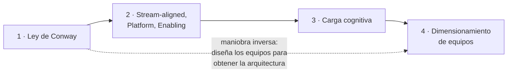
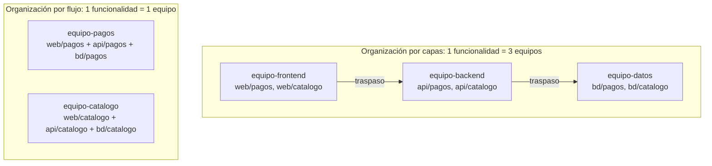
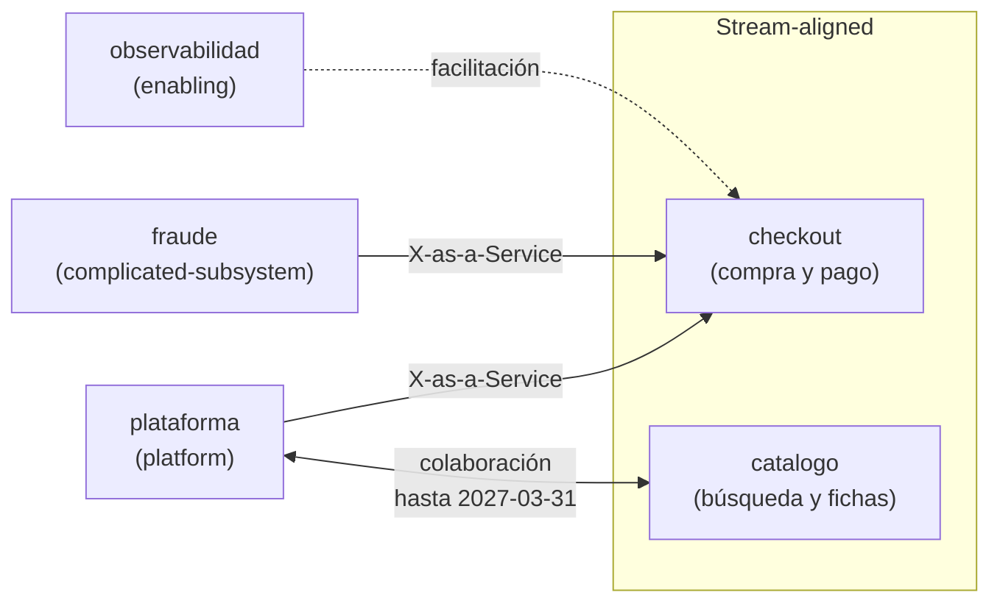
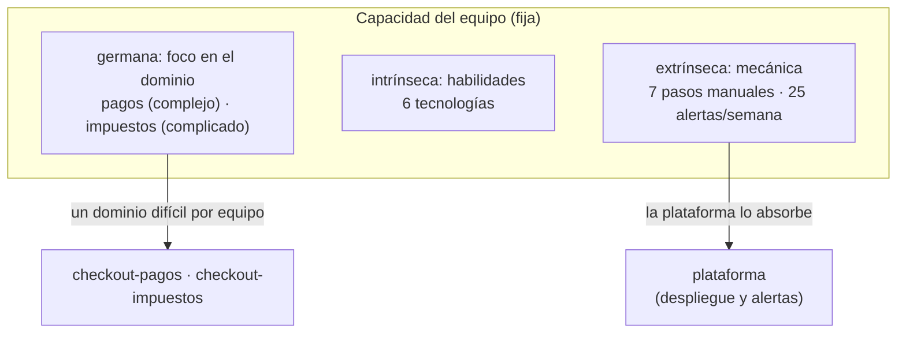
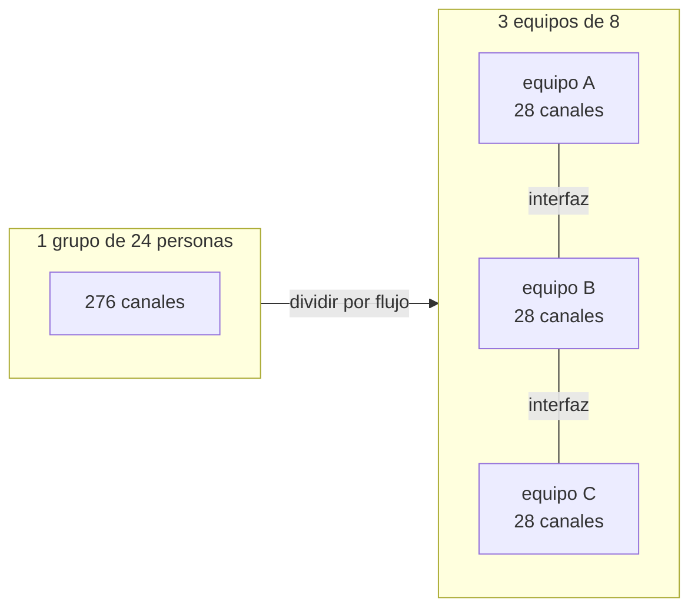

# Módulo 18 · Team Topologies y organización

**Fase 3 · Nivel maestro: arquitectura avanzada** (media semana; semana 4 de 8). **Duración:** 6 h (4 temas de unos
75 min y 1 h de laboratorio integrador). **Dificultad:** 3 de 5. **Dependencias:** Módulo 24 (ADRs y modelo C4: aquí
decides quién es dueño de cada caja del diagrama) y Módulo 5 (bounded contexts: la frontera natural de un equipo).
**Herramientas:**Node.js 26.13.1 LTS** y **Git** (el de tu sistema, 2.x); sin dependencias de npm ni
infraestructura. 
scripts de las cuatro fichas; `--compose` se acepta, pero este módulo no levanta contenedores).

Hasta aquí todo el curso ha tratado de **software**. Este módulo trata de **personas**, porque en un sistema de
microservicios la forma de los equipos acaba siendo la forma del sistema. Si cuatro equipos tienen que ponerse de
acuerdo para cada funcionalidad, da igual lo bien que estén separados los servicios en el diagrama: el sistema se
moverá a la velocidad de la reunión más lenta. Vas a **medir** esto con datos reales (un historial de Git), a modelar
los cuatro tipos de equipo y los tres modos de interacción de *Team Topologies* (Matthew Skelton y Manuel Pais, IT
Revolution, 2019), a convertir la «carga cognitiva» en algo que se puede revisar cada trimestre y a dimensionar
equipos con aritmética en lugar de intuición.



**Texto alternativo:** mapa del módulo. La Ley de Conway (tema 1) explica por qué la estructura de los equipos se
copia en el sistema; de ahí salen los tipos de equipo y sus interacciones (tema 2), que se eligen para limitar la
carga cognitiva de cada equipo (tema 3), y esa carga junto con los canales de comunicación decide el tamaño de los
equipos (tema 4). Una flecha punteada vuelve del tema 1 al 4: la maniobra inversa de Conway consiste en diseñar los
equipos para obtener la arquitectura deseada.

**Cómo usar el laboratorio.** Con Node 26 y Git:

```bash
npm ci                    # no instala nada: el laboratorio no tiene dependencias, pero así se comprueba el lockfile
  # tests + demos + errores comunes de las 4 fichas → «RESULTADO: OK»
```

`package.json` del laboratorio:

```json
{
  "name": "modulo-29-team-topologies-organizacion",
  "version": "1.0.0",
  "private": true,
  "description": "Módulo 29 (Fase 3): Team Topologies y organización (Ley de Conway medida en Git, tipos de equipo e interacciones, carga cognitiva, dimensionamiento de equipos).",
  "type": "module",
  "engines": {
    "node": ">=26.13.1"
  },
  "scripts": {
    "test": "node --test --test-concurrency=1 'f1*/*.test.js'"
  }
}
```

**Fuentes de este módulo** (consultadas el 2026-11-20): el artículo original de Melvin Conway, «How Do Committees
Invent?», *Datamation*, abril de 1968 (https://www.melconway.com/Home/Committees_Paper.html); los conceptos clave de
*Team Topologies* (https://teamtopologies.com/key-concepts) y el extracto oficial del libro publicado por IT Revolution
(https://itrevolution.com/wp-content/uploads/2022/06/TTOP_excerpt.pdf), de donde salen las citas de tamaño de equipo y
de la figura 3.2; la entrevista de InfoQ a los autores sobre carga cognitiva
(https://www.infoq.com/news/2019/07/team-topologies-cognitive-loa) y la reseña de Martin Fowler
(https://martinfowler.com/bliki/TeamTopologies.html); y la documentación de CODEOWNERS de GitHub
(https://docs.github.com/en/repositories/managing-your-repositorys-settings-and-features/customizing-your-repository/about-code-owners).

**Lo que se ejecutó al escribir este módulo** (Node 26.13.1, Git 2.43.0, bash 5.2): todo. Las salidas que ves son
las reales. Queda por repetir en el Mac con bash 3.2 y el Git de Xcode (anotado en
`verificacion/microservicios/pendiente.md`).

---


### Ley de Conway

<details open>
<summary><strong>Capa 1 — Lectura</strong></summary>

#### ► DE QUÉ TRATA
Explicar la Ley de Conway con la cita original, medirla sobre un historial de Git real (cuántos equipos toca cada funcionalidad) y aplicar la maniobra inversa: cambiar a la vez la estructura de los equipos y la del código para que una funcionalidad la termine un solo equipo. Lo c…

#### ► LA IDEA EN UNA FRASE
**Explicar la Ley de Conway con la cita original, medirla sobre un historial de Git real (cuántos equipos toca cada funcionalidad) y aplicar la maniobra inversa: cambiar a la vez la estructura de los equipos y la del código para que una funcionalidad la termine un solo equipo.**

#### ► POR QUÉ EXISTE ESTO
Resuelve un problema real de diseño o implementación y evita decisiones a ciegas.

#### ► LA ANALOGÍA
Piensa en ley de conway como una herramienta de taller: útil cuando conoces su propósito y sus límites.
**Dónde se rompe la analogía:** en software, los efectos dependen del contexto, la escala y los trade-offs.

#### ► CÓMO FUNCIONA


1. En 1968, Melvin Conway escribió que las organizaciones que diseñan sistemas «están obligadas a producir diseños que
2. Dicho fácil: **el software se parece a los equipos que lo hacen**. Si hay un equipo de pantallas, uno de servidor y
3. Por eso, antes de dibujar microservicios, conviene preguntar: **¿qué equipo va a cambiar cada pieza?** Si la

#### ► LO QUE PUEDE SALIR MAL
| Síntoma | Causa probable | Arreglo |
|---|---|---|
| Ley de Conway se aplica pero el resultado no mejora | Se usó sin medir el problema real | Mide antes y compara contra la alternativa simple |
| Aparece complejidad inesperada | Se adoptó la técnica sin comprender sus trade-offs | Vuelve a la sección de trade-offs y reduce el alcance |
| Falla en un caso límite | Se asumió un contexto que no se cumple | Prueba el caso límite y documenta cuándo NO usarlo |

#### ► TRADE-OFFS
| Opción | Cuándo usarla | Cuándo NO usarla |
|---|---|---|
| Usar Ley de Conway | Cuando el problema coincide con su propósito y el beneficio es observable | Cuando agrega complejidad sin resolver un problema real |
| Alternativa más simple | Cuando el contexto es pequeño, estable o fácil de razonar | Cuando ya demostró no escalar o no cumplir el requisito |
| Postergar la decisión | Cuando falta evidencia del problema | Cuando el costo de esperar es mayor que el costo de probar |

#### ► CUÁNDO NO USAR ESTO
Microservicios por capa técnica («servicio de frontend», «servicio de lógica», «servicio de datos») mantenidos por equipos por capa: el sistema tiene la red de los microservicios y la coordinación de un monolito.

#### ► DE VUELTA A LA ANALOGÍA
Volviendo a la analogía: ley de conway funciona como el modelo inicial, pero recuerda dónde se rompe: en producción importan la evidencia, la escala y el costo de equivocarte.

#### ► LO QUE DEBES RECORDAR
- En 1968, Melvin Conway escribió que las organizaciones que diseñan sistemas «están obligadas a producir diseños que
- Dicho fácil: **el software se parece a los equipos que lo hacen**. Si hay un equipo de pantallas, uno de servidor y
- Por eso, antes de dibujar microservicios, conviene preguntar: **¿qué equipo va a cambiar cada pieza?** Si la

#### ► PREGUNTAS PARA PENSAR
1. ¿Qué problema concreto resuelve ley de conway en tu contexto?
2. ¿Cómo sabrías que ley de conway no está funcionando bien?
3. ¿Qué alternativa más simple considerarías antes de usar ley de conway?

</details>

<details>
<summary><strong>Capa 2 — Construcción</strong></summary>

#### Código y verificación


```javascript
// Módulo 29 · F169 · Ley de Conway medida sobre un historial de Git real.
// Idea: si cada cambio de negocio (un commit) toca archivos de varios equipos, la arquitectura obliga a coordinar
// a esos equipos. Comparamos la MISMA base de código con dos organizaciones: por capas y por flujo de negocio.
// Requisitos: Node.js 26.13.1 LTS y Git (cualquier 2.x). Sin dependencias de npm.
import { execFileSync } from 'node:child_process';

// Reglas de propiedad al estilo CODEOWNERS: [patrón, equipo]. El patrón es una expresión regular sobre la ruta.
// Como en CODEOWNERS de GitHub, si varias reglas coinciden, gana la ÚLTIMA.
export function propietario(ruta, reglas) {
  let dueno = 'sin-dueño';
  for (const [patron, equipo] of reglas) if (new RegExp(patron).test(ruta)) dueno = equipo;
  return dueno;
}

// Lee el historial: un objeto por commit con el autor y los archivos que tocó.
export function leerHistorial(dirRepo) {
  const salida = execFileSync('git', ['-C', dirRepo, 'log', '--reverse', '--format=@@%s', '--name-only'], {
    encoding: 'utf8',
  });
  const commits = [];
  for (const linea of salida.split('\n')) {
    if (linea.startsWith('@@')) commits.push({ mensaje: linea.slice(2), archivos: [] });
    else if (linea.trim()) commits.at(-1).archivos.push(linea.trim());
  }
  return commits;
}

// Para cada commit: qué equipos tuvo que tocar. Un commit con 3 equipos = 3 agendas que coordinar y 2 traspasos.
export function analizar(commits, reglas) {
  const porCommit = commits.map((c) => {
    const equipos = [...new Set(c.archivos.map((a) => propietario(a, reglas)))].sort();
    return { mensaje: c.mensaje, equipos, traspasos: equipos.length - 1 };
  });
  const cruzados = porCommit.filter((c) => c.equipos.length > 1).length;
  const traspasos = porCommit.reduce((s, c) => s + c.traspasos, 0);
  // Pares de equipos que cambian juntos: la «estructura de comunicación» que la base de código exige.
  const pares = new Map();
  for (const { equipos } of porCommit)
    for (let i = 0; i < equipos.length; i++)
      for (let j = i + 1; j < equipos.length; j++) {
        const clave = `${equipos[i]} ↔ ${equipos[j]}`;
        pares.set(clave, (pares.get(clave) ?? 0) + 1);
      }
  return {
    commits: porCommit.length,
    cruzados,
    porcentajeCruzados: Math.round((100 * cruzados) / porCommit.length),
    traspasos,
    pares: Object.fromEntries([...pares].sort((a, b) => b[1] - a[1])),
  };
}

// Las dos organizaciones que comparamos sobre el mismo código (carpetas capa/flujo, p. ej. web/pagos).
export const POR_CAPAS = [
  ['^web/', 'equipo-frontend'],
  ['^api/', 'equipo-backend'],
  ['^bd/', 'equipo-datos'],
];
export const POR_FLUJO = [
  ['/pagos/', 'equipo-pagos'],
  ['/catalogo/', 'equipo-catalogo'],
];
```

```javascript
// Módulo 29 · F169 · Crea un repositorio Git de ejemplo en una carpeta temporal con 6 commits de negocio.
// Cada funcionalidad (pagos o catálogo) toca su pantalla (web/), su API (api/) y su tabla (bd/), como en la vida real.
import { execFileSync } from 'node:child_process';
import { mkdirSync, mkdtempSync, writeFileSync } from 'node:fs';
import { tmpdir } from 'node:os';
import { dirname, join } from 'node:path';

const FUNCIONALIDADES = [
  ['pagos', 'Pagar con tarjeta'],
  ['catalogo', 'Buscar productos por nombre'],
  ['pagos', 'Reembolso parcial'],
  ['catalogo', 'Filtrar por precio'],
  ['pagos', 'Pagar con PSE'],
  ['catalogo', 'Productos agotados ocultos'],
];

export function crearRepoDeEjemplo() {
  const dir = mkdtempSync(join(tmpdir(), 'conway-'));
  const git = (...args) => execFileSync('git', ['-C', dir, ...args], { stdio: 'pipe' });
  git('init', '-q');
  git('config', 'user.name', 'Academia');
  git('config', 'user.email', 'academia@example.com');
  git('config', 'commit.gpgsign', 'false');
  FUNCIONALIDADES.forEach(([flujo, titulo], i) => {
    for (const archivo of [`web/${flujo}/pantalla.js`, `api/${flujo}/rutas.js`, `bd/${flujo}/V${i + 1}.sql`]) {
      mkdirSync(dirname(join(dir, archivo)), { recursive: true });
      writeFileSync(join(dir, archivo), `// ${titulo} (cambio ${i + 1})\n`, { flag: 'a' });
    }
    git('add', '-A');
    git('commit', '-q', '-m', titulo);
  });
  return dir;
}
```

```javascript
// Módulo 29 · F169 · Ejecuta: node f169-conway/demo.js
// Mismo código, dos organizaciones: ¿cuántos equipos hay que coordinar por cada funcionalidad?
import { rmSync } from 'node:fs';
import { analizar, leerHistorial, POR_CAPAS, POR_FLUJO } from './conway.js';
import { crearRepoDeEjemplo } from './repo.js';

const dir = crearRepoDeEjemplo();
const commits = leerHistorial(dir);
for (const [nombre, reglas] of [['por capas', POR_CAPAS], ['por flujo', POR_FLUJO]]) {
  const r = analizar(commits, reglas);
  console.log(`Organización ${nombre}: ${r.cruzados}/${r.commits} funcionalidades cruzan equipos (${r.porcentajeCruzados} %) · traspasos: ${r.traspasos}`);
  for (const [par, veces] of Object.entries(r.pares)) console.log(`   ${par}: ${veces} funcionalidades juntas`);
}
rmSync(dir, { recursive: true, force: true });
```

```bash
node f169-conway/demo.js
```

```text
Organización por capas: 6/6 funcionalidades cruzan equipos (100 %) · traspasos: 12
   equipo-backend ↔ equipo-datos: 6 funcionalidades juntas
   equipo-backend ↔ equipo-frontend: 6 funcionalidades juntas
   equipo-datos ↔ equipo-frontend: 6 funcionalidades juntas
Organización por flujo: 0/6 funcionalidades cruzan equipos (0 %) · traspasos: 0
```

</details>

### Stream-aligned, Platform, Enabling teams

<details open>
<summary><strong>Capa 1 — Lectura</strong></summary>

#### ► DE QUÉ TRATA
Distinguir los cuatro tipos de equipo de *Team Topologies* (stream-aligned, platform, enabling y complicated-subsystem) y sus tres modos de interacción (colaboración, X-as-a-Service y facilitación), detectar con un revisor automático una topología mal planteada y cuantificar por…

#### ► LA IDEA EN UNA FRASE
**Distinguir los cuatro tipos de equipo de *Team Topologies* (stream-aligned, platform, enabling y complicated-subsystem) y sus tres modos de interacción (colaboración, X-as-a-Service y facilitación), detectar con un revisor automático una topología mal planteada y cuantificar por qué una plataforma debe ser autoservicio.**

#### ► POR QUÉ EXISTE ESTO
Resuelve un problema real de diseño o implementación y evita decisiones a ciegas.

#### ► LA ANALOGÍA
Piensa en stream-aligned, platform, enabling teams como una herramienta de taller: útil cuando conoces su propósito y sus límites.
**Dónde se rompe la analogía:** en software, los efectos dependen del contexto, la escala y los trade-offs.

#### ► CÓMO FUNCIONA


1. La mayoría de los equipos deberían **entregar valor directamente a los usuarios** en un área del negocio: son los
2. Para que esos equipos no tengan que saber de todo, otros equipos los **ayudan**: uno les da herramientas listas
3. Además del **tipo** de equipo importa **cómo se relacionan**: trabajando juntos un tiempo, dando un servicio que el

#### ► LO QUE PUEDE SALIR MAL
| Síntoma | Causa probable | Arreglo |
|---|---|---|
| Stream-aligned, Platform, Enabling teams se aplica pero el resultado no mejora | Se usó sin medir el problema real | Mide antes y compara contra la alternativa simple |
| Aparece complejidad inesperada | Se adoptó la técnica sin comprender sus trade-offs | Vuelve a la sección de trade-offs y reduce el alcance |
| Falla en un caso límite | Se asumió un contexto que no se cumple | Prueba el caso límite y documenta cuándo NO usarlo |

#### ► TRADE-OFFS
| Opción | Cuándo usarla | Cuándo NO usarla |
|---|---|---|
| Usar Stream-aligned, Platform, Enabling teams | Cuando el problema coincide con su propósito y el beneficio es observable | Cuando agrega complejidad sin resolver un problema real |
| Alternativa más simple | Cuando el contexto es pequeño, estable o fácil de razonar | Cuando ya demostró no escalar o no cumplir el requisito |
| Postergar la decisión | Cuando falta evidencia del problema | Cuando el costo de esperar es mayor que el costo de probar |

#### ► CUÁNDO NO USAR ESTO
El equipo «de arquitectura» o «de DevOps» como cuello de botella: todos los equipos le piden cosas, nadie puede hacerlas solo y la colaboración nunca termina.

#### ► DE VUELTA A LA ANALOGÍA
Volviendo a la analogía: stream-aligned, platform, enabling teams funciona como el modelo inicial, pero recuerda dónde se rompe: en producción importan la evidencia, la escala y el costo de equivocarte.

#### ► LO QUE DEBES RECORDAR
- La mayoría de los equipos deberían **entregar valor directamente a los usuarios** en un área del negocio: son los
- Para que esos equipos no tengan que saber de todo, otros equipos los **ayudan**: uno les da herramientas listas
- Además del **tipo** de equipo importa **cómo se relacionan**: trabajando juntos un tiempo, dando un servicio que el

#### ► PREGUNTAS PARA PENSAR
1. ¿Qué problema concreto resuelve stream-aligned, platform, enabling teams en tu contexto?
2. ¿Cómo sabrías que stream-aligned, platform, enabling teams no está funcionando bien?
3. ¿Qué alternativa más simple considerarías antes de usar stream-aligned, platform, enabling teams?

</details>

<details>
<summary><strong>Capa 2 — Construcción</strong></summary>

#### Código y verificación


```javascript
// Módulo 29 · F170 · Tipos de equipo e interacciones de Team Topologies (Skelton y Pais, 2019) como datos revisables,
// y una simulación del tiempo que espera un equipo stream-aligned según cómo le llega la infraestructura.
// Requisitos: Node.js 26.13.1 LTS. Sin dependencias de npm.

export const TIPOS = ['stream-aligned', 'platform', 'enabling', 'complicated-subsystem'];
export const MODOS = ['colaboracion', 'x-as-a-service', 'facilitacion'];

// Revisa una topología { equipos: [{nombre, tipo, flujo?}], interacciones: [{de, a, modo, hasta?}] }.
// Las reglas 1–4 salen de las definiciones del libro; la 5 es una heurística de este curso.
export function revisar({ equipos, interacciones }) {
  const avisos = [];
  const tipo = new Map(equipos.map((e) => [e.nombre, e.tipo]));
  for (const e of equipos) {
    if (!TIPOS.includes(e.tipo)) avisos.push(`${e.nombre}: tipo desconocido «${e.tipo}»`);
    // 1. Un stream-aligned se alinea a un flujo de trabajo del negocio: si no sabes cuál, no lo es.
    if (e.tipo === 'stream-aligned' && !e.flujo) avisos.push(`${e.nombre}: stream-aligned sin flujo de negocio`);
  }
  for (const i of interacciones) {
    if (!MODOS.includes(i.modo)) avisos.push(`${i.de} → ${i.a}: modo desconocido «${i.modo}»`);
    // 2. Un enabling ayuda y enseña (facilitación); si construye y opera cosas para otros, es otro tipo de equipo.
    if (tipo.get(i.de) === 'enabling' && i.modo !== 'facilitacion')
      avisos.push(`${i.de} → ${i.a}: un enabling interactúa por facilitación, no por ${i.modo}`);
    // 3. La colaboración es intensa y temporal: debe tener fecha de fin.
    if (i.modo === 'colaboracion' && !i.hasta) avisos.push(`${i.de} ↔ ${i.a}: colaboración sin fecha de fin`);
  }
  // 4. Una plataforma es un producto interno: si nadie la consume como servicio, no está cumpliendo su papel.
  for (const p of equipos.filter((e) => e.tipo === 'platform'))
    if (!interacciones.some((i) => i.de === p.nombre && i.modo === 'x-as-a-service'))
      avisos.push(`${p.nombre}: plataforma sin consumidores x-as-a-service`);
  // 5. (Heurística del curso) Un equipo en más de una colaboración a la vez se queda sin tiempo para su flujo.
  const colaboraciones = new Map();
  for (const i of interacciones.filter((x) => x.modo === 'colaboracion'))
    for (const n of [i.de, i.a]) colaboraciones.set(n, (colaboraciones.get(n) ?? 0) + 1);
  for (const [n, c] of colaboraciones) if (c > 1) avisos.push(`${n}: ${c} colaboraciones a la vez`);
  return avisos;
}

// Simulación: `pedidos` equipos stream-aligned piden cada uno una base de datos nueva el mismo día.
//  - por tickets: un equipo de operaciones atiende `capacidadDia` tickets al día, en orden de llegada.
//  - autoservicio: la plataforma lo ofrece como servicio (una orden o un formulario) y tarda `minutosAutoservicio`.
export function simularEspera({ pedidos, capacidadDia, minutosAutoservicio }) {
  const diasTicket = Array.from({ length: pedidos }, (_, i) => Math.floor(i / capacidadDia) + 1);
  const media = diasTicket.reduce((s, d) => s + d, 0) / pedidos;
  return {
    porTickets: { mediaDias: Math.round(media * 10) / 10, peorDias: diasTicket.at(-1) },
    autoservicio: { minutos: minutosAutoservicio },
  };
}
```

```javascript
// Módulo 29 · F170 · Dos topologías de la tienda en línea: la inicial (con problemas) y la corregida.
export const INICIAL = {
  equipos: [
    { nombre: 'checkout', tipo: 'stream-aligned', flujo: 'compra y pago' },
    { nombre: 'catalogo', tipo: 'stream-aligned', flujo: 'búsqueda y fichas de producto' },
    { nombre: 'backend', tipo: 'stream-aligned' }, // ¿alineado a qué flujo? a ninguno: es una capa
    { nombre: 'plataforma', tipo: 'platform' },
    { nombre: 'observabilidad', tipo: 'enabling' },
  ],
  interacciones: [
    { de: 'plataforma', a: 'checkout', modo: 'colaboracion' }, // sin fecha de fin: colaboración eterna
    { de: 'plataforma', a: 'catalogo', modo: 'colaboracion', hasta: '2027-03-31' },
    { de: 'observabilidad', a: 'checkout', modo: 'x-as-a-service' }, // el enabling opera el stack por ellos
  ],
};

export const CORREGIDA = {
  equipos: [
    { nombre: 'checkout', tipo: 'stream-aligned', flujo: 'compra y pago' },
    { nombre: 'catalogo', tipo: 'stream-aligned', flujo: 'búsqueda y fichas de producto' },
    { nombre: 'fraude', tipo: 'complicated-subsystem' }, // modelo de riesgo: necesita especialistas
    { nombre: 'plataforma', tipo: 'platform' },
    { nombre: 'observabilidad', tipo: 'enabling' },
  ],
  interacciones: [
    { de: 'plataforma', a: 'checkout', modo: 'x-as-a-service' },
    { de: 'plataforma', a: 'catalogo', modo: 'colaboracion', hasta: '2027-03-31' }, // descubren juntos la API de búsqueda
    { de: 'fraude', a: 'checkout', modo: 'x-as-a-service' },
    { de: 'observabilidad', a: 'checkout', modo: 'facilitacion' }, // enseña a instrumentar y se retira
  ],
};
```

```javascript
// Módulo 29 · F170 · Ejecuta: node f170-topologias/demo.js
import { CORREGIDA, INICIAL } from './ejemplo.js';
import { revisar, simularEspera } from './topologia.js';

for (const [nombre, t] of [['inicial', INICIAL], ['corregida', CORREGIDA]]) {
  const avisos = revisar(t);
  console.log(`Topología ${nombre}: ${avisos.length} avisos`);
  for (const a of avisos) console.log(`   - ${a}`);
}
const s = simularEspera({ pedidos: 10, capacidadDia: 2, minutosAutoservicio: 15 });
console.log(`10 equipos piden una base de datos: por tickets esperan ${s.porTickets.mediaDias} días de media (el último, ${s.porTickets.peorDias}); con autoservicio, ${s.autoservicio.minutos} minutos`);
```

```bash
node f170-topologias/demo.js
```

```text
Topología inicial: 5 avisos
   - backend: stream-aligned sin flujo de negocio
   - plataforma ↔ checkout: colaboración sin fecha de fin
   - observabilidad → checkout: un enabling interactúa por facilitación, no por x-as-a-service
   - plataforma: plataforma sin consumidores x-as-a-service
   - plataforma: 2 colaboraciones a la vez
Topología corregida: 0 avisos
10 equipos piden una base de datos: por tickets esperan 3 días de media (el último, 5); con autoservicio, 15 minutos
```

</details>

### Carga cognitiva

<details open>
<summary><strong>Capa 1 — Lectura</strong></summary>

#### ► DE QUÉ TRATA
Distinguir los tres tipos de carga cognitiva (intrínseca, extrínseca y germana), medir la de un equipo con indicadores que se pueden revisar cada trimestre (dominios difíciles, tecnologías, pasos manuales, alertas y una encuesta 1–5) y proponer cómo reducirla. Lo compruebas cuand…

#### ► LA IDEA EN UNA FRASE
**Distinguir los tres tipos de carga cognitiva (intrínseca, extrínseca y germana), medir la de un equipo con indicadores que se pueden revisar cada trimestre (dominios difíciles, tecnologías, pasos manuales, alertas y una encuesta 1–5) y proponer cómo reducirla.**

#### ► POR QUÉ EXISTE ESTO
Resuelve un problema real de diseño o implementación y evita decisiones a ciegas.

#### ► LA ANALOGÍA
Piensa en carga cognitiva como una herramienta de taller: útil cuando conoces su propósito y sus límites.
**Dónde se rompe la analogía:** en software, los efectos dependen del contexto, la escala y los trade-offs.

#### ► CÓMO FUNCIONA


1. Una persona solo puede tener **cierta cantidad de cosas en la cabeza** a la vez. Un equipo también.
2. Si a un equipo le das demasiados temas difíciles, herramientas distintas y tareas repetitivas, **se equivoca más y
3. Los autores de *Team Topologies* lo comparan con un ordenador: igual que una CPU saturada vuelve lento al equipo

#### ► LO QUE PUEDE SALIR MAL
| Síntoma | Causa probable | Arreglo |
|---|---|---|
| Carga cognitiva se aplica pero el resultado no mejora | Se usó sin medir el problema real | Mide antes y compara contra la alternativa simple |
| Aparece complejidad inesperada | Se adoptó la técnica sin comprender sus trade-offs | Vuelve a la sección de trade-offs y reduce el alcance |
| Falla en un caso límite | Se asumió un contexto que no se cumple | Prueba el caso límite y documenta cuándo NO usarlo |

#### ► TRADE-OFFS
| Opción | Cuándo usarla | Cuándo NO usarla |
|---|---|---|
| Usar Carga cognitiva | Cuando el problema coincide con su propósito y el beneficio es observable | Cuando agrega complejidad sin resolver un problema real |
| Alternativa más simple | Cuando el contexto es pequeño, estable o fácil de razonar | Cuando ya demostró no escalar o no cumplir el requisito |
| Postergar la decisión | Cuando falta evidencia del problema | Cuando el costo de esperar es mayor que el costo de probar |

#### ► CUÁNDO NO USAR ESTO
El equipo «comodín»: el que mejor trabaja recibe todos los servicios huérfanos y acaba con cinco dominios, ocho tecnologías y la guardia de todos.

#### ► DE VUELTA A LA ANALOGÍA
Volviendo a la analogía: carga cognitiva funciona como el modelo inicial, pero recuerda dónde se rompe: en producción importan la evidencia, la escala y el costo de equivocarte.

#### ► LO QUE DEBES RECORDAR
- Una persona solo puede tener **cierta cantidad de cosas en la cabeza** a la vez. Un equipo también.
- Si a un equipo le das demasiados temas difíciles, herramientas distintas y tareas repetitivas, **se equivoca más y
- Los autores de *Team Topologies* lo comparan con un ordenador: igual que una CPU saturada vuelve lento al equipo

#### ► PREGUNTAS PARA PENSAR
1. ¿Qué problema concreto resuelve carga cognitiva en tu contexto?
2. ¿Cómo sabrías que carga cognitiva no está funcionando bien?
3. ¿Qué alternativa más simple considerarías antes de usar carga cognitiva?

</details>

<details>
<summary><strong>Capa 2 — Construcción</strong></summary>

#### Código y verificación


```javascript
// Módulo 29 · F171 · Carga cognitiva de un equipo: una medida RELATIVA (no existe una exacta) a partir de su inventario
// y de una encuesta 1–5, separando los tres tipos de carga: intrínseca (habilidades), extrínseca (mecánica) y germana
// (foco en el dominio), como los nombran Skelton y Pais.
// Requisitos: Node.js 26.13.1 LTS. Sin dependencias de npm.

// Umbrales del curso (ajústalos a tu organización; lo importante es compararlos en el tiempo y entre equipos).
export const UMBRALES = {
  dominiosDificiles: 1, // Team Topologies, figura 3.2: «no más de un dominio complicado o complejo por equipo»
  tecnologias: 4, // lenguajes, bases de datos y brokers distintos que el equipo opera
  pasosManuales: 3, // pasos manuales para desplegar
  alertasSemana: 10, // alertas que despiertan a alguien cada semana
  encuestaMinima: 3, // media de «¿cuánto entiendes los sistemas que operas?» (1 = nada, 5 = todo)
};

export function evaluar(equipo, u = UMBRALES) {
  const dificiles = equipo.dominios.filter((d) => d.complejidad !== 'simple');
  const encuesta = equipo.encuesta.reduce((s, x) => s + x, 0) / equipo.encuesta.length;
  const avisos = [];
  // Germana: el foco en el dominio de negocio, la carga que SÍ queremos… pero no más de un dominio difícil.
  if (dificiles.length > u.dominiosDificiles)
    avisos.push(`germana: ${dificiles.length} dominios complicados o complejos (${dificiles.map((d) => d.nombre).join(', ')})`);
  // Intrínseca: las habilidades que exige el trabajo (cada tecnología distinta hay que dominarla).
  if (equipo.tecnologias.length > u.tecnologias)
    avisos.push(`intrínseca: ${equipo.tecnologias.length} tecnologías distintas`);
  // Extrínseca: la mecánica que no aporta al problema (despliegues manuales, ruido de alertas).
  if (equipo.pasosManuales > u.pasosManuales) avisos.push(`extrínseca: ${equipo.pasosManuales} pasos manuales por despliegue`);
  if (equipo.alertasSemana > u.alertasSemana) avisos.push(`extrínseca: ${equipo.alertasSemana} alertas por semana`);
  if (encuesta < u.encuestaMinima) avisos.push(`encuesta: entienden sus sistemas ${encuesta.toFixed(1)} de 5`);
  return { equipo: equipo.nombre, encuesta: Number(encuesta.toFixed(1)), avisos, sobrecargado: avisos.length > 0 };
}

// Propuesta: un dominio difícil por equipo stream-aligned; lo extrínseco, a la plataforma.
export function proponer(equipo) {
  const dificiles = equipo.dominios.filter((d) => d.complejidad !== 'simple');
  const simples = equipo.dominios.filter((d) => d.complejidad === 'simple');
  if (dificiles.length <= 1) return [{ nombre: equipo.nombre, dominios: equipo.dominios.map((d) => d.nombre) }];
  return dificiles.map((d, i) => ({
    nombre: `${equipo.nombre}-${d.nombre}`,
    // Los dominios simples se quedan con el primer equipo para no crear equipos sin un flujo con sentido.
    dominios: [d.nombre, ...(i === 0 ? simples.map((s) => s.nombre) : [])],
  }));
}
```

```javascript
// Módulo 29 · F171 · Ejecuta: node f171-carga-cognitiva/demo.js
import { evaluar, proponer } from './carga.js';

const checkout = {
  nombre: 'checkout',
  dominios: [
    { nombre: 'pagos', complejidad: 'complejo' },
    { nombre: 'impuestos', complejidad: 'complicado' },
    { nombre: 'cupones', complejidad: 'simple' },
  ],
  tecnologias: ['Java', 'Node.js', 'PostgreSQL', 'Kafka', 'Redis', 'Terraform'],
  pasosManuales: 7,
  alertasSemana: 25,
  encuesta: [2, 3, 2, 2, 3, 2],
};

const antes = evaluar(checkout);
console.log(`Antes: ${antes.avisos.length} avisos · encuesta ${antes.encuesta}/5`);
for (const a of antes.avisos) console.log(`   - ${a}`);
console.log(`Propuesta: ${proponer(checkout).map((e) => `${e.nombre} [${e.dominios.join(', ')}]`).join(' · ')}`);

// Después: un equipo por dominio difícil y la plataforma absorbe despliegue y alertas (lo extrínseco).
const pagos = { ...checkout, nombre: 'checkout-pagos', dominios: checkout.dominios.filter((d) => d.nombre !== 'impuestos'),
  tecnologias: ['Java', 'PostgreSQL', 'Kafka'], pasosManuales: 0, alertasSemana: 4, encuesta: [4, 4, 3, 4, 4] };
const despues = evaluar(pagos);
console.log(`Después (checkout-pagos): ${despues.avisos.length} avisos · encuesta ${despues.encuesta}/5`);
```

```bash
node f171-carga-cognitiva/demo.js
```

```text
Antes: 5 avisos · encuesta 2.3/5
   - germana: 2 dominios complicados o complejos (pagos, impuestos)
   - intrínseca: 6 tecnologías distintas
   - extrínseca: 7 pasos manuales por despliegue
   - extrínseca: 25 alertas por semana
   - encuesta: entienden sus sistemas 2.3 de 5
Propuesta: checkout-pagos [pagos, cupones] · checkout-impuestos [impuestos]
Después (checkout-pagos): 0 avisos · encuesta 3.8/5
```

```javascript
// Módulo 29 · F171 · Tests. Ejecuta: node --test f171-carga-cognitiva/carga.test.js
import assert from 'node:assert/strict';
import { test } from 'node:test';
import { evaluar, proponer } from './carga.js';

const base = { nombre: 'x', dominios: [{ nombre: 'envios', complejidad: 'complicado' }], tecnologias: ['Node.js', 'PostgreSQL'],
  pasosManuales: 0, alertasSemana: 2, encuesta: [4, 4, 5] };

test('un equipo con un solo dominio difícil y poco ruido no está sobrecargado', () => {
  assert.equal(evaluar(base).sobrecargado, false);
});

test('dos dominios difíciles: aviso de carga germana', () => {
  const e = evaluar({ ...base, dominios: [...base.dominios, { nombre: 'aduanas', complejidad: 'complejo' }] });
  assert.deepEqual(e.avisos, ['germana: 2 dominios complicados o complejos (envios, aduanas)']);
});

test('despliegue manual y alertas son carga extrínseca; la encuesta baja también avisa', () => {
  const e = evaluar({ ...base, pasosManuales: 5, alertasSemana: 30, encuesta: [2, 2, 3] });
  assert.deepEqual(e.avisos, [
    'extrínseca: 5 pasos manuales por despliegue',
    'extrínseca: 30 alertas por semana',
    'encuesta: entienden sus sistemas 2.3 de 5',
  ]);
});

test('la propuesta deja un dominio difícil por equipo y los simples con el primero', () => {
  const p = proponer({ ...base, nombre: 'logistica', dominios: [
    { nombre: 'envios', complejidad: 'complicado' }, { nombre: 'aduanas', complejidad: 'complejo' }, { nombre: 'etiquetas', complejidad: 'simple' }] });
  assert.deepEqual(p, [
    { nombre: 'logistica-envios', dominios: ['envios', 'etiquetas'] },
    { nombre: 'logistica-aduanas', dominios: ['aduanas'] },
  ]);
});
```

</details>

### Dimensionamiento de equipos

<details open>
<summary><strong>Capa 1 — Lectura</strong></summary>

#### ► DE QUÉ TRATA
Calcular los canales de comunicación de un grupo, aplicar el rango de cinco a nueve personas por equipo y los límites de agrupación de *Team Topologies* y dividir un grupo grande en equipos con interfaces explícitas entre ellos. Lo compruebas cuando tamano.test.js pasa 5 de 5 y s…

#### ► LA IDEA EN UNA FRASE
**Calcular los canales de comunicación de un grupo, aplicar el rango de cinco a nueve personas por equipo y los límites de agrupación de *Team Topologies* y dividir un grupo grande en equipos con interfaces explícitas entre ellos.**

#### ► POR QUÉ EXISTE ESTO
Resuelve un problema real de diseño o implementación y evita decisiones a ciegas.

#### ► LA ANALOGÍA
Piensa en dimensionamiento de equipos como una herramienta de taller: útil cuando conoces su propósito y sus límites.
**Dónde se rompe la analogía:** en software, los efectos dependen del contexto, la escala y los trade-offs.

#### ► CÓMO FUNCIONA


1. Cada **pareja** de personas que tiene que ponerse de acuerdo es un canal de comunicación.
2. Con pocas personas hay pocos canales; con muchas, los canales **crecen muchísimo más rápido** que las personas.
3. Por eso los equipos que funcionan bien son **pequeños** (de cinco a nueve personas), y cuando hay más gente se

#### ► LO QUE PUEDE SALIR MAL
| Síntoma | Causa probable | Arreglo |
|---|---|---|
| Dimensionamiento de equipos se aplica pero el resultado no mejora | Se usó sin medir el problema real | Mide antes y compara contra la alternativa simple |
| Aparece complejidad inesperada | Se adoptó la técnica sin comprender sus trade-offs | Vuelve a la sección de trade-offs y reduce el alcance |
| Falla en un caso límite | Se asumió un contexto que no se cumple | Prueba el caso límite y documenta cuándo NO usarlo |

#### ► TRADE-OFFS
| Opción | Cuándo usarla | Cuándo NO usarla |
|---|---|---|
| Usar Dimensionamiento de equipos | Cuando el problema coincide con su propósito y el beneficio es observable | Cuando agrega complejidad sin resolver un problema real |
| Alternativa más simple | Cuando el contexto es pequeño, estable o fácil de razonar | Cuando ya demostró no escalar o no cumplir el requisito |
| Postergar la decisión | Cuando falta evidencia del problema | Cuando el costo de esperar es mayor que el costo de probar |

#### ► CUÁNDO NO USAR ESTO
El «equipo» de 20 personas con una sola daily: todos asisten a todo, la reunión dura una hora y las decisiones se toman en pasillos.

#### ► DE VUELTA A LA ANALOGÍA
Volviendo a la analogía: dimensionamiento de equipos funciona como el modelo inicial, pero recuerda dónde se rompe: en producción importan la evidencia, la escala y el costo de equivocarte.

#### ► LO QUE DEBES RECORDAR
- Cada **pareja** de personas que tiene que ponerse de acuerdo es un canal de comunicación.
- Con pocas personas hay pocos canales; con muchas, los canales **crecen muchísimo más rápido** que las personas.
- Por eso los equipos que funcionan bien son **pequeños** (de cinco a nueve personas), y cuando hay más gente se

#### ► PREGUNTAS PARA PENSAR
1. ¿Qué problema concreto resuelve dimensionamiento de equipos en tu contexto?
2. ¿Cómo sabrías que dimensionamiento de equipos no está funcionando bien?
3. ¿Qué alternativa más simple considerarías antes de usar dimensionamiento de equipos?

</details>

<details>
<summary><strong>Capa 2 — Construcción</strong></summary>

#### Código de referencia / ejecutable
Versiones: **Node.js 26.13.1 LTS**, sin dependencias.

`f172-dimensionamiento/tamano.js`:

```javascript
// Módulo 29 · F172 · Dimensionamiento de equipos: canales de comunicación, tamaño de 5 a 9 personas y límites de
// agrupación (Team Topologies, cap. 3, basado en el número de Dunbar).
// Requisitos: Node.js 26.13.1 LTS. Sin dependencias de npm.

// Canales de comunicación entre n personas: cada par es un canal → n·(n−1)/2 (Brooks, The Mythical Man-Month).
export const canales = (n) => (n * (n - 1)) / 2;

// «Un grupo estable de cinco a nueve personas que trabajan hacia un objetivo común como una unidad».
export function evaluarTamano(n) {
  if (n < 5) return 'pequeño: frágil ante vacaciones y bajas';
  if (n <= 9) return 'adecuado';
  if (n <= 15) return 'grande: solo funciona con mucha confianza; considera dividir';
  return 'demasiado grande: dividir';
}

// Reparte `personas` en el menor número de equipos de como máximo `maximo` personas, lo más parejos posible.
export function dividir(personas, maximo = 9) {
  const equipos = Math.ceil(personas / maximo);
  const base = Math.floor(personas / equipos);
  const resto = personas % equipos;
  return Array.from({ length: equipos }, (_, i) => base + (i < resto ? 1 : 0));
}

// Compara un solo grupo con la división en equipos. Entre equipos no hablan todos con todos: se comunican por
// `interfaces` explícitas (una API, un contrato o una reunión de sincronización) entre los pares que se necesitan.
export function comparar(personas, { maximo = 9, interfaces } = {}) {
  const tamanos = dividir(personas, maximo);
  const internos = tamanos.reduce((s, n) => s + canales(n), 0);
  const entreEquipos = interfaces ?? canales(tamanos.length); // por defecto, el peor caso: todos los pares
  return { unSoloGrupo: canales(personas), tamanos, canalesInternos: internos, interfacesEntreEquipos: entreEquipos };
}

// Límites de agrupación de equipos del libro: ≈50 personas por grupo de equipos (150 con mucha confianza).
export function revisarAgrupacion(tamanos, { altaConfianza = false } = {}) {
  const total = tamanos.reduce((s, n) => s + n, 0);
  const limite = altaConfianza ? 150 : 50;
  return { total, limite, ok: total <= limite };
}
```

`f172-dimensionamiento/demo.js`:

```javascript
// Módulo 29 · F172 · Ejecuta: node f172-dimensionamiento/demo.js
import { canales, comparar, evaluarTamano, revisarAgrupacion } from './tamano.js';

for (const n of [3, 7, 12, 24]) console.log(`${String(n).padStart(2)} personas → ${String(canales(n)).padStart(3)} canales · ${evaluarTamano(n)}`);
const c = comparar(24, { interfaces: 2 });
console.log(`24 personas en un grupo: ${c.unSoloGrupo} canales · en equipos ${c.tamanos.join('+')}: ${c.canalesInternos} internos + ${c.interfacesEntreEquipos} interfaces entre equipos`);
const g = revisarAgrupacion([8, 8, 8, 7, 9, 6, 8]);
console.log(`Grupo de 7 equipos: ${g.total} personas (límite ${g.limite}) → ${g.ok ? 'ok' : 'partir en dos grupos'}`);
```

#### Verificación
Tests (`f172-dimensionamiento/tamano.test.js`):

```javascript
// Módulo 29 · F172 · Tests. Ejecuta: node --test f172-dimensionamiento/tamano.test.js
import assert from 'node:assert/strict';
import { test } from 'node:test';
import { canales, comparar, dividir, evaluarTamano, revisarAgrupacion } from './tamano.js';

test('canales crecen con el cuadrado: 5→10, 9→36, 24→276', () => {
  assert.deepEqual([5, 9, 24].map(canales), [10, 36, 276]);
});

test('tamaño adecuado entre 5 y 9 personas', () => {
  assert.equal(evaluarTamano(4), 'pequeño: frágil ante vacaciones y bajas');
  assert.equal(evaluarTamano(5), 'adecuado');
  assert.equal(evaluarTamano(9), 'adecuado');
  assert.match(evaluarTamano(10), /^grande/);
  assert.match(evaluarTamano(16), /^demasiado grande/);
});

test('dividir reparte parejo y nunca pasa del máximo', () => {
  assert.deepEqual(dividir(24), [8, 8, 8]);
  assert.deepEqual(dividir(20), [7, 7, 6]);
  assert.ok(dividir(41).every((n) => n <= 9));
});

test('24 personas: 276 canales en un grupo frente a 84 + 2 en tres equipos', () => {
  assert.deepEqual(comparar(24, { interfaces: 2 }), { unSoloGrupo: 276, tamanos: [8, 8, 8], canalesInternos: 84, interfacesEntreEquipos: 2 });
});

test('un grupo de equipos de 54 personas pasa del límite de 50 salvo con alta confianza', () => {
  assert.equal(revisarAgrupacion([8, 8, 8, 7, 9, 6, 8]).ok, false);
  assert.equal(revisarAgrupacion([8, 8, 8, 7, 9, 6, 8], { altaConfianza: true }).ok, true);
});
```

```bash
node --test --test-reporter=spec f172-dimensionamiento/tamano.test.js
```

**Output esperado** (real): `ℹ tests 5` y `ℹ pass 5`.

**Pregunta de comprobación:** ¿cuántos canales tiene un equipo de 9 personas y cuántos dos equipos de 4 y 5 con una
interfaz? (36 frente a 6 + 10 + 1 = 17. La división ayuda solo si cada equipo puede trabajar casi siempre sin la
interfaz.)

</details>
