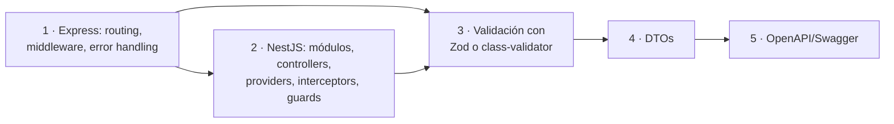
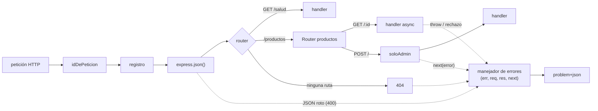
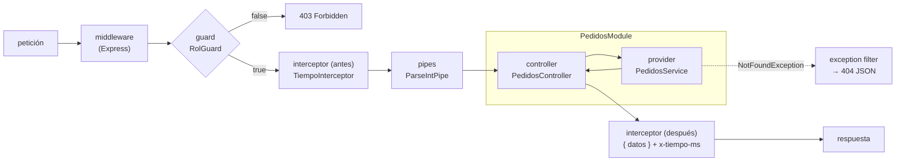
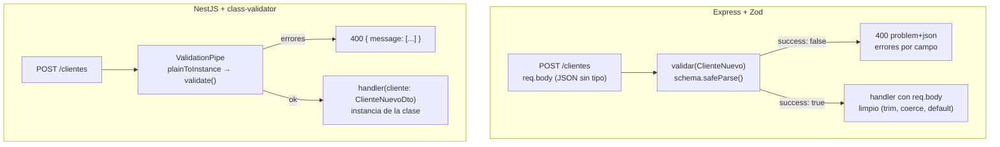
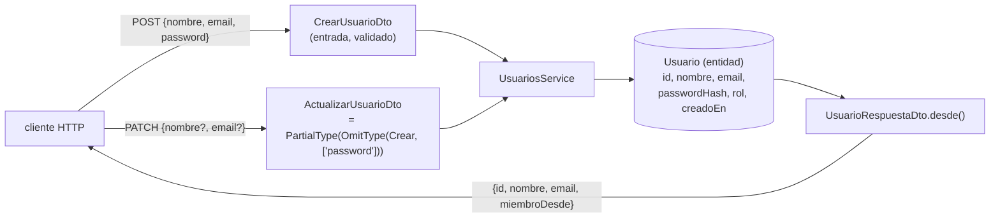
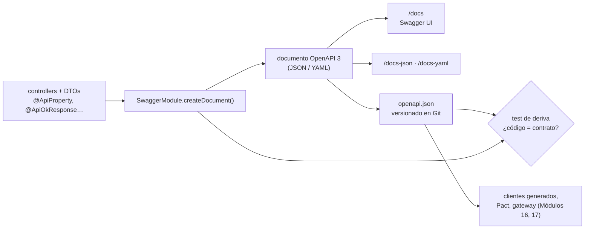

# Módulo 14 · APIs REST con Express y NestJS

**Fase 2 · Node.js de cero a experto** (semanas 3 y 4 de 12). **Duración:** 12 h (5 temas de 2 h y 2 h de
laboratorio integrador). **Dificultad:** 2 de 5 en Express, 3 de 5 en NestJS, validación, DTOs y OpenAPI.
**Dependencias:** Módulo 13 (async/await, TypeScript estricto, Event Loop, graceful shutdown) y Módulo 0.4 (HTTP,
códigos de estado, JSON, `curl`). **Herramientas:** **Node.js 26.13.1 LTS**, **TypeScript 6.0.3**, **express 5.3.0**,
**NestJS 12.5.1** (`@nestjs/common`, `core`, `platform-express`, `testing`), **zod 4.6.7**, **class-validator
0.15.1** + **class-transformer 0.5.1**, **@nestjs/mapped-types 12.0.1** y **@nestjs/swagger 12.1.2**.
Una API REST es la **puerta de entrada** de un microservicio. En este módulo construyes la misma idea de dos formas:
con **Express**, mínimo y explícito (tú conectas cada pieza), y con **NestJS**, un framework con estructura (módulos,
inyección de dependencias, guards, interceptores) que escala a equipos grandes. Después aprendes a **no confiar** en
lo que llega (validación con Zod o class-validator), a separar lo que entra y sale de lo que guardas (DTOs) y a
publicar el contrato para que otros equipos lo consuman (OpenAPI/Swagger).



**Texto alternativo:** mapa del módulo. El tema 1 (Express) lleva al tema 2 (NestJS) y al tema 3 (validación con Zod
o class-validator); el tema 2 también lleva al 3. El tema 3 lleva al tema 4 (DTOs) y este al tema 5 (OpenAPI/Swagger).

**Cómo usar el laboratorio.** Con Node 26 activo:

```bash
  # npm ci + tsc + 26 tests + cada API con curl → «RESULTADO: OK»
```

Todas las órdenes de las fichas se ejecutan **desde `modulo-18`** después de `npm ci`. Los
ejemplos de Express son JavaScript (módulos ES) que Node ejecuta tal cual; los de NestJS son TypeScript que se compila
a `dist/` con `npm run build`, porque NestJS usa decoradores con metadatos de tipos (`emitDecoratorMetadata`), que el
type stripping de Node no sabe generar. `package.json` del laboratorio (con `package-lock.json` que fija el árbol
completo):

```json
{
  "name": "modulo-14-apis-rest-node",
  "version": "1.0.0",
  "private": true,
  "description": "Módulo 14 (Fase 2): APIs REST con Express y NestJS.",
  "type": "module",
  "engines": {
    "node": ">=26.13.1"
  },
  "scripts": {
    "build": "tsc -p tsconfig.json",
    "test": "npm run build && node --test --test-concurrency=1 'f096-express/*.test.js' 'f098-validacion/*.test.js' 'dist/**/*.test.js'"
  },
  "dependencies": {
    "@nestjs/common": "12.5.1",
    "@nestjs/core": "12.5.1",
    "@nestjs/mapped-types": "12.0.1",
    "@nestjs/platform-express": "12.5.1",
    "@nestjs/swagger": "12.1.2",
    "class-transformer": "0.5.1",
    "class-validator": "0.15.1",
    "express": "5.3.0",
    "reflect-metadata": "0.2.2",
    "rxjs": "7.8.2",
    "zod": "4.6.7"
  },
  "devDependencies": {
    "@nestjs/testing": "12.5.1",
    "@types/express": "5.0.6",
    "@types/node": "26.6.6",
    "typescript": "6.0.3"
  }
}
```

`tsconfig.json` (compila los proyectos NestJS de las fichas 2 a 5):

```jsonc
{
  // Módulo 14 · NestJS 12.5.1 con TypeScript 6.0.3. Compila f097–f100 a dist/ (npm run build).
  // NestJS necesita decoradores "experimentales" y emitDecoratorMetadata: con ellos lee los tipos de los
  // constructores (inyección de dependencias) y de los DTO (validación y OpenAPI). Node no puede quitar
  // esos decoradores por sí solo (type stripping), por eso aquí sí se compila con tsc.
  "compilerOptions": {
    "target": "es2024",
    "module": "nodenext",
    "strict": true,
    "experimentalDecorators": true,
    "emitDecoratorMetadata": true,
    "strictPropertyInitialization": false, // los DTO los rellena class-transformer, no un constructor
    "useDefineForClassFields": false,      // si no, los campos sin valor de un DTO borran lo que puso class-transformer
    "outDir": "dist",
    "rootDir": ".",
    "sourceMap": true,
    "types": ["node"],
    "skipLibCheck": true
  },
  "include": ["f097-nestjs/src", "f098-validacion/src", "f099-dtos/src", "f100-openapi/src"]
}
```

---


### Express: routing, middleware, error handling

<details open>
<summary><strong>Capa 1 — Lectura</strong></summary>

#### ► DE QUÉ TRATA
Construir una API con Express 5 que organice rutas en un Router, encadenar middleware global y por ruta, y centralizar los errores (incluidos los de funciones async) en un manejador que responda application/problem+json con el código correcto; lo compruebas cuando node --test f09…

#### ► LA IDEA EN UNA FRASE
**Construir una API con Express 5 que organice rutas en un Router, encadenar middleware global y por ruta, y centralizar los errores (incluidos los de funciones async) en un manejador que responda application/problem+json con el código correcto; lo compruebas cuando node --test f096-express/app.test.js pasa 6 de 6.**

#### ► POR QUÉ EXISTE ESTO
Resuelve un problema real de diseño o implementación y evita decisiones a ciegas.

#### ► LA ANALOGÍA
Piensa en express: routing, middleware, error handling como una herramienta de taller: útil cuando conoces su propósito y sus límites.
**Dónde se rompe la analogía:** en software, los efectos dependen del contexto, la escala y los trade-offs.

#### ► CÓMO FUNCIONA


1. **Express** es una librería para construir servidores web en Node con muy poco código. Es la más usada de Node.
2. **Routing** (enrutamiento) es decidir qué función responde a cada petición según su **método** y su **ruta**:
3. Un **middleware** es una función que se ejecuta **antes** de la respuesta y puede mirar o cambiar la petición, cortar
4. El **manejo de errores** es la oficina de reclamos: en lugar de poner `try/catch` en cada ruta, lanzas el error y un

#### ► LO QUE PUEDE SALIR MAL
| Síntoma | Causa probable | Arreglo |
|---|---|---|
| Express: routing, middleware, error handling se aplica pero el resultado no mejora | Se usó sin medir el problema real | Mide antes y compara contra la alternativa simple |
| Aparece complejidad inesperada | Se adoptó la técnica sin comprender sus trade-offs | Vuelve a la sección de trade-offs y reduce el alcance |
| Falla en un caso límite | Se asumió un contexto que no se cumple | Prueba el caso límite y documenta cuándo NO usarlo |

#### ► TRADE-OFFS
| Opción | Cuándo usarla | Cuándo NO usarla |
|---|---|---|
| Usar Express: routing, middleware, error handling | Cuando el problema coincide con su propósito y el beneficio es observable | Cuando agrega complejidad sin resolver un problema real |
| Alternativa más simple | Cuando el contexto es pequeño, estable o fácil de razonar | Cuando ya demostró no escalar o no cumplir el requisito |
| Postergar la decisión | Cuando falta evidencia del problema | Cuando el costo de esperar es mayor que el costo de probar |

#### ► CUÁNDO NO USAR ESTO
try/catch copiado en cada ruta con respuestas distintas:

#### ► DE VUELTA A LA ANALOGÍA
Volviendo a la analogía: express: routing, middleware, error handling funciona como el modelo inicial, pero recuerda dónde se rompe: en producción importan la evidencia, la escala y el costo de equivocarte.

#### ► LO QUE DEBES RECORDAR
- **Express** es una librería para construir servidores web en Node con muy poco código. Es la más usada de Node.
- **Routing** (enrutamiento) es decidir qué función responde a cada petición según su **método** y su **ruta**:
- Un **middleware** es una función que se ejecuta **antes** de la respuesta y puede mirar o cambiar la petición, cortar
- El **manejo de errores** es la oficina de reclamos: en lugar de poner `try/catch` en cada ruta, lanzas el error y un

#### ► PREGUNTAS PARA PENSAR
1. ¿Qué problema concreto resuelve express: routing, middleware, error handling en tu contexto?
2. ¿Cómo sabrías que express: routing, middleware, error handling no está funcionando bien?
3. ¿Qué alternativa más simple considerarías antes de usar express: routing, middleware, error handling?

</details>

<details>
<summary><strong>Capa 2 — Construcción</strong></summary>

#### Código y verificación


```javascript
// Módulo 14 · F096 · Express: routing, middleware, error handling.
// Requisitos: Node.js 26.13.1 LTS y express 5.3.0 (package.json del laboratorio). Ejecuta: node f096-express/app.js
import express from 'express';
import { randomUUID } from 'node:crypto';

// Error de dominio con su código HTTP: el manejador de errores lo traduce a la respuesta.
export class ErrorHttp extends Error {
  constructor(status, titulo, detalle) {
    super(detalle);
    this.status = status;
    this.titulo = titulo;
  }
}

// ---------- MIDDLEWARE: funciones (req, res, next) que se ejecutan en orden, como una cadena. ----------
function idDePeticion(req, res, next) {
  req.id = req.get('x-request-id') ?? randomUUID(); // propaga el id si viene de otro servicio
  res.set('x-request-id', req.id);
  next(); // ¡sin next() la petición se queda colgada!
}

function registro(log) {
  return (req, res, next) => {
    const inicio = performance.now();
    res.on('finish', () => log(`${req.method} ${req.originalUrl} ${res.statusCode} ${Math.round(performance.now() - inicio)}ms`));
    next();
  };
}

function soloAdmin(req, _res, next) {
  if (req.get('x-rol') !== 'admin') return next(new ErrorHttp(403, 'Prohibido', 'Se necesita el rol admin'));
  next();
}

// ---------- ROUTING: un Router agrupa las rutas de un recurso y se monta bajo un prefijo. ----------
function rutasDeProductos(repo) {
  const router = express.Router();

  router.get('/', (req, res) => {
    const max = Number(req.query.max ?? 100); // query string: /productos?max=1
    res.json([...repo.values()].slice(0, max));
  });

  router.get('/:id', async (req, res) => {
    // Express 5: si una función async lanza o su promesa se rechaza, el error va solo al manejador de errores.
    const producto = repo.get(req.params.id);
    if (!producto) throw new ErrorHttp(404, 'No encontrado', `No existe el producto ${req.params.id}`);
    res.json(producto);
  });

  router.post('/', soloAdmin, (req, res) => { // middleware solo para esta ruta
    const { nombre, precio } = req.body ?? {};
    if (typeof nombre !== 'string' || typeof precio !== 'number') {
      throw new ErrorHttp(400, 'Petición inválida', 'nombre (texto) y precio (número) son obligatorios');
    }
    const producto = { id: String(repo.size + 1), nombre, precio };
    repo.set(producto.id, producto);
    res.status(201).location(`/productos/${producto.id}`).json(producto);
  });

  return router;
}

export function crearApp({ log = console.log } = {}) {
  const repo = new Map([['1', { id: '1', nombre: 'Teclado', precio: 120000 }]]);
  const app = express();
  app.use(idDePeticion);          // 1. todas las peticiones
  app.use(registro(log));         // 2. log al terminar
  app.use(express.json({ limit: '10kb' })); // 3. parsea JSON (400 si viene roto, 413 si es enorme)

  app.get('/salud', (_req, res) => res.json({ estado: 'ok' }));
  app.use('/productos', rutasDeProductos(repo));

  // 404: ninguna ruta respondió. Va DESPUÉS de todas las rutas.
  app.use((req, _res, next) => next(new ErrorHttp(404, 'No encontrado', `No existe ${req.method} ${req.path}`)));

  // MANEJADOR DE ERRORES: Express lo reconoce porque tiene 4 parámetros. Va AL FINAL.
  // eslint-disable-next-line no-unused-vars
  app.use((err, req, res, _next) => {
    const status = err.status ?? err.statusCode ?? 500; // express.json() usa err.status = 400 / 413
    const desconocido = status >= 500;
    if (desconocido) log(`ERROR ${req.id}: ${err.stack}`); // el detalle va al log, no al cliente
    res.status(status).type('application/problem+json').json({
      type: 'about:blank',
      title: err.titulo ?? (desconocido ? 'Error interno' : 'Petición inválida'),
      status,
      detail: desconocido ? 'Ocurrió un error inesperado' : err.message,
      instance: req.originalUrl,
      requestId: req.id,
    });
  });
  return app;
}

if (import.meta.main) {
  const puerto = Number(process.env.PORT ?? 3096);
  crearApp().listen(puerto, () => console.log(`API Express en http://localhost:${puerto}`));
}
```

```bash
   npm ci
   node f096-express/app.js
   ```

```bash
   curl -s -i localhost:3096/productos/1 -H 'x-request-id: demo-1'
   curl -s -i localhost:3096/productos/99
   curl -s -X POST localhost:3096/productos -H 'content-type: application/json' -H 'x-rol: admin' -d '{"nombre":"Mouse","precio":50000}' -w ' [%{http_code}]\n'
   curl -s -X POST localhost:3096/productos -H 'content-type: application/json' -d '{"nombre":"Mouse","precio":50000}' -w ' [%{http_code}]\n'
   curl -s -X POST localhost:3096/productos -H 'content-type: application/json' -H 'x-rol: admin' -d '{roto' -w ' [%{http_code}]\n'
   ```

```text
HTTP/1.1 200 OK
X-Powered-By: Express
x-request-id: demo-1
Content-Type: application/json; charset=utf-8
Content-Length: 45
Connection: keep-alive
Keep-Alive: timeout=5

{"id":"1","nombre":"Teclado","precio":120000}
HTTP/1.1 404 Not Found
X-Powered-By: Express
Content-Type: application/problem+json; charset=utf-8
Content-Length: 173
Connection: keep-alive
Keep-Alive: timeout=5

{"type":"about:blank","title":"No encontrado","status":404,"detail":"No existe el producto 99","instance":"/productos/99","requestId":"334b89d0-57b9-4650-a52e-d2992d134e95"}
{"id":"2","nombre":"Mouse","precio":50000} [201]
{"type":"about:blank","title":"Prohibido","status":403,"detail":"Se necesita el rol admin","instance":"/productos","requestId":"…"} [403]
{"type":"about:blank","title":"Petición inválida","status":400,"detail":"Expected property name or '}' in JSON at position 1 (line 1 column 2)","instance":"/productos","requestId":"…"} [400]
```

```text
API Express en http://localhost:3096
GET /productos/1 200 6ms
GET /productos/99 404 3ms
POST /productos 201 7ms
POST /productos 403 1ms
POST /productos 400 2ms
```

</details>

### NestJS: módulos, controllers, providers, interceptors, guards

<details open>
<summary><strong>Capa 1 — Lectura</strong></summary>

#### ► DE QUÉ TRATA
Organizar una API NestJS en un módulo con su controller y su provider, explicar cómo la inyección de dependencias crea y entrega el provider, y aplicar un guard (autorización) y un interceptor (medición y transformación de la respuesta) en el orden correcto del ciclo de la petici…

#### ► LA IDEA EN UNA FRASE
**Organizar una API NestJS en un módulo con su controller y su provider, explicar cómo la inyección de dependencias crea y entrega el provider, y aplicar un guard (autorización) y un interceptor (medición y transformación de la respuesta) en el orden correcto del ciclo de la petición; lo compruebas cuando node --test dist/f097-nestjs/src/pedidos.test.js pasa 4 de 4.**

#### ► POR QUÉ EXISTE ESTO
Resuelve un problema real de diseño o implementación y evita decisiones a ciegas.

#### ► LA ANALOGÍA
Piensa en nestjs: módulos, controllers, providers, interceptors, guards como una herramienta de taller: útil cuando conoces su propósito y sus límites.
**Dónde se rompe la analogía:** en software, los efectos dependen del contexto, la escala y los trade-offs.

#### ► CÓMO FUNCIONA


1. **NestJS** es un framework para APIs en Node que te da una **estructura fija**: cada cosa tiene su lugar y su
2. **Módulo:** una caja que agrupa todo lo de un tema (pedidos).
3. **Controller:** recibe la petición HTTP y devuelve la respuesta. No hace cálculos de negocio.
4. **Provider** (o servicio): hace el trabajo (buscar, crear pedidos). Nest lo crea y se lo **entrega** al controller
5. **Guard:** el portero que decide si la petición puede entrar.

#### ► LO QUE PUEDE SALIR MAL
| Síntoma | Causa probable | Arreglo |
|---|---|---|
| NestJS: módulos, controllers, providers, interceptors, guards se aplica pero el resultado no mejora | Se usó sin medir el problema real | Mide antes y compara contra la alternativa simple |
| Aparece complejidad inesperada | Se adoptó la técnica sin comprender sus trade-offs | Vuelve a la sección de trade-offs y reduce el alcance |
| Falla en un caso límite | Se asumió un contexto que no se cumple | Prueba el caso límite y documenta cuándo NO usarlo |

#### ► TRADE-OFFS
| Opción | Cuándo usarla | Cuándo NO usarla |
|---|---|---|
| Usar NestJS: módulos, controllers, providers, interceptors, guards | Cuando el problema coincide con su propósito y el beneficio es observable | Cuando agrega complejidad sin resolver un problema real |
| Alternativa más simple | Cuando el contexto es pequeño, estable o fácil de razonar | Cuando ya demostró no escalar o no cumplir el requisito |
| Postergar la decisión | Cuando falta evidencia del problema | Cuando el costo de esperar es mayor que el costo de probar |

#### ► CUÁNDO NO USAR ESTO
Controller gordo (lógica de negocio y acceso a datos en el controller):

#### ► DE VUELTA A LA ANALOGÍA
Volviendo a la analogía: nestjs: módulos, controllers, providers, interceptors, guards funciona como el modelo inicial, pero recuerda dónde se rompe: en producción importan la evidencia, la escala y el costo de equivocarte.

#### ► LO QUE DEBES RECORDAR
- **NestJS** es un framework para APIs en Node que te da una **estructura fija**: cada cosa tiene su lugar y su
- **Módulo:** una caja que agrupa todo lo de un tema (pedidos).
- **Controller:** recibe la petición HTTP y devuelve la respuesta. No hace cálculos de negocio.
- **Provider** (o servicio): hace el trabajo (buscar, crear pedidos). Nest lo crea y se lo **entrega** al controller

#### ► PREGUNTAS PARA PENSAR
1. ¿Qué problema concreto resuelve nestjs: módulos, controllers, providers, interceptors, guards en tu contexto?
2. ¿Cómo sabrías que nestjs: módulos, controllers, providers, interceptors, guards no está funcionando bien?
3. ¿Qué alternativa más simple considerarías antes de usar nestjs: módulos, controllers, providers, interceptors, guards?

</details>

<details>
<summary><strong>Capa 2 — Construcción</strong></summary>

#### Verificación
```bash
npm run build && node --test --test-reporter=spec dist/f097-nestjs/src/pedidos.test.js
```

Salida real:

```text
✔ el contenedor de Nest crea UN solo PedidosService (singleton) (86.958435ms)
✔ controller + interceptor: GET /pedidos/1 → { datos } y cabecera x-tiempo-ms (23.542903ms)
✔ pipe: un id que no es número → 400; provider: id inexistente → 404 (11.441868ms)
✔ guard: POST sin rol → 403; con x-rol admin → 201 (10.865608ms)
ℹ tests 4
ℹ pass 4
ℹ fail 0
```

`f097-nestjs/src/pedidos.test.ts` (usa `@nestjs/testing` para montar el módulo real en un puerto efímero):

```typescript
// Verificación F097: npm run build && node --test dist/f097-nestjs/src/pedidos.test.js
import 'reflect-metadata';
import { test, before, after } from 'node:test';
import assert from 'node:assert/strict';
import { Test } from '@nestjs/testing';
import type { INestApplication } from '@nestjs/common';
import { AppModule } from './pedidos.module.js';
import { PedidosService } from './pedidos.service.js';

let app: INestApplication;
let base: string;
before(async () => {
  const modulo = await Test.createTestingModule({ imports: [AppModule] }).compile();
  app = modulo.createNestApplication({ logger: false });
  await app.listen(0);
  base = (await app.getUrl()).replace('[::1]', 'localhost');
});
after(() => app.close());

test('el contenedor de Nest crea UN solo PedidosService (singleton)', () => {
  assert.equal(app.get(PedidosService), app.get(PedidosService));
});

test('controller + interceptor: GET /pedidos/1 → { datos } y cabecera x-tiempo-ms', async () => {
  const r = await fetch(`${base}/pedidos/1`);
  assert.equal(r.status, 200);
  assert.deepEqual(await r.json(), { datos: { id: 1, cliente: 'Ana', total: 120000 } });
  assert.match(r.headers.get('x-tiempo-ms') ?? '', /^\d+$/);
});

test('pipe: un id que no es número → 400; provider: id inexistente → 404', async () => {
  assert.equal((await fetch(`${base}/pedidos/abc`)).status, 400);
  const r = await fetch(`${base}/pedidos/99`);
  assert.equal(r.status, 404);
  assert.equal((await r.json()).message, 'No existe el pedido 99');
});

test('guard: POST sin rol → 403; con x-rol admin → 201', async () => {
  const cuerpo = { method: 'POST', headers: { 'content-type': 'application/json' }, body: JSON.stringify({ cliente: 'Luis', total: 5000 }) };
  assert.equal((await fetch(`${base}/pedidos`, cuerpo)).status, 403);
  const r = await fetch(`${base}/pedidos`, { ...cuerpo, headers: { ...cuerpo.headers, 'x-rol': 'admin' } });
  assert.equal(r.status, 201);
  assert.deepEqual(await r.json(), { datos: { id: 2, cliente: 'Luis', total: 5000 } });
});
```

**Pregunta de comprobación:** ¿por qué la respuesta 403 del guard no viene envuelta en `{ "datos": … }`? (Respuesta:
el guard se ejecuta antes que el interceptor; al devolver `false`, Nest lanza `ForbiddenException` y el interceptor
nunca llega a `next.handle()`.)

</details>

### Validación con Zod o class-validator

<details open>
<summary><strong>Capa 1 — Lectura</strong></summary>

#### ► DE QUÉ TRATA
Definir reglas de validación con un esquema de Zod y con decoradores de class-validator, aplicarlas en el borde de la API (middleware en Express, ValidationPipe en NestJS) y responder 400 con un error por campo, rechazando campos desconocidos; comparar ambos enfoques. Lo comprueb…

#### ► LA IDEA EN UNA FRASE
**Definir reglas de validación con un esquema de Zod y con decoradores de class-validator, aplicarlas en el borde de la API (middleware en Express, ValidationPipe en NestJS) y responder 400 con un error por campo, rechazando campos desconocidos; comparar ambos enfoques.**

#### ► POR QUÉ EXISTE ESTO
Resuelve un problema real de diseño o implementación y evita decisiones a ciegas.

#### ► LA ANALOGÍA
Piensa en validación con zod o class-validator como una herramienta de taller: útil cuando conoces su propósito y sus límites.
**Dónde se rompe la analogía:** en software, los efectos dependen del contexto, la escala y los trade-offs.

#### ► CÓMO FUNCIONA


1. **Validar** es comprobar que los datos que llegan tienen sentido **antes** de usarlos: que el email parece un email,
2. Todo lo que llega por HTTP es **texto que alguien escribió**: puede venir mal por error o a propósito. La regla es
3. **Zod** describe las reglas como un **molde** escrito en código (`z.object({ … })`).
4. **class-validator** describe las reglas como **etiquetas** (`@IsEmail()`) sobre las propiedades de una clase.
5. Cuando algo no cumple, la API responde **400 Bad Request** con la lista de problemas, para que quien llama los

#### ► LO QUE PUEDE SALIR MAL
| Síntoma | Causa probable | Arreglo |
|---|---|---|
| Validación con Zod o class-validator se aplica pero el resultado no mejora | Se usó sin medir el problema real | Mide antes y compara contra la alternativa simple |
| Aparece complejidad inesperada | Se adoptó la técnica sin comprender sus trade-offs | Vuelve a la sección de trade-offs y reduce el alcance |
| Falla en un caso límite | Se asumió un contexto que no se cumple | Prueba el caso límite y documenta cuándo NO usarlo |

#### ► TRADE-OFFS
| Opción | Cuándo usarla | Cuándo NO usarla |
|---|---|---|
| Usar Validación con Zod o class-validator | Cuando el problema coincide con su propósito y el beneficio es observable | Cuando agrega complejidad sin resolver un problema real |
| Alternativa más simple | Cuando el contexto es pequeño, estable o fácil de razonar | Cuando ya demostró no escalar o no cumplir el requisito |
| Postergar la decisión | Cuando falta evidencia del problema | Cuando el costo de esperar es mayor que el costo de probar |

#### ► CUÁNDO NO USAR ESTO
Validación manual dispersa (o ninguna, confiando en los tipos):

#### ► DE VUELTA A LA ANALOGÍA
Volviendo a la analogía: validación con zod o class-validator funciona como el modelo inicial, pero recuerda dónde se rompe: en producción importan la evidencia, la escala y el costo de equivocarte.

#### ► LO QUE DEBES RECORDAR
- **Validar** es comprobar que los datos que llegan tienen sentido **antes** de usarlos: que el email parece un email,
- Todo lo que llega por HTTP es **texto que alguien escribió**: puede venir mal por error o a propósito. La regla es
- **Zod** describe las reglas como un **molde** escrito en código (`z.object({ … })`).
- **class-validator** describe las reglas como **etiquetas** (`@IsEmail()`) sobre las propiedades de una clase.

#### ► PREGUNTAS PARA PENSAR
1. ¿Qué problema concreto resuelve validación con zod o class-validator en tu contexto?
2. ¿Cómo sabrías que validación con zod o class-validator no está funcionando bien?
3. ¿Qué alternativa más simple considerarías antes de usar validación con zod o class-validator?

</details>

<details>
<summary><strong>Capa 2 — Construcción</strong></summary>

#### Código de referencia / ejecutable
Versiones: **Node.js 26.13.1 LTS**, **express 5.3.0**, **zod 4.6.7**; **NestJS 12.5.1**, **class-validator 0.15.1**,
**class-transformer 0.5.1**, **TypeScript 6.0.3** (ver `package.json` del módulo).

`zod-express.js`:

```javascript
// Módulo 14 · F098 · Validación con Zod (en Express).
// Requisitos: Node.js 26.13.1 LTS, express 5.3.0 y zod 4.6.7. Ejecuta: node f098-validacion/zod-express.js
import express from 'express';
import * as z from 'zod';

// 1. El ESQUEMA describe la forma válida de los datos. Es código: se puede probar, reutilizar y componer.
export const ClienteNuevo = z.object({
  nombre: z.string().trim().min(2, 'mínimo 2 caracteres'),
  email: z.email('email inválido'),
  edad: z.coerce.number().int().min(18, 'debe ser mayor de edad'), // coerce: "30" → 30
  plan: z.enum(['basico', 'pro']).default('basico'),
}).strict(); // .strict(): rechaza campos que no están en el esquema (p. ej. "rol")

// 2. El TIPO de TypeScript sale del esquema: una sola fuente de verdad (útil si usas TS).
/** @typedef {z.infer<typeof ClienteNuevo>} ClienteNuevoTipo */

// 3. Middleware reutilizable: valida req.body y lo REEMPLAZA por los datos limpios (con defaults y coerciones).
export const validar = (esquema) => (req, res, next) => {
  const resultado = esquema.safeParse(req.body ?? {}); // safeParse no lanza: devuelve { success, data | error }
  if (!resultado.success) {
    return res.status(400).type('application/problem+json').json({
      title: 'Datos inválidos',
      status: 400,
      errores: z.flattenError(resultado.error).fieldErrors, // { campo: [mensajes] }
      desconocidos: resultado.error.issues.filter((i) => i.code === 'unrecognized_keys').flatMap((i) => i.keys),
    });
  }
  req.body = resultado.data;
  next();
};

export function crearApp() {
  const app = express();
  app.use(express.json());
  app.post('/clientes', validar(ClienteNuevo), (req, res) => res.status(201).json(req.body));
  return app;
}

if (import.meta.main) {
  const puerto = Number(process.env.PORT ?? 3098);
  crearApp().listen(puerto, () => console.log(`API con Zod en http://localhost:${puerto}`));
}
```

`clientes.ts`:

```typescript
// Módulo 14 · F098 · Validación con class-validator (en NestJS 12.5.1).
// Requisitos: class-validator 0.15.1, class-transformer 0.5.1, @nestjs/common 12.5.1. Compila con npm run build.
import 'reflect-metadata';
import { Body, Controller, HttpCode, Module, Post, ValidationPipe } from '@nestjs/common';
import { Type } from 'class-transformer';
import { IsEmail, IsIn, IsInt, IsOptional, IsString, Length, Min, ValidateNested } from 'class-validator';

export class DireccionDto {
  @IsString() @Length(3, 80)
  calle: string;

  @IsString()
  ciudad: string;
}

// Las reglas viven como DECORADORES sobre las propiedades de una clase.
export class ClienteNuevoDto {
  @IsString() @Length(2, 60, { message: 'nombre: entre 2 y 60 caracteres' })
  nombre: string;

  @IsEmail({}, { message: 'email inválido' })
  email: string;

  @Type(() => Number) @IsInt() @Min(18, { message: 'debe ser mayor de edad' }) // @Type: "30" → 30 con transform
  edad: number;

  @IsOptional() @IsIn(['basico', 'pro'])
  plan?: 'basico' | 'pro';

  @IsOptional() @ValidateNested() @Type(() => DireccionDto) // valida también el objeto anidado
  direccion?: DireccionDto;
}

@Controller('clientes')
export class ClientesController {
  @Post()
  @HttpCode(201)
  crear(@Body() cliente: ClienteNuevoDto) {
    // Si llegamos aquí, `cliente` ya es una instancia de ClienteNuevoDto válida.
    return { recibido: cliente, esInstancia: cliente instanceof ClienteNuevoDto };
  }
}

@Module({ controllers: [ClientesController] })
export class ClientesModule {}

// La pipe GLOBAL que activa class-validator en todos los @Body(), @Query() y @Param().
export const tuberiaDeValidacion = new ValidationPipe({
  whitelist: true,            // borra las propiedades sin decorador…
  forbidNonWhitelisted: true, // …o mejor: responde 400 si llegan (p. ej. "rol": "admin")
  transform: true,            // convierte el JSON plano en instancia de la clase y aplica @Type
});
```

`f098-validacion/src/main.ts`:

```typescript
// F098 · Arranque de la API NestJS con class-validator. Ejecuta: npm run build && node dist/f098-validacion/src/main.js
import 'reflect-metadata';
import { NestFactory } from '@nestjs/core';
import { ClientesModule, tuberiaDeValidacion } from './clientes.js';

const app = await NestFactory.create(ClientesModule, { logger: ['error', 'warn'] });
app.useGlobalPipes(tuberiaDeValidacion); // ❗ sin esta línea los decoradores no validan nada
await app.listen(Number(process.env.PORT ?? 3198));
console.log(`API NestJS con class-validator en http://localhost:${process.env.PORT ?? 3198}`);
```

#### Verificación
```bash
node --test --test-reporter=spec f098-validacion/zod-express.test.js
npm run build && node --test --test-reporter=spec dist/f098-validacion/src/clientes.test.js
```

Salida real:

```text
✔ safeParse limpia, convierte y aplica defaults (3.402564ms)
✔ safeParse informa cada campo inválido y los campos desconocidos (1.020053ms)
✔ POST /clientes inválido → 400 con errores por campo (61.048981ms)
ℹ tests 3
ℹ pass 3
ℹ fail 0
✔ validate() sin Nest: devuelve un error por propiedad (82.958415ms)
✔ ValidationPipe: datos válidos → 201 e instancia de la clase con edad numérica (33.76468ms)
✔ ValidationPipe: inválido → 400 con un mensaje por regla rota (9.002608ms)
✔ forbidNonWhitelisted: un campo extra ("rol") → 400 (4.154554ms)
ℹ tests 4
ℹ pass 4
ℹ fail 0
```

`f098-validacion/zod-express.test.js`:

```javascript
// Verificación F098 (Zod): node --test f098-validacion/zod-express.test.js
import { test } from 'node:test';
import assert from 'node:assert/strict';
import { ClienteNuevo, crearApp } from './zod-express.js';

test('safeParse limpia, convierte y aplica defaults', () => {
  const r = ClienteNuevo.safeParse({ nombre: '  Ana ', email: 'ana@correo.co', edad: '30' });
  assert.equal(r.success, true);
  assert.deepEqual(r.data, { nombre: 'Ana', email: 'ana@correo.co', edad: 30, plan: 'basico' });
});

test('safeParse informa cada campo inválido y los campos desconocidos', () => {
  const r = ClienteNuevo.safeParse({ nombre: 'A', email: 'no-es-email', edad: 15, rol: 'admin' });
  assert.equal(r.success, false);
  assert.deepEqual(r.error.issues.map((i) => i.path.join('.') || i.code).sort(), ['edad', 'email', 'nombre', 'unrecognized_keys']);
});

test('POST /clientes inválido → 400 con errores por campo', async () => {
  const servidor = crearApp().listen(0);
  await new Promise((r) => servidor.once('listening', r));
  const base = `http://localhost:${servidor.address().port}`;
  const enviar = (cuerpo) => fetch(`${base}/clientes`, { method: 'POST', headers: { 'content-type': 'application/json' }, body: JSON.stringify(cuerpo) });
  try {
    const malo = await enviar({ nombre: 'A', email: 'x', edad: 15, rol: 'admin' });
    assert.equal(malo.status, 400);
    const cuerpo = await malo.json();
    assert.deepEqual(cuerpo.errores.edad, ['debe ser mayor de edad']);
    assert.deepEqual(cuerpo.desconocidos, ['rol']);
    const bueno = await enviar({ nombre: 'Ana', email: 'ana@correo.co', edad: 30, plan: 'pro' });
    assert.equal(bueno.status, 201);
  } finally {
    servidor.close();
  }
});
```

`f098-validacion/src/clientes.test.ts`:

```typescript
// Verificación F098 (class-validator): npm run build && node --test dist/f098-validacion/src/clientes.test.js
import 'reflect-metadata';
import { test, before, after } from 'node:test';
import assert from 'node:assert/strict';
import { Test } from '@nestjs/testing';
import type { INestApplication } from '@nestjs/common';
import { plainToInstance } from 'class-transformer';
import { validate } from 'class-validator';
import { ClienteNuevoDto, ClientesModule, tuberiaDeValidacion } from './clientes.js';

let app: INestApplication;
let base: string;
before(async () => {
  const modulo = await Test.createTestingModule({ imports: [ClientesModule] }).compile();
  app = modulo.createNestApplication({ logger: false });
  app.useGlobalPipes(tuberiaDeValidacion);
  await app.listen(0);
  base = (await app.getUrl()).replace('[::1]', 'localhost');
});
after(() => app.close());

const enviar = (cuerpo: unknown) =>
  fetch(`${base}/clientes`, { method: 'POST', headers: { 'content-type': 'application/json' }, body: JSON.stringify(cuerpo) });

test('validate() sin Nest: devuelve un error por propiedad', async () => {
  const dto = plainToInstance(ClienteNuevoDto, { nombre: 'A', email: 'x', edad: '15' });
  const errores = await validate(dto);
  assert.deepEqual(errores.map((e) => e.property), ['nombre', 'email', 'edad']);
});

test('ValidationPipe: datos válidos → 201 e instancia de la clase con edad numérica', async () => {
  const r = await enviar({ nombre: 'Ana', email: 'ana@correo.co', edad: '30', direccion: { calle: 'Cra 7 # 40', ciudad: 'Bogotá' } });
  assert.equal(r.status, 201);
  const cuerpo = await r.json();
  assert.equal(cuerpo.esInstancia, true);
  assert.equal(cuerpo.recibido.edad, 30);
});

test('ValidationPipe: inválido → 400 con un mensaje por regla rota', async () => {
  const r = await enviar({ nombre: 'A', email: 'x', edad: 15, direccion: { calle: 'X' } });
  assert.equal(r.status, 400);
  const { message } = await r.json();
  assert.deepEqual(message.sort(), [
    'debe ser mayor de edad',
    'direccion.calle must be longer than or equal to 3 characters',
    'direccion.ciudad must be a string',
    'email inválido',
    'nombre: entre 2 y 60 caracteres',
  ]);
});

test('forbidNonWhitelisted: un campo extra ("rol") → 400', async () => {
  const r = await enviar({ nombre: 'Ana', email: 'ana@correo.co', edad: 30, rol: 'admin' });
  assert.equal(r.status, 400);
  assert.deepEqual((await r.json()).message, ['property rol should not exist']);
});
```

**Pregunta de comprobación:** si quitas `app.useGlobalPipes(tuberiaDeValidacion)` de `main.ts`, ¿qué responde el POST
inválido? (Respuesta: 201: los decoradores solo describen reglas; sin `ValidationPipe` nadie las ejecuta.)

</details>

### DTOs

<details open>
<summary><strong>Capa 1 — Lectura</strong></summary>

#### ► DE QUÉ TRATA
Diseñar DTOs de entrada (crear y actualizar) y de salida separados de la entidad interna, derivar el DTO de actualización con PartialType y OmitType sin duplicar reglas, y demostrar que la API no filtra campos internos (passwordHash, rol) ni acepta asignación masiva; lo comprueba…

#### ► LA IDEA EN UNA FRASE
**Diseñar DTOs de entrada (crear y actualizar) y de salida separados de la entidad interna, derivar el DTO de actualización con PartialType y OmitType sin duplicar reglas, y demostrar que la API no filtra campos internos (passwordHash, rol) ni acepta asignación masiva; lo compruebas cuando node --test dist/f099-dtos/src/usuarios.test.js pasa 4 de 4.**

#### ► POR QUÉ EXISTE ESTO
Resuelve un problema real de diseño o implementación y evita decisiones a ciegas.

#### ► LA ANALOGÍA
Piensa en dtos como una herramienta de taller: útil cuando conoces su propósito y sus límites.
**Dónde se rompe la analogía:** en software, los efectos dependen del contexto, la escala y los trade-offs.

#### ► CÓMO FUNCIONA


1. Un **DTO** (*Data Transfer Object*, objeto de transferencia de datos) es la **forma** de los datos que viajan por la
2. La **entidad** es cómo guardas los datos por dentro. Casi nunca coinciden: por dentro guardas cosas privadas (el
3. Por eso tienes **varios DTO**: uno para crear, otro para actualizar, otro para responder.
4. Pasar de la entidad al DTO de salida se llama **mapear**: copiar solo lo que se puede mostrar.

#### ► LO QUE PUEDE SALIR MAL
| Síntoma | Causa probable | Arreglo |
|---|---|---|
| DTOs se aplica pero el resultado no mejora | Se usó sin medir el problema real | Mide antes y compara contra la alternativa simple |
| Aparece complejidad inesperada | Se adoptó la técnica sin comprender sus trade-offs | Vuelve a la sección de trade-offs y reduce el alcance |
| Falla en un caso límite | Se asumió un contexto que no se cumple | Prueba el caso límite y documenta cuándo NO usarlo |

#### ► TRADE-OFFS
| Opción | Cuándo usarla | Cuándo NO usarla |
|---|---|---|
| Usar DTOs | Cuando el problema coincide con su propósito y el beneficio es observable | Cuando agrega complejidad sin resolver un problema real |
| Alternativa más simple | Cuando el contexto es pequeño, estable o fácil de razonar | Cuando ya demostró no escalar o no cumplir el requisito |
| Postergar la decisión | Cuando falta evidencia del problema | Cuando el costo de esperar es mayor que el costo de probar |

#### ► CUÁNDO NO USAR ESTO
Entidad expuesta y Object.assign del cuerpo sin lista blanca:

#### ► DE VUELTA A LA ANALOGÍA
Volviendo a la analogía: dtos funciona como el modelo inicial, pero recuerda dónde se rompe: en producción importan la evidencia, la escala y el costo de equivocarte.

#### ► LO QUE DEBES RECORDAR
- Un **DTO** (*Data Transfer Object*, objeto de transferencia de datos) es la **forma** de los datos que viajan por la
- La **entidad** es cómo guardas los datos por dentro. Casi nunca coinciden: por dentro guardas cosas privadas (el
- Por eso tienes **varios DTO**: uno para crear, otro para actualizar, otro para responder.
- Pasar de la entidad al DTO de salida se llama **mapear**: copiar solo lo que se puede mostrar.

#### ► PREGUNTAS PARA PENSAR
1. ¿Qué problema concreto resuelve dtos en tu contexto?
2. ¿Cómo sabrías que dtos no está funcionando bien?
3. ¿Qué alternativa más simple considerarías antes de usar dtos?

</details>

<details>
<summary><strong>Capa 2 — Construcción</strong></summary>

#### Código de referencia / ejecutable
Versiones: **Node.js 26.13.1 LTS**, **TypeScript 6.0.3**, **NestJS 12.5.1**, **@nestjs/mapped-types 12.0.1**,
**class-validator 0.15.1**, **class-transformer 0.5.1** (ver `package.json` del módulo).

`usuarios.ts`:

```typescript
// Módulo 14 · F099 · DTOs (Data Transfer Objects): la forma de los datos que ENTRAN y SALEN por la API,
// separada de la entidad interna. Requisitos: NestJS 12.5.1, @nestjs/mapped-types 12.0.1, class-validator 0.15.1.
import 'reflect-metadata';
import { Body, Controller, Get, HttpCode, Injectable, Module, NotFoundException, Param, ParseIntPipe, Patch, Post } from '@nestjs/common';
import { OmitType, PartialType } from '@nestjs/mapped-types';
import { IsEmail, IsString, Length } from 'class-validator';
import { createHash } from 'node:crypto';

// ENTIDAD: cómo guardamos al usuario por dentro. Tiene campos que NUNCA deben salir ni entrar por la API.
export interface Usuario {
  id: number;
  nombre: string;
  email: string;
  passwordHash: string;
  rol: 'cliente' | 'admin';
  creadoEn: Date;
}

// DTO DE ENTRADA para crear: solo lo que el cliente puede enviar. No hay `rol` ni `id`.
export class CrearUsuarioDto {
  @IsString() @Length(2, 60)
  nombre: string;

  @IsEmail()
  email: string;

  @IsString() @Length(12, 128)
  password: string;
}

// DTO DE ENTRADA para actualizar: todo opcional y sin password (se cambia por otro endpoint).
// PartialType y OmitType copian las reglas de validación de CrearUsuarioDto: no se repiten.
export class ActualizarUsuarioDto extends PartialType(OmitType(CrearUsuarioDto, ['password'] as const)) {}

// DTO DE SALIDA: lo que el cliente ve. Se construye a mano desde la entidad (mapper explícito).
export class UsuarioRespuestaDto {
  id: number;
  nombre: string;
  email: string;
  miembroDesde: string; // renombrado y formateado: la API no tiene por qué copiar la base de datos

  static desde(u: Usuario): UsuarioRespuestaDto {
    return { id: u.id, nombre: u.nombre, email: u.email, miembroDesde: u.creadoEn.toISOString().slice(0, 10) };
  }
}

@Injectable()
export class UsuariosService {
  private readonly usuarios = new Map<number, Usuario>();

  crear(dto: CrearUsuarioDto): Usuario {
    const usuario: Usuario = {
      id: this.usuarios.size + 1,
      nombre: dto.nombre,
      email: dto.email,
      passwordHash: createHash('sha256').update(dto.password).digest('hex'), // solo ilustrativo: usa argon2/bcrypt (Módulo 20)
      rol: 'cliente', // lo decide el servidor, nunca el cuerpo de la petición
      creadoEn: new Date('2026-11-19T12:00:00Z'),
    };
    this.usuarios.set(usuario.id, usuario);
    return usuario;
  }

  actualizar(id: number, cambios: ActualizarUsuarioDto): Usuario {
    const usuario = this.buscar(id);
    Object.assign(usuario, cambios); // seguro: ValidationPipe ya quitó todo lo que no está en el DTO
    return usuario;
  }

  buscar(id: number): Usuario {
    const usuario = this.usuarios.get(id);
    if (!usuario) throw new NotFoundException(`No existe el usuario ${id}`);
    return usuario;
  }
}

@Controller('usuarios')
export class UsuariosController {
  constructor(private readonly servicio: UsuariosService) {}

  @Post()
  @HttpCode(201)
  crear(@Body() dto: CrearUsuarioDto): UsuarioRespuestaDto {
    return UsuarioRespuestaDto.desde(this.servicio.crear(dto));
  }

  @Patch(':id')
  actualizar(@Param('id', ParseIntPipe) id: number, @Body() dto: ActualizarUsuarioDto): UsuarioRespuestaDto {
    return UsuarioRespuestaDto.desde(this.servicio.actualizar(id, dto));
  }

  @Get(':id')
  buscar(@Param('id', ParseIntPipe) id: number): UsuarioRespuestaDto {
    return UsuarioRespuestaDto.desde(this.servicio.buscar(id));
  }
}

@Module({ controllers: [UsuariosController], providers: [UsuariosService] })
export class UsuariosModule {}
```

`f099-dtos/src/main.ts`:

```typescript
// F099 · Arranque. Ejecuta: npm run build && node dist/f099-dtos/src/main.js
import 'reflect-metadata';
import { ValidationPipe } from '@nestjs/common';
import { NestFactory } from '@nestjs/core';
import { UsuariosModule } from './usuarios.js';

const app = await NestFactory.create(UsuariosModule, { logger: ['error', 'warn'] });
app.useGlobalPipes(new ValidationPipe({ whitelist: true, forbidNonWhitelisted: true, transform: true }));
await app.listen(Number(process.env.PORT ?? 3099));
console.log(`API de usuarios en http://localhost:${process.env.PORT ?? 3099}`);
```

#### Verificación
```bash
npm run build && node --test --test-reporter=spec dist/f099-dtos/src/usuarios.test.js
```

Salida real:

```text
✔ la respuesta es el DTO de salida: sin passwordHash ni rol (101.217736ms)
✔ asignación masiva bloqueada: enviar "rol" da 400 y nadie se vuelve admin (7.960358ms)
✔ PartialType: PATCH acepta solo algunos campos y conserva sus reglas (13.620541ms)
✔ la entidad interna sí guarda el hash y el rol decidido por el servidor (0.56048ms)
ℹ tests 4
ℹ pass 4
ℹ fail 0
```

```typescript
// Verificación F099: npm run build && node --test dist/f099-dtos/src/usuarios.test.js
import 'reflect-metadata';
import { test, before, after } from 'node:test';
import assert from 'node:assert/strict';
import { Test } from '@nestjs/testing';
import { ValidationPipe, type INestApplication } from '@nestjs/common';
import { UsuariosModule, UsuariosService } from './usuarios.js';

let app: INestApplication;
let base: string;
before(async () => {
  const modulo = await Test.createTestingModule({ imports: [UsuariosModule] }).compile();
  app = modulo.createNestApplication({ logger: false });
  app.useGlobalPipes(new ValidationPipe({ whitelist: true, forbidNonWhitelisted: true, transform: true }));
  await app.listen(0);
  base = (await app.getUrl()).replace('[::1]', 'localhost');
});
after(() => app.close());

const pedir = (metodo: string, ruta: string, cuerpo?: unknown) =>
  fetch(`${base}${ruta}`, { method: metodo, headers: { 'content-type': 'application/json' }, body: cuerpo === undefined ? undefined : JSON.stringify(cuerpo) });

test('la respuesta es el DTO de salida: sin passwordHash ni rol', async () => {
  const r = await pedir('POST', '/usuarios', { nombre: 'Ana', email: 'ana@correo.co', password: 'una-clave-larga' });
  assert.equal(r.status, 201);
  assert.deepEqual(await r.json(), { id: 1, nombre: 'Ana', email: 'ana@correo.co', miembroDesde: '2026-11-19' });
});

test('asignación masiva bloqueada: enviar "rol" da 400 y nadie se vuelve admin', async () => {
  const r = await pedir('POST', '/usuarios', { nombre: 'Eva', email: 'eva@correo.co', password: 'una-clave-larga', rol: 'admin' });
  assert.equal(r.status, 400);
  assert.deepEqual((await r.json()).message, ['property rol should not exist']);
});

test('PartialType: PATCH acepta solo algunos campos y conserva sus reglas', async () => {
  const ok = await pedir('PATCH', '/usuarios/1', { nombre: 'Ana María' });
  assert.equal(ok.status, 200);
  assert.equal((await ok.json()).nombre, 'Ana María');
  const malo = await pedir('PATCH', '/usuarios/1', { email: 'no-es-email' });
  assert.equal(malo.status, 400);
  const sinPassword = await pedir('PATCH', '/usuarios/1', { password: 'otra-clave-larga' });
  assert.deepEqual((await sinPassword.json()).message, ['property password should not exist']); // OmitType
});

test('la entidad interna sí guarda el hash y el rol decidido por el servidor', () => {
  const u = app.get(UsuariosService).buscar(1);
  assert.equal(u.rol, 'cliente');
  assert.equal(u.passwordHash.length, 64);
});
```

**Pregunta de comprobación:** si agregas `saldo: number` a la entidad `Usuario`, ¿aparece en las respuestas de la
API? (Respuesta: no, porque `UsuarioRespuestaDto.desde` copia campo por campo; tendrías que añadirlo a propósito.)

</details>

### OpenAPI/Swagger

<details open>
<summary><strong>Capa 1 — Lectura</strong></summary>

#### ► DE QUÉ TRATA
Generar un documento OpenAPI 3 desde los controllers y DTOs de NestJS con @nestjs/swagger, publicarlo con Swagger UI, exportarlo a un archivo versionado y detectar con un test cuándo el código y el contrato se separan; lo compruebas cuando node --test dist/f100-openapi/src/catalo…

#### ► LA IDEA EN UNA FRASE
**Generar un documento OpenAPI 3 desde los controllers y DTOs de NestJS con @nestjs/swagger, publicarlo con Swagger UI, exportarlo a un archivo versionado y detectar con un test cuándo el código y el contrato se separan; lo compruebas cuando node --test dist/f100-openapi/src/catalogo.test.js pasa 5 de 5.**

#### ► POR QUÉ EXISTE ESTO
Resuelve un problema real de diseño o implementación y evita decisiones a ciegas.

#### ► LA ANALOGÍA
Piensa en openapi/swagger como una herramienta de taller: útil cuando conoces su propósito y sus límites.
**Dónde se rompe la analogía:** en software, los efectos dependen del contexto, la escala y los trade-offs.

#### ► CÓMO FUNCIONA


1. **OpenAPI** es un formato estándar (un JSON o YAML) para **describir una API REST**: qué rutas tiene, qué datos
2. **Swagger** es el nombre original del formato y hoy el de las herramientas que lo usan, como **Swagger UI**: una
3. Con NestJS, el documento se **genera solo** a partir de tu código y de unos decoradores (`@ApiProperty`), así que la
4. Otros equipos (o su código) leen ese documento para saber cómo llamarte sin preguntarte.

#### ► LO QUE PUEDE SALIR MAL
| Síntoma | Causa probable | Arreglo |
|---|---|---|
| OpenAPI/Swagger se aplica pero el resultado no mejora | Se usó sin medir el problema real | Mide antes y compara contra la alternativa simple |
| Aparece complejidad inesperada | Se adoptó la técnica sin comprender sus trade-offs | Vuelve a la sección de trade-offs y reduce el alcance |
| Falla en un caso límite | Se asumió un contexto que no se cumple | Prueba el caso límite y documenta cuándo NO usarlo |

#### ► TRADE-OFFS
| Opción | Cuándo usarla | Cuándo NO usarla |
|---|---|---|
| Usar OpenAPI/Swagger | Cuando el problema coincide con su propósito y el beneficio es observable | Cuando agrega complejidad sin resolver un problema real |
| Alternativa más simple | Cuando el contexto es pequeño, estable o fácil de razonar | Cuando ya demostró no escalar o no cumplir el requisito |
| Postergar la decisión | Cuando falta evidencia del problema | Cuando el costo de esperar es mayor que el costo de probar |

#### ► CUÁNDO NO USAR ESTO
Documentación escrita a mano y desconectada (o «la documentación es el código»):

#### ► DE VUELTA A LA ANALOGÍA
Volviendo a la analogía: openapi/swagger funciona como el modelo inicial, pero recuerda dónde se rompe: en producción importan la evidencia, la escala y el costo de equivocarte.

#### ► LO QUE DEBES RECORDAR
- **OpenAPI** es un formato estándar (un JSON o YAML) para **describir una API REST**: qué rutas tiene, qué datos
- **Swagger** es el nombre original del formato y hoy el de las herramientas que lo usan, como **Swagger UI**: una
- Con NestJS, el documento se **genera solo** a partir de tu código y de unos decoradores (`@ApiProperty`), así que la
- Otros equipos (o su código) leen ese documento para saber cómo llamarte sin preguntarte.

#### ► PREGUNTAS PARA PENSAR
1. ¿Qué problema concreto resuelve openapi/swagger en tu contexto?
2. ¿Cómo sabrías que openapi/swagger no está funcionando bien?
3. ¿Qué alternativa más simple considerarías antes de usar openapi/swagger?

</details>

<details>
<summary><strong>Capa 2 — Construcción</strong></summary>

#### Código de referencia / ejecutable
Versiones: **Node.js 26.13.1 LTS**, **TypeScript 6.0.3**, **NestJS 12.5.1**, **@nestjs/swagger 12.1.2** (trae
`swagger-ui-dist` 5.34.1), **class-validator 0.15.1** (ver `package.json` del módulo).

`catalogo.ts`:

```typescript
// Módulo 14 · F100 · OpenAPI/Swagger con @nestjs/swagger 12.1.2 (enfoque code-first: el contrato sale del código).
// Requisitos: NestJS 12.5.1, @nestjs/swagger 12.1.2, class-validator 0.15.1. Compila con npm run build.
import 'reflect-metadata';
import { Body, Controller, Get, HttpCode, Injectable, Module, NotFoundException, Param, ParseIntPipe, Post, ValidationPipe, type INestApplication } from '@nestjs/common';
import { ApiBadRequestResponse, ApiCreatedResponse, ApiNotFoundResponse, ApiOkResponse, ApiProperty, ApiTags, DocumentBuilder, SwaggerModule, type OpenAPIObject } from '@nestjs/swagger';
import { IsIn, IsInt, IsString, Length, Min } from 'class-validator';

// @ApiProperty describe cada campo en el documento OpenAPI; class-validator lo valida en ejecución.
export class CrearProductoDto {
  @ApiProperty({ example: 'Teclado mecánico', minLength: 2, maxLength: 80 })
  @IsString() @Length(2, 80)
  nombre: string;

  @ApiProperty({ example: 250000, minimum: 1, description: 'Precio en pesos, sin decimales' })
  @IsInt() @Min(1)
  precio: number;

  @ApiProperty({ enum: ['hardware', 'software'], example: 'hardware' })
  @IsIn(['hardware', 'software'])
  categoria: 'hardware' | 'software';
}

export class ProductoDto extends CrearProductoDto {
  @ApiProperty({ example: 1 })
  id: number;
}

export class ErrorDto {
  @ApiProperty({ example: 404 }) statusCode: number;
  @ApiProperty({ example: 'No existe el producto 99' }) message: string;
  @ApiProperty({ example: 'Not Found' }) error: string;
}

@Injectable()
export class CatalogoService {
  private readonly productos = new Map<number, ProductoDto>([[1, { id: 1, nombre: 'Teclado mecánico', precio: 250000, categoria: 'hardware' }]]);
  buscar(id: number): ProductoDto {
    const p = this.productos.get(id);
    if (!p) throw new NotFoundException(`No existe el producto ${id}`);
    return p;
  }
  crear(dto: CrearProductoDto): ProductoDto {
    const p = { id: this.productos.size + 1, ...dto };
    this.productos.set(p.id, p);
    return p;
  }
}

@ApiTags('productos') // agrupa las operaciones en la interfaz de Swagger UI
@Controller('productos')
export class CatalogoController {
  constructor(private readonly catalogo: CatalogoService) {}

  @Get(':id')
  @ApiOkResponse({ type: ProductoDto, description: 'El producto' })
  @ApiNotFoundResponse({ type: ErrorDto, description: 'No existe' })
  buscar(@Param('id', ParseIntPipe) id: number): ProductoDto {
    return this.catalogo.buscar(id);
  }

  @Post()
  @HttpCode(201)
  @ApiCreatedResponse({ type: ProductoDto })
  @ApiBadRequestResponse({ description: 'Datos inválidos' })
  crear(@Body() dto: CrearProductoDto): ProductoDto {
    return this.catalogo.crear(dto);
  }
}

@Module({ controllers: [CatalogoController], providers: [CatalogoService] })
export class CatalogoModule {}

// Construye el documento OpenAPI 3 leyendo los decoradores de los controllers y DTOs.
export function documentoOpenApi(app: INestApplication): OpenAPIObject {
  const config = new DocumentBuilder()
    .setTitle('Catálogo')
    .setDescription('API de productos del curso Microservicios de Cero a Maestro')
    .setVersion('1.0.0')
    .build();
  return SwaggerModule.createDocument(app, config);
}

export function configurar(app: INestApplication): void {
  app.useGlobalPipes(new ValidationPipe({ whitelist: true, forbidNonWhitelisted: true, transform: true }));
  // Swagger UI en /docs y el JSON en /docs-json (el YAML en /docs-yaml).
  SwaggerModule.setup('docs', app, () => documentoOpenApi(app));
}
```

`f100-openapi/src/main.ts` y `f100-openapi/src/exportar.ts`:

```typescript
// F100 · Arranque. Ejecuta: npm run build && node dist/f100-openapi/src/main.js   y abre http://localhost:3100/docs
import 'reflect-metadata';
import { NestFactory } from '@nestjs/core';
import { CatalogoModule, configurar } from './catalogo.js';

const app = await NestFactory.create(CatalogoModule, { logger: ['error', 'warn'] });
configurar(app);
await app.listen(Number(process.env.PORT ?? 3100));
console.log(`Swagger UI en http://localhost:${process.env.PORT ?? 3100}/docs`);
```

```typescript
// F100 · Exporta el contrato a f100-openapi/openapi.json (se versiona en Git y se revisa en cada PR).
// Ejecuta: npm run build && node dist/f100-openapi/src/exportar.js
import 'reflect-metadata';
import { writeFileSync } from 'node:fs';
import { NestFactory } from '@nestjs/core';
import { CatalogoModule, documentoOpenApi } from './catalogo.js';

const app = await NestFactory.create(CatalogoModule, { logger: false });
const destino = new URL('../../../f100-openapi/openapi.json', import.meta.url);
writeFileSync(destino, JSON.stringify(documentoOpenApi(app), null, 2) + '\n');
await app.close();
console.log(`contrato escrito en ${destino.pathname.split('/').slice(-2).join('/')}`);
```

#### Verificación
```bash
npm run build && node --test --test-reporter=spec dist/f100-openapi/src/catalogo.test.js
```

Salida real:

```text
✔ /docs-json publica un documento OpenAPI 3 con las rutas y respuestas (141.030273ms)
✔ el esquema del DTO trae tipos, ejemplos, enum y campos obligatorios (4.299493ms)
✔ Swagger UI responde en /docs (4.043621ms)
✔ el contrato versionado (openapi.json) coincide con el código: no hay deriva (2.71672ms)
✔ la API cumple su contrato: un precio negativo → 400 (18.709146ms)
ℹ tests 5
ℹ pass 5
ℹ fail 0
```

```typescript
// Verificación F100: npm run build && node --test dist/f100-openapi/src/catalogo.test.js
import 'reflect-metadata';
import { test, before, after } from 'node:test';
import assert from 'node:assert/strict';
import { readFileSync } from 'node:fs';
import { Test } from '@nestjs/testing';
import type { INestApplication } from '@nestjs/common';
import { CatalogoModule, configurar, documentoOpenApi } from './catalogo.js';

let app: INestApplication;
let base: string;
before(async () => {
  const modulo = await Test.createTestingModule({ imports: [CatalogoModule] }).compile();
  app = modulo.createNestApplication({ logger: false });
  configurar(app);
  await app.listen(0);
  base = (await app.getUrl()).replace('[::1]', 'localhost');
});
after(() => app.close());

test('/docs-json publica un documento OpenAPI 3 con las rutas y respuestas', async () => {
  const doc = await (await fetch(`${base}/docs-json`)).json();
  assert.match(doc.openapi, /^3\./);
  assert.deepEqual(Object.keys(doc.paths).sort(), ['/productos', '/productos/{id}']);
  assert.deepEqual(Object.keys(doc.paths['/productos/{id}'].get.responses).sort(), ['200', '404']);
});

test('el esquema del DTO trae tipos, ejemplos, enum y campos obligatorios', async () => {
  const doc = await (await fetch(`${base}/docs-json`)).json();
  const esquema = doc.components.schemas.CrearProductoDto;
  assert.deepEqual(esquema.required.sort(), ['categoria', 'nombre', 'precio']);
  assert.deepEqual(esquema.properties.categoria.enum, ['hardware', 'software']);
  assert.equal(esquema.properties.precio.minimum, 1);
});

test('Swagger UI responde en /docs', async () => {
  const r = await fetch(`${base}/docs`);
  assert.equal(r.status, 200);
  assert.match(await r.text(), /swagger-ui/i);
});

test('el contrato versionado (openapi.json) coincide con el código: no hay deriva', () => {
  const versionado = JSON.parse(readFileSync(new URL('../../../f100-openapi/openapi.json', import.meta.url), 'utf8'));
  assert.deepEqual(documentoOpenApi(app), versionado);
});

test('la API cumple su contrato: un precio negativo → 400', async () => {
  const r = await fetch(`${base}/productos`, { method: 'POST', headers: { 'content-type': 'application/json' }, body: JSON.stringify({ nombre: 'Mouse', precio: -5, categoria: 'hardware' }) });
  assert.equal(r.status, 400);
});
```

**Pregunta de comprobación:** quitas `@ApiProperty` de `precio` pero dejas `@IsInt() @Min(1)`. ¿Sigue validando la
API? ¿Qué cambia en el contrato? (Respuesta: la API sigue rechazando precios negativos, pero `precio` desaparece del
esquema y de `required`: el contrato miente; el test de deriva falla.)

</details>
