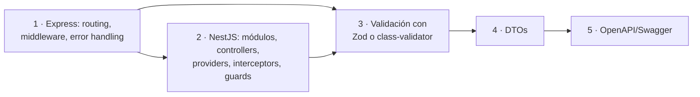
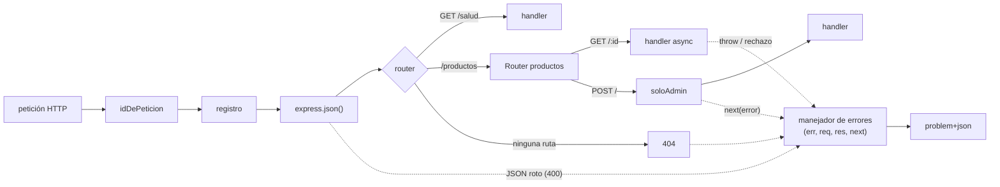
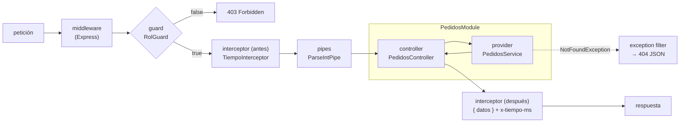
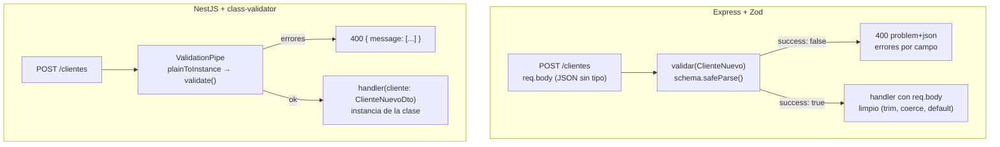
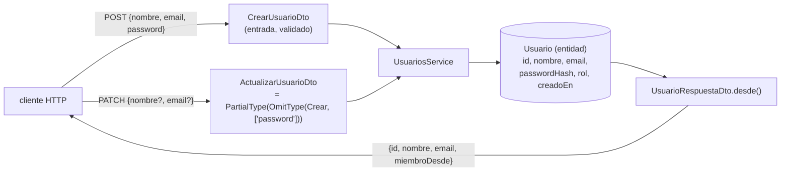
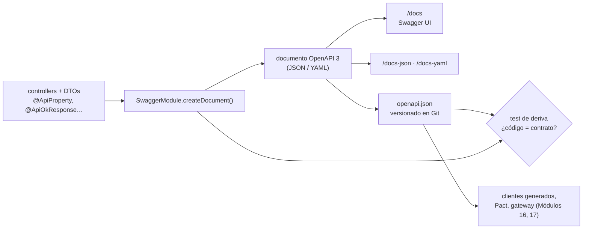

# Módulo 14 · APIs REST con Express y NestJS

**Fase 2 · Node.js de cero a experto** (semanas 3 y 4 de 12). **Duración:** 12 h (5 temas de 2 h y 2 h de
laboratorio integrador). **Dificultad:** 2 de 5 en Express, 3 de 5 en NestJS, validación, DTOs y OpenAPI.
**Dependencias:** Módulo 13 (async/await, TypeScript estricto, Event Loop, graceful shutdown) y Módulo 0.4 (HTTP,
códigos de estado, JSON, `curl`). **Herramientas:** **Node.js 26.13.1 LTS**, **TypeScript 6.0.3**, **express 5.3.0**,
**NestJS 12.5.1** (`@nestjs/common`, `core`, `platform-express`, `testing`), **zod 4.6.7**, **class-validator
0.15.1** + **class-transformer 0.5.1**, **@nestjs/mapped-types 12.0.1** y **@nestjs/swagger 12.1.2**.
Una API REST es la **puerta de entrada** de un microservicio. En este módulo construyes la misma idea de dos formas:
con **Express**, mínimo y explícito (tú conectas cada pieza), y con **NestJS**, un framework con estructura (módulos,
inyección de dependencias, guards, interceptores) que escala a equipos grandes. Después aprendes a **no confiar** en
lo que llega (validación con Zod o class-validator), a separar lo que entra y sale de lo que guardas (DTOs) y a
publicar el contrato para que otros equipos lo consuman (OpenAPI/Swagger).



**Texto alternativo:** mapa del módulo. El tema 1 (Express) lleva al tema 2 (NestJS) y al tema 3 (validación con Zod
o class-validator); el tema 2 también lleva al 3. El tema 3 lleva al tema 4 (DTOs) y este al tema 5 (OpenAPI/Swagger).

**Cómo usar el laboratorio.** Con Node 26 activo:

```bash
  # npm ci + tsc + 26 tests + cada API con curl → «RESULTADO: OK»
```

Todas las órdenes de las fichas se ejecutan **desde `modulo-18`** después de `npm ci`. Los
ejemplos de Express son JavaScript (módulos ES) que Node ejecuta tal cual; los de NestJS son TypeScript que se compila
a `dist/` con `npm run build`, porque NestJS usa decoradores con metadatos de tipos (`emitDecoratorMetadata`), que el
type stripping de Node no sabe generar. `package.json` del laboratorio (con `package-lock.json` que fija el árbol
completo):

```json
{
  "name": "modulo-14-apis-rest-node",
  "version": "1.0.0",
  "private": true,
  "description": "Módulo 14 (Fase 2): APIs REST con Express y NestJS.",
  "type": "module",
  "engines": {
    "node": ">=26.13.1"
  },
  "scripts": {
    "build": "tsc -p tsconfig.json",
    "test": "npm run build && node --test --test-concurrency=1 'f096-express/*.test.js' 'f098-validacion/*.test.js' 'dist/**/*.test.js'"
  },
  "dependencies": {
    "@nestjs/common": "12.5.1",
    "@nestjs/core": "12.5.1",
    "@nestjs/mapped-types": "12.0.1",
    "@nestjs/platform-express": "12.5.1",
    "@nestjs/swagger": "12.1.2",
    "class-transformer": "0.5.1",
    "class-validator": "0.15.1",
    "express": "5.3.0",
    "reflect-metadata": "0.2.2",
    "rxjs": "7.8.2",
    "zod": "4.6.7"
  },
  "devDependencies": {
    "@nestjs/testing": "12.5.1",
    "@types/express": "5.0.6",
    "@types/node": "26.6.6",
    "typescript": "6.0.3"
  }
}
```

`tsconfig.json` (compila los proyectos NestJS de las fichas 2 a 5):

```jsonc
{
  // Módulo 14 · NestJS 12.5.1 con TypeScript 6.0.3. Compila f097–f100 a dist/ (npm run build).
  // NestJS necesita decoradores "experimentales" y emitDecoratorMetadata: con ellos lee los tipos de los
  // constructores (inyección de dependencias) y de los DTO (validación y OpenAPI). Node no puede quitar
  // esos decoradores por sí solo (type stripping), por eso aquí sí se compila con tsc.
  "compilerOptions": {
    "target": "es2024",
    "module": "nodenext",
    "strict": true,
    "experimentalDecorators": true,
    "emitDecoratorMetadata": true,
    "strictPropertyInitialization": false, // los DTO los rellena class-transformer, no un constructor
    "useDefineForClassFields": false,      // si no, los campos sin valor de un DTO borran lo que puso class-transformer
    "outDir": "dist",
    "rootDir": ".",
    "sourceMap": true,
    "types": ["node"],
    "skipLibCheck": true
  },
  "include": ["f097-nestjs/src", "f098-validacion/src", "f099-dtos/src", "f100-openapi/src"]
}
```

---

### Express: routing, middleware, error handling

#### 1. UBICACIÓN

Módulo 14, Lección 1 de 5 · Fase 2.

#### 2. PRERREQUISITOS

- HTTP: métodos, rutas, cabeceras, códigos 2xx/4xx/5xx y `curl -i` (Módulo 0.4).
- Módulos ES, `async/await` y manejo de errores con `try/catch` (Módulo 13, ficha 1).

#### 3. OBJETIVO DE APRENDIZAJE

**Construir** una API con Express 5 que organice rutas en un `Router`, **encadenar** middleware global y por ruta, y
**centralizar** los errores (incluidos los de funciones `async`) en un manejador que responda `application/problem+json`
con el código correcto; lo compruebas cuando `node --test f096-express/app.test.js` pasa 6 de 6.

#### 4. ANALOGÍA VISUAL

Dibuja la **recepción de un edificio de oficinas**. La puerta giratoria lleva a una **fila de mostradores** por los
que pasa todo visitante (middleware global): el primero le pega una **pulsera con número** (`x-request-id`), el
segundo anota en un **libro de visitas** la hora de entrada y salida (log), el tercero **abre el sobre** que trae y lo
deja legible (`express.json()`). Al fondo, un **directorio en la pared** con flechas por piso: «/productos → piso 3»
(el router). En el piso 3, una puerta con un **guardia** que solo deja pasar a quien tiene credencial de admin
(middleware de ruta). Si en cualquier punto algo sale mal, hay una **escalera de emergencia** pintada en rojo que
lleva directo a una **oficina de reclamos** en la planta baja (el manejador de errores), donde siempre se entrega un
formulario con el mismo formato.

#### 5. DIAGRAMA TÉCNICO



**Texto alternativo:** la petición atraviesa en orden tres middleware globales (idDePeticion, registro y
express.json) y llega al router. GET /salud va a su handler; /productos va al Router de productos, donde GET /:id va a
un handler async y POST / pasa antes por el middleware soloAdmin. Si ninguna ruta responde, se genera un 404. Con
líneas punteadas, los errores (un throw o rechazo del handler async, el next(error) de soloAdmin, el JSON roto de
express.json y el 404) van al manejador de errores de cuatro parámetros, que responde problem+json.

#### 6. EXPLICACIÓN NIVEL 0

- **Express** es una librería para construir servidores web en Node con muy poco código. Es la más usada de Node.
- **Routing** (enrutamiento) es decidir qué función responde a cada petición según su **método** y su **ruta**:
  `GET /productos/1` → «busca el producto 1».
- Un **middleware** es una función que se ejecuta **antes** de la respuesta y puede mirar o cambiar la petición, cortar
  el paso o dejarla seguir llamando a `next()`. Se ejecutan **en el orden en que los registras**.
- El **manejo de errores** es la oficina de reclamos: en lugar de poner `try/catch` en cada ruta, lanzas el error y un
  único manejador decide qué responder.

#### 7. EXPLICACIÓN INTERMEDIA

- **Firma:** un middleware es `(req, res, next)`; un manejador de errores es `(err, req, res, next)`: Express lo
  reconoce **por tener 4 parámetros** (`fn.length === 4`). Va registrado **después** de todas las rutas.
- **`app.use(fn)`** registra para todas las rutas; `app.use('/prefijo', router)` monta un `Router`;
  `router.post('/', soloAdmin, handler)` encadena middleware solo para esa ruta.
- **Parámetros:** `req.params` (`/:id`), `req.query` (`?max=1`), `req.body` (lo llena `express.json()`), `req.get()`
  (cabeceras).
- **Express 5** (la línea actual; 4.x queda en la etiqueta `latest-4`): si un handler `async` lanza o su promesa se
  rechaza, el error va solo al manejador de errores. En Express 4 había que llamar a `next(err)` a mano o la petición
  se quedaba colgada. También cambió la sintaxis de rutas (`path-to-regexp` 8: el comodín se escribe `/*nombre`).
- **`next(error)`** salta todos los middleware normales y va al de errores. `express.json()` lo hace con
  `err.status = 400` (JSON roto) o `413` (cuerpo mayor que `limit`).
- **Respuestas de error estándar:** `application/problem+json` (RFC 9457) con `type`, `title`, `status`, `detail`,
  `instance`. Los errores 5xx esconden el detalle al cliente y lo registran en el log con el `requestId`.

#### 8. EXPLICACIÓN MAESTRA

- **Express vs alternativas.** Express: el ecosistema más grande y el modelo más simple, pero sin estructura, sin
  validación ni documentación integradas, y más lento que los modernos. **Fastify**: más rápido, con validación y
  serialización por JSON Schema y un sistema de plugins encapsulado. **Hono**: mínimo y basado en estándares Web
  (`Request`/`Response`), corre en Node, Deno, Bun y edge. **NestJS** (ficha siguiente): estructura y DI, por encima de
  Express o Fastify. Trade-off: libertad y simplicidad frente a convenciones que escalan con el equipo.
- **Orden = semántica.** Un `app.use(auth)` registrado después de una ruta no la protege; un manejador de errores antes
  de las rutas nunca se ejecuta. En equipos grandes conviene una función `crearApp()` única y tests que comprueben el
  orden (como `app.test.js`).
- **Errores operacionales vs bugs.** Los esperables (404, 403, 400) se lanzan como `ErrorHttp` con su código; los
  inesperados son 500 genéricos, log con pila y alerta. Mezclarlos produce alertas falsas o fugas de información.
- **`crearApp()` separado de `listen()`** permite probar con un puerto efímero (`listen(0)`) o con Supertest
  (Módulo 16) y arrancar varias instancias en un test.
- **Cuándo NO usar Express en un servicio nuevo:** si necesitas alto rendimiento y validación por esquema (Fastify),
  o si el equipo es grande y quiere convenciones (NestJS). Para un servicio pequeño y claro, Express sigue siendo una
  elección razonable.

#### 9. CÓDIGO EJECUTABLE

Versiones: **Node.js 26.13.1 LTS** y **express 5.3.0** (dependencia del `package.json` del laboratorio).

`app.js`:

```javascript
// Módulo 14 · F096 · Express: routing, middleware, error handling.
// Requisitos: Node.js 26.13.1 LTS y express 5.3.0 (package.json del laboratorio). Ejecuta: node f096-express/app.js
import express from 'express';
import { randomUUID } from 'node:crypto';

// Error de dominio con su código HTTP: el manejador de errores lo traduce a la respuesta.
export class ErrorHttp extends Error {
  constructor(status, titulo, detalle) {
    super(detalle);
    this.status = status;
    this.titulo = titulo;
  }
}

// ---------- MIDDLEWARE: funciones (req, res, next) que se ejecutan en orden, como una cadena. ----------
function idDePeticion(req, res, next) {
  req.id = req.get('x-request-id') ?? randomUUID(); // propaga el id si viene de otro servicio
  res.set('x-request-id', req.id);
  next(); // ¡sin next() la petición se queda colgada!
}

function registro(log) {
  return (req, res, next) => {
    const inicio = performance.now();
    res.on('finish', () => log(`${req.method} ${req.originalUrl} ${res.statusCode} ${Math.round(performance.now() - inicio)}ms`));
    next();
  };
}

function soloAdmin(req, _res, next) {
  if (req.get('x-rol') !== 'admin') return next(new ErrorHttp(403, 'Prohibido', 'Se necesita el rol admin'));
  next();
}

// ---------- ROUTING: un Router agrupa las rutas de un recurso y se monta bajo un prefijo. ----------
function rutasDeProductos(repo) {
  const router = express.Router();

  router.get('/', (req, res) => {
    const max = Number(req.query.max ?? 100); // query string: /productos?max=1
    res.json([...repo.values()].slice(0, max));
  });

  router.get('/:id', async (req, res) => {
    // Express 5: si una función async lanza o su promesa se rechaza, el error va solo al manejador de errores.
    const producto = repo.get(req.params.id);
    if (!producto) throw new ErrorHttp(404, 'No encontrado', `No existe el producto ${req.params.id}`);
    res.json(producto);
  });

  router.post('/', soloAdmin, (req, res) => { // middleware solo para esta ruta
    const { nombre, precio } = req.body ?? {};
    if (typeof nombre !== 'string' || typeof precio !== 'number') {
      throw new ErrorHttp(400, 'Petición inválida', 'nombre (texto) y precio (número) son obligatorios');
    }
    const producto = { id: String(repo.size + 1), nombre, precio };
    repo.set(producto.id, producto);
    res.status(201).location(`/productos/${producto.id}`).json(producto);
  });

  return router;
}

export function crearApp({ log = console.log } = {}) {
  const repo = new Map([['1', { id: '1', nombre: 'Teclado', precio: 120000 }]]);
  const app = express();
  app.use(idDePeticion);          // 1. todas las peticiones
  app.use(registro(log));         // 2. log al terminar
  app.use(express.json({ limit: '10kb' })); // 3. parsea JSON (400 si viene roto, 413 si es enorme)

  app.get('/salud', (_req, res) => res.json({ estado: 'ok' }));
  app.use('/productos', rutasDeProductos(repo));

  // 404: ninguna ruta respondió. Va DESPUÉS de todas las rutas.
  app.use((req, _res, next) => next(new ErrorHttp(404, 'No encontrado', `No existe ${req.method} ${req.path}`)));

  // MANEJADOR DE ERRORES: Express lo reconoce porque tiene 4 parámetros. Va AL FINAL.
  // eslint-disable-next-line no-unused-vars
  app.use((err, req, res, _next) => {
    const status = err.status ?? err.statusCode ?? 500; // express.json() usa err.status = 400 / 413
    const desconocido = status >= 500;
    if (desconocido) log(`ERROR ${req.id}: ${err.stack}`); // el detalle va al log, no al cliente
    res.status(status).type('application/problem+json').json({
      type: 'about:blank',
      title: err.titulo ?? (desconocido ? 'Error interno' : 'Petición inválida'),
      status,
      detail: desconocido ? 'Ocurrió un error inesperado' : err.message,
      instance: req.originalUrl,
      requestId: req.id,
    });
  });
  return app;
}

if (import.meta.main) {
  const puerto = Number(process.env.PORT ?? 3096);
  crearApp().listen(puerto, () => console.log(`API Express en http://localhost:${puerto}`));
}
```

#### 10. MINI-LABORATORIO

1. Instala las dependencias fijadas (una sola vez para todo el módulo) y arranca la API:
   ```bash
   npm ci
   node f096-express/app.js
   ```
2. En otra terminal, recorre la cadena de middleware y las rutas:
   ```bash
   curl -s -i localhost:3096/productos/1 -H 'x-request-id: demo-1'
   curl -s -i localhost:3096/productos/99
   curl -s -X POST localhost:3096/productos -H 'content-type: application/json' -H 'x-rol: admin' -d '{"nombre":"Mouse","precio":50000}' -w ' [%{http_code}]\n'
   curl -s -X POST localhost:3096/productos -H 'content-type: application/json' -d '{"nombre":"Mouse","precio":50000}' -w ' [%{http_code}]\n'
   curl -s -X POST localhost:3096/productos -H 'content-type: application/json' -H 'x-rol: admin' -d '{roto' -w ' [%{http_code}]\n'
   ```
3. Mira la terminal 1: cada petición dejó una línea de log.

**Output esperado** (paso 2, salida real sin las cabeceras `Date` y `ETag`; el `requestId` aleatorio se muestra como
`…` desde la tercera respuesta):

```text
HTTP/1.1 200 OK
X-Powered-By: Express
x-request-id: demo-1
Content-Type: application/json; charset=utf-8
Content-Length: 45
Connection: keep-alive
Keep-Alive: timeout=5

{"id":"1","nombre":"Teclado","precio":120000}
HTTP/1.1 404 Not Found
X-Powered-By: Express
Content-Type: application/problem+json; charset=utf-8
Content-Length: 173
Connection: keep-alive
Keep-Alive: timeout=5

{"type":"about:blank","title":"No encontrado","status":404,"detail":"No existe el producto 99","instance":"/productos/99","requestId":"334b89d0-57b9-4650-a52e-d2992d134e95"}
{"id":"2","nombre":"Mouse","precio":50000} [201]
{"type":"about:blank","title":"Prohibido","status":403,"detail":"Se necesita el rol admin","instance":"/productos","requestId":"…"} [403]
{"type":"about:blank","title":"Petición inválida","status":400,"detail":"Expected property name or '}' in JSON at position 1 (line 1 column 2)","instance":"/productos","requestId":"…"} [400]
```

Paso 3 (terminal 1; los milisegundos cambian):

```text
API Express en http://localhost:3096
GET /productos/1 200 6ms
GET /productos/99 404 3ms
POST /productos 201 7ms
POST /productos 403 1ms
POST /productos 400 2ms
```

**Captura comentada:** el `x-request-id` que enviaste vuelve en la respuesta (middleware 1). El 404 de un `throw`
dentro de un handler `async` llegó al manejador de errores sin `try/catch` (Express 5). El 403 lo produjo el
middleware de ruta antes del handler; el 400 lo produjo `express.json()` con el mensaje de `JSON.parse`. Todos los
errores tienen la misma forma `problem+json`. `X-Powered-By: Express` revela la tecnología: en el Módulo 20 lo quitarás
con Helmet.

#### 11. VERIFICACIÓN

```bash
node --test --test-reporter=spec f096-express/app.test.js
```

Salida real:

```text
✔ routing con parámetros y query string (51.690822ms)
✔ el middleware propaga x-request-id y registra cada petición (3.355738ms)
✔ middleware de ruta: POST sin rol admin → 403 problem+json (33.741668ms)
✔ POST con rol admin → 201 con Location (3.791855ms)
✔ error lanzado en un handler async llega al manejador de errores (404) (3.027659ms)
✔ JSON roto → 400 de express.json(); ruta desconocida → 404 (4.884ms)
ℹ tests 6
ℹ pass 6
ℹ fail 0
```

```javascript
// Verificación F096: node --test f096-express/app.test.js
import { test, before, after } from 'node:test';
import assert from 'node:assert/strict';
import { crearApp } from './app.js';

let servidor, base;
const logs = [];
before(async () => {
  servidor = crearApp({ log: (l) => logs.push(l) }).listen(0);
  await new Promise((r) => servidor.once('listening', r));
  base = `http://localhost:${servidor.address().port}`;
});
after(() => servidor.close());

const json = (cuerpo, cabeceras = {}) => ({ method: 'POST', headers: { 'content-type': 'application/json', ...cabeceras }, body: cuerpo });

test('routing con parámetros y query string', async () => {
  const uno = await fetch(`${base}/productos/1`);
  assert.equal(uno.status, 200);
  assert.deepEqual(await uno.json(), { id: '1', nombre: 'Teclado', precio: 120000 });
  assert.equal((await (await fetch(`${base}/productos?max=0`)).json()).length, 0);
});

test('el middleware propaga x-request-id y registra cada petición', async () => {
  const r = await fetch(`${base}/salud`, { headers: { 'x-request-id': 'abc-123' } });
  assert.equal(r.headers.get('x-request-id'), 'abc-123');
  assert.ok(logs.some((l) => /^GET \/salud 200 \d+ms$/.test(l)), logs.join('\n'));
});

test('middleware de ruta: POST sin rol admin → 403 problem+json', async () => {
  const r = await fetch(`${base}/productos`, json('{"nombre":"Mouse","precio":50000}'));
  assert.equal(r.status, 403);
  assert.match(r.headers.get('content-type'), /application\/problem\+json/);
  assert.equal((await r.json()).detail, 'Se necesita el rol admin');
});

test('POST con rol admin → 201 con Location', async () => {
  const r = await fetch(`${base}/productos`, json('{"nombre":"Mouse","precio":50000}', { 'x-rol': 'admin' }));
  assert.equal(r.status, 201);
  assert.equal(r.headers.get('location'), '/productos/2');
});

test('error lanzado en un handler async llega al manejador de errores (404)', async () => {
  const r = await fetch(`${base}/productos/99`);
  assert.equal(r.status, 404);
  assert.equal((await r.json()).detail, 'No existe el producto 99');
});

test('JSON roto → 400 de express.json(); ruta desconocida → 404', async () => {
  assert.equal((await fetch(`${base}/productos`, json('{roto', { 'x-rol': 'admin' }))).status, 400);
  assert.equal((await fetch(`${base}/nada`)).status, 404);
});
```

**Pregunta de comprobación:** si mueves `app.use(idDePeticion)` debajo de `app.use('/productos', …)`, ¿qué test falla
y por qué? (Respuesta: ninguno de `/salud`, pero las respuestas de `/productos` ya no llevan `x-request-id` y los
errores salen con `requestId` indefinido: el middleware solo afecta a lo registrado después.)

#### 12. ERROR COMÚN

**Síntoma:** tu API responde una **página HTML** con la pila del error en lugar de tu JSON, aunque escribiste un
manejador de errores. `f096-express/error-comun.js`:

```javascript
// F096 · Error común: el «manejador de errores» tiene 3 parámetros, así que Express lo trata como un middleware
// normal, se lo salta cuando hay un error y responde con su página HTML por defecto (con el stack en desarrollo).
// Ejecuta: node f096-express/error-comun.js   y luego: curl -i localhost:3196/falla
import express from 'express';

const app = express();
app.get('/falla', async () => {
  throw new Error('la base de datos no responde');
});
app.use((err, req, res) => { // ❌ falta el cuarto parámetro `next`
  res.status(500).json({ error: err.message });
});
app.listen(3196, () => console.log('escuchando en 3196'));
```

**Cómo se ve** (`curl -i localhost:3196/falla`, salida real con express 5.3.0, recortada):

```text
HTTP/1.1 500 Internal Server Error
X-Powered-By: Express
Content-Security-Policy: default-src 'none'
X-Content-Type-Options: nosniff
Content-Type: text/html; charset=utf-8
Content-Length: 1504

<!DOCTYPE html>
<html lang="en">
<head>
<meta charset="utf-8">
<title>Error</title>
</head>
<body>
<pre>Error: la base de datos no responde<br> &nbsp; &nbsp;at file:///…/f096-express/error-comun.js:8:9<br> …</pre>
</body>
</html>
```

Con `NODE_ENV=production` el cuerpo es `<pre>Internal Server Error</pre>` y la pila va a la consola.

**Diagnóstico visual:** `Content-Type: text/html` en una API JSON es la señal: respondió el manejador **por defecto**
de Express, no el tuyo. Cuenta los parámetros: con 3, Express lo trata como middleware normal y lo salta cuando hay un
error. **Arreglo:** `(err, req, res, next) =>` (los cuatro, aunque no uses `next`) y regístralo al final.

#### 13. PREGUNTA DE ENTREVISTA

«¿Cómo manejas los errores en una API Express de forma consistente?»

**Respuesta modelo:** con un único manejador de errores de cuatro parámetros registrado al final, después de un
middleware de 404. Las rutas no hacen `try/catch` para responder: lanzan errores de dominio que llevan su código HTTP
(o llaman a `next(err)`); en Express 5 los rechazos de handlers `async` llegan solos al manejador, y en Express 4 uso
un envoltorio o `express-async-errors`. El manejador responde siempre con el mismo formato (`application/problem+json`),
oculta el detalle de los 5xx al cliente, los registra con el id de correlación y deja pasar los 4xx sin alertas.

#### 14. ANTI-PATRÓN RELACIONADO

**`try/catch` copiado en cada ruta con respuestas distintas:**

```javascript
// ❌ cada ruta inventa su formato y su código; los errores reales se tragan
router.get('/:id', async (req, res) => {
  try {
    res.json(await repo.buscar(req.params.id));
  } catch (e) {
    res.status(200).send({ ok: false, msg: 'error' }); // 200 con error dentro: el balanceador cree que todo va bien
  }
});
```

Se ve en los clientes como `if (respuesta.ok === false)` repartidos por todo el código y en las métricas como cero
errores 5xx aunque el servicio esté fallando.

---

### NestJS: módulos, controllers, providers, interceptors, guards

#### 1. UBICACIÓN

Módulo 14, Lección 2 de 5 · Fase 2.

#### 2. PRERREQUISITOS

- Ficha anterior (Express: middleware y errores): NestJS corre **sobre** Express.
- TypeScript: clases, interfaces y modo strict (Módulo 13, ficha 2).
- Saber compilar con `npx tsc` (Módulo 13).

#### 3. OBJETIVO DE APRENDIZAJE

**Organizar** una API NestJS en un módulo con su controller y su provider, **explicar** cómo la inyección de
dependencias crea y entrega el provider, y **aplicar** un guard (autorización) y un interceptor (medición y
transformación de la respuesta) en el orden correcto del ciclo de la petición; lo compruebas cuando
`node --test dist/f097-nestjs/src/pedidos.test.js` pasa 4 de 4.

#### 4. ANALOGÍA VISUAL

Dibuja un **hospital**. Cada **ala** con su cartel (Pediatría, Urgencias) es un **módulo**: agrupa su personal. En la
entrada de cada ala hay una **recepcionista** (el controller) que escucha al paciente y lo deriva, pero no opera. Los
**especialistas** (providers) hacen el trabajo; nadie los contrata a mano: una **oficina de personal** (el contenedor
de inyección de dependencias) los asigna a quien los necesite según su especialidad (el tipo del constructor), y hay
**uno solo** de cada uno (singleton). Antes de la recepcionista, un **guardia de seguridad** (guard) revisa la
credencial y decide sí o no. Alrededor de toda la consulta, una **enfermera con cronómetro y carpeta** (interceptor):
anota la hora de entrada, y a la salida mete el informe en una carpeta con portada estándar.

#### 5. DIAGRAMA TÉCNICO



**Texto alternativo:** ciclo de una petición en NestJS. La petición pasa por el middleware de Express y llega al guard
RolGuard: si devuelve false, la respuesta es 403 Forbidden; si devuelve true, entra al interceptor TiempoInterceptor
(parte «antes»), luego a las pipes (ParseIntPipe), al controller PedidosController, que llama al provider
PedidosService. Al volver, el interceptor (parte «después») envuelve la respuesta en «datos» y pone la cabecera
x-tiempo-ms. Si el provider lanza NotFoundException, el exception filter responde 404 en JSON. El controller y el
provider están dentro del recuadro PedidosModule.

#### 6. EXPLICACIÓN NIVEL 0

- **NestJS** es un framework para APIs en Node que te da una **estructura fija**: cada cosa tiene su lugar y su
  nombre. Usa TypeScript y **decoradores** (las líneas con `@`, como `@Controller('pedidos')`), que son etiquetas que
  le dicen a Nest qué es cada clase.
- **Módulo:** una caja que agrupa todo lo de un tema (pedidos).
- **Controller:** recibe la petición HTTP y devuelve la respuesta. No hace cálculos de negocio.
- **Provider** (o servicio): hace el trabajo (buscar, crear pedidos). Nest lo crea y se lo **entrega** al controller
  por el constructor: eso es la **inyección de dependencias**.
- **Guard:** el portero que decide si la petición puede entrar.
- **Interceptor:** algo que se ejecuta **antes y después** del controller (medir el tiempo, cambiar la forma de la
  respuesta).

#### 7. EXPLICACIÓN INTERMEDIA

- **Inyección por tipo:** con `emitDecoratorMetadata`, TypeScript guarda el tipo de cada parámetro del constructor;
  Nest lo lee y busca un provider con ese *token* en el módulo. Por eso `PedidosService` debe estar en `providers` (o
  en un módulo importado que lo `exports`). El alcance por defecto es **singleton**; existen `Scope.REQUEST` y
  `Scope.TRANSIENT`.
- **Orden del ciclo:** middleware → **guards** → **interceptores (antes)** → **pipes** → handler → **interceptores
  (después)** → **exception filters** si algo lanza. Los guards ven el `ExecutionContext` (handler y clase), por eso
  pueden leer metadatos como `@Roles('admin')` con el `Reflector`.
- **Interceptores** usan RxJS: `next.handle()` devuelve un `Observable` de la respuesta; con `map` la transformas, con
  `tap` haces efectos (cabeceras, logs), con `timeout`/`catchError` los envuelves.
- **Pipes** transforman y validan parámetros: `ParseIntPipe` convierte `"7"` en `7` o responde 400. `ValidationPipe`
  (ficha 3) valida cuerpos completos.
- **Excepciones HTTP:** `NotFoundException`, `ForbiddenException`… las convierte el filtro global en
  `{ "message", "error", "statusCode" }`.
- **Ámbito de los decoradores:** `@UseGuards`/`@UseInterceptors` en la clase (todas las rutas), en un método (una
  ruta) o global con `app.useGlobalGuards(...)`.

#### 8. EXPLICACIÓN MAESTRA

- **NestJS vs Express a pelo.** Nest aporta convenciones (todos los servicios se parecen), DI (fácil de probar y de
  sustituir implementaciones), y módulos oficiales para microservicios (transportes TCP, Kafka, RabbitMQ, gRPC),
  CQRS, GraphQL, Swagger. Cuesta: curva de aprendizaje (decoradores, RxJS), más arranque y más «magia». En un servicio
  de 3 rutas puede ser excesivo; en un equipo de 20 personas con 15 servicios, la uniformidad paga.
- **Guard vs middleware vs interceptor para autenticación.** Middleware no conoce el handler ni sus metadatos; el guard
  sí (puede leer `@Roles`), por eso la autorización va en guards. La **autenticación** (validar el JWT y poner
  `req.user`) puede ir en un guard (Passport, Módulo 20) o en middleware.
- **Plataforma:** `@nestjs/platform-express` (por defecto) o `@nestjs/platform-fastify` (más rendimiento; algunos
  middleware de Express no sirven). El código de controllers no cambia.
- **Límites de módulo = límites de contexto.** Un módulo de Nest por contexto delimitado, exportando solo lo
  necesario, ayuda a extraer un microservicio más tarde. Importar módulos «para todo» (`SharedModule` gigante) acopla.
- **Cuándo NO usar NestJS:** funciones serverless con arranque crítico, servicios diminutos, o equipos que no quieren
  depender de decoradores experimentales de TypeScript (Nest los necesita; los decoradores estándar de TC39 no emiten
  metadatos de tipos).

#### 9. CÓDIGO EJECUTABLE

Versiones: **Node.js 26.13.1 LTS**, **TypeScript 6.0.3**, **@nestjs/common, core, platform-express y testing 12.5.1**,
**reflect-metadata 0.2.2**, **rxjs 7.8.2** (ver `package.json` y `tsconfig.json` al inicio del módulo).

`pedidos.service.ts` (provider):

```typescript
// Módulo 14 · F097 · PROVIDER: una clase @Injectable que Nest crea una vez (singleton) y entrega a quien la pida.
import { Injectable, NotFoundException } from '@nestjs/common';

export interface Pedido {
  id: number;
  cliente: string;
  total: number;
}

@Injectable()
export class PedidosService {
  private readonly pedidos = new Map<number, Pedido>([[1, { id: 1, cliente: 'Ana', total: 120000 }]]);

  listar(): Pedido[] {
    return [...this.pedidos.values()];
  }

  buscar(id: number): Pedido {
    const pedido = this.pedidos.get(id);
    if (!pedido) throw new NotFoundException(`No existe el pedido ${id}`); // Nest la convierte en 404
    return pedido;
  }

  crear(cliente: string, total: number): Pedido {
    const pedido = { id: this.pedidos.size + 1, cliente, total };
    this.pedidos.set(pedido.id, pedido);
    return pedido;
  }
}
```

`f097-nestjs/src/rol.guard.ts` (guard):

```typescript
// F097 · GUARD: decide SI la petición puede llegar al controller (true/false). Corre antes que interceptores y pipes.
import { CanActivate, ExecutionContext, Injectable, SetMetadata } from '@nestjs/common';
import { Reflector } from '@nestjs/core';
import type { Request } from 'express';

export const ROLES = 'roles';
export const Roles = (...roles: string[]) => SetMetadata(ROLES, roles); // decorador propio: @Roles('admin')

@Injectable()
export class RolGuard implements CanActivate {
  constructor(private readonly reflector: Reflector) {} // inyectado por Nest

  canActivate(contexto: ExecutionContext): boolean {
    const requeridos = this.reflector.getAllAndOverride<string[] | undefined>(ROLES, [contexto.getHandler(), contexto.getClass()]);
    if (!requeridos) return true; // la ruta no pide rol
    const rol = contexto.switchToHttp().getRequest<Request>().header('x-rol');
    return rol !== undefined && requeridos.includes(rol); // false → 403 Forbidden automático
  }
}
```

`f097-nestjs/src/tiempo.interceptor.ts` (interceptor):

```typescript
// F097 · INTERCEPTOR: envuelve la ejecución del handler (antes y después). Útil para medir, transformar o cachear.
import { CallHandler, ExecutionContext, Injectable, NestInterceptor } from '@nestjs/common';
import type { Response } from 'express';
import { Observable, map, tap } from 'rxjs';

@Injectable()
export class TiempoInterceptor implements NestInterceptor {
  intercept(contexto: ExecutionContext, siguiente: CallHandler): Observable<unknown> {
    const inicio = performance.now();
    const res = contexto.switchToHttp().getResponse<Response>();
    return siguiente.handle().pipe(
      map((datos) => ({ datos })), // DESPUÉS: envuelve la respuesta en { datos: ... }
      tap(() => res.setHeader('x-tiempo-ms', Math.round(performance.now() - inicio).toString())),
    );
  }
}
```

`f097-nestjs/src/pedidos.controller.ts` (controller):

```typescript
// F097 · CONTROLLER: traduce HTTP (ruta, verbo, parámetros) a llamadas al provider. No tiene lógica de negocio.
import { Body, Controller, Get, HttpCode, Param, ParseIntPipe, Post, UseGuards, UseInterceptors } from '@nestjs/common';
import { PedidosService } from './pedidos.service.js';
import type { Pedido } from './pedidos.service.js';
import { RolGuard, Roles } from './rol.guard.js';
import { TiempoInterceptor } from './tiempo.interceptor.js';

@Controller('pedidos') // prefijo de ruta: /pedidos
@UseGuards(RolGuard)
@UseInterceptors(TiempoInterceptor)
export class PedidosController {
  constructor(private readonly pedidos: PedidosService) {} // inyección de dependencias por el tipo

  @Get()
  listar(): Pedido[] {
    return this.pedidos.listar();
  }

  @Get(':id')
  buscar(@Param('id', ParseIntPipe) id: number): Pedido { // ParseIntPipe: "7" → 7, "abc" → 400
    return this.pedidos.buscar(id);
  }

  @Post()
  @HttpCode(201)
  @Roles('admin') // solo pasa el guard con x-rol: admin
  crear(@Body() cuerpo: { cliente: string; total: number }): Pedido {
    return this.pedidos.crear(cuerpo.cliente, cuerpo.total);
  }
}
```

`f097-nestjs/src/pedidos.module.ts` (módulos) y `f097-nestjs/src/main.ts` (arranque):

```typescript
// F097 · MÓDULO: agrupa controllers y providers de un mismo dominio. Es la unidad de organización de Nest.
import { Module } from '@nestjs/common';
import { PedidosController } from './pedidos.controller.js';
import { PedidosService } from './pedidos.service.js';

@Module({
  controllers: [PedidosController],
  providers: [PedidosService],
  exports: [PedidosService], // otros módulos que importen PedidosModule podrán inyectarlo
})
export class PedidosModule {}

@Module({ imports: [PedidosModule] })
export class AppModule {} // módulo raíz: el que se pasa a NestFactory.create
```

```typescript
// F097 · Arranque. Ejecuta: npm run build && node dist/f097-nestjs/src/main.js
import 'reflect-metadata';
import { NestFactory } from '@nestjs/core';
import { AppModule } from './pedidos.module.js';

const app = await NestFactory.create(AppModule);
app.enableShutdownHooks(); // SIGTERM → cierra módulos (graceful shutdown, Módulo 13)
await app.listen(Number(process.env.PORT ?? 3097));
console.log(`API NestJS en ${await app.getUrl()}`);
```

#### 10. MINI-LABORATORIO

1. Compila y arranca:
   ```bash
   npm run build
   node dist/f097-nestjs/src/main.js
   ```
2. En otra terminal:
   ```bash
   curl -s -i localhost:3097/pedidos/1
   curl -s localhost:3097/pedidos/abc -w ' [%{http_code}]\n'
   curl -s localhost:3097/pedidos/99 -w ' [%{http_code}]\n'
   curl -s -X POST localhost:3097/pedidos -H 'content-type: application/json' -d '{"cliente":"Luis","total":5000}' -w ' [%{http_code}]\n'
   curl -s -X POST localhost:3097/pedidos -H 'content-type: application/json' -H 'x-rol: admin' -d '{"cliente":"Luis","total":5000}' -w ' [%{http_code}]\n'
   ```
3. Rompe la inyección: ejecuta `f097-nestjs/src/error-comun.ts`, un módulo que olvida declarar el provider:
   ```bash
   node dist/f097-nestjs/src/error-comun.js
   ```

**Output esperado** (paso 1, terminal 1; la fecha, el PID y los `+ms` cambian, y en tu terminal se ve en colores):

```text
[Nest] 696  - 11/19/2026, 10:23:17 PM     LOG [NestFactory] Starting Nest application...
[Nest] 696  - 11/19/2026, 10:23:17 PM     LOG [InstanceLoader] AppModule dependencies initialized +12ms
[Nest] 696  - 11/19/2026, 10:23:17 PM     LOG [InstanceLoader] PedidosModule dependencies initialized +0ms
[Nest] 696  - 11/19/2026, 10:23:17 PM     LOG [RoutesResolver] PedidosController {/pedidos}: +4ms
[Nest] 696  - 11/19/2026, 10:23:17 PM     LOG [RouterExplorer] Mapped {/pedidos, GET} route +3ms
[Nest] 696  - 11/19/2026, 10:23:17 PM     LOG [RouterExplorer] Mapped {/pedidos/:id, GET} route +1ms
[Nest] 696  - 11/19/2026, 10:23:17 PM     LOG [RouterExplorer] Mapped {/pedidos, POST} route +1ms
[Nest] 696  - 11/19/2026, 10:23:17 PM     LOG [NestApplication] Nest application successfully started +1ms
API NestJS en http://127.0.0.1:3097
```

(En el Mac, `getUrl()` puede mostrar `http://[::1]:3097`: es la misma máquina por IPv6.)

Paso 2 (salida real, sin `Date` ni `ETag`):

```text
HTTP/1.1 200 OK
X-Powered-By: Express
x-tiempo-ms: 2
Content-Type: application/json; charset=utf-8
Content-Length: 49
Connection: keep-alive
Keep-Alive: timeout=5

{"datos":{"id":1,"cliente":"Ana","total":120000}}
{"message":"Validation failed (numeric string is expected)","error":"Bad Request","statusCode":400} [400]
{"message":"No existe el pedido 99","error":"Not Found","statusCode":404} [404]
{"message":"Forbidden resource","error":"Forbidden","statusCode":403} [403]
{"datos":{"id":2,"cliente":"Luis","total":5000}} [201]
```

**Captura comentada:** las líneas `Mapped {…} route` son el mapa de rutas que Nest construyó leyendo los decoradores.
`x-tiempo-ms` y el envoltorio `{"datos": …}` los puso el interceptor; el 400 lo produjo `ParseIntPipe` antes de llegar
al controller; el 404 es la `NotFoundException` del provider; el 403 es el guard (fíjate en que el interceptor **no**
envolvió el error: el guard corre antes). `X-Powered-By: Express` confirma que Nest corre sobre Express.

#### 11. VERIFICACIÓN

```bash
npm run build && node --test --test-reporter=spec dist/f097-nestjs/src/pedidos.test.js
```

Salida real:

```text
✔ el contenedor de Nest crea UN solo PedidosService (singleton) (86.958435ms)
✔ controller + interceptor: GET /pedidos/1 → { datos } y cabecera x-tiempo-ms (23.542903ms)
✔ pipe: un id que no es número → 400; provider: id inexistente → 404 (11.441868ms)
✔ guard: POST sin rol → 403; con x-rol admin → 201 (10.865608ms)
ℹ tests 4
ℹ pass 4
ℹ fail 0
```

`f097-nestjs/src/pedidos.test.ts` (usa `@nestjs/testing` para montar el módulo real en un puerto efímero):

```typescript
// Verificación F097: npm run build && node --test dist/f097-nestjs/src/pedidos.test.js
import 'reflect-metadata';
import { test, before, after } from 'node:test';
import assert from 'node:assert/strict';
import { Test } from '@nestjs/testing';
import type { INestApplication } from '@nestjs/common';
import { AppModule } from './pedidos.module.js';
import { PedidosService } from './pedidos.service.js';

let app: INestApplication;
let base: string;
before(async () => {
  const modulo = await Test.createTestingModule({ imports: [AppModule] }).compile();
  app = modulo.createNestApplication({ logger: false });
  await app.listen(0);
  base = (await app.getUrl()).replace('[::1]', 'localhost');
});
after(() => app.close());

test('el contenedor de Nest crea UN solo PedidosService (singleton)', () => {
  assert.equal(app.get(PedidosService), app.get(PedidosService));
});

test('controller + interceptor: GET /pedidos/1 → { datos } y cabecera x-tiempo-ms', async () => {
  const r = await fetch(`${base}/pedidos/1`);
  assert.equal(r.status, 200);
  assert.deepEqual(await r.json(), { datos: { id: 1, cliente: 'Ana', total: 120000 } });
  assert.match(r.headers.get('x-tiempo-ms') ?? '', /^\d+$/);
});

test('pipe: un id que no es número → 400; provider: id inexistente → 404', async () => {
  assert.equal((await fetch(`${base}/pedidos/abc`)).status, 400);
  const r = await fetch(`${base}/pedidos/99`);
  assert.equal(r.status, 404);
  assert.equal((await r.json()).message, 'No existe el pedido 99');
});

test('guard: POST sin rol → 403; con x-rol admin → 201', async () => {
  const cuerpo = { method: 'POST', headers: { 'content-type': 'application/json' }, body: JSON.stringify({ cliente: 'Luis', total: 5000 }) };
  assert.equal((await fetch(`${base}/pedidos`, cuerpo)).status, 403);
  const r = await fetch(`${base}/pedidos`, { ...cuerpo, headers: { ...cuerpo.headers, 'x-rol': 'admin' } });
  assert.equal(r.status, 201);
  assert.deepEqual(await r.json(), { datos: { id: 2, cliente: 'Luis', total: 5000 } });
});
```

**Pregunta de comprobación:** ¿por qué la respuesta 403 del guard no viene envuelta en `{ "datos": … }`? (Respuesta:
el guard se ejecuta antes que el interceptor; al devolver `false`, Nest lanza `ForbiddenException` y el interceptor
nunca llega a `next.handle()`.)

#### 12. ERROR COMÚN

**Síntoma:** la aplicación no arranca y el mensaje habla de `(?)` y de un índice. `f097-nestjs/src/error-comun.ts`:

```typescript
// F097 · Error común: el controller pide PedidosService, pero el módulo no lo declara en `providers`.
// Ejecuta: npm run build && node dist/f097-nestjs/src/error-comun.js
import 'reflect-metadata';
import { Module } from '@nestjs/common';
import { NestFactory } from '@nestjs/core';
import { PedidosController } from './pedidos.controller.js';

@Module({ controllers: [PedidosController] /* ❌ falta providers: [PedidosService] */ })
class ModuloRoto {}

try {
  await NestFactory.create(ModuloRoto, { logger: false, abortOnError: false });
} catch (error) {
  console.log((error as Error).message);
  process.exitCode = 1;
}
```

**Cómo se ve** (salida real, NestJS 12.5.1):

```text
Nest can't resolve dependencies of the PedidosController (?). Please make sure that the argument PedidosService at index [0] is available in the ModuloRoto module.

Potential solutions:
- Is ModuloRoto a valid NestJS module?
- If PedidosService is a provider, is it part of the current ModuloRoto?
- If PedidosService is exported from a separate @Module, is that module imported within ModuloRoto?
  @Module({
    imports: [ /* the Module containing PedidosService */ ]
  })

For more common dependency resolution issues, see: https://docs.nestjs.com/faq/common-errors
```

**Diagnóstico visual:** el `(?)` marca **la posición** del parámetro del constructor que Nest no pudo resolver
(`index [0]`), y el mensaje dice en qué módulo lo buscó. Dibuja el árbol de módulos: el provider debe estar en
`providers` de ese módulo, o `exports` de un módulo que esté en sus `imports`. Si el mensaje dice `argument Object` o
`argument dependency`, el problema es otro: falta `emitDecoratorMetadata` en el `tsconfig.json`, se importó la clase
con `import type` o hay una importación circular. **Arreglo:** `providers: [PedidosService]` (como en
`PedidosModule`).

#### 13. PREGUNTA DE ENTREVISTA

«En NestJS, ¿qué diferencia hay entre un middleware, un guard, un interceptor y una pipe, y en qué orden se ejecutan?»

**Respuesta modelo:** el middleware es el de Express: corre primero, no sabe qué handler se ejecutará; sirve para
cosas transversales como logs o CORS. El guard corre después y decide si la petición sigue (devuelve true o false);
conoce el handler y sus metadatos, así que es el sitio de la autorización por roles. Los interceptores envuelven al
handler: antes y después, con RxJS; sirven para medir, transformar respuestas, cachear o poner timeouts. Las pipes
corren justo antes del handler y transforman o validan sus argumentos. El orden es middleware, guards, interceptores,
pipes, handler, interceptores de vuelta y, si algo lanza, los exception filters.

#### 14. ANTI-PATRÓN RELACIONADO

**Controller gordo (lógica de negocio y acceso a datos en el controller):**

```typescript
// ❌ el controller valida, calcula, consulta la base y decide: imposible de reutilizar y de probar sin HTTP
@Post()
async crear(@Body() b: any, @Req() req: Request) {
  if (req.headers['x-rol'] !== 'admin') throw new ForbiddenException();     // eso es un guard
  const total = b.items.reduce((a: number, i: any) => a + i.precio, 0) * 1.19; // eso es del provider
  return this.dataSource.query('INSERT INTO pedidos …', [total]);             // eso es de un repositorio
}
```

Se ve como controllers de cientos de líneas, `any` y `@Req()` por todas partes, y tests que necesitan levantar HTTP
para probar una regla de negocio. Controller fino → provider con la lógica → repositorio con los datos.

---

### Validación con Zod o class-validator

#### 1. UBICACIÓN

Módulo 14, Lección 3 de 5 · Fase 2
Express en `zod-express.js`; class-validator con NestJS en `src/`).

#### 2. PRERREQUISITOS

- Express (ficha 1) y NestJS: módulos, controllers y pipes (ficha 2).
- TypeScript: diferencia entre tipos (compilación) y datos (ejecución) (Módulo 13, ficha 2).

#### 3. OBJETIVO DE APRENDIZAJE

**Definir** reglas de validación con un esquema de Zod y con decoradores de class-validator, **aplicarlas** en el borde
de la API (middleware en Express, `ValidationPipe` en NestJS) y **responder** 400 con un error por campo, rechazando
campos desconocidos; **comparar** ambos enfoques. Lo compruebas cuando `node --test f098-validacion/zod-express.test.js`
pasa 3 de 3 y `node --test dist/f098-validacion/src/clientes.test.js` pasa 4 de 4.

#### 4. ANALOGÍA VISUAL

Dibuja el **control de equipaje de un aeropuerto**. Antes del avión (tu lógica de negocio) hay una **máquina de rayos
X** con una pantalla. A la izquierda, un **molde metálico** con la forma exacta de una maleta permitida (el esquema de
Zod): la maleta que no cabe en el molde no pasa. A la derecha, otro control donde cada maleta trae **etiquetas
pegadas** con sus reglas («máx. 23 kg», «sin líquidos») (los decoradores de class-validator), y el inspector las lee.
Las maletas rechazadas salen por una cinta lateral con una **hoja de motivos** («peso: excede 23 kg; asa: rota»):
todos los motivos juntos, no uno a la vez. Un objeto que nadie declaró (un **paquete sin etiqueta**) se retiene.

#### 5. DIAGRAMA TÉCNICO



**Texto alternativo:** dos flujos. En Express con Zod, el POST /clientes trae un req.body JSON sin tipo; el middleware
validar llama a schema.safeParse; si success es false responde 400 problem+json con errores por campo; si es true, el
handler recibe un req.body limpio (con trim, coerción y valores por defecto). En NestJS con class-validator, el POST
pasa por ValidationPipe, que convierte el objeto en instancia con plainToInstance y llama a validate; si hay errores
responde 400 con una lista de mensajes; si no, el handler recibe una instancia de ClienteNuevoDto.

#### 6. EXPLICACIÓN NIVEL 0

- **Validar** es comprobar que los datos que llegan tienen sentido **antes** de usarlos: que el email parece un email,
  que la edad es un número mayor de 18, que no falte el nombre.
- Todo lo que llega por HTTP es **texto que alguien escribió**: puede venir mal por error o a propósito. La regla es
  simple: **no confíes en nada de fuera**.
- **Zod** describe las reglas como un **molde** escrito en código (`z.object({ … })`).
- **class-validator** describe las reglas como **etiquetas** (`@IsEmail()`) sobre las propiedades de una clase.
- Cuando algo no cumple, la API responde **400 Bad Request** con la lista de problemas, para que quien llama los
  corrija.

#### 7. EXPLICACIÓN INTERMEDIA

- **Zod 4:** `z.object({...})`, tipos (`z.string()`, `z.email()`, `z.enum([...])`), refinamientos (`.min`, `.int`),
  transformaciones (`.trim()`, `z.coerce.number()`), valores por defecto (`.default`) y `.strict()` (rechaza claves
  desconocidas con el código `unrecognized_keys`). `parse` **lanza** `ZodError`; `safeParse` devuelve
  `{ success, data | error }`. `z.flattenError(error).fieldErrors` da `{ campo: [mensajes] }`. `z.infer<typeof
  Esquema>` deriva el tipo TypeScript.
- **class-validator 0.15:** decoradores (`@IsString`, `@Length`, `@IsEmail`, `@IsInt`, `@Min`, `@IsIn`,
  `@IsOptional`, `@ValidateNested`) + **class-transformer** (`plainToInstance`, `@Type(() => Number)` para convertir
  y para clases anidadas). `validate(instancia)` devuelve un `ValidationError` por propiedad.
- **`ValidationPipe` de Nest:** `whitelist` quita propiedades sin decorador, `forbidNonWhitelisted` responde 400 si
  llegan, `transform` entrega una **instancia** de la clase con los tipos convertidos. Se activa con
  `app.useGlobalPipes(...)`.
- **Diferencias que se ven en el laboratorio:** Zod **limpia** (`" Ana "` → `"Ana"`, `"30"` → `30`, añade `plan:
  "basico"`); class-validator **comprueba** y solo convierte lo que marcas con `@Type` (el nombre llega con espacios).
  Zod agrupa errores por campo; Nest devuelve una lista plana de mensajes.

#### 8. EXPLICACIÓN MAESTRA

| Criterio | Zod | class-validator | JSON Schema (Ajv, Fastify) |
|---|---|---|---|
| Dónde viven las reglas | objetos de esquema (funciones) | decoradores en clases | documento JSON |
| Tipo TypeScript | derivado (`z.infer`) | la propia clase | generado (o `json-schema-to-ts`) |
| Transformación | integrada (trim, coerce, default) | con class-transformer | limitada (`coerceTypes`, `useDefaults`) |
| Encaje natural | Express, Fastify, Hono, tRPC, frontend | NestJS (ValidationPipe, Swagger) | Fastify, contratos OpenAPI |
| Requiere decoradores experimentales | no | sí (`experimentalDecorators`) | no |

- **Elige Zod** si no usas Nest, si quieres compartir esquemas con el frontend o si prefieres no depender de
  decoradores. **Elige class-validator** en NestJS: se integra con `ValidationPipe` y con `@nestjs/swagger`. En
  NestJS 12 también puedes usar Zod con una pipe propia que llame a `safeParse` (el paquete `@nestjs/swagger` 12 ya
  depende de `@standard-schema/spec`, el estándar común de esquemas).
- **Valida en el borde, una vez.** Dentro del servicio, confía en los tipos. Validar en cada capa duplica reglas y
  diverge.
- **Validación sintáctica vs semántica:** «email con formato válido» va en el esquema; «email no registrado» o «stock
  suficiente» es lógica de negocio (provider), que necesita la base de datos y responde 409/422.
- **Seguridad:** rechazar campos desconocidos evita la **asignación masiva** (ficha siguiente) y limitar tamaños
  (`.max`, `@Length`, `express.json({ limit })`) evita abusos de memoria.
- **Cuándo NO validar así:** mensajes entre servicios ya validados por un contrato binario (Protobuf/Avro con registro
  de esquemas, Módulos 18 y 22): ahí el contrato lo impone la serialización.

#### 9. CÓDIGO EJECUTABLE

Versiones: **Node.js 26.13.1 LTS**, **express 5.3.0**, **zod 4.6.7**; **NestJS 12.5.1**, **class-validator 0.15.1**,
**class-transformer 0.5.1**, **TypeScript 6.0.3** (ver `package.json` del módulo).

`zod-express.js`:

```javascript
// Módulo 14 · F098 · Validación con Zod (en Express).
// Requisitos: Node.js 26.13.1 LTS, express 5.3.0 y zod 4.6.7. Ejecuta: node f098-validacion/zod-express.js
import express from 'express';
import * as z from 'zod';

// 1. El ESQUEMA describe la forma válida de los datos. Es código: se puede probar, reutilizar y componer.
export const ClienteNuevo = z.object({
  nombre: z.string().trim().min(2, 'mínimo 2 caracteres'),
  email: z.email('email inválido'),
  edad: z.coerce.number().int().min(18, 'debe ser mayor de edad'), // coerce: "30" → 30
  plan: z.enum(['basico', 'pro']).default('basico'),
}).strict(); // .strict(): rechaza campos que no están en el esquema (p. ej. "rol")

// 2. El TIPO de TypeScript sale del esquema: una sola fuente de verdad (útil si usas TS).
/** @typedef {z.infer<typeof ClienteNuevo>} ClienteNuevoTipo */

// 3. Middleware reutilizable: valida req.body y lo REEMPLAZA por los datos limpios (con defaults y coerciones).
export const validar = (esquema) => (req, res, next) => {
  const resultado = esquema.safeParse(req.body ?? {}); // safeParse no lanza: devuelve { success, data | error }
  if (!resultado.success) {
    return res.status(400).type('application/problem+json').json({
      title: 'Datos inválidos',
      status: 400,
      errores: z.flattenError(resultado.error).fieldErrors, // { campo: [mensajes] }
      desconocidos: resultado.error.issues.filter((i) => i.code === 'unrecognized_keys').flatMap((i) => i.keys),
    });
  }
  req.body = resultado.data;
  next();
};

export function crearApp() {
  const app = express();
  app.use(express.json());
  app.post('/clientes', validar(ClienteNuevo), (req, res) => res.status(201).json(req.body));
  return app;
}

if (import.meta.main) {
  const puerto = Number(process.env.PORT ?? 3098);
  crearApp().listen(puerto, () => console.log(`API con Zod en http://localhost:${puerto}`));
}
```

`clientes.ts`:

```typescript
// Módulo 14 · F098 · Validación con class-validator (en NestJS 12.5.1).
// Requisitos: class-validator 0.15.1, class-transformer 0.5.1, @nestjs/common 12.5.1. Compila con npm run build.
import 'reflect-metadata';
import { Body, Controller, HttpCode, Module, Post, ValidationPipe } from '@nestjs/common';
import { Type } from 'class-transformer';
import { IsEmail, IsIn, IsInt, IsOptional, IsString, Length, Min, ValidateNested } from 'class-validator';

export class DireccionDto {
  @IsString() @Length(3, 80)
  calle: string;

  @IsString()
  ciudad: string;
}

// Las reglas viven como DECORADORES sobre las propiedades de una clase.
export class ClienteNuevoDto {
  @IsString() @Length(2, 60, { message: 'nombre: entre 2 y 60 caracteres' })
  nombre: string;

  @IsEmail({}, { message: 'email inválido' })
  email: string;

  @Type(() => Number) @IsInt() @Min(18, { message: 'debe ser mayor de edad' }) // @Type: "30" → 30 con transform
  edad: number;

  @IsOptional() @IsIn(['basico', 'pro'])
  plan?: 'basico' | 'pro';

  @IsOptional() @ValidateNested() @Type(() => DireccionDto) // valida también el objeto anidado
  direccion?: DireccionDto;
}

@Controller('clientes')
export class ClientesController {
  @Post()
  @HttpCode(201)
  crear(@Body() cliente: ClienteNuevoDto) {
    // Si llegamos aquí, `cliente` ya es una instancia de ClienteNuevoDto válida.
    return { recibido: cliente, esInstancia: cliente instanceof ClienteNuevoDto };
  }
}

@Module({ controllers: [ClientesController] })
export class ClientesModule {}

// La pipe GLOBAL que activa class-validator en todos los @Body(), @Query() y @Param().
export const tuberiaDeValidacion = new ValidationPipe({
  whitelist: true,            // borra las propiedades sin decorador…
  forbidNonWhitelisted: true, // …o mejor: responde 400 si llegan (p. ej. "rol": "admin")
  transform: true,            // convierte el JSON plano en instancia de la clase y aplica @Type
});
```

`f098-validacion/src/main.ts`:

```typescript
// F098 · Arranque de la API NestJS con class-validator. Ejecuta: npm run build && node dist/f098-validacion/src/main.js
import 'reflect-metadata';
import { NestFactory } from '@nestjs/core';
import { ClientesModule, tuberiaDeValidacion } from './clientes.js';

const app = await NestFactory.create(ClientesModule, { logger: ['error', 'warn'] });
app.useGlobalPipes(tuberiaDeValidacion); // ❗ sin esta línea los decoradores no validan nada
await app.listen(Number(process.env.PORT ?? 3198));
console.log(`API NestJS con class-validator en http://localhost:${process.env.PORT ?? 3198}`);
```

#### 10. MINI-LABORATORIO

1. Arranca las dos APIs (dos terminales; `npm run build` compila la de Nest):
   ```bash
   node f098-validacion/zod-express.js
   npm run build && node dist/f098-validacion/src/main.js
   ```
2. En una tercera terminal, envía el mismo cliente válido y el mismo inválido a ambas:
   ```bash
   for p in 3098 3198; do
     echo "== $p"
     curl -s -X POST localhost:$p/clientes -H 'content-type: application/json' -d '{"nombre":" Ana ","email":"ana@correo.co","edad":"30"}' -w ' [%{http_code}]\n'
     curl -s -X POST localhost:$p/clientes -H 'content-type: application/json' -d '{"nombre":"A","email":"x","edad":15,"rol":"admin"}' -w ' [%{http_code}]\n'
   done
   ```
3. Rompe la validación de Zod usando `parse` sin capturar el error (`f098-validacion/error-comun.js`) y envía
   `{"edad":15}` al puerto 3199.

**Output esperado** (paso 2, salida real):

```text
== 3098
{"nombre":"Ana","email":"ana@correo.co","edad":30,"plan":"basico"} [201]
{"title":"Datos inválidos","status":400,"errores":{"nombre":["mínimo 2 caracteres"],"email":["email inválido"],"edad":["debe ser mayor de edad"]},"desconocidos":["rol"]} [400]
== 3198
{"recibido":{"nombre":" Ana ","email":"ana@correo.co","edad":30},"esInstancia":true} [201]
{"message":["property rol should not exist","nombre: entre 2 y 60 caracteres","email inválido","debe ser mayor de edad"],"error":"Bad Request","statusCode":400} [400]
```

**Captura comentada:** con el mismo JSON, Zod devolvió el nombre **recortado**, la edad como número y el plan por
defecto; class-validator convirtió la edad (gracias a `@Type`) pero dejó los espacios del nombre: valida, no limpia.
Ante datos inválidos, ambos devolvieron **todos** los errores a la vez y ambos rechazaron el campo `rol`.

#### 11. VERIFICACIÓN

```bash
node --test --test-reporter=spec f098-validacion/zod-express.test.js
npm run build && node --test --test-reporter=spec dist/f098-validacion/src/clientes.test.js
```

Salida real:

```text
✔ safeParse limpia, convierte y aplica defaults (3.402564ms)
✔ safeParse informa cada campo inválido y los campos desconocidos (1.020053ms)
✔ POST /clientes inválido → 400 con errores por campo (61.048981ms)
ℹ tests 3
ℹ pass 3
ℹ fail 0
✔ validate() sin Nest: devuelve un error por propiedad (82.958415ms)
✔ ValidationPipe: datos válidos → 201 e instancia de la clase con edad numérica (33.76468ms)
✔ ValidationPipe: inválido → 400 con un mensaje por regla rota (9.002608ms)
✔ forbidNonWhitelisted: un campo extra ("rol") → 400 (4.154554ms)
ℹ tests 4
ℹ pass 4
ℹ fail 0
```

`f098-validacion/zod-express.test.js`:

```javascript
// Verificación F098 (Zod): node --test f098-validacion/zod-express.test.js
import { test } from 'node:test';
import assert from 'node:assert/strict';
import { ClienteNuevo, crearApp } from './zod-express.js';

test('safeParse limpia, convierte y aplica defaults', () => {
  const r = ClienteNuevo.safeParse({ nombre: '  Ana ', email: 'ana@correo.co', edad: '30' });
  assert.equal(r.success, true);
  assert.deepEqual(r.data, { nombre: 'Ana', email: 'ana@correo.co', edad: 30, plan: 'basico' });
});

test('safeParse informa cada campo inválido y los campos desconocidos', () => {
  const r = ClienteNuevo.safeParse({ nombre: 'A', email: 'no-es-email', edad: 15, rol: 'admin' });
  assert.equal(r.success, false);
  assert.deepEqual(r.error.issues.map((i) => i.path.join('.') || i.code).sort(), ['edad', 'email', 'nombre', 'unrecognized_keys']);
});

test('POST /clientes inválido → 400 con errores por campo', async () => {
  const servidor = crearApp().listen(0);
  await new Promise((r) => servidor.once('listening', r));
  const base = `http://localhost:${servidor.address().port}`;
  const enviar = (cuerpo) => fetch(`${base}/clientes`, { method: 'POST', headers: { 'content-type': 'application/json' }, body: JSON.stringify(cuerpo) });
  try {
    const malo = await enviar({ nombre: 'A', email: 'x', edad: 15, rol: 'admin' });
    assert.equal(malo.status, 400);
    const cuerpo = await malo.json();
    assert.deepEqual(cuerpo.errores.edad, ['debe ser mayor de edad']);
    assert.deepEqual(cuerpo.desconocidos, ['rol']);
    const bueno = await enviar({ nombre: 'Ana', email: 'ana@correo.co', edad: 30, plan: 'pro' });
    assert.equal(bueno.status, 201);
  } finally {
    servidor.close();
  }
});
```

`f098-validacion/src/clientes.test.ts`:

```typescript
// Verificación F098 (class-validator): npm run build && node --test dist/f098-validacion/src/clientes.test.js
import 'reflect-metadata';
import { test, before, after } from 'node:test';
import assert from 'node:assert/strict';
import { Test } from '@nestjs/testing';
import type { INestApplication } from '@nestjs/common';
import { plainToInstance } from 'class-transformer';
import { validate } from 'class-validator';
import { ClienteNuevoDto, ClientesModule, tuberiaDeValidacion } from './clientes.js';

let app: INestApplication;
let base: string;
before(async () => {
  const modulo = await Test.createTestingModule({ imports: [ClientesModule] }).compile();
  app = modulo.createNestApplication({ logger: false });
  app.useGlobalPipes(tuberiaDeValidacion);
  await app.listen(0);
  base = (await app.getUrl()).replace('[::1]', 'localhost');
});
after(() => app.close());

const enviar = (cuerpo: unknown) =>
  fetch(`${base}/clientes`, { method: 'POST', headers: { 'content-type': 'application/json' }, body: JSON.stringify(cuerpo) });

test('validate() sin Nest: devuelve un error por propiedad', async () => {
  const dto = plainToInstance(ClienteNuevoDto, { nombre: 'A', email: 'x', edad: '15' });
  const errores = await validate(dto);
  assert.deepEqual(errores.map((e) => e.property), ['nombre', 'email', 'edad']);
});

test('ValidationPipe: datos válidos → 201 e instancia de la clase con edad numérica', async () => {
  const r = await enviar({ nombre: 'Ana', email: 'ana@correo.co', edad: '30', direccion: { calle: 'Cra 7 # 40', ciudad: 'Bogotá' } });
  assert.equal(r.status, 201);
  const cuerpo = await r.json();
  assert.equal(cuerpo.esInstancia, true);
  assert.equal(cuerpo.recibido.edad, 30);
});

test('ValidationPipe: inválido → 400 con un mensaje por regla rota', async () => {
  const r = await enviar({ nombre: 'A', email: 'x', edad: 15, direccion: { calle: 'X' } });
  assert.equal(r.status, 400);
  const { message } = await r.json();
  assert.deepEqual(message.sort(), [
    'debe ser mayor de edad',
    'direccion.calle must be longer than or equal to 3 characters',
    'direccion.ciudad must be a string',
    'email inválido',
    'nombre: entre 2 y 60 caracteres',
  ]);
});

test('forbidNonWhitelisted: un campo extra ("rol") → 400', async () => {
  const r = await enviar({ nombre: 'Ana', email: 'ana@correo.co', edad: 30, rol: 'admin' });
  assert.equal(r.status, 400);
  assert.deepEqual((await r.json()).message, ['property rol should not exist']);
});
```

**Pregunta de comprobación:** si quitas `app.useGlobalPipes(tuberiaDeValidacion)` de `main.ts`, ¿qué responde el POST
inválido? (Respuesta: 201: los decoradores solo describen reglas; sin `ValidationPipe` nadie las ejecuta.)

#### 12. ERROR COMÚN

**Síntoma:** datos inválidos producen un **500** en lugar de un 400 y el log se llena de `ZodError`.
`f098-validacion/error-comun.js`:

```javascript
// F098 · Error común: usar .parse() (que LANZA) en vez de .safeParse() y no capturar el error.
// El cliente recibe un 500 en vez de un 400 y el log se llena de ZodError.
// Ejecuta: node f098-validacion/error-comun.js   y luego: curl -s -X POST localhost:3199/clientes -H 'content-type: application/json' -d '{"edad":15}'
import express from 'express';
import { ClienteNuevo } from './zod-express.js';

const app = express();
app.use(express.json());
app.post('/clientes', (req, res) => {
  const cliente = ClienteNuevo.parse(req.body); // ❌ lanza ZodError → Express responde 500
  res.status(201).json(cliente);
});
app.listen(3199, () => console.log('escuchando en 3199'));
```

**Cómo se ve** (salida real con `NODE_ENV=production`; el cliente recibe `<pre>Internal Server Error</pre>` y
`[500]`, y la consola del servidor muestra):

```text
ZodError: [
  {
    "expected": "string",
    "code": "invalid_type",
    "path": [
      "nombre"
    ],
    "message": "Invalid input: expected string, received undefined"
  },
  {
    "expected": "string",
    "code": "invalid_type",
    "path": [
      "email"
    ],
    "message": "email inválido"
  },
  {
    "origin": "number",
    "code": "too_small",
    "minimum": 18,
    "inclusive": true,
    "path": [
      "edad"
    ],
    "message": "debe ser mayor de edad"
  }
]
    at file:///…/f098-validacion/error-comun.js:10:32
```

**Diagnóstico visual:** en el panel de métricas, los 5xx suben cada vez que un cliente envía datos malos (debería
subir el 4xx). En el log, la pila apunta a la línea del `.parse(`. **Arreglo:** `safeParse` + 400 (como el
middleware `validar`), o capturar `ZodError` en el manejador de errores y traducirlo a 400.

#### 13. PREGUNTA DE ENTREVISTA

«¿Zod o class-validator? ¿Y dónde validas en un microservicio?»

**Respuesta modelo:** depende del framework y del equipo. En NestJS uso class-validator con `ValidationPipe`
(`whitelist`, `forbidNonWhitelisted`, `transform`) porque se integra con los DTOs y con Swagger. Fuera de Nest prefiero
Zod: el esquema es código sin decoradores, transforma datos y me da el tipo con `z.infer`, y lo puedo compartir con el
frontend. Valido en el borde, una sola vez: cuerpo, query, parámetros, cabeceras relevantes, variables de entorno al
arrancar y mensajes que llegan de colas. Respondo 400 con todos los errores por campo y rechazo campos desconocidos.
Las reglas que necesitan datos (unicidad, stock) van en la capa de negocio.

#### 14. ANTI-PATRÓN RELACIONADO

**Validación manual dispersa (o ninguna, confiando en los tipos):**

```typescript
// ❌ «el tipo dice que es number», pero en ejecución llega lo que el cliente quiera
app.post('/clientes', (req, res) => {
  const cliente = req.body as Cliente;           // el `as` no valida nada
  if (!cliente.email.includes('@')) …            // y si email no viene, TypeError → 500
  repo.guardar(cliente);                          // guarda también "rol": "admin" y 5 MB de basura
});
```

Se ve como `if` de validación copiados entre rutas con reglas distintas para el mismo campo, errores 500 por
`Cannot read properties of undefined` y registros corruptos en la base de datos.

---

### DTOs

#### 1. UBICACIÓN

Módulo 14, Lección 4 de 5 · Fase 2.

#### 2. PRERREQUISITOS

- NestJS: módulos, controllers, providers (ficha 2).
- Validación con class-validator y `ValidationPipe` (ficha 3).

#### 3. OBJETIVO DE APRENDIZAJE

**Diseñar** DTOs de entrada (crear y actualizar) y de salida separados de la entidad interna, **derivar** el DTO de
actualización con `PartialType` y `OmitType` sin duplicar reglas, y **demostrar** que la API no filtra campos internos
(`passwordHash`, `rol`) ni acepta asignación masiva; lo compruebas cuando `node --test dist/f099-dtos/src/usuarios.test.js`
pasa 4 de 4.

#### 4. ANALOGÍA VISUAL

Dibuja la **ventanilla de un banco** con un vidrio. Del lado del cliente hay **formularios impresos** distintos para
cada trámite: «Abrir cuenta» (nombre, email, contraseña), «Actualizar datos» (los mismos casilleros, todos
opcionales, y **sin** el de contraseña). Detrás del vidrio, en la bóveda, la **ficha interna completa** del cliente
(la entidad): saldo, nivel de riesgo, hash de la contraseña, rol. Cuando el cliente pide su información, el cajero no
le pasa la ficha interna por la ranura: rellena un **comprobante** con solo los datos que puede ver (DTO de salida).
Si alguien escribe a mano en el formulario un casillero que no existe («rol: gerente»), el formulario se **rechaza**.

#### 5. DIAGRAMA TÉCNICO



**Texto alternativo:** el cliente HTTP envía un POST con nombre, email y password que entra como CrearUsuarioDto
validado, o un PATCH con nombre y email opcionales que entra como ActualizarUsuarioDto, definido como PartialType de
OmitType de CrearUsuarioDto sin password. Ambos llegan a UsuariosService, que guarda la entidad Usuario con id, nombre,
email, passwordHash, rol y creadoEn. La entidad pasa por el mapper UsuarioRespuestaDto.desde, que devuelve al cliente
solo id, nombre, email y miembroDesde.

#### 6. EXPLICACIÓN NIVEL 0

- Un **DTO** (*Data Transfer Object*, objeto de transferencia de datos) es la **forma** de los datos que viajan por la
  API: qué campos entran en una petición o salen en una respuesta.
- La **entidad** es cómo guardas los datos por dentro. Casi nunca coinciden: por dentro guardas cosas privadas (el
  hash de la contraseña, el rol, fechas de auditoría) que no deben salir, y no quieres que nadie pueda enviarte
  ciertos campos (como `rol`).
- Por eso tienes **varios DTO**: uno para crear, otro para actualizar, otro para responder.
- Pasar de la entidad al DTO de salida se llama **mapear**: copiar solo lo que se puede mostrar.

#### 7. EXPLICACIÓN INTERMEDIA

- **DTO de entrada = clase con decoradores de validación** (ficha 3). Al ser una **clase** (no una interfaz), existe
  en ejecución y `ValidationPipe` puede leer sus reglas.
- **Tipos mapeados** (`@nestjs/mapped-types`; `@nestjs/swagger` exporta los mismos con soporte de OpenAPI):
  `PartialType` (todo opcional), `PickType` (algunos campos), `OmitType` (todos menos algunos) e `IntersectionType`
  (combinar). Heredan **también** las reglas de validación: no se repiten decoradores.
- **DTO de salida:** construido con un mapper explícito (`UsuarioRespuestaDto.desde(entidad)`) o con class-transformer
  (`@Exclude()`/`@Expose()` + `ClassSerializerInterceptor`). El mapper explícito es más verboso pero imposible de
  olvidar: si agregas un campo a la entidad, no sale hasta que lo pongas en el DTO.
- **Asignación masiva (*mass assignment*):** copiar el cuerpo entero a la entidad (`Object.assign(usuario, req.body)`)
  permite que un atacante cambie `rol`, `saldo` o `id`. Con `whitelist` + `forbidNonWhitelisted` el cuerpo solo trae
  campos del DTO, y el `Object.assign` del servicio pasa a ser seguro.
- **Nombres y formatos de la API ≠ de la base:** `creadoEn` (Date) sale como `miembroDesde` (`YYYY-MM-DD`). Puedes
  renombrar columnas sin romper a los clientes.

#### 8. EXPLICACIÓN MAESTRA

- **Coste vs beneficio.** Tres clases por recurso parecen burocracia en un CRUD de 2 campos; en cuanto la entidad
  crece o cambia, los DTO son el **contrato estable** de la API frente al modelo interno, que puede evolucionar
  (Módulo 15: Prisma o Mongoose).
- **Alternativas:** (1) devolver la entidad tal cual con `@Exclude` en los campos sensibles (rápido, pero un campo
  nuevo sale por defecto: «lista negra»); (2) mapper explícito o `@Expose` con `excludeExtraneousValues: true` («lista
  blanca»); (3) esquemas de Zod para entrada y salida (`schema.parse(respuesta)` también protege la salida); (4) tipos
  generados desde un contrato OpenAPI (ficha siguiente, enfoque *contract-first*).
- **Versionado.** Cuando el contrato cambia de forma incompatible, se crea `UsuarioRespuestaV2Dto` y la ruta `/v2`:
  la entidad es una sola, los DTO por versión conviven.
- **DTOs entre microservicios:** los eventos y mensajes también son DTOs (contratos), y deben versionarse con todavía
  más cuidado porque los consumidores no se despliegan a la vez (Módulos 18 y 22). No compartas la entidad entre
  servicios a través de una librería común: comparte contratos.
- **Cuándo NO crear DTOs separados:** prototipos, herramientas internas de un solo uso, o recursos de solo lectura
  idénticos a una vista de la base. Aun así, **nunca** devuelvas una entidad con datos sensibles.

#### 9. CÓDIGO EJECUTABLE

Versiones: **Node.js 26.13.1 LTS**, **TypeScript 6.0.3**, **NestJS 12.5.1**, **@nestjs/mapped-types 12.0.1**,
**class-validator 0.15.1**, **class-transformer 0.5.1** (ver `package.json` del módulo).

`usuarios.ts`:

```typescript
// Módulo 14 · F099 · DTOs (Data Transfer Objects): la forma de los datos que ENTRAN y SALEN por la API,
// separada de la entidad interna. Requisitos: NestJS 12.5.1, @nestjs/mapped-types 12.0.1, class-validator 0.15.1.
import 'reflect-metadata';
import { Body, Controller, Get, HttpCode, Injectable, Module, NotFoundException, Param, ParseIntPipe, Patch, Post } from '@nestjs/common';
import { OmitType, PartialType } from '@nestjs/mapped-types';
import { IsEmail, IsString, Length } from 'class-validator';
import { createHash } from 'node:crypto';

// ENTIDAD: cómo guardamos al usuario por dentro. Tiene campos que NUNCA deben salir ni entrar por la API.
export interface Usuario {
  id: number;
  nombre: string;
  email: string;
  passwordHash: string;
  rol: 'cliente' | 'admin';
  creadoEn: Date;
}

// DTO DE ENTRADA para crear: solo lo que el cliente puede enviar. No hay `rol` ni `id`.
export class CrearUsuarioDto {
  @IsString() @Length(2, 60)
  nombre: string;

  @IsEmail()
  email: string;

  @IsString() @Length(12, 128)
  password: string;
}

// DTO DE ENTRADA para actualizar: todo opcional y sin password (se cambia por otro endpoint).
// PartialType y OmitType copian las reglas de validación de CrearUsuarioDto: no se repiten.
export class ActualizarUsuarioDto extends PartialType(OmitType(CrearUsuarioDto, ['password'] as const)) {}

// DTO DE SALIDA: lo que el cliente ve. Se construye a mano desde la entidad (mapper explícito).
export class UsuarioRespuestaDto {
  id: number;
  nombre: string;
  email: string;
  miembroDesde: string; // renombrado y formateado: la API no tiene por qué copiar la base de datos

  static desde(u: Usuario): UsuarioRespuestaDto {
    return { id: u.id, nombre: u.nombre, email: u.email, miembroDesde: u.creadoEn.toISOString().slice(0, 10) };
  }
}

@Injectable()
export class UsuariosService {
  private readonly usuarios = new Map<number, Usuario>();

  crear(dto: CrearUsuarioDto): Usuario {
    const usuario: Usuario = {
      id: this.usuarios.size + 1,
      nombre: dto.nombre,
      email: dto.email,
      passwordHash: createHash('sha256').update(dto.password).digest('hex'), // solo ilustrativo: usa argon2/bcrypt (Módulo 20)
      rol: 'cliente', // lo decide el servidor, nunca el cuerpo de la petición
      creadoEn: new Date('2026-11-19T12:00:00Z'),
    };
    this.usuarios.set(usuario.id, usuario);
    return usuario;
  }

  actualizar(id: number, cambios: ActualizarUsuarioDto): Usuario {
    const usuario = this.buscar(id);
    Object.assign(usuario, cambios); // seguro: ValidationPipe ya quitó todo lo que no está en el DTO
    return usuario;
  }

  buscar(id: number): Usuario {
    const usuario = this.usuarios.get(id);
    if (!usuario) throw new NotFoundException(`No existe el usuario ${id}`);
    return usuario;
  }
}

@Controller('usuarios')
export class UsuariosController {
  constructor(private readonly servicio: UsuariosService) {}

  @Post()
  @HttpCode(201)
  crear(@Body() dto: CrearUsuarioDto): UsuarioRespuestaDto {
    return UsuarioRespuestaDto.desde(this.servicio.crear(dto));
  }

  @Patch(':id')
  actualizar(@Param('id', ParseIntPipe) id: number, @Body() dto: ActualizarUsuarioDto): UsuarioRespuestaDto {
    return UsuarioRespuestaDto.desde(this.servicio.actualizar(id, dto));
  }

  @Get(':id')
  buscar(@Param('id', ParseIntPipe) id: number): UsuarioRespuestaDto {
    return UsuarioRespuestaDto.desde(this.servicio.buscar(id));
  }
}

@Module({ controllers: [UsuariosController], providers: [UsuariosService] })
export class UsuariosModule {}
```

`f099-dtos/src/main.ts`:

```typescript
// F099 · Arranque. Ejecuta: npm run build && node dist/f099-dtos/src/main.js
import 'reflect-metadata';
import { ValidationPipe } from '@nestjs/common';
import { NestFactory } from '@nestjs/core';
import { UsuariosModule } from './usuarios.js';

const app = await NestFactory.create(UsuariosModule, { logger: ['error', 'warn'] });
app.useGlobalPipes(new ValidationPipe({ whitelist: true, forbidNonWhitelisted: true, transform: true }));
await app.listen(Number(process.env.PORT ?? 3099));
console.log(`API de usuarios en http://localhost:${process.env.PORT ?? 3099}`);
```

#### 10. MINI-LABORATORIO

1. Compila y arranca:
   ```bash
   npm run build && node dist/f099-dtos/src/main.js
   ```
2. En otra terminal, crea un usuario, intenta hacerte admin, actualiza y prueba cambiar la contraseña por PATCH:
   ```bash
   curl -s -X POST localhost:3099/usuarios -H 'content-type: application/json' -d '{"nombre":"Ana","email":"ana@correo.co","password":"una-clave-larga"}' -w ' [%{http_code}]\n'
   curl -s -X POST localhost:3099/usuarios -H 'content-type: application/json' -d '{"nombre":"Eva","email":"eva@correo.co","password":"una-clave-larga","rol":"admin"}' -w ' [%{http_code}]\n'
   curl -s -X PATCH localhost:3099/usuarios/1 -H 'content-type: application/json' -d '{"nombre":"Ana María"}' -w ' [%{http_code}]\n'
   curl -s -X PATCH localhost:3099/usuarios/1 -H 'content-type: application/json' -d '{"password":"otra-clave-larga"}' -w ' [%{http_code}]\n'
   ```
3. Provoca el error común (un campo del DTO sin decorador):
   ```bash
   node dist/f099-dtos/src/error-comun.js
   ```

**Output esperado** (paso 2, salida real):

```text
{"id":1,"nombre":"Ana","email":"ana@correo.co","miembroDesde":"2026-11-19"} [201]
{"message":["property rol should not exist"],"error":"Bad Request","statusCode":400} [400]
{"id":1,"nombre":"Ana María","email":"ana@correo.co","miembroDesde":"2026-11-19"} [200]
{"message":["property password should not exist"],"error":"Bad Request","statusCode":400} [400]
```

**Captura comentada:** la respuesta de creación no trae `password`, `passwordHash` ni `rol`: solo el DTO de salida.
El intento de enviar `rol` fue rechazado (asignación masiva bloqueada). El PATCH aceptó un solo campo (`PartialType`)
y rechazó `password` porque `OmitType` lo quitó del DTO de actualización. La fecha es fija en el código para que la
salida sea reproducible.

#### 11. VERIFICACIÓN

```bash
npm run build && node --test --test-reporter=spec dist/f099-dtos/src/usuarios.test.js
```

Salida real:

```text
✔ la respuesta es el DTO de salida: sin passwordHash ni rol (101.217736ms)
✔ asignación masiva bloqueada: enviar "rol" da 400 y nadie se vuelve admin (7.960358ms)
✔ PartialType: PATCH acepta solo algunos campos y conserva sus reglas (13.620541ms)
✔ la entidad interna sí guarda el hash y el rol decidido por el servidor (0.56048ms)
ℹ tests 4
ℹ pass 4
ℹ fail 0
```

```typescript
// Verificación F099: npm run build && node --test dist/f099-dtos/src/usuarios.test.js
import 'reflect-metadata';
import { test, before, after } from 'node:test';
import assert from 'node:assert/strict';
import { Test } from '@nestjs/testing';
import { ValidationPipe, type INestApplication } from '@nestjs/common';
import { UsuariosModule, UsuariosService } from './usuarios.js';

let app: INestApplication;
let base: string;
before(async () => {
  const modulo = await Test.createTestingModule({ imports: [UsuariosModule] }).compile();
  app = modulo.createNestApplication({ logger: false });
  app.useGlobalPipes(new ValidationPipe({ whitelist: true, forbidNonWhitelisted: true, transform: true }));
  await app.listen(0);
  base = (await app.getUrl()).replace('[::1]', 'localhost');
});
after(() => app.close());

const pedir = (metodo: string, ruta: string, cuerpo?: unknown) =>
  fetch(`${base}${ruta}`, { method: metodo, headers: { 'content-type': 'application/json' }, body: cuerpo === undefined ? undefined : JSON.stringify(cuerpo) });

test('la respuesta es el DTO de salida: sin passwordHash ni rol', async () => {
  const r = await pedir('POST', '/usuarios', { nombre: 'Ana', email: 'ana@correo.co', password: 'una-clave-larga' });
  assert.equal(r.status, 201);
  assert.deepEqual(await r.json(), { id: 1, nombre: 'Ana', email: 'ana@correo.co', miembroDesde: '2026-11-19' });
});

test('asignación masiva bloqueada: enviar "rol" da 400 y nadie se vuelve admin', async () => {
  const r = await pedir('POST', '/usuarios', { nombre: 'Eva', email: 'eva@correo.co', password: 'una-clave-larga', rol: 'admin' });
  assert.equal(r.status, 400);
  assert.deepEqual((await r.json()).message, ['property rol should not exist']);
});

test('PartialType: PATCH acepta solo algunos campos y conserva sus reglas', async () => {
  const ok = await pedir('PATCH', '/usuarios/1', { nombre: 'Ana María' });
  assert.equal(ok.status, 200);
  assert.equal((await ok.json()).nombre, 'Ana María');
  const malo = await pedir('PATCH', '/usuarios/1', { email: 'no-es-email' });
  assert.equal(malo.status, 400);
  const sinPassword = await pedir('PATCH', '/usuarios/1', { password: 'otra-clave-larga' });
  assert.deepEqual((await sinPassword.json()).message, ['property password should not exist']); // OmitType
});

test('la entidad interna sí guarda el hash y el rol decidido por el servidor', () => {
  const u = app.get(UsuariosService).buscar(1);
  assert.equal(u.rol, 'cliente');
  assert.equal(u.passwordHash.length, 64);
});
```

**Pregunta de comprobación:** si agregas `saldo: number` a la entidad `Usuario`, ¿aparece en las respuestas de la
API? (Respuesta: no, porque `UsuarioRespuestaDto.desde` copia campo por campo; tendrías que añadirlo a propósito.)

#### 12. ERROR COMÚN

**Síntoma:** agregas un campo al DTO, lo envías y la API responde 400 diciendo que **no debería existir**.
`f099-dtos/src/error-comun.ts`:

```typescript
// F099 · Error común: agregas un campo al DTO pero OLVIDAS su decorador. Con whitelist + forbidNonWhitelisted,
// class-validator no lo conoce y lo rechaza aunque esté escrito en la clase.
// Ejecuta: npm run build && node dist/f099-dtos/src/error-comun.js
import 'reflect-metadata';
import { ValidationPipe } from '@nestjs/common';
import { IsString } from 'class-validator';

class ClienteDto {
  @IsString()
  nombre: string;

  telefono: string; // ❌ sin decorador: para class-validator esta propiedad no existe
}

const tuberia = new ValidationPipe({ whitelist: true, forbidNonWhitelisted: true, transform: true });
try {
  await tuberia.transform({ nombre: 'Ana', telefono: '3001234567' }, { type: 'body', metatype: ClienteDto });
} catch (error) {
  console.log(JSON.stringify((error as { getResponse(): unknown }).getResponse()));
}
```

**Cómo se ve** (salida real):

```text
{"message":["property telefono should not exist"],"error":"Bad Request","statusCode":400}
```

**Diagnóstico visual:** compara la clase con el mensaje: `telefono` está escrito en el DTO pero no tiene **ningún**
decorador de class-validator. Para `whitelist`, «permitido» significa «tiene al menos un decorador». Sin
`forbidNonWhitelisted` el síntoma es peor y silencioso: el campo **desaparece** del objeto y nunca se guarda.
**Arreglo:** decora cada propiedad (`@IsString()`, o `@IsOptional()` si puede faltar; `@Allow()` si no tiene reglas).

#### 13. PREGUNTA DE ENTREVISTA

«¿Por qué no devolver directamente la entidad de base de datos en un endpoint?»

**Respuesta modelo:** porque mezcla dos contratos que cambian por razones distintas. La entidad refleja el
almacenamiento y puede tener datos sensibles (hash de contraseña, roles, campos de auditoría) o relaciones que
disparan consultas; la API es un contrato público que los clientes usan y que debo poder mantener estable. Uso DTOs de
entrada con validación y lista blanca (lo que no está en el DTO se rechaza, así evito la asignación masiva), DTOs de
actualización derivados con `PartialType`/`OmitType`, y DTOs de salida construidos con un mapper explícito para que un
campo nuevo en la entidad no se filtre por accidente. Además me deja renombrar o versionar sin tocar la base.

#### 14. ANTI-PATRÓN RELACIONADO

**Entidad expuesta y `Object.assign` del cuerpo sin lista blanca:**

```typescript
// ❌ el cliente puede enviar {"rol":"admin"} y recibe passwordHash en la respuesta
@Patch(':id')
actualizar(@Param('id') id: string, @Body() cuerpo: any) {
  const usuario = this.repo.buscar(+id);
  Object.assign(usuario, cuerpo);
  return usuario;
}
```

Se ve en la respuesta JSON como campos que el frontend nunca pidió (`passwordHash`, `rol`, `deletedAt`) y, en un
incidente, como usuarios que se ascendieron solos a administradores (OWASP API3:2023, *Broken Object Property Level
Authorization*).

---

### OpenAPI/Swagger

#### 1. UBICACIÓN

Módulo 14, Lección 5 de 5 · Fase 2.

#### 2. PRERREQUISITOS

- NestJS, validación con class-validator y DTOs (fichas 2 a 4).
- JSON y YAML (Módulo 0.4); `jq` ayuda a leer JSON en la terminal (`brew install jq`).

#### 3. OBJETIVO DE APRENDIZAJE

**Generar** un documento OpenAPI 3 desde los controllers y DTOs de NestJS con `@nestjs/swagger`, **publicarlo** con
Swagger UI, **exportarlo** a un archivo versionado y **detectar** con un test cuándo el código y el contrato se separan;
lo compruebas cuando `node --test dist/f100-openapi/src/catalogo.test.js` pasa 5 de 5.

#### 4. ANALOGÍA VISUAL

Dibuja la **carta de un restaurante** colgada en la puerta. Cada plato tiene su nombre, una foto de ejemplo, los
ingredientes obligatorios marcados con un asterisco y lo que puede salir mal («sin gluten: no disponible») (rutas,
ejemplos, campos requeridos y respuestas de error). Quien llega no necesita entrar a la cocina para saber qué pedir.
La carta la **imprime la propia cocina** cada mañana a partir de sus recetas (code-first): si el chef cambia una receta
y no se reimprime la carta, el cliente pide algo que ya no existe. Por eso hay un **ayudante con una lupa** que
compara la carta impresa con las recetas antes de abrir (el test de deriva). Al lado de la puerta, una **pantalla
táctil** donde puedes probar a pedir (Swagger UI).

#### 5. DIAGRAMA TÉCNICO



**Texto alternativo:** los controllers y DTOs con decoradores como ApiProperty y ApiOkResponse entran a
SwaggerModule.createDocument, que produce un documento OpenAPI 3 en JSON o YAML. El documento se publica en /docs como
Swagger UI, en /docs-json y /docs-yaml, y se exporta a openapi.json versionado en Git. Un test de deriva compara el
documento generado con el archivo versionado. El archivo versionado alimenta clientes generados, Pact y el gateway
(Módulos 16 y 17).

#### 6. EXPLICACIÓN NIVEL 0

- **OpenAPI** es un formato estándar (un JSON o YAML) para **describir una API REST**: qué rutas tiene, qué datos
  recibe cada una, qué responde y qué errores puede dar.
- **Swagger** es el nombre original del formato y hoy el de las herramientas que lo usan, como **Swagger UI**: una
  página web que muestra la API con botones para probarla.
- Con NestJS, el documento se **genera solo** a partir de tu código y de unos decoradores (`@ApiProperty`), así que la
  documentación no se escribe aparte.
- Otros equipos (o su código) leen ese documento para saber cómo llamarte sin preguntarte.

#### 7. EXPLICACIÓN INTERMEDIA

- **`DocumentBuilder`** define `info` (título, versión, descripción), servidores y esquemas de seguridad
  (`addBearerAuth()`). **`SwaggerModule.createDocument(app, config)`** recorre los controllers; **`SwaggerModule.setup
  ('docs', app, documento)`** sirve la UI en `/docs`, el JSON en `/docs-json` y el YAML en `/docs-yaml`.
- **Decoradores:** `@ApiProperty` (tipo, ejemplo, `minimum`, `enum`, `required`) en DTOs; `@ApiTags` agrupa;
  `@ApiOkResponse`, `@ApiCreatedResponse`, `@ApiNotFoundResponse`… documentan respuestas; `@ApiBearerAuth` marca rutas
  protegidas. Sin `@ApiProperty` un campo **no aparece** en el esquema (salvo con el plugin del CLI de Nest, que los
  infiere en compilación).
- **Herencia:** `ProductoDto extends CrearProductoDto` produce un esquema con todos los campos. Usa `PartialType`,
  `OmitType`… **de `@nestjs/swagger`** para que el documento también los entienda.
- **Lo que el documento promete, la validación lo cumple:** `minimum: 1` en `@ApiProperty` y `@Min(1)` de
  class-validator deben coincidir; el último test del laboratorio comprueba un caso.
- **Versionar el contrato:** exportar `openapi.json` al repositorio permite revisarlo en cada pull request y detectar
  cambios incompatibles con herramientas como `oasdiff`.

#### 8. EXPLICACIÓN MAESTRA

- **Code-first vs contract-first.** *Code-first* (este laboratorio): el contrato sale del código; es rápido y nunca
  queda desactualizado respecto al código, pero el diseño lo dicta la implementación. *Contract-first*: se escribe
  `openapi.yaml` primero, se revisa con los consumidores y se generan stubs y clientes (`openapi-generator`,
  `openapi-typescript`); mejor para APIs públicas o entre equipos, a cambio de mantener la generación. Un punto
  intermedio: code-first + contrato exportado y revisado + test de deriva.
- **Alternativas de generación:** Zod con `zod-openapi` o `@asteasolutions/zod-to-openapi`; Fastify con sus JSON
  Schemas; `tsoa` para Express con decoradores; documentación a mano con `swagger-ui-express` (5.0.1) sirviendo un YAML.
- **El documento no es el contrato completo.** OpenAPI describe forma, no comportamiento (idempotencia, orden,
  límites de tasa). Para verificar comportamiento entre servicios se usan contract tests con Pact (Módulo 16).
- **Seguridad:** Swagger UI en producción expone el mapa de tu API; publícalo solo en entornos internos o detrás de
  autenticación, y nunca documentes rutas internas en el contrato público.
- **Cuándo NO usar OpenAPI:** APIs gRPC (el contrato es el `.proto`), GraphQL (el esquema SDL ya es el contrato) o
  mensajería asíncrona (para eso existe AsyncAPI).

#### 9. CÓDIGO EJECUTABLE

Versiones: **Node.js 26.13.1 LTS**, **TypeScript 6.0.3**, **NestJS 12.5.1**, **@nestjs/swagger 12.1.2** (trae
`swagger-ui-dist` 5.34.1), **class-validator 0.15.1** (ver `package.json` del módulo).

`catalogo.ts`:

```typescript
// Módulo 14 · F100 · OpenAPI/Swagger con @nestjs/swagger 12.1.2 (enfoque code-first: el contrato sale del código).
// Requisitos: NestJS 12.5.1, @nestjs/swagger 12.1.2, class-validator 0.15.1. Compila con npm run build.
import 'reflect-metadata';
import { Body, Controller, Get, HttpCode, Injectable, Module, NotFoundException, Param, ParseIntPipe, Post, ValidationPipe, type INestApplication } from '@nestjs/common';
import { ApiBadRequestResponse, ApiCreatedResponse, ApiNotFoundResponse, ApiOkResponse, ApiProperty, ApiTags, DocumentBuilder, SwaggerModule, type OpenAPIObject } from '@nestjs/swagger';
import { IsIn, IsInt, IsString, Length, Min } from 'class-validator';

// @ApiProperty describe cada campo en el documento OpenAPI; class-validator lo valida en ejecución.
export class CrearProductoDto {
  @ApiProperty({ example: 'Teclado mecánico', minLength: 2, maxLength: 80 })
  @IsString() @Length(2, 80)
  nombre: string;

  @ApiProperty({ example: 250000, minimum: 1, description: 'Precio en pesos, sin decimales' })
  @IsInt() @Min(1)
  precio: number;

  @ApiProperty({ enum: ['hardware', 'software'], example: 'hardware' })
  @IsIn(['hardware', 'software'])
  categoria: 'hardware' | 'software';
}

export class ProductoDto extends CrearProductoDto {
  @ApiProperty({ example: 1 })
  id: number;
}

export class ErrorDto {
  @ApiProperty({ example: 404 }) statusCode: number;
  @ApiProperty({ example: 'No existe el producto 99' }) message: string;
  @ApiProperty({ example: 'Not Found' }) error: string;
}

@Injectable()
export class CatalogoService {
  private readonly productos = new Map<number, ProductoDto>([[1, { id: 1, nombre: 'Teclado mecánico', precio: 250000, categoria: 'hardware' }]]);
  buscar(id: number): ProductoDto {
    const p = this.productos.get(id);
    if (!p) throw new NotFoundException(`No existe el producto ${id}`);
    return p;
  }
  crear(dto: CrearProductoDto): ProductoDto {
    const p = { id: this.productos.size + 1, ...dto };
    this.productos.set(p.id, p);
    return p;
  }
}

@ApiTags('productos') // agrupa las operaciones en la interfaz de Swagger UI
@Controller('productos')
export class CatalogoController {
  constructor(private readonly catalogo: CatalogoService) {}

  @Get(':id')
  @ApiOkResponse({ type: ProductoDto, description: 'El producto' })
  @ApiNotFoundResponse({ type: ErrorDto, description: 'No existe' })
  buscar(@Param('id', ParseIntPipe) id: number): ProductoDto {
    return this.catalogo.buscar(id);
  }

  @Post()
  @HttpCode(201)
  @ApiCreatedResponse({ type: ProductoDto })
  @ApiBadRequestResponse({ description: 'Datos inválidos' })
  crear(@Body() dto: CrearProductoDto): ProductoDto {
    return this.catalogo.crear(dto);
  }
}

@Module({ controllers: [CatalogoController], providers: [CatalogoService] })
export class CatalogoModule {}

// Construye el documento OpenAPI 3 leyendo los decoradores de los controllers y DTOs.
export function documentoOpenApi(app: INestApplication): OpenAPIObject {
  const config = new DocumentBuilder()
    .setTitle('Catálogo')
    .setDescription('API de productos del curso Microservicios de Cero a Maestro')
    .setVersion('1.0.0')
    .build();
  return SwaggerModule.createDocument(app, config);
}

export function configurar(app: INestApplication): void {
  app.useGlobalPipes(new ValidationPipe({ whitelist: true, forbidNonWhitelisted: true, transform: true }));
  // Swagger UI en /docs y el JSON en /docs-json (el YAML en /docs-yaml).
  SwaggerModule.setup('docs', app, () => documentoOpenApi(app));
}
```

`f100-openapi/src/main.ts` y `f100-openapi/src/exportar.ts`:

```typescript
// F100 · Arranque. Ejecuta: npm run build && node dist/f100-openapi/src/main.js   y abre http://localhost:3100/docs
import 'reflect-metadata';
import { NestFactory } from '@nestjs/core';
import { CatalogoModule, configurar } from './catalogo.js';

const app = await NestFactory.create(CatalogoModule, { logger: ['error', 'warn'] });
configurar(app);
await app.listen(Number(process.env.PORT ?? 3100));
console.log(`Swagger UI en http://localhost:${process.env.PORT ?? 3100}/docs`);
```

```typescript
// F100 · Exporta el contrato a f100-openapi/openapi.json (se versiona en Git y se revisa en cada PR).
// Ejecuta: npm run build && node dist/f100-openapi/src/exportar.js
import 'reflect-metadata';
import { writeFileSync } from 'node:fs';
import { NestFactory } from '@nestjs/core';
import { CatalogoModule, documentoOpenApi } from './catalogo.js';

const app = await NestFactory.create(CatalogoModule, { logger: false });
const destino = new URL('../../../f100-openapi/openapi.json', import.meta.url);
writeFileSync(destino, JSON.stringify(documentoOpenApi(app), null, 2) + '\n');
await app.close();
console.log(`contrato escrito en ${destino.pathname.split('/').slice(-2).join('/')}`);
```

#### 10. MINI-LABORATORIO

1. Compila, exporta el contrato y arranca la API:
   ```bash
   npm run build
   node dist/f100-openapi/src/exportar.js
   node dist/f100-openapi/src/main.js
   ```
2. En otra terminal, consulta el contrato y prueba la API:
   ```bash
   curl -s localhost:3100/docs-json | jq -c '{openapi, info: .info.title, paths: (.paths | keys)}'
   curl -s localhost:3100/docs-json | jq -c '.components.schemas.CrearProductoDto.required'
   curl -s -o /dev/null -w 'GET /docs → %{http_code} %{content_type}\n' localhost:3100/docs
   curl -s localhost:3100/docs-yaml | head -3
   curl -s localhost:3100/productos/1 -w ' [%{http_code}]\n'
   curl -s -X POST localhost:3100/productos -H 'content-type: application/json' -d '{"nombre":"Mouse","precio":-5,"categoria":"ropa"}' -w ' [%{http_code}]\n'
   ```
3. Abre http://localhost:3100/docs en el navegador, despliega `POST /productos`, pulsa **Try it out** y envía el
   ejemplo.

**Output esperado** (pasos 1 y 2, salida real):

```text
contrato escrito en f100-openapi/openapi.json
Swagger UI en http://localhost:3100/docs
```

```text
{"openapi":"3.0.0","info":"Catálogo","paths":["/productos","/productos/{id}"]}
["nombre","precio","categoria"]
GET /docs → 200 text/html; charset=utf-8
openapi: 3.0.0
paths:
  /productos/{id}:
{"id":1,"nombre":"Teclado mecánico","precio":250000,"categoria":"hardware"} [200]
{"message":["precio must not be less than 1","categoria must be one of the following values: hardware, software"],"error":"Bad Request","statusCode":400} [400]
```

**Captura comentada** (paso 3; descrita a partir del documento generado, pendiente de confirmar a ojo en el Mac):
la página muestra el título «Catálogo 1.0.0», una sección **productos** (por
`@ApiTags`) con `GET /productos/{id}` en azul y `POST /productos` en verde. Al desplegar el POST, el cuerpo de ejemplo
ya viene relleno (`"nombre": "Teclado mecánico", "precio": 250000, "categoria": "hardware"`) gracias a los `example`
de `@ApiProperty`; abajo, la sección **Schemas** lista `CrearProductoDto`, `ProductoDto` y `ErrorDto`, con asteriscos
rojos en los campos obligatorios. Al ejecutar **Try it out** con el ejemplo, la respuesta es 201 con el producto
creado.

#### 11. VERIFICACIÓN

```bash
npm run build && node --test --test-reporter=spec dist/f100-openapi/src/catalogo.test.js
```

Salida real:

```text
✔ /docs-json publica un documento OpenAPI 3 con las rutas y respuestas (141.030273ms)
✔ el esquema del DTO trae tipos, ejemplos, enum y campos obligatorios (4.299493ms)
✔ Swagger UI responde en /docs (4.043621ms)
✔ el contrato versionado (openapi.json) coincide con el código: no hay deriva (2.71672ms)
✔ la API cumple su contrato: un precio negativo → 400 (18.709146ms)
ℹ tests 5
ℹ pass 5
ℹ fail 0
```

```typescript
// Verificación F100: npm run build && node --test dist/f100-openapi/src/catalogo.test.js
import 'reflect-metadata';
import { test, before, after } from 'node:test';
import assert from 'node:assert/strict';
import { readFileSync } from 'node:fs';
import { Test } from '@nestjs/testing';
import type { INestApplication } from '@nestjs/common';
import { CatalogoModule, configurar, documentoOpenApi } from './catalogo.js';

let app: INestApplication;
let base: string;
before(async () => {
  const modulo = await Test.createTestingModule({ imports: [CatalogoModule] }).compile();
  app = modulo.createNestApplication({ logger: false });
  configurar(app);
  await app.listen(0);
  base = (await app.getUrl()).replace('[::1]', 'localhost');
});
after(() => app.close());

test('/docs-json publica un documento OpenAPI 3 con las rutas y respuestas', async () => {
  const doc = await (await fetch(`${base}/docs-json`)).json();
  assert.match(doc.openapi, /^3\./);
  assert.deepEqual(Object.keys(doc.paths).sort(), ['/productos', '/productos/{id}']);
  assert.deepEqual(Object.keys(doc.paths['/productos/{id}'].get.responses).sort(), ['200', '404']);
});

test('el esquema del DTO trae tipos, ejemplos, enum y campos obligatorios', async () => {
  const doc = await (await fetch(`${base}/docs-json`)).json();
  const esquema = doc.components.schemas.CrearProductoDto;
  assert.deepEqual(esquema.required.sort(), ['categoria', 'nombre', 'precio']);
  assert.deepEqual(esquema.properties.categoria.enum, ['hardware', 'software']);
  assert.equal(esquema.properties.precio.minimum, 1);
});

test('Swagger UI responde en /docs', async () => {
  const r = await fetch(`${base}/docs`);
  assert.equal(r.status, 200);
  assert.match(await r.text(), /swagger-ui/i);
});

test('el contrato versionado (openapi.json) coincide con el código: no hay deriva', () => {
  const versionado = JSON.parse(readFileSync(new URL('../../../f100-openapi/openapi.json', import.meta.url), 'utf8'));
  assert.deepEqual(documentoOpenApi(app), versionado);
});

test('la API cumple su contrato: un precio negativo → 400', async () => {
  const r = await fetch(`${base}/productos`, { method: 'POST', headers: { 'content-type': 'application/json' }, body: JSON.stringify({ nombre: 'Mouse', precio: -5, categoria: 'hardware' }) });
  assert.equal(r.status, 400);
});
```

**Pregunta de comprobación:** quitas `@ApiProperty` de `precio` pero dejas `@IsInt() @Min(1)`. ¿Sigue validando la
API? ¿Qué cambia en el contrato? (Respuesta: la API sigue rechazando precios negativos, pero `precio` desaparece del
esquema y de `required`: el contrato miente; el test de deriva falla.)

#### 12. ERROR COMÚN

**Síntoma:** alguien agrega un campo al DTO, la API ya lo acepta, pero el `openapi.json` del repositorio (el que usan
los otros equipos para generar sus clientes) no lo tiene. **Cómo se ve:** al añadir a `CrearProductoDto` un campo
`stock?: number` con `@ApiProperty({ required: false, minimum: 0 })` y `@IsOptional() @IsInt() @Min(0)`, sin volver a
exportar el contrato, el test de deriva falla (salida real, recortada):

```text
✖ el contrato versionado (openapi.json) coincide con el código: no hay deriva (5.216816ms)
  AssertionError [ERR_ASSERTION]: Expected values to be strictly deep-equal:
  + actual - expected
  ... Skipped lines

    {
      components: {
        schemas: {
          CrearProductoDto: {
            properties: {
  ...
              },
  +           stock: {
  +             minimum: 0,
  +             type: 'number'
  +           }
            },
```

**Diagnóstico visual:** las líneas con `+` son lo que el código genera y el archivo versionado no tiene. **Arreglo:**
`node dist/f100-openapi/src/exportar.js`, revisar el `git diff` de `openapi.json` (¿es un cambio compatible?) y
subirlo junto con el código. La variante silenciosa del mismo error es olvidar `@ApiProperty`: el campo funciona pero
**no aparece** en Swagger UI.

#### 13. PREGUNTA DE ENTREVISTA

«¿Cómo mantienes sincronizada la documentación OpenAPI con el código de un microservicio?»

**Respuesta modelo:** genero el documento desde el código (en NestJS con `@nestjs/swagger` y DTOs anotados) para que
la fuente sea una sola, lo exporto a un archivo versionado en el repositorio y tengo un test en CI que falla si el
documento generado y el versionado difieren. En cada pull request reviso el diff del contrato y lo paso por una
herramienta de detección de cambios incompatibles; si hay ruptura, versiono la API. Para APIs públicas o entre
equipos prefiero contract-first: diseñamos el `openapi.yaml`, generamos stubs y clientes, y verificamos el
comportamiento con contract testing (Pact). Swagger UI solo la expongo en entornos internos.

#### 14. ANTI-PATRÓN RELACIONADO

**Documentación escrita a mano y desconectada (o «la documentación es el código»):**

```yaml
# ❌ docs/api.yaml editado a mano hace 8 meses: dice que /productos devuelve "price" (hoy es "precio")
paths:
  /products:
    get:
      responses:
        '200': { description: OK }   # sin esquema, sin errores, sin ejemplos
```

Se ve como una wiki o un YAML con fecha vieja, clientes generados que fallan al deserializar y preguntas por chat del
tipo «¿qué devuelve este endpoint?». La alternativa es un contrato generado o validado automáticamente en CI.
