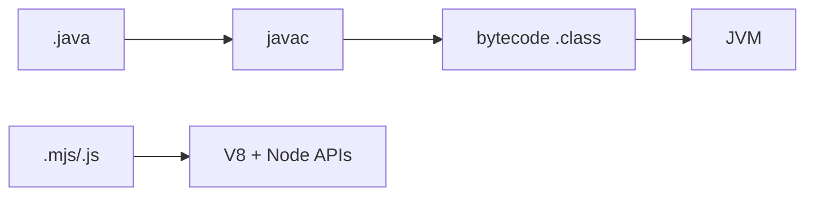
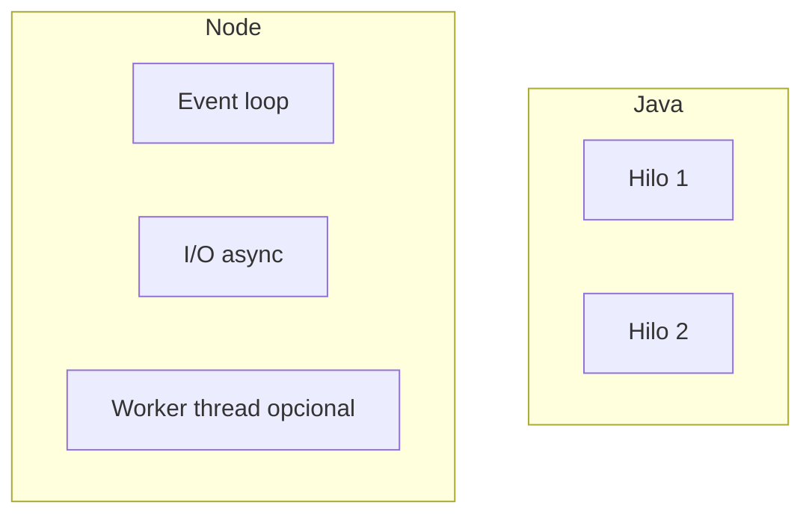

# Módulo 0.3 · Introducción a Java y Node.js lado a lado

Java y Node.js pueden resolver el mismo problema con modelos de ejecución distintos. Compararlos lado a lado evita la falsa idea de que “sintaxis parecida” significa “runtime igual”. Este módulo construye el mapa mental: JVM vs V8/Node, tipado, estructura, errores y concurrencia.

**Entorno de referencia verificado (2026-05-22):** JDK 27.0.1.0.2, Node.js v24.18.0.

## Aprende construyendo

### Tema 1: Sintaxis y ejecución · Básico · 240 min

Caso guía: calcular el total de una tienda en Java y Node.js.

#### Modelo de ejecución (JVM vs V8/Node)

**Definición formal.** Java compila fuente a bytecode `.class` ejecutado por la JVM. Node.js ejecuta JavaScript sobre V8 con APIs del runtime Node.

**Para qué sirve.** Explica arranque, empaquetado, debugging y comportamiento en producción.

**Cuándo usarlo / cuándo no.** Java cuando el ecosistema JVM, tipado estático y tooling enterprise pesan; Node cuando el equipo JS y la I/O async son el centro. No elijas por moda.



**Ejemplo mínimo enfocado (ejecutable).**

```bash
mkdir -p ms2-exec
cd ms2-exec
```

Crea el archivo `Hola.java`:

```java
public class Hola {
  public static void main(String[] args) {
    System.out.println("java");
  }
}
```

Crea el archivo `hola.mjs`:

```js
console.log('node');
```

```bash
javac Hola.java
java Hola
node hola.mjs
```

**Error común.** Confundir Java con JavaScript. Corrección: son lenguajes/runtimes distintos.

**Verificación (JDK 27, Node 24.18.0, 2026-05-22).** `java`, `node`.

#### Tipado declarado vs dinámico

**Definición formal.** Java tiene tipado estático declarado; JavaScript es dinámicamente tipado (los valores llevan tipo en runtime).

**Para qué sirve.** El tipado estático detecta incompatibilidades antes; el dinámico exige validación y tests.

**Ejemplo mínimo enfocado (ejecutable).**

```bash
mkdir -p ms2-types
cd ms2-types
```

Crea el archivo `Tipos.java`:

```java
public class Tipos {
  public static void main(String[] args) {
    int x = 2;
    System.out.println(x + 1);
  }
}
```

Crea el archivo `tipos.mjs`:

```js
let x = 2;
x = '2';
console.log(x + 1);
```

```bash
javac Tipos.java
java Tipos
node tipos.mjs
```

**Error común.** Confiar en coerción JS en reglas de negocio. Corrección: validación explícita y/o TypeScript.

**Verificación (2026-05-22).** `3`, `21`.

#### Estructura mínima de programa

**Definición formal.** Java inicia en `public static void main(String[] args)`. Node ejecuta el módulo; `import.meta.main` indica si es el entrypoint.

**Ejemplo mínimo enfocado (ejecutable).**

```bash
mkdir -p ms2-main
cd ms2-main
```

Crea el archivo `Main.java`:

```java
public class Main {
  public static void main(String[] args) {
    System.out.println(args.length);
  }
}
```

Crea el archivo `main.mjs`:

```js
console.log(process.argv.slice(2).length);
```

```bash
javac Main.java
java Main a b
node main.mjs a b
```

**Error común.** Cambiar la firma de `main` en Java. Corrección: mantener la firma exacta.

**Verificación (2026-05-22).** `2`, `2`.

### Tema 2: Tipos, errores y concurrencia · Intermedio · 240 min

Caso guía: manejar un error de input y ejecutar trabajo concurrente.

#### Manejo de errores

**Definición formal.** Java modela fallos con excepciones; JS con excepciones y rechazos de Promise. Ambos usan `try/catch/finally`.

**Ejemplo mínimo enfocado (ejecutable).**

```bash
mkdir -p ms2-err
cd ms2-err
```

Crea el archivo `Err.java`:

```java
public class Err {
  static int div(int a, int b) {
    if (b == 0) throw new IllegalArgumentException("b=0");
    return a / b;
  }
  public static void main(String[] args) {
    try { div(1, 0); }
    catch (Exception e) { System.out.println("error"); }
  }
}
```

Crea el archivo `err.mjs`:

```js
function div(a, b) {
  if (b === 0) throw new Error('b=0');
  return a / b;
}
try { div(1, 0); } catch { console.log('error'); }
```

```bash
javac Err.java
java Err
node err.mjs
```

**Error común.** Tragar excepción y seguir como si nada. Corrección: manejar, traducir o relanzar.

**Verificación (2026-05-22).** `error`, `error`.

#### Concurrencia: hilos vs event loop

**Definición formal.** Java usa hilos y scheduler; Node usa event loop con I/O no bloqueante y Promises, más Worker Threads para CPU-bound.



**Ejemplo mínimo enfocado (ejecutable).**

```bash
mkdir -p ms2-conc
cd ms2-conc
```

Crea el archivo `Conc.java`:

```java
import java.util.concurrent.*;
public class Conc {
  public static void main(String[] args) throws Exception {
    ExecutorService ex = Executors.newSingleThreadExecutor();
    System.out.println(ex.submit(() -> "ok").get());
    ex.shutdown();
  }
}
```

Crea el archivo `conc.mjs`:

```js
const r = await Promise.resolve('ok');
console.log(r);
```

```bash
javac Conc.java
java Conc
node conc.mjs
```

**Error común.** CPU pesada en el event loop de Node. Corrección: worker/cola/servicio dedicado.

**Verificación (2026-05-22).** `ok`, `ok`.

#### Mismo contrato, distinta implementación

**Definición formal.** Un contrato funcional puede implementarse en distintos runtimes si preserva entradas, salidas y errores observables.

**Ejemplo mínimo enfocado (ejecutable).**

```bash
mkdir -p ms2-contract
cd ms2-contract
```

Crea el archivo `Total.java`:

```java
public class Total {
  static int total(int[] xs) { int s = 0; for (int x : xs) s += x; return s; }
  public static void main(String[] args) { System.out.println(total(new int[]{4500,12000,3500})); }
}
```

Crea el archivo `total.mjs`:

```js
const total = (xs) => xs.reduce((a, b) => a + b, 0);
console.log(total([4500, 12000, 3500]));
```

```bash
javac Total.java
java Total
node total.mjs
```

**Error común.** Comparar por gusto sintáctico. Corrección: comparar por contrato, pruebas, operación y requisitos.

**Verificación (2026-05-22).** `20000`, `20000`.

## Cierre

Java y Node comparten conceptos pero no modelo de ejecución. Elige por contrato, carga, equipo y operación; conserva pruebas que validen comportamiento observable.

## Checklist

- Distingo JVM/bytecode de V8/Node.
- Entiendo tipado estático vs dinámico.
- Manejo errores sin tragarlos.
- No bloqueo el event loop; entiendo hilos.
