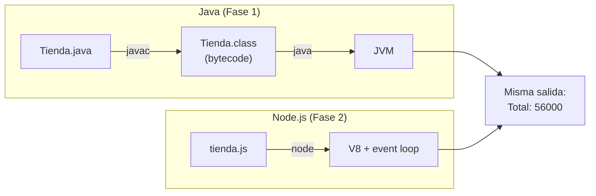
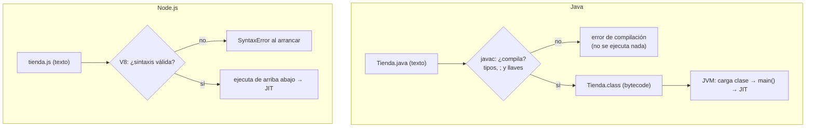

# Módulo 0.3 · Introducción a Java y Node.js lado a lado (comparativa visual)

**Fase 0 · Fundamentos absolutos** (semana 2 de 4). **Duración:** 8 h (2 temas de 4 h). **Dificultad:** 2 de 5.
**Dependencias:** Módulos 0.1 y 0.2 (programa, servidor, variables, decisiones, bucles, funciones, tests).
**Herramientas:** **JDK 25 LTS (25.0.5)** y **Node.js 26.13.1 LTS**, sin dependencias externas (la instalación
paso a paso está en el Módulo 0.5; si aún no tienes Java, instálalo primero con esa guía). **Laboratorio:**
`examples/microservicios/modulo-2/` (se verifica con `./verificar.sh`).

El curso tiene dos caminos completos y separados: la **Fase 1** con Java y Spring Boot y la **Fase 2** con
JavaScript/TypeScript y Node.js. Este módulo te presenta los dos lenguajes **escribiendo el mismo programa dos
veces**, para que veas qué cambia y qué es igual. No tienes que elegir todavía.



**Texto alternativo:** dos carriles paralelos. Arriba, Java: el archivo Tienda.java se compila con javac a
Tienda.class (bytecode) y se ejecuta con java en la JVM. Abajo, Node.js: el archivo tienda.js se ejecuta
directamente con node en el motor V8 con su event loop. Ambos carriles llegan a la misma salida «Total: 56000».

---

### Java y Node.js lado a lado: sintaxis y ejecución

#### 1. UBICACIÓN

Módulo 0.3, Lección 1 de 2 · Fase 0 · `web/public/content/microservices/modulo-2.md` · Laboratorio
`examples/microservicios/modulo-2/java/Tienda.java` y `examples/microservicios/modulo-2/node/tienda.js`.

#### 2. PRERREQUISITOS

- Módulo 0.2: variables, `if/else`, `for`, funciones y tests con `node --test`.
- Tener **JDK 25** (comprueba con `java -version`: debe decir `25.0.x`) y **Node.js 26** (`node -v`).
- Saber cambiar de carpeta con `cd`.

#### 3. OBJETIVO DE APRENDIZAJE

**Ejecutar** el mismo programa en Java y en Node.js, **señalar** al menos cinco diferencias de sintaxis (clase,
`main`, tipos declarados, `;`, impresión) y **explicar** el camino de cada lenguaje desde el archivo hasta la
salida (compilar + JVM frente a ejecutar con V8); lo compruebas cuando `java TiendaTest.java` y
`node --test tienda.test.js` pasan 5 de 5 cada uno.

#### 4. ANALOGÍA VISUAL

Dibuja **dos cocinas una al lado de la otra**, preparando la misma receta (la cuenta de una papelería: 3
cuadernos, 4 lápices, 1 mochila).

- **Cocina Java**: antes de encender el fuego, un **inspector con casco** revisa la receta completa y la pasa a
  un formato estándar en tarjetas plastificadas (compilar a *bytecode*). Cada ingrediente tiene una **etiqueta de
  tipo** pegada («entero», «texto»). Todo ocurre dentro de un **cuarto con letrero** «class Tienda» y la cocina
  arranca siempre por la puerta marcada **main**. Las instrucciones terminan con un punto y coma, como puntos al
  final de cada oración.
- **Cocina Node.js**: el cocinero lee la receta **directamente** y empieza a cocinar de arriba abajo; traduce
  sobre la marcha (compila «justo a tiempo»). Los ingredientes no llevan etiqueta de tipo, no hay cuarto
  obligatorio ni puerta «main».

Al final, las dos cocinas sacan **el mismo plato** con el mismo cartel: «Total: 56000 · Envío: gratis».

#### 5. DIAGRAMA TÉCNICO



**Texto alternativo:** dos columnas. En Java, el archivo de texto pasa por javac, que revisa tipos, puntos y
coma y llaves; si falla, hay un error de compilación y no se ejecuta nada; si pasa, se genera Tienda.class y la
JVM carga la clase, entra por main y optimiza con JIT. En Node.js, el archivo pasa por V8, que solo revisa la
sintaxis; si falla hay un SyntaxError al arrancar; si pasa, ejecuta de arriba abajo y optimiza con JIT.

#### 6. EXPLICACIÓN NIVEL 0

**Java** y **JavaScript** son lenguajes distintos (el parecido del nombre es marketing de 1995). **Node.js** es
el programa que ejecuta JavaScript fuera del navegador. Ambos sirven para construir servidores y microservicios.

Mira el mismo programa en los dos (sección 9) y fíjate en esto:

| Qué | Java | Node.js (JavaScript) |
|---|---|---|
| Dónde vive el código | dentro de una `class` obligatoria | suelto en el archivo |
| Por dónde empieza | el método `main` | la primera línea del archivo |
| Variables | con tipo: `int suma = 0;` | sin tipo: `let suma = 0;` |
| Datos agrupados | `record Producto(String nombre, int precio, int cantidad)` | objeto `{ nombre: 'Lápiz', precio: 1500, cantidad: 4 }` |
| Lista | `List.of(...)` | `[ ... ]` |
| Fin de instrucción | `;` obligatorio | `;` opcional (recomendado) |
| Imprimir | `System.out.println(...)` | `console.log(...)` |
| Ejecutar | `java Tienda.java` (compila y ejecuta) | `node tienda.js` |

Lo que **no** cambia: las ideas. Variable, decisión, bucle y función son iguales en los dos.

#### 7. EXPLICACIÓN INTERMEDIA

- **Compilación en Java.** `javac Tienda.java` revisa todo el archivo y produce `Tienda.class` (y
  `Tienda$Producto.class` para el record): *bytecode*, un formato intermedio que entiende la **JVM** (Java Virtual
  Machine) en cualquier sistema operativo. `java Tienda` arranca la JVM, carga la clase y llama a
  `public static void main(String[] args)`. Desde JDK 11 puedes saltarte el paso con `java Tienda.java` (el
  lanzador compila en memoria), y desde JDK 22 ese modo acepta programas de **varios archivos**: por eso
  `java TiendaTest.java` encuentra `Tienda.java` en la misma carpeta.
- **Nombre de archivo = nombre de clase.** Con `javac`, una clase `public class Tienda` debe vivir en
  `Tienda.java` (con la misma mayúscula).
- **Ejecución en Node.** `node tienda.js` le entrega el archivo al motor **V8**, que lo analiza, lo ejecuta de
  arriba abajo y optimiza las partes calientes mientras corre. Con `"type": "module"` en `package.json` usas
  `import/export` (módulos ES).
- **`static` en Java:** las funciones `subtotal`, `total` y `envio` pertenecen a la clase, no a un objeto; por eso
  se llaman como `Tienda.total(...)` desde el test. En JavaScript son funciones sueltas exportadas.
- **Formato de salida:** `printf("%-9s x%d = %d%n", ...)` en Java y `padEnd(9)` en JavaScript producen
  exactamente las mismas columnas.

#### 8. EXPLICACIÓN MAESTRA

- **Compilado + JVM frente a JIT directo.** Java detecta antes de ejecutar errores de tipos y de sintaxis en
  **todo** el programa, y la JVM tiene décadas de optimización para procesos de larga vida (servicios que corren
  días). A cambio, arranca más lento y usa más memoria base; para eso existen CRaC y GraalVM Native Image
  (Módulo 1). Node arranca en milisegundos con poca memoria y un solo hilo para tu código, ideal para servicios
  dominados por E/S (llamar a otras APIs, bases de datos), pero sin red de seguridad de tipos salvo que uses
  **TypeScript** (Módulo 13).
- **Ecosistemas.** Java: Maven/Gradle, Spring Boot, librerías empresariales maduras. Node: npm, Express/NestJS,
  enorme cantidad de paquetes pequeños (más agilidad, más riesgo de cadena de suministro).
- **Alternativas** reales para microservicios además de estos dos: Go (binario único, arranque instantáneo),
  Kotlin (JVM con sintaxis moderna), C#/.NET, Python (FastAPI). El curso usa Java y Node porque dominan el mercado
  de backend empresarial y startups, respectivamente.
- **Cuándo NO** mezclar: no elijas un lenguaje distinto por servicio solo porque se puede. Cada lenguaje extra
  duplica pipelines, librerías de observabilidad, imágenes base y conocimiento del equipo. Un segundo lenguaje se
  justifica por una necesidad concreta (rendimiento, una librería única, un equipo existente).

#### 9. CÓDIGO EJECUTABLE

Versiones: **JDK 25 LTS (25.0.5)** y **Node.js 26.13.1 LTS**. Sin dependencias: Java no necesita `pom.xml` para
un archivo suelto (Maven llega en el Módulo 0.5 y la Fase 1); Node usa este `package.json` en `node/`:

```json
{
  "name": "modulo-0-3-node",
  "version": "1.0.0",
  "private": true,
  "type": "module",
  "engines": { "node": ">=26.13.1" },
  "scripts": { "test": "node --test" }
}
```

`examples/microservicios/modulo-2/java/Tienda.java`:

```java
// Módulo 0.3 · Java y Node.js lado a lado: sintaxis y ejecución
// El MISMO programa que node/tienda.js, escrito en Java. Compáralos línea a línea.
// Requisitos: JDK 25 LTS (funciona desde JDK 22). Sin dependencias.
// Ejecuta (desde la carpeta java/):  java Tienda.java
// O en dos pasos (compilar y luego ejecutar):  javac Tienda.java && java Tienda

import java.util.List;

public class Tienda { // En Java todo vive dentro de una clase.

    // Un "record" es una ficha con campos fijos y TIPOS declarados (String, int).
    record Producto(String nombre, int precio, int cantidad) {}

    // static = la función pertenece a la clase; int = devuelve un número entero.
    static int subtotal(Producto p) {
        return p.precio() * p.cantidad();
    }

    static int total(List<Producto> carrito) {
        int suma = 0; // variable con tipo: solo puede guardar enteros
        for (Producto p : carrito) {
            suma += subtotal(p);
        }
        return suma;
    }

    static String envio(int total) {
        if (total >= 50000) {
            return "gratis";
        }
        return "5000";
    }

    // main es la puerta de entrada: la JVM empieza a ejecutar aquí.
    public static void main(String[] args) {
        List<Producto> carrito = List.of(
                new Producto("Cuaderno", 6000, 3),
                new Producto("Lápiz", 1500, 4),
                new Producto("Mochila", 32000, 1));
        for (Producto p : carrito) {
            System.out.printf("%-9s x%d = %d%n", p.nombre(), p.cantidad(), subtotal(p));
        }
        int t = total(carrito);
        System.out.println("Total: " + t);
        System.out.println("Envío: " + envio(t));
    }
}
```

`examples/microservicios/modulo-2/node/tienda.js`:

```javascript
// Módulo 0.3 · Java y Node.js lado a lado: sintaxis y ejecución
// El MISMO programa que java/Tienda.java, escrito en JavaScript para Node.js.
// Requisitos: Node.js 26.13.1 LTS (funciona desde Node 22). Sin dependencias.
// Ejecuta (desde la carpeta node/):  node tienda.js

// En JavaScript no hace falta una clase: las funciones viven sueltas en el archivo.
// Un objeto { } cumple el papel del record de Java, pero sin tipos declarados.
export function subtotal(p) {
  return p.precio * p.cantidad;
}

export function total(carrito) {
  let suma = 0; // let = variable que puede cambiar; no declara tipo
  for (const p of carrito) {
    suma += subtotal(p);
  }
  return suma;
}

export function envio(total) {
  if (total >= 50000) {
    return 'gratis';
  }
  return '5000';
}

// No hay método main: Node ejecuta el archivo de arriba abajo.
// import.meta.main es true solo cuando ejecutas este archivo directamente.
if (import.meta.main) {
  const carrito = [
    { nombre: 'Cuaderno', precio: 6000, cantidad: 3 },
    { nombre: 'Lápiz', precio: 1500, cantidad: 4 },
    { nombre: 'Mochila', precio: 32000, cantidad: 1 },
  ];
  for (const p of carrito) {
    console.log(`${p.nombre.padEnd(9)} x${p.cantidad} = ${subtotal(p)}`);
  }
  const t = total(carrito);
  console.log('Total: ' + t);
  console.log('Envío: ' + envio(t));
}
```

#### 10. MINI-LABORATORIO

1. Ejecuta la versión Java (compila en memoria y ejecuta):
   ```bash
   cd examples/microservicios/modulo-2/java
   java Tienda.java
   ```
2. Ahora en dos pasos, para ver el *bytecode* que genera el compilador:
   ```bash
   javac Tienda.java
   ls *.class
   java Tienda
   rm *.class
   ```
3. Ejecuta la versión Node:
   ```bash
   cd ../node
   node tienda.js
   ```
4. **Rómpelo a propósito:** en `java/Tienda.java` borra el `;` de `int suma = 0;` y ejecuta `java Tienda.java`.
   Haz lo mismo en `node/tienda.js` con `let suma = 0;` y ejecuta `node tienda.js`. Compara qué lenguaje se queja.
   Deshaz ambos cambios.

**Output esperado** (pasos 1, 2 y 3 producen exactamente estas líneas):

```text
Cuaderno  x3 = 18000
Lápiz     x4 = 6000
Mochila   x1 = 32000
Total: 56000
Envío: gratis
```

`ls *.class` muestra `Tienda$Producto.class  Tienda.class`. En el paso 4, Java se niega a ejecutar:

```text
Tienda.java:20: error: ';' expected
        int suma = 0 // variable con tipo: solo puede guardar enteros
                    ^
1 error
error: compilation failed
```

y Node.js ejecuta igual y muestra la salida normal (en JavaScript el `;` al final de línea es opcional).

**Captura comentada:** la salida idéntica demuestra que la lógica es la misma. En el paso 4, el `^` de Java
apunta a la columna exacta donde faltó el `;`, y **ninguna** línea del programa se imprimió: el error se detectó
antes de ejecutar.

#### 11. VERIFICACIÓN

Los dos lenguajes tienen el mismo test con los mismos 5 casos. Desde `examples/microservicios/modulo-2`:

```bash
(cd java && java TiendaTest.java)
(cd node && node --test --test-reporter=spec tienda.test.js)
```

Salida real:

```text
✔ subtotal de 3 cuadernos
✔ total del carrito
✔ carrito vacío suma 0
✔ envío gratis desde 50000
✔ envío con costo bajo 50000
Java: todos los tests pasaron
✔ subtotal de 3 cuadernos (0.618169ms)
✔ total del carrito (0.146858ms)
✔ carrito vacío suma 0 (0.11317ms)
✔ envío gratis desde 50000 (0.088809ms)
✔ envío con costo bajo 50000 (0.076171ms)
ℹ tests 5
ℹ pass 5
ℹ fail 0
```

El test de Java no usa librerías (JUnit 5 llega en la Fase 1): imprime `✔`/`✖` y termina con código 1 si algo
falla. **Pregunta de comprobación:** ¿por qué en Java el test llama `Tienda.total(...)` y en Node solo
`total(...)`? *(En Java la función es `static` dentro de la clase `Tienda`; en Node es una función exportada del
módulo e importada por nombre.)*

#### 12. ERROR COMÚN

**Síntoma:** en Windows o en un servidor Linux, la salida de Java muestra `L?piz` y `Env?o` en vez de `Lápiz` y
`Envío`, mientras que Node se ve bien. **Cómo se ve:** signos `?` justo donde hay tildes, solo en Java. Lo
reproducimos en un Linux con la configuración regional mínima (`LANG=POSIX`):

```text
Cuaderno  x3 = 18000
L?piz     x4 = 6000
Mochila   x1 = 32000
Total: 56000
Env?o: gratis
```

**Diagnóstico:** desde JDK 18 los archivos fuente se leen en UTF-8, pero la **consola** usa la codificación de tu
sistema (`stdout.encoding`). Compruébala con
`java -XshowSettings:properties -version 2>&1 | grep stdout.encoding`; en ese Linux responde
`stdout.encoding = ANSI_X3.4-1968` (ASCII, sin tildes). **Arreglo:** usa una terminal en UTF-8
(`export LANG=es_ES.UTF-8` o `C.UTF-8` en Linux; en Windows, `chcp 65001`) o ejecuta con
`java -Dstdout.encoding=UTF-8 Tienda.java`.

#### 13. PREGUNTA DE ENTREVISTA

«¿Qué hace la JVM y por qué se dice que Java es "compila una vez, ejecuta en cualquier parte"?»

**Respuesta modelo:** `javac` no genera código de máquina para un procesador concreto, sino *bytecode*, un
conjunto de instrucciones para una máquina virtual. La JVM de cada plataforma (macOS ARM, Linux x86…) interpreta
ese bytecode y, con su compilador JIT, convierte en código nativo las partes que más se ejecutan, optimizándolas
con información de la ejecución real. Por eso el mismo `.class` o `.jar` corre en cualquier sistema con una JVM
compatible. Node.js tiene un modelo parecido con V8, pero parte del código fuente JavaScript en vez de bytecode
precompilado.

#### 14. ANTI-PATRÓN RELACIONADO

**Escribir Java como si fuera JavaScript (o al revés):** traducir línea por línea sin respetar los modismos de
cada lenguaje.

```java
// ✖ Anti-patrón: "objetos" de JavaScript imitados con mapas sin tipo en Java
Map<String, Object> p = new HashMap<>();
p.put("precio", "1500");                          // texto donde debía ir número: compila igual
int subtotal = (Integer) p.get("precio") * 4;      // ClassCastException en ejecución
```

Se ve como `Map<String, Object>` y conversiones `(Integer)` por todas partes: renuncias a la ventaja principal de
Java (que el compilador revise los tipos) y el error aparece en producción. En Java usa `record` o clases con
tipos; en JavaScript usa objetos simples (y TypeScript cuando quieras tipos), no imitaciones de clases Java con
*getters* para todo.

---

### Java y Node.js lado a lado: tipos, errores y concurrencia

#### 1. UBICACIÓN

Módulo 0.3, Lección 2 de 2 · Fase 0 · Laboratorio `examples/microservicios/modulo-2/java/Diferencias.java` y
`examples/microservicios/modulo-2/node/diferencias.js`.

#### 2. PRERREQUISITOS

- Tema anterior (ejecutar Java y Node, clase y `main`, `import/export`).
- Módulo 0.2: `throw` y la idea de error.
- Módulo 0.1: un servidor atiende muchos pedidos; aquí verás **cómo** lo hace cada lenguaje.

#### 3. OBJETIVO DE APRENDIZAJE

**Comparar** cómo Java y Node.js manejan tipos (estáticos frente a dinámicos), errores (excepciones tipadas frente
a `NaN`/`try-catch`) y concurrencia (hilos virtuales frente a event loop con `async/await`), y **demostrar** con
tests que tres esperas de 1 segundo terminan en ~1 segundo en ambos; lo compruebas cuando
`java DiferenciasTest.java` pasa 4 de 4 y `node --test diferencias.test.js` pasa 5 de 5.

#### 4. ANALOGÍA VISUAL

Dibuja **dos restaurantes** a la hora del almuerzo, con tres mesas cada uno esperando sopa (que tarda 1 minuto
en calentarse):

- **Restaurante Java**: hay **tres meseros** (hilos), uno por mesa. Cada mesero se queda parado junto a su olla
  esperando. Antes eran meseros caros (hilos de plataforma) y se contrataban pocos; ahora son **meseros
  virtuales** casi gratis: puedes tener miles, y cuando uno espera, el restaurante le presta su delantal a otro.
- **Restaurante Node.js**: hay **un solo mesero muy rápido** (un hilo) y un **tablero de avisos** junto a la
  cocina (el event loop). Pone las tres ollas al fuego, deja una nota en el tablero por cada una («avísame cuando
  hierva») y mientras tanto atiende otras cosas. Cuando suena el aviso, sirve.

En los dos, las tres sopas salen a **1 minuto**, no a 3. Encima de las puertas hay dos letreros más: en Java, un
**guardia** revisa que en el plato de sopa no sirvan una ensalada (tipos estáticos, antes de abrir); en Node no
hay guardia: si pides «2» + 2 te traen «22» (dos tarjetas pegadas) y nadie protesta.

#### 5. DIAGRAMA TÉCNICO

```mermaid
sequenceDiagram
    participant M as main / script
    participant J as Java: hilos virtuales
    participant E as Node: event loop
    Note over M,J: Java
    M->>J: submit(tarea 1), submit(tarea 2), submit(tarea 3)
    J-->>J: cada hilo duerme 1 s en paralelo
    J-->>M: f.get() ×3 → ~1000 ms
    Note over M,E: Node.js
    M->>E: Promise.all([tarea(1), tarea(2), tarea(3)])
    E-->>E: 3 temporizadores; el hilo queda libre
    E-->>M: await → ~1000 ms
```

**Texto alternativo:** diagrama de secuencia. En Java, main envía tres tareas a un ejecutor de hilos virtuales;
cada hilo duerme 1 segundo en paralelo y main recoge los tres resultados en unos 1000 ms. En Node.js, el script
llama a Promise.all con tres tareas; el event loop registra tres temporizadores, el único hilo queda libre y el
await termina en unos 1000 ms.

#### 6. EXPLICACIÓN NIVEL 0

Tres diferencias de fondo:

1. **Tipos.** Un **tipo** dice qué clase de dato es algo: número, texto, verdadero/falso. Java exige declararlo
   y lo **revisa antes de ejecutar**: si una función pide números y le das texto, el programa ni arranca.
   JavaScript lo decide **mientras ejecuta**: `'2' + 2` da `'22'` (une textos) sin avisar.
2. **Errores.** Cuando algo sale mal, Java **lanza una excepción** con nombre (`NumberFormatException`) que
   puedes atrapar con `try/catch`. JavaScript también tiene `try/catch`, pero algunas operaciones no lanzan
   nada: `Number('cuarenta')` devuelve `NaN` («no es un número») y tienes que comprobarlo tú.
3. **Concurrencia** (hacer varias cosas a la vez). Java usa **hilos**: varios trabajadores en paralelo. Node.js
   usa **un trabajador** que nunca se queda quieto esperando: deja la espera anotada y sigue con otra cosa
   (`async/await`).

#### 7. EXPLICACIÓN INTERMEDIA

- **Tipado estático (Java):** `static int sumar(int a, int b)`; la llamada `sumar("2", 2)` produce
  `error: method sumar in class Suma cannot be applied to given types` en compilación. **Tipado dinámico (JS):**
  `+` con un texto concatena; `*` convierte a número (`'5' * 3` es `15`). TypeScript añade tipos estáticos a
  JavaScript (Módulo 13).
- **Excepciones comprobadas:** en Java algunas excepciones deben declararse (`throws Exception` en `main`) o
  atraparse; `NumberFormatException` no es obligatoria, pero sí específica. En JS, `JSON.parse` lanza
  `SyntaxError`, mientras que `Number()` y `parseInt()` devuelven `NaN`; `Number.isNaN(n)` lo detecta.
- **Hilos virtuales (Java 21+):** `Executors.newVirtualThreadPerTaskExecutor()` crea un hilo virtual por tarea.
  `Thread.sleep(1000)` bloquea solo ese hilo virtual; la JVM lo «aparca» y reutiliza el hilo del sistema operativo.
  El `try (var ejecutor = ...)` cierra el ejecutor esperando a que terminen todas las tareas. `f.get()` espera el
  resultado de cada `Future`.
- **Event loop (Node):** `await esperar(1000)` registra un temporizador y **devuelve el control** al event loop.
  `Promise.all` espera a que las tres promesas se cumplan; como los temporizadores corren a la vez, el total es
  ~1 s. Si en vez de esperar hicieras un cálculo pesado de 1 s (un bucle), bloquearías el único hilo y las tres
  tareas tardarían 3 s: Node es concurrente en E/S, no paralelo en CPU (para eso, Worker Threads, Módulo 13).

#### 8. EXPLICACIÓN MAESTRA

| Decisión | Java (JDK 25) | Node.js 26 | Trade-off |
|---|---|---|---|
| Tipos | estáticos, revisados al compilar | dinámicos; TypeScript los añade en desarrollo | seguridad y refactorización frente a velocidad para empezar |
| Errores | excepciones tipadas; `catch` por tipo | `Error` genérico, `NaN`, promesas rechazadas | una promesa rechazada sin `catch` puede tumbar el proceso |
| Concurrencia E/S | hilos virtuales: código secuencial y bloqueante | event loop + `async/await` | Java: código simple; Node: menos memoria por conexión |
| Concurrencia CPU | varios núcleos con hilos de plataforma | un hilo; Worker Threads o varios procesos | Node necesita escalar con procesos/réplicas |

Alternativas en Java antes de los hilos virtuales: *pools* de hilos de tamaño fijo (límite de concurrencia) o
programación reactiva (Project Reactor, WebFlux): muy eficiente pero más difícil de leer y depurar. En Node, antes
de `async/await` había *callbacks* anidados (*callback hell*).

**Cuándo NO** usar hilos virtuales: para trabajo intensivo de CPU (no ganan nada frente a hilos de plataforma) ni
como excusa para no limitar la concurrencia contra una base de datos con un *pool* de 10 conexiones: miles de
hilos esperando la misma conexión no la hacen más rápida. **Cuándo NO** usar Node para un servicio: cálculos
pesados y sostenidos (procesar video, criptografía masiva) que bloquean el event loop y degradan a todas las
peticiones.

#### 9. CÓDIGO EJECUTABLE

Versiones: **JDK 25 LTS (25.0.5)** (los hilos virtuales existen desde JDK 21) y **Node.js 26.13.1 LTS**. Sin
dependencias; Node usa el `package.json` de `node/` del tema anterior.

`examples/microservicios/modulo-2/java/Diferencias.java`:

```java
// Módulo 0.3 · Java y Node.js lado a lado: tipos, errores y concurrencia
// Tres diferencias de fondo entre Java y Node.js, en un solo programa. Compáralo con node/diferencias.js.
// Requisitos: JDK 25 LTS (los hilos virtuales existen desde JDK 21). Sin dependencias.
// Ejecuta (desde la carpeta java/):  java Diferencias.java

import java.time.Duration;
import java.time.Instant;
import java.util.ArrayList;
import java.util.List;
import java.util.concurrent.Executors;
import java.util.concurrent.Future;

public class Diferencias {

    // 1. TIPOS ESTÁTICOS: el compilador revisa los tipos ANTES de ejecutar.
    //    Si escribes sumar("2", 2), el programa ni siquiera arranca (error de compilación).
    static int sumar(int a, int b) {
        return a + b;
    }

    // 2. ERRORES: Java lanza excepciones con tipo; puedes atrapar exactamente la que esperas.
    static String convertir(String texto) {
        try {
            return "número " + Integer.parseInt(texto);
        } catch (NumberFormatException e) {
            return "error: '" + texto + "' no es un número";
        }
    }

    // 3. CONCURRENCIA: Java usa hilos. Un hilo virtual es barato: puedes crear miles.
    //    Tres tareas de 1 segundo, cada una en su hilo, terminan juntas en ~1 segundo.
    static long tresTareasEnParalelo() throws Exception {
        Instant inicio = Instant.now();
        try (var ejecutor = Executors.newVirtualThreadPerTaskExecutor()) {
            List<Future<String>> futuros = new ArrayList<>();
            for (int i = 1; i <= 3; i++) {
                int n = i;
                futuros.add(ejecutor.submit(() -> {
                    Thread.sleep(1000); // simula esperar a una base de datos
                    return "tarea " + n;
                }));
            }
            for (Future<String> f : futuros) {
                f.get(); // espera el resultado de cada tarea
            }
        }
        return Duration.between(inicio, Instant.now()).toMillis();
    }

    public static void main(String[] args) throws Exception {
        System.out.println("1) sumar(2, 2) = " + sumar(2, 2));
        System.out.println("2) " + convertir("42") + " | " + convertir("cuarenta"));
        long ms = tresTareasEnParalelo();
        System.out.println("3) tres tareas de 1 s en hilos virtuales tardaron menos de 1.5 s: " + (ms < 1500));
    }
}
```

`examples/microservicios/modulo-2/node/diferencias.js`:

```javascript
// Módulo 0.3 · Java y Node.js lado a lado: tipos, errores y concurrencia
// Las mismas tres ideas que java/Diferencias.java, en Node.js.
// Requisitos: Node.js 26.13.1 LTS (funciona desde Node 22). Sin dependencias.
// Ejecuta (desde la carpeta node/):  node diferencias.js

import { setTimeout as esperar } from 'node:timers/promises';

// 1. TIPOS DINÁMICOS: nadie revisa los tipos antes de ejecutar.
//    sumar('2', 2) SÍ corre, y da '22' (une textos en vez de sumar).
export function sumar(a, b) {
  return a + b;
}

// 2. ERRORES: Number('cuarenta') no lanza error; devuelve NaN ("no es un número").
//    Hay que comprobarlo a mano.
export function convertir(texto) {
  const n = Number(texto);
  if (Number.isNaN(n)) {
    return `error: '${texto}' no es un número`;
  }
  return `número ${n}`;
}

// 3. CONCURRENCIA: Node tiene UN solo hilo para tu código, pero no se queda bloqueado
//    esperando: con async/await deja la espera "en pausa" y atiende otra cosa (el event loop).
export async function tresTareasEnParalelo() {
  const inicio = Date.now();
  const tarea = async (n) => {
    await esperar(1000); // simula esperar a una base de datos
    return `tarea ${n}`;
  };
  await Promise.all([tarea(1), tarea(2), tarea(3)]);
  return Date.now() - inicio;
}

if (import.meta.main) {
  console.log(`1) sumar(2, 2) = ${sumar(2, 2)} | sumar('2', 2) = ${sumar('2', 2)}`);
  console.log(`2) ${convertir('42')} | ${convertir('cuarenta')}`);
  const ms = await tresTareasEnParalelo();
  console.log(`3) tres tareas de 1 s con async/await tardaron menos de 1.5 s: ${ms < 1500}`);
}
```

#### 10. MINI-LABORATORIO

1. Ejecuta los dos programas (desde `examples/microservicios/modulo-2`):
   ```bash
   (cd java && java Diferencias.java)
   (cd node && node diferencias.js)
   ```
2. **Provoca el error de tipos en Java:** crea `Suma.java` en una carpeta de práctica (`/tmp` sirve) con este
   contenido y ejecútalo con `java Suma.java`:
   ```java
   public class Suma {
       static int sumar(int a, int b) { return a + b; }
       public static void main(String[] args) {
           System.out.println(sumar("2", 2));
       }
   }
   ```
3. **Bloquea el event loop a propósito:** en `node/diferencias.js` cambia `await esperar(1000);` por
   `const fin = Date.now() + 1000; while (Date.now() < fin) {}` y ejecuta `node diferencias.js`. Observa la línea 3.
   Deshaz el cambio.

**Output esperado** (paso 1):

```text
1) sumar(2, 2) = 4
2) número 42 | error: 'cuarenta' no es un número
3) tres tareas de 1 s en hilos virtuales tardaron menos de 1.5 s: true
1) sumar(2, 2) = 4 | sumar('2', 2) = 22
2) número 42 | error: 'cuarenta' no es un número
3) tres tareas de 1 s con async/await tardaron menos de 1.5 s: true
```

Paso 2:

```text
Suma.java:4: error: method sumar in class Suma cannot be applied to given types;
        System.out.println(sumar("2", 2));
                           ^
  required: int,int
  found:    String,int
  reason: argument mismatch; String cannot be converted to int
1 error
error: compilation failed
```

Paso 3: la línea 3 de Node pasa a decir `... tardaron menos de 1.5 s: false` (tarda unos 3 s).

**Captura comentada:** Java y Node imprimen casi lo mismo, salvo `sumar('2', 2) = 22`, que solo existe en Node
porque Java no habría compilado. En el paso 3, la terminal se queda «congelada» unos 3 segundos antes de imprimir
`false`: el único hilo estuvo ocupado y las tareas se ejecutaron una tras otra.

#### 11. VERIFICACIÓN

```bash
(cd java && java DiferenciasTest.java)
(cd node && node --test --test-reporter=spec diferencias.test.js)
```

Salida real:

```text
✔ sumar(2, 2) es 4
✔ convertir('42') da número 42
✔ convertir('cuarenta') atrapa la excepción
✔ 3 tareas de 1 s en paralelo tardan menos de 1.5 s (tardaron menos)
Java: todos los tests pasaron
✔ sumar(2, 2) es 4 (0.710827ms)
✔ sumar('2', 2) es '22': JavaScript no revisa tipos (0.254804ms)
✔ convertir('42') da número 42 (0.097643ms)
✔ convertir('cuarenta') detecta NaN (0.166912ms)
✔ 3 tareas de 1 s en paralelo tardan menos de 1.5 s (1002.72407ms)
ℹ tests 5
ℹ pass 5
ℹ fail 0
```

Para el módulo completo: `./verificar.sh` (Java 9 comprobaciones, Node 10 tests y `RESULTADO: OK · Módulo 0.3
(Java y Node.js lado a lado) verificado`). **Pregunta de comprobación:** con el bucle `while` del paso 3, ¿por
qué los hilos virtuales de Java seguirían tardando ~1 s si hicieras lo mismo en cada tarea? *(Porque cada tarea
tiene su propio hilo y la JVM los reparte entre varios núcleos; en Node las tres comparten un único hilo.)*

#### 12. ERROR COMÚN

**Síntoma (Node):** olvidar `await` delante de una función `async`. **Cómo se ve:** el programa imprime
`Promise { <pending> }` o una línea con `NaN` en lugar de los milisegundos:

```bash
node -e "import('./node/diferencias.js').then(m => { const ms = m.tresTareasEnParalelo(); console.log(ms, ms < 1500); })"
```

```text
Promise { <pending> } false
```

**Diagnóstico:** una función `async` siempre devuelve una **promesa**, no el valor; si no esperas con `await`
(o `.then`), trabajas con la caja vacía. Comparar una promesa con un número da `false`. **Arreglo:** añade `await`
(dentro de una función `async` o en el nivel superior de un módulo ES). En Java, el error equivalente es usar el
`Future` sin llamar a `get()`.

#### 13. PREGUNTA DE ENTREVISTA

«¿Node.js es de un solo hilo? ¿Cómo atiende miles de conexiones a la vez?»

**Respuesta modelo:** el código JavaScript de la aplicación corre en un solo hilo, pero Node no es «de un solo
hilo» en total: libuv tiene un *pool* de hilos para algunas operaciones (sistema de archivos, DNS, cripto) y el
sistema operativo gestiona los sockets de forma asíncrona (epoll, kqueue). Cuando una operación de E/S está
pendiente, el hilo principal no espera: registra una continuación y el event loop la ejecuta cuando llega el
resultado. Por eso maneja muchas conexiones concurrentes con poca memoria, siempre que ninguna tarea bloquee el
hilo con cálculo pesado. Java logra un efecto similar desde JDK 21 con hilos virtuales, manteniendo código
secuencial.

#### 14. ANTI-PATRÓN RELACIONADO

**Bloquear el event loop** con operaciones síncronas en un servidor Node:

```javascript
// ✖ Anti-patrón: cada petición lee un archivo grande de forma SÍNCRONA y calcula un hash pesado
import { readFileSync } from 'node:fs';
import { pbkdf2Sync } from 'node:crypto';
http.createServer((req, res) => {
  const datos = readFileSync('/datos/catalogo-enorme.json');          // bloquea el hilo
  const hash = pbkdf2Sync(datos, 'sal', 500000, 64, 'sha512');          // bloquea aún más
  res.end(hash.toString('hex'));
});
```

Se ve como funciones terminadas en `Sync` dentro de un manejador de peticiones. En un diagrama de latencia, todas
las peticiones se ponen en fila detrás de la más lenta: la p99 se dispara aunque la CPU tenga núcleos libres. Usa
las versiones asíncronas (`fs/promises`, `crypto.pbkdf2`), mueve el cálculo a Worker Threads o a otro servicio. El
equivalente en Java es fijar (*pinning*) hilos virtuales con bloqueos largos dentro de secciones `synchronized`
en versiones anteriores a JDK 24.
