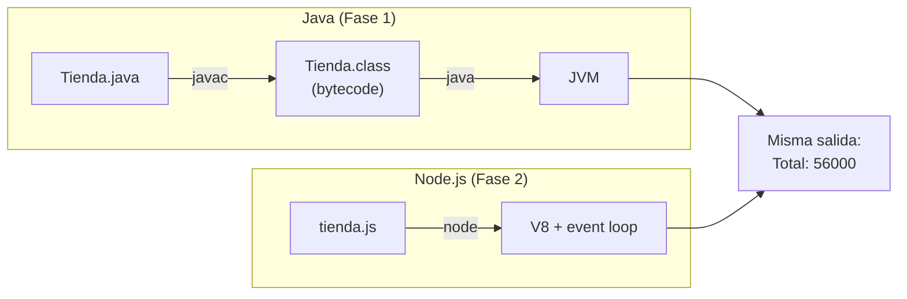
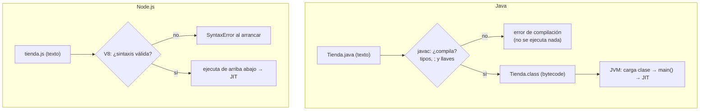

# Módulo 0.3 · Introducción a Java y Node.js lado a lado (comparativa visual)

**Fase 0 · Fundamentos absolutos** (semana 2 de 4). **Duración:** 8 h (2 temas de 4 h). **Dificultad:** 2 de 5.
**Dependencias:** Módulos 0.1 y 0.2 (programa, servidor, variables, decisiones, bucles, funciones, tests).
**Herramientas:** **JDK 25 LTS (25.0.5)** y **Node.js 26.13.1 LTS**, sin dependencias externas (la instalación
paso a paso está en el Módulo 0.5; si aún no tienes Java, instálalo primero con esa guía)..

El curso tiene dos caminos completos y separados: la **Fase 1** con Java y Spring Boot y la **Fase 2** con
JavaScript/TypeScript y Node.js. Este módulo te presenta los dos lenguajes **escribiendo el mismo programa dos
veces**, para que veas qué cambia y qué es igual. No tienes que elegir todavía.



**Texto alternativo:** dos carriles paralelos. Arriba, Java: el archivo Tienda.java se compila con javac a
Tienda.class (bytecode) y se ejecuta con java en la JVM. Abajo, Node.js: el archivo tienda.js se ejecuta
directamente con node en el motor V8 con su event loop. Ambos carriles llegan a la misma salida «Total: 56000».

---


### Java y Node.js lado a lado: sintaxis y ejecución

<details open>
<summary><strong>Capa 1 — Lectura</strong></summary>

#### ► DE QUÉ TRATA
Ejecutar el mismo programa en Java y en Node.js, señalar al menos cinco diferencias de sintaxis (clase, main, tipos declarados, ;, impresión) y explicar el camino de cada lenguaje desde el archivo hasta la salida (compilar + JVM frente a ejecutar con V8); lo compruebas cuando jav…

#### ► LA IDEA EN UNA FRASE
**Ejecutar el mismo programa en Java y en Node.js, señalar al menos cinco diferencias de sintaxis (clase, main, tipos declarados, ;, impresión) y explicar el camino de cada lenguaje desde el archivo hasta la salida (compilar + JVM frente a ejecutar con V8); lo compruebas cuando java TiendaTest.java y node --test tienda.test.js pasan 5 de 5 cada uno.**

#### ► POR QUÉ EXISTE ESTO
Java y JavaScript son lenguajes distintos (el parecido del nombre es marketing de 1995). Node.js es el programa que ejecuta JavaScript fuera del navegador. Ambos sirven para construir servidores y microservicios.

#### ► LA ANALOGÍA
Piensa en java y node.js lado a lado: sintaxis y ejecución como una herramienta de taller: útil cuando conoces su propósito y sus límites.
**Dónde se rompe la analogía:** en software, los efectos dependen del contexto, la escala y los trade-offs.

#### ► CÓMO FUNCIONA


| Qué | Java | Node.js (JavaScript) |
|---|---|---|
| Dónde vive el código | dentro de una `class` obligatoria | suelto en el archivo |
| Por dónde empieza | el método `main` | la primera línea del archivo |
| Variables | con tipo: `int suma = 0;` | sin tipo: `let suma = 0;` |
| Datos agrupados | `record Producto(String nombre, int precio, int cantidad)` | objeto `{ nombre: 'Lápiz', precio: 1500, cantidad: 4 }` |
| Lista | `List.of(...)` | `[ ... ]` |
| Fin de instrucción | `;` obligatorio | `;` opcional (recomendado) |
| Imprimir | `System.out.println(...)` | `console.log(...)` |
| Ejecutar | `java Tienda.java` (compila y ejecuta) | `node tienda.js` |

#### ► LO QUE PUEDE SALIR MAL
| Síntoma | Causa probable | Arreglo |
|---|---|---|
| Java y Node.js lado a lado: sintaxis y ejecución se aplica pero el resultado no mejora | Se usó sin medir el problema real | Mide antes y compara contra la alternativa simple |
| Aparece complejidad inesperada | Se adoptó la técnica sin comprender sus trade-offs | Vuelve a la sección de trade-offs y reduce el alcance |
| Falla en un caso límite | Se asumió un contexto que no se cumple | Prueba el caso límite y documenta cuándo NO usarlo |

#### ► TRADE-OFFS
| Opción | Cuándo usarla | Cuándo NO usarla |
|---|---|---|
| Usar Java y Node.js lado a lado: sintaxis y ejecución | Cuando el problema coincide con su propósito y el beneficio es observable | Cuando agrega complejidad sin resolver un problema real |
| Alternativa más simple | Cuando el contexto es pequeño, estable o fácil de razonar | Cuando ya demostró no escalar o no cumplir el requisito |
| Postergar la decisión | Cuando falta evidencia del problema | Cuando el costo de esperar es mayor que el costo de probar |

#### ► CUÁNDO NO USAR ESTO
Escribir Java como si fuera JavaScript (o al revés): traducir línea por línea sin respetar los modismos de cada lenguaje.

#### ► DE VUELTA A LA ANALOGÍA
Volviendo a la analogía: java y node.js lado a lado: sintaxis y ejecución funciona como el modelo inicial, pero recuerda dónde se rompe: en producción importan la evidencia, la escala y el costo de equivocarte.

#### ► LO QUE DEBES RECORDAR
- Java y JavaScript son lenguajes distintos (el parecido del nombre es marketing de 1995).
- Node.js es el programa que ejecuta JavaScript fuera del navegador.
- Ambos sirven para construir servidores y microservicios.

#### ► PREGUNTAS PARA PENSAR
1. ¿Qué problema concreto resuelve java y node.js lado a lado: sintaxis y ejecución en tu contexto?
2. ¿Cómo sabrías que java y node.js lado a lado: sintaxis y ejecución no está funcionando bien?
3. ¿Qué alternativa más simple considerarías antes de usar java y node.js lado a lado: sintaxis y ejecución?

</details>

<details>
<summary><strong>Capa 2 — Construcción</strong></summary>

#### Código y verificación


```json
{
  "name": "modulo-0-3-node",
  "version": "1.0.0",
  "private": true,
  "type": "module",
  "engines": { "node": ">=26.13.1" },
  "scripts": { "test": "node --test" }
}
```

```java
// Módulo 0.3 · Java y Node.js lado a lado: sintaxis y ejecución
// El MISMO programa que node/tienda.js, escrito en Java. Compáralos línea a línea.
// Requisitos: JDK 25 LTS (funciona desde JDK 22). Sin dependencias.
// Ejecuta (desde la carpeta java/):  java Tienda.java
// O en dos pasos (compilar y luego ejecutar):  javac Tienda.java && java Tienda

import java.util.List;

public class Tienda { // En Java todo vive dentro de una clase.

    // Un "record" es una ficha con campos fijos y TIPOS declarados (String, int).
    record Producto(String nombre, int precio, int cantidad) {}

    // static = la función pertenece a la clase; int = devuelve un número entero.
    static int subtotal(Producto p) {
        return p.precio() * p.cantidad();
    }

    static int total(List<Producto> carrito) {
        int suma = 0; // variable con tipo: solo puede guardar enteros
        for (Producto p : carrito) {
            suma += subtotal(p);
        }
        return suma;
    }

    static String envio(int total) {
        if (total >= 50000) {
            return "gratis";
        }
        return "5000";
    }

    // main es la puerta de entrada: la JVM empieza a ejecutar aquí.
    public static void main(String[] args) {
        List<Producto> carrito = List.of(
                new Producto("Cuaderno", 6000, 3),
                new Producto("Lápiz", 1500, 4),
                new Producto("Mochila", 32000, 1));
        for (Producto p : carrito) {
            System.out.printf("%-9s x%d = %d%n", p.nombre(), p.cantidad(), subtotal(p));
        }
        int t = total(carrito);
        System.out.println("Total: " + t);
        System.out.println("Envío: " + envio(t));
    }
}
```

```javascript
// Módulo 0.3 · Java y Node.js lado a lado: sintaxis y ejecución
// El MISMO programa que java/Tienda.java, escrito en JavaScript para Node.js.
// Requisitos: Node.js 26.13.1 LTS (funciona desde Node 22). Sin dependencias.
// Ejecuta (desde la carpeta node/):  node tienda.js

// En JavaScript no hace falta una clase: las funciones viven sueltas en el archivo.
// Un objeto { } cumple el papel del record de Java, pero sin tipos declarados.
export function subtotal(p) {
  return p.precio * p.cantidad;
}

export function total(carrito) {
  let suma = 0; // let = variable que puede cambiar; no declara tipo
  for (const p of carrito) {
    suma += subtotal(p);
  }
  return suma;
}

export function envio(total) {
  if (total >= 50000) {
    return 'gratis';
  }
  return '5000';
}

// No hay método main: Node ejecuta el archivo de arriba abajo.
// import.meta.main es true solo cuando ejecutas este archivo directamente.
if (import.meta.main) {
  const carrito = [
    { nombre: 'Cuaderno', precio: 6000, cantidad: 3 },
    { nombre: 'Lápiz', precio: 1500, cantidad: 4 },
    { nombre: 'Mochila', precio: 32000, cantidad: 1 },
  ];
  for (const p of carrito) {
    console.log(`${p.nombre.padEnd(9)} x${p.cantidad} = ${subtotal(p)}`);
  }
  const t = total(carrito);
  console.log('Total: ' + t);
  console.log('Envío: ' + envio(t));
}
```

```bash
   java Tienda.java
   ```

```bash
   javac Tienda.java
   ls *.class
   java Tienda
   rm *.class
   ```

</details>

### Java y Node.js lado a lado: tipos, errores y concurrencia

<details open>
<summary><strong>Capa 1 — Lectura</strong></summary>

#### ► DE QUÉ TRATA
Comparar cómo Java y Node.js manejan tipos (estáticos frente a dinámicos), errores (excepciones tipadas frente a NaN/try-catch) y concurrencia (hilos virtuales frente a event loop con async/await), y demostrar con tests que tres esperas de 1 segundo terminan en ~1 segundo en ambo…

#### ► LA IDEA EN UNA FRASE
**Comparar cómo Java y Node.js manejan tipos (estáticos frente a dinámicos), errores (excepciones tipadas frente a NaN/try-catch) y concurrencia (hilos virtuales frente a event loop con async/await), y demostrar con tests que tres esperas de 1 segundo terminan en ~1 segundo en ambos; lo compruebas cuando java DiferenciasTest.java pasa 4 de 4 y node --test diferencias.test.js pasa 5 de 5.**

#### ► POR QUÉ EXISTE ESTO
Tres diferencias de fondo:

#### ► LA ANALOGÍA
Piensa en java y node.js lado a lado: tipos, errores y concurrencia como una herramienta de taller: útil cuando conoces su propósito y sus límites.
**Dónde se rompe la analogía:** en software, los efectos dependen del contexto, la escala y los trade-offs.

#### ► CÓMO FUNCIONA
```mermaid
sequenceDiagram
    participant M as main / script
    participant J as Java: hilos virtuales
    participant E as Node: event loop
    Note over M,J: Java
    M->>J: submit(tarea 1), submit(tarea 2), submit(tarea 3)
    J-->>J: cada hilo duerme 1 s en paralelo
    J-->>M: f.get() ×3 → ~1000 ms
    Note over M,E: Node.js
    M->>E: Promise.all([tarea(1), tarea(2), tarea(3)])
    E-->>E: 3 temporizadores; el hilo queda libre
    E-->>M: await → ~1000 ms
```

1. Tres diferencias de fondo:

#### ► LO QUE PUEDE SALIR MAL
| Síntoma | Causa probable | Arreglo |
|---|---|---|
| Java y Node.js lado a lado: tipos, errores y concurrencia se aplica pero el resultado no mejora | Se usó sin medir el problema real | Mide antes y compara contra la alternativa simple |
| Aparece complejidad inesperada | Se adoptó la técnica sin comprender sus trade-offs | Vuelve a la sección de trade-offs y reduce el alcance |
| Falla en un caso límite | Se asumió un contexto que no se cumple | Prueba el caso límite y documenta cuándo NO usarlo |

#### ► TRADE-OFFS
| Opción | Cuándo usarla | Cuándo NO usarla |
|---|---|---|
| Usar Java y Node.js lado a lado: tipos, errores y concurrencia | Cuando el problema coincide con su propósito y el beneficio es observable | Cuando agrega complejidad sin resolver un problema real |
| Alternativa más simple | Cuando el contexto es pequeño, estable o fácil de razonar | Cuando ya demostró no escalar o no cumplir el requisito |
| Postergar la decisión | Cuando falta evidencia del problema | Cuando el costo de esperar es mayor que el costo de probar |

#### ► CUÁNDO NO USAR ESTO
Bloquear el event loop con operaciones síncronas en un servidor Node:

#### ► DE VUELTA A LA ANALOGÍA
Volviendo a la analogía: java y node.js lado a lado: tipos, errores y concurrencia funciona como el modelo inicial, pero recuerda dónde se rompe: en producción importan la evidencia, la escala y el costo de equivocarte.

#### ► LO QUE DEBES RECORDAR
- Tres diferencias de fondo:

#### ► PREGUNTAS PARA PENSAR
1. ¿Qué problema concreto resuelve java y node.js lado a lado: tipos, errores y concurrencia en tu contexto?
2. ¿Cómo sabrías que java y node.js lado a lado: tipos, errores y concurrencia no está funcionando bien?
3. ¿Qué alternativa más simple considerarías antes de usar java y node.js lado a lado: tipos, errores y concurrencia?

</details>

<details>
<summary><strong>Capa 2 — Construcción</strong></summary>

#### Código de referencia / ejecutable
Versiones: **JDK 25 LTS (25.0.5)** (los hilos virtuales existen desde JDK 21) y **Node.js 26.13.1 LTS**. Sin
dependencias; Node usa el `package.json` de `node/` del tema anterior.

`Diferencias.java`:

```java
// Módulo 0.3 · Java y Node.js lado a lado: tipos, errores y concurrencia
// Tres diferencias de fondo entre Java y Node.js, en un solo programa. Compáralo con node/diferencias.js.
// Requisitos: JDK 25 LTS (los hilos virtuales existen desde JDK 21). Sin dependencias.
// Ejecuta (desde la carpeta java/):  java Diferencias.java

import java.time.Duration;
import java.time.Instant;
import java.util.ArrayList;
import java.util.List;
import java.util.concurrent.Executors;
import java.util.concurrent.Future;

public class Diferencias {

    // 1. TIPOS ESTÁTICOS: el compilador revisa los tipos ANTES de ejecutar.
    //    Si escribes sumar("2", 2), el programa ni siquiera arranca (error de compilación).
    static int sumar(int a, int b) {
        return a + b;
    }

    // 2. ERRORES: Java lanza excepciones con tipo; puedes atrapar exactamente la que esperas.
    static String convertir(String texto) {
        try {
            return "número " + Integer.parseInt(texto);
        } catch (NumberFormatException e) {
            return "error: '" + texto + "' no es un número";
        }
    }

    // 3. CONCURRENCIA: Java usa hilos. Un hilo virtual es barato: puedes crear miles.
    //    Tres tareas de 1 segundo, cada una en su hilo, terminan juntas en ~1 segundo.
    static long tresTareasEnParalelo() throws Exception {
        Instant inicio = Instant.now();
        try (var ejecutor = Executors.newVirtualThreadPerTaskExecutor()) {
            List<Future<String>> futuros = new ArrayList<>();
            for (int i = 1; i <= 3; i++) {
                int n = i;
                futuros.add(ejecutor.submit(() -> {
                    Thread.sleep(1000); // simula esperar a una base de datos
                    return "tarea " + n;
                }));
            }
            for (Future<String> f : futuros) {
                f.get(); // espera el resultado de cada tarea
            }
        }
        return Duration.between(inicio, Instant.now()).toMillis();
    }

    public static void main(String[] args) throws Exception {
        System.out.println("1) sumar(2, 2) = " + sumar(2, 2));
        System.out.println("2) " + convertir("42") + " | " + convertir("cuarenta"));
        long ms = tresTareasEnParalelo();
        System.out.println("3) tres tareas de 1 s en hilos virtuales tardaron menos de 1.5 s: " + (ms < 1500));
    }
}
```

`diferencias.js`:

```javascript
// Módulo 0.3 · Java y Node.js lado a lado: tipos, errores y concurrencia
// Las mismas tres ideas que java/Diferencias.java, en Node.js.
// Requisitos: Node.js 26.13.1 LTS (funciona desde Node 22). Sin dependencias.
// Ejecuta (desde la carpeta node/):  node diferencias.js

import { setTimeout as esperar } from 'node:timers/promises';

// 1. TIPOS DINÁMICOS: nadie revisa los tipos antes de ejecutar.
//    sumar('2', 2) SÍ corre, y da '22' (une textos en vez de sumar).
export function sumar(a, b) {
  return a + b;
}

// 2. ERRORES: Number('cuarenta') no lanza error; devuelve NaN ("no es un número").
//    Hay que comprobarlo a mano.
export function convertir(texto) {
  const n = Number(texto);
  if (Number.isNaN(n)) {
    return `error: '${texto}' no es un número`;
  }
  return `número ${n}`;
}

// 3. CONCURRENCIA: Node tiene UN solo hilo para tu código, pero no se queda bloqueado
//    esperando: con async/await deja la espera "en pausa" y atiende otra cosa (el event loop).
export async function tresTareasEnParalelo() {
  const inicio = Date.now();
  const tarea = async (n) => {
    await esperar(1000); // simula esperar a una base de datos
    return `tarea ${n}`;
  };
  await Promise.all([tarea(1), tarea(2), tarea(3)]);
  return Date.now() - inicio;
}

if (import.meta.main) {
  console.log(`1) sumar(2, 2) = ${sumar(2, 2)} | sumar('2', 2) = ${sumar('2', 2)}`);
  console.log(`2) ${convertir('42')} | ${convertir('cuarenta')}`);
  const ms = await tresTareasEnParalelo();
  console.log(`3) tres tareas de 1 s con async/await tardaron menos de 1.5 s: ${ms < 1500}`);
}
```

</details>
