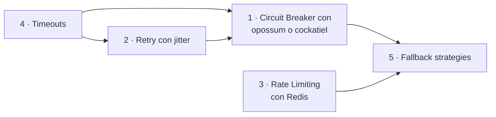
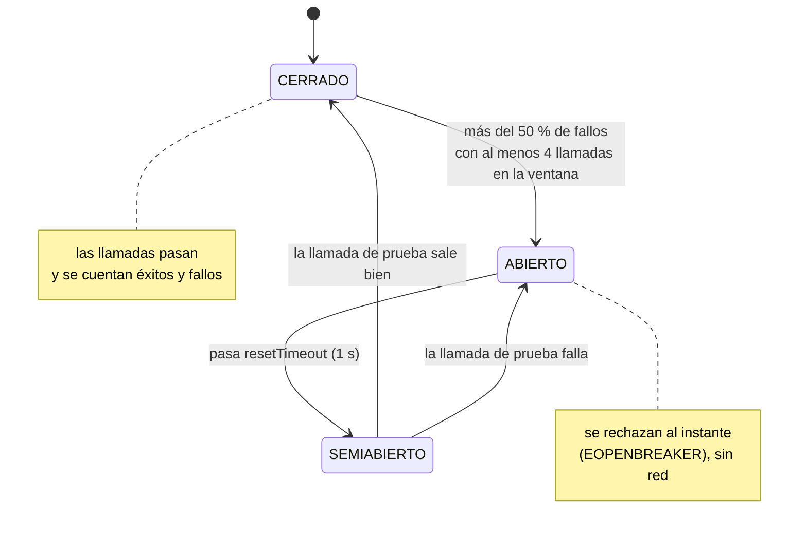
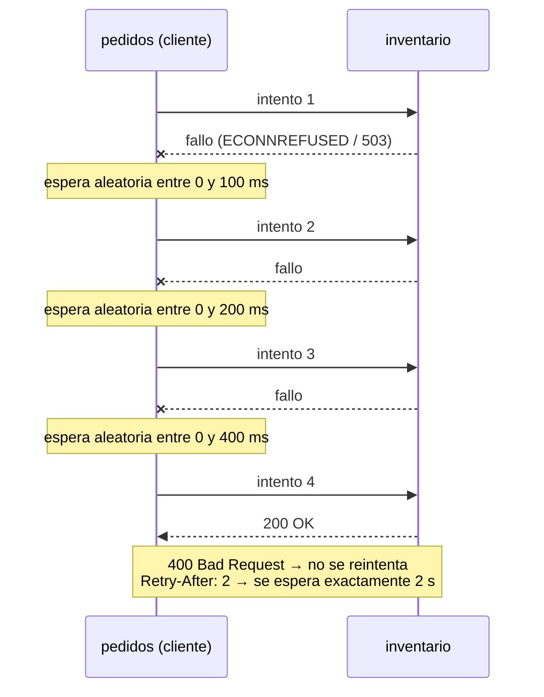
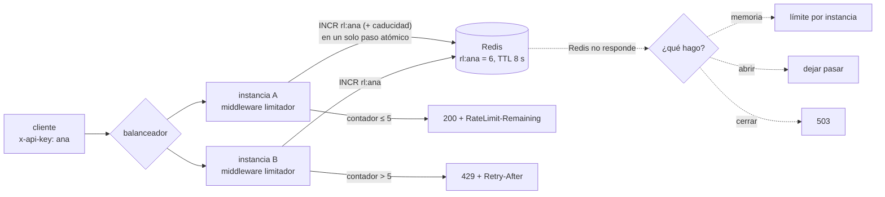
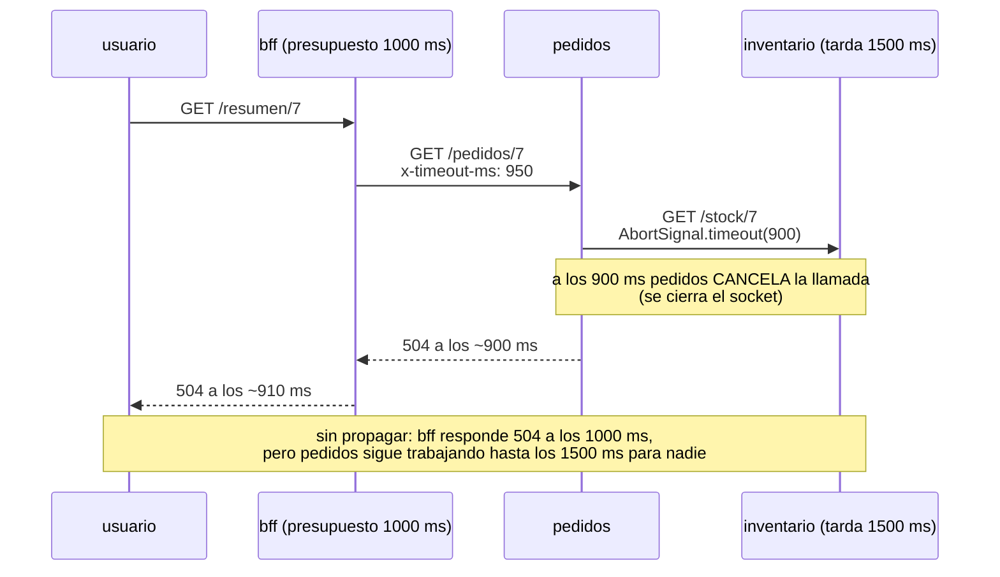
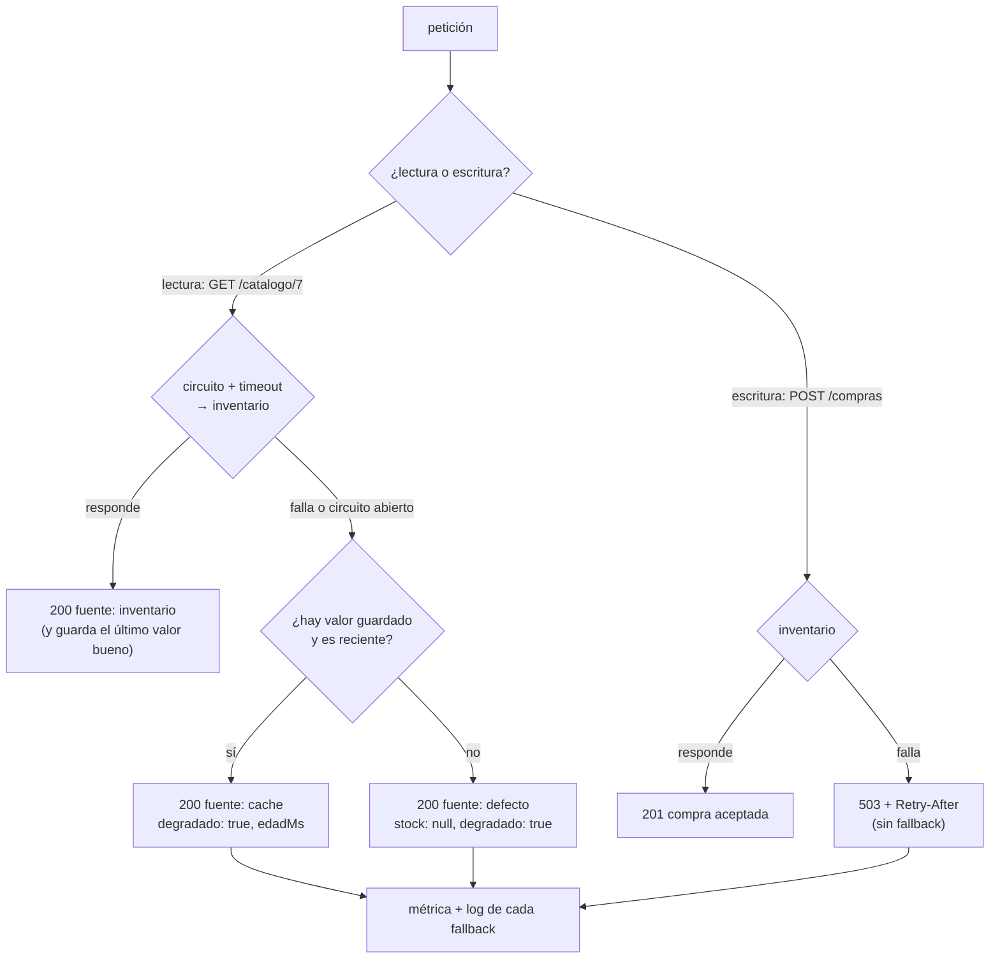

# Módulo 19 · Resiliencia

**Fase 2 · Node.js de cero a experto** (media semana de 12). **Duración:** 8 h (5 temas de unos 80 min y 1 h 20 min de
laboratorio integrador). **Dificultad:** 4 de 5. **Dependencias:** Módulo 18 (REST con Axios/Fetch, sync vs async) y
Módulo 13 (Promises, `async/await`, Event Loop, graceful shutdown); ayuda haber hecho el Módulo 14 (Express).
**Herramientas:**Node.js 26.13.1 LTS**, **TypeScript 6.0.3**, **opossum 10.0.0**, **cockatiel 4.0.0**,
**redis (node-redis) 6.3.1**, **rate-limiter-flexible 11.5.0**, **express 5.3.0**, **Redis 8.10.2** y **Toxiproxy
2.13.0**..

En un sistema distribuido **fallar es lo normal**: una red pierde paquetes, un servicio se queda sin memoria, un
despliegue reinicia pods. La resiliencia no evita esos fallos; consigue que **un fallo pequeño no se convierta en una
caída completa**. En este módulo proteges un servicio Node.js con cinco defensas: cortar las llamadas a una dependencia
rota (circuit breaker), reintentar lo pasajero sin crear una avalancha (retry con jitter), no aceptar más de lo que
puedes atender (rate limiting), no esperar para siempre (timeouts) y tener una respuesta digna cuando todo lo anterior
no alcanza (fallbacks).



**Texto alternativo:** mapa del módulo. Los timeouts (tema 4) son la base del retry con jitter (tema 2) y del circuit
breaker (tema 1); el retry también alimenta al circuit breaker. El circuit breaker y el rate limiting con Redis
(tema 3) desembocan en las estrategias de fallback (tema 5). Las fichas siguen el orden del temario (1 a 5), pero
puedes leer primero la 4 si nunca has puesto un timeout.

**Regla del módulo:** cada tema trae una **Simulación del fallo**: un script que inyecta el fallo con **Toxiproxy**
(un proxy TCP al que le pides por HTTP que añada latencia, corte conexiones o las deje colgadas) y muestra el
comportamiento observado, con la salida real.

**Cómo usar el laboratorio.** Con Node 26 y Docker en marcha:

```bash
npm ci
docker compose up -d --wait      # inventario (:9000), Redis (:6379) y Toxiproxy (:8474 → :21212 y :26379)
los comandos de verificación indicados         # 25 tests + simulaciones de las 5 fichas → «RESULTADO: OK»
docker compose down
```

arriba. Tus servicios Node corren en tu máquina y llaman al inventario **a través de Toxiproxy** (`127.0.0.1:21212`) y
a Redis también (`127.0.0.1:26379`): así el script de simulación puede estropear la red sin tocar tu código. Si no
tienes Docker, `./infra.sh up` usa los binarios `toxiproxy-server` y `redis-server` de tu máquina (en macOS:
`brew install toxiproxy redis`).

`package.json` del laboratorio (con `package-lock.json` que fija el árbol completo):

```json
{
  "name": "modulo-19-resiliencia-node",
  "version": "1.0.0",
  "private": true,
  "description": "Módulo 19 (Fase 2): Resiliencia en Node.js (circuit breaker, retry con jitter, rate limiting con Redis, timeouts y fallbacks).",
  "type": "module",
  "engines": {
    "node": ">=26.13.1"
  },
  "scripts": {
    "tipos": "tsc -p tsconfig.json",
    "test": "node --test --test-concurrency=1 'f1*/*.test.js'"
  },
  "dependencies": {
    "cockatiel": "4.0.0",
    "express": "5.3.0",
    "opossum": "10.0.0",
    "rate-limiter-flexible": "11.5.0",
    "redis": "6.3.1"
  },
  "devDependencies": {
    "@types/node": "26.6.6",
    "typescript": "6.0.3"
  }
}
```

`docker-compose.yml`:

```yaml
# Módulo 19 (modulo-23) · Resiliencia en Node.js: inventario + Redis, con Toxiproxy delante de los dos.
#   docker compose up -d --wait
#   curl localhost:21212/stock/7            -> {"sku":"7","stock":12}   (inventario a través de Toxiproxy)
#   ./simular-fallo.sh lento 2000           -> 2 s de latencia en el inventario (ver simular-fallo.sh)
#   ./simular-fallo.sh caido redis          -> Redis «caído» para el rate limiter
#   docker compose down
# Tus servicios Node (f119…f123) corren en tu máquina y llaman a 127.0.0.1:21212 (inventario) y 127.0.0.1:26379 (Redis).
services:
  inventario:
    image: node:26-alpine
    working_dir: /lab
    command: ["node", "comun/inventario.js", "9000"]
    volumes: ["./comun:/lab/comun:ro"]
    ports: ["9000:9000"]          # directo, sin proxy: solo para las rutas de control (/contador, /reiniciar)
    healthcheck:
      test: ["CMD", "node", "-e", "fetch('http://127.0.0.1:9000/salud').then(r=>process.exit(r.ok?0:1),()=>process.exit(1))"]
      interval: 2s
      timeout: 2s
      retries: 30
  redis:
    image: redis:8.10.2-alpine
    command: ["redis-server", "--save", "", "--appendonly", "no"]
    ports: ["6379:6379"]          # directo, sin proxy: para redis-cli y los tests
    healthcheck:
      test: ["CMD", "redis-cli", "ping"]
      interval: 2s
      timeout: 2s
      retries: 30
  toxiproxy:
    image: ghcr.io/shopify/toxiproxy:2.13.0
    # API de control en 8474; los proxies "inventario" (21212) y "redis" (26379) se crean desde toxiproxy.json.
    command: ["-host=0.0.0.0", "-config=/config/toxiproxy.json"]
    volumes: ["./toxiproxy.json:/config/toxiproxy.json:ro"]
    ports: ["8474:8474", "21212:21212", "26379:26379"]
    depends_on:
      inventario:
        condition: service_healthy
      redis:
        condition: service_healthy
```

`toxiproxy.json` (los dos proxies que Toxiproxy crea al arrancar):

```json
[
  { "name": "inventario", "listen": "0.0.0.0:21212", "upstream": "inventario:9000", "enabled": true },
  { "name": "redis", "listen": "0.0.0.0:26379", "upstream": "redis:6379", "enabled": true }
]
```

`comun/inventario.js`, la dependencia a la que le vas a provocar fallos (un servidor HTTP sin librerías):

```javascript
// Módulo 19 · Servicio «inventario»: la dependencia a la que le vamos a provocar fallos.
// Requisitos: Node.js 26.13.1 LTS (sin dependencias). Ejecuta: node comun/inventario.js [puerto]
import http from 'node:http';

const STOCK = { 7: 12, 8: 0, 9: 3 };
const estado = { consultas: 0, intentosDeReserva: 0, reservasCreadas: 0 };
const porClave = new Map(); // Idempotency-Key -> reserva ya creada

function responder(res, status, cuerpo) {
  res.writeHead(status, { 'content-type': 'application/json' });
  res.end(JSON.stringify(cuerpo));
}

const servidor = http.createServer((req, res) => {
  const url = new URL(req.url, 'http://inventario');
  const stock = url.pathname.match(/^\/stock\/(\w+)$/);
  if (req.method === 'GET' && stock) {
    estado.consultas += 1;
    const sku = stock[1];
    if (!(sku in STOCK)) return responder(res, 404, { error: `sku ${sku} desconocido` });
    return responder(res, 200, { sku, stock: STOCK[sku] });
  }
  if (req.method === 'POST' && url.pathname === '/reservas') {
    estado.intentosDeReserva += 1;
    const clave = req.headers['idempotency-key'];
    if (clave && porClave.has(clave)) return responder(res, 200, porClave.get(clave)); // repetida: misma respuesta
    estado.reservasCreadas += 1;
    const reserva = { reserva: estado.reservasCreadas };
    if (clave) porClave.set(clave, reserva);
    return responder(res, 201, reserva);
  }
  // Rutas de control del laboratorio: úsalas directo en el puerto 9000 (sin pasar por Toxiproxy).
  if (req.method === 'GET' && url.pathname === '/contador') return responder(res, 200, estado);
  if (req.method === 'POST' && url.pathname === '/reiniciar') {
    estado.consultas = 0; estado.intentosDeReserva = 0; estado.reservasCreadas = 0; porClave.clear();
    return responder(res, 200, estado);
  }
  if (url.pathname === '/salud') return responder(res, 200, { estado: 'ok' });
  responder(res, 404, { error: 'ruta desconocida' });
});

const puerto = Number(process.argv[2] ?? process.env.PORT ?? 9000);
servidor.listen(puerto, () => console.log(`inventario escuchando en :${puerto}`));
process.on('SIGTERM', () => servidor.close(() => process.exit(0)));
```

`comun/toxiproxy.js`: funciones con las que los scripts de simulación le hablan a Toxiproxy.

```javascript
// Módulo 19 · Cliente mínimo de la API HTTP de Toxiproxy 2.13.0 (puerto 8474) para los scripts de simulación.
// Requisitos: Node.js 26.13.1 LTS (usa fetch nativo). La infraestructura se levanta con docker compose up -d --wait.
export const TOXIPROXY_API = process.env.TOXIPROXY_API ?? 'http://127.0.0.1:8474';
export const INVENTARIO_URL = process.env.INVENTARIO_URL ?? 'http://127.0.0.1:21212'; // inventario A TRAVÉS de Toxiproxy
export const INVENTARIO_DIRECTO = process.env.INVENTARIO_DIRECTO ?? 'http://127.0.0.1:9000'; // sin proxy (control)
export const REDIS_URL = process.env.REDIS_URL ?? 'redis://127.0.0.1:26379'; // Redis A TRAVÉS de Toxiproxy

async function api(metodo, ruta, cuerpo) {
  const r = await fetch(`${TOXIPROXY_API}${ruta}`, {
    method: metodo,
    headers: { 'content-type': 'application/json' },
    body: cuerpo ? JSON.stringify(cuerpo) : undefined,
  });
  if (!r.ok) throw new Error(`Toxiproxy ${metodo} ${ruta} -> ${r.status} ${await r.text()}`);
  return r.status === 204 ? null : r.json();
}

/** Latencia fija en cada respuesta (toxic "latency"). */
export const lento = (proxy, ms) => api('POST', `/proxies/${proxy}/toxics`, {
  name: 'lento', type: 'latency', stream: 'downstream', toxicity: 1, attributes: { latency: ms, jitter: 0 },
});
/** Acepta la conexión y nunca entrega datos (toxic "timeout" con timeout 0). */
export const cuelga = (proxy) => api('POST', `/proxies/${proxy}/toxics`, {
  name: 'cuelga', type: 'timeout', stream: 'downstream', toxicity: 1, attributes: { timeout: 0 },
});
/** Apaga el proxy: conexión rechazada, como un servicio caído. */
export const apagar = (proxy) => api('POST', `/proxies/${proxy}`, { enabled: false });
export const encender = (proxy) => api('POST', `/proxies/${proxy}`, { enabled: true });
/** Quita todos los toxics y enciende todos los proxies. */
export const sanar = () => api('POST', '/reset');

export const dormir = (ms) => new Promise((ok) => setTimeout(ok, ms));
export const control = (ruta, metodo = 'GET') => fetch(`${INVENTARIO_DIRECTO}${ruta}`, { method: metodo }).then((r) => r.json());
```

`simular-fallo.sh`, lo mismo desde la terminal (para los pasos manuales):

```bash
#!/usr/bin/env bash
# Simula fallos con la API HTTP de Toxiproxy 2.13.0 (puerto 8474). Requiere la infraestructura arriba
# (docker compose up -d --wait, o ./infra.sh up). El proxy por defecto es "inventario"; el otro es "redis".
# Uso:
#   ./simular-fallo.sh lento [ms] [proxy]   latencia en cada respuesta (toxic "latency", 2000 ms por defecto)
#   ./simular-fallo.sh caido [proxy]        apaga el proxy: conexión rechazada (enabled=false)
#   ./simular-fallo.sh cuelga [proxy]       acepta la conexión y nunca responde (toxic "timeout" con 0)
#   ./simular-fallo.sh sano                 quita todos los toxics y enciende todos los proxies (POST /reset)
#   ./simular-fallo.sh estado [proxy]       muestra el proxy y sus toxics activos
set -eu
API=${TOXIPROXY_API:-http://127.0.0.1:8474}
case "${1:-estado}" in
  lento)
    P=${3:-inventario}
    curl -fsS -X POST "$API/proxies/$P/toxics" -H 'Content-Type: application/json' \
      -d "{\"name\":\"lento\",\"type\":\"latency\",\"stream\":\"downstream\",\"toxicity\":1.0,\"attributes\":{\"latency\":${2:-2000},\"jitter\":0}}"
    ;;
  caido)
    curl -fsS -X POST "$API/proxies/${2:-inventario}" -H 'Content-Type: application/json' -d '{"enabled":false}'
    ;;
  cuelga)
    curl -fsS -X POST "$API/proxies/${2:-inventario}/toxics" -H 'Content-Type: application/json' \
      -d '{"name":"cuelga","type":"timeout","stream":"downstream","toxicity":1.0,"attributes":{"timeout":0}}'
    ;;
  sano)
    curl -fsS -X POST "$API/reset"
    ;;
  estado)
    curl -fsS "$API/proxies/${2:-inventario}"
    ;;
  *)
    echo "uso: $0 lento [ms] [proxy] | caido [proxy] | cuelga [proxy] | sano | estado [proxy]" >&2
    exit 2
    ;;
esac
echo
```

---

### Circuit Breaker con opossum o cockatiel

#### 1. UBICACIÓN

Módulo 19, Lección 1 de 5 · Fase 2.

#### 2. PRERREQUISITOS

- Llamar a otro servicio con `fetch` y `async/await`, y distinguir un 4xx de un 5xx (Módulo 18, ficha «REST con Axios/Fetch»).
- Saber qué es un timeout (ficha 4 de este módulo; puedes leerla antes).
- Middleware y rutas de Express (Módulo 14).

#### 3. OBJETIVO DE APRENDIZAJE

**Implementar** un circuit breaker con opossum delante de una dependencia HTTP, **configurar** su umbral, su ventana y
su tiempo de recuperación, y **demostrar** con Toxiproxy que, con la dependencia caída, las llamadas se rechazan en
0 ms sin tocar la red y que el circuito se cierra solo cuando la dependencia vuelve. Lo compruebas cuando
`node --test f119-circuit-breaker/circuito.test.js` pasa 5 de 5 y `simulacion.js` termina en `OK`.

#### 4. ANALOGÍA VISUAL

Dibuja el **tablero eléctrico de una casa**. Cada circuito (cocina, baño, sala) tiene su **interruptor automático**
(el «breaker»). Cuando la tostadora hace cortocircuito, el interruptor de la cocina **salta** y corta la corriente de
esa zona: la sala sigue con luz y los cables no se queman. Mientras está abajo, por más que pulses el botón de la
tostadora no pasa nada (rechazo inmediato). Al rato subes la palanca **con cuidado**: si la tostadora sigue rota, salta
otra vez; si ya la arreglaron, la luz vuelve. Dibuja tres posiciones de la palanca: **arriba** (pasa corriente,
«cerrado»), **abajo** (no pasa, «abierto») y una mano **probando** a subirla («semiabierto»). Ojo con el nombre: en
electricidad, circuito *cerrado* es el que **funciona**.

#### 5. DIAGRAMA TÉCNICO



**Texto alternativo:** diagrama de estados del circuito. Empieza en CERRADO, donde las llamadas pasan y se cuentan
éxitos y fallos. Pasa a ABIERTO cuando falla más del 50 % con al menos 4 llamadas en la ventana; en ABIERTO las llamadas
se rechazan al instante con el error EOPENBREAKER, sin usar la red. Tras el resetTimeout de 1 segundo pasa a
SEMIABIERTO, que deja pasar una llamada de prueba: si sale bien vuelve a CERRADO y si falla regresa a ABIERTO.

#### 6. EXPLICACIÓN NIVEL 0

- Tu servicio (pedidos) le pregunta cosas a otro (inventario). Si el inventario se cae, cada pregunta **tarda y
  falla**. Si llegan 500 preguntas por segundo, tu servicio se llena de preguntas esperando y **se cae también**.
- Un **circuit breaker** (cortacircuitos) es un vigilante entre los dos. Cuenta cuántas preguntas fallan. Si fallan
  demasiadas, **deja de preguntar** durante un rato y responde enseguida «ahora no se puede».
- Pasado ese rato deja pasar **una** pregunta de prueba. Si funciona, todo vuelve a la normalidad. Si no, sigue
  cortado.
- Ganas dos cosas: tu servicio no se hunde esperando, y el inventario, que está intentando recuperarse, **deja de
  recibir golpes**.

#### 7. EXPLICACIÓN INTERMEDIA

- **opossum** envuelve una función asíncrona: `new CircuitBreaker(accion, opciones)` y la llamas con
  `circuito.fire(args)`. Cuenta resultados en una **ventana deslizante** (`rollingCountTimeout` repartido en
  `rollingCountBuckets` cubetas).
- **Cuándo se abre** (lo ves en `lib/circuit.js` de opossum 10.0.0): tras cada fallo, si en la ventana hay al menos
  `volumeThreshold` llamadas y la tasa de error es **estrictamente mayor** que `errorThresholdPercentage`. Con 50 %,
  2 fallos de 4 no abren; 3 de 5 sí.
- **Abierto:** `fire()` rechaza con un error cuyo `code` es `EOPENBREAKER` y emite `reject`; tu función ni se ejecuta.
- **Semiabierto:** pasado `resetTimeout` emite `halfOpen` y deja pasar una llamada. Éxito → `close`; fallo → `open`.
- **Qué cuenta como fallo:** cualquier rechazo de la función, salvo los que `errorFilter(error)` marque con `true`. Un
  404 es una respuesta correcta del inventario («ese producto no existe»): no debe abrir el circuito.
- **`timeout`** de opossum (10 s por defecto) solo rechaza la promesa; no cancela la petición. Aquí se desactiva
  (`timeout: false`) y el límite lo pone `AbortSignal.timeout`, que sí cierra el socket (ficha 4).
- **Eventos** (`open`, `halfOpen`, `close`, `reject`, `failure`, `success`, `timeout`, `fallback`) y `circuito.stats`
  (`fires`, `successes`, `failures`, `rejects`…) son tu fuente de logs y métricas.
- **cockatiel** hace lo mismo con **políticas componibles**: `circuitBreaker(handleWhen(...), { halfOpenAfter,
  breaker })`, donde `breaker` es `ConsecutiveBreaker(n)` (n fallos seguidos) o `SamplingBreaker` (porcentaje en una
  ventana), y `wrap(a, b)` las combina con `timeout`, `retry`, `bulkhead` y `fallback`.

#### 8. EXPLICACIÓN MAESTRA

- **opossum vs cockatiel vs la malla.** *opossum*: JavaScript, basado en eventos, con extras (fallback, caché,
  métricas para Prometheus con `opossum-prometheus`); solo trae el circuito. *cockatiel*: escrito en TypeScript, sin
  dependencias, modela **todas** las políticas (retry, timeout, bulkhead, circuito, fallback) y las compone con tipos;
  es la opción natural en un proyecto TypeScript. *Service mesh* (Istio/Linkerd, Módulo 27): el circuito vive en el
  proxy lateral, igual para todos los lenguajes y sin tocar código, pero solo ve conexiones y códigos HTTP, no tu
  lógica de negocio, y no puede darte un fallback. Trade-off: control fino en el código frente a uniformidad en la
  plataforma. Lo habitual es malla para lo genérico y librería donde necesitas fallback.
- **Un circuito por dependencia (y a veces por operación).** Si `GET /stock` va bien y `POST /reservas` está roto, un
  solo circuito para todo el inventario te deja sin lecturas. Y al revés: un circuito por URL con id (`/stock/7`,
  `/stock/8`…) nunca junta volumen suficiente.
- **El estado es por proceso.** Con 10 réplicas, cada una abre su circuito cuando *ella* ve los fallos. Casi siempre
  es lo correcto (cada réplica reacciona a su propia vista de la red). Compartir el estado en Redis añade otra
  dependencia que puede fallar.
- **Umbral por conteo vs por porcentaje.** `ConsecutiveBreaker(3)` es fácil de razonar pero se abre con 3 fallos
  aislados de mala suerte a bajo tráfico y nunca con un 40 % de fallos intercalados. El porcentaje con volumen mínimo
  es más robusto en servicios con mucho tráfico.
- **Semiabierto bajo carga.** opossum deja pasar una sola llamada de prueba; el resto se sigue rechazando. Si tu
  `resetTimeout` es muy corto, martilleas a un servicio que arranca; si es muy largo, tardas en recuperarte. Empieza
  por el tiempo que tarda la dependencia en reiniciar.
- **Cuándo NO usarlo:** en llamadas a recursos locales (memoria, disco), con tan poco tráfico que la ventana nunca
  llega al volumen mínimo, o como sustituto de un timeout (el circuito se alimenta de fallos: sin timeout, una
  dependencia colgada no produce ninguno).

#### 9. CÓDIGO EJECUTABLE

Versiones: **Node.js 26.13.1 LTS**, **opossum 10.0.0**, **cockatiel 4.0.0**, **express 5.3.0** y **TypeScript 6.0.3**
(dependencias del `package.json` del laboratorio).

`f119-circuit-breaker/cliente-inventario.js` (el circuito):

```javascript
// Módulo 19 · F119 · Circuit Breaker con opossum: el cliente del inventario protegido por un circuito.
// Requisitos: Node.js 26.13.1 LTS y opossum 10.0.0 (package.json del laboratorio).
import CircuitBreaker from 'opossum';

/** Error de negocio (4xx): el inventario respondió bien, aunque la respuesta sea «no». No debe abrir el circuito. */
export class ErrorDeNegocio extends Error {
  constructor(status, detalle) {
    super(detalle);
    this.name = 'ErrorDeNegocio';
    this.status = status;
  }
}

/** La llamada «desnuda»: un GET con límite de tiempo. Lanza si no hay conexión, si tarda o si responde 5xx. */
export async function consultarStock(urlBase, sku, { timeoutMs = 1000 } = {}) {
  const r = await fetch(`${urlBase}/stock/${sku}`, { signal: AbortSignal.timeout(timeoutMs) });
  if (r.status >= 500) throw new Error(`inventario respondió ${r.status}`);
  if (!r.ok) throw new ErrorDeNegocio(r.status, (await r.json()).error);
  return r.json();
}

export const OPCIONES_POR_DEFECTO = {
  name: 'inventario',
  timeout: false,               // el límite de tiempo ya lo pone AbortSignal.timeout (y sí cancela la petición)
  volumeThreshold: 4,           // no decide nada hasta ver 4 llamadas en la ventana…
  errorThresholdPercentage: 50, // …y abre cuando falla MÁS del 50 % (comparación estricta: 2 de 4 no abre, 3 de 5 sí)
  rollingCountTimeout: 10_000,  // ventana deslizante de 10 s…
  rollingCountBuckets: 10,      // …en 10 cubetas de 1 s
  resetTimeout: 1000,           // tras 1 s abierto deja pasar UNA llamada de prueba (semiabierto)
};

/**
 * Crea UN circuito para el inventario (uno por dependencia, creado una sola vez al arrancar).
 * `accion` es inyectable para poder probarlo sin red.
 */
export function crearCircuitoDeInventario(urlBase, opciones = {}, accion = (sku) => consultarStock(urlBase, sku)) {
  const circuito = new CircuitBreaker(accion, {
    ...OPCIONES_POR_DEFECTO,
    errorFilter: (error) => error instanceof ErrorDeNegocio, // true = «esto NO cuenta como fallo»
    ...opciones,
  });
  return circuito;
}

/** Estado legible del circuito: CERRADO, ABIERTO o SEMIABIERTO. */
export function estadoDe(circuito) {
  if (circuito.opened) return 'ABIERTO';
  if (circuito.halfOpen) return 'SEMIABIERTO';
  return 'CERRADO';
}
```

`f119-circuit-breaker/servicio.js` (el servicio «pedidos» que lo usa):

```javascript
// Módulo 19 · F119 · Servicio «pedidos» (Express 5.3.0) que consulta el inventario detrás de un circuito opossum 10.0.0.
// Requisitos: Node.js 26.13.1 LTS. Ejecuta: node f119-circuit-breaker/servicio.js   (PORT=3119 por defecto)
import express from 'express';
import { crearCircuitoDeInventario, ErrorDeNegocio, estadoDe } from './cliente-inventario.js';

const INVENTARIO_URL = process.env.INVENTARIO_URL ?? 'http://127.0.0.1:21212';

export function crearApp(circuito = crearCircuitoDeInventario(INVENTARIO_URL)) {
  const app = express();
  // Cada cambio de estado queda en el log: es lo primero que mirarás en un incidente.
  for (const evento of ['open', 'halfOpen', 'close']) {
    circuito.on(evento, () => console.log(`[circuito ${circuito.name}] ${evento} -> ${estadoDe(circuito)}`));
  }

  app.get('/pedidos/stock/:sku', async (req, res) => {
    try {
      res.json(await circuito.fire(req.params.sku));
    } catch (error) {
      if (error instanceof ErrorDeNegocio) return res.status(error.status).json({ error: error.message });
      if (error.code === 'EOPENBREAKER') {
        // Circuito abierto: respondemos al instante, sin tocar la red, y decimos cuándo volver a intentar.
        res.set('Retry-After', String(Math.ceil(circuito.options.resetTimeout / 1000)));
        return res.status(503).json({ error: 'inventario no disponible', circuito: 'ABIERTO' });
      }
      res.status(502).json({ error: 'fallo al consultar el inventario', causa: error.cause?.code ?? error.name });
    }
  });

  app.get('/circuito', (_req, res) => {
    const { fires, successes, failures, rejects, timeouts } = circuito.stats;
    res.json({ estado: estadoDe(circuito), fires, successes, failures, rejects, timeouts });
  });
  return app;
}

if (import.meta.main) {
  const puerto = Number(process.env.PORT ?? 3119);
  crearApp().listen(puerto, () => console.log(`pedidos (F119) en :${puerto} -> inventario ${INVENTARIO_URL}`));
}
```

`f119-circuit-breaker/cockatiel.ts` (la alternativa: el mismo comportamiento con cockatiel, en TypeScript; Node 26
ejecuta el `.ts` quitando los tipos y `npm run tipos` los comprueba con `tsc --noEmit`):

`comun/toxiproxy.js`: utilidades de Toxiproxy usadas en esta ficha.

```typescript
// Módulo 19 · F119 · El mismo circuito con cockatiel 4.0.0, en TypeScript (políticas componibles y tipadas).
// Requisitos: Node.js 26.13.1 LTS (ejecuta .ts quitando los tipos) y TypeScript 6.0.3 para comprobarlos (npm run tipos).
// Ejecuta con la infraestructura arriba: node f119-circuit-breaker/cockatiel.ts
import {
  BrokenCircuitError, CircuitState, ConsecutiveBreaker, circuitBreaker, handleWhen, timeout, TimeoutStrategy, wrap,
  type IPolicy,
} from 'cockatiel';
import { apagar, encender, sanar, dormir, INVENTARIO_URL } from '../comun/toxiproxy.js';

interface Stock { sku: string; stock: number }
class ErrorDeNegocio extends Error {}

// Política 1: límite de tiempo de 500 ms. «Aggressive» rechaza al vencer y aborta la señal que recibe la función.
const limite = timeout(500, TimeoutStrategy.Aggressive);
// Política 2: el circuito. Se abre con 3 fallos SEGUIDOS y prueba de nuevo tras 1 s.
// handleWhen decide qué errores cuentan: los de negocio (4xx) no.
const circuito = circuitBreaker(handleWhen((error) => !(error instanceof ErrorDeNegocio)), {
  halfOpenAfter: 1000,
  breaker: new ConsecutiveBreaker(3),
});
// wrap compone de fuera hacia dentro: primero el circuito, dentro el límite de tiempo.
const politica: IPolicy = wrap(circuito, limite);

const cambios: string[] = []; // los eventos llegan durante la llamada: se muestran después de su línea
circuito.onBreak(() => cambios.push('Open'));
circuito.onHalfOpen(() => cambios.push('HalfOpen (llamada de prueba)'));
circuito.onReset(() => cambios.push('Closed'));

const NOMBRE = { [CircuitState.Closed]: 'Closed', [CircuitState.Open]: 'Open', [CircuitState.HalfOpen]: 'HalfOpen', [CircuitState.Isolated]: 'Isolated' };

async function consultarStock(sku: string): Promise<Stock> {
  return politica.execute(async ({ signal }) => {
    const r = await fetch(`${INVENTARIO_URL}/stock/${sku}`, { signal });
    if (r.status >= 500) throw new Error(`inventario respondió ${r.status}`);
    if (!r.ok) throw new ErrorDeNegocio(`sku ${sku} desconocido`);
    return (await r.json()) as Stock;
  });
}

async function llamar(n: number): Promise<void> {
  const antes = NOMBRE[circuito.state];
  try {
    console.log(`llamada ${n} [${antes}] OK ${JSON.stringify(await consultarStock('7'))}`);
  } catch (error) {
    const texto = error instanceof BrokenCircuitError ? 'RECHAZADA (BrokenCircuitError)' : `FALLO ${(error as { cause?: { code?: string } }).cause?.code ?? (error as Error).name}`;
    console.log(`llamada ${n} [${antes}] ${texto}`);
  }
  while (cambios.length > 0) console.log(`   -> el circuito pasa a ${cambios.shift()}`);
}

await sanar();
await llamar(1);
await apagar('inventario'); // fallo inyectado con Toxiproxy
for (let n = 2; n <= 5; n += 1) await llamar(n);
await encender('inventario');
await dormir(1100);
await llamar(6);
await llamar(7);
if (circuito.state !== CircuitState.Closed) throw new Error('el circuito debía terminar cerrado');
console.log('OK: cockatiel abrió con 3 fallos seguidos, rechazó y se cerró al volver el inventario');
```

Salida real de `node f119-circuit-breaker/cockatiel.ts` (Node 26.13.1, cockatiel 4.0.0, Toxiproxy 2.13.0):

```text
llamada 1 [Closed] OK {"sku":"7","stock":12}
llamada 2 [Closed] FALLO ECONNREFUSED
llamada 3 [Closed] FALLO ECONNREFUSED
llamada 4 [Closed] FALLO ECONNREFUSED
   -> el circuito pasa a Open
llamada 5 [Open] RECHAZADA (BrokenCircuitError)
llamada 6 [Open] OK {"sku":"7","stock":12}
   -> el circuito pasa a HalfOpen (llamada de prueba)
   -> el circuito pasa a Closed
llamada 7 [Closed] OK {"sku":"7","stock":12}
OK: cockatiel abrió con 3 fallos seguidos, rechazó y se cerró al volver el inventario
```

#### 10. MINI-LABORATORIO

**Simulación del fallo.** `f119-circuit-breaker/simulacion.js` hace dos llamadas con el inventario sano, le pide a
Toxiproxy que **apague el proxy** (conexión rechazada, como un servicio caído), hace seis llamadas más, vuelve a
encender el proxy y espera el `resetTimeout`:

```javascript
// Módulo 19 · F119 · Simulación del fallo: Toxiproxy «tumba» el inventario y el circuito se abre, rechaza y se recupera.
// Requisitos: infraestructura arriba (docker compose up -d --wait). Ejecuta: node f119-circuit-breaker/simulacion.js
import assert from 'node:assert/strict';
import { apagar, encender, sanar, dormir, control, INVENTARIO_URL } from '../comun/toxiproxy.js';
import { crearCircuitoDeInventario, estadoDe } from './cliente-inventario.js';

await sanar();
await control('/reiniciar', 'POST');
const circuito = crearCircuitoDeInventario(INVENTARIO_URL);
const cambios = []; // los eventos llegan durante la llamada: los mostramos justo después de su línea
circuito.on('open', () => cambios.push('ABIERTO'));
circuito.on('halfOpen', () => console.log('   -> pasó resetTimeout: el circuito pasa a SEMIABIERTO (deja pasar una llamada de prueba)'));
circuito.on('close', () => cambios.push('CERRADO'));

let n = 0;
async function llamar() {
  n += 1;
  const antes = estadoDe(circuito);
  const inicio = performance.now();
  let resultado;
  try {
    resultado = `OK ${JSON.stringify(await circuito.fire('7'))}`;
  } catch (error) {
    resultado = error.code === 'EOPENBREAKER' ? 'RECHAZADA (EOPENBREAKER), sin tocar la red' : `FALLO ${error.cause?.code ?? error.name}`;
  }
  console.log(`llamada ${n} [${antes}] ${resultado} (${Math.round(performance.now() - inicio)} ms)`);
  while (cambios.length) console.log(`   -> el circuito pasa a ${cambios.shift()}`);
}

console.log('== 1. Inventario sano');
await llamar(); await llamar();
console.log('== 2. Fallo inyectado: Toxiproxy apaga el proxy "inventario" (conexión rechazada)');
await apagar('inventario');
for (let i = 0; i < 6; i += 1) await llamar();
const trasElFallo = (await control('/contador')).consultas;
console.log(`   el inventario recibió ${trasElFallo} consultas en total: las rechazadas no llegaron a la red`);
console.log('== 3. El inventario vuelve; esperamos resetTimeout (1 s)');
await encender('inventario');
await dormir(1100);
await llamar(); await llamar();

assert.equal(trasElFallo, 2);
assert.equal(estadoDe(circuito), 'CERRADO');
assert.equal(circuito.stats.rejects, 3);
console.log(`estadísticas: fires=${circuito.stats.fires} successes=${circuito.stats.successes} failures=${circuito.stats.failures} rejects=${circuito.stats.rejects}`);
console.log('OK: el circuito se abrió, rechazó sin tocar la red y se cerró al recuperarse el inventario');
circuito.shutdown();
```

1. Levanta la infraestructura y ejecuta la simulación:

```bash
npm ci
docker compose up -d --wait
node f119-circuit-breaker/simulacion.js
```

   **Output esperado** (los milisegundos varían):

```text
== 1. Inventario sano
llamada 1 [CERRADO] OK {"sku":"7","stock":12} (5 ms)
llamada 2 [CERRADO] OK {"sku":"7","stock":12} (4 ms)
== 2. Fallo inyectado: Toxiproxy apaga el proxy "inventario" (conexión rechazada)
llamada 3 [CERRADO] FALLO ECONNREFUSED (4 ms)
llamada 4 [CERRADO] FALLO ECONNREFUSED (1 ms)
llamada 5 [CERRADO] FALLO ECONNREFUSED (1 ms)
   -> el circuito pasa a ABIERTO
llamada 6 [ABIERTO] RECHAZADA (EOPENBREAKER), sin tocar la red (0 ms)
llamada 7 [ABIERTO] RECHAZADA (EOPENBREAKER), sin tocar la red (0 ms)
llamada 8 [ABIERTO] RECHAZADA (EOPENBREAKER), sin tocar la red (0 ms)
   el inventario recibió 2 consultas en total: las rechazadas no llegaron a la red
== 3. El inventario vuelve; esperamos resetTimeout (1 s)
   -> pasó resetTimeout: el circuito pasa a SEMIABIERTO (deja pasar una llamada de prueba)
llamada 9 [SEMIABIERTO] OK {"sku":"7","stock":12} (4 ms)
   -> el circuito pasa a CERRADO
llamada 10 [CERRADO] OK {"sku":"7","stock":12} (3 ms)
estadísticas: fires=10 successes=4 failures=3 rejects=3
OK: el circuito se abrió, rechazó sin tocar la red y se cerró al recuperarse el inventario
```

   **Comportamiento observado:** las llamadas 3, 4 y 5 fallan de verdad (`ECONNREFUSED`); con la 5 la tasa de error es
   3 de 5 (60 % > 50 %) y el circuito se abre. Las llamadas 6, 7 y 8 se rechazan en **0 ms** y el inventario no las
   recibe: su contador sigue en 2. Tras 1 s, la llamada 9 pasa como prueba, sale bien y el circuito se cierra.

2. Ahora a mano, con el servicio HTTP. En una terminal: `node f119-circuit-breaker/servicio.js`. En otra:

```bash
curl -s -w " [%{http_code}]\n" 127.0.0.1:3119/pedidos/stock/7
./simular-fallo.sh caido > /dev/null
for i in 1 2 3 4 5; do curl -s -w " [%{http_code}]\n" 127.0.0.1:3119/pedidos/stock/7; done
curl -s 127.0.0.1:3119/circuito
./simular-fallo.sh sano > /dev/null && sleep 1.2 && curl -s -w " [%{http_code}]\n" 127.0.0.1:3119/pedidos/stock/7
```

   **Output esperado:**

```text
{"sku":"7","stock":12} [200]
{"error":"fallo al consultar el inventario","causa":"ECONNREFUSED"} [502]
{"error":"fallo al consultar el inventario","causa":"ECONNREFUSED"} [502]
{"error":"fallo al consultar el inventario","causa":"ECONNREFUSED"} [502]
{"error":"inventario no disponible","circuito":"ABIERTO"} [503]
{"error":"inventario no disponible","circuito":"ABIERTO"} [503]
{"estado":"ABIERTO","fires":6,"successes":1,"failures":3,"rejects":2,"timeouts":0}
{"sku":"7","stock":12} [200]
```

   **Captura comentada:** en la terminal del servicio ves tres líneas, una por cambio de estado:
   `[circuito inventario] open -> ABIERTO` justo después del tercer 502, y `[circuito inventario] halfOpen ->
   SEMIABIERTO` seguida de `[circuito inventario] close -> CERRADO` al hacer la última petición. Fíjate en el paso del
   502 («lo intenté y falló») al 503 con `Retry-After: 1` («ni lo intento; vuelve en 1 s»).

3. Apaga todo con `docker compose down`.

#### 11. VERIFICACIÓN

Test que debes ejecutar (no necesita infraestructura: la dependencia se inyecta):

```javascript
// Módulo 19 · F119 · Tests del circuito (sin red: la acción se inyecta). Ejecuta: node --test f119-circuit-breaker/circuito.test.js
import { test } from 'node:test';
import assert from 'node:assert/strict';
import { setTimeout as dormir } from 'node:timers/promises';
import { crearCircuitoDeInventario, ErrorDeNegocio, estadoDe } from './cliente-inventario.js';

/** Acción falsa: responde lo que diga `modo.actual` y cuenta cuántas veces la llaman de verdad. */
function dependenciaFalsa() {
  const modo = { actual: 'ok', llamadas: 0 };
  const accion = async (sku) => {
    modo.llamadas += 1;
    if (modo.actual === 'caida') throw new Error('ECONNREFUSED');
    if (modo.actual === '404') throw new ErrorDeNegocio(404, `sku ${sku} desconocido`);
    return { sku, stock: 12 };
  };
  return { modo, accion };
}
const OPCIONES = { volumeThreshold: 4, resetTimeout: 200 };

test('cerrado: deja pasar las llamadas y devuelve el resultado', async () => {
  const { accion } = dependenciaFalsa();
  const circuito = crearCircuitoDeInventario('', OPCIONES, accion);
  assert.deepEqual(await circuito.fire('7'), { sku: '7', stock: 12 });
  assert.equal(estadoDe(circuito), 'CERRADO');
  circuito.shutdown();
});

test('se abre al superar el 50 % de fallos con al menos 4 llamadas, y rechaza sin llamar a la dependencia', async () => {
  const { modo, accion } = dependenciaFalsa();
  const circuito = crearCircuitoDeInventario('', OPCIONES, accion);
  await circuito.fire('7'); await circuito.fire('7');
  modo.actual = 'caida';
  for (let i = 0; i < 3; i += 1) await assert.rejects(circuito.fire('7'), /ECONNREFUSED/);
  assert.equal(estadoDe(circuito), 'ABIERTO');
  const llamadasAntes = modo.llamadas;
  await assert.rejects(circuito.fire('7'), { code: 'EOPENBREAKER' });
  assert.equal(modo.llamadas, llamadasAntes, 'abierto: la dependencia no recibe nada');
  circuito.shutdown();
});

test('semiabierto: una llamada de prueba con éxito lo cierra', async () => {
  const { modo, accion } = dependenciaFalsa();
  const circuito = crearCircuitoDeInventario('', OPCIONES, accion);
  modo.actual = 'caida';
  for (let i = 0; i < 4; i += 1) await assert.rejects(circuito.fire('7'));
  assert.equal(estadoDe(circuito), 'ABIERTO');
  modo.actual = 'ok';
  await dormir(250); // resetTimeout
  assert.equal(estadoDe(circuito), 'SEMIABIERTO');
  await circuito.fire('7');
  assert.equal(estadoDe(circuito), 'CERRADO');
  circuito.shutdown();
});

test('semiabierto: si la llamada de prueba falla, vuelve a abrirse', async () => {
  const { modo, accion } = dependenciaFalsa();
  const circuito = crearCircuitoDeInventario('', OPCIONES, accion);
  modo.actual = 'caida';
  for (let i = 0; i < 4; i += 1) await assert.rejects(circuito.fire('7'));
  await dormir(250);
  await assert.rejects(circuito.fire('7'), /ECONNREFUSED/);
  assert.equal(estadoDe(circuito), 'ABIERTO');
  circuito.shutdown();
});

test('los errores de negocio (404) no cuentan como fallo: el circuito sigue cerrado', async () => {
  const { modo, accion } = dependenciaFalsa();
  const circuito = crearCircuitoDeInventario('', OPCIONES, accion);
  modo.actual = '404';
  for (let i = 0; i < 10; i += 1) await assert.rejects(circuito.fire('404'), ErrorDeNegocio);
  assert.equal(estadoDe(circuito), 'CERRADO');
  assert.equal(circuito.stats.failures, 0);
  circuito.shutdown();
});
```

```bash
node --test f119-circuit-breaker/circuito.test.js
```

Resultado esperado:

```text
✔ cerrado: deja pasar las llamadas y devuelve el resultado
✔ se abre al superar el 50 % de fallos con al menos 4 llamadas, y rechaza sin llamar a la dependencia
✔ semiabierto: una llamada de prueba con éxito lo cierra
✔ semiabierto: si la llamada de prueba falla, vuelve a abrirse
✔ los errores de negocio (404) no cuentan como fallo: el circuito sigue cerrado
ℹ tests 5
ℹ pass 5
ℹ fail 0
```

**Pregunta de comprobación:** con `volumeThreshold: 4` y `errorThresholdPercentage: 50`, llegan 2 éxitos y después
2 fallos. ¿Se abre el circuito? *(No: 2 de 4 es 50 %, y opossum exige que la tasa sea mayor que el umbral. Se abre con
el tercer fallo: 3 de 5 = 60 %.)*

#### 12. ERROR COMÚN

**Síntoma:** el inventario está sano, pero de repente todas las consultas de stock responden 503 «circuito abierto»
durante unos segundos. **Causa:** el circuito cuenta los **404 de negocio** como fallos; un cliente con un catálogo
desactualizado que pregunta por productos que no existen lo abre para todos. `f119-circuit-breaker/error-comun.js` lo
reproduce:

```javascript
// Módulo 19 · F119 · ERROR COMÚN: sin errorFilter, los 404 de negocio abren el circuito y tumban las consultas válidas.
// Requisitos: Node.js 26.13.1 LTS, opossum 10.0.0 e infraestructura arriba. Ejecuta: node f119-circuit-breaker/error-comun.js
import CircuitBreaker from 'opossum';
import { sanar, INVENTARIO_URL } from '../comun/toxiproxy.js';
import { consultarStock, crearCircuitoDeInventario, OPCIONES_POR_DEFECTO } from './cliente-inventario.js';

await sanar();
async function probar(titulo, circuito) {
  console.log(`== ${titulo}`);
  // Un cliente con un catálogo desactualizado pregunta 5 veces por un sku que no existe (404).
  for (let i = 0; i < 5; i += 1) await circuito.fire('999').catch(() => {});
  // …y ahora otro cliente pregunta por un sku que SÍ existe, con el inventario perfectamente sano.
  const resultado = await circuito.fire('7').then((r) => `OK ${JSON.stringify(r)}`, (e) => `RECHAZADA ${e.code}`);
  console.log(`   tras cinco 404 → failures=${circuito.stats.failures} abierto=${circuito.opened} · consulta válida: ${resultado}`);
  circuito.shutdown();
}
await probar('MAL: sin errorFilter', new CircuitBreaker((sku) => consultarStock(INVENTARIO_URL, sku), OPCIONES_POR_DEFECTO));
await probar('BIEN: errorFilter descarta los errores de negocio', crearCircuitoDeInventario(INVENTARIO_URL));
```

Salida real de `node f119-circuit-breaker/error-comun.js`:

```text
== MAL: sin errorFilter
   tras cinco 404 → failures=4 abierto=true · consulta válida: RECHAZADA EOPENBREAKER
== BIEN: errorFilter descarta los errores de negocio
   tras cinco 404 → failures=0 abierto=false · consulta válida: OK {"sku":"7","stock":12}
```

**Diagnóstico visual:** mira `GET /circuito` (o tus métricas): `failures` sube mientras el inventario responde rápido y
con 4xx. Si los «fallos» coinciden con respuestas 4xx, el circuito está contando lo que no debe. **Arreglo:**
`errorFilter: (error) => error instanceof ErrorDeNegocio` (en cockatiel, `handleWhen(...)`): solo cuentan los errores
de red, los timeouts y los 5xx.

#### 13. PREGUNTA DE ENTREVISTA

**¿Qué problema resuelve un circuit breaker y en qué se diferencia de un retry?**

**Respuesta modelo:** resuelven problemas opuestos. El retry asume que el fallo es **pasajero** e insiste; el circuit
breaker asume que la dependencia está **rota de verdad** y deja de insistir. El circuito tiene tres estados: cerrado
(las llamadas pasan y se mide la tasa de error), abierto (se rechazan al instante durante un tiempo) y semiabierto (una
llamada de prueba decide si se cierra o se vuelve a abrir). Con eso consigo dos cosas: mi servicio no agota conexiones
ni memoria esperando a alguien que no va a contestar (evito el fallo en cascada) y le quito carga a la dependencia
mientras se recupera. Se combinan: el retry va **dentro** del circuito, con pocos intentos, de modo que una operación
que agota sus reintentos cuenta como un fallo. Lo configuro con un volumen mínimo para que no se abra con dos fallos
aislados, excluyo los errores de negocio (4xx) y siempre lo acompaño de un timeout, porque el circuito solo aprende de
fallos y una llamada colgada no es un fallo hasta que vence. Y registro cada cambio de estado, porque es la primera
señal de un incidente.

#### 14. ANTI-PATRÓN RELACIONADO

**Un circuito nuevo en cada petición.** Evita crear el `CircuitBreaker` dentro del handler: cada petición estrena un
circuito sin historia, que ve una sola llamada y jamás alcanza el volumen mínimo. Parece protegido y no lo está (y
además cada instancia deja temporizadores vivos).

```javascript
// MAL: el circuito nace y muere con la petición; nunca acumula fallos, nunca se abre.
app.get('/pedidos/stock/:sku', async (req, res) => {
  const circuito = new CircuitBreaker(consultarStock, opciones);
  res.json(await circuito.fire(req.params.sku));
});

// BIEN: uno por dependencia, creado al arrancar y compartido por todas las peticiones (servicio.js).
const circuito = crearCircuitoDeInventario(INVENTARIO_URL);
app.get('/pedidos/stock/:sku', async (req, res) => res.json(await circuito.fire(req.params.sku)));
```

El anti-patrón gemelo es el contrario: **un único circuito para todas las dependencias**, donde la caída del servicio
de recomendaciones te deja sin pagos.

---

### Retry con jitter

#### 1. UBICACIÓN

Módulo 19, Lección 2 de 5 · Fase 2.

#### 2. PRERREQUISITOS

- Promises, `async/await` y `try/catch` (Módulo 13).
- Códigos HTTP: cuáles indican un problema tuyo (4xx) y cuáles del servidor (5xx) (Módulo 0.4).
- Idempotencia de los métodos HTTP (Módulo 18, ficha «REST con Axios/Fetch»).

#### 3. OBJETIVO DE APRENDIZAJE

**Implementar** reintentos con espera exponencial y jitter, **distinguir** qué errores se reintentan y cuáles no, y
**comparar** con números la carga que generan 200 clientes reintentando con y sin jitter. Lo compruebas cuando
`node --test f120-retry/reintentar.test.js` pasa 6 de 6 y `simulacion.js` muestra que el pico baja de 200 a menos de
60 peticiones simultáneas.

#### 4. ANALOGÍA VISUAL

Dibuja la **salida de un estadio**. Termina el partido y las puertas están atascadas. **Sin jitter:** por megafonía
dicen «vuelvan a intentarlo en un minuto» y, al minuto exacto, las 200 personas empujan la puerta **a la vez**; se
atasca otra vez; «en dos minutos», y otra vez todas juntas. **Con jitter:** a cada persona le dan un papelito con un
número al azar: «tú a los 12 segundos, tú a los 47, tú a los 31». La gente llega **repartida** y la puerta nunca tiene
más de unas pocas personas delante. Dibuja dos gráficas debajo: tres picos altos y separados (sin jitter) frente a una
loma baja y ancha (con jitter).

#### 5. DIAGRAMA TÉCNICO



**Texto alternativo:** diagrama de secuencia entre el cliente pedidos y el inventario. El intento 1 falla; el cliente
espera un tiempo aleatorio entre 0 y 100 ms. El intento 2 falla; espera entre 0 y 200 ms. El intento 3 falla; espera
entre 0 y 400 ms. El intento 4 responde 200 OK. Una nota final indica que un 400 Bad Request no se reintenta y que,
si el servidor envía la cabecera Retry-After: 2, se espera exactamente 2 segundos.

#### 6. EXPLICACIÓN NIVEL 0

- **Reintentar** es volver a pedir algo que falló. Muchos fallos duran un instante (un reinicio, un corte de red de
  medio segundo) y al segundo intento ya funciona.
- Si reintentas **enseguida y sin parar**, empeoras las cosas: el otro servicio está intentando levantarse y tú lo
  bombardeas.
- Por eso se **espera** entre intentos, y cada vez más: 100 ms, 200 ms, 400 ms… Eso es el **backoff exponencial**.
- Pero si mil clientes esperan *exactamente* lo mismo, vuelven todos a la vez. El **jitter** («temblor») añade azar a
  la espera para que cada uno vuelva en un momento distinto.
- No todo se reintenta: si te dicen «tu petición está mal escrita» (un 400), repetirla da el mismo resultado.

#### 7. EXPLICACIÓN INTERMEDIA

- **Fórmula.** Tope de la espera tras el intento *n*: `min(maxMs, baseMs * 2^(n-1))`. Con **full jitter** la espera es
  un número aleatorio entre 0 y ese tope; con **equal jitter**, la mitad fija más la otra mitad aleatoria; cockatiel
  usa por defecto **decorrelated jitter** (cada espera es aleatoria y depende de la anterior).
- **Qué reintentar:** errores de red (`ECONNREFUSED`, `ECONNRESET`), timeouts y 502/503/504. **Qué no:** 400, 401, 403,
  404, 409, 422 (la petición seguirá mal) ni las cancelaciones del propio llamador (`AbortError`).
- **`Retry-After`.** Si el servidor dice cuánto esperar (en un 429 o un 503), obedeces ese valor en vez de tu fórmula.
- **Límite.** Siempre un número máximo de intentos (3 a 5) y un tope de espera. Y el total debe caber en el presupuesto
  de tiempo de quien te llama (ficha 4): tres intentos de 1 s no caben en un presupuesto de 2 s.
- **Idempotencia.** Reintentar un `GET` es inofensivo. Reintentar un `POST` puede repetir el efecto (dos cobros, tres
  reservas), porque un timeout no te dice si el servidor procesó la petición. Solución: una cabecera
  `Idempotency-Key` con el mismo valor en todos los intentos, y un servidor que la recuerde.
- **cockatiel:** `retry(handleWhen(predicado), { maxAttempts, backoff: new ExponentialBackoff({ initialDelay, maxDelay
  }) })`. `maxAttempts` cuenta los **reintentos**, no el primer intento.

#### 8. EXPLICACIÓN MAESTRA

- **Los reintentos se multiplican entre capas.** Si el gateway reintenta 3 veces, pedidos 3 y el cliente del
  inventario 3, una petición del usuario se convierte en hasta 27 llamadas al inventario justo cuando peor está.
  Reintenta en **una** capa (la más cercana al fallo) o usa un **presupuesto de reintentos**: como mucho un 10–20 % de
  tráfico extra por reintentos en una ventana; pasado eso, se falla sin insistir.
- **Full jitter vs equal vs decorrelated.** Full jitter reparte mejor la carga y, de media, termina antes el trabajo
  total; su pega es que alguna espera sale casi 0. Equal jitter garantiza una espera mínima a costa de agrupar más.
  Decorrelated da una distribución parecida a full sin necesidad de llevar la cuenta del intento. Para clientes
  masivos, full o decorrelated; si necesitas un mínimo de respiro, equal.
- **Alternativas al retry en el cliente:** *hedging* (lanzar una segunda petición si la primera tarda más que el p95 y
  quedarse con la que llegue antes: baja la latencia de cola, pero duplica carga y exige idempotencia); una **cola**
  con reintentos del lado del consumidor y DLQ (Módulo 22) cuando la operación no necesita respuesta inmediata; o
  reintentos en la **malla de servicios**, uniformes pero ciegos a tu lógica.
- **Retry + circuit breaker.** El retry va dentro del circuito: si el circuito está abierto, no hay nada que
  reintentar. Y `EOPENBREAKER` es un error **no reintentable**.
- **Cuándo NO reintentar:** operaciones no idempotentes sin clave de idempotencia, errores deterministas (validación,
  permisos), cuando ya no queda presupuesto de tiempo, y cuando el servidor te está pidiendo que pares (429 sin
  `Retry-After` razonable: mejor fallar y avisar).

#### 9. CÓDIGO EJECUTABLE

Versiones: **Node.js 26.13.1 LTS** (la implementación propia no tiene dependencias) y **cockatiel 4.0.0**.

`f120-retry/reintentar.js`:

```javascript
// Módulo 19 · F120 · Retry con jitter: reintentos con espera exponencial y aleatoriedad, escritos a mano.
// Requisitos: Node.js 26.13.1 LTS (sin dependencias).
import { setTimeout as dormir } from 'node:timers/promises';

/**
 * Cuánto esperar antes del reintento número `intento` (1 = primer reintento).
 *  - 'ninguno':  base * 2^(intento-1), igual para todos los clientes (¡tormenta de reintentos!)
 *  - 'completo': aleatorio entre 0 y ese valor («full jitter», el que mejor reparte la carga)
 *  - 'igual':    la mitad fija + la otra mitad aleatoria («equal jitter», garantiza una espera mínima)
 * Siempre con tope `maxMs`.
 */
export function esperaMs(intento, { baseMs = 100, maxMs = 5000, jitter = 'completo', aleatorio = Math.random } = {}) {
  const exponencial = Math.min(maxMs, baseMs * 2 ** (intento - 1));
  if (jitter === 'ninguno') return exponencial;
  if (jitter === 'igual') return Math.round(exponencial / 2 + aleatorio() * (exponencial / 2));
  return Math.round(aleatorio() * exponencial);
}

/** Error que NO tiene sentido reintentar (4xx: la petición está mal y seguirá mal). */
export class ErrorNoReintentable extends Error {}

/** Por defecto se reintenta todo salvo ErrorNoReintentable y las cancelaciones del propio llamador. */
export const esReintentablePorDefecto = (error) => !(error instanceof ErrorNoReintentable) && error.name !== 'AbortError';

/**
 * Ejecuta `fn(intento)` hasta `intentos` veces. Entre intentos espera con backoff exponencial + jitter,
 * o lo que pida el servidor en `error.retryAfterMs` (cabecera Retry-After). Respeta `signal` para cancelar.
 */
export async function reintentar(fn, opciones = {}) {
  const { intentos = 3, esReintentable = esReintentablePorDefecto, alReintentar = () => {}, signal } = opciones;
  for (let intento = 1; ; intento += 1) {
    try {
      return await fn(intento);
    } catch (error) {
      if (intento >= intentos || !esReintentable(error)) throw error;
      const espera = error.retryAfterMs ?? esperaMs(intento, opciones);
      alReintentar({ intento, espera, error });
      await dormir(espera, undefined, { signal }); // si `signal` se aborta, la espera termina con AbortError
    }
  }
}

/** GET con reintentos: reintenta fallos de red y 502/503/504; un 4xx es definitivo. Lee Retry-After (en segundos). */
export function getConReintentos(url, opciones = {}) {
  return reintentar(async () => {
    const r = await fetch(url, { signal: AbortSignal.timeout(opciones.timeoutMs ?? 1000) });
    if ([502, 503, 504].includes(r.status)) {
      const error = new Error(`HTTP ${r.status}`);
      const retryAfter = Number(r.headers.get('retry-after'));
      if (retryAfter > 0) error.retryAfterMs = retryAfter * 1000;
      throw error;
    }
    if (!r.ok) throw new ErrorNoReintentable(`HTTP ${r.status}`);
    return r.json();
  }, opciones);
}
```

`f120-retry/con-cockatiel.js` (la misma política con la librería):

`comun/toxiproxy.js`: utilidades de Toxiproxy usadas en esta ficha.

```javascript
// Módulo 19 · F120 · La misma política con cockatiel 4.0.0: retry + backoff exponencial con jitter.
// Requisitos: Node.js 26.13.1 LTS, cockatiel 4.0.0 e infraestructura arriba. Ejecuta: node f120-retry/con-cockatiel.js
import { ExponentialBackoff, handleWhen, retry } from 'cockatiel';
import { apagar, encender, sanar, INVENTARIO_URL } from '../comun/toxiproxy.js';

class ErrorNoReintentable extends Error {}

// ExponentialBackoff usa por defecto «decorrelated jitter»: cada espera es aleatoria y depende de la anterior.
const politica = retry(handleWhen((error) => !(error instanceof ErrorNoReintentable)), {
  maxAttempts: 4, // reintentos DESPUÉS del primer intento: 5 intentos en total
  backoff: new ExponentialBackoff({ initialDelay: 100, maxDelay: 2000 }),
});
politica.onRetry(({ attempt, delay }) => console.log(`   reintento ${attempt} en ${Math.round(delay)} ms`));
politica.onGiveUp(() => console.log('   se acabaron los reintentos'));

await sanar();
await apagar('inventario');                       // fallo inyectado
setTimeout(() => encender('inventario'), 250);    // el inventario «vuelve» a los 250 ms
const stock = await politica.execute(async ({ attempt, signal }) => {
  console.log(`intento ${attempt + 1}`);
  const r = await fetch(`${INVENTARIO_URL}/stock/7`, { signal });
  if (r.status >= 500) throw new Error(`HTTP ${r.status}`);
  if (!r.ok) throw new ErrorNoReintentable(`HTTP ${r.status}`);
  return r.json();
});
console.log(`OK ${JSON.stringify(stock)}`);
```

Salida real de `node f120-retry/con-cockatiel.js` (las esperas son aleatorias: cambian en cada ejecución):

```text
intento 1
   reintento 1 en 99 ms
intento 2
   reintento 2 en 132 ms
intento 3
   reintento 3 en 107 ms
intento 4
OK {"sku":"7","stock":12}
```

#### 10. MINI-LABORATORIO

**Simulación del fallo.** `f120-retry/simulacion.js` tiene dos partes. En la **A**, Toxiproxy apaga el inventario
durante 350 ms mientras un cliente consulta el stock con reintentos. En la **B** se calcula, con un generador con
semilla (siempre da los mismos números), cuándo llegarían los reintentos de 200 clientes que fallan a la vez:

```javascript
// Módulo 19 · F120 · Simulación del fallo: (A) un fallo pasajero que el reintento absorbe y (B) la «tormenta de
// reintentos» de 200 clientes con y sin jitter. Requisitos: infraestructura arriba.
// Ejecuta: node f120-retry/simulacion.js
import assert from 'node:assert/strict';
import { apagar, encender, sanar, INVENTARIO_URL } from '../comun/toxiproxy.js';
import { esperaMs, getConReintentos } from './reintentar.js';

// Generador pseudoaleatorio con semilla (mulberry32): la simulación B da siempre los mismos números.
function conSemilla(semilla) {
  let a = semilla;
  return () => {
    a = (a + 0x6d2b79f5) | 0;
    let t = Math.imul(a ^ (a >>> 15), 1 | a);
    t = (t + Math.imul(t ^ (t >>> 7), 61 | t)) ^ t;
    return ((t ^ (t >>> 14)) >>> 0) / 4294967296;
  };
}

console.log('== A. Fallo pasajero: Toxiproxy apaga el inventario 350 ms');
await sanar();
await apagar('inventario');
setTimeout(() => encender('inventario'), 350);
const inicio = performance.now();
const t = () => `t=${String(Math.round(performance.now() - inicio)).padStart(4)} ms`;
let intentosHechos = 0;
const stock = await getConReintentos(`${INVENTARIO_URL}/stock/7`, {
  intentos: 5, baseMs: 100, jitter: 'completo', aleatorio: conSemilla(7),
  alReintentar: ({ intento, espera, error }) => {
    intentosHechos = intento;
    console.log(`   ${t()} intento ${intento}: ${error.cause?.code ?? error.message} -> espero ${espera} ms (tope ${Math.min(5000, 100 * 2 ** (intento - 1))})`);
  },
});
console.log(`   ${t()} intento ${intentosHechos + 1}: OK ${JSON.stringify(stock)}`);
assert.deepEqual(stock, { sku: '7', stock: 12 });

console.log('== B. Tormenta: 200 clientes fallan a la vez en t=0 y reintentan 3 veces (base 1000 ms)');
function tormenta(jitter) {
  const aleatorio = conSemilla(2026);
  const porCubeta = new Map(); // cubeta de 100 ms -> peticiones que llegan en ella
  for (let cliente = 0; cliente < 200; cliente += 1) {
    let instante = 0;
    for (let intento = 1; intento <= 3; intento += 1) {
      instante += esperaMs(intento, { baseMs: 1000, maxMs: 4000, jitter, aleatorio });
      const cubeta = Math.floor(instante / 100) * 100;
      porCubeta.set(cubeta, (porCubeta.get(cubeta) ?? 0) + 1);
    }
  }
  const pico = Math.max(...porCubeta.values());
  const primeras = [...porCubeta.entries()].sort((a, b) => a[0] - b[0]).slice(0, 6).map(([c, n]) => `${c}ms:${n}`).join(' ');
  console.log(`   jitter=${jitter.padEnd(8)} pico=${String(pico).padStart(3)} peticiones en la misma décima de segundo · repartidas en ${String(porCubeta.size).padStart(2)} décimas · ${primeras}…`);
  return pico;
}
const picoSin = tormenta('ninguno');
const picoCon = tormenta('completo');
assert.equal(picoSin, 200);
assert.ok(picoCon < 60);
console.log(`OK: el reintento absorbió el fallo pasajero y el jitter bajó el pico de ${picoSin} a ${picoCon} peticiones simultáneas`);
```

1. Con la infraestructura arriba (`docker compose up -d --wait`):

```bash
node f120-retry/simulacion.js
```

   **Output esperado** (los `t=` varían unos milisegundos; las esperas y los picos son siempre los mismos):

```text
== A. Fallo pasajero: Toxiproxy apaga el inventario 350 ms
   t=   3 ms intento 1: ECONNREFUSED -> espero 1 ms (tope 100)
   t=   5 ms intento 2: ECONNREFUSED -> espero 12 ms (tope 200)
   t=  19 ms intento 3: ECONNREFUSED -> espero 391 ms (tope 400)
   t= 413 ms intento 4: OK {"sku":"7","stock":12}
== B. Tormenta: 200 clientes fallan a la vez en t=0 y reintentan 3 veces (base 1000 ms)
   jitter=ninguno  pico=200 peticiones en la misma décima de segundo · repartidas en  3 décimas · 1000ms:200 3000ms:200 7000ms:200…
   jitter=completo pico= 38 peticiones en la misma décima de segundo · repartidas en 64 décimas · 0ms:15 100ms:26 200ms:17 300ms:38 400ms:29 500ms:20…
OK: el reintento absorbió el fallo pasajero y el jitter bajó el pico de 200 a 38 peticiones simultáneas
```

   **Comportamiento observado:** en la parte A los tres primeros intentos chocan con el inventario apagado
   (`ECONNREFUSED`) y cada espera sale de un rango que se duplica (hasta 100, 200 y 400 ms); el cuarto intento llega
   cuando el inventario ya volvió. El usuario no se entera del corte. En la parte B, sin jitter los 200 clientes
   llegan juntos tres veces (picos de 200); con jitter completo el peor instante tiene 38 peticiones y la carga se
   reparte en 64 décimas de segundo en lugar de 3.

2. Cambia `intentos: 5` por `intentos: 2` en la parte A y vuelve a ejecutar.

   **Output esperado:** el script termina con un error `TypeError: fetch failed` cuya causa es `ECONNREFUSED`: dos
   intentos no alcanzan para cubrir un corte de 350 ms. **Captura comentada:** verás la línea del intento 1 con su
   espera y, a continuación, la traza del error sin ninguna línea «OK». Es la lección: el número de intentos y el
   backoff deben cubrir la duración típica de tus fallos pasajeros (un reinicio, un cambio de líder).

#### 11. VERIFICACIÓN

Test que debes ejecutar (sin infraestructura):

```javascript
// Módulo 19 · F120 · Tests de los reintentos (sin red). Ejecuta: node --test f120-retry/reintentar.test.js
import { test } from 'node:test';
import assert from 'node:assert/strict';
import { ErrorNoReintentable, esperaMs, reintentar } from './reintentar.js';

const rapido = { baseMs: 1, maxMs: 4 };

test('reintenta hasta que la función tiene éxito', async () => {
  const vistos = [];
  const resultado = await reintentar(async (intento) => {
    vistos.push(intento);
    if (intento < 3) throw new Error('503');
    return 'ok';
  }, { ...rapido, intentos: 5 });
  assert.equal(resultado, 'ok');
  assert.deepEqual(vistos, [1, 2, 3]);
});

test('se rinde tras `intentos` y lanza el último error', async () => {
  let llamadas = 0;
  await assert.rejects(reintentar(async () => { llamadas += 1; throw new Error(`fallo ${llamadas}`); }, { ...rapido, intentos: 3 }), /fallo 3/);
  assert.equal(llamadas, 3);
});

test('no reintenta un error no reintentable (4xx)', async () => {
  let llamadas = 0;
  await assert.rejects(reintentar(async () => { llamadas += 1; throw new ErrorNoReintentable('HTTP 400'); }, rapido), ErrorNoReintentable);
  assert.equal(llamadas, 1);
});

test('la espera crece de forma exponencial con tope, y el jitter completo queda entre 0 y ese tope', () => {
  const sin = [1, 2, 3, 4, 5, 6, 7].map((i) => esperaMs(i, { baseMs: 100, maxMs: 2000, jitter: 'ninguno' }));
  assert.deepEqual(sin, [100, 200, 400, 800, 1600, 2000, 2000]);
  for (let i = 1; i <= 7; i += 1) {
    for (let k = 0; k < 200; k += 1) {
      const espera = esperaMs(i, { baseMs: 100, maxMs: 2000, jitter: 'completo' });
      assert.ok(espera >= 0 && espera <= sin[i - 1], `intento ${i}: ${espera}`);
    }
  }
  assert.equal(esperaMs(3, { baseMs: 100, jitter: 'igual', aleatorio: () => 0 }), 200); // mitad fija de 400
});

test('respeta Retry-After (error.retryAfterMs) por encima del backoff', async () => {
  const esperas = [];
  await reintentar(async (intento) => {
    if (intento === 1) throw Object.assign(new Error('HTTP 503'), { retryAfterMs: 30 });
    return 'ok';
  }, { baseMs: 1000, alReintentar: ({ espera }) => esperas.push(espera) });
  assert.deepEqual(esperas, [30]);
});

test('una señal abortada corta la espera entre reintentos', async () => {
  const control = new AbortController();
  setTimeout(() => control.abort(), 20);
  const inicio = performance.now();
  await assert.rejects(reintentar(async () => { throw new Error('503'); }, { baseMs: 5000, jitter: 'ninguno', signal: control.signal }), { name: 'AbortError' });
  assert.ok(performance.now() - inicio < 1000);
});
```

```bash
node --test f120-retry/reintentar.test.js
```

Resultado esperado:

```text
✔ reintenta hasta que la función tiene éxito
✔ se rinde tras `intentos` y lanza el último error
✔ no reintenta un error no reintentable (4xx)
✔ la espera crece de forma exponencial con tope, y el jitter completo queda entre 0 y ese tope
✔ respeta Retry-After (error.retryAfterMs) por encima del backoff
✔ una señal abortada corta la espera entre reintentos
ℹ tests 6
ℹ pass 6
ℹ fail 0
```

**Pregunta de comprobación:** con `baseMs: 100`, `maxMs: 2000` y jitter completo, ¿entre qué valores está la espera
tras el sexto intento fallido? *(Entre 0 y 2000 ms: 100 × 2⁵ = 3200, recortado al tope de 2000.)*

#### 12. ERROR COMÚN

**Síntoma:** tras una tarde de lentitud aparecen **reservas duplicadas** (o cobros dobles). **Causa:** se reintenta un
`POST` que no es idempotente. El servidor sí procesó la petición, pero respondió tarde; el cliente vio un timeout,
creyó que había fallado y la repitió. `f120-retry/error-comun.js` lo reproduce con 600 ms de latencia en la respuesta
y un timeout de cliente de 300 ms:

```javascript
// Módulo 19 · F120 · ERROR COMÚN: reintentar un POST que no es idempotente crea duplicados.
// Toxiproxy añade 600 ms de latencia a la RESPUESTA: el inventario sí crea la reserva, pero el cliente (timeout de
// 300 ms) cree que falló y reintenta. Requisitos: infraestructura arriba. Ejecuta: node f120-retry/error-comun.js
import { randomUUID } from 'node:crypto';
import { lento, sanar, control, INVENTARIO_URL } from '../comun/toxiproxy.js';
import { reintentar } from './reintentar.js';

async function reservar(cabeceras) {
  await control('/reiniciar', 'POST');
  const resultado = await reintentar(async () => {
    const r = await fetch(`${INVENTARIO_URL}/reservas`, {
      method: 'POST',
      headers: { 'content-type': 'application/json', ...cabeceras },
      body: JSON.stringify({ sku: '7', cantidad: 1 }),
      signal: AbortSignal.timeout(300),
    });
    return r.json();
  }, { intentos: 3, baseMs: 50 }).catch((error) => `el cliente se rinde: ${error.name}`);
  await new Promise((ok) => setTimeout(ok, 700)); // deja que lleguen las respuestas atrasadas
  const { intentosDeReserva, reservasCreadas } = await control('/contador');
  console.log(`   cliente: ${JSON.stringify(resultado)} · inventario: ${intentosDeReserva} POST recibidos, ${reservasCreadas} reservas creadas`);
}

await sanar();
await lento('inventario', 600);
console.log('== MAL: POST /reservas con reintentos y sin clave de idempotencia');
await reservar({});
console.log('== BIEN: el mismo POST con la cabecera Idempotency-Key (la misma en los 3 intentos)');
await reservar({ 'idempotency-key': randomUUID() });
await sanar();
```

Salida real de `node f120-retry/error-comun.js`:

```text
== MAL: POST /reservas con reintentos y sin clave de idempotencia
   cliente: "el cliente se rinde: TimeoutError" · inventario: 3 POST recibidos, 3 reservas creadas
== BIEN: el mismo POST con la cabecera Idempotency-Key (la misma en los 3 intentos)
   cliente: "el cliente se rinde: TimeoutError" · inventario: 3 POST recibidos, 1 reservas creadas
```

**Diagnóstico visual:** compara dos contadores: peticiones que **envió** el cliente y efectos que **creó** el
servidor. En el caso malo, 3 POST producen 3 reservas para una sola intención del usuario. En tus logs lo ves como
varias peticiones con el mismo cuerpo separadas por unos cientos de milisegundos. **Arreglo:** el cliente genera una
`Idempotency-Key` (un UUID) **una vez por operación** y la envía en todos los intentos; el servidor guarda la respuesta
de esa clave y la devuelve si la ve de nuevo: 3 POST, 1 reserva. (El cliente del ejemplo se rinde igual porque la
latencia no desaparece; lo que cambia es que rendirse ya no deja basura.)

#### 13. PREGUNTA DE ENTREVISTA

**¿Qué es el jitter en una política de reintentos y por qué no basta con el backoff exponencial?**

**Respuesta modelo:** el backoff exponencial espacia los reintentos de **un** cliente, pero no los de muchos. Si mil
clientes fallan en el mismo instante (porque la dependencia se cayó para todos a la vez) y todos esperan 1 s, 2 s,
4 s, vuelven sincronizados y forman oleadas que tumban al servicio cada vez que intenta levantarse: es la tormenta de
reintentos o «thundering herd». El jitter añade aleatoriedad a la espera para **desincronizarlos**; con full jitter
cada cliente espera un valor al azar entre 0 y el tope exponencial, y la carga pasa de picos a una meseta baja. En mi
laboratorio, con 200 clientes el pico bajó de 200 a 38 peticiones en la misma décima de segundo. Además de jitter, una
política sana tiene máximo de intentos, tope de espera, respeta `Retry-After`, solo reintenta errores transitorios
(red, timeouts, 502/503/504), exige idempotencia para todo lo que no sea lectura y se aplica en una sola capa para que
los reintentos no se multipliquen.

#### 14. ANTI-PATRÓN RELACIONADO

**El bucle de reintentos inmediato e infinito.** Evita el `while (true)` que reintenta todo, al instante y sin límite:
convierte un fallo pasajero en un ataque de denegación de servicio contra tu propia dependencia, y un 400 en un bucle
eterno.

```javascript
// MAL: sin espera, sin límite, sin distinguir errores. Cada cliente dispara miles de peticiones por segundo.
async function consultar(url) {
  while (true) {
    try { return await fetch(url).then((r) => r.json()); } catch { /* otra vez */ }
  }
}

// BIEN: intentos acotados, espera exponencial con jitter y solo para errores transitorios (reintentar.js).
const stock = await getConReintentos(url, { intentos: 4, baseMs: 100, maxMs: 2000, jitter: 'completo' });
```

Cómo se ve en producción: la gráfica de peticiones de la dependencia **sube** justo cuando empieza a fallar, en vez de
bajar; y al arreglarla vuelve a caer sola por la avalancha acumulada.

---

### Rate Limiting con Redis

#### 1. UBICACIÓN

Módulo 19, Lección 3 de 5 · Fase 2.

#### 2. PRERREQUISITOS

- Middleware de Express y códigos de estado (Módulo 14).
- Redis básico: claves, `INCR`, caducidad (TTL). Si vienes de la Fase 1, es el Redis del Módulo 4; aquí se explica
  lo necesario.
- Por qué un servicio corre en varias instancias detrás de un balanceador (Módulo 17).

#### 3. OBJETIVO DE APRENDIZAJE

**Implementar** un limitador de peticiones compartido entre instancias con Redis, **comparar** los algoritmos de
ventana fija y cubeta de tokens, y **decidir** qué hace el limitador cuando Redis no responde. Lo compruebas cuando
`node --test f121-rate-limiting/limitadores.test.js` pasa 4 de 4 y `simulacion.js` muestra `200 200 200 200 200 429 429
429` alternando entre dos instancias.

#### 4. ANALOGÍA VISUAL

Dibuja la **entrada de una discoteca con aforo**. En la puerta hay un portero con un **contador de mano** (clic, clic).
Deja entrar a 5 personas por turno; a la sexta le dice «vuelve en 10 minutos» (eso es un 429 con `Retry-After`). Ahora
dibuja **dos puertas**, cada una con su portero. Si cada portero lleva **su propio contador**, entran 10: el aforo real
es el doble del anunciado. La solución es una **pizarra compartida** a la vista de los dos (Redis) donde ambos apuntan
cada entrada. Y dibuja una tercera viñeta: alguien **se lleva la pizarra** (Redis caído). ¿Qué hacen los porteros?
¿Dejan pasar a todos, no dejan pasar a nadie, o vuelven cada uno a su contador de mano?

#### 5. DIAGRAMA TÉCNICO



**Texto alternativo:** un cliente con la clave de API «ana» llega a un balanceador que reparte entre la instancia A y
la instancia B. Las dos ejecutan un middleware limitador que incrementa en Redis el contador rl:ana, con su caducidad,
en un solo paso atómico. Si el contador es menor o igual que 5 la petición recibe 200 con la cabecera
RateLimit-Remaining; si lo supera recibe 429 con Retry-After. Con líneas punteadas, si Redis no responde hay que
decidir entre tres estrategias: limitar en memoria por instancia, abrir (dejar pasar) o cerrar (responder 503).

#### 6. EXPLICACIÓN NIVEL 0

- **Rate limiting** es poner un tope a cuántas peticiones puede hacer alguien en un tiempo: «5 cada 10 segundos».
- ¿Para qué? Para que un cliente con un bug (o con malas intenciones) no deje sin servicio a los demás, y para que tu
  sistema nunca reciba más trabajo del que puede hacer.
- Cuando alguien se pasa, no se le ignora: se le responde **429 Too Many Requests** y se le dice cuándo puede volver.
- Tu servicio corre en varias copias. Para que el tope sea **uno solo** y no uno por copia, el contador vive en un
  sitio común y rapidísimo: **Redis**, una base de datos en memoria.
- Proteger así tu servicio también es resiliencia: es la defensa que evita que **tú** seas el que se cae.

#### 7. EXPLICACIÓN INTERMEDIA

- **Ventana fija.** Una clave por cliente con un contador y una caducidad: `INCR rl:ana`; si el resultado es 1, se le
  pone TTL de 10 s; si supera el límite, 429. Simple y barato (una clave, un comando). Pega: en el borde entre dos
  ventanas pueden pasar hasta el doble (5 al final de una y 5 al principio de la siguiente).
- **Cubeta de tokens.** Cada cliente tiene una cubeta con `capacidad` fichas que se rellena a `porSegundo`. Cada
  petición gasta una. Permite **ráfagas** (hasta la capacidad) y un ritmo sostenido. Se guarda `fichas` y `marca` de
  tiempo, y se calcula la recarga en cada petición.
- **Atomicidad.** Leer, decidir y escribir deben ser **una sola operación**; si no, dos instancias leen «4» a la vez y
  las dos dejan pasar. En Redis eso se consigue con un **script Lua** (`EVAL`): Redis lo ejecuta entero sin intercalar
  otros comandos.
- **Clave de limitación.** Por credencial (`x-api-key`, id de usuario) siempre que exista; la IP es el último recurso
  (muchos usuarios comparten una, y detrás de un proxy necesitas `app.set('trust proxy', …)` para ver la real).
- **Respuesta.** `429` con `Retry-After` (segundos) y cabeceras informativas `RateLimit-Limit`,
  `RateLimit-Remaining` y `RateLimit-Reset`, para que los clientes bien hechos se frenen solos.
- **rate-limiter-flexible** resuelve todo esto: `new RateLimiterRedis({ storeClient, points, duration, keyPrefix })`
  y `await limitador.consume(clave)`, que **rechaza** con un `RateLimiterRes` si se superó el límite o con un `Error`
  si falló Redis. Con `insuranceLimiter` le das un limitador de respaldo en memoria.
- **Cliente Redis.** Por defecto, node-redis **encola** los comandos mientras está desconectado: tus peticiones se
  quedarían esperando a Redis. `disableOfflineQueue: true` hace que fallen al instante y puedas decidir.

#### 8. EXPLICACIÓN MAESTRA

- **Si Redis cae, ¿abrir o cerrar?** *Abrir* (dejar pasar) prioriza la disponibilidad: es lo habitual en límites de
  «buen uso» de una API. *Cerrar* (503) prioriza la protección: es lo correcto en límites de seguridad (intentos de
  login, envío de SMS, endpoints caros). *Respaldo en memoria* es el punto medio: sigues limitando, pero por instancia
  (con N instancias el límite efectivo es N veces mayor). La decisión es de negocio y debe estar escrita, no ser un
  accidente del `catch`.
- **Algoritmos.** Ventana fija: mínima memoria, imprecisa en los bordes. **Ventana deslizante con registro** (un
  `ZSET` con una marca por petición): exacta, pero guarda cada petición. **Contador de ventana deslizante** (dos
  contadores ponderados): buen equilibrio. **Cubeta de tokens**: la mejor para APIs que admiten ráfagas. **Cubeta con
  goteo**: salida a ritmo constante, para proteger un sistema lento.
- **Dónde limitar.** En el **API Gateway** (Módulo 32) el límite global por cliente: una sola pieza, antes de gastar
  recursos. En **cada servicio** los límites que dependen de la lógica (por operación, por plan). En el **cliente**
  (throttling) cuando eres tú quien consume una API con cuota.
- **Coste por petición.** Cada petición hace un viaje a Redis (~1 ms en la misma red). Si tu p99 no lo aguanta:
  contadores locales con sincronización periódica (menos precisión), o `inMemoryBlockOnConsumed` de
  rate-limiter-flexible para dejar de consultar Redis por clientes ya bloqueados.
- **Reloj.** Usa el tiempo de Redis (`TIME` dentro del script), no el de cada instancia: relojes desajustados
  entre pods dan límites inconsistentes.
- **Cuándo NO usar Redis:** con una sola instancia basta un limitador en memoria; para proteger de la sobrecarga
  interna (no de clientes) encaja mejor un límite de concurrencia (bulkhead) o descartar carga; y contra un ataque
  volumétrico el límite debe estar antes de tu aplicación (CDN, WAF).

#### 9. CÓDIGO EJECUTABLE

Versiones: **Node.js 26.13.1 LTS**, **redis (node-redis) 6.3.1**, **rate-limiter-flexible 11.5.0**, **express 5.3.0**
y **Redis 8.10.2** (imagen `redis:8.10.2-alpine` del `docker-compose.yml`).

`f121-rate-limiting/limitadores.js` (los dos algoritmos, a mano, para entender qué hace la librería):

```javascript
// Módulo 19 · F121 · Rate Limiting con Redis: dos algoritmos escritos a mano con scripts Lua (atómicos).
// Requisitos: Node.js 26.13.1 LTS, redis (node-redis) 6.3.1 y un servidor Redis (docker compose del laboratorio).
import { createClient } from 'redis';

/**
 * Cliente Redis pensado para un limitador: si Redis no está, los comandos FALLAN AL INSTANTE en vez de
 * quedarse en cola (disableOfflineQueue), y la conexión se reintenta sola cada 200 ms.
 */
export async function conectarRedis(url) {
  const cliente = createClient({
    url,
    disableOfflineQueue: true,
    socket: { connectTimeout: 500, reconnectStrategy: () => 200 },
  });
  cliente.on('error', () => {}); // sin este listener, un error de conexión tumbaría el proceso
  await cliente.connect();
  return cliente;
}

// VENTANA FIJA: un contador por cliente que caduca al terminar la ventana.
// INCR y EXPIRE van en el MISMO script: Redis lo ejecuta entero o no lo ejecuta (ver error-comun.js).
const VENTANA_FIJA = `
local actual = redis.call('INCR', KEYS[1])
if actual == 1 then redis.call('PEXPIRE', KEYS[1], ARGV[2]) end
local ttl = redis.call('PTTL', KEYS[1])
return { actual, ttl }`;

export async function ventanaFija(redis, clave, { limite, ventanaMs }) {
  const [actual, ttl] = await redis.eval(VENTANA_FIJA, { keys: [`vf:${clave}`], arguments: [String(limite), String(ventanaMs)] });
  return { permitido: actual <= limite, restantes: Math.max(0, limite - actual), reintentarEnMs: actual <= limite ? 0 : ttl };
}

// CUBETA DE TOKENS: la cubeta tiene `capacidad` fichas y se rellena a `porSegundo`. Cada petición gasta una.
// Permite ráfagas (hasta `capacidad`) y un ritmo sostenido (`porSegundo`). Usa la hora de Redis, no la del cliente.
const CUBETA_DE_TOKENS = `
local capacidad = tonumber(ARGV[1])
local por_segundo = tonumber(ARGV[2])
local t = redis.call('TIME')
local ahora = tonumber(t[1]) * 1000 + math.floor(tonumber(t[2]) / 1000)
local datos = redis.call('HMGET', KEYS[1], 'fichas', 'marca')
local fichas = tonumber(datos[1]) or capacidad
local marca = tonumber(datos[2]) or ahora
fichas = math.min(capacidad, fichas + (ahora - marca) * por_segundo / 1000)
local permitido = 0
if fichas >= 1 then fichas = fichas - 1; permitido = 1 end
redis.call('HSET', KEYS[1], 'fichas', fichas, 'marca', ahora)
redis.call('PEXPIRE', KEYS[1], math.ceil(capacidad / por_segundo * 1000) + 1000)
local espera = 0
if permitido == 0 then espera = math.ceil((1 - fichas) / por_segundo * 1000) end
return { permitido, math.floor(fichas), espera }`;

export async function cubetaDeTokens(redis, clave, { capacidad, porSegundo }) {
  const [permitido, restantes, espera] = await redis.eval(CUBETA_DE_TOKENS, { keys: [`ct:${clave}`], arguments: [String(capacidad), String(porSegundo)] });
  return { permitido: permitido === 1, restantes, reintentarEnMs: espera };
}
```

`f121-rate-limiting/servicio.js` (la API con rate-limiter-flexible y las tres estrategias ante la caída de Redis):

```javascript
// Módulo 19 · F121 · API Express 5.3.0 con rate limiting compartido en Redis (rate-limiter-flexible 11.5.0).
// Requisitos: Node.js 26.13.1 LTS, redis 6.3.1 y Redis arriba. Ejecuta: PORT=3121 node f121-rate-limiting/servicio.js
// Variables: LIMITE (5), VENTANA_S (10), SI_REDIS_FALLA = memoria | abrir | cerrar (memoria por defecto).
import express from 'express';
import { RateLimiterMemory, RateLimiterRedis, RateLimiterRes } from 'rate-limiter-flexible';
import { conectarRedis } from './limitadores.js';

export async function crearApp({
  redisUrl = process.env.REDIS_URL ?? 'redis://127.0.0.1:26379',
  limite = Number(process.env.LIMITE ?? 5),
  ventanaS = Number(process.env.VENTANA_S ?? 10),
  siRedisFalla = process.env.SI_REDIS_FALLA ?? 'memoria',
  instancia = process.env.PORT ?? 'test',
} = {}) {
  const redis = await conectarRedis(redisUrl);
  const limitador = new RateLimiterRedis({
    storeClient: redis,
    useRedisPackage: true,   // el cliente es node-redis (no ioredis)
    keyPrefix: 'rl',
    points: limite,          // peticiones permitidas…
    duration: ventanaS,      // …por ventana de N segundos, por cliente
    // «Seguro»: si Redis falla, cada instancia limita en memoria con el mismo límite (peor, pero sigue protegiendo).
    insuranceLimiter: siRedisFalla === 'memoria' ? new RateLimiterMemory({ points: limite, duration: ventanaS }) : undefined,
  });

  const app = express();
  app.set('trust proxy', 1); // detrás de UN proxy o balanceador: req.ip sale de X-Forwarded-For

  app.use(async (req, res, next) => {
    const cliente = req.get('x-api-key') ?? req.ip; // limita por credencial; la IP es el último recurso
    try {
      const r = await limitador.consume(cliente);
      res.set({ 'RateLimit-Limit': limite, 'RateLimit-Remaining': r.remainingPoints, 'RateLimit-Reset': Math.ceil(r.msBeforeNext / 1000) });
      next();
    } catch (rechazo) {
      if (rechazo instanceof RateLimiterRes) { // límite superado: 429 y cuándo volver
        res.set({ 'RateLimit-Limit': limite, 'RateLimit-Remaining': 0, 'Retry-After': Math.ceil(rechazo.msBeforeNext / 1000) });
        return res.status(429).json({ error: 'demasiadas peticiones', reintentaEnSegundos: Math.ceil(rechazo.msBeforeNext / 1000) });
      }
      // Redis falló y no hay seguro: hay que DECIDIR. Abrir = dejar pasar (disponibilidad). Cerrar = 503 (protección).
      console.log(`[limitador] Redis no responde (${rechazo.message}) -> ${siRedisFalla}`);
      if (siRedisFalla === 'abrir') { res.set('X-RateLimit-Estado', 'sin-limite'); return next(); }
      res.status(503).json({ error: 'limitador no disponible' });
    }
  });

  app.get('/api/ofertas', (_req, res) => res.json({ ofertas: ['teclado', 'mouse'], instancia }));
  return { app, redis };
}

if (import.meta.main) {
  const puerto = Number(process.env.PORT ?? 3121);
  const { app } = await crearApp();
  app.listen(puerto, () => console.log(`ofertas (F121) en :${puerto}`));
}
```

#### 10. MINI-LABORATORIO

**Simulación del fallo.** `f121-rate-limiting/simulacion.js` arranca cuatro instancias de la API. Primero lanza una
ráfaga contra dos de ellas con Redis sano; después le pide a Toxiproxy que **apague el proxy de Redis** y repite la
ráfaga contra cada estrategia; al final lo enciende de nuevo:

`comun/toxiproxy.js`: utilidades de Toxiproxy usadas en esta ficha.

```javascript
// Módulo 19 · F121 · Simulación del fallo: (A) una ráfaga contra DOS instancias que comparten el límite en Redis y
// (B) Toxiproxy tumba Redis: qué hace el limitador con cada estrategia (memoria, abrir, cerrar).
// Requisitos: infraestructura arriba. Ejecuta: node f121-rate-limiting/simulacion.js
import assert from 'node:assert/strict';
import { once } from 'node:events';
import { apagar, encender, sanar, dormir, REDIS_URL } from '../comun/toxiproxy.js';
import { crearApp } from './servicio.js';

const registro = console.log;
console.log = () => {}; // silencia el log de los servicios; la simulación escribe con registro()

async function instancia(puerto, siRedisFalla) {
  const { app, redis } = await crearApp({ redisUrl: REDIS_URL, limite: 5, ventanaS: 10, siRedisFalla, instancia: String(puerto) });
  const servidor = app.listen(puerto);
  await once(servidor, 'listening');
  return { cerrar: async () => { servidor.close(); servidor.closeAllConnections(); await redis.destroy(); } };
}
async function rafaga(puertos, cliente, n = 8) {
  const codigos = [];
  for (let i = 0; i < n; i += 1) {
    const r = await fetch(`http://127.0.0.1:${puertos[i % puertos.length]}/api/ofertas`, { headers: { 'x-api-key': cliente } });
    codigos.push(r.status);
  }
  return codigos.join(' ');
}

await sanar();
const cliente = `cliente-${Date.now()}`; // clave nueva en cada ejecución
const instancias = [await instancia(3121, 'memoria'), await instancia(3221, 'memoria'), await instancia(3321, 'abrir'), await instancia(3421, 'cerrar')];

registro('== A. Redis sano: 8 peticiones del mismo cliente alternando entre DOS instancias (límite 5 cada 10 s)');
const sano = await rafaga([3121, 3221], cliente);
registro(`   ${sano}`);
const r429 = await fetch('http://127.0.0.1:3221/api/ofertas', { headers: { 'x-api-key': cliente } });
registro(`   cabeceras del 429: RateLimit-Limit=${r429.headers.get('ratelimit-limit')} RateLimit-Remaining=${r429.headers.get('ratelimit-remaining')} Retry-After=${r429.headers.get('retry-after')}`);

registro('== B. Fallo inyectado: Toxiproxy apaga el proxy "redis"');
await apagar('redis');
await dormir(300); // los clientes Redis notan la desconexión
const memoria = await rafaga([3121, 3221], `${cliente}-b`);
registro(`   SI_REDIS_FALLA=memoria (2 instancias): ${memoria}   <- cada instancia cuenta por su lado: pasan 8 de 8`);
const abrir = await rafaga([3321], `${cliente}-b`);
registro(`   SI_REDIS_FALLA=abrir               : ${abrir}   <- sin límite mientras dure la caída`);
const cerrar = await rafaga([3421], `${cliente}-b`);
registro(`   SI_REDIS_FALLA=cerrar              : ${cerrar}   <- protegido, pero la API queda fuera de servicio`);

registro('== C. Redis vuelve');
await encender('redis');
await dormir(600); // reconnectStrategy: 200 ms
const recuperado = await rafaga([3121, 3221], `${cliente}-c`);
registro(`   ${recuperado}`);

for (const i of instancias) await i.cerrar();
assert.equal(sano, '200 200 200 200 200 429 429 429');
assert.equal(memoria, '200 200 200 200 200 200 200 200');
assert.equal(abrir, '200 200 200 200 200 200 200 200');
assert.equal(cerrar, '503 503 503 503 503 503 503 503');
assert.equal(recuperado, '200 200 200 200 200 429 429 429');
registro('OK: el límite se comparte entre instancias con Redis sano y cada estrategia se comportó como se esperaba sin Redis');
```

1. Con la infraestructura arriba (`docker compose up -d --wait`):

```bash
node f121-rate-limiting/simulacion.js
```

   **Output esperado:**

```text
== A. Redis sano: 8 peticiones del mismo cliente alternando entre DOS instancias (límite 5 cada 10 s)
   200 200 200 200 200 429 429 429
   cabeceras del 429: RateLimit-Limit=5 RateLimit-Remaining=0 Retry-After=10
== B. Fallo inyectado: Toxiproxy apaga el proxy "redis"
   SI_REDIS_FALLA=memoria (2 instancias): 200 200 200 200 200 200 200 200   <- cada instancia cuenta por su lado: pasan 8 de 8
   SI_REDIS_FALLA=abrir               : 200 200 200 200 200 200 200 200   <- sin límite mientras dure la caída
   SI_REDIS_FALLA=cerrar              : 503 503 503 503 503 503 503 503   <- protegido, pero la API queda fuera de servicio
== C. Redis vuelve
   200 200 200 200 200 429 429 429
OK: el límite se comparte entre instancias con Redis sano y cada estrategia se comportó como se esperaba sin Redis
```

   **Comportamiento observado:** con Redis sano el límite es **uno** aunque las peticiones se repartan entre dos
   instancias (la sexta recibe 429 venga de donde venga). Sin Redis, el respaldo en memoria deja pasar las 8 porque
   cada instancia solo vio 4 (el límite se ha duplicado en silencio); «abrir» no limita nada; «cerrar» responde 503 a
   todo. Al volver Redis, el cliente se reconecta solo (200 ms) y el límite compartido funciona otra vez.

2. A mano, con una instancia (`PORT=3121 node f121-rate-limiting/servicio.js` en otra terminal):

```bash
for i in 1 2 3 4 5 6; do curl -s -o /dev/null -w "%{http_code} " -H "x-api-key: demo" 127.0.0.1:3121/api/ofertas; done; echo
curl -s -i -H "x-api-key: demo" 127.0.0.1:3121/api/ofertas | grep -i -E "^HTTP|ratelimit|retry-after"
docker compose exec redis redis-cli --scan --pattern 'rl:*'
```

   **Output esperado:**

```text
200 200 200 200 200 429
HTTP/1.1 429 Too Many Requests
RateLimit-Limit: 5
RateLimit-Remaining: 0
Retry-After: 10
rl:demo
```

   **Captura comentada:** cinco 200 y un 429 en una línea; debajo, la respuesta rechazada con sus tres cabeceras
   (`Retry-After` puede valer entre 1 y 10 según cuánto tardes en lanzar el segundo comando); y la clave `rl:demo` que
   la librería creó en Redis (prefijo `rl` + la clave de API). Espera 10 s, repite el primer comando y verás otra vez
   cinco 200: la clave caducó sola.

#### 11. VERIFICACIÓN

Test que debes ejecutar (necesita el Redis del laboratorio):

```javascript
// Módulo 19 · F121 · Tests de los limitadores contra Redis de verdad (el del laboratorio, a través de Toxiproxy).
// Ejecuta con la infraestructura arriba: node --test f121-rate-limiting/limitadores.test.js
import { test, before, after } from 'node:test';
import assert from 'node:assert/strict';
import { once } from 'node:events';
import { setTimeout as dormir } from 'node:timers/promises';
import { conectarRedis, cubetaDeTokens, ventanaFija } from './limitadores.js';
import { crearApp } from './servicio.js';

const REDIS_URL = process.env.REDIS_URL ?? 'redis://127.0.0.1:26379';
const unico = (nombre) => `${nombre}-${process.pid}-${Date.now()}`;
let redis;
before(async () => { redis = await conectarRedis(REDIS_URL); });
after(async () => { await redis.destroy(); });

test('ventana fija: permite `limite` peticiones y rechaza la siguiente diciendo cuánto esperar', async () => {
  const clave = unico('vf');
  const resultados = [];
  for (let i = 0; i < 4; i += 1) resultados.push(await ventanaFija(redis, clave, { limite: 3, ventanaMs: 2000 }));
  assert.deepEqual(resultados.map((r) => r.permitido), [true, true, true, false]);
  assert.deepEqual(resultados.map((r) => r.restantes), [2, 1, 0, 0]);
  assert.ok(resultados[3].reintentarEnMs > 0 && resultados[3].reintentarEnMs <= 2000);
});

test('ventana fija: la clave SIEMPRE tiene caducidad y el contador se reinicia al vencer', async () => {
  const clave = unico('vf');
  await ventanaFija(redis, clave, { limite: 1, ventanaMs: 300 });
  assert.ok((await redis.pTTL(`vf:${clave}`)) > 0, 'la clave debe tener TTL');
  assert.equal((await ventanaFija(redis, clave, { limite: 1, ventanaMs: 300 })).permitido, false);
  await dormir(350);
  assert.equal((await ventanaFija(redis, clave, { limite: 1, ventanaMs: 300 })).permitido, true);
});

test('cubeta de tokens: admite la ráfaga inicial y luego el ritmo de recarga', async () => {
  const clave = unico('ct');
  const opciones = { capacidad: 3, porSegundo: 10 }; // 1 ficha nueva cada 100 ms
  const rafaga = [];
  for (let i = 0; i < 5; i += 1) rafaga.push((await cubetaDeTokens(redis, clave, opciones)).permitido);
  assert.deepEqual(rafaga, [true, true, true, false, false]);
  await dormir(250); // se recargan 2 fichas
  const despues = [];
  for (let i = 0; i < 3; i += 1) despues.push((await cubetaDeTokens(redis, clave, opciones)).permitido);
  assert.deepEqual(despues, [true, true, false]);
});

test('API: dos clientes tienen contadores separados y el 429 trae Retry-After', async () => {
  const salida = console.log; console.log = () => {};
  const { app, redis: r } = await crearApp({ redisUrl: REDIS_URL, limite: 2, ventanaS: 5 });
  const servidor = app.listen(0);
  await once(servidor, 'listening');
  const url = `http://127.0.0.1:${servidor.address().port}/api/ofertas`;
  const pedir = (cliente) => fetch(url, { headers: { 'x-api-key': cliente } });
  const [ana, luis] = [unico('ana'), unico('luis')];
  assert.equal((await pedir(ana)).status, 200);
  const segunda = await pedir(ana);
  assert.equal(segunda.headers.get('ratelimit-remaining'), '0');
  const tercera = await pedir(ana);
  assert.equal(tercera.status, 429);
  assert.ok(Number(tercera.headers.get('retry-after')) >= 1);
  assert.equal((await pedir(luis)).status, 200, 'el límite de Ana no afecta a Luis');
  servidor.close(); servidor.closeAllConnections(); await r.destroy(); console.log = salida;
});
```

```bash
node --test f121-rate-limiting/limitadores.test.js
```

Resultado esperado:

```text
✔ ventana fija: permite `limite` peticiones y rechaza la siguiente diciendo cuánto esperar
✔ ventana fija: la clave SIEMPRE tiene caducidad y el contador se reinicia al vencer
✔ cubeta de tokens: admite la ráfaga inicial y luego el ritmo de recarga
✔ API: dos clientes tienen contadores separados y el 429 trae Retry-After
ℹ tests 4
ℹ pass 4
ℹ fail 0
```

**Pregunta de comprobación:** tu API tiene un límite de 100 peticiones por minuto con ventana fija. ¿Cuántas puede
colar un cliente en 2 segundos, en el peor caso? *(200: 100 en el último segundo de una ventana y 100 en el primero de
la siguiente. Si eso te importa, usa ventana deslizante o cubeta de tokens.)*

#### 12. ERROR COMÚN

**Síntoma:** un cliente concreto recibe 429 **para siempre**, aunque lleve horas sin hacer peticiones. **Causa:** el
contador se incrementa con `INCR` y la caducidad se pone después con `EXPIRE`, en **dos comandos**. Si el proceso muere
o la red falla entre uno y otro, la clave se queda sin TTL. `f121-rate-limiting/error-comun.js`:

```javascript
// Módulo 19 · F121 · ERROR COMÚN: INCR y EXPIRE en dos comandos separados. Si el proceso muere (o la red falla)
// entre los dos, la clave queda SIN caducidad y ese cliente se queda bloqueado para siempre.
// Requisitos: Redis del laboratorio arriba. Ejecuta: node f121-rate-limiting/error-comun.js
import { conectarRedis, ventanaFija } from './limitadores.js';

const redis = await conectarRedis(process.env.REDIS_URL ?? 'redis://127.0.0.1:26379');
const cliente = `ana-${Date.now()}`;

console.log('== MAL: dos comandos (INCR … y luego EXPIRE)');
const clave = `mal:${cliente}`;
const actual = await redis.incr(clave);
if (actual === 1) {
  // Aquí «muere» el proceso (despliegue, OOM, corte de red): el EXPIRE nunca llega a Redis.
  // await redis.expire(clave, 10);
}
for (let i = 0; i < 5; i += 1) await redis.incr(clave); // el cliente agota su límite de 5
console.log(`   contador=${await redis.get(clave)} TTL=${await redis.ttl(clave)}   <- TTL -1: nunca caduca, 429 para siempre`);

console.log('== BIEN: INCR + PEXPIRE dentro de un script Lua (atómico)');
for (let i = 0; i < 6; i += 1) await ventanaFija(redis, cliente, { limite: 5, ventanaMs: 10_000 });
console.log(`   contador=${await redis.get(`vf:${cliente}`)} TTL=${await redis.ttl(`vf:${cliente}`)}   <- caduca sola al terminar la ventana`);

await redis.del(clave);
await redis.destroy();
```

Salida real de `node f121-rate-limiting/error-comun.js`:

```text
== MAL: dos comandos (INCR … y luego EXPIRE)
   contador=6 TTL=-1   <- TTL -1: nunca caduca, 429 para siempre
== BIEN: INCR + PEXPIRE dentro de un script Lua (atómico)
   contador=6 TTL=10   <- caduca sola al terminar la ventana
```

**Diagnóstico visual:** en `redis-cli`, `TTL <clave>` devuelve `-1` (existe y no caduca nunca) cuando debería devolver
los segundos que faltan. Para encontrarlas todas: recorre con `--scan --pattern 'mal:*'` y pide el `TTL` de cada una.
**Arreglo:** incremento y caducidad en un único script Lua, como `ventanaFija()` de `limitadores.js` (o deja que lo
haga `RateLimiterRedis`, que ya es atómico).

#### 13. PREGUNTA DE ENTREVISTA

**Tu API corre en 10 instancias. ¿Cómo implementas un límite de 100 peticiones por minuto por cliente y qué pasa si
Redis se cae?**

**Respuesta modelo:** el contador no puede vivir en la memoria de cada instancia, porque el límite real sería 1000;
lo llevo a Redis, con una clave por cliente y un script Lua que incrementa y fija la caducidad de forma atómica, para
que dos instancias no lean el mismo valor a la vez ni quede una clave sin TTL. Elijo el algoritmo según el contrato:
ventana fija si me vale algo simple y acepto el doble en los bordes; cubeta de tokens si quiero permitir ráfagas con un
ritmo sostenido. Limito por credencial, no por IP, respondo 429 con `Retry-After` y publico las cabeceras `RateLimit-*`.
Sobre la caída de Redis: primero configuro el cliente para que falle rápido en vez de encolar comandos, y luego decido
de forma explícita. Para un límite de uso normal, sigo atendiendo con un limitador de respaldo en memoria, sabiendo
que el límite efectivo se multiplica por el número de instancias; para un límite de seguridad, como intentos de login,
cierro y respondo 503. En ambos casos lo registro y alerto, porque estoy funcionando degradado. Y si existe un API
Gateway, el límite global por cliente lo pongo allí y dejo en el servicio solo los que dependen de la lógica.

#### 14. ANTI-PATRÓN RELACIONADO

**El limitador en memoria de un servicio con varias instancias.** Funciona en tu portátil (una instancia) y falla en
producción sin dar ningún error: el límite anunciado se multiplica por el número de réplicas, y cambia cada vez que el
autoescalador añade una. `f121-rate-limiting/anti-patron.js` lo mide con tres instancias:

```javascript
// Módulo 19 · F121 · ANTI-PATRÓN: limitar en la memoria de cada instancia. Con N instancias el límite real es N veces mayor.
// Requisitos: Node.js 26.13.1 LTS, express 5.3.0 y rate-limiter-flexible 11.5.0. Ejecuta: node f121-rate-limiting/anti-patron.js
import express from 'express';
import { once } from 'node:events';
import { RateLimiterMemory } from 'rate-limiter-flexible';

async function instanciaConLimiteEnMemoria(puerto) {
  const limitador = new RateLimiterMemory({ points: 5, duration: 10 }); // un contador POR PROCESO
  const app = express();
  app.use((req, res, next) => limitador.consume(req.get('x-api-key')).then(() => next(), () => res.status(429).end()));
  app.get('/api/ofertas', (_req, res) => res.json({ instancia: puerto }));
  const servidor = app.listen(puerto);
  await once(servidor, 'listening');
  return servidor;
}
const servidores = [await instanciaConLimiteEnMemoria(3521), await instanciaConLimiteEnMemoria(3621), await instanciaConLimiteEnMemoria(3721)];
const codigos = [];
for (let i = 0; i < 18; i += 1) { // el balanceador reparte por turnos entre las 3 instancias
  const r = await fetch(`http://127.0.0.1:${[3521, 3621, 3721][i % 3]}/api/ofertas`, { headers: { 'x-api-key': 'ana' } });
  codigos.push(r.status);
}
const aceptadas = codigos.filter((c) => c === 200).length;
console.log(`límite declarado: 5 cada 10 s · 3 instancias · 18 peticiones -> ${aceptadas} aceptadas, ${18 - aceptadas} rechazadas`);
for (const s of servidores) { s.close(); s.closeAllConnections(); }
```

Salida real de `node f121-rate-limiting/anti-patron.js`:

```text
límite declarado: 5 cada 10 s · 3 instancias · 18 peticiones -> 15 aceptadas, 3 rechazadas
```

Cómo se ve: prometiste 5 y aceptaste 15. En producción lo notas cuando un cliente «que respeta el límite» satura la
base de datos, o cuando el número de 429 baja justo al escalar.

---

### Timeouts

#### 1. UBICACIÓN

Módulo 19, Lección 4 de 5 · Fase 2.

#### 2. PRERREQUISITOS

- `fetch`, Promises y `async/await` (Módulos 13 y 18).
- Qué es una conexión TCP y una petición HTTP con cabeceras y cuerpo (Módulo 0.4).
- Event Loop: por qué una promesa pendiente mantiene vivo el proceso (Módulo 13).

#### 3. OBJETIVO DE APRENDIZAJE

**Aplicar** un límite de tiempo que cancele de verdad una petición HTTP con `AbortSignal.timeout`, **propagar** el
presupuesto restante de un servicio al siguiente y **configurar** los timeouts del servidor HTTP de Node. Lo compruebas
cuando `node --test f122-timeouts/con-timeout.test.js` pasa 5 de 5 y, en `simulacion.js`, una llamada a un inventario
con 2000 ms de latencia termina en `TimeoutError` a los ~500 ms.

#### 4. ANALOGÍA VISUAL

Dibuja a alguien **llamando por teléfono a un restaurante** para reservar. Suena y suena. **Sin timeout:** la persona
se queda con el teléfono en la oreja toda la tarde; mientras, no puede hacer nada más y su propia línea está ocupada
para quien quiera llamarla. **Con timeout:** mira el reloj, «si en 30 segundos no contestan, cuelgo» y llama a otro
sitio. Ahora añade una **cadena**: tu jefa te dio **10 minutos** para conseguir mesa. Si ya gastaste 7 buscando el
número, a la persona a la que le pides ayuda no le dices «tómate tu tiempo»: le dices «tienes **3 minutos**». Dibuja un
reloj de arena que pasa de mano en mano, cada vez con menos arena.

#### 5. DIAGRAMA TÉCNICO



**Texto alternativo:** diagrama de secuencia con cuatro participantes: usuario, bff con un presupuesto de 1000 ms,
pedidos e inventario, que tarda 1500 ms. El usuario pide GET /resumen/7 al bff; el bff llama a pedidos con la cabecera
x-timeout-ms: 950; pedidos llama al inventario con AbortSignal.timeout(900). A los 900 ms pedidos cancela la llamada y
se cierra el socket; pedidos responde 504 al bff a los 900 ms aproximadamente y el bff responde 504 al usuario a los
910 ms. Una nota final explica que, sin propagar el presupuesto, el bff responde 504 a los 1000 ms pero pedidos sigue
trabajando hasta los 1500 ms para una respuesta que ya nadie espera.

#### 6. EXPLICACIÓN NIVEL 0

- Un **timeout** es un límite de espera: «si en medio segundo no me contestas, dejo de esperar».
- Sin límite, una petición a un servicio que se quedó colgado **no termina nunca**. Y mientras espera, ocupa memoria y
  una conexión. Si se acumulan miles, tu servicio se queda sin recursos aunque él esté «bien».
- Un servicio **lento** es más peligroso que uno **caído**: el caído falla al instante; el lento te tiene esperando.
- Poner el límite no basta: al vencer hay que **cancelar** la petición de verdad (colgar el teléfono), no solo dejar
  de mirarla.
- Y si a ti te dieron 1 segundo para responder, no tiene sentido que le des 3 segundos al siguiente.

#### 7. EXPLICACIÓN INTERMEDIA

- **`fetch` de Node no tiene un timeout corto por defecto.** Usa undici, cuyos límites por defecto son 10 s para
  conectar y **300 s** para recibir las cabeceras y entre trozos del cuerpo (documentación de undici 8, la versión
  que trae Node 26.13.1). Cinco minutos es «para siempre» en una API.
- **`AbortSignal.timeout(ms)`** crea una señal que se aborta sola al pasar ese tiempo. Pasada a `fetch({ signal })`,
  cancela la petición (cierra el socket) y la promesa se rechaza con un error de nombre **`TimeoutError`**. Si quien
  cancela es un `AbortController` tuyo, el nombre es **`AbortError`**: así distingues «tardó» de «ya no lo necesito».
- **`AbortSignal.any([a, b])`** combina señales: la del timeout y la del llamador (por ejemplo, que el usuario cerró
  la conexión).
- **El límite debe cubrir el cuerpo.** `fetch` resuelve al llegar las cabeceras; si lees el cuerpo fuera del alcance de
  la señal, un servidor que gotea datos te cuelga igual. Lee el cuerpo dentro de la misma función.
- **Presupuesto de latencia.** Cada servicio recibe cuánto tiempo queda (aquí, la cabecera `x-timeout-ms`, relativa
  como el `grpc-timeout` de gRPC), le resta lo que tarde él y un margen, y pasa el resto río abajo. Nunca te fíes del
  valor sin un máximo.
- **Timeouts del servidor HTTP de Node** (valores por defecto que imprime Node 26.13.1): `headersTimeout` 60 000 ms,
  `requestTimeout` 300 000 ms, `keepAliveTimeout` 5000 ms y `timeout` 0 (sin límite de inactividad del socket).
- **Otros clientes:** cada uno tiene los suyos (el pool de PostgreSQL, node-redis con `connectTimeout`, Axios con
  `timeout`). Ninguna llamada de red sin límite.

#### 8. EXPLICACIÓN MAESTRA

- **Cómo elegir el valor.** No a ojo: mira el **p99** de la dependencia y pon el timeout algo por encima (p. ej. p99
  de 180 ms → 300–500 ms). Demasiado corto fabrica errores con la dependencia sana; demasiado largo no protege.
- **Timeouts en cascada.** El de arriba debe ser **mayor** que todo lo de abajo, reintentos incluidos: si pedidos hace
  3 intentos de 500 ms con esperas, puede tardar 2 s; un bff con 1 s de límite se rinde antes y esos reintentos son
  trabajo tirado. Regla: presupuesto de arriba ≥ intentos × timeout por intento + esperas + margen. O mejor, propaga
  el presupuesto y que cada capa calcule.
- **Timeout fijo vs deadline propagado.** *Fijo por llamada:* simple, pero cada capa decide a ciegas. *Deadline
  relativo* (`x-timeout-ms`, `grpc-timeout`): cada salto resta su tiempo; no depende de relojes sincronizados.
  *Deadline absoluto* (una marca de tiempo): más fácil de pasar sin tocar, pero exige relojes sincronizados. gRPC lo
  trae de serie; en REST lo implementas tú o la malla.
- **Cancelar también es propagar.** Cuando el bff aborta, su conexión con pedidos se cierra; pedidos puede escuchar
  `res.on('close')` y abortar a su vez lo que tenga en curso. Úsalo además del presupuesto.
- **`keepAliveTimeout` y el balanceador.** Si el servidor cierra una conexión inactiva justo cuando el balanceador la
  reutiliza, el cliente ve un 502 esporádico. El `keepAliveTimeout` del servidor debe ser **mayor** que el idle timeout
  del balanceador (60 s en un ALB de AWS por defecto → 65 s).
- **Qué no arregla un timeout:** la operación puede haberse completado en el servidor (por eso los reintentos exigen
  idempotencia, ficha 2). Y cancelar el `fetch` no cancela el trabajo del otro lado salvo que él también escuche.
- **Cuándo NO poner uno corto:** operaciones largas legítimas (exportar un informe, subir un vídeo). No subas el
  timeout a 10 minutos: cambia el diseño a asíncrono (202 Accepted + consulta de estado, o una cola).

#### 9. CÓDIGO EJECUTABLE

Versiones: **Node.js 26.13.1 LTS** (`fetch`, `AbortSignal.timeout` y `AbortSignal.any` son nativos) y **express
5.3.0**.

`f122-timeouts/con-timeout.js`:

```javascript
// Módulo 19 · F122 · Timeouts: límite de tiempo que SÍ cancela la petición, y presupuesto que viaja entre servicios.
// Requisitos: Node.js 26.13.1 LTS (fetch, AbortSignal.timeout y AbortSignal.any son nativos).

/**
 * fetch con límite de tiempo total (conexión + cabeceras + cuerpo). Al vencer, la petición se CANCELA (se cierra el
 * socket) y la promesa se rechaza con TimeoutError. Si el llamador pasa su propia `signal`, cualquiera de las dos corta.
 */
export async function fetchConTimeout(url, { timeoutMs, signal, ...opciones } = {}) {
  const limite = AbortSignal.timeout(timeoutMs);
  const r = await fetch(url, { ...opciones, signal: signal ? AbortSignal.any([limite, signal]) : limite });
  const cuerpo = await r.text(); // leer el cuerpo DENTRO del límite: las cabeceras pueden llegar rápido y el cuerpo no
  return { status: r.status, cuerpo: cuerpo ? JSON.parse(cuerpo) : null };
}

export const CABECERA = 'x-timeout-ms'; // presupuesto restante, relativo (como grpc-timeout): no depende de relojes sincronizados

/**
 * Presupuesto de una petición entrante: cuánto tiempo queda para responder. Lo fija la cabecera x-timeout-ms del
 * llamador o, si no viene, `porDefectoMs`. Nunca supera `maximoMs` (no te fíes de un cliente que pide 1 hora).
 */
export function presupuestoDe(cabeceras, { porDefectoMs = 2000, maximoMs = 10_000 } = {}) {
  const pedido = Number(cabeceras[CABECERA]);
  const total = Math.min(maximoMs, pedido > 0 ? pedido : porDefectoMs);
  const vence = performance.now() + total;
  return {
    total,
    restante: () => Math.max(0, Math.round(vence - performance.now())),
    /** Tiempo para la siguiente llamada: lo que queda menos un margen para poder responder nosotros. */
    paraLlamar: (margenMs = 50) => Math.max(1, Math.round(vence - performance.now()) - margenMs),
  };
}

export const esTimeout = (error) => error.name === 'TimeoutError';
```

`f122-timeouts/cadena.js` (bff → pedidos → inventario, con y sin propagación, y los timeouts del servidor):

```javascript
// Módulo 19 · F122 · Cadena bff -> pedidos -> inventario con presupuesto de latencia (Express 5.3.0).
// Requisitos: Node.js 26.13.1 LTS e infraestructura arriba.
// Ejecuta: node f122-timeouts/cadena.js     (bff en :3122, pedidos en :3222; PROPAGAR=no para ver la versión mala)
import express from 'express';
import { once } from 'node:events';
import { CABECERA, esTimeout, fetchConTimeout, presupuestoDe } from './con-timeout.js';

const INVENTARIO_URL = process.env.INVENTARIO_URL ?? 'http://127.0.0.1:21212';

/** Timeouts del SERVIDOR HTTP: protegen de clientes lentos o que dejan conexiones abiertas. */
function protegerServidor(servidor) {
  servidor.headersTimeout = 10_000;   // máx. para recibir las cabeceras completas (defecto 60 000)
  servidor.requestTimeout = 30_000;   // máx. para recibir la petición entera, cuerpo incluido (defecto 300 000)
  servidor.keepAliveTimeout = 65_000; // conexión inactiva; MAYOR que el idle timeout del balanceador (60 s típico)
  return servidor;
}

export async function arrancarCadena({ propagar = true, puertoBff = 3122, puertoPedidos = 3222, log = console.log } = {}) {
  // ---------- pedidos: llama al inventario ----------
  const pedidos = express();
  pedidos.get('/pedidos/:sku', async (req, res) => {
    const inicio = performance.now();
    // Con propagación: lo que diga el llamador. Sin propagación: un timeout fijo de 3 s «por si acaso».
    const limite = propagar ? presupuestoDe(req.headers).paraLlamar() : 3000;
    try {
      const { cuerpo } = await fetchConTimeout(`${INVENTARIO_URL}/stock/${req.params.sku}`, { timeoutMs: limite });
      log(`   [pedidos] respondió a los ${Math.round(performance.now() - inicio)} ms (límite ${limite} ms)`);
      res.json({ pedido: 1, ...cuerpo });
    } catch (error) {
      log(`   [pedidos] ${esTimeout(error) ? 'canceló la llamada al inventario' : error.name} a los ${Math.round(performance.now() - inicio)} ms (límite ${limite} ms)`);
      res.status(esTimeout(error) ? 504 : 502).json({ error: 'inventario no respondió a tiempo' });
    }
  });

  // ---------- bff: tiene 1000 ms para responder al usuario ----------
  const bff = express();
  bff.get('/resumen/:sku', async (req, res) => {
    const inicio = performance.now();
    const presupuesto = presupuestoDe(req.headers, { porDefectoMs: 1000 });
    try {
      const r = await fetchConTimeout(`http://127.0.0.1:${puertoPedidos}/pedidos/${req.params.sku}`, {
        timeoutMs: presupuesto.restante(),
        headers: propagar ? { [CABECERA]: String(presupuesto.paraLlamar()) } : {}, // el presupuesto viaja río abajo
      });
      log(`   [bff] respondió ${r.status} a los ${Math.round(performance.now() - inicio)} ms`);
      res.status(r.status).json(r.cuerpo);
    } catch (error) {
      log(`   [bff] ${esTimeout(error) ? 'agotó su presupuesto' : error.name} a los ${Math.round(performance.now() - inicio)} ms`);
      res.status(504).json({ error: 'tiempo agotado' });
    }
  });

  const servidores = [protegerServidor(pedidos.listen(puertoPedidos)), protegerServidor(bff.listen(puertoBff))];
  await Promise.all(servidores.map((s) => once(s, 'listening')));
  return { cerrar: () => servidores.forEach((s) => { s.close(); s.closeAllConnections(); }) };
}

if (import.meta.main) {
  await arrancarCadena({ propagar: process.env.PROPAGAR !== 'no' });
  console.log(`bff en :3122 -> pedidos en :3222 -> inventario ${INVENTARIO_URL} (propagar=${process.env.PROPAGAR !== 'no'})`);
}
```

#### 10. MINI-LABORATORIO

**Simulación del fallo.** `f122-timeouts/simulacion.js` usa dos toxics de Toxiproxy: `latency` (cada respuesta tarda
2000 ms más) y `timeout` con valor 0 (acepta la conexión y **nunca** entrega datos, como un proceso bloqueado). Después
monta la cadena con el inventario a 1500 ms:

`comun/toxiproxy.js`: utilidades de Toxiproxy usadas en esta ficha.

```javascript
// Módulo 19 · F122 · Simulación del fallo: Toxiproxy vuelve LENTO al inventario (latencia) y luego lo deja COLGADO
// (acepta la conexión y no responde). Requisitos: infraestructura arriba. Ejecuta: node f122-timeouts/simulacion.js
import assert from 'node:assert/strict';
import { cuelga, lento, sanar, dormir, control, INVENTARIO_URL } from '../comun/toxiproxy.js';
import { arrancarCadena } from './cadena.js';
import { fetchConTimeout } from './con-timeout.js';

const ms = (inicio) => Math.round(performance.now() - inicio);
const URL_STOCK = `${INVENTARIO_URL}/stock/7`;

console.log('== A. Fallo inyectado: latencia de 2000 ms (toxic "latency")');
await sanar();
await lento('inventario', 2000);
let inicio = performance.now();
await fetch(URL_STOCK).then((r) => r.json());
const sinLimite = ms(inicio);
console.log(`   sin timeout:          OK tras ${sinLimite} ms (tu petición, su memoria y su conexión, ocupadas todo ese tiempo)`);
inicio = performance.now();
const errorA = await fetchConTimeout(URL_STOCK, { timeoutMs: 500 }).catch((e) => e);
const conLimite = ms(inicio);
console.log(`   con timeout de 500 ms: ${errorA.name} tras ${conLimite} ms`);

console.log('== B. Fallo inyectado: conexión colgada (toxic "timeout" con timeout=0)');
await sanar();
await cuelga('inventario');
inicio = performance.now();
const control3s = new AbortController();
const colgada = fetch(URL_STOCK, { signal: control3s.signal }).then(() => 'respondió', () => 'cancelada por el script');
const vigilante = dormir(3000).then(() => 'sigue esperando');
console.log(`   sin timeout:          a los 3000 ms ${await Promise.race([colgada, vigilante])} (fetch esperaría hasta 300 000 ms)`);
control3s.abort();
inicio = performance.now();
const errorB = await fetchConTimeout(URL_STOCK, { timeoutMs: 500 }).catch((e) => e);
console.log(`   con timeout de 500 ms: ${errorB.name} tras ${ms(inicio)} ms`);

console.log('== C. Presupuesto en cadena: el bff tiene 1000 ms y el inventario tarda 1500 ms');
await sanar();
await lento('inventario', 1500);
for (const propagar of [false, true]) {
  console.log(`   -- ${propagar ? 'CON' : 'SIN'} propagar el presupuesto`);
  const cadena = await arrancarCadena({ propagar });
  inicio = performance.now();
  const r = await fetch('http://127.0.0.1:3122/resumen/7');
  console.log(`   [usuario] recibió ${r.status} a los ${ms(inicio)} ms`);
  await dormir(1000); // deja ver qué hace pedidos después de que el bff se rindió
  cadena.cerrar();
}
await sanar();

assert.ok(sinLimite >= 2000);
assert.equal(errorA.name, 'TimeoutError');
assert.ok(conLimite >= 480 && conLimite < 900);
assert.equal(errorB.name, 'TimeoutError');
console.log('OK: con timeout la espera está acotada; con presupuesto propagado nadie trabaja para una respuesta que ya no se espera');
```

1. Con la infraestructura arriba (`docker compose up -d --wait`):

```bash
node f122-timeouts/simulacion.js
```

   **Output esperado** (los milisegundos varían un poco):

```text
== A. Fallo inyectado: latencia de 2000 ms (toxic "latency")
   sin timeout:          OK tras 2005 ms (tu petición, su memoria y su conexión, ocupadas todo ese tiempo)
   con timeout de 500 ms: TimeoutError tras 503 ms
== B. Fallo inyectado: conexión colgada (toxic "timeout" con timeout=0)
   sin timeout:          a los 3000 ms sigue esperando (fetch esperaría hasta 300 000 ms)
   con timeout de 500 ms: TimeoutError tras 501 ms
== C. Presupuesto en cadena: el bff tiene 1000 ms y el inventario tarda 1500 ms
   -- SIN propagar el presupuesto
   [bff] agotó su presupuesto a los 1001 ms
   [usuario] recibió 504 a los 1010 ms
   [pedidos] respondió a los 1503 ms (límite 3000 ms)
   -- CON propagar el presupuesto
   [pedidos] canceló la llamada al inventario a los 901 ms (límite 900 ms)
   [bff] respondió 504 a los 904 ms
   [usuario] recibió 504 a los 907 ms
OK: con timeout la espera está acotada; con presupuesto propagado nadie trabaja para una respuesta que ya no se espera
```

   **Comportamiento observado:** (A) sin timeout esperas los 2 s completos; con timeout, 500 ms. (B) con la conexión
   colgada, a los 3 s `fetch` sigue esperando y lo haría hasta su límite por defecto de 300 s; con timeout, 500 ms.
   (C) sin propagar, el usuario recibe su 504 al segundo, pero pedidos **sigue trabajando** y completa a los 1500 ms
   una respuesta que nadie va a leer; propagando, pedidos sabe que solo tiene 900 ms, cancela a tiempo y toda la cadena
   termina antes.

2. A mano: arranca la cadena (`node f122-timeouts/cadena.js`) y, en otra terminal:

```bash
./simular-fallo.sh lento 1500 > /dev/null
curl -s -w " [%{http_code}] %{time_total}s\n" 127.0.0.1:3122/resumen/7
./simular-fallo.sh sano > /dev/null
curl -s -w " [%{http_code}] %{time_total}s\n" 127.0.0.1:3122/resumen/7
```

   **Output esperado** (los tiempos varían):

```text
{"error":"inventario no respondió a tiempo"} [504] 0.963116s
{"pedido":1,"sku":"7","stock":12} [200] 0.005233s
```

   **Captura comentada:** en la terminal de la cadena aparecen, por la primera petición, `[pedidos] canceló la llamada
   al inventario a los 904 ms (límite 900 ms)` y `[bff] respondió 504 a los 957 ms`; por la segunda, `[pedidos]
   respondió a los 2 ms (límite 900 ms)` y `[bff] respondió 200 a los 4 ms`. El «límite 900 ms» sale de restar dos
   márgenes de 50 ms al presupuesto de 1000 ms: uno en cada salto.

3. Repite el paso 2 arrancando con `PROPAGAR=no node f122-timeouts/cadena.js` y mira el log de pedidos: responde a
   los ~1500 ms, medio segundo después de que el bff se rindiera.

#### 11. VERIFICACIÓN

Test que debes ejecutar (sin infraestructura: usa un servidor lento local):

```javascript
// Módulo 19 · F122 · Tests de los timeouts con un servidor lento local (sin infraestructura).
// Ejecuta: node --test f122-timeouts/con-timeout.test.js
import { test, before, after } from 'node:test';
import assert from 'node:assert/strict';
import http from 'node:http';
import { once } from 'node:events';
import { CABECERA, fetchConTimeout, presupuestoDe } from './con-timeout.js';

let servidor; let url; const cerradas = [];
before(async () => {
  // /lento?ms=N responde tras N ms; /goteo manda las cabeceras ya y el cuerpo 1 s después.
  servidor = http.createServer((req, res) => {
    const u = new URL(req.url, 'http://x');
    res.on('close', () => { if (!res.writableFinished) cerradas.push(u.pathname); }); // el cliente cortó antes de tiempo
    if (u.pathname === '/goteo') {
      res.writeHead(200, { 'content-type': 'application/json' });
      res.write('{"sku":');
      setTimeout(() => res.end('"7"}'), 1000);
      return;
    }
    setTimeout(() => { res.writeHead(200, { 'content-type': 'application/json' }); res.end('{"ok":true}'); }, Number(u.searchParams.get('ms') ?? 0));
  }).listen(0);
  await once(servidor, 'listening');
  url = `http://127.0.0.1:${servidor.address().port}`;
});
after(() => { servidor.close(); servidor.closeAllConnections(); });

test('si responde dentro del límite devuelve status y cuerpo', async () => {
  assert.deepEqual(await fetchConTimeout(`${url}/lento?ms=20`, { timeoutMs: 500 }), { status: 200, cuerpo: { ok: true } });
});

test('si tarda más que el límite lanza TimeoutError cerca del límite y CIERRA la conexión', async () => {
  const inicio = performance.now();
  await assert.rejects(fetchConTimeout(`${url}/lento?ms=2000`, { timeoutMs: 200 }), { name: 'TimeoutError' });
  const tardo = performance.now() - inicio;
  assert.ok(tardo >= 190 && tardo < 600, `tardó ${tardo} ms`);
  await new Promise((ok) => setTimeout(ok, 50));
  assert.ok(cerradas.includes('/lento'), 'el servidor debe ver la conexión cerrada por el cliente');
});

test('el límite cubre también el cuerpo: cabeceras rápidas y cuerpo lento también vencen', async () => {
  await assert.rejects(fetchConTimeout(`${url}/goteo`, { timeoutMs: 200 }), { name: 'TimeoutError' });
});

test('la señal del llamador también cancela, con AbortError', async () => {
  const control = new AbortController();
  setTimeout(() => control.abort(), 50);
  await assert.rejects(fetchConTimeout(`${url}/lento?ms=2000`, { timeoutMs: 5000, signal: control.signal }), { name: 'AbortError' });
});

test('presupuesto: usa la cabecera, aplica el máximo y descuenta el tiempo que pasa', async () => {
  assert.equal(presupuestoDe({}, { porDefectoMs: 1000 }).total, 1000);
  assert.equal(presupuestoDe({ [CABECERA]: '400' }).total, 400);
  assert.equal(presupuestoDe({ [CABECERA]: '3600000' }, { maximoMs: 10_000 }).total, 10_000);
  assert.equal(presupuestoDe({ [CABECERA]: 'abc' }, { porDefectoMs: 700 }).total, 700);
  const p = presupuestoDe({ [CABECERA]: '300' });
  await new Promise((ok) => setTimeout(ok, 100));
  assert.ok(p.restante() <= 205 && p.restante() >= 150, `restante ${p.restante()}`);
  assert.ok(p.paraLlamar(50) <= 155);
  await new Promise((ok) => setTimeout(ok, 250));
  assert.equal(p.restante(), 0);
  assert.equal(p.paraLlamar(), 1, 'nunca 0: AbortSignal.timeout(0) vencería igual, pero 1 lo deja explícito');
});
```

```bash
node --test f122-timeouts/con-timeout.test.js
```

Resultado esperado:

```text
✔ si responde dentro del límite devuelve status y cuerpo
✔ si tarda más que el límite lanza TimeoutError cerca del límite y CIERRA la conexión
✔ el límite cubre también el cuerpo: cabeceras rápidas y cuerpo lento también vencen
✔ la señal del llamador también cancela, con AbortError
✔ presupuesto: usa la cabecera, aplica el máximo y descuenta el tiempo que pasa
ℹ tests 5
ℹ pass 5
ℹ fail 0
```

**Pregunta de comprobación:** el bff tiene 1 s para responder y pedidos reintenta 3 veces con timeout de 500 ms por
intento. ¿Qué está mal? *(Los tres intentos pueden sumar más de 1,5 s: el bff se rinde antes de que pedidos termine.
O bajas a 1 intento de ~400 ms, o subes el presupuesto del bff, o propagas el presupuesto para que pedidos calcule
cuántos intentos caben.)*

#### 12. ERROR COMÚN

**Síntoma:** pusiste «timeout» a tus llamadas, pero bajo carga la memoria y las conexiones abiertas siguen creciendo,
y el proceso tarda en apagarse. **Causa:** el timeout está hecho con `Promise.race` contra un temporizador. Tu código
recibe el error y sigue, pero **la petición no se cancela**: sigue viva hasta que el otro lado responda.
`f122-timeouts/error-comun.js`:

```javascript
// Módulo 19 · F122 · ERROR COMÚN: un «timeout» con Promise.race no cancela nada. Tu código sigue adelante, pero la
// petición sigue viva: ocupa un socket y memoria, y el proceso no puede terminar hasta que acaba.
// Requisitos: infraestructura arriba. Ejecuta: node f122-timeouts/error-comun.js
import { lento, sanar, INVENTARIO_URL } from '../comun/toxiproxy.js';

await sanar();
await lento('inventario', 1500);
const inicio = performance.now();
const ms = () => `${Math.round(performance.now() - inicio)} ms`;

console.log('== MAL: Promise.race([fetch, temporizador])');
const peticion = fetch(`${INVENTARIO_URL}/stock/7`).then((r) => r.json());
peticion.then(() => console.log(`   ${ms()}: …la petición «cancelada» termina ahora: estuvo viva todo este tiempo`));
const vence = new Promise((_, rechazar) => setTimeout(() => rechazar(new Error('timeout')), 300));
await Promise.race([peticion, vence]).catch((e) => console.log(`   ${ms()}: tu código recibe "${e.message}" y sigue…`));
await peticion;

console.log('== BIEN: AbortSignal.timeout(300) cancela la petición de verdad');
const inicio2 = performance.now();
let cerrada = 'no';
await fetch(`${INVENTARIO_URL}/stock/7`, { signal: AbortSignal.timeout(300) })
  .catch((e) => { cerrada = `${e.name} a los ${Math.round(performance.now() - inicio2)} ms y el socket se cierra`; });
console.log(`   ${cerrada}`);
await sanar();
```

Salida real de `node f122-timeouts/error-comun.js` (los milisegundos varían):

```text
== MAL: Promise.race([fetch, temporizador])
   302 ms: tu código recibe "timeout" y sigue…
   1505 ms: …la petición «cancelada» termina ahora: estuvo viva todo este tiempo
== BIEN: AbortSignal.timeout(300) cancela la petición de verdad
   TimeoutError a los 303 ms y el socket se cierra
```

**Diagnóstico visual:** traza dos marcas de tiempo, cuándo recibió el error tu código (302 ms) y cuándo terminó de
verdad la petición (1509 ms). Si hay hueco entre las dos, tu timeout es decorativo. En producción lo ves como sockets
abiertos que crecen (`lsof -p <pid> | grep TCP | wc -l`) aunque las peticiones «fallen rápido». **Arreglo:** pasa una
señal al cliente (`fetch(url, { signal: AbortSignal.timeout(ms) })`): al vencer se cierra el socket y se libera todo.

#### 13. PREGUNTA DE ENTREVISTA

**¿Cómo eliges los timeouts en una cadena de tres microservicios?**

**Respuesta modelo:** empiezo por arriba: cuánto está dispuesto a esperar el usuario, por ejemplo 1 s. Ese es el
presupuesto total y lo reparto hacia abajo, de modo que cada servicio tenga menos tiempo que quien lo llama; si no, el
de arriba se rinde y los de abajo siguen trabajando para nadie. Para cada llamada parto del p99 real de la dependencia
y dejo algo de margen, y compruebo que intentos × timeout + esperas quepa en el presupuesto del llamador. Mejor que
valores fijos es propagar el presupuesto restante en cada salto, con una cabecera relativa como hace gRPC con
`grpc-timeout`, y que cada servicio le reste su tiempo. En Node implemento el límite con `AbortSignal.timeout`, que
cancela la petición y libera el socket, y lo combino con la señal del llamador mediante `AbortSignal.any`; nunca con
`Promise.race`, que solo deja de mirar. Recuerdo que `fetch` por defecto espera hasta 300 s las cabeceras. En el
servidor ajusto `headersTimeout` y `requestTimeout` contra clientes lentos y pongo `keepAliveTimeout` por encima del
idle timeout del balanceador para evitar 502 esporádicos. Y lo que de verdad tarda minutos lo convierto en asíncrono
en vez de subir el timeout.

#### 14. ANTI-PATRÓN RELACIONADO

**La llamada sin timeout (y su primo, el timeout «por si acaso» de 60 s).** Evita cualquier llamada de red que herede
el límite por defecto del cliente. Se ve así, y es el código más común del mundo:

```javascript
// MAL: sin señal, fetch espera hasta 300 s. Un inventario colgado deja colgado a pedidos.
const stock = await fetch(`${INVENTARIO_URL}/stock/${sku}`).then((r) => r.json());

// MAL (disfrazado): hay timeout, pero mayor que el de todos los que te llaman. Nunca llega a actuar.
const stock = await fetch(url, { signal: AbortSignal.timeout(60_000) }).then((r) => r.json());

// BIEN: límite derivado del presupuesto de quien te llama (con-timeout.js).
const { cuerpo } = await fetchConTimeout(url, { timeoutMs: presupuesto.paraLlamar() });
```

Cómo se ve en un incidente: la latencia p99 de **todos** tus endpoints sube a la vez, el número de peticiones en curso
crece sin parar y los pods se reinician por memoria, mientras la única pieza realmente rota es una dependencia lenta
que usa un solo endpoint.

---

### Fallback strategies

#### 1. UBICACIÓN

Módulo 19, Lección 5 de 5 · Fase 2.

#### 2. PRERREQUISITOS

- Circuit breaker (ficha 1) y timeouts (ficha 4) de este módulo.
- Diferencia entre operaciones de lectura y de escritura, y códigos 503 y 409 (Módulo 14).
- Idea de caché: guardar una respuesta para reutilizarla (Módulo 4 en la Fase 1; aquí se explica lo necesario).

#### 3. OBJETIVO DE APRENDIZAJE

**Diseñar** la respuesta degradada de un servicio cuando su dependencia no contesta, **eligiendo** entre último valor
bueno, valor por defecto y fallo rápido según el tipo de operación, y **hacer visible** cada degradación. Lo compruebas
cuando `node --test f123-fallbacks/catalogo.test.js` pasa 5 de 5 y `simulacion.js` muestra `"fuente":"cache"`,
`"fuente":"defecto"` y un 503 para la compra con el inventario caído.

#### 4. ANALOGÍA VISUAL

Dibuja un **restaurante al que se le acaba de ir el internet**. El camarero no puede consultar en la tablet qué queda
en cocina. Tiene tres opciones, y hay que dibujar las tres: (1) mira la **pizarra de hace una hora**, donde anotó «hay
salmón», y lo ofrece avisando: «creo que queda, se lo confirmo» (último valor bueno); (2) para un plato que no está en
la pizarra dice **«no lo sé, pregunto»** en vez de inventarse «se acabó» (valor por defecto honesto); (3) cuando el
cliente quiere **pagar con tarjeta** y el datáfono no tiene red, **no** apunta el cobro a ojo: dice «ahora no puedo
cobrar con tarjeta, deme un minuto» (fallar rápido). Lo que el camarero nunca hace es quedarse parado mirando la
tablet, ni inventarse datos como si fueran ciertos.

#### 5. DIAGRAMA TÉCNICO



**Texto alternativo:** diagrama de decisión. Cada petición se clasifica en lectura o escritura. Una lectura, como GET
/catalogo/7, pasa por el circuito con timeout hacia el inventario: si responde, se devuelve 200 con fuente inventario y
se guarda el último valor bueno; si falla o el circuito está abierto, se mira si hay un valor guardado reciente: si lo
hay, 200 con fuente cache, degradado true y su edad; si no, 200 con fuente defecto, stock null y degradado true. Una
escritura, como POST /compras, consulta el inventario sin fallback: si responde, 201 compra aceptada; si falla, 503 con
Retry-After. Las tres salidas degradadas acaban en una métrica y un log.

#### 6. EXPLICACIÓN NIVEL 0

- Un **fallback** es el **plan B**: qué respondes cuando lo que necesitabas no está disponible.
- Sin plan B, si el inventario se cae, tu página de producto muestra un error y **no se ve nada**, aunque el nombre,
  la foto y el precio sí los tenías.
- Con plan B muestras lo que sí sabes y, para el stock, «disponibilidad por confirmar». La tienda sigue abierta,
  **un poco peor**. Eso se llama **degradación elegante**.
- El plan B depende de la operación: para **mostrar** información, algo aproximado sirve. Para **cobrar o reservar**,
  no: ahí es mejor decir «ahora no puedo» que hacerlo mal.
- Y siempre hay que **avisar** de que estás en plan B, al usuario y a tu equipo.

#### 7. EXPLICACIÓN INTERMEDIA

- **Último valor bueno** («stale»): cada respuesta correcta se guarda; si la dependencia falla, se sirve la guardada
  junto con su **edad** y una marca `degradado: true`. Tiene una edad máxima: un stock de hace 3 días no es
  información, es ruido.
- **Valor por defecto:** una respuesta fija y segura cuando no hay nada guardado. Debe ser **honesta**: `stock: null`
  («no lo sé»), nunca `stock: 0` («no hay»), que es una afirmación falsa.
- **Fallar rápido:** para escrituras y decisiones que no admiten aproximación. `503 Service Unavailable` con
  `Retry-After`, y al instante gracias al timeout y al circuito.
- **Otras estrategias:** una **fuente alternativa** (réplica de lectura, otro proveedor), **encolar** la operación
  para procesarla después (responder 202 Accepted), o **quitar la función** de la respuesta (la página sin el bloque
  de recomendaciones).
- **En opossum:** `circuito.fallback(fn)`. `fn` recibe los mismos argumentos que la acción más el error, y se ejecuta
  cuando la acción falla, vence el timeout o el circuito está abierto. Con fallback, `fire()` **resuelve** con el
  valor alternativo, y se emite el evento `fallback`.
- **En cockatiel:** `fallback(handleAll, valor)` como una política más dentro de `wrap(...)`.
- **Señalizar:** un campo en el cuerpo (`degradado`, `fuente`) y, si quieres, una cabecera; y por dentro, un contador
  por tipo de fallback.

#### 8. EXPLICACIÓN MAESTRA

- **Elegir estrategia es una decisión de negocio.** La pregunta es: ¿qué cuesta más, responder algo aproximado o no
  responder? Stock en una ficha de producto: aproximado sirve. Saldo antes de una transferencia: no. Escríbelo por
  operación, con quien es dueño del producto; no lo decidas tú solo en un `catch`.
- **Caché en memoria vs Redis vs encolar.** *En memoria:* cero latencia y sin dependencias, pero cada instancia tiene
  la suya, se vacía al reiniciar y un pod nuevo no tiene nada que servir. *En Redis:* compartida y sobrevive a los
  reinicios, pero es otra dependencia que también puede caer (el fallback de tu fallback). *Encolar la escritura:*
  mantiene la venta, pero introduce consistencia eventual y compensaciones si luego no hay stock (Módulo 22).
- **Un fallback no debe poder fallar.** Si el plan B llama a otro servicio remoto sin timeout ni circuito, has movido
  el problema. El último escalón siempre es local y trivial: una constante.
- **Fallback y capacidad.** Si el camino degradado es más caro que el normal (p. ej. recalcular en vez de leer), el
  fallo de una dependencia te sobrecarga justo cuando peor estás. El plan B debe ser más barato que el plan A.
- **El riesgo de que funcione demasiado bien.** Un fallback silencioso puede esconder una caída durante días. Por eso
  métrica, log y alerta sobre la **tasa de fallbacks**, y por eso se ensaya (Módulo 8 lo hace con Chaos Engineering en
  la Fase 1; aquí, con `simulacion.js`).
- **Cuándo NO usar fallback:** cuando una respuesta incorrecta es peor que ninguna (autorización: si no puedes
  comprobar el permiso, niega; cobros; cumplimiento legal), y cuando el fallback ocultaría un error de programación
  (un `catch` genérico que devuelve `[]` ante un `TypeError`).

#### 9. CÓDIGO EJECUTABLE

Versiones: **Node.js 26.13.1 LTS**, **opossum 10.0.0** y **express 5.3.0**.

`f123-fallbacks/catalogo.js`:

```javascript
// Módulo 19 · F123 · Fallback strategies: qué responder cuando el inventario no contesta.
// Tres estrategias en orden: (1) último valor bueno en caché, (2) valor por defecto degradado, (3) fallar rápido.
// Requisitos: Node.js 26.13.1 LTS, opossum 10.0.0 y express 5.3.0. Ejecuta: node f123-fallbacks/catalogo.js (:3123)
import express from 'express';
import CircuitBreaker from 'opossum';

const INVENTARIO_URL = process.env.INVENTARIO_URL ?? 'http://127.0.0.1:21212';
const NOMBRES = { 7: 'Teclado', 8: 'Mouse', 9: 'Monitor' };

export function crearCatalogo({ urlInventario = INVENTARIO_URL, edadMaximaMs = 60_000, log = console.log } = {}) {
  const ultimoBueno = new Map(); // sku -> { stock, guardado }  (en producción: Redis, con TTL)
  const metricas = { inventario: 0, cache: 0, defecto: 0 }; // cuántas respuestas salieron de cada fuente

  async function consultar(sku) {
    const r = await fetch(`${urlInventario}/stock/${sku}`, { signal: AbortSignal.timeout(500) });
    if (!r.ok) throw new Error(`inventario respondió ${r.status}`);
    const { stock } = await r.json();
    ultimoBueno.set(sku, { stock, guardado: Date.now() }); // cada éxito alimenta el fallback
    return { stock, fuente: 'inventario', degradado: false };
  }

  const circuito = new CircuitBreaker(consultar, { name: 'inventario', timeout: false, volumeThreshold: 4, resetTimeout: 1000 });
  // El fallback se ejecuta cuando la acción falla O cuando el circuito está abierto. Recibe los mismos argumentos + el error.
  circuito.fallback((sku, error) => {
    const guardado = ultimoBueno.get(sku);
    if (guardado && Date.now() - guardado.guardado <= edadMaximaMs) {
      // Estrategia 1: último valor bueno. Sirve para LEER; se marca como degradado y con su edad.
      return { stock: guardado.stock, fuente: 'cache', degradado: true, edadMs: Date.now() - guardado.guardado };
    }
    // Estrategia 2: valor por defecto HONESTO. «No sé» (null), nunca un 0 inventado que diría «agotado».
    return { stock: null, fuente: 'defecto', degradado: true, motivo: error?.code ?? error?.cause?.code ?? error?.name };
  });
  // Un fallback silencioso esconde la caída: cuenta y registra cada uno.
  circuito.on('success', (resultado) => { metricas[resultado.fuente] += 1; });
  circuito.on('fallback', (resultado, error) => {
    metricas[resultado.fuente] += 1;
    log(`[fallback] fuente=${resultado.fuente} causa=${error?.code ?? error?.cause?.code ?? error?.name}`);
  });

  const app = express();
  app.use(express.json());

  // LECTURA: admite degradarse. El cliente ve `degradado` y puede mostrar «disponibilidad por confirmar».
  app.get('/catalogo/:sku', async (req, res) => {
    const { sku } = req.params;
    if (!NOMBRES[sku]) return res.status(404).json({ error: 'producto desconocido' });
    const stock = await circuito.fire(sku); // nunca lanza: siempre hay fallback
    if (stock.degradado) res.set('Warning', '110 - "respuesta degradada"');
    res.json({ sku, nombre: NOMBRES[sku], ...stock });
  });

  // ESCRITURA: Estrategia 3, fallar rápido. No se vende con un stock supuesto: 503 y que el cliente reintente.
  app.post('/compras', async (req, res) => {
    const sku = String(req.body?.sku);
    try {
      const { stock } = await consultar(sku); // sin fallback a propósito
      if (stock < 1) return res.status(409).json({ error: 'sin stock' });
      res.status(201).json({ compra: 'aceptada', sku });
    } catch {
      res.set('Retry-After', '5');
      res.status(503).json({ error: 'no podemos confirmar el stock ahora; inténtalo en unos segundos' });
    }
  });

  app.get('/metricas', (_req, res) => res.json({ ...metricas, circuito: circuito.opened ? 'ABIERTO' : 'CERRADO' }));
  return { app, circuito, metricas };
}

if (import.meta.main) {
  const puerto = Number(process.env.PORT ?? 3123);
  crearCatalogo().app.listen(puerto, () => console.log(`catálogo (F123) en :${puerto} -> inventario ${INVENTARIO_URL}`));
}
```

#### 10. MINI-LABORATORIO

**Simulación del fallo.** `f123-fallbacks/simulacion.js` consulta el catálogo con el inventario sano (eso llena el
«último valor bueno» del producto 7), le pide a Toxiproxy que **apague el proxy** y prueba una lectura con valor
guardado, una sin él y una compra; después lo enciende:

`comun/toxiproxy.js`: utilidades de Toxiproxy usadas en esta ficha.

```javascript
// Módulo 19 · F123 · Simulación del fallo: Toxiproxy tumba el inventario y el catálogo responde con cada estrategia.
// Requisitos: infraestructura arriba. Ejecuta: node f123-fallbacks/simulacion.js
import assert from 'node:assert/strict';
import { once } from 'node:events';
import { apagar, encender, sanar, dormir } from '../comun/toxiproxy.js';
import { crearCatalogo } from './catalogo.js';

await sanar();
const { app, circuito } = crearCatalogo({ log: (linea) => console.log(`   ${linea}`) });
const servidor = app.listen(3123);
await once(servidor, 'listening');
const URL_BASE = 'http://127.0.0.1:3123';
async function pedir(titulo, ruta, opciones) {
  const r = await fetch(`${URL_BASE}${ruta}`, opciones);
  const cuerpo = await r.json();
  if (cuerpo.edadMs !== undefined) cuerpo.edadMs = '<edad>'; // la edad cambia en cada ejecución
  console.log(`   ${titulo} -> ${r.status} ${JSON.stringify(cuerpo)}`);
  return { status: r.status, cuerpo };
}
const comprar = { method: 'POST', headers: { 'content-type': 'application/json' }, body: JSON.stringify({ sku: '7' }) };

console.log('== 1. Inventario sano');
const sano = await pedir('GET /catalogo/7', '/catalogo/7');
await pedir('POST /compras   ', '/compras', comprar);

console.log('== 2. Fallo inyectado: Toxiproxy apaga el proxy "inventario"');
await apagar('inventario');
const cache = await pedir('GET /catalogo/7', '/catalogo/7');   // ya lo vimos: último valor bueno
const defecto = await pedir('GET /catalogo/9', '/catalogo/9'); // nunca lo vimos: valor por defecto
const compra = await pedir('POST /compras   ', '/compras', comprar); // escritura: falla rápido
for (let i = 0; i < 3; i += 1) await fetch(`${URL_BASE}/catalogo/7`); // más fallos: el circuito se abre
const abierto = await pedir('GET /catalogo/7', '/catalogo/7'); // circuito abierto: el fallback ya ni toca la red
await pedir('GET /metricas   ', '/metricas');

console.log('== 3. El inventario vuelve');
await encender('inventario');
await dormir(1100);
const recuperado = await pedir('GET /catalogo/7', '/catalogo/7');

servidor.close(); servidor.closeAllConnections(); circuito.shutdown();
assert.equal(sano.cuerpo.fuente, 'inventario');
assert.deepEqual([cache.cuerpo.fuente, cache.cuerpo.stock, cache.cuerpo.degradado], ['cache', 12, true]);
assert.deepEqual([defecto.cuerpo.fuente, defecto.cuerpo.stock], ['defecto', null]);
assert.equal(compra.status, 503);
assert.equal(abierto.cuerpo.fuente, 'cache');
assert.equal(recuperado.cuerpo.fuente, 'inventario');
console.log('OK: lectura degradada con caché o valor por defecto, escritura rechazada con 503 y recuperación automática');
```

1. Con la infraestructura arriba (`docker compose up -d --wait`):

```bash
node f123-fallbacks/simulacion.js
```

   **Output esperado** (`<edad>` sustituye a un número de milisegundos que cambia en cada ejecución):

```text
== 1. Inventario sano
   GET /catalogo/7 -> 200 {"sku":"7","nombre":"Teclado","stock":12,"fuente":"inventario","degradado":false}
   POST /compras    -> 201 {"compra":"aceptada","sku":"7"}
== 2. Fallo inyectado: Toxiproxy apaga el proxy "inventario"
   [fallback] fuente=cache causa=ECONNREFUSED
   GET /catalogo/7 -> 200 {"sku":"7","nombre":"Teclado","stock":12,"fuente":"cache","degradado":true,"edadMs":"<edad>"}
   [fallback] fuente=defecto causa=ECONNREFUSED
   GET /catalogo/9 -> 200 {"sku":"9","nombre":"Monitor","stock":null,"fuente":"defecto","degradado":true,"motivo":"ECONNREFUSED"}
   POST /compras    -> 503 {"error":"no podemos confirmar el stock ahora; inténtalo en unos segundos"}
   [fallback] fuente=cache causa=ECONNREFUSED
   [fallback] fuente=cache causa=EOPENBREAKER
   [fallback] fuente=cache causa=EOPENBREAKER
   [fallback] fuente=cache causa=EOPENBREAKER
   GET /catalogo/7 -> 200 {"sku":"7","nombre":"Teclado","stock":12,"fuente":"cache","degradado":true,"edadMs":"<edad>"}
   GET /metricas    -> 200 {"inventario":1,"cache":5,"defecto":1,"circuito":"ABIERTO"}
== 3. El inventario vuelve
   GET /catalogo/7 -> 200 {"sku":"7","nombre":"Teclado","stock":12,"fuente":"inventario","degradado":false}
OK: lectura degradada con caché o valor por defecto, escritura rechazada con 503 y recuperación automática
```

   **Comportamiento observado:** con el inventario caído, el producto 7 sale de la caché marcado como degradado; el 9,
   que nunca se había consultado, sale con `stock: null`; la compra se rechaza con 503 en vez de vender a ciegas. Tras
   varios fallos el circuito se abre y la causa del fallback pasa de `ECONNREFUSED` a `EOPENBREAKER`: el plan B ya ni
   toca la red. `/metricas` cuenta 5 respuestas de caché y 1 por defecto: la degradación queda a la vista. Al volver
   el inventario, la primera consulta lo usa de nuevo.

2. A mano: `node f123-fallbacks/catalogo.js` en una terminal y, en otra:

```bash
curl -s 127.0.0.1:3123/catalogo/7; echo
./simular-fallo.sh caido > /dev/null
curl -s -i 127.0.0.1:3123/catalogo/7 | grep -i -E "^HTTP|warning|^\{"
./simular-fallo.sh sano > /dev/null
```

   **Output esperado** (`edadMs` cambia):

```text
{"sku":"7","nombre":"Teclado","stock":12,"fuente":"inventario","degradado":false}
HTTP/1.1 200 OK
Warning: 110 - "respuesta degradada"
{"sku":"7","nombre":"Teclado","stock":12,"fuente":"cache","degradado":true,"edadMs":26}
```

   **Captura comentada:** la segunda respuesta sigue siendo un **200**, pero trae la cabecera `Warning` y los campos
   `fuente: "cache"`, `degradado: true` y `edadMs`. En la terminal del servicio aparece `[fallback] fuente=cache
   causa=ECONNREFUSED`: lo que el usuario apenas nota, tu equipo lo ve.

#### 11. VERIFICACIÓN

Test que debes ejecutar (sin infraestructura: usa un inventario falso local que se «cae» a voluntad):

```javascript
// Módulo 19 · F123 · Tests de las estrategias de fallback con un inventario falso local (sin infraestructura).
// Ejecuta: node --test f123-fallbacks/catalogo.test.js
import { test, before, after, beforeEach } from 'node:test';
import assert from 'node:assert/strict';
import http from 'node:http';
import { once } from 'node:events';
import { crearCatalogo } from './catalogo.js';

let inventario; let caido = false; let servidor; let url; let partes;
before(async () => {
  inventario = http.createServer((req, res) => {
    if (caido) return req.socket.destroy(); // corta la conexión: como un servicio que se cae
    res.writeHead(200, { 'content-type': 'application/json' });
    res.end(JSON.stringify({ sku: req.url.split('/').pop(), stock: 12 }));
  }).listen(0);
  await once(inventario, 'listening');
});
beforeEach(async () => {
  caido = false;
  partes = crearCatalogo({ urlInventario: `http://127.0.0.1:${inventario.address().port}`, edadMaximaMs: 150, log: () => {} });
  servidor = partes.app.listen(0);
  await once(servidor, 'listening');
  url = `http://127.0.0.1:${servidor.address().port}`;
});
const cerrar = () => { servidor.close(); servidor.closeAllConnections(); partes.circuito.shutdown(); };
after(() => { inventario.close(); inventario.closeAllConnections(); });
const get = (ruta) => fetch(`${url}${ruta}`).then(async (r) => ({ status: r.status, warning: r.headers.get('warning'), cuerpo: await r.json() }));

test('sano: responde con el dato del inventario, sin marcar degradación', async () => {
  const r = await get('/catalogo/7');
  assert.deepEqual(r.cuerpo, { sku: '7', nombre: 'Teclado', stock: 12, fuente: 'inventario', degradado: false });
  assert.equal(r.warning, null);
  cerrar();
});

test('caído con caché reciente: último valor bueno, marcado como degradado', async () => {
  await get('/catalogo/7');
  caido = true;
  const r = await get('/catalogo/7');
  assert.equal(r.status, 200);
  assert.equal(r.cuerpo.fuente, 'cache');
  assert.equal(r.cuerpo.stock, 12);
  assert.equal(r.cuerpo.degradado, true);
  assert.match(r.warning, /degradada/);
  cerrar();
});

test('caído sin caché (o caché vieja): valor por defecto con stock null, nunca 0', async () => {
  caido = true;
  const nunca = await get('/catalogo/9');
  assert.deepEqual([nunca.cuerpo.fuente, nunca.cuerpo.stock, nunca.cuerpo.degradado], ['defecto', null, true]);
  caido = false; await get('/catalogo/7'); caido = true;
  await new Promise((ok) => setTimeout(ok, 200)); // supera edadMaximaMs (150)
  assert.equal((await get('/catalogo/7')).cuerpo.fuente, 'defecto');
  cerrar();
});

test('la compra no tiene fallback: 503 con Retry-After', async () => {
  caido = true;
  const r = await fetch(`${url}/compras`, { method: 'POST', headers: { 'content-type': 'application/json' }, body: '{"sku":"7"}' });
  assert.equal(r.status, 503);
  assert.equal(r.headers.get('retry-after'), '5');
  cerrar();
});

test('cada fallback queda contado en /metricas', async () => {
  await get('/catalogo/7'); caido = true; await get('/catalogo/7'); await get('/catalogo/9');
  const { cuerpo } = await get('/metricas');
  assert.deepEqual([cuerpo.inventario, cuerpo.cache, cuerpo.defecto], [1, 1, 1]);
  cerrar();
});
```

```bash
node --test f123-fallbacks/catalogo.test.js
```

Resultado esperado:

```text
✔ sano: responde con el dato del inventario, sin marcar degradación
✔ caído con caché reciente: último valor bueno, marcado como degradado
✔ caído sin caché (o caché vieja): valor por defecto con stock null, nunca 0
✔ la compra no tiene fallback: 503 con Retry-After
✔ cada fallback queda contado en /metricas
ℹ tests 5
ℹ pass 5
ℹ fail 0
```

**Pregunta de comprobación:** el servicio de permisos no responde. ¿Qué fallback usas para decidir si un usuario puede
borrar una factura? *(Ninguno que conceda: se niega y se responde 503. Un fallback que «deja pasar por si acaso» es una
vulnerabilidad; es la categoría A10 del OWASP Top 10:2025, que verás en el Módulo 20.)*

#### 12. ERROR COMÚN

**Síntoma:** un día todos los productos aparecen como «Agotado», las ventas caen a cero y **ninguna alerta salta**.
**Causa:** el `catch` de la consulta de stock devuelve `0` «por si acaso», sin log ni métrica. El inventario llevaba
horas caído; para el resto del sistema, `0` es un dato real. `f123-fallbacks/error-comun.js`:

```javascript
// Módulo 19 · F123 · ERROR COMÚN: un fallback que inventa un valor «normal» (stock: 0) y no avisa a nadie.
// El inventario está caído, pero la tienda muestra «agotado» en todos los productos y ninguna alerta salta.
// Requisitos: infraestructura arriba. Ejecuta: node f123-fallbacks/error-comun.js
import { apagar, sanar, INVENTARIO_URL } from '../comun/toxiproxy.js';

async function stockMal(sku) {
  try {
    const r = await fetch(`${INVENTARIO_URL}/stock/${sku}`, { signal: AbortSignal.timeout(500) });
    return (await r.json()).stock;
  } catch {
    return 0; // «por si acaso»: sin log, sin métrica, y 0 significa otra cosa
  }
}
async function stockBien(sku) {
  try {
    const r = await fetch(`${INVENTARIO_URL}/stock/${sku}`, { signal: AbortSignal.timeout(500) });
    return { stock: (await r.json()).stock, degradado: false };
  } catch (error) {
    console.log(`   [fallback] inventario sin respuesta: ${error.cause?.code ?? error.name}`); // + contador para la alerta
    return { stock: null, degradado: true };
  }
}
const etiqueta = (r) => (r.degradado ? 'Disponibilidad por confirmar' : r.stock > 0 ? `Quedan ${r.stock}` : 'Agotado');

await sanar();
await apagar('inventario');
console.log('== MAL: el fallback devuelve 0');
console.log(`   la tienda muestra: "${(await stockMal('7')) > 0 ? 'Disponible' : 'Agotado'}"   <- falso: hay 12 unidades, y nadie se entera de la caída`);
console.log('== BIEN: el fallback dice «no sé» y deja rastro');
console.log(`   la tienda muestra: "${etiqueta(await stockBien('7'))}"`);
await sanar();
```

Salida real de `node f123-fallbacks/error-comun.js`:

```text
== MAL: el fallback devuelve 0
   la tienda muestra: "Agotado"   <- falso: hay 12 unidades, y nadie se entera de la caída
== BIEN: el fallback dice «no sé» y deja rastro
   [fallback] inventario sin respuesta: ECONNREFUSED
   la tienda muestra: "Disponibilidad por confirmar"
```

**Diagnóstico visual:** busca en el código `catch` que devuelvan un valor con aspecto normal (`0`, `[]`, `false`,
`''`) y pregúntate: ¿quien recibe esto puede distinguirlo de una respuesta real? En las gráficas, el indicio es un
valor de negocio que se queda **plano** en un número redondo mientras la tasa de errores sigue en cero. **Arreglo:** el
valor por defecto expresa «no lo sé» (`null` más `degradado: true`) y cada fallback deja log y cuenta en una métrica
con alerta.

#### 13. PREGUNTA DE ENTREVISTA

**El servicio de inventario se cae. ¿Qué debería ver un usuario en la página de producto y qué al pulsar «comprar»?**

**Respuesta modelo:** depende de la operación, y lo decido con negocio, no en un `catch`. La página de producto es una
lectura: muestro todo lo que sí tengo (nombre, foto, precio) y para el stock uso el último valor bueno si es reciente,
marcado como aproximado, o «disponibilidad por confirmar» si no tengo nada; nunca un «agotado» inventado, porque cero
es una afirmación y sería falsa. «Comprar» es una escritura: no vendo con un stock supuesto, respondo 503 con
`Retry-After` y un mensaje claro, y lo hago al instante gracias al timeout y al circuit breaker. Si el negocio prefiere
no perder la venta, la alternativa es aceptar el pedido como pendiente, encolarlo y confirmar o compensar después, y
eso ya es una saga. En cualquier caso, el fallback tiene que ser local y más barato que el camino normal, no puede
depender de otra llamada remota sin protección, y cada vez que se usa queda registrado y contado, con una alerta sobre
la tasa de fallbacks, porque un plan B que funciona en silencio esconde la avería. Y hay casos en los que no pongo
fallback: permisos y cobros fallan cerrados.

#### 14. ANTI-PATRÓN RELACIONADO

**El fallback que llama a otra dependencia sin protección.** Evita que el plan B sea «si falla el inventario, pregunto
al almacén»: otra llamada remota, sin timeout ni circuito, que comparte causa de fallo con la primera (la misma red, la
misma base de datos). Cuando falla la primera, la segunda suele fallar igual, y ahora cada petición espera **dos**
veces.

```javascript
// MAL: el plan B es otra llamada de red sin límite; si también falla, la excepción llega al usuario como 500.
circuito.fallback(async (sku) => {
  const r = await fetch(`${ALMACEN_URL}/existencias/${sku}`); // sin timeout, sin circuito
  return r.json();
});

// BIEN: escalera que termina en algo local que no puede fallar (catalogo.js).
circuito.fallback((sku, error) => {
  const guardado = ultimoBueno.get(sku);                       // 1. memoria local
  if (guardado && esReciente(guardado)) return { ...guardado, fuente: 'cache', degradado: true };
  return { stock: null, fuente: 'defecto', degradado: true };  // 2. una constante
});
```

Si de verdad tienes una fuente alternativa remota, es una dependencia más: su propio timeout, su propio circuito y, al
final de la escalera, siempre una constante.
