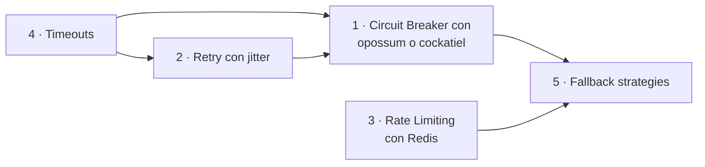
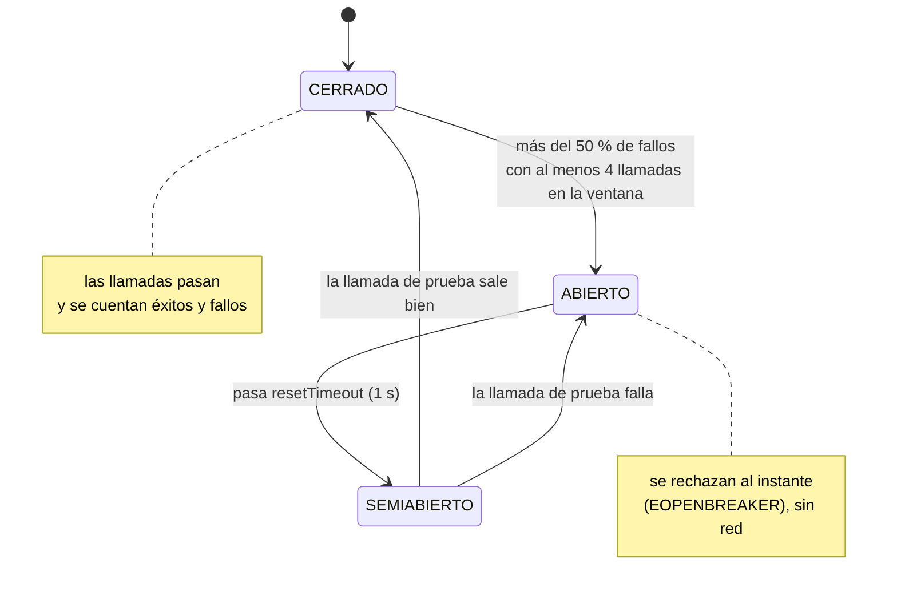
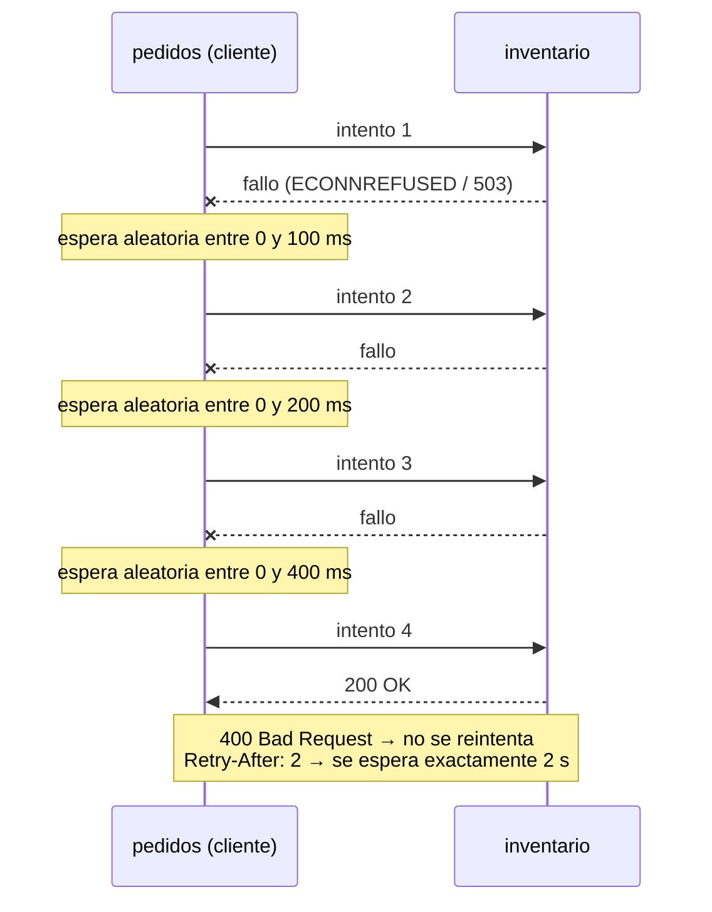
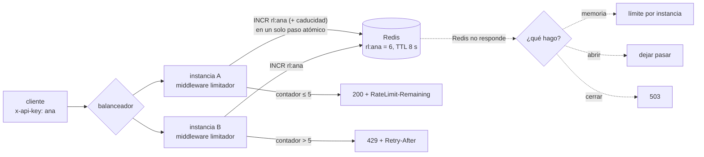
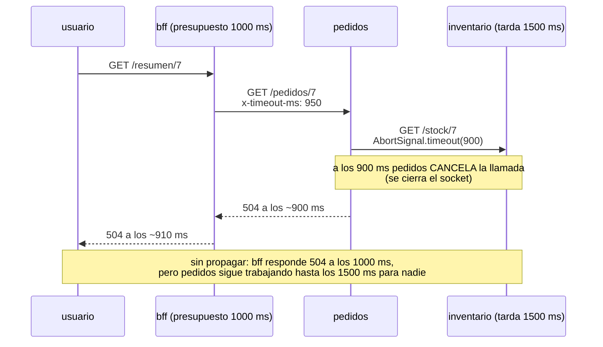
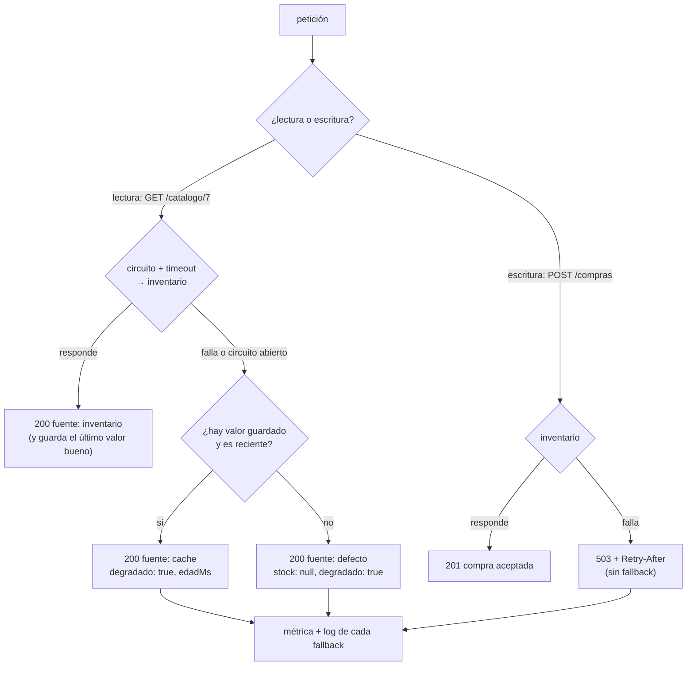

# Módulo 19 · Resiliencia

**Fase 2 · Node.js de cero a experto** (media semana de 12). **Duración:** 8 h (5 temas de unos 80 min y 1 h 20 min de
laboratorio integrador). **Dificultad:** 4 de 5. **Dependencias:** Módulo 18 (REST con Axios/Fetch, sync vs async) y
Módulo 13 (Promises, `async/await`, Event Loop, graceful shutdown); ayuda haber hecho el Módulo 14 (Express).
**Herramientas:**Node.js 26.13.1 LTS**, **TypeScript 6.0.3**, **opossum 10.0.0**, **cockatiel 4.0.0**,
**redis (node-redis) 6.3.1**, **rate-limiter-flexible 11.5.0**, **express 5.3.0**, **Redis 8.10.2** y **Toxiproxy
2.13.0**..

En un sistema distribuido **fallar es lo normal**: una red pierde paquetes, un servicio se queda sin memoria, un
despliegue reinicia pods. La resiliencia no evita esos fallos; consigue que **un fallo pequeño no se convierta en una
caída completa**. En este módulo proteges un servicio Node.js con cinco defensas: cortar las llamadas a una dependencia
rota (circuit breaker), reintentar lo pasajero sin crear una avalancha (retry con jitter), no aceptar más de lo que
puedes atender (rate limiting), no esperar para siempre (timeouts) y tener una respuesta digna cuando todo lo anterior
no alcanza (fallbacks).



**Texto alternativo:** mapa del módulo. Los timeouts (tema 4) son la base del retry con jitter (tema 2) y del circuit
breaker (tema 1); el retry también alimenta al circuit breaker. El circuit breaker y el rate limiting con Redis
(tema 3) desembocan en las estrategias de fallback (tema 5). Las fichas siguen el orden del temario (1 a 5), pero
puedes leer primero la 4 si nunca has puesto un timeout.

**Regla del módulo:** cada tema trae una **Simulación del fallo**: un script que inyecta el fallo con **Toxiproxy**
(un proxy TCP al que le pides por HTTP que añada latencia, corte conexiones o las deje colgadas) y muestra el
comportamiento observado, con la salida real.

**Cómo usar el laboratorio.** Con Node 26 y Docker en marcha:

```bash
npm ci
docker compose up -d --wait      # inventario (:9000), Redis (:6379) y Toxiproxy (:8474 → :21212 y :26379)
los comandos de verificación indicados         # 25 tests + simulaciones de las 5 fichas → «RESULTADO: OK»
docker compose down
```

arriba. Tus servicios Node corren en tu máquina y llaman al inventario **a través de Toxiproxy** (`127.0.0.1:21212`) y
a Redis también (`127.0.0.1:26379`): así el script de simulación puede estropear la red sin tocar tu código. Si no
tienes Docker, `./infra.sh up` usa los binarios `toxiproxy-server` y `redis-server` de tu máquina (en macOS:
`brew install toxiproxy redis`).

`package.json` del laboratorio (con `package-lock.json` que fija el árbol completo):

```json
{
  "name": "modulo-19-resiliencia-node",
  "version": "1.0.0",
  "private": true,
  "description": "Módulo 19 (Fase 2): Resiliencia en Node.js (circuit breaker, retry con jitter, rate limiting con Redis, timeouts y fallbacks).",
  "type": "module",
  "engines": {
    "node": ">=26.13.1"
  },
  "scripts": {
    "tipos": "tsc -p tsconfig.json",
    "test": "node --test --test-concurrency=1 'f1*/*.test.js'"
  },
  "dependencies": {
    "cockatiel": "4.0.0",
    "express": "5.3.0",
    "opossum": "10.0.0",
    "rate-limiter-flexible": "11.5.0",
    "redis": "6.3.1"
  },
  "devDependencies": {
    "@types/node": "26.6.6",
    "typescript": "6.0.3"
  }
}
```

`docker-compose.yml`:

```yaml
# Módulo 19 (modulo-23) · Resiliencia en Node.js: inventario + Redis, con Toxiproxy delante de los dos.
#   docker compose up -d --wait
#   curl localhost:21212/stock/7            -> {"sku":"7","stock":12}   (inventario a través de Toxiproxy)
#   ./simular-fallo.sh lento 2000           -> 2 s de latencia en el inventario (ver simular-fallo.sh)
#   ./simular-fallo.sh caido redis          -> Redis «caído» para el rate limiter
#   docker compose down
# Tus servicios Node (f119…f123) corren en tu máquina y llaman a 127.0.0.1:21212 (inventario) y 127.0.0.1:26379 (Redis).
services:
  inventario:
    image: node:26-alpine
    working_dir: /lab
    command: ["node", "comun/inventario.js", "9000"]
    volumes: ["./comun:/lab/comun:ro"]
    ports: ["9000:9000"]          # directo, sin proxy: solo para las rutas de control (/contador, /reiniciar)
    healthcheck:
      test: ["CMD", "node", "-e", "fetch('http://127.0.0.1:9000/salud').then(r=>process.exit(r.ok?0:1),()=>process.exit(1))"]
      interval: 2s
      timeout: 2s
      retries: 30
  redis:
    image: redis:8.10.2-alpine
    command: ["redis-server", "--save", "", "--appendonly", "no"]
    ports: ["6379:6379"]          # directo, sin proxy: para redis-cli y los tests
    healthcheck:
      test: ["CMD", "redis-cli", "ping"]
      interval: 2s
      timeout: 2s
      retries: 30
  toxiproxy:
    image: ghcr.io/shopify/toxiproxy:2.13.0
    # API de control en 8474; los proxies "inventario" (21212) y "redis" (26379) se crean desde toxiproxy.json.
    command: ["-host=0.0.0.0", "-config=/config/toxiproxy.json"]
    volumes: ["./toxiproxy.json:/config/toxiproxy.json:ro"]
    ports: ["8474:8474", "21212:21212", "26379:26379"]
    depends_on:
      inventario:
        condition: service_healthy
      redis:
        condition: service_healthy
```

`toxiproxy.json` (los dos proxies que Toxiproxy crea al arrancar):

```json
[
  { "name": "inventario", "listen": "0.0.0.0:21212", "upstream": "inventario:9000", "enabled": true },
  { "name": "redis", "listen": "0.0.0.0:26379", "upstream": "redis:6379", "enabled": true }
]
```

`comun/inventario.js`, la dependencia a la que le vas a provocar fallos (un servidor HTTP sin librerías):

```javascript
// Módulo 19 · Servicio «inventario»: la dependencia a la que le vamos a provocar fallos.
// Requisitos: Node.js 26.13.1 LTS (sin dependencias). Ejecuta: node comun/inventario.js [puerto]
import http from 'node:http';

const STOCK = { 7: 12, 8: 0, 9: 3 };
const estado = { consultas: 0, intentosDeReserva: 0, reservasCreadas: 0 };
const porClave = new Map(); // Idempotency-Key -> reserva ya creada

function responder(res, status, cuerpo) {
  res.writeHead(status, { 'content-type': 'application/json' });
  res.end(JSON.stringify(cuerpo));
}

const servidor = http.createServer((req, res) => {
  const url = new URL(req.url, 'http://inventario');
  const stock = url.pathname.match(/^\/stock\/(\w+)$/);
  if (req.method === 'GET' && stock) {
    estado.consultas += 1;
    const sku = stock[1];
    if (!(sku in STOCK)) return responder(res, 404, { error: `sku ${sku} desconocido` });
    return responder(res, 200, { sku, stock: STOCK[sku] });
  }
  if (req.method === 'POST' && url.pathname === '/reservas') {
    estado.intentosDeReserva += 1;
    const clave = req.headers['idempotency-key'];
    if (clave && porClave.has(clave)) return responder(res, 200, porClave.get(clave)); // repetida: misma respuesta
    estado.reservasCreadas += 1;
    const reserva = { reserva: estado.reservasCreadas };
    if (clave) porClave.set(clave, reserva);
    return responder(res, 201, reserva);
  }
  // Rutas de control del laboratorio: úsalas directo en el puerto 9000 (sin pasar por Toxiproxy).
  if (req.method === 'GET' && url.pathname === '/contador') return responder(res, 200, estado);
  if (req.method === 'POST' && url.pathname === '/reiniciar') {
    estado.consultas = 0; estado.intentosDeReserva = 0; estado.reservasCreadas = 0; porClave.clear();
    return responder(res, 200, estado);
  }
  if (url.pathname === '/salud') return responder(res, 200, { estado: 'ok' });
  responder(res, 404, { error: 'ruta desconocida' });
});

const puerto = Number(process.argv[2] ?? process.env.PORT ?? 9000);
servidor.listen(puerto, () => console.log(`inventario escuchando en :${puerto}`));
process.on('SIGTERM', () => servidor.close(() => process.exit(0)));
```

`comun/toxiproxy.js`: funciones con las que los scripts de simulación le hablan a Toxiproxy.

```javascript
// Módulo 19 · Cliente mínimo de la API HTTP de Toxiproxy 2.13.0 (puerto 8474) para los scripts de simulación.
// Requisitos: Node.js 26.13.1 LTS (usa fetch nativo). La infraestructura se levanta con docker compose up -d --wait.
export const TOXIPROXY_API = process.env.TOXIPROXY_API ?? 'http://127.0.0.1:8474';
export const INVENTARIO_URL = process.env.INVENTARIO_URL ?? 'http://127.0.0.1:21212'; // inventario A TRAVÉS de Toxiproxy
export const INVENTARIO_DIRECTO = process.env.INVENTARIO_DIRECTO ?? 'http://127.0.0.1:9000'; // sin proxy (control)
export const REDIS_URL = process.env.REDIS_URL ?? 'redis://127.0.0.1:26379'; // Redis A TRAVÉS de Toxiproxy

async function api(metodo, ruta, cuerpo) {
  const r = await fetch(`${TOXIPROXY_API}${ruta}`, {
    method: metodo,
    headers: { 'content-type': 'application/json' },
    body: cuerpo ? JSON.stringify(cuerpo) : undefined,
  });
  if (!r.ok) throw new Error(`Toxiproxy ${metodo} ${ruta} -> ${r.status} ${await r.text()}`);
  return r.status === 204 ? null : r.json();
}

/** Latencia fija en cada respuesta (toxic "latency"). */
export const lento = (proxy, ms) => api('POST', `/proxies/${proxy}/toxics`, {
  name: 'lento', type: 'latency', stream: 'downstream', toxicity: 1, attributes: { latency: ms, jitter: 0 },
});
/** Acepta la conexión y nunca entrega datos (toxic "timeout" con timeout 0). */
export const cuelga = (proxy) => api('POST', `/proxies/${proxy}/toxics`, {
  name: 'cuelga', type: 'timeout', stream: 'downstream', toxicity: 1, attributes: { timeout: 0 },
});
/** Apaga el proxy: conexión rechazada, como un servicio caído. */
export const apagar = (proxy) => api('POST', `/proxies/${proxy}`, { enabled: false });
export const encender = (proxy) => api('POST', `/proxies/${proxy}`, { enabled: true });
/** Quita todos los toxics y enciende todos los proxies. */
export const sanar = () => api('POST', '/reset');

export const dormir = (ms) => new Promise((ok) => setTimeout(ok, ms));
export const control = (ruta, metodo = 'GET') => fetch(`${INVENTARIO_DIRECTO}${ruta}`, { method: metodo }).then((r) => r.json());
```

`simular-fallo.sh`, lo mismo desde la terminal (para los pasos manuales):

```bash
#!/usr/bin/env bash
# Simula fallos con la API HTTP de Toxiproxy 2.13.0 (puerto 8474). Requiere la infraestructura arriba
# (docker compose up -d --wait, o ./infra.sh up). El proxy por defecto es "inventario"; el otro es "redis".
# Uso:
#   ./simular-fallo.sh lento [ms] [proxy]   latencia en cada respuesta (toxic "latency", 2000 ms por defecto)
#   ./simular-fallo.sh caido [proxy]        apaga el proxy: conexión rechazada (enabled=false)
#   ./simular-fallo.sh cuelga [proxy]       acepta la conexión y nunca responde (toxic "timeout" con 0)
#   ./simular-fallo.sh sano                 quita todos los toxics y enciende todos los proxies (POST /reset)
#   ./simular-fallo.sh estado [proxy]       muestra el proxy y sus toxics activos
set -eu
API=${TOXIPROXY_API:-http://127.0.0.1:8474}
case "${1:-estado}" in
  lento)
    P=${3:-inventario}
    curl -fsS -X POST "$API/proxies/$P/toxics" -H 'Content-Type: application/json' \
      -d "{\"name\":\"lento\",\"type\":\"latency\",\"stream\":\"downstream\",\"toxicity\":1.0,\"attributes\":{\"latency\":${2:-2000},\"jitter\":0}}"
    ;;
  caido)
    curl -fsS -X POST "$API/proxies/${2:-inventario}" -H 'Content-Type: application/json' -d '{"enabled":false}'
    ;;
  cuelga)
    curl -fsS -X POST "$API/proxies/${2:-inventario}/toxics" -H 'Content-Type: application/json' \
      -d '{"name":"cuelga","type":"timeout","stream":"downstream","toxicity":1.0,"attributes":{"timeout":0}}'
    ;;
  sano)
    curl -fsS -X POST "$API/reset"
    ;;
  estado)
    curl -fsS "$API/proxies/${2:-inventario}"
    ;;
  *)
    echo "uso: $0 lento [ms] [proxy] | caido [proxy] | cuelga [proxy] | sano | estado [proxy]" >&2
    exit 2
    ;;
esac
echo
```

---


### Circuit Breaker con opossum o cockatiel

<details open>
<summary><strong>Capa 1 — Lectura</strong></summary>

#### ► DE QUÉ TRATA
Implementar un circuit breaker con opossum delante de una dependencia HTTP, configurar su umbral, su ventana y su tiempo de recuperación, y demostrar con Toxiproxy que, con la dependencia caída, las llamadas se rechazan en 0 ms sin tocar la red y que el circuito se cierra solo cu…

#### ► LA IDEA EN UNA FRASE
**Implementar un circuit breaker con opossum delante de una dependencia HTTP, configurar su umbral, su ventana y su tiempo de recuperación, y demostrar con Toxiproxy que, con la dependencia caída, las llamadas se rechazan en 0 ms sin tocar la red y que el circuito se cierra solo cuando la dependencia vuelve.**

#### ► POR QUÉ EXISTE ESTO
Resuelve un problema real de diseño o implementación y evita decisiones a ciegas.

#### ► LA ANALOGÍA
Piensa en circuit breaker con opossum o cockatiel como una herramienta de taller: útil cuando conoces su propósito y sus límites.
**Dónde se rompe la analogía:** en software, los efectos dependen del contexto, la escala y los trade-offs.

#### ► CÓMO FUNCIONA


1. Tu servicio (pedidos) le pregunta cosas a otro (inventario). Si el inventario se cae, cada pregunta **tarda y
2. Un **circuit breaker** (cortacircuitos) es un vigilante entre los dos. Cuenta cuántas preguntas fallan. Si fallan
3. Pasado ese rato deja pasar **una** pregunta de prueba. Si funciona, todo vuelve a la normalidad. Si no, sigue
4. Ganas dos cosas: tu servicio no se hunde esperando, y el inventario, que está intentando recuperarse, **deja de

#### ► LO QUE PUEDE SALIR MAL
| Síntoma | Causa probable | Arreglo |
|---|---|---|
| Circuit Breaker con opossum o cockatiel se aplica pero el resultado no mejora | Se usó sin medir el problema real | Mide antes y compara contra la alternativa simple |
| Aparece complejidad inesperada | Se adoptó la técnica sin comprender sus trade-offs | Vuelve a la sección de trade-offs y reduce el alcance |
| Falla en un caso límite | Se asumió un contexto que no se cumple | Prueba el caso límite y documenta cuándo NO usarlo |

#### ► TRADE-OFFS
| Opción | Cuándo usarla | Cuándo NO usarla |
|---|---|---|
| Usar Circuit Breaker con opossum o cockatiel | Cuando el problema coincide con su propósito y el beneficio es observable | Cuando agrega complejidad sin resolver un problema real |
| Alternativa más simple | Cuando el contexto es pequeño, estable o fácil de razonar | Cuando ya demostró no escalar o no cumplir el requisito |
| Postergar la decisión | Cuando falta evidencia del problema | Cuando el costo de esperar es mayor que el costo de probar |

#### ► CUÁNDO NO USAR ESTO
Un circuito nuevo en cada petición. Evita crear el CircuitBreaker dentro del handler: cada petición estrena un circuito sin historia, que ve una sola llamada y jamás alcanza el volumen mínimo. Parece protegido y no lo está (y además cada instancia deja temporizadores vivos).

#### ► DE VUELTA A LA ANALOGÍA
Volviendo a la analogía: circuit breaker con opossum o cockatiel funciona como el modelo inicial, pero recuerda dónde se rompe: en producción importan la evidencia, la escala y el costo de equivocarte.

#### ► LO QUE DEBES RECORDAR
- Tu servicio (pedidos) le pregunta cosas a otro (inventario). Si el inventario se cae, cada pregunta **tarda y
- Un **circuit breaker** (cortacircuitos) es un vigilante entre los dos. Cuenta cuántas preguntas fallan. Si fallan
- Pasado ese rato deja pasar **una** pregunta de prueba. Si funciona, todo vuelve a la normalidad. Si no, sigue
- Ganas dos cosas: tu servicio no se hunde esperando, y el inventario, que está intentando recuperarse, **deja de

#### ► PREGUNTAS PARA PENSAR
1. ¿Qué problema concreto resuelve circuit breaker con opossum o cockatiel en tu contexto?
2. ¿Cómo sabrías que circuit breaker con opossum o cockatiel no está funcionando bien?
3. ¿Qué alternativa más simple considerarías antes de usar circuit breaker con opossum o cockatiel?

</details>

<details>
<summary><strong>Capa 2 — Construcción</strong></summary>

#### Construcción guiada
**Simulación del fallo.** `f119-circuit-breaker/simulacion.js` hace dos llamadas con el inventario sano, le pide a
Toxiproxy que **apague el proxy** (conexión rechazada, como un servicio caído), hace seis llamadas más, vuelve a
encender el proxy y espera el `resetTimeout`:

```javascript
// Módulo 19 · F119 · Simulación del fallo: Toxiproxy «tumba» el inventario y el circuito se abre, rechaza y se recupera.
// Requisitos: infraestructura arriba (docker compose up -d --wait). Ejecuta: node f119-circuit-breaker/simulacion.js
import assert from 'node:assert/strict';
import { apagar, encender, sanar, dormir, control, INVENTARIO_URL } from '../comun/toxiproxy.js';
import { crearCircuitoDeInventario, estadoDe } from './cliente-inventario.js';

await sanar();
await control('/reiniciar', 'POST');
const circuito = crearCircuitoDeInventario(INVENTARIO_URL);
const cambios = []; // los eventos llegan durante la llamada: los mostramos justo después de su línea
circuito.on('open', () => cambios.push('ABIERTO'));
circuito.on('halfOpen', () => console.log('   -> pasó resetTimeout: el circuito pasa a SEMIABIERTO (deja pasar una llamada de prueba)'));
circuito.on('close', () => cambios.push('CERRADO'));

let n = 0;
async function llamar() {
  n += 1;
  const antes = estadoDe(circuito);
  const inicio = performance.now();
  let resultado;
  try {
    resultado = `OK ${JSON.stringify(await circuito.fire('7'))}`;
  } catch (error) {
    resultado = error.code === 'EOPENBREAKER' ? 'RECHAZADA (EOPENBREAKER), sin tocar la red' : `FALLO ${error.cause?.code ?? error.name}`;
  }
  console.log(`llamada ${n} [${antes}] ${resultado} (${Math.round(performance.now() - inicio)} ms)`);
  while (cambios.length) console.log(`   -> el circuito pasa a ${cambios.shift()}`);
}

console.log('== 1. Inventario sano');
await llamar(); await llamar();
console.log('== 2. Fallo inyectado: Toxiproxy apaga el proxy "inventario" (conexión rechazada)');
await apagar('inventario');
for (let i = 0; i < 6; i += 1) await llamar();
const trasElFallo = (await control('/contador')).consultas;
console.log(`   el inventario recibió ${trasElFallo} consultas en total: las rechazadas no llegaron a la red`);
console.log('== 3. El inventario vuelve; esperamos resetTimeout (1 s)');
await encender('inventario');
await dormir(1100);
await llamar(); await llamar();

assert.equal(trasElFallo, 2);
assert.equal(estadoDe(circuito), 'CERRADO');
assert.equal(circuito.stats.rejects, 3);
console.log(`estadísticas: fires=${circuito.stats.fires} successes=${circuito.stats.successes} failures=${circuito.stats.failures} rejects=${circuito.stats.rejects}`);
console.log('OK: el circuito se abrió, rechazó sin tocar la red y se cerró al recuperarse el inventario');
circuito.shutdown();
```

1. Levanta la infraestructura y ejecuta la simulación:

```bash
npm ci
docker compose up -d --wait
node f119-circuit-breaker/simulacion.js
```

   **Output esperado** (los milisegundos varían):

```text
== 1. Inventario sano
llamada 1 [CERRADO] OK {"sku":"7","stock":12} (5 ms)
llamada 2 [CERRADO] OK {"sku":"7","stock":12} (4 ms)
== 2. Fallo inyectado: Toxiproxy apaga el proxy "inventario" (conexión rechazada)
llamada 3 [CERRADO] FALLO ECONNREFUSED (4 ms)
llamada 4 [CERRADO] FALLO ECONNREFUSED (1 ms)
llamada 5 [CERRADO] FALLO ECONNREFUSED (1 ms)
   -> el circuito pasa a ABIERTO
llamada 6 [ABIERTO] RECHAZADA (EOPENBREAKER), sin tocar la red (0 ms)
llamada 7 [ABIERTO] RECHAZADA (EOPENBREAKER), sin tocar la red (0 ms)
llamada 8 [ABIERTO] RECHAZADA (EOPENBREAKER), sin tocar la red (0 ms)
   el inventario recibió 2 consultas en total: las rechazadas no llegaron a la red
== 3. El inventario vuelve; esperamos resetTimeout (1 s)
   -> pasó resetTimeout: el circuito pasa a SEMIABIERTO (deja pasar una llamada de prueba)
llamada 9 [SEMIABIERTO] OK {"sku":"7","stock":12} (4 ms)
   -> el circuito pasa a CERRADO
llamada 10 [CERRADO] OK {"sku":"7","stock":12} (3 ms)
estadísticas: fires=10 successes=4 failures=3 rejects=3
OK: el circuito se abrió, rechazó sin tocar la red y se cerró al recuperarse el inventario
```

   **Comportamiento observado:** las llamadas 3, 4 y 5 fallan de verdad (`ECONNREFUSED`); con la 5 la tasa de error es
   3 de 5 (60 % > 50 %) y el circuito se abre. Las llamadas 6, 7 y 8 se rechazan en **0 ms** y el inventario no las
   recibe: su contador sigue en 2. Tras 1 s, la llamada 9 pasa como prueba, sale bien y el circuito se cierra.

2. Ahora a mano, con el servicio HTTP. En una terminal: `node f119-circuit-breaker/servicio.js`. En otra:

```bash
curl -s -w " [%{http_code}]\n" 127.0.0.1:3119/pedidos/stock/7
./simular-fallo.sh caido > /dev/null
for i in 1 2 3 4 5; do curl -s -w " [%{http_code}]\n" 127.0.0.1:3119/pedidos/stock/7; done
curl -s 127.0.0.1:3119/circuito
./simular-fallo.sh sano > /dev/null && sleep 1.2 && curl -s -w " [%{http_code}]\n" 127.0.0.1:3119/pedidos/stock/7
```

   **Output esperado:**

```text
{"sku":"7","stock":12} [200]
{"error":"fallo al consultar el inventario","causa":"ECONNREFUSED"} [502]
{"error":"fallo al consultar el inventario","causa":"ECONNREFUSED"} [502]
{"error":"fallo al consultar el inventario","causa":"ECONNREFUSED"} [502]
{"error":"inventario no disponible","circuito":"ABIERTO"} [503]
{"error":"inventario no disponible","circuito":"ABIERTO"} [503]
{"estado":"ABIERTO","fires":6,"successes":1,"failures":3,"rejects":2,"timeouts":0}
{"sku":"7","stock":12} [200]
```

   **Captura comentada:** en la terminal del servicio ves tres líneas, una por cambio de estado:
   `[circuito inventario] open -> ABIERTO` justo después del tercer 502, y `[circuito inventario] halfOpen ->
   SEMIABIERTO` seguida de `[circuito inventario] close -> CERRADO` al hacer la última petición. Fíjate en el paso del
   502 («lo intenté y falló») al 503 con `Retry-After: 1` («ni lo intento; vuelve en 1 s»).

3. Apaga todo con `docker compose down`.

#### Código de referencia / ejecutable
Versiones: **Node.js 26.13.1 LTS**, **opossum 10.0.0**, **cockatiel 4.0.0**, **express 5.3.0** y **TypeScript 6.0.3**
(dependencias del `package.json` del laboratorio).

`f119-circuit-breaker/cliente-inventario.js` (el circuito):

```javascript
// Módulo 19 · F119 · Circuit Breaker con opossum: el cliente del inventario protegido por un circuito.
// Requisitos: Node.js 26.13.1 LTS y opossum 10.0.0 (package.json del laboratorio).
import CircuitBreaker from 'opossum';

/** Error de negocio (4xx): el inventario respondió bien, aunque la respuesta sea «no». No debe abrir el circuito. */
export class ErrorDeNegocio extends Error {
  constructor(status, detalle) {
    super(detalle);
    this.name = 'ErrorDeNegocio';
    this.status = status;
  }
}

/** La llamada «desnuda»: un GET con límite de tiempo. Lanza si no hay conexión, si tarda o si responde 5xx. */
export async function consultarStock(urlBase, sku, { timeoutMs = 1000 } = {}) {
  const r = await fetch(`${urlBase}/stock/${sku}`, { signal: AbortSignal.timeout(timeoutMs) });
  if (r.status >= 500) throw new Error(`inventario respondió ${r.status}`);
  if (!r.ok) throw new ErrorDeNegocio(r.status, (await r.json()).error);
  return r.json();
}

export const OPCIONES_POR_DEFECTO = {
  name: 'inventario',
  timeout: false,               // el límite de tiempo ya lo pone AbortSignal.timeout (y sí cancela la petición)
  volumeThreshold: 4,           // no decide nada hasta ver 4 llamadas en la ventana…
  errorThresholdPercentage: 50, // …y abre cuando falla MÁS del 50 % (comparación estricta: 2 de 4 no abre, 3 de 5 sí)
  rollingCountTimeout: 10_000,  // ventana deslizante de 10 s…
  rollingCountBuckets: 10,      // …en 10 cubetas de 1 s
  resetTimeout: 1000,           // tras 1 s abierto deja pasar UNA llamada de prueba (semiabierto)
};

/**
 * Crea UN circuito para el inventario (uno por dependencia, creado una sola vez al arrancar).
 * `accion` es inyectable para poder probarlo sin red.
 */
export function crearCircuitoDeInventario(urlBase, opciones = {}, accion = (sku) => consultarStock(urlBase, sku)) {
  const circuito = new CircuitBreaker(accion, {
    ...OPCIONES_POR_DEFECTO,
    errorFilter: (error) => error instanceof ErrorDeNegocio, // true = «esto NO cuenta como fallo»
    ...opciones,
  });
  return circuito;
}

/** Estado legible del circuito: CERRADO, ABIERTO o SEMIABIERTO. */
export function estadoDe(circuito) {
  if (circuito.opened) return 'ABIERTO';
  if (circuito.halfOpen) return 'SEMIABIERTO';
  return 'CERRADO';
}
```

`f119-circuit-breaker/servicio.js` (el servicio «pedidos» que lo usa):

```javascript
// Módulo 19 · F119 · Servicio «pedidos» (Express 5.3.0) que consulta el inventario detrás de un circuito opossum 10.0.0.
// Requisitos: Node.js 26.13.1 LTS. Ejecuta: node f119-circuit-breaker/servicio.js   (PORT=3119 por defecto)
import express from 'express';
import { crearCircuitoDeInventario, ErrorDeNegocio, estadoDe } from './cliente-inventario.js';

const INVENTARIO_URL = process.env.INVENTARIO_URL ?? 'http://127.0.0.1:21212';

export function crearApp(circuito = crearCircuitoDeInventario(INVENTARIO_URL)) {
  const app = express();
  // Cada cambio de estado queda en el log: es lo primero que mirarás en un incidente.
  for (const evento of ['open', 'halfOpen', 'close']) {
    circuito.on(evento, () => console.log(`[circuito ${circuito.name}] ${evento} -> ${estadoDe(circuito)}`));
  }

  app.get('/pedidos/stock/:sku', async (req, res) => {
    try {
      res.json(await circuito.fire(req.params.sku));
    } catch (error) {
      if (error instanceof ErrorDeNegocio) return res.status(error.status).json({ error: error.message });
      if (error.code === 'EOPENBREAKER') {
        // Circuito abierto: respondemos al instante, sin tocar la red, y decimos cuándo volver a intentar.
        res.set('Retry-After', String(Math.ceil(circuito.options.resetTimeout / 1000)));
        return res.status(503).json({ error: 'inventario no disponible', circuito: 'ABIERTO' });
      }
      res.status(502).json({ error: 'fallo al consultar el inventario', causa: error.cause?.code ?? error.name });
    }
  });

  app.get('/circuito', (_req, res) => {
    const { fires, successes, failures, rejects, timeouts } = circuito.stats;
    res.json({ estado: estadoDe(circuito), fires, successes, failures, rejects, timeouts });
  });
  return app;
}

if (import.meta.main) {
  const puerto = Number(process.env.PORT ?? 3119);
  crearApp().listen(puerto, () => console.log(`pedidos (F119) en :${puerto} -> inventario ${INVENTARIO_URL}`));
}
```

`f119-circuit-breaker/cockatiel.ts` (la alternativa: el mismo comportamiento con cockatiel, en TypeScript; Node 26
ejecuta el `.ts` quitando los tipos y `npm run tipos` los comprueba con `tsc --noEmit`):

`comun/toxiproxy.js`: utilidades de Toxiproxy usadas en esta ficha.

```typescript
// Módulo 19 · F119 · El mismo circuito con cockatiel 4.0.0, en TypeScript (políticas componibles y tipadas).
// Requisitos: Node.js 26.13.1 LTS (ejecuta .ts quitando los tipos) y TypeScript 6.0.3 para comprobarlos (npm run tipos).
// Ejecuta con la infraestructura arriba: node f119-circuit-breaker/cockatiel.ts
import {
  BrokenCircuitError, CircuitState, ConsecutiveBreaker, circuitBreaker, handleWhen, timeout, TimeoutStrategy, wrap,
  type IPolicy,
} from 'cockatiel';
import { apagar, encender, sanar, dormir, INVENTARIO_URL } from '../comun/toxiproxy.js';

interface Stock { sku: string; stock: number }
class ErrorDeNegocio extends Error {}

// Política 1: límite de tiempo de 500 ms. «Aggressive» rechaza al vencer y aborta la señal que recibe la función.
const limite = timeout(500, TimeoutStrategy.Aggressive);
// Política 2: el circuito. Se abre con 3 fallos SEGUIDOS y prueba de nuevo tras 1 s.
// handleWhen decide qué errores cuentan: los de negocio (4xx) no.
const circuito = circuitBreaker(handleWhen((error) => !(error instanceof ErrorDeNegocio)), {
  halfOpenAfter: 1000,
  breaker: new ConsecutiveBreaker(3),
});
// wrap compone de fuera hacia dentro: primero el circuito, dentro el límite de tiempo.
const politica: IPolicy = wrap(circuito, limite);

const cambios: string[] = []; // los eventos llegan durante la llamada: se muestran después de su línea
circuito.onBreak(() => cambios.push('Open'));
circuito.onHalfOpen(() => cambios.push('HalfOpen (llamada de prueba)'));
circuito.onReset(() => cambios.push('Closed'));

const NOMBRE = { [CircuitState.Closed]: 'Closed', [CircuitState.Open]: 'Open', [CircuitState.HalfOpen]: 'HalfOpen', [CircuitState.Isolated]: 'Isolated' };

async function consultarStock(sku: string): Promise<Stock> {
  return politica.execute(async ({ signal }) => {
    const r = await fetch(`${INVENTARIO_URL}/stock/${sku}`, { signal });
    if (r.status >= 500) throw new Error(`inventario respondió ${r.status}`);
    if (!r.ok) throw new ErrorDeNegocio(`sku ${sku} desconocido`);
    return (await r.json()) as Stock;
  });
}

async function llamar(n: number): Promise<void> {
  const antes = NOMBRE[circuito.state];
  try {
    console.log(`llamada ${n} [${antes}] OK ${JSON.stringify(await consultarStock('7'))}`);
  } catch (error) {
    const texto = error instanceof BrokenCircuitError ? 'RECHAZADA (BrokenCircuitError)' : `FALLO ${(error as { cause?: { code?: string } }).cause?.code ?? (error as Error).name}`;
    console.log(`llamada ${n} [${antes}] ${texto}`);
  }
  while (cambios.length > 0) console.log(`   -> el circuito pasa a ${cambios.shift()}`);
}

await sanar();
await llamar(1);
await apagar('inventario'); // fallo inyectado con Toxiproxy
for (let n = 2; n <= 5; n += 1) await llamar(n);
await encender('inventario');
await dormir(1100);
await llamar(6);
await llamar(7);
if (circuito.state !== CircuitState.Closed) throw new Error('el circuito debía terminar cerrado');
console.log('OK: cockatiel abrió con 3 fallos seguidos, rechazó y se cerró al volver el inventario');
```

Salida real de `node f119-circuit-breaker/cockatiel.ts` (Node 26.13.1, cockatiel 4.0.0, Toxiproxy 2.13.0):

```text
llamada 1 [Closed] OK {"sku":"7","stock":12}
llamada 2 [Closed] FALLO ECONNREFUSED
llamada 3 [Closed] FALLO ECONNREFUSED
llamada 4 [Closed] FALLO ECONNREFUSED
   -> el circuito pasa a Open
llamada 5 [Open] RECHAZADA (BrokenCircuitError)
llamada 6 [Open] OK {"sku":"7","stock":12}
   -> el circuito pasa a HalfOpen (llamada de prueba)
   -> el circuito pasa a Closed
llamada 7 [Closed] OK {"sku":"7","stock":12}
OK: cockatiel abrió con 3 fallos seguidos, rechazó y se cerró al volver el inventario
```

#### Verificación
Test que debes ejecutar (no necesita infraestructura: la dependencia se inyecta):

```javascript
// Módulo 19 · F119 · Tests del circuito (sin red: la acción se inyecta). Ejecuta: node --test f119-circuit-breaker/circuito.test.js
import { test } from 'node:test';
import assert from 'node:assert/strict';
import { setTimeout as dormir } from 'node:timers/promises';
import { crearCircuitoDeInventario, ErrorDeNegocio, estadoDe } from './cliente-inventario.js';

/** Acción falsa: responde lo que diga `modo.actual` y cuenta cuántas veces la llaman de verdad. */
function dependenciaFalsa() {
  const modo = { actual: 'ok', llamadas: 0 };
  const accion = async (sku) => {
    modo.llamadas += 1;
    if (modo.actual === 'caida') throw new Error('ECONNREFUSED');
    if (modo.actual === '404') throw new ErrorDeNegocio(404, `sku ${sku} desconocido`);
    return { sku, stock: 12 };
  };
  return { modo, accion };
}
const OPCIONES = { volumeThreshold: 4, resetTimeout: 200 };

test('cerrado: deja pasar las llamadas y devuelve el resultado', async () => {
  const { accion } = dependenciaFalsa();
  const circuito = crearCircuitoDeInventario('', OPCIONES, accion);
  assert.deepEqual(await circuito.fire('7'), { sku: '7', stock: 12 });
  assert.equal(estadoDe(circuito), 'CERRADO');
  circuito.shutdown();
});

test('se abre al superar el 50 % de fallos con al menos 4 llamadas, y rechaza sin llamar a la dependencia', async () => {
  const { modo, accion } = dependenciaFalsa();
  const circuito = crearCircuitoDeInventario('', OPCIONES, accion);
  await circuito.fire('7'); await circuito.fire('7');
  modo.actual = 'caida';
  for (let i = 0; i < 3; i += 1) await assert.rejects(circuito.fire('7'), /ECONNREFUSED/);
  assert.equal(estadoDe(circuito), 'ABIERTO');
  const llamadasAntes = modo.llamadas;
  await assert.rejects(circuito.fire('7'), { code: 'EOPENBREAKER' });
  assert.equal(modo.llamadas, llamadasAntes, 'abierto: la dependencia no recibe nada');
  circuito.shutdown();
});

test('semiabierto: una llamada de prueba con éxito lo cierra', async () => {
  const { modo, accion } = dependenciaFalsa();
  const circuito = crearCircuitoDeInventario('', OPCIONES, accion);
  modo.actual = 'caida';
  for (let i = 0; i < 4; i += 1) await assert.rejects(circuito.fire('7'));
  assert.equal(estadoDe(circuito), 'ABIERTO');
  modo.actual = 'ok';
  await dormir(250); // resetTimeout
  assert.equal(estadoDe(circuito), 'SEMIABIERTO');
  await circuito.fire('7');
  assert.equal(estadoDe(circuito), 'CERRADO');
  circuito.shutdown();
});

test('semiabierto: si la llamada de prueba falla, vuelve a abrirse', async () => {
  const { modo, accion } = dependenciaFalsa();
  const circuito = crearCircuitoDeInventario('', OPCIONES, accion);
  modo.actual = 'caida';
  for (let i = 0; i < 4; i += 1) await assert.rejects(circuito.fire('7'));
  await dormir(250);
  await assert.rejects(circuito.fire('7'), /ECONNREFUSED/);
  assert.equal(estadoDe(circuito), 'ABIERTO');
  circuito.shutdown();
});

test('los errores de negocio (404) no cuentan como fallo: el circuito sigue cerrado', async () => {
  const { modo, accion } = dependenciaFalsa();
  const circuito = crearCircuitoDeInventario('', OPCIONES, accion);
  modo.actual = '404';
  for (let i = 0; i < 10; i += 1) await assert.rejects(circuito.fire('404'), ErrorDeNegocio);
  assert.equal(estadoDe(circuito), 'CERRADO');
  assert.equal(circuito.stats.failures, 0);
  circuito.shutdown();
});
```

```bash
node --test f119-circuit-breaker/circuito.test.js
```

Resultado esperado:

```text
✔ cerrado: deja pasar las llamadas y devuelve el resultado
✔ se abre al superar el 50 % de fallos con al menos 4 llamadas, y rechaza sin llamar a la dependencia
✔ semiabierto: una llamada de prueba con éxito lo cierra
✔ semiabierto: si la llamada de prueba falla, vuelve a abrirse
✔ los errores de negocio (404) no cuentan como fallo: el circuito sigue cerrado
ℹ tests 5
ℹ pass 5
ℹ fail 0
```

**Pregunta de comprobación:** con `volumeThreshold: 4` y `errorThresholdPercentage: 50`, llegan 2 éxitos y después
2 fallos. ¿Se abre el circuito? *(No: 2 de 4 es 50 %, y opossum exige que la tasa sea mayor que el umbral. Se abre con
el tercer fallo: 3 de 5 = 60 %.)*

</details>

### Retry con jitter

<details open>
<summary><strong>Capa 1 — Lectura</strong></summary>

#### ► DE QUÉ TRATA
Implementar reintentos con espera exponencial y jitter, distinguir qué errores se reintentan y cuáles no, y comparar con números la carga que generan 200 clientes reintentando con y sin jitter. Lo compruebas cuando node --test f120-retry/reintentar.test.js pasa 6 de 6 y simulacio…

#### ► LA IDEA EN UNA FRASE
**Implementar reintentos con espera exponencial y jitter, distinguir qué errores se reintentan y cuáles no, y comparar con números la carga que generan 200 clientes reintentando con y sin jitter.**

#### ► POR QUÉ EXISTE ESTO
Resuelve un problema real de diseño o implementación y evita decisiones a ciegas.

#### ► LA ANALOGÍA
Piensa en retry con jitter como una herramienta de taller: útil cuando conoces su propósito y sus límites.
**Dónde se rompe la analogía:** en software, los efectos dependen del contexto, la escala y los trade-offs.

#### ► CÓMO FUNCIONA


1. **Reintentar** es volver a pedir algo que falló. Muchos fallos duran un instante (un reinicio, un corte de red de
2. Si reintentas **enseguida y sin parar**, empeoras las cosas: el otro servicio está intentando levantarse y tú lo
3. Por eso se **espera** entre intentos, y cada vez más: 100 ms, 200 ms, 400 ms… Eso es el **backoff exponencial**.
4. Pero si mil clientes esperan *exactamente* lo mismo, vuelven todos a la vez. El **jitter** («temblor») añade azar a
5. No todo se reintenta: si te dicen «tu petición está mal escrita» (un 400), repetirla da el mismo resultado.

#### ► LO QUE PUEDE SALIR MAL
| Síntoma | Causa probable | Arreglo |
|---|---|---|
| Retry con jitter se aplica pero el resultado no mejora | Se usó sin medir el problema real | Mide antes y compara contra la alternativa simple |
| Aparece complejidad inesperada | Se adoptó la técnica sin comprender sus trade-offs | Vuelve a la sección de trade-offs y reduce el alcance |
| Falla en un caso límite | Se asumió un contexto que no se cumple | Prueba el caso límite y documenta cuándo NO usarlo |

#### ► TRADE-OFFS
| Opción | Cuándo usarla | Cuándo NO usarla |
|---|---|---|
| Usar Retry con jitter | Cuando el problema coincide con su propósito y el beneficio es observable | Cuando agrega complejidad sin resolver un problema real |
| Alternativa más simple | Cuando el contexto es pequeño, estable o fácil de razonar | Cuando ya demostró no escalar o no cumplir el requisito |
| Postergar la decisión | Cuando falta evidencia del problema | Cuando el costo de esperar es mayor que el costo de probar |

#### ► CUÁNDO NO USAR ESTO
El bucle de reintentos inmediato e infinito. Evita el while (true) que reintenta todo, al instante y sin límite: convierte un fallo pasajero en un ataque de denegación de servicio contra tu propia dependencia, y un 400 en un bucle eterno.

#### ► DE VUELTA A LA ANALOGÍA
Volviendo a la analogía: retry con jitter funciona como el modelo inicial, pero recuerda dónde se rompe: en producción importan la evidencia, la escala y el costo de equivocarte.

#### ► LO QUE DEBES RECORDAR
- **Reintentar** es volver a pedir algo que falló. Muchos fallos duran un instante (un reinicio, un corte de red de
- Si reintentas **enseguida y sin parar**, empeoras las cosas: el otro servicio está intentando levantarse y tú lo
- Por eso se **espera** entre intentos, y cada vez más: 100 ms, 200 ms, 400 ms… Eso es el **backoff exponencial**.
- Pero si mil clientes esperan *exactamente* lo mismo, vuelven todos a la vez. El **jitter** («temblor») añade azar a

#### ► PREGUNTAS PARA PENSAR
1. ¿Qué problema concreto resuelve retry con jitter en tu contexto?
2. ¿Cómo sabrías que retry con jitter no está funcionando bien?
3. ¿Qué alternativa más simple considerarías antes de usar retry con jitter?

</details>

<details>
<summary><strong>Capa 2 — Construcción</strong></summary>

#### Código de referencia / ejecutable
Versiones: **Node.js 26.13.1 LTS** (la implementación propia no tiene dependencias) y **cockatiel 4.0.0**.

`f120-retry/reintentar.js`:

```javascript
// Módulo 19 · F120 · Retry con jitter: reintentos con espera exponencial y aleatoriedad, escritos a mano.
// Requisitos: Node.js 26.13.1 LTS (sin dependencias).
import { setTimeout as dormir } from 'node:timers/promises';

/**
 * Cuánto esperar antes del reintento número `intento` (1 = primer reintento).
 *  - 'ninguno':  base * 2^(intento-1), igual para todos los clientes (¡tormenta de reintentos!)
 *  - 'completo': aleatorio entre 0 y ese valor («full jitter», el que mejor reparte la carga)
 *  - 'igual':    la mitad fija + la otra mitad aleatoria («equal jitter», garantiza una espera mínima)
 * Siempre con tope `maxMs`.
 */
export function esperaMs(intento, { baseMs = 100, maxMs = 5000, jitter = 'completo', aleatorio = Math.random } = {}) {
  const exponencial = Math.min(maxMs, baseMs * 2 ** (intento - 1));
  if (jitter === 'ninguno') return exponencial;
  if (jitter === 'igual') return Math.round(exponencial / 2 + aleatorio() * (exponencial / 2));
  return Math.round(aleatorio() * exponencial);
}

/** Error que NO tiene sentido reintentar (4xx: la petición está mal y seguirá mal). */
export class ErrorNoReintentable extends Error {}

/** Por defecto se reintenta todo salvo ErrorNoReintentable y las cancelaciones del propio llamador. */
export const esReintentablePorDefecto = (error) => !(error instanceof ErrorNoReintentable) && error.name !== 'AbortError';

/**
 * Ejecuta `fn(intento)` hasta `intentos` veces. Entre intentos espera con backoff exponencial + jitter,
 * o lo que pida el servidor en `error.retryAfterMs` (cabecera Retry-After). Respeta `signal` para cancelar.
 */
export async function reintentar(fn, opciones = {}) {
  const { intentos = 3, esReintentable = esReintentablePorDefecto, alReintentar = () => {}, signal } = opciones;
  for (let intento = 1; ; intento += 1) {
    try {
      return await fn(intento);
    } catch (error) {
      if (intento >= intentos || !esReintentable(error)) throw error;
      const espera = error.retryAfterMs ?? esperaMs(intento, opciones);
      alReintentar({ intento, espera, error });
      await dormir(espera, undefined, { signal }); // si `signal` se aborta, la espera termina con AbortError
    }
  }
}

/** GET con reintentos: reintenta fallos de red y 502/503/504; un 4xx es definitivo. Lee Retry-After (en segundos). */
export function getConReintentos(url, opciones = {}) {
  return reintentar(async () => {
    const r = await fetch(url, { signal: AbortSignal.timeout(opciones.timeoutMs ?? 1000) });
    if ([502, 503, 504].includes(r.status)) {
      const error = new Error(`HTTP ${r.status}`);
      const retryAfter = Number(r.headers.get('retry-after'));
      if (retryAfter > 0) error.retryAfterMs = retryAfter * 1000;
      throw error;
    }
    if (!r.ok) throw new ErrorNoReintentable(`HTTP ${r.status}`);
    return r.json();
  }, opciones);
}
```

`f120-retry/con-cockatiel.js` (la misma política con la librería):

`comun/toxiproxy.js`: utilidades de Toxiproxy usadas en esta ficha.

```javascript
// Módulo 19 · F120 · La misma política con cockatiel 4.0.0: retry + backoff exponencial con jitter.
// Requisitos: Node.js 26.13.1 LTS, cockatiel 4.0.0 e infraestructura arriba. Ejecuta: node f120-retry/con-cockatiel.js
import { ExponentialBackoff, handleWhen, retry } from 'cockatiel';
import { apagar, encender, sanar, INVENTARIO_URL } from '../comun/toxiproxy.js';

class ErrorNoReintentable extends Error {}

// ExponentialBackoff usa por defecto «decorrelated jitter»: cada espera es aleatoria y depende de la anterior.
const politica = retry(handleWhen((error) => !(error instanceof ErrorNoReintentable)), {
  maxAttempts: 4, // reintentos DESPUÉS del primer intento: 5 intentos en total
  backoff: new ExponentialBackoff({ initialDelay: 100, maxDelay: 2000 }),
});
politica.onRetry(({ attempt, delay }) => console.log(`   reintento ${attempt} en ${Math.round(delay)} ms`));
politica.onGiveUp(() => console.log('   se acabaron los reintentos'));

await sanar();
await apagar('inventario');                       // fallo inyectado
setTimeout(() => encender('inventario'), 250);    // el inventario «vuelve» a los 250 ms
const stock = await politica.execute(async ({ attempt, signal }) => {
  console.log(`intento ${attempt + 1}`);
  const r = await fetch(`${INVENTARIO_URL}/stock/7`, { signal });
  if (r.status >= 500) throw new Error(`HTTP ${r.status}`);
  if (!r.ok) throw new ErrorNoReintentable(`HTTP ${r.status}`);
  return r.json();
});
console.log(`OK ${JSON.stringify(stock)}`);
```

Salida real de `node f120-retry/con-cockatiel.js` (las esperas son aleatorias: cambian en cada ejecución):

```text
intento 1
   reintento 1 en 99 ms
intento 2
   reintento 2 en 132 ms
intento 3
   reintento 3 en 107 ms
intento 4
OK {"sku":"7","stock":12}
```

</details>

### Rate Limiting con Redis

<details open>
<summary><strong>Capa 1 — Lectura</strong></summary>

#### ► DE QUÉ TRATA
Implementar un limitador de peticiones compartido entre instancias con Redis, comparar los algoritmos de ventana fija y cubeta de tokens, y decidir qué hace el limitador cuando Redis no responde. Lo compruebas cuando node --test f121-rate-limiting/limitadores.test.js pasa 4 de 4…

#### ► LA IDEA EN UNA FRASE
**Implementar un limitador de peticiones compartido entre instancias con Redis, comparar los algoritmos de ventana fija y cubeta de tokens, y decidir qué hace el limitador cuando Redis no responde.**

#### ► POR QUÉ EXISTE ESTO
Resuelve un problema real de diseño o implementación y evita decisiones a ciegas.

#### ► LA ANALOGÍA
Piensa en rate limiting con redis como una herramienta de taller: útil cuando conoces su propósito y sus límites.
**Dónde se rompe la analogía:** en software, los efectos dependen del contexto, la escala y los trade-offs.

#### ► CÓMO FUNCIONA


1. **Rate limiting** es poner un tope a cuántas peticiones puede hacer alguien en un tiempo: «5 cada 10 segundos».
2. ¿Para qué? Para que un cliente con un bug (o con malas intenciones) no deje sin servicio a los demás, y para que tu
3. Cuando alguien se pasa, no se le ignora: se le responde **429 Too Many Requests** y se le dice cuándo puede volver.
4. Tu servicio corre en varias copias. Para que el tope sea **uno solo** y no uno por copia, el contador vive en un
5. Proteger así tu servicio también es resiliencia: es la defensa que evita que **tú** seas el que se cae.

#### ► LO QUE PUEDE SALIR MAL
| Síntoma | Causa probable | Arreglo |
|---|---|---|
| Rate Limiting con Redis se aplica pero el resultado no mejora | Se usó sin medir el problema real | Mide antes y compara contra la alternativa simple |
| Aparece complejidad inesperada | Se adoptó la técnica sin comprender sus trade-offs | Vuelve a la sección de trade-offs y reduce el alcance |
| Falla en un caso límite | Se asumió un contexto que no se cumple | Prueba el caso límite y documenta cuándo NO usarlo |

#### ► TRADE-OFFS
| Opción | Cuándo usarla | Cuándo NO usarla |
|---|---|---|
| Usar Rate Limiting con Redis | Cuando el problema coincide con su propósito y el beneficio es observable | Cuando agrega complejidad sin resolver un problema real |
| Alternativa más simple | Cuando el contexto es pequeño, estable o fácil de razonar | Cuando ya demostró no escalar o no cumplir el requisito |
| Postergar la decisión | Cuando falta evidencia del problema | Cuando el costo de esperar es mayor que el costo de probar |

#### ► CUÁNDO NO USAR ESTO
El limitador en memoria de un servicio con varias instancias. Funciona en tu portátil (una instancia) y falla en producción sin dar ningún error: el límite anunciado se multiplica por el número de réplicas, y cambia cada vez que el autoescalador añade una. f121-rate-limiting/anti-patron.js lo mide con tres instancias:

#### ► DE VUELTA A LA ANALOGÍA
Volviendo a la analogía: rate limiting con redis funciona como el modelo inicial, pero recuerda dónde se rompe: en producción importan la evidencia, la escala y el costo de equivocarte.

#### ► LO QUE DEBES RECORDAR
- **Rate limiting** es poner un tope a cuántas peticiones puede hacer alguien en un tiempo: «5 cada 10 segundos».
- ¿Para qué? Para que un cliente con un bug (o con malas intenciones) no deje sin servicio a los demás, y para que tu
- Cuando alguien se pasa, no se le ignora: se le responde **429 Too Many Requests** y se le dice cuándo puede volver.
- Tu servicio corre en varias copias. Para que el tope sea **uno solo** y no uno por copia, el contador vive en un

#### ► PREGUNTAS PARA PENSAR
1. ¿Qué problema concreto resuelve rate limiting con redis en tu contexto?
2. ¿Cómo sabrías que rate limiting con redis no está funcionando bien?
3. ¿Qué alternativa más simple considerarías antes de usar rate limiting con redis?

</details>

<details>
<summary><strong>Capa 2 — Construcción</strong></summary>

#### Código y verificación


```javascript
// Módulo 19 · F121 · Rate Limiting con Redis: dos algoritmos escritos a mano con scripts Lua (atómicos).
// Requisitos: Node.js 26.13.1 LTS, redis (node-redis) 6.3.1 y un servidor Redis (docker compose del laboratorio).
import { createClient } from 'redis';

/**
 * Cliente Redis pensado para un limitador: si Redis no está, los comandos FALLAN AL INSTANTE en vez de
 * quedarse en cola (disableOfflineQueue), y la conexión se reintenta sola cada 200 ms.
 */
export async function conectarRedis(url) {
  const cliente = createClient({
    url,
    disableOfflineQueue: true,
    socket: { connectTimeout: 500, reconnectStrategy: () => 200 },
  });
  cliente.on('error', () => {}); // sin este listener, un error de conexión tumbaría el proceso
  await cliente.connect();
  return cliente;
}

// VENTANA FIJA: un contador por cliente que caduca al terminar la ventana.
// INCR y EXPIRE van en el MISMO script: Redis lo ejecuta entero o no lo ejecuta (ver error-comun.js).
const VENTANA_FIJA = `
local actual = redis.call('INCR', KEYS[1])
if actual == 1 then redis.call('PEXPIRE', KEYS[1], ARGV[2]) end
local ttl = redis.call('PTTL', KEYS[1])
return { actual, ttl }`;

export async function ventanaFija(redis, clave, { limite, ventanaMs }) {
  const [actual, ttl] = await redis.eval(VENTANA_FIJA, { keys: [`vf:${clave}`], arguments: [String(limite), String(ventanaMs)] });
  return { permitido: actual <= limite, restantes: Math.max(0, limite - actual), reintentarEnMs: actual <= limite ? 0 : ttl };
}

// CUBETA DE TOKENS: la cubeta tiene `capacidad` fichas y se rellena a `porSegundo`. Cada petición gasta una.
// Permite ráfagas (hasta `capacidad`) y un ritmo sostenido (`porSegundo`). Usa la hora de Redis, no la del cliente.
const CUBETA_DE_TOKENS = `
local capacidad = tonumber(ARGV[1])
local por_segundo = tonumber(ARGV[2])
local t = redis.call('TIME')
local ahora = tonumber(t[1]) * 1000 + math.floor(tonumber(t[2]) / 1000)
local datos = redis.call('HMGET', KEYS[1], 'fichas', 'marca')
local fichas = tonumber(datos[1]) or capacidad
local marca = tonumber(datos[2]) or ahora
fichas = math.min(capacidad, fichas + (ahora - marca) * por_segundo / 1000)
local permitido = 0
if fichas >= 1 then fichas = fichas - 1; permitido = 1 end
redis.call('HSET', KEYS[1], 'fichas', fichas, 'marca', ahora)
redis.call('PEXPIRE', KEYS[1], math.ceil(capacidad / por_segundo * 1000) + 1000)
local espera = 0
if permitido == 0 then espera = math.ceil((1 - fichas) / por_segundo * 1000) end
return { permitido, math.floor(fichas), espera }`;

export async function cubetaDeTokens(redis, clave, { capacidad, porSegundo }) {
  const [permitido, restantes, espera] = await redis.eval(CUBETA_DE_TOKENS, { keys: [`ct:${clave}`], arguments: [String(capacidad), String(porSegundo)] });
  return { permitido: permitido === 1, restantes, reintentarEnMs: espera };
}
```

```javascript
// Módulo 19 · F121 · API Express 5.3.0 con rate limiting compartido en Redis (rate-limiter-flexible 11.5.0).
// Requisitos: Node.js 26.13.1 LTS, redis 6.3.1 y Redis arriba. Ejecuta: PORT=3121 node f121-rate-limiting/servicio.js
// Variables: LIMITE (5), VENTANA_S (10), SI_REDIS_FALLA = memoria | abrir | cerrar (memoria por defecto).
import express from 'express';
import { RateLimiterMemory, RateLimiterRedis, RateLimiterRes } from 'rate-limiter-flexible';
import { conectarRedis } from './limitadores.js';

export async function crearApp({
  redisUrl = process.env.REDIS_URL ?? 'redis://127.0.0.1:26379',
  limite = Number(process.env.LIMITE ?? 5),
  ventanaS = Number(process.env.VENTANA_S ?? 10),
  siRedisFalla = process.env.SI_REDIS_FALLA ?? 'memoria',
  instancia = process.env.PORT ?? 'test',
} = {}) {
  const redis = await conectarRedis(redisUrl);
  const limitador = new RateLimiterRedis({
    storeClient: redis,
    useRedisPackage: true,   // el cliente es node-redis (no ioredis)
    keyPrefix: 'rl',
    points: limite,          // peticiones permitidas…
    duration: ventanaS,      // …por ventana de N segundos, por cliente
    // «Seguro»: si Redis falla, cada instancia limita en memoria con el mismo límite (peor, pero sigue protegiendo).
    insuranceLimiter: siRedisFalla === 'memoria' ? new RateLimiterMemory({ points: limite, duration: ventanaS }) : undefined,
  });

  const app = express();
  app.set('trust proxy', 1); // detrás de UN proxy o balanceador: req.ip sale de X-Forwarded-For

  app.use(async (req, res, next) => {
    const cliente = req.get('x-api-key') ?? req.ip; // limita por credencial; la IP es el último recurso
    try {
      const r = await limitador.consume(cliente);
      res.set({ 'RateLimit-Limit': limite, 'RateLimit-Remaining': r.remainingPoints, 'RateLimit-Reset': Math.ceil(r.msBeforeNext / 1000) });
      next();
    } catch (rechazo) {
      if (rechazo instanceof RateLimiterRes) { // límite superado: 429 y cuándo volver
        res.set({ 'RateLimit-Limit': limite, 'RateLimit-Remaining': 0, 'Retry-After': Math.ceil(rechazo.msBeforeNext / 1000) });
        return res.status(429).json({ error: 'demasiadas peticiones', reintentaEnSegundos: Math.ceil(rechazo.msBeforeNext / 1000) });
      }
      // Redis falló y no hay seguro: hay que DECIDIR. Abrir = dejar pasar (disponibilidad). Cerrar = 503 (protección).
      console.log(`[limitador] Redis no responde (${rechazo.message}) -> ${siRedisFalla}`);
      if (siRedisFalla === 'abrir') { res.set('X-RateLimit-Estado', 'sin-limite'); return next(); }
      res.status(503).json({ error: 'limitador no disponible' });
    }
  });

  app.get('/api/ofertas', (_req, res) => res.json({ ofertas: ['teclado', 'mouse'], instancia }));
  return { app, redis };
}

if (import.meta.main) {
  const puerto = Number(process.env.PORT ?? 3121);
  const { app } = await crearApp();
  app.listen(puerto, () => console.log(`ofertas (F121) en :${puerto}`));
}
```

```javascript
// Módulo 19 · F121 · Simulación del fallo: (A) una ráfaga contra DOS instancias que comparten el límite en Redis y
// (B) Toxiproxy tumba Redis: qué hace el limitador con cada estrategia (memoria, abrir, cerrar).
// Requisitos: infraestructura arriba. Ejecuta: node f121-rate-limiting/simulacion.js
import assert from 'node:assert/strict';
import { once } from 'node:events';
import { apagar, encender, sanar, dormir, REDIS_URL } from '../comun/toxiproxy.js';
import { crearApp } from './servicio.js';

const registro = console.log;
console.log = () => {}; // silencia el log de los servicios; la simulación escribe con registro()

async function instancia(puerto, siRedisFalla) {
  const { app, redis } = await crearApp({ redisUrl: REDIS_URL, limite: 5, ventanaS: 10, siRedisFalla, instancia: String(puerto) });
  const servidor = app.listen(puerto);
  await once(servidor, 'listening');
  return { cerrar: async () => { servidor.close(); servidor.closeAllConnections(); await redis.destroy(); } };
}
async function rafaga(puertos, cliente, n = 8) {
  const codigos = [];
  for (let i = 0; i < n; i += 1) {
    const r = await fetch(`http://127.0.0.1:${puertos[i % puertos.length]}/api/ofertas`, { headers: { 'x-api-key': cliente } });
    codigos.push(r.status);
  }
  return codigos.join(' ');
}

await sanar();
const cliente = `cliente-${Date.now()}`; // clave nueva en cada ejecución
const instancias = [await instancia(3121, 'memoria'), await instancia(3221, 'memoria'), await instancia(3321, 'abrir'), await instancia(3421, 'cerrar')];

registro('== A. Redis sano: 8 peticiones del mismo cliente alternando entre DOS instancias (límite 5 cada 10 s)');
const sano = await rafaga([3121, 3221], cliente);
registro(`   ${sano}`);
const r429 = await fetch('http://127.0.0.1:3221/api/ofertas', { headers: { 'x-api-key': cliente } });
registro(`   cabeceras del 429: RateLimit-Limit=${r429.headers.get('ratelimit-limit')} RateLimit-Remaining=${r429.headers.get('ratelimit-remaining')} Retry-After=${r429.headers.get('retry-after')}`);

registro('== B. Fallo inyectado: Toxiproxy apaga el proxy "redis"');
await apagar('redis');
await dormir(300); // los clientes Redis notan la desconexión
const memoria = await rafaga([3121, 3221], `${cliente}-b`);
registro(`   SI_REDIS_FALLA=memoria (2 instancias): ${memoria}   <- cada instancia cuenta por su lado: pasan 8 de 8`);
const abrir = await rafaga([3321], `${cliente}-b`);
registro(`   SI_REDIS_FALLA=abrir               : ${abrir}   <- sin límite mientras dure la caída`);
const cerrar = await rafaga([3421], `${cliente}-b`);
registro(`   SI_REDIS_FALLA=cerrar              : ${cerrar}   <- protegido, pero la API queda fuera de servicio`);

registro('== C. Redis vuelve');
await encender('redis');
await dormir(600); // reconnectStrategy: 200 ms
const recuperado = await rafaga([3121, 3221], `${cliente}-c`);
registro(`   ${recuperado}`);

for (const i of instancias) await i.cerrar();
assert.equal(sano, '200 200 200 200 200 429 429 429');
assert.equal(memoria, '200 200 200 200 200 200 200 200');
assert.equal(abrir, '200 200 200 200 200 200 200 200');
assert.equal(cerrar, '503 503 503 503 503 503 503 503');
assert.equal(recuperado, '200 200 200 200 200 429 429 429');
registro('OK: el límite se comparte entre instancias con Redis sano y cada estrategia se comportó como se esperaba sin Redis');
```

```bash
node f121-rate-limiting/simulacion.js
```

```text
== A. Redis sano: 8 peticiones del mismo cliente alternando entre DOS instancias (límite 5 cada 10 s)
   200 200 200 200 200 429 429 429
   cabeceras del 429: RateLimit-Limit=5 RateLimit-Remaining=0 Retry-After=10
== B. Fallo inyectado: Toxiproxy apaga el proxy "redis"
   SI_REDIS_FALLA=memoria (2 instancias): 200 200 200 200 200 200 200 200   <- cada instancia cuenta por su lado: pasan 8 de 8
   SI_REDIS_FALLA=abrir               : 200 200 200 200 200 200 200 200   <- sin límite mientras dure la caída
   SI_REDIS_FALLA=cerrar              : 503 503 503 503 503 503 503 503   <- protegido, pero la API queda fuera de servicio
== C. Redis vuelve
   200 200 200 200 200 429 429 429
OK: el límite se comparte entre instancias con Redis sano y cada estrategia se comportó como se esperaba sin Redis
```

</details>

### Timeouts

<details open>
<summary><strong>Capa 1 — Lectura</strong></summary>

#### ► DE QUÉ TRATA
Aplicar un límite de tiempo que cancele de verdad una petición HTTP con AbortSignal.timeout, propagar el presupuesto restante de un servicio al siguiente y configurar los timeouts del servidor HTTP de Node. Lo compruebas cuando node --test f122-timeouts/con-timeout.test.js pasa 5…

#### ► LA IDEA EN UNA FRASE
**Aplicar un límite de tiempo que cancele de verdad una petición HTTP con AbortSignal.timeout, propagar el presupuesto restante de un servicio al siguiente y configurar los timeouts del servidor HTTP de Node.**

#### ► POR QUÉ EXISTE ESTO
Resuelve un problema real de diseño o implementación y evita decisiones a ciegas.

#### ► LA ANALOGÍA
Piensa en timeouts como una herramienta de taller: útil cuando conoces su propósito y sus límites.
**Dónde se rompe la analogía:** en software, los efectos dependen del contexto, la escala y los trade-offs.

#### ► CÓMO FUNCIONA


1. Un **timeout** es un límite de espera: «si en medio segundo no me contestas, dejo de esperar».
2. Sin límite, una petición a un servicio que se quedó colgado **no termina nunca**. Y mientras espera, ocupa memoria y
3. Un servicio **lento** es más peligroso que uno **caído**: el caído falla al instante; el lento te tiene esperando.
4. Poner el límite no basta: al vencer hay que **cancelar** la petición de verdad (colgar el teléfono), no solo dejar
5. Y si a ti te dieron 1 segundo para responder, no tiene sentido que le des 3 segundos al siguiente.

#### ► LO QUE PUEDE SALIR MAL
| Síntoma | Causa probable | Arreglo |
|---|---|---|
| Timeouts se aplica pero el resultado no mejora | Se usó sin medir el problema real | Mide antes y compara contra la alternativa simple |
| Aparece complejidad inesperada | Se adoptó la técnica sin comprender sus trade-offs | Vuelve a la sección de trade-offs y reduce el alcance |
| Falla en un caso límite | Se asumió un contexto que no se cumple | Prueba el caso límite y documenta cuándo NO usarlo |

#### ► TRADE-OFFS
| Opción | Cuándo usarla | Cuándo NO usarla |
|---|---|---|
| Usar Timeouts | Cuando el problema coincide con su propósito y el beneficio es observable | Cuando agrega complejidad sin resolver un problema real |
| Alternativa más simple | Cuando el contexto es pequeño, estable o fácil de razonar | Cuando ya demostró no escalar o no cumplir el requisito |
| Postergar la decisión | Cuando falta evidencia del problema | Cuando el costo de esperar es mayor que el costo de probar |

#### ► CUÁNDO NO USAR ESTO
La llamada sin timeout (y su primo, el timeout «por si acaso» de 60 s). Evita cualquier llamada de red que herede el límite por defecto del cliente. Se ve así, y es el código más común del mundo:

#### ► DE VUELTA A LA ANALOGÍA
Volviendo a la analogía: timeouts funciona como el modelo inicial, pero recuerda dónde se rompe: en producción importan la evidencia, la escala y el costo de equivocarte.

#### ► LO QUE DEBES RECORDAR
- Un **timeout** es un límite de espera: «si en medio segundo no me contestas, dejo de esperar».
- Sin límite, una petición a un servicio que se quedó colgado **no termina nunca**. Y mientras espera, ocupa memoria y
- Un servicio **lento** es más peligroso que uno **caído**: el caído falla al instante; el lento te tiene esperando.
- Poner el límite no basta: al vencer hay que **cancelar** la petición de verdad (colgar el teléfono), no solo dejar

#### ► PREGUNTAS PARA PENSAR
1. ¿Qué problema concreto resuelve timeouts en tu contexto?
2. ¿Cómo sabrías que timeouts no está funcionando bien?
3. ¿Qué alternativa más simple considerarías antes de usar timeouts?

</details>

<details>
<summary><strong>Capa 2 — Construcción</strong></summary>

#### Código y verificación


```javascript
// Módulo 19 · F122 · Timeouts: límite de tiempo que SÍ cancela la petición, y presupuesto que viaja entre servicios.
// Requisitos: Node.js 26.13.1 LTS (fetch, AbortSignal.timeout y AbortSignal.any son nativos).

/**
 * fetch con límite de tiempo total (conexión + cabeceras + cuerpo). Al vencer, la petición se CANCELA (se cierra el
 * socket) y la promesa se rechaza con TimeoutError. Si el llamador pasa su propia `signal`, cualquiera de las dos corta.
 */
export async function fetchConTimeout(url, { timeoutMs, signal, ...opciones } = {}) {
  const limite = AbortSignal.timeout(timeoutMs);
  const r = await fetch(url, { ...opciones, signal: signal ? AbortSignal.any([limite, signal]) : limite });
  const cuerpo = await r.text(); // leer el cuerpo DENTRO del límite: las cabeceras pueden llegar rápido y el cuerpo no
  return { status: r.status, cuerpo: cuerpo ? JSON.parse(cuerpo) : null };
}

export const CABECERA = 'x-timeout-ms'; // presupuesto restante, relativo (como grpc-timeout): no depende de relojes sincronizados

/**
 * Presupuesto de una petición entrante: cuánto tiempo queda para responder. Lo fija la cabecera x-timeout-ms del
 * llamador o, si no viene, `porDefectoMs`. Nunca supera `maximoMs` (no te fíes de un cliente que pide 1 hora).
 */
export function presupuestoDe(cabeceras, { porDefectoMs = 2000, maximoMs = 10_000 } = {}) {
  const pedido = Number(cabeceras[CABECERA]);
  const total = Math.min(maximoMs, pedido > 0 ? pedido : porDefectoMs);
  const vence = performance.now() + total;
  return {
    total,
    restante: () => Math.max(0, Math.round(vence - performance.now())),
    /** Tiempo para la siguiente llamada: lo que queda menos un margen para poder responder nosotros. */
    paraLlamar: (margenMs = 50) => Math.max(1, Math.round(vence - performance.now()) - margenMs),
  };
}

export const esTimeout = (error) => error.name === 'TimeoutError';
```

```javascript
// Módulo 19 · F122 · Cadena bff -> pedidos -> inventario con presupuesto de latencia (Express 5.3.0).
// Requisitos: Node.js 26.13.1 LTS e infraestructura arriba.
// Ejecuta: node f122-timeouts/cadena.js     (bff en :3122, pedidos en :3222; PROPAGAR=no para ver la versión mala)
import express from 'express';
import { once } from 'node:events';
import { CABECERA, esTimeout, fetchConTimeout, presupuestoDe } from './con-timeout.js';

const INVENTARIO_URL = process.env.INVENTARIO_URL ?? 'http://127.0.0.1:21212';

/** Timeouts del SERVIDOR HTTP: protegen de clientes lentos o que dejan conexiones abiertas. */
function protegerServidor(servidor) {
  servidor.headersTimeout = 10_000;   // máx. para recibir las cabeceras completas (defecto 60 000)
  servidor.requestTimeout = 30_000;   // máx. para recibir la petición entera, cuerpo incluido (defecto 300 000)
  servidor.keepAliveTimeout = 65_000; // conexión inactiva; MAYOR que el idle timeout del balanceador (60 s típico)
  return servidor;
}

export async function arrancarCadena({ propagar = true, puertoBff = 3122, puertoPedidos = 3222, log = console.log } = {}) {
  // ---------- pedidos: llama al inventario ----------
  const pedidos = express();
  pedidos.get('/pedidos/:sku', async (req, res) => {
    const inicio = performance.now();
    // Con propagación: lo que diga el llamador. Sin propagación: un timeout fijo de 3 s «por si acaso».
    const limite = propagar ? presupuestoDe(req.headers).paraLlamar() : 3000;
    try {
      const { cuerpo } = await fetchConTimeout(`${INVENTARIO_URL}/stock/${req.params.sku}`, { timeoutMs: limite });
      log(`   [pedidos] respondió a los ${Math.round(performance.now() - inicio)} ms (límite ${limite} ms)`);
      res.json({ pedido: 1, ...cuerpo });
    } catch (error) {
      log(`   [pedidos] ${esTimeout(error) ? 'canceló la llamada al inventario' : error.name} a los ${Math.round(performance.now() - inicio)} ms (límite ${limite} ms)`);
      res.status(esTimeout(error) ? 504 : 502).json({ error: 'inventario no respondió a tiempo' });
    }
  });

  // ---------- bff: tiene 1000 ms para responder al usuario ----------
  const bff = express();
  bff.get('/resumen/:sku', async (req, res) => {
    const inicio = performance.now();
    const presupuesto = presupuestoDe(req.headers, { porDefectoMs: 1000 });
    try {
      const r = await fetchConTimeout(`http://127.0.0.1:${puertoPedidos}/pedidos/${req.params.sku}`, {
        timeoutMs: presupuesto.restante(),
        headers: propagar ? { [CABECERA]: String(presupuesto.paraLlamar()) } : {}, // el presupuesto viaja río abajo
      });
      log(`   [bff] respondió ${r.status} a los ${Math.round(performance.now() - inicio)} ms`);
      res.status(r.status).json(r.cuerpo);
    } catch (error) {
      log(`   [bff] ${esTimeout(error) ? 'agotó su presupuesto' : error.name} a los ${Math.round(performance.now() - inicio)} ms`);
      res.status(504).json({ error: 'tiempo agotado' });
    }
  });

  const servidores = [protegerServidor(pedidos.listen(puertoPedidos)), protegerServidor(bff.listen(puertoBff))];
  await Promise.all(servidores.map((s) => once(s, 'listening')));
  return { cerrar: () => servidores.forEach((s) => { s.close(); s.closeAllConnections(); }) };
}

if (import.meta.main) {
  await arrancarCadena({ propagar: process.env.PROPAGAR !== 'no' });
  console.log(`bff en :3122 -> pedidos en :3222 -> inventario ${INVENTARIO_URL} (propagar=${process.env.PROPAGAR !== 'no'})`);
}
```

```javascript
// Módulo 19 · F122 · Simulación del fallo: Toxiproxy vuelve LENTO al inventario (latencia) y luego lo deja COLGADO
// (acepta la conexión y no responde). Requisitos: infraestructura arriba. Ejecuta: node f122-timeouts/simulacion.js
import assert from 'node:assert/strict';
import { cuelga, lento, sanar, dormir, control, INVENTARIO_URL } from '../comun/toxiproxy.js';
import { arrancarCadena } from './cadena.js';
import { fetchConTimeout } from './con-timeout.js';

const ms = (inicio) => Math.round(performance.now() - inicio);
const URL_STOCK = `${INVENTARIO_URL}/stock/7`;

console.log('== A. Fallo inyectado: latencia de 2000 ms (toxic "latency")');
await sanar();
await lento('inventario', 2000);
let inicio = performance.now();
await fetch(URL_STOCK).then((r) => r.json());
const sinLimite = ms(inicio);
console.log(`   sin timeout:          OK tras ${sinLimite} ms (tu petición, su memoria y su conexión, ocupadas todo ese tiempo)`);
inicio = performance.now();
const errorA = await fetchConTimeout(URL_STOCK, { timeoutMs: 500 }).catch((e) => e);
const conLimite = ms(inicio);
console.log(`   con timeout de 500 ms: ${errorA.name} tras ${conLimite} ms`);

console.log('== B. Fallo inyectado: conexión colgada (toxic "timeout" con timeout=0)');
await sanar();
await cuelga('inventario');
inicio = performance.now();
const control3s = new AbortController();
const colgada = fetch(URL_STOCK, { signal: control3s.signal }).then(() => 'respondió', () => 'cancelada por el script');
const vigilante = dormir(3000).then(() => 'sigue esperando');
console.log(`   sin timeout:          a los 3000 ms ${await Promise.race([colgada, vigilante])} (fetch esperaría hasta 300 000 ms)`);
control3s.abort();
inicio = performance.now();
const errorB = await fetchConTimeout(URL_STOCK, { timeoutMs: 500 }).catch((e) => e);
console.log(`   con timeout de 500 ms: ${errorB.name} tras ${ms(inicio)} ms`);

console.log('== C. Presupuesto en cadena: el bff tiene 1000 ms y el inventario tarda 1500 ms');
await sanar();
await lento('inventario', 1500);
for (const propagar of [false, true]) {
  console.log(`   -- ${propagar ? 'CON' : 'SIN'} propagar el presupuesto`);
  const cadena = await arrancarCadena({ propagar });
  inicio = performance.now();
  const r = await fetch('http://127.0.0.1:3122/resumen/7');
  console.log(`   [usuario] recibió ${r.status} a los ${ms(inicio)} ms`);
  await dormir(1000); // deja ver qué hace pedidos después de que el bff se rindió
  cadena.cerrar();
}
await sanar();

assert.ok(sinLimite >= 2000);
assert.equal(errorA.name, 'TimeoutError');
assert.ok(conLimite >= 480 && conLimite < 900);
assert.equal(errorB.name, 'TimeoutError');
console.log('OK: con timeout la espera está acotada; con presupuesto propagado nadie trabaja para una respuesta que ya no se espera');
```

```bash
node f122-timeouts/simulacion.js
```

```text
== A. Fallo inyectado: latencia de 2000 ms (toxic "latency")
   sin timeout:          OK tras 2005 ms (tu petición, su memoria y su conexión, ocupadas todo ese tiempo)
   con timeout de 500 ms: TimeoutError tras 503 ms
== B. Fallo inyectado: conexión colgada (toxic "timeout" con timeout=0)
   sin timeout:          a los 3000 ms sigue esperando (fetch esperaría hasta 300 000 ms)
   con timeout de 500 ms: TimeoutError tras 501 ms
== C. Presupuesto en cadena: el bff tiene 1000 ms y el inventario tarda 1500 ms
   -- SIN propagar el presupuesto
   [bff] agotó su presupuesto a los 1001 ms
   [usuario] recibió 504 a los 1010 ms
   [pedidos] respondió a los 1503 ms (límite 3000 ms)
   -- CON propagar el presupuesto
   [pedidos] canceló la llamada al inventario a los 901 ms (límite 900 ms)
   [bff] respondió 504 a los 904 ms
   [usuario] recibió 504 a los 907 ms
OK: con timeout la espera está acotada; con presupuesto propagado nadie trabaja para una respuesta que ya no se espera
```

</details>

### Fallback strategies

<details open>
<summary><strong>Capa 1 — Lectura</strong></summary>

#### ► DE QUÉ TRATA
Diseñar la respuesta degradada de un servicio cuando su dependencia no contesta, eligiendo entre último valor bueno, valor por defecto y fallo rápido según el tipo de operación, y hacer visible cada degradación. Lo compruebas cuando node --test f123-fallbacks/catalogo.test.js pas…

#### ► LA IDEA EN UNA FRASE
**Diseñar la respuesta degradada de un servicio cuando su dependencia no contesta, eligiendo entre último valor bueno, valor por defecto y fallo rápido según el tipo de operación, y hacer visible cada degradación.**

#### ► POR QUÉ EXISTE ESTO
Resuelve un problema real de diseño o implementación y evita decisiones a ciegas.

#### ► LA ANALOGÍA
Piensa en fallback strategies como una herramienta de taller: útil cuando conoces su propósito y sus límites.
**Dónde se rompe la analogía:** en software, los efectos dependen del contexto, la escala y los trade-offs.

#### ► CÓMO FUNCIONA


1. Un **fallback** es el **plan B**: qué respondes cuando lo que necesitabas no está disponible.
2. Sin plan B, si el inventario se cae, tu página de producto muestra un error y **no se ve nada**, aunque el nombre,
3. Con plan B muestras lo que sí sabes y, para el stock, «disponibilidad por confirmar». La tienda sigue abierta,
4. El plan B depende de la operación: para **mostrar** información, algo aproximado sirve. Para **cobrar o reservar**,
5. Y siempre hay que **avisar** de que estás en plan B, al usuario y a tu equipo.

#### ► LO QUE PUEDE SALIR MAL
| Síntoma | Causa probable | Arreglo |
|---|---|---|
| Fallback strategies se aplica pero el resultado no mejora | Se usó sin medir el problema real | Mide antes y compara contra la alternativa simple |
| Aparece complejidad inesperada | Se adoptó la técnica sin comprender sus trade-offs | Vuelve a la sección de trade-offs y reduce el alcance |
| Falla en un caso límite | Se asumió un contexto que no se cumple | Prueba el caso límite y documenta cuándo NO usarlo |

#### ► TRADE-OFFS
| Opción | Cuándo usarla | Cuándo NO usarla |
|---|---|---|
| Usar Fallback strategies | Cuando el problema coincide con su propósito y el beneficio es observable | Cuando agrega complejidad sin resolver un problema real |
| Alternativa más simple | Cuando el contexto es pequeño, estable o fácil de razonar | Cuando ya demostró no escalar o no cumplir el requisito |
| Postergar la decisión | Cuando falta evidencia del problema | Cuando el costo de esperar es mayor que el costo de probar |

#### ► CUÁNDO NO USAR ESTO
El fallback que llama a otra dependencia sin protección. Evita que el plan B sea «si falla el inventario, pregunto al almacén»: otra llamada remota, sin timeout ni circuito, que comparte causa de fallo con la primera (la misma red, la misma base de datos). Cuando falla la primera, la segunda suele fallar igual, y ahora cada petición espera dos vece…

#### ► DE VUELTA A LA ANALOGÍA
Volviendo a la analogía: fallback strategies funciona como el modelo inicial, pero recuerda dónde se rompe: en producción importan la evidencia, la escala y el costo de equivocarte.

#### ► LO QUE DEBES RECORDAR
- Un **fallback** es el **plan B**: qué respondes cuando lo que necesitabas no está disponible.
- Sin plan B, si el inventario se cae, tu página de producto muestra un error y **no se ve nada**, aunque el nombre,
- Con plan B muestras lo que sí sabes y, para el stock, «disponibilidad por confirmar». La tienda sigue abierta,
- El plan B depende de la operación: para **mostrar** información, algo aproximado sirve. Para **cobrar o reservar**,

#### ► PREGUNTAS PARA PENSAR
1. ¿Qué problema concreto resuelve fallback strategies en tu contexto?
2. ¿Cómo sabrías que fallback strategies no está funcionando bien?
3. ¿Qué alternativa más simple considerarías antes de usar fallback strategies?

</details>

<details>
<summary><strong>Capa 2 — Construcción</strong></summary>

#### Código y verificación


```javascript
// Módulo 19 · F123 · Fallback strategies: qué responder cuando el inventario no contesta.
// Tres estrategias en orden: (1) último valor bueno en caché, (2) valor por defecto degradado, (3) fallar rápido.
// Requisitos: Node.js 26.13.1 LTS, opossum 10.0.0 y express 5.3.0. Ejecuta: node f123-fallbacks/catalogo.js (:3123)
import express from 'express';
import CircuitBreaker from 'opossum';

const INVENTARIO_URL = process.env.INVENTARIO_URL ?? 'http://127.0.0.1:21212';
const NOMBRES = { 7: 'Teclado', 8: 'Mouse', 9: 'Monitor' };

export function crearCatalogo({ urlInventario = INVENTARIO_URL, edadMaximaMs = 60_000, log = console.log } = {}) {
  const ultimoBueno = new Map(); // sku -> { stock, guardado }  (en producción: Redis, con TTL)
  const metricas = { inventario: 0, cache: 0, defecto: 0 }; // cuántas respuestas salieron de cada fuente

  async function consultar(sku) {
    const r = await fetch(`${urlInventario}/stock/${sku}`, { signal: AbortSignal.timeout(500) });
    if (!r.ok) throw new Error(`inventario respondió ${r.status}`);
    const { stock } = await r.json();
    ultimoBueno.set(sku, { stock, guardado: Date.now() }); // cada éxito alimenta el fallback
    return { stock, fuente: 'inventario', degradado: false };
  }

  const circuito = new CircuitBreaker(consultar, { name: 'inventario', timeout: false, volumeThreshold: 4, resetTimeout: 1000 });
  // El fallback se ejecuta cuando la acción falla O cuando el circuito está abierto. Recibe los mismos argumentos + el error.
  circuito.fallback((sku, error) => {
    const guardado = ultimoBueno.get(sku);
    if (guardado && Date.now() - guardado.guardado <= edadMaximaMs) {
      // Estrategia 1: último valor bueno. Sirve para LEER; se marca como degradado y con su edad.
      return { stock: guardado.stock, fuente: 'cache', degradado: true, edadMs: Date.now() - guardado.guardado };
    }
    // Estrategia 2: valor por defecto HONESTO. «No sé» (null), nunca un 0 inventado que diría «agotado».
    return { stock: null, fuente: 'defecto', degradado: true, motivo: error?.code ?? error?.cause?.code ?? error?.name };
  });
  // Un fallback silencioso esconde la caída: cuenta y registra cada uno.
  circuito.on('success', (resultado) => { metricas[resultado.fuente] += 1; });
  circuito.on('fallback', (resultado, error) => {
    metricas[resultado.fuente] += 1;
    log(`[fallback] fuente=${resultado.fuente} causa=${error?.code ?? error?.cause?.code ?? error?.name}`);
  });

  const app = express();
  app.use(express.json());

  // LECTURA: admite degradarse. El cliente ve `degradado` y puede mostrar «disponibilidad por confirmar».
  app.get('/catalogo/:sku', async (req, res) => {
    const { sku } = req.params;
    if (!NOMBRES[sku]) return res.status(404).json({ error: 'producto desconocido' });
    const stock = await circuito.fire(sku); // nunca lanza: siempre hay fallback
    if (stock.degradado) res.set('Warning', '110 - "respuesta degradada"');
    res.json({ sku, nombre: NOMBRES[sku], ...stock });
  });

  // ESCRITURA: Estrategia 3, fallar rápido. No se vende con un stock supuesto: 503 y que el cliente reintente.
  app.post('/compras', async (req, res) => {
    const sku = String(req.body?.sku);
    try {
      const { stock } = await consultar(sku); // sin fallback a propósito
      if (stock < 1) return res.status(409).json({ error: 'sin stock' });
      res.status(201).json({ compra: 'aceptada', sku });
    } catch {
      res.set('Retry-After', '5');
      res.status(503).json({ error: 'no podemos confirmar el stock ahora; inténtalo en unos segundos' });
    }
  });

  app.get('/metricas', (_req, res) => res.json({ ...metricas, circuito: circuito.opened ? 'ABIERTO' : 'CERRADO' }));
  return { app, circuito, metricas };
}

if (import.meta.main) {
  const puerto = Number(process.env.PORT ?? 3123);
  crearCatalogo().app.listen(puerto, () => console.log(`catálogo (F123) en :${puerto} -> inventario ${INVENTARIO_URL}`));
}
```

```javascript
// Módulo 19 · F123 · Simulación del fallo: Toxiproxy tumba el inventario y el catálogo responde con cada estrategia.
// Requisitos: infraestructura arriba. Ejecuta: node f123-fallbacks/simulacion.js
import assert from 'node:assert/strict';
import { once } from 'node:events';
import { apagar, encender, sanar, dormir } from '../comun/toxiproxy.js';
import { crearCatalogo } from './catalogo.js';

await sanar();
const { app, circuito } = crearCatalogo({ log: (linea) => console.log(`   ${linea}`) });
const servidor = app.listen(3123);
await once(servidor, 'listening');
const URL_BASE = 'http://127.0.0.1:3123';
async function pedir(titulo, ruta, opciones) {
  const r = await fetch(`${URL_BASE}${ruta}`, opciones);
  const cuerpo = await r.json();
  if (cuerpo.edadMs !== undefined) cuerpo.edadMs = '<edad>'; // la edad cambia en cada ejecución
  console.log(`   ${titulo} -> ${r.status} ${JSON.stringify(cuerpo)}`);
  return { status: r.status, cuerpo };
}
const comprar = { method: 'POST', headers: { 'content-type': 'application/json' }, body: JSON.stringify({ sku: '7' }) };

console.log('== 1. Inventario sano');
const sano = await pedir('GET /catalogo/7', '/catalogo/7');
await pedir('POST /compras   ', '/compras', comprar);

console.log('== 2. Fallo inyectado: Toxiproxy apaga el proxy "inventario"');
await apagar('inventario');
const cache = await pedir('GET /catalogo/7', '/catalogo/7');   // ya lo vimos: último valor bueno
const defecto = await pedir('GET /catalogo/9', '/catalogo/9'); // nunca lo vimos: valor por defecto
const compra = await pedir('POST /compras   ', '/compras', comprar); // escritura: falla rápido
for (let i = 0; i < 3; i += 1) await fetch(`${URL_BASE}/catalogo/7`); // más fallos: el circuito se abre
const abierto = await pedir('GET /catalogo/7', '/catalogo/7'); // circuito abierto: el fallback ya ni toca la red
await pedir('GET /metricas   ', '/metricas');

console.log('== 3. El inventario vuelve');
await encender('inventario');
await dormir(1100);
const recuperado = await pedir('GET /catalogo/7', '/catalogo/7');

servidor.close(); servidor.closeAllConnections(); circuito.shutdown();
assert.equal(sano.cuerpo.fuente, 'inventario');
assert.deepEqual([cache.cuerpo.fuente, cache.cuerpo.stock, cache.cuerpo.degradado], ['cache', 12, true]);
assert.deepEqual([defecto.cuerpo.fuente, defecto.cuerpo.stock], ['defecto', null]);
assert.equal(compra.status, 503);
assert.equal(abierto.cuerpo.fuente, 'cache');
assert.equal(recuperado.cuerpo.fuente, 'inventario');
console.log('OK: lectura degradada con caché o valor por defecto, escritura rechazada con 503 y recuperación automática');
```

```bash
node f123-fallbacks/simulacion.js
```

```text
== 1. Inventario sano
   GET /catalogo/7 -> 200 {"sku":"7","nombre":"Teclado","stock":12,"fuente":"inventario","degradado":false}
   POST /compras    -> 201 {"compra":"aceptada","sku":"7"}
== 2. Fallo inyectado: Toxiproxy apaga el proxy "inventario"
   [fallback] fuente=cache causa=ECONNREFUSED
   GET /catalogo/7 -> 200 {"sku":"7","nombre":"Teclado","stock":12,"fuente":"cache","degradado":true,"edadMs":"<edad>"}
   [fallback] fuente=defecto causa=ECONNREFUSED
   GET /catalogo/9 -> 200 {"sku":"9","nombre":"Monitor","stock":null,"fuente":"defecto","degradado":true,"motivo":"ECONNREFUSED"}
   POST /compras    -> 503 {"error":"no podemos confirmar el stock ahora; inténtalo en unos segundos"}
   [fallback] fuente=cache causa=ECONNREFUSED
   [fallback] fuente=cache causa=EOPENBREAKER
   [fallback] fuente=cache causa=EOPENBREAKER
   [fallback] fuente=cache causa=EOPENBREAKER
   GET /catalogo/7 -> 200 {"sku":"7","nombre":"Teclado","stock":12,"fuente":"cache","degradado":true,"edadMs":"<edad>"}
   GET /metricas    -> 200 {"inventario":1,"cache":5,"defecto":1,"circuito":"ABIERTO"}
== 3. El inventario vuelve
   GET /catalogo/7 -> 200 {"sku":"7","nombre":"Teclado","stock":12,"fuente":"inventario","degradado":false}
OK: lectura degradada con caché o valor por defecto, escritura rechazada con 503 y recuperación automática
```

```bash
curl -s 127.0.0.1:3123/catalogo/7; echo
./simular-fallo.sh caido > /dev/null
curl -s -i 127.0.0.1:3123/catalogo/7 | grep -i -E "^HTTP|warning|^\{"
./simular-fallo.sh sano > /dev/null
```

</details>
