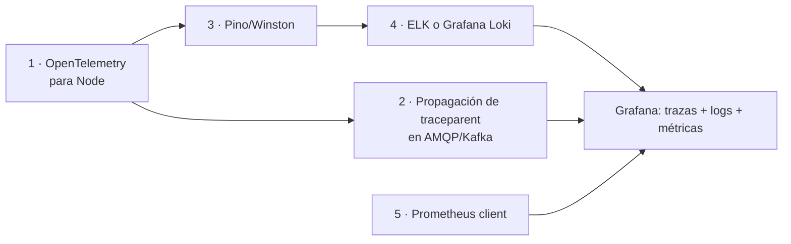
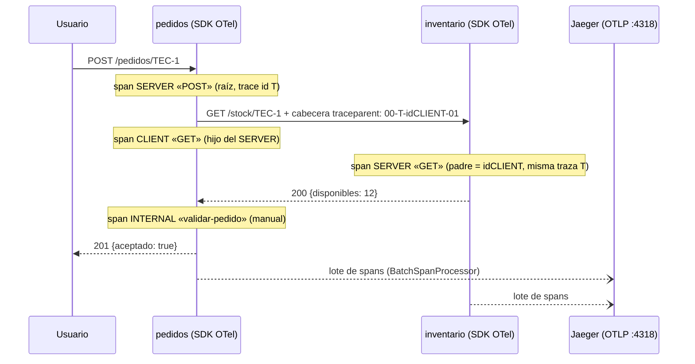
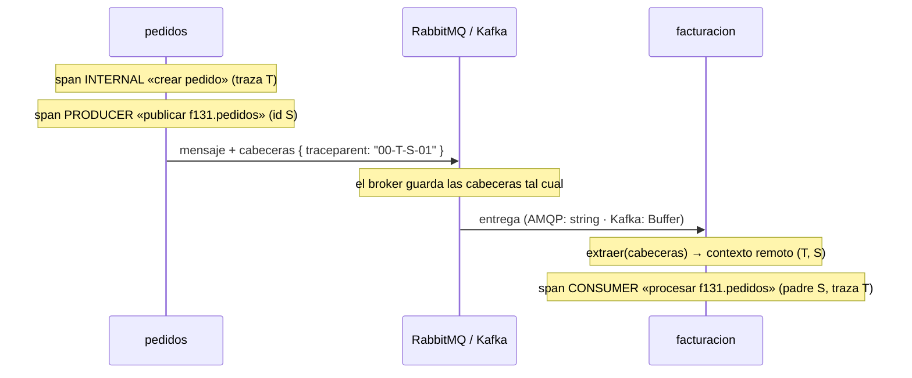
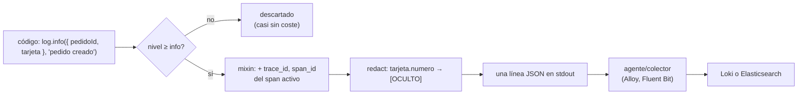
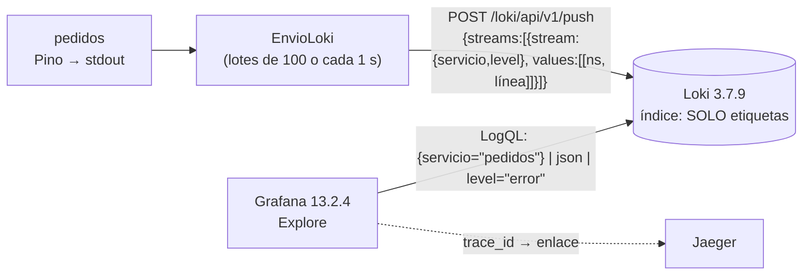
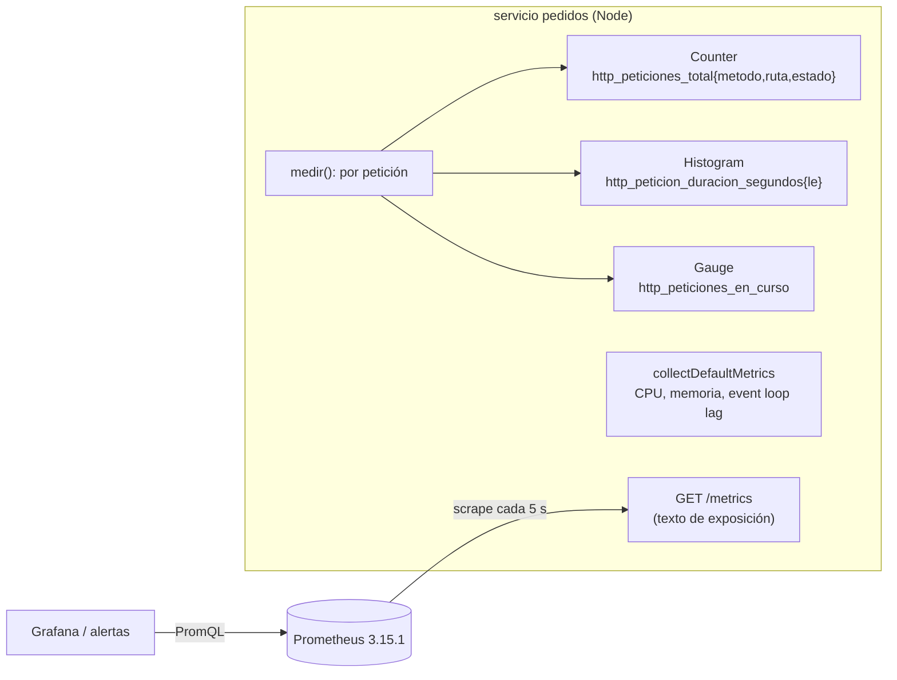

# Módulo 21 · Observabilidad

**Fase 2 · Node.js de cero a experto** (una semana de 12). **Duración:** 10 h (5 temas de unos 100 min y 1 h 40 min
de laboratorio integrador). **Dificultad:** 4 de 5. **Dependencias:** Módulo 13 (Event Loop, `async/await`, graceful
shutdown), Módulo 14 (servidores HTTP y middleware), Módulo 18 (REST y mensajería con RabbitMQ y Kafka) y Módulo 19
(timeouts). **Herramientas:**Node.js 26.13.1 LTS**, **@opentelemetry/api 1.10.0**, **@opentelemetry/sdk-node
0.301.2**, **@opentelemetry/sdk-trace 3.1.1**, **@opentelemetry/auto-instrumentations-node 0.83.1**,
**@opentelemetry/exporter-trace-otlp-http 0.301.2**, **import-in-the-middle 3.6.0**, **amqplib 2.4.0**, **kafkajs
2.2.4**, **pino 10.4.0**, **winston 3.19.0**, **@prometheus-io/client 0.16.1** (el sucesor oficial de `prom-client`),
**Jaeger 2.22.0**, **RabbitMQ 4.4.1**, **Kafka 4.4.0**, **Grafana Loki 3.7.9**, **Prometheus 3.15.1** y **Grafana
13.2.4**. **Laboratorio:** `modulo-25` (`./verificar.sh` ejecuta 19 tests, las demos y los
errores comunes sin infraestructura; `./verificar.sh --compose` levanta Jaeger, RabbitMQ, Kafka, Loki, Prometheus y
Grafana y comprueba que cada señal llega a su destino).

Un monolito que falla se investiga con un solo log. Diez microservicios que fallan juntos, no: una petición del
usuario cruza cinco procesos, dos colas y tres bases de datos, y cada uno guarda su pedacito de la historia.
**Observabilidad** es poder contestar «¿qué le pasó a esta petición?» y «¿está sano el sistema?» **sin desplegar
código nuevo**, a partir de tres señales: **trazas** (el recorrido de una petición), **logs** (lo que cada servicio
cuenta) y **métricas** (números agregados en el tiempo). En este módulo instrumentas dos servicios Node con
OpenTelemetry, haces que la traza sobreviva a RabbitMQ y Kafka, escribes logs JSON con Pino y Winston que llevan el
`trace_id`, los envías a Grafana Loki y expones métricas para Prometheus.



**Texto alternativo:** mapa del módulo. El tema 1 (OpenTelemetry para Node) es la base del tema 2 (propagación de
traceparent en AMQP y Kafka) y del tema 3 (Pino/Winston, que pega el identificador de traza en cada log). El tema 3 lleva
al tema 4 (ELK o Grafana Loki, adonde van los logs). El tema 5 (Prometheus client) es independiente. Las tres señales
terminan en Grafana.

**Cómo usar el laboratorio.** Con Node 26 (y Docker para la parte de infraestructura):

```bash
npm ci
./verificar.sh                   # 19 tests + demos + errores comunes, sin Docker → «RESULTADO: OK»
docker compose up -d --wait      # Jaeger :16686, RabbitMQ :5672, Kafka :9092, Loki :3100, Prometheus :9090, Grafana :3000
./verificar.sh --compose         # además: trazas en Jaeger, traceparent por RabbitMQ y Kafka, logs en Loki, PromQL
docker compose down -v
```

en tu máquina; Jaeger, los brokers, Loki, Prometheus y Grafana, en Docker.

`package.json` del laboratorio (con `package-lock.json` que fija el árbol completo):

```json
{
  "name": "modulo-21-observabilidad-node",
  "version": "1.0.0",
  "private": true,
  "description": "Módulo 21 (Fase 2): Observabilidad en Node.js con OpenTelemetry, traceparent en AMQP/Kafka, Pino/Winston, Grafana Loki y prom-client.",
  "type": "module",
  "engines": {
    "node": ">=26.13.1"
  },
  "scripts": {
    "test": "node --test --test-concurrency=1 'f13*/*.test.js'",
    "test:infra": "node --test --test-concurrency=1 'f13*/*.infra.js'"
  },
  "dependencies": {
    "@opentelemetry/api": "1.10.0",
    "@opentelemetry/auto-instrumentations-node": "0.83.1",
    "@opentelemetry/exporter-trace-otlp-http": "0.301.2",
    "@opentelemetry/sdk-node": "0.301.2",
    "@opentelemetry/sdk-trace": "3.1.1",
    "@prometheus-io/client": "0.16.1",
    "amqplib": "2.4.0",
    "import-in-the-middle": "3.6.0",
    "kafkajs": "2.2.4",
    "pino": "10.4.0",
    "winston": "3.19.0"
  }
}
```

`docker-compose.yml`:

```yaml
# Módulo 21 (modulo-25) · Observabilidad en Node.js
# Arranca:  docker compose up -d --wait   (espera a los healthchecks de RabbitMQ, Kafka y Prometheus)
#   Jaeger UI :16686 + OTLP/HTTP :4318 (F130) · RabbitMQ :5672 (consola :15672, academia/academia) y Kafka :9092 (F131)
#   Loki :3100 (F133) · Prometheus :9090, raspa f134 en host.docker.internal:9464 (F134) · Grafana :3000 (admin / admin-solo-dev)
# Detén:    docker compose down -v        (sin volúmenes persistentes: trazas, logs y métricas se borran)
name: modulo-25
services:
  jaeger:
    image: jaegertracing/jaeger:2.22.0
    ports: ["16686:16686", "4318:4318"]
  rabbitmq:
    image: rabbitmq:4.4.1-management
    environment:
      RABBITMQ_DEFAULT_USER: academia
      RABBITMQ_DEFAULT_PASS: academia
    ports: ["5672:5672", "15672:15672"]
    healthcheck:
      test: ["CMD", "rabbitmq-diagnostics", "-q", "ping"]
      interval: 5s
      timeout: 10s
      retries: 30
  kafka:
    image: apache/kafka:4.4.0      # sin variables: un nodo KRaft anunciado en localhost:9092
    ports: ["9092:9092"]
    healthcheck:
      test: ["CMD-SHELL", "/opt/kafka/bin/kafka-topics.sh --bootstrap-server localhost:9092 --list >/dev/null"]
      interval: 5s
      timeout: 15s
      retries: 30
  loki:
    image: grafana/loki:3.7.9      # configuración por defecto de la imagen: un solo proceso, almacenamiento en disco local
    ports: ["3100:3100"]
  prometheus:
    image: prom/prometheus:v3.15.1
    command: ["--config.file=/etc/prometheus/prometheus.yml"]
    ports: ["9090:9090"]
    volumes: ["./prometheus/prometheus.yml:/etc/prometheus/prometheus.yml:ro"]
    extra_hosts: ["host.docker.internal:host-gateway"]   # en Linux; Docker Desktop (Mac) ya lo resuelve
    healthcheck:
      test: ["CMD", "wget", "-qO-", "http://localhost:9090/-/ready"]
      interval: 2s
      timeout: 3s
      retries: 30
  grafana:
    image: grafana/grafana:13.2.4
    environment:
      GF_SECURITY_ADMIN_PASSWORD: admin-solo-dev
      GF_AUTH_ANONYMOUS_ENABLED: "true"
      GF_AUTH_ANONYMOUS_ORG_ROLE: Viewer
    ports: ["3000:3000"]
    volumes: ["./grafana/provisioning:/etc/grafana/provisioning:ro"]
    depends_on: [loki, prometheus, jaeger]
```

---

### OpenTelemetry para Node

#### 1. UBICACIÓN

Módulo 21, Lección 1 de 5 · Fase 2.

#### 2. PRERREQUISITOS

- Crear un servidor con `node:http` y llamar a otro con `fetch` (Módulos 14 y 18).
- Módulos ES (`import`) y la opción `--import` de Node para cargar un archivo antes que la aplicación (Módulo 13).
- Graceful shutdown con `SIGTERM` (Módulo 13).

#### 3. OBJETIVO DE APRENDIZAJE

**Instrumentar** dos servicios Node con el SDK de OpenTelemetry sin tocar su código de negocio, **añadir** un span
manual y **demostrar** que una petición produce **una sola traza** que cruza los dos procesos (el span del servidor de
inventario cuelga del span cliente de pedidos). Lo compruebas cuando `node --test f130-opentelemetry/traza.test.js`
pasa 2 de 2 y, con Docker, Jaeger muestra los servicios `pedidos` e `inventario` en la misma traza.

#### 4. ANALOGÍA VISUAL

Dibuja un **paquete de mensajería** que viaja de Bogotá a Medellín pasando por tres bodegas. En la caja va pegada una
**guía con un número** (el *trace id*). En cada bodega, un empleado escanea la guía y anota en su planilla: «llegó a
las 10:02, salió a las 10:07, lo mandé al camión 14» (un *span*: inicio, fin y de quién viene). Al final, en la web de
la transportadora escribes el número de guía y ves **la línea de tiempo completa**: cuánto estuvo en cada bodega y
dónde se demoró. Si una bodega se olvida de **copiar el número de guía** a la caja siguiente, la historia se corta en
dos y nadie sabe que son el mismo paquete.

#### 5. DIAGRAMA TÉCNICO



**Texto alternativo:** diagrama de secuencia. El usuario envía POST /pedidos/TEC-1 al servicio pedidos, que abre un
span SERVER raíz con el identificador de traza T. Pedidos llama a inventario con GET /stock/TEC-1 y añade la cabecera
traceparent con la traza T y el identificador de su span CLIENT. Inventario abre un span SERVER cuyo padre es ese span
CLIENT, dentro de la misma traza T. Inventario responde 200; pedidos crea un span manual validar-pedido y responde 201.
Después, cada servicio envía sus spans en lotes a Jaeger por OTLP en el puerto 4318.

#### 6. EXPLICACIÓN NIVEL 0

- Cuando un usuario hace clic en «Comprar», su petición pasa por varios programas. Si tarda 8 segundos, ¿en cuál se
  demoró? Sin ayuda, cada programa solo sabe lo suyo.
- **OpenTelemetry** (OTel) es una librería que cada programa carga al arrancar. Mide cada trabajo (un **span**: «atendí
  una petición», «llamé al inventario») con su hora de inicio y de fin.
- Todos los spans de un mismo clic comparten un número, el **trace id**. Para que el número pase de un programa a otro,
  OTel lo escribe en una **cabecera** de la petición HTTP (`traceparent`) y el programa que la recibe lo lee.
- Al final, cada programa envía sus spans a un visor (**Jaeger**), que los junta por trace id y te dibuja la línea de
  tiempo: ves de un vistazo dónde se fueron los 8 segundos.

#### 7. EXPLICACIÓN INTERMEDIA

- **Piezas:** la **API** (`@opentelemetry/api`) es lo que usa tu código (`trace.getTracer`, `startActiveSpan`); el
  **SDK** (`@opentelemetry/sdk-node`) la implementa: crea spans, decide muestreo, los procesa y los exporta. Si no
  arrancas el SDK, la API funciona en modo «no-op» y no cuesta nada.
- **Instrumentación automática:** `getNodeAutoInstrumentations()` (0.83.1) depende de 41 paquetes
  `@opentelemetry/instrumentation-*` (http, undici para `fetch`, express, amqplib, kafkajs, pg, mongodb, redis, pino,
  winston…). Parchean esas librerías para crear
  spans e **inyectar/extraer `traceparent`** sin que escribas nada. Se desactivan una a una: aquí apagamos `fs`, que
  genera un span por cada lectura de disco.
- **Cargar antes que la app:** el SDK tiene que parchear los módulos **antes** de que tu código los importe. Por eso se
  arranca con `node --import./telemetria.js app.js`. Con módulos ES hace falta además el hook de
  **import-in-the-middle** (`register()`); sin él solo verías los spans de `fetch`, que se instrumenta por
  `diagnostics_channel`.
- **Procesadores:** `SimpleSpanProcessor` exporta cada span al terminar (útil para aprender); `BatchSpanProcessor`
  los agrupa y envía cada pocos segundos sin bloquear (lo de producción). En `sdk-trace` 3.x reciben **un objeto**
  `{ exporter }`.
- **Exportador OTLP:** `OTLPTraceExporter` envía por HTTP a `http://localhost:4318/v1/traces` (o a
  `OTEL_EXPORTER_OTLP_ENDPOINT`). Jaeger 2 y el OpenTelemetry Collector lo reciben directamente.
- **Recurso:** `OTEL_SERVICE_NAME=pedidos` pone `service.name`, el nombre con el que el servicio aparece en Jaeger.
  Sin él verás `unknown_service:/ruta/a/node`.
- **Span manual:** `tracer.startActiveSpan('validar-pedido', (span) => { …; span.end(); })` crea un hijo del span
  activo; los atributos (`span.setAttribute`) y el estado (`SpanStatusCode.ERROR`) se ven en Jaeger. Un span sin
  `end()` nunca se exporta.

#### 8. EXPLICACIÓN MAESTRA

- **OTLP directo vs Collector.** Enviar del servicio a Jaeger es lo más simple (este laboratorio). En producción se
  pone un **OpenTelemetry Collector** (0.163.2) en medio: recibe OTLP, hace muestreo por cola (*tail sampling*: guardar
  solo trazas con error o lentas), quita datos sensibles y reenvía a uno o varios backends (Jaeger, Tempo, un SaaS).
  Trade-off: un componente más que operar frente a poder cambiar de backend sin redeplegar los servicios.
- **Alternativas:** *Zipkin* (3.6.1, formato B3, más antiguo); *agentes de proveedor* (Datadog, New Relic, Elastic
  APM: instalación de un paso, pero te atan al proveedor); *eBPF* (Grafana Beyla, Pixie: trazas sin tocar el proceso,
  pero sin spans de negocio). OTel ganó porque es un **estándar abierto** con SDK para cada lenguaje: el servicio Java
  del Módulo 10 y este de Node hablan el mismo `traceparent`.
- **Muestreo.** Guardar el 100 % de las trazas sale caro (Módulo 28, «observability tax»). `ParentBased(TraceIdRatio(0.1))`
  guarda el 10 % y respeta la decisión del servicio anterior, para no tener trazas cortadas. El *tail sampling* del
  Collector es más listo (decide al ver la traza completa) pero exige que todos los spans de una traza pasen por la
  misma instancia del Collector.
- **Coste en el proceso.** La auto-instrumentación envuelve cada llamada a librerías parcheadas; mídelo con tu carga
  (Módulo 13). Apaga lo que no aporta (`fs`, `dns`, `net`) y no pongas datos grandes en atributos.
- **Cuándo NO usarlo:** un script o una CLI de vida corta (el `BatchSpanProcessor` ni siquiera alcanza a enviar si no
  llamas a `shutdown()`), o un monolito pequeño donde un log con un id de petición basta. Tampoco sustituye a las
  métricas: una traza explica **una** petición; para «¿cuántas fallan?» necesitas la ficha 5.

#### 9. CÓDIGO EJECUTABLE

Versiones: **Node.js 26.13.1 LTS**, **@opentelemetry/sdk-node 0.301.2**, **@opentelemetry/sdk-trace 3.1.1**,
**@opentelemetry/auto-instrumentations-node 0.83.1**, **@opentelemetry/exporter-trace-otlp-http 0.301.2** e
**import-in-the-middle 3.6.0** (dependencias del `package.json` del laboratorio).

`f130-opentelemetry/telemetria.js` (el arranque del SDK; se carga con `--import`):

```javascript
// Módulo 21 · F130 · OpenTelemetry para Node: arranque del SDK. Se carga ANTES que la aplicación:
//   node --import ./f130-opentelemetry/telemetria.js f130-opentelemetry/pedidos.js
// Requisitos: Node.js 26.13.1 LTS, @opentelemetry/sdk-node 0.301.2, @opentelemetry/sdk-trace 3.1.1,
// @opentelemetry/auto-instrumentations-node 0.83.1, @opentelemetry/exporter-trace-otlp-http 0.301.2, import-in-the-middle 3.6.0.
// Variables: OTEL_SERVICE_NAME (nombre del servicio en Jaeger), TRAZAS=resumen|otlp (adónde van los spans).
import { register } from 'import-in-the-middle/register-hooks.mjs';
import { NodeSDK } from '@opentelemetry/sdk-node';
import { OTLPTraceExporter } from '@opentelemetry/exporter-trace-otlp-http';
import { BatchSpanProcessor, SimpleSpanProcessor } from '@opentelemetry/sdk-trace';
import { getNodeAutoInstrumentations } from '@opentelemetry/auto-instrumentations-node';
import { ExportadorResumen } from './exportador-resumen.js';

// ESM: sin este hook, los `import` de tu aplicación (node:http, amqplib…) NO se parchean y solo verías los spans
// de fetch (que se instrumenta por diagnostics_channel). Con CommonJS (require) no hace falta.
// import-in-the-middle 3.6.0 usa module.registerHooks() (síncrono, Node 26); el antiguo
// module.register('@opentelemetry/instrumentation/hook.mjs') también funciona, pero Node 26 avisa DEP0205.
register();

const destino = process.env.TRAZAS ?? 'resumen';
// sdk-trace 3.x: los procesadores reciben un OBJETO de opciones { exporter } (en 2.x era el exportador suelto).
const procesador = destino === 'otlp'
  // OTLP por HTTP al colector (o directo a Jaeger): por defecto http://localhost:4318/v1/traces.
  // Batch: agrupa spans y los envía cada pocos segundos, sin bloquear las peticiones.
  ? new BatchSpanProcessor({ exporter: new OTLPTraceExporter() })
  // Resumen en consola, una línea por span, al terminar cada span (solo para aprender: es síncrono).
  : new SimpleSpanProcessor({ exporter: new ExportadorResumen() });

// Este módulo solo exporta TRAZAS: las métricas van con el cliente de Prometheus (F134) y los logs con Pino (F132).
// Sin estas dos líneas el SDK intenta enviar métricas y logs por OTLP a localhost:4318 y, si no hay colector, falla al salir.
process.env.OTEL_METRICS_EXPORTER ??= 'none';
process.env.OTEL_LOGS_EXPORTER ??= 'none';

const sdk = new NodeSDK({
  spanProcessors: [procesador],
  instrumentations: [
    getNodeAutoInstrumentations({
      // fs genera un span por cada lectura de disco: ruido. Lo apagamos como se hace en producción.
      '@opentelemetry/instrumentation-fs': { enabled: false },
    }),
  ],
});
sdk.start(); // desde aquí, http, fetch (undici), amqplib, kafkajs, pino… quedan instrumentados

// Graceful shutdown: vacía el buffer de spans antes de salir (si no, se pierden los últimos).
for (const senal of ['SIGTERM', 'SIGINT']) {
  process.once(senal, () => sdk.shutdown().finally(() => process.exit(0)));
}
```

`f130-opentelemetry/exportador-resumen.js` (un exportador didáctico: una línea por span en la consola):

```javascript
// Módulo 21 · F130 · Exportador didáctico: imprime UNA línea por span con lo que importa para entender una traza.
// Implementa la interfaz SpanExporter de @opentelemetry/sdk-trace 3.1.1: export(spans, callback) y shutdown().
import { SpanKind } from '@opentelemetry/api';

const TIPOS = { [SpanKind.INTERNAL]: 'INTERNAL', [SpanKind.SERVER]: 'SERVER', [SpanKind.CLIENT]: 'CLIENT',
  [SpanKind.PRODUCER]: 'PRODUCER', [SpanKind.CONSUMER]: 'CONSUMER' };

export function resumir(span) {
  const servicio = span.resource.attributes['service.name'];
  const padre = span.parentSpanContext?.spanId ?? '(raíz)';
  const ms = (span.duration[0] * 1e3 + span.duration[1] / 1e6).toFixed(1);
  return `[${servicio}] ${TIPOS[span.kind].padEnd(8)} ${span.name.padEnd(28)} traza=${span.spanContext().traceId} span=${span.spanContext().spanId} padre=${padre} ${ms} ms`;
}

export class ExportadorResumen {
  export(spans, alTerminar) {
    for (const span of spans) console.log(resumir(span));
    alTerminar({ code: 0 }); // 0 = ExportResultCode.SUCCESS
  }
  shutdown() { return Promise.resolve(); }
}
```

`f130-opentelemetry/pedidos.js` (sin una línea de OTel salvo el span manual):

```javascript
// Módulo 21 · F130 · Servicio «pedidos»: POST /pedidos/:sku consulta el stock en inventario y responde.
// Las llamadas HTTP entrantes y el fetch saliente los instrumenta telemetria.js; el span «validar-pedido» es MANUAL.
// Ejecuta: OTEL_SERVICE_NAME=pedidos node --import ./f130-opentelemetry/telemetria.js f130-opentelemetry/pedidos.js
import http from 'node:http';
import { trace, SpanStatusCode } from '@opentelemetry/api';

const tracer = trace.getTracer('pedidos', '1.0.0'); // nombre y versión de TU código (instrumentation scope)
const puerto = Number(process.env.PORT ?? 3130);
const INVENTARIO = process.env.INVENTARIO_URL ?? 'http://localhost:3131';

// Span manual: un trozo de lógica de negocio que quieres ver como un bloque propio en la traza.
function validarPedido(sku, disponibles) {
  return tracer.startActiveSpan('validar-pedido', (span) => {
    span.setAttribute('pedido.sku', sku);
    span.setAttribute('inventario.disponibles', disponibles);
    const ok = disponibles > 0;
    if (!ok) span.setStatus({ code: SpanStatusCode.ERROR, message: 'sin stock' });
    span.end(); // un span sin end() nunca se exporta
    return ok;
  });
}

http.createServer(async (req, res) => {
  const sku = req.url.split('/')[2];
  // fetch está instrumentado (undici): crea un span CLIENT e inyecta la cabecera traceparent.
  const r = await fetch(`${INVENTARIO}/stock/${sku}`);
  const datos = await r.json();
  const ok = r.ok && validarPedido(sku, datos.disponibles);
  res.writeHead(ok ? 201 : 409, { 'content-type': 'application/json' });
  res.end(JSON.stringify({ sku, aceptado: ok }));
}).listen(puerto, () => console.log(`pedidos escuchando en ${puerto}`));
```

`f130-opentelemetry/inventario.js`:

```javascript
// Módulo 21 · F130 · Servicio «inventario»: GET /stock/:sku. Ni una línea de OpenTelemetry: lo instrumenta telemetria.js.
// Ejecuta: OTEL_SERVICE_NAME=inventario node --import ./f130-opentelemetry/telemetria.js f130-opentelemetry/inventario.js
import http from 'node:http';

const STOCK = { 'TEC-1': 12, 'MOU-1': 0 };
const puerto = Number(process.env.PORT ?? 3131);

http.createServer((req, res) => {
  const sku = req.url.split('/')[2];
  const cuerpo = sku in STOCK ? { sku, disponibles: STOCK[sku] } : { error: 'no existe' };
  res.writeHead(sku in STOCK ? 200 : 404, { 'content-type': 'application/json' });
  res.end(JSON.stringify(cuerpo));
}).listen(puerto, () => console.log(`inventario escuchando en ${puerto}`));
```

#### 10. MINI-LABORATORIO

1. Instala las dependencias: `npm ci`.
2. Arranca los dos servicios con el exportador de consola (dos terminales, o con `&`):

```bash
OTEL_SERVICE_NAME=inventario node --import ./f130-opentelemetry/telemetria.js f130-opentelemetry/inventario.js &
OTEL_SERVICE_NAME=pedidos node --import ./f130-opentelemetry/telemetria.js f130-opentelemetry/pedidos.js &
curl -s -X POST localhost:3130/pedidos/TEC-1
curl -s -i -X POST localhost:3130/pedidos/MOU-1
```

   **Output esperado** (real; los identificadores y los milisegundos cambian en cada ejecución). `curl`:

```text
{"sku":"TEC-1","aceptado":true}
HTTP/1.1 409 Conflict
…
{"sku":"MOU-1","aceptado":false}
```

   Consola de pedidos:

```text
pedidos escuchando en 3130
[pedidos] CLIENT   GET                          traza=263d4099a347006aa3db6a2e6b8274ba span=451868f7b42ebe56 padre=c321f69fba299247 18.8 ms
[pedidos] INTERNAL validar-pedido               traza=263d4099a347006aa3db6a2e6b8274ba span=8ff11cbdd8acf3c5 padre=c321f69fba299247 0.1 ms
[pedidos] SERVER   POST                         traza=263d4099a347006aa3db6a2e6b8274ba span=c321f69fba299247 padre=(raíz) 31.5 ms
```

   Consola de inventario:

```text
inventario escuchando en 3131
[inventario] SERVER   GET                          traza=263d4099a347006aa3db6a2e6b8274ba span=3889f111dfb6f704 padre=451868f7b42ebe56 5.8 ms
```

   **Captura comentada:** la traza `263d…` es **la misma** en los dos procesos. El padre del SERVER de inventario
   (`4518…`) es el span CLIENT de pedidos: eso es la cabecera `traceparent` funcionando. Los spans se imprimen al
   **terminar**, por eso el SERVER de pedidos (el que más dura) sale el último.
3. Para la petición de `MOU-1`, mira el span `validar-pedido`: tiene estado de error «sin stock» (en la consola no se
   ve; en Jaeger sale en rojo en el paso 4).
4. Con Docker: `docker compose up -d --wait`, detén los dos servicios (`kill %1 %2`) y arráncalos con
   `TRAZAS=otlp` (mismas órdenes del paso 2 con `TRAZAS=otlp` delante). Haz el `curl` y abre
   `http://localhost:16686`. **Output esperado:** en *Search*, el desplegable *Service* lista `pedidos` e
   `inventario`; la traza `pedidos: POST` tiene 4 spans y 2 servicios; al abrirla ves la cascada SERVER → CLIENT →
   SERVER de inventario y el `validar-pedido` con sus atributos `pedido.sku` e `inventario.disponibles`.
   *(Este paso no se pudo ejecutar en el entorno de redacción: está en `verificacion/microservicios/pendiente.md`.)*

#### 11. VERIFICACIÓN

Test que debes ejecutar (sin Docker: el segundo test levanta un «colector» HTTP falso para comprobar el envío OTLP):

```javascript
// Módulo 21 · F130 · Verificación: una petición a pedidos produce UNA traza que cruza los dos servicios.
// Ejecuta: node --test f130-opentelemetry/traza.test.js   (no necesita Docker)
import { test, after } from 'node:test';
import assert from 'node:assert/strict';
import http from 'node:http';
import { arrancar, esperarTexto, detener } from '../comun/procesos.js';

const OTEL = ['--import', './f130-opentelemetry/telemetria.js'];
const hijos = [];
after(() => Promise.all(hijos.map(detener)));

function spans(salida) { // [inventario] SERVER GET traza=… span=… padre=…
  return [...salida.matchAll(/\[(\w+)\] (\w+)\s+(\S+)\s+traza=(\w+) span=(\w+) padre=(\S+)/g)]
    .map(([, servicio, tipo, nombre, traza, span, padre]) => ({ servicio, tipo, nombre, traza, span, padre }));
}

test('pedidos → inventario comparten traza y el SERVER de inventario cuelga del CLIENT de pedidos', async () => {
  const inv = arrancar([...OTEL, 'f130-opentelemetry/inventario.js'], { OTEL_SERVICE_NAME: 'inventario', PORT: '3231' });
  const ped = arrancar([...OTEL, 'f130-opentelemetry/pedidos.js'], { OTEL_SERVICE_NAME: 'pedidos', PORT: '3230', INVENTARIO_URL: 'http://localhost:3231' });
  hijos.push(inv, ped);
  await esperarTexto(inv, 'escuchando'); await esperarTexto(ped, 'escuchando');

  const r = await fetch('http://localhost:3230/pedidos/TEC-1', { method: 'POST' });
  assert.equal(r.status, 201);
  await esperarTexto(ped, 'SERVER   POST'); await esperarTexto(inv, 'SERVER   GET');

  const p = spans(ped.salida), i = spans(inv.salida);
  const servidorPedidos = p.find((s) => s.tipo === 'SERVER');
  const cliente = p.find((s) => s.tipo === 'CLIENT');
  const manual = p.find((s) => s.nombre === 'validar-pedido');
  const servidorInventario = i.find((s) => s.tipo === 'SERVER');
  assert.equal(servidorPedidos.padre, '(raíz)', 'la petición del usuario empieza la traza');
  assert.equal(cliente.padre, servidorPedidos.span, 'el fetch es hijo del SERVER de pedidos');
  assert.equal(manual.padre, servidorPedidos.span, 'el span manual cuelga del span activo');
  assert.equal(servidorInventario.traza, servidorPedidos.traza, 'misma traza en otro proceso: traceparent viajó');
  assert.equal(servidorInventario.padre, cliente.span, 'inventario cuelga del CLIENT de pedidos');
});

test('con TRAZAS=otlp los spans llegan por OTLP/HTTP a /v1/traces con service.name', async () => {
  const recibidos = [];
  const colector = http.createServer((req, res) => {
    let cuerpo = ''; req.on('data', (d) => { cuerpo += d; });
    req.on('end', () => { recibidos.push({ url: req.url, tipo: req.headers['content-type'], cuerpo }); res.end('{}'); });
  });
  await new Promise((r) => colector.listen(0, r));
  const inv = arrancar([...OTEL, 'f130-opentelemetry/inventario.js'], {
    OTEL_SERVICE_NAME: 'inventario', PORT: '3232', TRAZAS: 'otlp',
    OTEL_EXPORTER_OTLP_ENDPOINT: `http://127.0.0.1:${colector.address().port}`,
    OTEL_METRICS_EXPORTER: 'none', OTEL_LOGS_EXPORTER: 'none',
  });
  await esperarTexto(inv, 'escuchando');
  await fetch('http://localhost:3232/stock/TEC-1');
  await detener(inv); // SIGTERM → sdk.shutdown() → el BatchSpanProcessor envía lo pendiente
  colector.close();
  const trazas = recibidos.find((r) => r.url === '/v1/traces');
  assert.ok(trazas, `no llegó nada a /v1/traces (llegó: ${recibidos.map((r) => r.url)})`);
  assert.match(trazas.tipo, /application\/(x-protobuf|json)/);
  assert.ok(trazas.cuerpo.includes('inventario'), 'el recurso lleva service.name=inventario');
});
```

```bash
node --test f130-opentelemetry/traza.test.js
```

**Output esperado:** `ℹ tests 2` y `ℹ pass 2`.

**Pregunta de comprobación:** si quitas `register()` de `telemetria.js`, ¿qué spans siguen apareciendo y por qué?
(Respuesta: solo el CLIENT de `fetch`, que se instrumenta por `diagnostics_channel`; el SERVER de `node:http` ya no,
porque el `import` ESM no pasó por el hook que lo parchea.)

#### 12. ERROR COMÚN

**Síntoma:** copias el arranque de un tutorial y la aplicación funciona, pero **Jaeger no muestra nada**. Ni un error en
la consola. **Causa:** el tutorial es de `sdk-trace` 2.x y escribía `new SimpleSpanProcessor(exportador)`; en 3.x el
constructor recibe `{ exporter }`. El SDK arranca, los spans se crean y cada exportación revienta **en silencio**, porque
el error va al logger de diagnóstico de OTel, que por defecto está apagado.

```javascript
// Módulo 21 · F130 · Error común: copiar el arranque de un tutorial de sdk-trace 2.x en sdk-trace 3.1.1.
// En 2.x se escribía new SimpleSpanProcessor(exportador); en 3.x el constructor recibe { exporter }.
// El SDK NO falla al arrancar: el span se crea y la aplicación funciona, pero cada exportación revienta y no ves trazas.
// Por defecto el error es SILENCIOSO (va al logger de diagnóstico de OpenTelemetry, que está apagado).
// Ejecuta: node f130-opentelemetry/error-comun.js                       → 0 spans, ningún mensaje
//          OTEL_LOG_LEVEL=error node f130-opentelemetry/error-comun.js  → aparece el TypeError
import { trace } from '@opentelemetry/api';
import { NodeSDK } from '@opentelemetry/sdk-node';
import { SimpleSpanProcessor, InMemorySpanExporter } from '@opentelemetry/sdk-trace';

process.env.OTEL_METRICS_EXPORTER = 'none'; process.env.OTEL_LOGS_EXPORTER = 'none';
const exportador = new InMemorySpanExporter();
const sdk = new NodeSDK({
  spanProcessors: [new SimpleSpanProcessor(exportador)], // MAL en 3.x: debe ser { exporter: exportador }
  autoDetectResources: false,
});
sdk.start();

const span = trace.getTracer('demo').startSpan('operacion');
console.log('span grabando:', span.isRecording());
span.end();
await new Promise((r) => setTimeout(r, 100));
console.log('spans exportados:', exportador.getFinishedSpans().length);
await sdk.shutdown().catch(() => {});
```

Salida real de `node f130-opentelemetry/error-comun.js`:

```text
span grabando: true
spans exportados: 0
```

Y con `OTEL_LOG_LEVEL=error node f130-opentelemetry/error-comun.js` aparece la causa (recortada):

```text
span grabando: true
{"stack":"TypeError: Cannot read properties of undefined (reading 'export')\n    at file:///…/node_modules/@opentelemetry/core/dist/internal/exporter.mjs:11:13 …","message":"Cannot read properties of undefined (reading 'export')","name":"TypeError"}
spans exportados: 0
```

**Diagnóstico visual:** «la app va bien y el visor está vacío» casi nunca es la red: enciende `OTEL_LOG_LEVEL=debug`
(o `error`) y mira qué dice el SDK. **Arreglo:** `new SimpleSpanProcessor({ exporter })` /
`new BatchSpanProcessor({ exporter })`, como en `telemetria.js`. Los otros dos culpables habituales: cargar el SDK
**después** de la app (sin `--import`) y olvidar `OTEL_SERVICE_NAME`.

#### 13. PREGUNTA DE ENTREVISTA

**¿Cómo sabe el servicio B que una petición pertenece a la misma traza que empezó en el servicio A?**

**Respuesta modelo:** por **propagación de contexto**. Cuando A llama a B, el SDK de OpenTelemetry de A inyecta en la
petición la cabecera `traceparent` del estándar W3C Trace Context, con cuatro campos: versión, trace id (32 hex), id
del span que hace la llamada (16 hex) y flags (por ejemplo, si la traza está muestreada). El SDK de B la extrae al
recibir la petición y crea su span SERVER como **hijo** de ese span remoto, con el mismo trace id. Con HTTP lo hace la
instrumentación automática; en colas lo tengo que garantizar yo o la instrumentación del cliente, metiendo el contexto
en las cabeceras del mensaje. Luego cada servicio exporta sus spans por OTLP, normalmente a un Collector, y el backend
(Jaeger, Tempo) los une por trace id. Si un salto no propaga, la traza se parte en dos y pierdo la causalidad; por eso
lo verifico con un test que compara el trace id y el padre en los dos lados.

#### 14. ANTI-PATRÓN RELACIONADO

**Inventar tu propio id de correlación a mano en cada servicio.** Evita el `x-request-id` que cada equipo genera,
copia (o no) y loguea con un nombre distinto: no tiene jerarquía padre-hijo, no tiene tiempos y no lo entiende ninguna
herramienta.

```javascript
// MAL: cada servicio inventa, propaga y loguea su id a su manera; nadie sabe qué llamada es hija de cuál.
const id = req.headers['x-request-id'] ?? crypto.randomUUID();
await fetch(`${INVENTARIO}/stock/${sku}`, { headers: { 'x-req': id } }); // ¡otro nombre de cabecera!

// BIEN: deja que OpenTelemetry propague traceparent (estándar W3C) y lee el trace_id del span activo para los logs
// (ficha 3: correlacion.js).
const r = await fetch(`${INVENTARIO}/stock/${sku}`); // la instrumentación de undici inyecta traceparent
```

---

### Propagación de traceparent en AMQP/Kafka

#### 1. UBICACIÓN

Módulo 21, Lección 2 de 5 · Fase 2.

#### 2. PRERREQUISITOS

- Ficha 1 de este módulo (spans, trace id, `traceparent`).
- Publicar y consumir con **amqplib** (RabbitMQ) y **kafkajs** (Kafka) (Módulo 18, ficha «Kafka y RabbitMQ»).
- Qué es un `Buffer` en Node.

#### 3. OBJETIVO DE APRENDIZAJE

**Propagar** el contexto de traza a través de RabbitMQ y Kafka inyectando `traceparent` en las cabeceras del mensaje
y extrayéndolo en el consumidor, y **demostrar** que cada span CONSUMER es hijo de su span PRODUCER aunque los separe un
broker. Lo compruebas cuando `propagacion.test.js` pasa 5 de 5 y, con un broker, `broker.infra.js` pasa 1 de 1.

#### 4. ANALOGÍA VISUAL

Dibuja una **oficina de correos con casilleros**. El remitente deja una carta en el casillero 7 y se va; horas después
el destinatario la recoge. No se ven nunca. Si quieres que el destinatario sepa a qué conversación pertenece la carta,
**el número de expediente tiene que ir escrito en el sobre**: no hay otra forma, porque no hay una conversación en
directo como en una llamada telefónica (HTTP). Y un detalle: en algunos correos (Kafka) el número llega **impreso en
código de barras** (bytes) y hay que pasarlo por el lector antes de poder leerlo.

#### 5. DIAGRAMA TÉCNICO



**Texto alternativo:** diagrama de secuencia. En el servicio pedidos hay un span crear pedido de la traza T y, dentro,
un span PRODUCER publicar f131.pedidos con identificador S. Pedidos publica el mensaje en RabbitMQ o Kafka con la
cabecera traceparent 00-T-S-01. El broker guarda las cabeceras sin tocarlas y las entrega a facturacion: en AMQP como
texto y en Kafka como Buffer. Facturacion extrae el contexto remoto (T, S) y crea un span CONSUMER procesar
f131.pedidos cuyo padre es S, dentro de la traza T.

#### 6. EXPLICACIÓN NIVEL 0

- En la ficha 1, el número de la traza viajaba en una cabecera HTTP y OpenTelemetry la copiaba solo.
- Con una cola, el servicio que envía y el que recibe **no hablan entre ellos**: dejan y recogen mensajes. Si nadie
  copia el número de la traza **dentro del mensaje**, el que recibe empieza una historia nueva y pierdes el hilo.
- La solución es la misma idea: el mensaje también tiene **cabeceras** (datos al lado del contenido). El que envía
  escribe ahí `traceparent`; el que recibe la lee y continúa la traza.

#### 7. EXPLICACIÓN INTERMEDIA

- **Inyectar:** `propagation.inject(context.active(), cabeceras)` escribe en un objeto plano el `traceparent` del span
  activo (y `tracestate`/`baggage` si los hay). El propagador por defecto del SDK es W3C Trace Context + W3C Baggage.
- **Extraer:** `propagation.extract(ROOT_CONTEXT, cabeceras, getter)` devuelve un contexto con un span **remoto**
  (`isRemote: true`); el span CONSUMER se crea con ese contexto como padre (`startActiveSpan(nombre, opciones,
  contexto, fn)`).
- **AMQP (amqplib):** las cabeceras van en `options.headers` al publicar y llegan como **strings** en
  `msg.properties.headers`. El getter por defecto sirve.
- **Kafka (kafkajs):** al producir aceptas strings en `headers`, pero al consumir cada cabecera llega como **`Buffer`**
  (o arreglo de Buffers si se repite). El getter por defecto del propagador solo lee strings: hay que pasar un
  **getter propio** que haga `toString()`.
- **Tipos de span:** `SpanKind.PRODUCER` al publicar y `SpanKind.CONSUMER` al procesar; el atributo
  `messaging.destination.name` lleva la cola o el topic (convención semántica de mensajería).
- **En producción**, `@opentelemetry/instrumentation-amqplib` e `instrumentation-kafkajs` (incluidas en
  auto-instrumentations-node 0.83.1) hacen esta inyección y extracción por ti. Aquí se hace a mano (`trazas.js` arranca
  el SDK **sin** instrumentaciones) para que veas qué viaja y para cuando uses un cliente que no tiene instrumentación.

#### 8. EXPLICACIÓN MAESTRA

- **¿Hijo o enlace?** Con un mensaje por petición, el CONSUMER como **hijo** del PRODUCER da una traza continua y
  fácil de leer. Si el consumidor procesa **lotes** (100 mensajes de 100 trazas distintas), no puede tener 100 padres:
  se crea un span propio y se añaden **span links** a cada contexto recibido. Las convenciones semánticas de mensajería
  de OTel recomiendan links para lotes. Trade-off: trazas más largas y legibles frente a modelar bien el fan-in.
- **Trazas eternas.** Un mensaje que se reencola o una saga que dura días crean trazas de horas o días que muchos
  backends cortan o no muestran bien. Alternativa: empezar una traza nueva en cada consumidor y **enlazarla** a la
  anterior.
- **Qué NO poner en `baggage`:** el baggage viaja con cada mensaje y cada petición, hacia servicios que quizá no son
  tuyos: nunca datos personales ni tokens.
- **Alternativas al estándar:** cabeceras B3 de Zipkin (`X-B3-TraceId`…) si convives con sistemas antiguos (OTel
  trae un propagador B3 que puedes componer con W3C), o ids de correlación propios (ver el anti-patrón de la ficha 1).
- **Cuándo NO hacerlo a mano:** si tu cliente tiene instrumentación oficial, úsala; la versión manual tiene sentido con
  clientes sin instrumentación (por ejemplo `@confluentinc/kafka-javascript`, si su versión no la trae) o en protocolos
  propios.

#### 9. CÓDIGO EJECUTABLE

Versiones: **Node.js 26.13.1 LTS**, **@opentelemetry/api 1.10.0**, **@opentelemetry/sdk-node 0.301.2**,
**@opentelemetry/sdk-trace 3.1.1**, **amqplib 2.4.0** con **RabbitMQ 4.4.1** y **kafkajs 2.2.4** con **Kafka 4.4.0**.

`f131-traceparent/propagacion.js` (todo lo que importa del tema):

```javascript
// Módulo 21 · F131 · Propagación de traceparent en mensajes AMQP (RabbitMQ) y Kafka.
// Requisitos: Node.js 26.13.1 LTS, @opentelemetry/api 1.10.0 (usa el propagador global que registra el SDK).
import { context, propagation, trace, ROOT_CONTEXT, SpanKind } from '@opentelemetry/api';

const tracer = trace.getTracer('f131-mensajeria', '1.0.0');

// PRODUCTOR: copia el contexto activo (la traza en curso) a un objeto de cabeceras del mensaje.
// Resultado: { traceparent: '00-<trace-id 32 hex>-<span-id 16 hex>-01' } (+ tracestate y baggage si los hay).
export function inyectar(cabeceras = {}) {
  propagation.inject(context.active(), cabeceras);
  return cabeceras;
}

// CONSUMIDOR AMQP: amqplib entrega las cabeceras como strings en msg.properties.headers.
export function extraerAmqp(mensaje) {
  return propagation.extract(ROOT_CONTEXT, mensaje.properties.headers ?? {});
}

// CONSUMIDOR Kafka: kafkajs entrega cada cabecera como Buffer (o arreglo de Buffers). El getter por defecto
// del propagador espera strings: hay que convertir, o la traza se corta en silencio (ver error-comun.js).
export const getterKafka = {
  keys: (cabeceras) => Object.keys(cabeceras),
  get: (cabeceras, clave) => {
    const valor = cabeceras[clave];
    if (valor === undefined) return undefined;
    return Array.isArray(valor) ? valor.map((v) => v.toString()) : valor.toString();
  },
};
export function extraerKafka(mensaje) {
  return propagation.extract(ROOT_CONTEXT, mensaje.headers ?? {}, getterKafka);
}

// Envuelve el envío en un span PRODUCER e inyecta SU contexto: el consumidor quedará colgado de este span.
export function conSpanProductor(destino, enviar) {
  return tracer.startActiveSpan(`publicar ${destino}`, { kind: SpanKind.PRODUCER,
    attributes: { 'messaging.destination.name': destino } }, async (span) => {
    try { return await enviar(inyectar({})); } finally { span.end(); }
  });
}

// Procesa un mensaje dentro de un span CONSUMER cuyo padre es el contexto que vino en las cabeceras.
export function conSpanConsumidor(destino, contextoPadre, procesar) {
  return tracer.startActiveSpan(`procesar ${destino}`, { kind: SpanKind.CONSUMER,
    attributes: { 'messaging.destination.name': destino } }, contextoPadre, async (span) => {
    try { return await procesar(span); } finally { span.end(); }
  });
}
```

`f131-traceparent/trazas.js` (SDK sin instrumentaciones automáticas, con el exportador de consola de la ficha 1):

```javascript
// Módulo 21 · F131 · Arranque mínimo de OpenTelemetry SIN instrumentaciones automáticas: aquí la propagación
// por mensajería la haces TÚ, a mano, para ver qué viaja. (En producción, instrumentation-amqplib y
// instrumentation-kafkajs hacen lo mismo por ti; ver la explicación intermedia.)
// Uso: node --import ./f131-traceparent/trazas.js f131-traceparent/consumidor-rabbit.js
// Requisitos: Node.js 26.13.1 LTS, @opentelemetry/sdk-node 0.301.2, @opentelemetry/sdk-trace 3.1.1.
import { NodeSDK } from '@opentelemetry/sdk-node';
import { SimpleSpanProcessor } from '@opentelemetry/sdk-trace';
import { ExportadorResumen } from '../f130-opentelemetry/exportador-resumen.js';

process.env.OTEL_METRICS_EXPORTER ??= 'none';
process.env.OTEL_LOGS_EXPORTER ??= 'none';
// Propagador por defecto del SDK: W3C Trace Context (cabecera traceparent/tracestate) + W3C Baggage.
const sdk = new NodeSDK({ spanProcessors: [new SimpleSpanProcessor({ exporter: new ExportadorResumen() })] });
sdk.start();
export const apagarTrazas = () => sdk.shutdown();
```

`f131-traceparent/productor-rabbit.js` y `f131-traceparent/consumidor-rabbit.js`:

```javascript
// Módulo 21 · F131 · Servicio «pedidos»: publica N eventos en RabbitMQ con traceparent en las cabeceras AMQP.
// Ejecuta: OTEL_SERVICE_NAME=pedidos node --import ./f131-traceparent/trazas.js f131-traceparent/productor-rabbit.js 2
import amqplib from 'amqplib';
import { trace } from '@opentelemetry/api';
import { AMQP_URL } from '../comun/config.js';
import { conSpanProductor } from './propagacion.js';
import { apagarTrazas } from './trazas.js';

const COLA = 'f131.pedidos';
const total = Number(process.argv[2] ?? 1);
const conexion = await amqplib.connect(AMQP_URL);
const canal = await conexion.createConfirmChannel();
// RabbitMQ 4.x rechaza colas no exclusivas y no durables («transient_nonexcl_queues» está retirada): durable.
await canal.assertQueue(COLA, { durable: true });

for (let i = 1; i <= total; i++) {
  // Span raíz «crear pedido»: simula la petición HTTP que origina el evento.
  await trace.getTracer('pedidos').startActiveSpan('crear pedido', async (raiz) => {
    await conSpanProductor(COLA, async (cabeceras) => {
      console.log(`pedidos publica P-${i} con traceparent=${cabeceras.traceparent}`);
      canal.sendToQueue(COLA, Buffer.from(JSON.stringify({ id: `P-${i}` })), { headers: cabeceras });
      await canal.waitForConfirms();
    });
    raiz.end();
  });
}
await canal.close(); await conexion.close(); await apagarTrazas();
```

```javascript
// Módulo 21 · F131 · Servicio «facturacion»: consume de RabbitMQ y CONTINÚA la traza que vino en el mensaje.
// Ejecuta: OTEL_SERVICE_NAME=facturacion node --import ./f131-traceparent/trazas.js f131-traceparent/consumidor-rabbit.js 2
import amqplib from 'amqplib';
import { AMQP_URL } from '../comun/config.js';
import { extraerAmqp, conSpanConsumidor } from './propagacion.js';
import { apagarTrazas } from './trazas.js';

const COLA = 'f131.pedidos';
const esperados = Number(process.argv[2] ?? 1);
let procesados = 0;
const conexion = await amqplib.connect(AMQP_URL);
const canal = await conexion.createChannel();
// RabbitMQ 4.x rechaza colas no exclusivas y no durables («transient_nonexcl_queues» está retirada): durable.
await canal.assertQueue(COLA, { durable: true });
console.log('facturacion esperando mensajes');

await canal.consume(COLA, async (mensaje) => {
  const padre = extraerAmqp(mensaje); // contexto remoto: trace-id y span-id del PRODUCER
  await conSpanConsumidor(COLA, padre, async (span) => {
    const { id } = JSON.parse(mensaje.content);
    console.log(`facturacion procesa ${id} en la traza ${span.spanContext().traceId}`);
  });
  canal.ack(mensaje);
  if (++procesados === esperados) { await canal.close(); await conexion.close(); await apagarTrazas(); }
});
```

`f131-traceparent/consumidor-kafka.js` (el productor de Kafka, `productor-kafka.js`, es igual al de RabbitMQ con
`productor.send({ topic, messages: [{ key, value, headers }] })`):

```javascript
// Módulo 21 · F131 · Servicio «facturacion»: consume de Kafka y continúa la traza (cabeceras Buffer → string).
// Ejecuta: OTEL_SERVICE_NAME=facturacion node --import ./f131-traceparent/trazas.js f131-traceparent/consumidor-kafka.js 2
import { Kafka, logLevel } from 'kafkajs';
import { KAFKA_BROKERS } from '../comun/config.js';
import { extraerKafka, conSpanConsumidor } from './propagacion.js';
import { apagarTrazas } from './trazas.js';

const TOPIC = 'f131.pedidos';
const esperados = Number(process.argv[2] ?? 1);
let procesados = 0;
const kafka = new Kafka({ clientId: 'facturacion', brokers: KAFKA_BROKERS, logLevel: logLevel.ERROR });
// Crear el topic antes de suscribirse: si no existe, el broker responde UNKNOWN_TOPIC_OR_PARTITION
// («This server does not host this topic-partition») y el consumidor se cae al arrancar.
const admin = kafka.admin();
await admin.connect();
await admin.createTopics({ topics: [{ topic: TOPIC, numPartitions: 1 }], waitForLeaders: true });
await admin.disconnect();
const consumidor = kafka.consumer({ groupId: 'f131-facturacion' });
await consumidor.connect();
await consumidor.subscribe({ topic: TOPIC, fromBeginning: true });
console.log('facturacion esperando mensajes');

await consumidor.run({
  eachMessage: async ({ message }) => {
    const padre = extraerKafka(message); // getterKafka convierte los Buffer a string
    await conSpanConsumidor(TOPIC, padre, async (span) => {
      const { id } = JSON.parse(message.value);
      console.log(`facturacion procesa ${id} en la traza ${span.spanContext().traceId}`);
    });
    if (++procesados === esperados) setImmediate(async () => { await consumidor.disconnect(); await apagarTrazas(); });
  },
});
```

#### 10. MINI-LABORATORIO

1. Arranca RabbitMQ: `docker compose up -d --wait rabbitmq`.
2. En una terminal, el consumidor (espera 2 mensajes y termina):

```bash
OTEL_SERVICE_NAME=facturacion node --import ./f131-traceparent/trazas.js f131-traceparent/consumidor-rabbit.js 2
```

3. En otra, el productor:

```bash
OTEL_SERVICE_NAME=pedidos node --import ./f131-traceparent/trazas.js f131-traceparent/productor-rabbit.js 2
```

   **Output esperado** (real, con RabbitMQ 3.12.1 en el entorno de redacción; los ids cambian en cada ejecución).
   Productor:

```text
pedidos publica P-1 con traceparent=00-860a902a85ec3e8ebaa0067558c2dda7-f478144c93c44df0-01
[pedidos] INTERNAL crear pedido                 traza=860a902a85ec3e8ebaa0067558c2dda7 span=3154f382c8aebd21 padre=(raíz) 5.1 ms
[pedidos] PRODUCER publicar f131.pedidos        traza=860a902a85ec3e8ebaa0067558c2dda7 span=f478144c93c44df0 padre=3154f382c8aebd21 4.6 ms
pedidos publica P-2 con traceparent=00-2e1af484f97ee091924d7a7ce2344274-52ed8df9b47d8888-01
[pedidos] PRODUCER publicar f131.pedidos        traza=2e1af484f97ee091924d7a7ce2344274 span=52ed8df9b47d8888 padre=13afc355fbd1a157 0.7 ms
[pedidos] INTERNAL crear pedido                 traza=2e1af484f97ee091924d7a7ce2344274 span=13afc355fbd1a157 padre=(raíz) 0.9 ms
```

   Consumidor:

```text
facturacion esperando mensajes
facturacion procesa P-1 en la traza 860a902a85ec3e8ebaa0067558c2dda7
[facturacion] CONSUMER procesar f131.pedidos        traza=860a902a85ec3e8ebaa0067558c2dda7 span=8da8868608422db9 padre=f478144c93c44df0 0.4 ms
facturacion procesa P-2 en la traza 2e1af484f97ee091924d7a7ce2344274
[facturacion] CONSUMER procesar f131.pedidos        traza=2e1af484f97ee091924d7a7ce2344274 span=d2c378b023c2c0b2 padre=52ed8df9b47d8888 0.1 ms
```

   **Captura comentada:** el `padre=` de cada CONSUMER (`f478…`, `52ed…`) es el `span=` del PRODUCER del mismo pedido
   y la traza coincide. El orden de las dos líneas del productor de P-2 puede cambiar: cada span se imprime al terminar.
4. Repite con Kafka: `docker compose up -d --wait kafka`, y los mismos dos comandos con `consumidor-kafka.js` y
   `productor-kafka.js`. **Output esperado:** el mismo patrón (`facturacion procesa P-1 en la traza …` y el CONSUMER
   con `padre=` igual al PRODUCER). *(Kafka no se pudo levantar en el entorno de redacción: este paso está en
   `verificacion/microservicios/pendiente.md`.)*

#### 11. VERIFICACIÓN

Test sin broker (simula las cabeceras tal como las entregan amqplib y kafkajs):

```javascript
// Módulo 21 · F131 · Verificación sin broker: el traceparent sobrevive al viaje por cabeceras AMQP y Kafka.
// Ejecuta: node --import ./f131-traceparent/trazas.js --test f131-traceparent/propagacion.test.js
import { test } from 'node:test';
import assert from 'node:assert/strict';
import { trace, propagation, ROOT_CONTEXT } from '@opentelemetry/api';
import { inyectar, extraerAmqp, extraerKafka } from './propagacion.js';

const tracer = trace.getTracer('test');
const enSpan = (fn) => tracer.startActiveSpan('origen', (span) => { try { return fn(span); } finally { span.end(); } });

test('inyectar escribe traceparent con el formato W3C 00-traceid-spanid-flags del span activo', () => {
  enSpan((span) => {
    const { traceparent } = inyectar({});
    const { traceId, spanId } = span.spanContext();
    assert.match(traceparent, /^00-[0-9a-f]{32}-[0-9a-f]{16}-0[01]$/);
    assert.equal(traceparent, `00-${traceId}-${spanId}-01`);
  });
});

test('sin span activo no se inyecta nada (no hay traza que continuar)', () => {
  assert.deepEqual(inyectar({}), {});
});

test('AMQP: lo que el consumidor extrae de properties.headers es el span del productor', () => {
  enSpan((span) => {
    const mensaje = { properties: { headers: inyectar({ 'x-otra': 'cabecera' }) } }; // como lo entrega amqplib
    const remoto = trace.getSpanContext(extraerAmqp(mensaje));
    assert.equal(remoto.traceId, span.spanContext().traceId);
    assert.equal(remoto.spanId, span.spanContext().spanId);
    assert.equal(remoto.isRemote, true);
  });
});

test('Kafka: con cabeceras Buffer, extraerKafka recupera la traza y el getter por defecto la pierde', () => {
  enSpan((span) => {
    const cabeceras = Object.fromEntries(Object.entries(inyectar({})).map(([k, v]) => [k, Buffer.from(v)]));
    const mensaje = { headers: cabeceras }; // así entrega kafkajs 2.2.4 cada mensaje en eachMessage
    assert.equal(trace.getSpanContext(extraerKafka(mensaje)).traceId, span.spanContext().traceId);
    // Error común: extraer con el getter por defecto → no hay contexto → el consumidor empieza OTRA traza.
    assert.equal(trace.getSpanContext(propagation.extract(ROOT_CONTEXT, mensaje.headers)), undefined);
  });
});

test('un traceparent corrupto se ignora sin lanzar: el consumidor arranca una traza nueva', () => {
  const contexto = extraerAmqp({ properties: { headers: { traceparent: '00-xyz-1-01' } } });
  assert.equal(trace.getSpanContext(contexto), undefined);
});
```

```bash
node --import ./f131-traceparent/trazas.js --test f131-traceparent/propagacion.test.js
BROKER=rabbit node --test f131-traceparent/broker.infra.js      # con RabbitMQ arriba
BROKER=kafka  node --test f131-traceparent/broker.infra.js      # con Kafka arriba
```

**Output esperado:** `ℹ pass 5` en el primero y `ℹ pass 1` en cada uno de los otros (si el broker no responde, el test
sale como `skipped`; con `EXIGIR_INFRA=1` falla).

**Pregunta de comprobación:** ¿por qué el test de Kafka convierte cada valor con `Buffer.from(v)` antes de extraer?

#### 12. ERROR COMÚN

**Síntoma:** en Jaeger, el productor y el consumidor de **Kafka** aparecen como **dos trazas separadas**, aunque con
RabbitMQ funcionaba. **Causa:** kafkajs entrega las cabeceras como `Buffer` y el getter por defecto del propagador no
las entiende: no encuentra `traceparent` y el consumidor empieza una traza nueva, sin ningún aviso.

```javascript
// Módulo 21 · F131 · Error común: en Kafka la traza «se corta» entre productor y consumidor.
// Causa: kafkajs entrega las cabeceras como Buffer y el propagador W3C, con su getter por defecto, solo lee strings.
// Ejecuta: OTEL_SERVICE_NAME=demo node --import ./f131-traceparent/trazas.js f131-traceparent/error-comun.js
import { trace, propagation, ROOT_CONTEXT } from '@opentelemetry/api';
import { inyectar, getterKafka } from './propagacion.js';
import { apagarTrazas } from './trazas.js';

await trace.getTracer('demo').startActiveSpan('publicar', async (span) => {
  const { traceparent } = inyectar({});
  const cabecerasKafka = { traceparent: Buffer.from(traceparent) }; // así llega en eachMessage({ message })
  console.log('cabecera tal como llega del broker:', cabecerasKafka.traceparent);

  const mal = trace.getSpanContext(propagation.extract(ROOT_CONTEXT, cabecerasKafka));
  console.log('getter por defecto →', mal ? `traza ${mal.traceId}` : 'sin contexto: el consumidor empieza una traza NUEVA');
  const bien = trace.getSpanContext(propagation.extract(ROOT_CONTEXT, cabecerasKafka, getterKafka));
  console.log('getterKafka        →', `traza ${bien.traceId} · ¿es la del productor? ${bien.traceId === span.spanContext().traceId}`);
  span.end();
});
await apagarTrazas();
```

Salida real de `OTEL_SERVICE_NAME=demo node --import./f131-traceparent/trazas.js f131-traceparent/error-comun.js`:

```text
cabecera tal como llega del broker: <Buffer 30 30 2d 35 35 31 34 36 33 36 36 65 37 38 31 35 32 63 39 37 34 33 38 66 33 62 63 34 66 39 64 35 38 38 39 2d 61 32 34 34 33 61 37 35 65 34 37 64 36 61 ... 5 more bytes>
getter por defecto → sin contexto: el consumidor empieza una traza NUEVA
getterKafka        → traza 55146366e78152c97438f3bc4f9d5889 · ¿es la del productor? true
[demo] INTERNAL publicar                     traza=55146366e78152c97438f3bc4f9d5889 span=a2443a75e47d6adf padre=(raíz) 1.7 ms
```

**Diagnóstico visual:** en Jaeger, busca el span CONSUMER: si su traza tiene **un solo servicio** y el span no tiene
padre, la propagación se cortó en el broker. Imprime `message.headers` en el consumidor: si ves `<Buffer 30 30 2d …>`
(«00-» en ASCII) es este caso. **Arreglo:** `propagation.extract(ROOT_CONTEXT, message.headers, getterKafka)`.

#### 13. PREGUNTA DE ENTREVISTA

**Tus trazas se cortan en cada cola. ¿Cómo lo arreglas y cómo modelas un consumidor que procesa lotes?**

**Respuesta modelo:** las colas no propagan nada por sí solas: el contexto tiene que viajar **dentro del mensaje**.
En el productor creo un span PRODUCER y con `propagation.inject` escribo `traceparent` en las cabeceras del mensaje
(headers de AMQP o de Kafka); en el consumidor lo extraigo con `propagation.extract` y creo un span CONSUMER cuyo padre
es ese contexto remoto. Si el cliente tiene instrumentación oficial (amqplib, kafkajs), la activo y lo verifico, porque
hay trampas como que kafkajs entregue las cabeceras como Buffer. Para lotes no uso padre-hijo, porque un span tiene un
solo padre: creo un span por lote y le añado un **link** a cada contexto recibido; así cada traza de origen sigue
llegando a su procesamiento sin falsear la jerarquía. Y para flujos muy largos, como una saga de días, prefiero trazas
nuevas enlazadas a una traza eterna.

#### 14. ANTI-PATRÓN RELACIONADO

**Meter el contexto dentro del cuerpo del mensaje.** Evita mezclar la telemetría con los datos de negocio: obliga a
cambiar el esquema del evento (Módulo 26, Schema Registry), la ven todos los consumidores como un campo más y ninguna
instrumentación la encuentra.

```javascript
// MAL: el traceparent viaja en el payload, como si fuera un dato del pedido.
canal.sendToQueue(COLA, Buffer.from(JSON.stringify({ id: 'P-1', traceparent })));

// BIEN: las cabeceras son para metadatos de transporte (propagacion.js).
canal.sendToQueue(COLA, Buffer.from(JSON.stringify({ id: 'P-1' })), { headers: inyectar({}) });
```

---

### Pino/Winston

#### 1. UBICACIÓN

Módulo 21, Lección 3 de 5 · Fase 2.

#### 2. PRERREQUISITOS

- `console.log` y JSON (Módulo 0.4).
- Ficha 1 (span activo, `trace_id`).
- Streams de escritura de Node (`Writable`) a nivel de usarlos (Módulo 13).

#### 3. OBJETIVO DE APRENDIZAJE

**Configurar** un logger JSON estructurado con **Pino** y su equivalente con **Winston** que incluya en cada línea el
servicio, el nivel en texto, el `trace_id` del span activo y **oculte** los datos sensibles, y **explicar** cuándo
elegir cada uno. Lo compruebas cuando `loggers.test.js` pasa 5 de 5.

#### 4. ANALOGÍA VISUAL

Dibuja dos **libros de bitácora de un barco**. El primero está escrito a mano, en prosa: «hoy hubo algo de viento y
creo que a eso de las tres vimos otro barco». El segundo es un **formulario** con columnas fijas: hora, posición,
velocidad, evento, firma. Para leer uno solo, la prosa sirve. Para que una **oficina central** reciba la bitácora de
cien barcos y conteste «¿cuántos vieron tormenta el martes?», solo sirve el formulario. Un log estructurado (JSON) es
el formulario; y el `trace_id` es el número de viaje que permite juntar las páginas de distintos barcos.

#### 5. DIAGRAMA TÉCNICO



**Texto alternativo:** diagrama de flujo de una línea de log con Pino. El código llama a log.info con un objeto y un
mensaje. Si el nivel es menor que info, la línea se descarta casi sin coste. Si no, el mixin añade trace_id y span_id
del span activo, redact reemplaza el número de tarjeta por [OCULTO] y se escribe una línea JSON en la salida estándar.
Un agente o colector (Alloy, Fluent Bit) la recoge y la envía a Loki o Elasticsearch.

#### 6. EXPLICACIÓN NIVEL 0

- Un **log** es una frase que el programa escribe para contar lo que hace: «pedido creado», «cobro rechazado».
- Con `console.log` escribes texto libre. Funciona en tu computador, pero con 20 servicios y millones de líneas nadie
  puede buscar «todos los errores del pedido P-7».
- Un **logger** como Pino o Winston escribe cada línea como **JSON**: campos con nombre (`level`, `msg`, `pedidoId`,
  `trace_id`). Un programa puede filtrarlos como una hoja de cálculo.
- También tiene **niveles** (debug, info, warn, error): en producción apagas los de detalle sin tocar el código, solo
  con `LOG_LEVEL=info`.

#### 7. EXPLICACIÓN INTERMEDIA

- **Pino:** `pino(opciones, destino)`. Firma: **`log.info(objeto, 'mensaje')`** (objeto primero). `base` fija campos
  en todas las líneas (reemplaza `pid` y `hostname`), `timestamp: pino.stdTimeFunctions.isoTime` escribe la hora ISO,
  `formatters.level` cambia el número (`30`) por texto (`"info"`), `mixin()` se llama en cada línea (aquí, para el
  `trace_id`), `redact` reemplaza rutas como `tarjeta.numero` o `*.password` **antes** de serializar. `log.child({
  pedidoId })` crea un logger hijo que añade esos campos a todas sus líneas. Un `Error` en la clave `err` se serializa
  con `type`, `message` y `stack`.
- **Winston:** `winston.createLogger({ level, defaultMeta, format, transports })`. Firma: **`log.info('mensaje',
  objeto)`** (mensaje primero; el campo se llama `message`). Los **formats** son funciones encadenadas con
  `combine(...)`; los **transports** deciden adónde va (consola, archivo, HTTP). No trae `redact`: se escribe un format.
- **Destino:** en contenedores, escribe a **stdout** y deja que la plataforma recoja (Docker, Kubernetes, un agente).
  El servicio no debería saber dónde se guardan sus logs (ficha 4 muestra el envío directo solo para aprender).
- **Correlación:** `correlacion.js` lee `trace.getActiveSpan()` y devuelve `{ trace_id, span_id }`. Fuera de una
  petición no hay span y no se añade nada. `@opentelemetry/instrumentation-pino` e `instrumentation-winston` (en
  auto-instrumentations-node) lo hacen automáticamente.

#### 8. EXPLICACIÓN MAESTRA

- **Pino vs Winston vs `console`.** *Pino* está diseñado para el mínimo trabajo en el hilo principal: serializa rápido
  y delega el transporte a otros procesos (`pino.transport`, en *worker threads*); su formato es JSON y punto. *Winston*
  es más flexible (formats y transports encadenables, varios destinos a la vez) a cambio de más trabajo por línea. En
  microservicios que escriben a stdout, Pino es la elección habitual; Winston encaja cuando el servicio necesita enviar
  a varios destinos y no hay agente. `console.log` no tiene niveles ni estructura. Mide con tu carga si el log está en
  la ruta caliente.
- **Asíncrono y pérdida de líneas.** Pino escribe a stdout de forma asíncrona por defecto: si el proceso muere de golpe
  (`process.exit()` en mitad de un error), las últimas líneas pueden perderse. Llama a `logger.flush()` en el cierre
  ordenado o usa `pino.destination({ sync: true })` solo donde importe (como en la demo, para ordenar la salida).
- **Qué loguear.** Eventos de negocio y errores con contexto, no cada función. Nunca contraseñas, tokens ni tarjetas
  (por eso `redact`); ojo con loguear objetos `req` enteros (cabecera `authorization`). El nivel `debug` en producción
  multiplica el volumen y el costo (Módulo 28).
- **Esquema común.** Pacta los nombres entre equipos (`servicio`, `trace_id`, `level`) o adopta uno estándar (Elastic
  Common Schema, el modelo de logs de OpenTelemetry). Sin eso, cada consulta en Loki es distinta por servicio.
- **Cuándo NO usar un logger así:** una CLI de un solo uso para humanos (texto legible es mejor) o un script de
  migración. Y no uses logs como métricas: «contar líneas de error» es más caro y menos fiable que un contador (ficha 5).

#### 9. CÓDIGO EJECUTABLE

Versiones: **Node.js 26.13.1 LTS**, **pino 10.4.0**, **winston 3.19.0** y **@opentelemetry/api 1.10.0**.

`f132-pino-winston/correlacion.js`:

```javascript
// Módulo 21 · F132 · Lee el span activo de OpenTelemetry para pegar trace_id y span_id en cada línea de log.
// Así, desde una línea de log saltas a su traza en Jaeger (y al revés). Requiere @opentelemetry/api 1.10.0.
import { trace } from '@opentelemetry/api';

export function camposDeTraza() {
  const span = trace.getActiveSpan();
  if (!span) return {}; // fuera de una petición (arranque, tareas programadas): no hay traza
  const { traceId, spanId } = span.spanContext();
  return { trace_id: traceId, span_id: spanId };
}
```

`f132-pino-winston/logger-pino.js`:

```javascript
// Módulo 21 · F132 · Logger JSON con Pino 10.4.0: una línea JSON por evento, lista para Loki o Elasticsearch.
// Requisitos: Node.js 26.13.1 LTS, pino 10.4.0, @opentelemetry/api 1.10.0.
import pino from 'pino';
import { camposDeTraza } from './correlacion.js';

export function crearLoggerPino({ servicio, nivel = process.env.LOG_LEVEL ?? 'info', destino } = {}) {
  return pino({
    level: nivel,                                   // trace < debug < info < warn < error < fatal
    base: { servicio },                             // campos fijos en TODAS las líneas (sin pid ni hostname)
    timestamp: pino.stdTimeFunctions.isoTime,       // "time":"2026-11-19T…Z" en lugar de milisegundos
    formatters: { level: (etiqueta) => ({ level: etiqueta }) }, // "level":"info" en vez de 30
    mixin: camposDeTraza,                           // se llama en cada línea: añade trace_id y span_id
    // Datos sensibles: se reemplazan ANTES de serializar. Rutas con comodín y corchetes para cabeceras.
    redact: { paths: ['req.headers.authorization', 'tarjeta.numero', '*.password'], censor: '[OCULTO]' },
  }, destino); // destino: por defecto stdout (pino.destination(1)); en los tests, un stream en memoria
}
```

`f132-pino-winston/logger-winston.js`:

```javascript
// Módulo 21 · F132 · El mismo logger con Winston 3.19.0: formatos encadenables y varios transportes.
// Requisitos: Node.js 26.13.1 LTS, winston 3.19.0, @opentelemetry/api 1.10.0.
import winston from 'winston';
import { camposDeTraza } from './correlacion.js';

const { combine, timestamp, json, errors } = winston.format;

// Un «format» de Winston es una función que recibe la línea (info) y la devuelve transformada.
const conTraza = winston.format((info) => Object.assign(info, camposDeTraza()));
const ocultar = winston.format((info) => {
  if (info.tarjeta?.numero) info.tarjeta = { ...info.tarjeta, numero: '[OCULTO]' };
  return info;
});

export function crearLoggerWinston({ servicio, nivel = process.env.LOG_LEVEL ?? 'info', transporte } = {}) {
  return winston.createLogger({
    level: nivel,
    defaultMeta: { servicio },
    format: combine(errors({ stack: true }), conTraza(), ocultar(), timestamp(), json()),
    transports: [transporte ?? new winston.transports.Console()],
  });
}
```

`f132-pino-winston/demo.js`:

```javascript
// Módulo 21 · F132 · Las mismas tres líneas con Pino y con Winston, dentro de un span de OpenTelemetry.
// Ejecuta: OTEL_SERVICE_NAME=pedidos node --import ./f131-traceparent/trazas.js f132-pino-winston/demo.js
import { trace } from '@opentelemetry/api';
import pino from 'pino';
import { crearLoggerPino } from './logger-pino.js';
import { crearLoggerWinston } from './logger-winston.js';

// sync: true solo para que en la demo las líneas salgan en orden con las de Winston (en producción, asíncrono).
const pinoLog = crearLoggerPino({ servicio: 'pedidos', destino: pino.destination({ dest: 1, sync: true }) });
const winstonLog = crearLoggerWinston({ servicio: 'pedidos' });

pinoLog.info('servicio arrancado'); // fuera de un span: sin trace_id

trace.getTracer('demo').startActiveSpan('POST /pedidos', (span) => {
  // Pino: el OBJETO va PRIMERO y el mensaje después. Un logger hijo fija campos para todo el pedido.
  const log = pinoLog.child({ pedidoId: 'P-7' });
  log.info({ total: 240000, tarjeta: { numero: '4111111111111111', marca: 'visa' } }, 'pedido creado');
  log.debug('esto no sale: el nivel es info');
  log.warn({ intento: 2 }, 'reintentando cobro');

  // Winston: el mensaje va PRIMERO y el objeto después (orden contrario a Pino).
  winstonLog.child({ pedidoId: 'P-7' }).info('pedido creado', { total: 240000, tarjeta: { numero: '4111111111111111', marca: 'visa' } });
  span.end();
});
```

#### 10. MINI-LABORATORIO

1. Ejecuta la demo dentro de un span (con el SDK de la ficha 2 para tener `trace_id`):

```bash
OTEL_SERVICE_NAME=pedidos node --import ./f131-traceparent/trazas.js f132-pino-winston/demo.js
```

   **Output esperado** (real; la hora y los ids cambian):

```text
{"level":"info","time":"2026-11-20T05:09:29.877Z","servicio":"pedidos","msg":"servicio arrancado"}
{"level":"info","time":"2026-11-20T05:09:29.879Z","servicio":"pedidos","pedidoId":"P-7","trace_id":"342eb9e65760a9eaccfa0d2cca21045a","span_id":"a6752e74ee01e99c","total":240000,"tarjeta":{"numero":"[OCULTO]","marca":"visa"},"msg":"pedido creado"}
{"level":"warn","time":"2026-11-20T05:09:29.879Z","servicio":"pedidos","pedidoId":"P-7","trace_id":"342eb9e65760a9eaccfa0d2cca21045a","span_id":"a6752e74ee01e99c","intento":2,"msg":"reintentando cobro"}
{"level":"info","message":"pedido creado","pedidoId":"P-7","servicio":"pedidos","span_id":"a6752e74ee01e99c","tarjeta":{"marca":"visa","numero":"[OCULTO]"},"timestamp":"2026-11-20T05:09:29.880Z","total":240000,"trace_id":"342eb9e65760a9eaccfa0d2cca21045a"}
[pedidos] INTERNAL POST /pedidos                traza=342eb9e65760a9eaccfa0d2cca21045a span=a6752e74ee01e99c padre=(raíz) 2.4 ms
```

   **Captura comentada:** la primera línea no tiene `trace_id` (se escribió fuera del span). La línea `debug` no sale.
   Las tres líneas dentro del span llevan el mismo `trace_id` que el span de la última línea: desde un log saltas a su
   traza. La cuarta es de Winston: `message` en vez de `msg`, `timestamp` en vez de `time` y campos en otro orden.
2. Cambia el nivel sin tocar código: `LOG_LEVEL=warn OTEL_SERVICE_NAME=pedidos node --import./f131-traceparent/trazas.js
   f132-pino-winston/demo.js`. **Output esperado:** solo la línea `"level":"warn"` de Pino (y la del span).
3. Haz legible la salida en desarrollo sin cambiar el formato de producción: `… | npx pino-pretty` (herramienta
   aparte; no está en el `package.json` del laboratorio).

#### 11. VERIFICACIÓN

```javascript
// Módulo 21 · F132 · Verificación: los dos loggers escriben JSON con servicio, nivel, trace_id y datos ocultos.
// Ejecuta: node --import ./f131-traceparent/trazas.js --test f132-pino-winston/loggers.test.js
import { test } from 'node:test';
import assert from 'node:assert/strict';
import { Writable } from 'node:stream';
import { trace } from '@opentelemetry/api';
import winston from 'winston';
import { crearLoggerPino } from './logger-pino.js';
import { crearLoggerWinston } from './logger-winston.js';

function memoria() { // stream que guarda cada línea JSON escrita
  const lineas = [];
  const stream = new Writable({ write(trozo, _c, listo) { lineas.push(...trozo.toString().trim().split('\n').map((l) => JSON.parse(l))); listo(); } });
  return { stream, lineas };
}
const enSpan = (fn) => trace.getTracer('test').startActiveSpan('peticion', (s) => { try { return fn(s); } finally { s.end(); } });

test('Pino: JSON con servicio y nivel en texto, trace_id del span activo y la tarjeta oculta', () => {
  const { stream, lineas } = memoria();
  const log = crearLoggerPino({ servicio: 'pedidos', destino: stream });
  enSpan((span) => log.info({ tarjeta: { numero: '4111111111111111' } }, 'pedido creado'));
  const [l] = lineas;
  assert.equal(l.servicio, 'pedidos');
  assert.equal(l.level, 'info');
  assert.equal(l.msg, 'pedido creado');
  assert.match(l.trace_id, /^[0-9a-f]{32}$/);
  assert.equal(l.tarjeta.numero, '[OCULTO]');
  assert.equal(l.pid, undefined, 'base reemplaza pid y hostname');
});

test('Pino: el nivel filtra (debug no sale con info) y el hijo añade sus campos a cada línea', () => {
  const { stream, lineas } = memoria();
  const log = crearLoggerPino({ servicio: 'pedidos', nivel: 'info', destino: stream }).child({ pedidoId: 'P-1' });
  log.debug('no sale'); log.warn('sí sale');
  assert.equal(lineas.length, 1);
  assert.deepEqual([lineas[0].level, lineas[0].pedidoId], ['warn', 'P-1']);
});

test('Pino: un Error en «err» se serializa con type, message y stack', () => {
  const { stream, lineas } = memoria();
  crearLoggerPino({ servicio: 'pedidos', destino: stream }).error({ err: new Error('boom') }, 'falló');
  assert.equal(lineas[0].err.type, 'Error');
  assert.equal(lineas[0].err.message, 'boom');
  assert.match(lineas[0].err.stack, /^Error: boom/);
});

test('Winston: mismos campos (message en vez de msg), trace_id y tarjeta oculta', () => {
  const { stream, lineas } = memoria();
  const log = crearLoggerWinston({ servicio: 'pedidos', transporte: new winston.transports.Stream({ stream }) });
  enSpan((span) => {
    log.info('pedido creado', { tarjeta: { numero: '4111111111111111' } });
    assert.equal(lineas[0].trace_id, span.spanContext().traceId);
  });
  assert.deepEqual([lineas[0].servicio, lineas[0].level, lineas[0].message], ['pedidos', 'info', 'pedido creado']);
  assert.equal(lineas[0].tarjeta.numero, '[OCULTO]');
});

test('error común: en Pino el objeto como SEGUNDO argumento se pierde', () => {
  const { stream, lineas } = memoria();
  crearLoggerPino({ servicio: 'pedidos', destino: stream }).info('pedido creado', { id: 'P-1' });
  assert.equal(lineas[0].id, undefined);
});
```

```bash
node --import ./f131-traceparent/trazas.js --test f132-pino-winston/loggers.test.js
```

**Output esperado:** `ℹ tests 5` y `ℹ pass 5`.

**Pregunta de comprobación:** ¿por qué los tests usan un `Writable` en memoria y no leen stdout?

#### 12. ERROR COMÚN

**Síntoma:** migras de Winston a Pino y los logs pierden todos los datos: solo queda el mensaje. **Causa:** el orden
de los argumentos es el contrario. En Pino, `log.info('pedido creado', { id })` toma el objeto como argumento de
interpolación (`%s`, `%o`…) y, como el mensaje no tiene ninguno, lo **descarta sin avisar**.

```javascript
// Módulo 21 · F132 · Error común: copiar una llamada de Winston a Pino. El orden de los argumentos es el contrario.
// Pino:    logger.info(objeto, 'mensaje')     Winston: logger.info('mensaje', objeto)
// Ejecuta: node f132-pino-winston/error-comun.js
import pino from 'pino';

const log = pino({ base: { servicio: 'pedidos' }, timestamp: false }, pino.destination({ dest: 1, sync: true }));
log.info('pedido creado', { id: 'P-1', total: 5 }); // MAL: estilo Winston → el objeto desaparece sin avisar
log.info({ id: 'P-1', total: 5 }, 'pedido creado'); // BIEN: estilo Pino
log.info('pedido %s creado', 'P-1');                 // los argumentos extra solo se usan con %s, %d, %o…
```

Salida real de `node f132-pino-winston/error-comun.js`:

```text
{"level":30,"servicio":"pedidos","msg":"pedido creado"}
{"level":30,"servicio":"pedidos","id":"P-1","total":5,"msg":"pedido creado"}
{"level":30,"servicio":"pedidos","msg":"pedido P-1 creado"}
```

**Diagnóstico visual:** busca en Loki/Kibana líneas cuyo único campo propio es `msg`; en el código, `grep -n
"\.\(info\|warn\|error\)('" src/` encuentra las llamadas que empiezan por string seguidas de un objeto. **Arreglo:**
`log.info({ id, total }, 'pedido creado')`. Con TypeScript, los tipos de Pino ayudan a detectarlo.

#### 13. PREGUNTA DE ENTREVISTA

**¿Qué es un log estructurado y cómo lo relacionas con las trazas?**

**Respuesta modelo:** es un log donde cada evento es un registro con campos con nombre, normalmente una línea JSON, en
lugar de una frase libre. Así puedo filtrar y agregar por campo (`level=error`, `pedidoId=P-7`) en Loki o
Elasticsearch sin expresiones regulares frágiles. Fijo campos comunes en todos los servicios (servicio, nivel, hora ISO)
y uso loggers hijos para el contexto de la petición. Para relacionarlo con las trazas añado en cada línea el
`trace_id` y el `span_id` del span activo de OpenTelemetry, con un mixin o con la instrumentación de Pino o Winston;
en Grafana configuro un campo derivado que convierte ese `trace_id` en un enlace a Jaeger o Tempo, y al revés, desde
un span salto a sus logs. Además, oculto datos sensibles con `redact` antes de serializar, escribo a stdout y dejo que
la plataforma los recoja. En Node prefiero Pino por su bajo coste en el hilo principal; Winston si necesito varios
destinos desde el propio proceso.

#### 14. ANTI-PATRÓN RELACIONADO

**Concatenar el contexto en el mensaje.** Evita meter los datos en el texto: cada línea es distinta, no se puede
agrupar ni filtrar por campo, y los datos sensibles se cuelan sin que `redact` los vea.

```javascript
// MAL: todo dentro del mensaje; Loki no puede filtrar por pedidoId y la tarjeta queda en claro.
log.info(`pedido ${pedido.id} creado por ${usuario.email} con tarjeta ${pedido.tarjeta.numero}`);

// BIEN: mensaje fijo y datos en campos; redact oculta la tarjeta (logger-pino.js).
log.info({ pedidoId: pedido.id, tarjeta: pedido.tarjeta }, 'pedido creado');
```

---

### ELK o Grafana Loki

#### 1. UBICACIÓN

Módulo 21, Lección 4 de 5 · Fase 2(con Loki y Grafana
del `docker-compose.yml`).

#### 2. PRERREQUISITOS

- Ficha 3 (logs JSON con Pino).
- HTTP `POST` con `fetch` y `AbortSignal.timeout` (Módulos 18 y 19).
- Docker Compose (Módulo 0.5).

#### 3. OBJETIVO DE APRENDIZAJE

**Enviar** los logs JSON de un servicio a **Grafana Loki** con su API de push, **elegir** etiquetas de baja
cardinalidad, **consultar** con LogQL (`{servicio="pedidos"} | json | level="error"`) y **comparar** Loki con ELK
para decidir cuál usar. Lo compruebas cuando `loki.test.js` pasa 3 de 3 y, con Docker, la consulta LogQL devuelve el
error de la demo.

#### 4. ANALOGÍA VISUAL

Dibuja dos **bibliotecas**. En la primera (ELK), un bibliotecario lee **cada página** de cada libro que llega y
apunta cada palabra en un fichero gigante: encuentras cualquier frase al instante, pero necesitas un edificio entero
para los ficheros. En la segunda (Loki), los libros se guardan en **cajas rotuladas** solo con tres datos (sala,
estante, color); para buscar una frase, sacas las cajas correctas y las hojeas rápido. Ocupa mucho menos, pero si
rotulas cada caja con el **número de cada libro**, tendrás un millón de rótulos y la biblioteca se colapsa.

#### 5. DIAGRAMA TÉCNICO



**Texto alternativo:** diagrama de flujo. El servicio pedidos escribe con Pino; EnvioLoki agrupa las líneas en lotes
de 100 o cada segundo y las envía con POST a /loki/api/v1/push, en streams con etiquetas servicio y level y valores con
marca de tiempo en nanosegundos y la línea. Loki 3.7.9 indexa solo las etiquetas. Grafana 13.2.4 consulta con LogQL
{servicio="pedidos"} | json | level="error" y, desde el trace_id de una línea, enlaza a la traza en Jaeger.

#### 6. EXPLICACIÓN NIVEL 0

- Cada servicio escribe sus logs en su propia consola. Con 20 servicios y 3 copias de cada uno, son 60 consolas: no
  puedes leerlas una por una.
- Se necesita un **lugar central** que guarde todos los logs y te deje buscar: «dame los errores de pedidos de la
  última hora».
- **ELK** (Elasticsearch, Logstash, Kibana) y **Grafana Loki** son dos de esos lugares. ELK indexa cada palabra (busca
  todo, pero gasta más disco y memoria); Loki indexa solo unas **etiquetas** (servicio, nivel) y busca el resto
  leyendo (gasta mucho menos).
- En este laboratorio usas Loki y lo miras con **Grafana**, la misma pantalla donde verás métricas (ficha 5) y trazas.

#### 7. EXPLICACIÓN INTERMEDIA

- **Modelo de Loki:** un **stream** es el conjunto de líneas con las mismas etiquetas (`{servicio="pedidos",
  level="error"}`). Loki indexa las etiquetas y guarda las líneas comprimidas en trozos (*chunks*). Cada etiqueta con
  muchos valores multiplica los streams.
- **API de push:** `POST /loki/api/v1/push` con JSON `{"streams":[{"stream":{etiquetas},"values":[["<ns>","<línea>"]]}]}`.
  La marca de tiempo va en **nanosegundos desde 1970 como string**: la documentación de la API avisa que si la envías
  como número el endpoint responde 400 (además, no cabe en un `Number` sin perder precisión). Si acepta el lote, responde
  con un código 2xx.
- **`envio-loki.js`** es un `Writable` que Pino usa como destino (con `pino.multistream` escribe a la vez en consola y
  en Loki): acumula, envía en lotes, usa `AbortSignal.timeout(3000)` y, si Loki falla, **cuenta las líneas perdidas y
  sigue**: los logs nunca deben tumbar el servicio.
- **LogQL:** primero el selector de streams `{servicio="pedidos"}` (usa el índice), luego filtros de línea
  (`|= "cobro"`), el parser `| json` (convierte la línea en campos) y filtros por campo (`| level="error"`). También
  métricas: `sum by (level) (count_over_time({servicio="pedidos"}[5m]))`.
- **Grafana:** `grafana/provisioning/datasources/fuentes.yml` crea las fuentes Loki, Prometheus y Jaeger al arrancar,
  y un **campo derivado** que convierte el `trace_id` de cada línea en un enlace a su traza.
- **En producción** el servicio **no** empuja a Loki: escribe a stdout y un agente (**Grafana Alloy**, Promtail o Fluent
  Bit) recoge los logs de los contenedores, añade etiquetas (namespace, pod) y los envía.
  El envío directo de esta ficha sirve para ver el protocolo sin más piezas.

#### 8. EXPLICACIÓN MAESTRA

- **Loki vs ELK (Elasticsearch, Logstash y Kibana 9.5.6).** *ELK* indexa el texto completo: búsquedas arbitrarias
  rapidísimas, análisis de texto, agregaciones potentes; a cambio, índices grandes, más RAM, gestión de *shards* y
  *mappings* (un campo que cambia de tipo entre servicios rompe el índice). *Loki* indexa solo etiquetas y guarda los
  chunks en almacenamiento de objetos barato (S3, GCS): mucho menos costo y operación, pero las búsquedas sin buen
  selector leen muchos datos y la cardinalidad de etiquetas es tu responsabilidad. Regla práctica: Loki si los logs
  son para **depurar** con contexto (servicio, traza); ELK si los logs son **datos de negocio** que se buscan por
  contenido (auditoría, seguridad, búsqueda libre).
- **Otras alternativas:** OpenSearch (bifurcación de Elasticsearch con licencia Apache), servicios gestionados
  (CloudWatch Logs, Google Cloud Logging, Elastic Cloud, Grafana Cloud) y bases columnares como ClickHouse para
  volúmenes muy altos.
- **Etiquetas:** pocas y de baja cardinalidad: `servicio`, `entorno`, `level`, `namespace`. Los ids (pedido, usuario,
  traza) van **en la línea** y se filtran con `| json`. Loki limita los streams activos por inquilino y rechaza
  los pushes que superan el límite.
- **Retención y costo.** Los logs son la señal más cara por volumen; define retención por entorno, muestrea los `info`
  ruidosos y no subas `debug` a producción (Módulo 28).
- **Cuándo NO montar ninguno:** un solo servicio en una VM con `journalctl` y rotación, o un equipo que ya paga un
  servicio gestionado. Montar y operar ELK para tres servicios suele costar más que lo que resuelve.

#### 9. CÓDIGO EJECUTABLE

Versiones: **Node.js 26.13.1 LTS** (`fetch` nativo), **pino 10.4.0**, **Grafana Loki 3.7.9** y **Grafana 13.2.4**
(imágenes del `docker-compose.yml`).

`f133-loki/envio-loki.js`:

```javascript
// Módulo 21 · F133 · Envía los logs JSON de Pino a Grafana Loki por su API HTTP de push (POST /loki/api/v1/push).
// Loki indexa SOLO las etiquetas (labels) de cada stream; el resto de la línea se guarda tal cual y se filtra al consultar.
// Requisitos: Node.js 26.13.1 LTS (fetch nativo), pino 10.4.0, Grafana Loki 3.7.9.
import { Writable } from 'node:stream';

// Etiquetas permitidas: pocas y con pocos valores posibles (baja cardinalidad). NUNCA ids de pedido o de usuario.
const ETIQUETAS = ['servicio', 'level'];

// Agrupa las entradas por conjunto de etiquetas: cada conjunto distinto es un «stream» en Loki.
export function aPayloadLoki(entradas, etiquetasFijas = {}) {
  const streams = new Map();
  for (const { linea, ns } of entradas) {
    const datos = JSON.parse(linea);
    const etiquetas = { ...etiquetasFijas };
    for (const e of ETIQUETAS) if (datos[e] !== undefined) etiquetas[e] = String(datos[e]);
    const clave = JSON.stringify(etiquetas);
    if (!streams.has(clave)) streams.set(clave, { stream: etiquetas, values: [] });
    // Marca de tiempo en NANOSEGUNDOS desde 1970, como STRING (no cabe en un número de JavaScript sin perder precisión).
    streams.get(clave).values.push([ns, linea]);
  }
  return { streams: [...streams.values()] };
}

// Stream de escritura para usar como destino de Pino: acumula líneas y las envía en lotes.
export class EnvioLoki extends Writable {
  constructor({ url, etiquetasFijas = { entorno: 'lab' }, lote = 100, cadaMs = 1000 }) {
    super();
    Object.assign(this, { url, etiquetasFijas, lote, pendientes: [], enviados: 0, fallidos: 0 });
    this.reloj = setInterval(() => this.vaciar(), cadaMs).unref(); // envía aunque el lote no esté lleno
  }
  _write(trozo, _codificacion, listo) {
    // process.hrtime.bigint() no es la hora del reloj; se combina Date.now() (ms) con un contador para no repetir.
    const ns = (BigInt(Date.now()) * 1_000_000n + BigInt(this.pendientes.length)).toString();
    for (const linea of trozo.toString().split('\n').filter(Boolean)) this.pendientes.push({ linea, ns });
    if (this.pendientes.length >= this.lote) this.vaciar().then(() => listo(), listo); else listo();
  }
  async vaciar() {
    if (this.pendientes.length === 0) return;
    const entradas = this.pendientes.splice(0); // vacía el buffer ANTES de enviar: lo nuevo va al siguiente lote
    try {
      const r = await fetch(`${this.url}/loki/api/v1/push`, {
        method: 'POST', headers: { 'content-type': 'application/json' },
        body: JSON.stringify(aPayloadLoki(entradas, this.etiquetasFijas)),
        signal: AbortSignal.timeout(3000),
      });
      if (!r.ok) throw new Error(`Loki respondió ${r.status}: ${await r.text()}`);
      this.enviados += entradas.length;
    } catch (error) {
      // Los logs NUNCA deben tumbar el servicio: se cuentan y se avisa por stderr.
      this.fallidos += entradas.length;
      process.stderr.write(`[envio-loki] ${entradas.length} líneas perdidas: ${error.message}\n`);
    }
  }
  _final(listo) { clearInterval(this.reloj); this.vaciar().then(() => listo(), listo); }
}
```

`f133-loki/demo.js`:

```javascript
// Módulo 21 · F133 · Pino escribe a la vez en la consola y en Loki (pino.multistream).
// Ejecuta (con docker compose up -d --wait):  node f133-loki/demo.js
// Después, en Grafana (http://localhost:3000 → Explore → Loki):  {servicio="pedidos"} | json | level="error"
import pino from 'pino';
import { LOKI_URL } from '../comun/config.js';
import { crearLoggerPino } from '../f132-pino-winston/logger-pino.js';
import { EnvioLoki } from './envio-loki.js';

const loki = new EnvioLoki({ url: LOKI_URL });
const log = crearLoggerPino({ servicio: 'pedidos', destino: pino.multistream([{ stream: process.stdout }, { stream: loki }]) });

for (let i = 1; i <= 5; i++) log.info({ pedidoId: `P-${i}`, total: i * 1000 }, 'pedido creado');
log.error({ pedidoId: 'P-3' }, 'cobro rechazado');
log.warn({ pedidoId: 'P-4', intento: 2 }, 'reintentando cobro');

await new Promise((r) => loki.end(r)); // _final: envía lo pendiente antes de salir
console.error(`enviadas a Loki: ${loki.enviados} · perdidas: ${loki.fallidos}`);
```

`grafana/provisioning/datasources/fuentes.yml`:

```yaml
# Módulo 21 · Grafana 13.2.4: las tres fuentes del módulo, ya configuradas al arrancar (Explore → elige la fuente).
apiVersion: 1
datasources:
  - name: Loki
    type: loki
    uid: loki
    access: proxy
    url: http://loki:3100
    jsonData:
      derivedFields:                       # en cada línea con trace_id, un enlace que abre la traza en Jaeger
        - name: trace_id
          matcherRegex: '"trace_id":"(\w+)"'
          datasourceUid: jaeger
          url: '$${__value.raw}'
  - name: Prometheus
    type: prometheus
    uid: prometheus
    access: proxy
    url: http://prometheus:9090
    isDefault: true
  - name: Jaeger
    type: jaeger
    uid: jaeger
    access: proxy
    url: http://jaeger:16686
```

#### 10. MINI-LABORATORIO

1. Levanta Loki y Grafana: `docker compose up -d --wait loki grafana` y comprueba `curl -s localhost:3100/ready`.
   **Output esperado:** `ready` (si todavía no lo está, espera unos segundos y repite).
2. Envía los logs de la demo: `node f133-loki/demo.js`. **Output esperado** (la última línea va a stderr):

```text
{"level":"info","time":"…","servicio":"pedidos","pedidoId":"P-1","total":1000,"msg":"pedido creado"}
… (5 líneas «pedido creado», 1 «cobro rechazado» y 1 «reintentando cobro»)
enviadas a Loki: 7 · perdidas: 0
```

3. Consulta con LogQL desde la terminal:

```bash
curl -s -G localhost:3100/loki/api/v1/query_range \
  --data-urlencode 'query={servicio="pedidos"} | json | level="error"' --data-urlencode 'limit=10'
```

   **Output esperado:** un JSON con `"status":"success"` y, en `data.result`, un stream con la línea de `cobro
   rechazado` y `"pedidoId":"P-3"`.
4. En Grafana (`http://localhost:3000`, usuario `admin`, clave `admin-solo-dev`, o como visitante): *Explore* → fuente
   **Loki** → escribe `{servicio="pedidos"} | json | level="error"`. **Captura comentada:** arriba, un histograma con una
   barra; abajo, la línea del error con sus campos desplegables (`pedidoId`, `level`, `servicio`). La etiqueta
   `entorno=lab` la puso `EnvioLoki`.
5. Apaga Loki (`docker compose stop loki`) y repite el paso 2. **Output esperado:** el servicio no se cae; por stderr
   sale `[envio-loki] 7 líneas perdidas: fetch failed` y al final `enviadas a Loki: 0 · perdidas: 7`.

*(Los pasos 1–5 necesitan Docker y no se ejecutaron en el entorno de redacción; están en
`verificacion/microservicios/pendiente.md`. El protocolo de push sí se verificó con el Loki falso del test.)*

#### 11. VERIFICACIÓN

Test sin Docker (un servidor HTTP que imita el endpoint de push y comprueba la forma del payload):

```javascript
// Módulo 21 · F133 · Verificación: el payload tiene la forma de la API de push de Loki y respeta la cardinalidad.
// Ejecuta: node --test f133-loki/loki.test.js   (usa un Loki falso: no necesita Docker)
import { test } from 'node:test';
import assert from 'node:assert/strict';
import pino from 'pino';
import { aPayloadLoki, EnvioLoki } from './envio-loki.js';
import { lokiFalso } from './loki-falso.js';
import { crearLoggerPino } from '../f132-pino-winston/logger-pino.js';

test('un stream por combinación de etiquetas; marcas de tiempo en nanosegundos como string', () => {
  const ns = '1763600000000000000';
  const payload = aPayloadLoki([
    { linea: '{"servicio":"pedidos","level":"info","pedidoId":"P-1"}', ns },
    { linea: '{"servicio":"pedidos","level":"info","pedidoId":"P-2"}', ns },
    { linea: '{"servicio":"pedidos","level":"error","pedidoId":"P-3"}', ns },
  ], { entorno: 'lab' });
  assert.equal(payload.streams.length, 2, 'info y error: 2 streams, NO uno por pedido');
  assert.deepEqual(payload.streams[0].stream, { entorno: 'lab', servicio: 'pedidos', level: 'info' });
  assert.equal(payload.streams[0].values.length, 2);
  assert.equal(typeof payload.streams[0].values[0][0], 'string');
  assert.match(payload.streams[0].values[0][0], /^\d{19}$/);
  assert.equal(JSON.parse(payload.streams[0].values[0][1]).pedidoId, 'P-1', 'el id viaja en la línea, no en la etiqueta');
});

test('Pino → EnvioLoki → POST /loki/api/v1/push: llegan todas las líneas en lotes', async () => {
  const loki = await lokiFalso();
  const envio = new EnvioLoki({ url: loki.url, lote: 3, cadaMs: 50 });
  const log = crearLoggerPino({ servicio: 'pedidos', destino: envio });
  for (let i = 1; i <= 7; i++) log.info({ pedidoId: `P-${i}` }, 'pedido creado');
  log.error('cobro rechazado');
  await new Promise((r) => setTimeout(r, 300));
  await new Promise((r) => envio.end(r));
  loki.cerrar();
  const lineas = loki.recibidos.flatMap((p) => p.streams.flatMap((s) => s.values));
  assert.equal(lineas.length, 8);
  assert.equal(envio.enviados, 8);
  assert.ok(loki.recibidos.length >= 2, 'se envió en más de un lote');
});

test('si Loki no responde, se cuentan las líneas perdidas y el servicio sigue', async () => {
  const envio = new EnvioLoki({ url: 'http://127.0.0.1:9', cadaMs: 10_000 });
  const log = crearLoggerPino({ servicio: 'pedidos', destino: pino.multistream([{ stream: envio }]) });
  log.info('uno'); log.info('dos');
  await new Promise((r) => envio.end(r));
  assert.equal(envio.fallidos, 2);
  assert.equal(envio.enviados, 0);
});
```

```bash
node --test f133-loki/loki.test.js
```

**Output esperado:** `ℹ pass 3` (verás también `[envio-loki] 2 líneas perdidas: fetch failed`, que es el tercer test
probando a propósito un Loki que no responde).

**Pregunta de comprobación:** ¿por qué la marca de tiempo es un string de 19 dígitos y no un número?

#### 12. ERROR COMÚN

**Síntoma:** las consultas a Loki se vuelven lentas, el índice crece sin parar y, al llegar al límite de streams por
inquilino, Loki empieza a rechazar pushes. **Causa:** alguien puso un **id como etiqueta** (`pedidoId`, `trace_id`, `usuario`).
Cada valor distinto crea un stream nuevo:

```javascript
// Módulo 21 · F133 · Error común: poner un id (pedidoId) como ETIQUETA. Cada valor distinto crea un stream nuevo en Loki:
// el índice crece sin control, las consultas se vuelven lentas y Loki empieza a rechazar pushes por límite de streams.
// Ejecuta: node f133-loki/error-comun.js
import { aPayloadLoki } from './envio-loki.js';

const ns = (BigInt(Date.now()) * 1_000_000n).toString();
const lineas = Array.from({ length: 1000 }, (_, i) => ({ ns, linea: JSON.stringify({ servicio: 'pedidos', level: 'info', pedidoId: `P-${i}` }) }));

const bien = aPayloadLoki(lineas, { entorno: 'lab' });
// MAL: se «promueve» pedidoId a etiqueta (lo que hace un pipeline mal configurado en Alloy o en el propio código).
const malConId = { streams: lineas.map(({ ns, linea }) => ({ stream: { entorno: 'lab', servicio: 'pedidos', level: 'info', pedidoId: JSON.parse(linea).pedidoId }, values: [[ns, linea]] })) };

console.log(`1000 líneas con etiquetas {entorno, servicio, level}        → ${bien.streams.length} stream`);
console.log(`1000 líneas con etiquetas {entorno, servicio, level, pedidoId} → ${malConId.streams.length} streams`);
```

Salida real de `node f133-loki/error-comun.js`:

```text
1000 líneas con etiquetas {entorno, servicio, level}        → 1 stream
1000 líneas con etiquetas {entorno, servicio, level, pedidoId} → 1000 streams
```

**Diagnóstico visual:** en Grafana, *Explore* → Loki → *Label browser*: si una etiqueta tiene miles de valores, es la
culpable. Por API: `curl -s localhost:3100/loki/api/v1/label/pedidoId/values | head`. **Arreglo:** deja solo etiquetas
de baja cardinalidad y filtra los ids con `| json | pedidoId="P-3"`.

#### 13. PREGUNTA DE ENTREVISTA

**¿Elegirías ELK o Loki para los logs de 40 microservicios? ¿Qué etiquetas pondrías?**

**Respuesta modelo:** depende de para qué se usan los logs. Si son sobre todo para depurar incidentes partiendo de un
servicio, un intervalo y un `trace_id`, elijo Loki: indexa solo etiquetas, guarda los datos comprimidos en
almacenamiento de objetos y cuesta mucho menos de operar, y en Grafana lo uno con métricas y trazas. Si necesito
búsqueda de texto libre rápida sobre todo el volumen, análisis de contenido o auditoría con consultas arbitrarias,
ELK u OpenSearch compensan su costo. En Loki pondría pocas etiquetas de baja cardinalidad: servicio, entorno,
namespace y nivel; nunca ids de pedido, usuario ni traza, que van en la línea JSON y se filtran con `| json`. Los
servicios escribirían JSON a stdout y un agente como Alloy los enviaría con las etiquetas de Kubernetes, con
retención por entorno y alertas sobre la tasa de errores.

#### 14. ANTI-PATRÓN RELACIONADO

**Logs como único sistema de monitorización.** Evita montar alertas que cuentan líneas de log (`count_over_time` de
«ERROR») como fuente principal de salud: es caro, depende de que alguien escriba el log con el texto exacto y se
rompe al cambiar un mensaje.

```text
MAL:  alerta = count_over_time({servicio="pedidos"} |= "ERROR" [5m]) > 10
BIEN: alerta = sum(rate(http_peticiones_total{servicio="pedidos",estado=~"5.."}[5m]))
              / sum(rate(http_peticiones_total{servicio="pedidos"}[5m])) > 0.05     (métrica, ficha 5)
      y los logs se usan para investigar el «porqué» una vez que la métrica avisó.
```

---

### Prometheus client

#### 1. UBICACIÓN

Módulo 21, Lección 5 de 5 · Fase 2(con
Prometheus del `docker-compose.yml`).

#### 2. PRERREQUISITOS

- Servidor HTTP con `node:http` (Módulo 14).
- Qué es un percentil (p95) a nivel intuitivo.
- Ficha 4 (cardinalidad de etiquetas: aquí es igual de importante).

#### 3. OBJETIVO DE APRENDIZAJE

**Exponer** métricas RED (tasa, errores y duración) de un servicio Node en `/metrics` con el cliente oficial de
Prometheus, **elegir** el tipo correcto (contador, histograma, gauge) y **consultar** en PromQL la tasa de peticiones y
el p95. Lo compruebas cuando `metricas.test.js` pasa 4 de 4 y, con Docker, `sum(http_peticiones_total)` devuelve 5.

#### 4. ANALOGÍA VISUAL

Dibuja el **tablero de un carro**. No te cuenta cada vuelta de la rueda (eso serían logs): te muestra números que se
actualizan solos. El **cuentakilómetros** solo sube (un *counter*). El **velocímetro** sube y baja (un *gauge*). Y
imagina un tercer reloj con **casillas**: «viajes de menos de 10 min», «menos de 30», «menos de 1 h», donde cada viaje
suma una rayita en todas las casillas en las que cabe (un *histograma*). Cada 15 segundos pasa un inspector con una
libreta (Prometheus) y **apunta lo que marcan** todos los relojes: así puede dibujar cómo cambiaron.

#### 5. DIAGRAMA TÉCNICO



**Texto alternativo:** diagrama de flujo. Dentro del servicio pedidos, la función medir registra cada petición en tres
métricas: un Counter http_peticiones_total con etiquetas método, ruta y estado; un Histogram
http_peticion_duracion_segundos con buckets le; y un Gauge http_peticiones_en_curso. collectDefaultMetrics añade CPU,
memoria y retraso del event loop. Todo se publica en GET /metrics en formato de texto. Prometheus 3.15.1 raspa ese
endpoint cada 5 segundos, y Grafana y las alertas lo consultan con PromQL.

#### 6. EXPLICACIÓN NIVEL 0

- Una **métrica** es un número con nombre que cambia en el tiempo: «peticiones atendidas», «memoria usada».
- Tu servicio guarda esos números en memoria y los muestra en una página, `/metrics`.
- **Prometheus** es un programa que visita esa página cada pocos segundos (eso se llama *scrape*, «raspar») y guarda
  cada valor con su hora. Así puede responder «¿cuántas peticiones por segundo hubo ayer a las 3?».
- Con esos números se dibujan gráficas en Grafana y se crean **alertas**: «avísame si más del 5 % de las peticiones
  fallan durante 5 minutos».

#### 7. EXPLICACIÓN INTERMEDIA

- **Paquete:** el cliente oficial se publica como **`@prometheus-io/client`** (0.16.1). El paquete `prom-client`, que
  verás en casi todos los tutoriales, está **deprecado** en npm con el mensaje «prom-client has been replaced by
  @prometheus-io/client»; la API (`Registry`, `Counter`, `Histogram`, `Gauge`, `collectDefaultMetrics`) es la misma.
- **Tipos:** *Counter* solo sube (peticiones, errores; se consulta con `rate()`); *Gauge* sube y baja (en curso,
  tamaño de cola); *Histogram* cuenta observaciones en **buckets acumulativos** `le` («menor o igual que») y añade
  `_sum` y `_count`; *Summary* calcula percentiles en el proceso (no se pueden agregar entre réplicas: prefiere
  histogramas).
- **Unidades base:** segundos y bytes, y el sufijo en el nombre (`_seconds`/`_segundos`, `_total` para contadores).
- **Registry propio** en vez del global: en los tests puedes crear varios sin el error de «ya registrada».
  `registro.setDefaultLabels({ servicio })` añade una etiqueta a todas.
- **RED:** *Rate* (`rate(http_peticiones_total[5m])`), *Errors* (los mismos con `estado=~"5.."`) y *Duration*
  (`histogram_quantile(0.95, sum by (le) (rate(http_peticion_duracion_segundos_bucket[5m])))`).
- **Etiqueta `ruta`:** la **plantilla** (`/pedidos/:id`), nunca la URL real. Con Express la tienes en
  `req.route.path`; en este servidor sin framework la pasa quien registra la ruta.

#### 8. EXPLICACIÓN MAESTRA

- **Pull (Prometheus) vs push (OTLP, StatsD).** Con *pull*, Prometheus decide el ritmo y detecta servicios caídos
  (`up == 0`); exige que el servicio sea alcanzable y descubrible (Kubernetes lo resuelve con *service discovery*). Para
  trabajos cortos que no viven hasta el siguiente scrape está el **Pushgateway**. Con *push*, el servicio envía a un
  colector (OpenTelemetry Metrics por OTLP), cómodo detrás de NAT o en *serverless*. Prometheus 3 también puede recibir métricas por OTLP (opción `--web.enable-otlp-receiver`).
- **Alternativa en Node:** métricas con el SDK de **OpenTelemetry** y su exportador Prometheus u OTLP: una sola
  librería para trazas y métricas y *exemplars* (enlace de un punto del histograma a una traza). Trade-off: API más
  verbosa y más piezas; el cliente de Prometheus es más directo si ya usas Prometheus.
- **Cardinalidad.** Cada combinación de etiquetas es una **serie temporal** con su costo de memoria en Prometheus.
  `metodo × ruta × estado × réplicas` ya multiplica; un id en una etiqueta lo multiplica por millones.
- **Buckets.** Elígelos alrededor de tu objetivo de latencia (si el SLO es 300 ms, ten buckets en 0,25 y 0,5). Los
  percentiles del histograma son **interpolaciones** dentro del bucket, no valores exactos. Prometheus también ofrece
  histogramas nativos (*native histograms*), que evitan elegir buckets.
- **Cuándo NO usarlo:** procesos efímeros sin Pushgateway (lambdas: mejor métricas del proveedor u OTLP) o eventos
  individuales que necesitas ver uno a uno (eso es un log o un span).

#### 9. CÓDIGO EJECUTABLE

Versiones: **Node.js 26.13.1 LTS**, **@prometheus-io/client 0.16.1** y **Prometheus 3.15.1** (imagen del
`docker-compose.yml`).

`f134-prometheus/metricas.js`:

```javascript
// Módulo 21 · F134 · Métricas RED (Rate, Errors, Duration) de un servicio HTTP con el cliente oficial de Prometheus.
// Requisitos: Node.js 26.13.1 LTS, @prometheus-io/client 0.16.1 (antes publicado como prom-client, hoy deprecado).
import client from '@prometheus-io/client';

export function crearMetricas({ servicio = 'pedidos' } = {}) {
  // Un Registry propio (no el global): en los tests puedes crear varios sin el error de «ya registrada».
  const registro = new client.Registry();
  registro.setDefaultLabels({ servicio });
  // CPU, memoria, event loop lag, GC, handles activos… con prefijo para distinguirlas de las tuyas.
  client.collectDefaultMetrics({ register: registro, prefix: 'node_' });

  const peticiones = new client.Counter({
    name: 'http_peticiones_total', help: 'Peticiones HTTP atendidas',
    labelNames: ['metodo', 'ruta', 'estado'], registers: [registro],
  });
  const duracion = new client.Histogram({
    name: 'http_peticion_duracion_segundos', help: 'Duración de las peticiones HTTP en segundos',
    labelNames: ['metodo', 'ruta'],
    buckets: [0.005, 0.01, 0.025, 0.05, 0.1, 0.25, 0.5, 1, 2.5], // en SEGUNDOS: la unidad base de Prometheus
    registers: [registro],
  });
  const enCurso = new client.Gauge({
    name: 'http_peticiones_en_curso', help: 'Peticiones que se están atendiendo ahora', registers: [registro],
  });
  return { registro, peticiones, duracion, enCurso };
}

// Envuelve un manejador HTTP y mide cada petición. «ruta» es la PLANTILLA (/pedidos/:id), nunca la URL real.
export function medir(metricas, ruta, manejador) {
  return async (req, res) => {
    metricas.enCurso.inc();
    const fin = metricas.duracion.startTimer({ metodo: req.method, ruta }); // devuelve una función que observa
    res.on('finish', () => {
      fin();
      metricas.peticiones.inc({ metodo: req.method, ruta, estado: String(res.statusCode) });
      metricas.enCurso.dec();
    });
    await manejador(req, res);
  };
}
```

`f134-prometheus/servidor.js`:

```javascript
// Módulo 21 · F134 · Servicio «pedidos» que expone /metrics para que Prometheus lo raspe (scrape).
// Ejecuta: node f134-prometheus/servidor.js   →   curl localhost:9464/metrics
import http from 'node:http';
import { crearMetricas, medir } from './metricas.js';

export function crearServidor(metricas = crearMetricas()) {
  const verPedido = medir(metricas, '/pedidos/:id', async (req, res) => {
    const id = req.url.split('/')[2];
    await new Promise((r) => setTimeout(r, Number(id) % 2 ? 30 : 5)); // impares «lentos» para ver el histograma
    res.writeHead(id === '404' ? 404 : 200, { 'content-type': 'application/json' }).end(JSON.stringify({ id }));
  });
  return http.createServer(async (req, res) => {
    if (req.url === '/metrics') {
      res.writeHead(200, { 'content-type': metricas.registro.contentType });
      res.end(await metricas.registro.metrics()); // texto en el formato de exposición de Prometheus
    } else if (req.url.startsWith('/pedidos/')) {
      await verPedido(req, res);
    } else {
      res.writeHead(404).end();
    }
  });
}

if (import.meta.main) { // solo al ejecutarlo directamente (Node 26), no al importarlo desde el test
  const puerto = Number(process.env.PORT ?? 9464);
  crearServidor().listen(puerto, () => console.log(`pedidos con /metrics en http://localhost:${puerto}/metrics`));
}
```

`prometheus/prometheus.yml`:

```yaml
# Módulo 21 · F134 · Prometheus v3.15.1 raspa el servicio f134 (en tu máquina, puerto 9464) cada 5 s.
global:
  scrape_interval: 5s
scrape_configs:
  - job_name: f134-pedidos
    static_configs:
      - targets: ["host.docker.internal:9464"]   # metrics_path por defecto: /metrics
```

#### 10. MINI-LABORATORIO

1. Arranca el servicio y genera tráfico:

```bash
node f134-prometheus/servidor.js &
for i in 1 2 3 404; do curl -s localhost:9464/pedidos/$i; echo; done
curl -s localhost:9464/metrics | grep -E '^(# (HELP|TYPE) http_|http_)'
```

   **Output esperado** (real; `_sum` cambia en cada ejecución):

```text
# HELP http_peticiones_total Peticiones HTTP atendidas
# TYPE http_peticiones_total counter
http_peticiones_total{metodo="GET",ruta="/pedidos/:id",estado="200",servicio="pedidos"} 3
http_peticiones_total{metodo="GET",ruta="/pedidos/:id",estado="404",servicio="pedidos"} 1
# HELP http_peticion_duracion_segundos Duración de las peticiones HTTP en segundos
# TYPE http_peticion_duracion_segundos histogram
http_peticion_duracion_segundos_bucket{le="0.005",servicio="pedidos",metodo="GET",ruta="/pedidos/:id"} 1
http_peticion_duracion_segundos_bucket{le="0.01",servicio="pedidos",metodo="GET",ruta="/pedidos/:id"} 2
http_peticion_duracion_segundos_bucket{le="0.025",servicio="pedidos",metodo="GET",ruta="/pedidos/:id"} 2
http_peticion_duracion_segundos_bucket{le="0.05",servicio="pedidos",metodo="GET",ruta="/pedidos/:id"} 4
http_peticion_duracion_segundos_bucket{le="0.1",servicio="pedidos",metodo="GET",ruta="/pedidos/:id"} 4
…
http_peticion_duracion_segundos_bucket{le="+Inf",servicio="pedidos",metodo="GET",ruta="/pedidos/:id"} 4
http_peticion_duracion_segundos_sum{servicio="pedidos",metodo="GET",ruta="/pedidos/:id"} 0.073520455
http_peticion_duracion_segundos_count{servicio="pedidos",metodo="GET",ruta="/pedidos/:id"} 4
# HELP http_peticiones_en_curso Peticiones que se están atendiendo ahora
# TYPE http_peticiones_en_curso gauge
http_peticiones_en_curso{servicio="pedidos"} 0
```

   **Captura comentada:** los ids impares tardan ~30 ms y los pares ~5 ms (el 2 y el 404). Por eso hay 1 en
   `le="0.005"` (el de ~5 ms que entró justo), 2 en `le="0.01"` y los 4 en `le="0.05"`: los buckets son acumulativos.
   `/pedidos/1` y `/pedidos/2` comparten la serie `ruta="/pedidos/:id"`.
2. Con Docker: `docker compose up -d --wait prometheus`, genera 5 peticiones (`for i in 1 2 3 4 5; do curl -s -o
   /dev/null localhost:9464/pedidos/$i; done`) y espera unos 10 s. Consulta:

```bash
curl -s -G localhost:9090/api/v1/query --data-urlencode 'query=sum(http_peticiones_total{job="f134-pedidos"})'
```

   **Output esperado:** `{"status":"success","data":{"resultType":"vector","result":[{"metric":{},"value":[<hora>,"5"]}]}}`
   (más las peticiones del paso 1 si el servicio sigue siendo el mismo proceso).
3. En `http://localhost:9090/targets` el objetivo `f134-pedidos` aparece **UP**. En Grafana, *Explore* → Prometheus →
   `histogram_quantile(0.95, sum by (le) (rate(http_peticion_duracion_segundos_bucket[1m])))` dibuja el p95.

*(Los pasos 2 y 3 necesitan Docker y no se ejecutaron en el entorno de redacción; están en
`verificacion/microservicios/pendiente.md`.)*

#### 11. VERIFICACIÓN

```javascript
// Módulo 21 · F134 · Verificación: /metrics expone el contador, el histograma y el gauge con las etiquetas correctas.
// Ejecuta: node --test f134-prometheus/metricas.test.js
import { test, before, after } from 'node:test';
import assert from 'node:assert/strict';
import { crearServidor } from './servidor.js';
import { crearMetricas } from './metricas.js';

let servidor, base, metricas;
before(async () => {
  metricas = crearMetricas({ servicio: 'pedidos' });
  servidor = crearServidor(metricas);
  await new Promise((r) => servidor.listen(0, r));
  base = `http://127.0.0.1:${servidor.address().port}`;
});
after(() => servidor.close());

test('cada petición suma en el contador con la RUTA plantilla y el estado', async () => {
  for (const id of ['1', '2', '404']) await fetch(`${base}/pedidos/${id}`);
  const texto = await (await fetch(`${base}/metrics`)).text();
  assert.match(texto, /http_peticiones_total\{metodo="GET",ruta="\/pedidos\/:id",estado="200",servicio="pedidos"\} 2/);
  assert.match(texto, /http_peticiones_total\{metodo="GET",ruta="\/pedidos\/:id",estado="404",servicio="pedidos"\} 1/);
  assert.doesNotMatch(texto, /ruta="\/pedidos\/1"/, 'la URL real nunca es etiqueta');
});

test('el histograma es acumulativo: _count = bucket +Inf y la petición lenta cae en le=0.05', async () => {
  const { values } = await metricas.duracion.get();
  const bucket = (le) => values.find((v) => v.metricName.endsWith('_bucket') && v.labels.le === le).value;
  const count = values.find((v) => v.metricName.endsWith('_count')).value;
  assert.equal(count, 3);
  assert.equal(bucket('+Inf'), count);
  assert.ok(bucket(0.01) <= bucket(0.05), 'los buckets nunca decrecen');
  assert.equal(bucket(0.05), 3, 'la impar de ~30 ms cabe en 0.05 s');
});

test('el gauge vuelve a 0 y las métricas por defecto de Node están presentes', async () => {
  const texto = await (await fetch(`${base}/metrics`)).text();
  assert.match(texto, /http_peticiones_en_curso\{servicio="pedidos"\} 0/);
  assert.match(texto, /# TYPE node_nodejs_eventloop_lag_seconds gauge/);
  assert.match(texto, /# TYPE node_process_cpu_seconds_total counter/);
});

test('error común: registrar dos veces el mismo nombre en un registro lanza error', () => {
  assert.throws(() => crearMetricas().registro.registerMetric(metricas.peticiones), /already been registered/);
});
```

```bash
node --test f134-prometheus/metricas.test.js
```

**Output esperado:** `ℹ tests 4` y `ℹ pass 4`.

**Pregunta de comprobación:** ¿por qué `bucket('+Inf')` siempre es igual a `_count`?

#### 12. ERROR COMÚN

**Síntoma A:** Prometheus consume cada vez más memoria y los paneles tardan; **síntoma B:** el servicio no arranca con
`A metric with the name … has already been registered.` **Causas:** A) usar `req.url` como etiqueta (una serie por
cada id); B) declarar la métrica dentro de una función que se llama dos veces con el registro global (o recargar el
módulo en caliente).

```javascript
// Módulo 21 · F134 · Dos errores comunes con el cliente de Prometheus.
// 1) Usar la URL real como etiqueta: una serie temporal NUEVA por cada id → explosión de cardinalidad.
// 2) Declarar la métrica dentro de una función que se llama más de una vez (o recargar el módulo) con el registro global.
// Ejecuta: node f134-prometheus/error-comun.js
import client from '@prometheus-io/client';

const registro = new client.Registry();
const mal = new client.Counter({ name: 'mal_peticiones_total', help: 'MAL', labelNames: ['ruta'], registers: [registro] });
const bien = new client.Counter({ name: 'bien_peticiones_total', help: 'BIEN', labelNames: ['ruta'], registers: [registro] });
for (let id = 1; id <= 1000; id++) {
  mal.inc({ ruta: `/pedidos/${id}` });   // MAL: req.url
  bien.inc({ ruta: '/pedidos/:id' });    // BIEN: la plantilla de la ruta
}
const series = async (m) => (await m.get()).values.length;
console.log(`1000 peticiones con ruta=req.url      → ${await series(mal)} series`);
console.log(`1000 peticiones con ruta=/pedidos/:id → ${await series(bien)} serie`);

function registrarContador() { return new client.Counter({ name: 'pedidos_creados_total', help: 'Pedidos creados' }); }
registrarContador();
try { registrarContador(); } catch (error) { console.log('Segunda declaración →', error.message); }
```

Salida real de `node f134-prometheus/error-comun.js`:

```text
1000 peticiones con ruta=req.url      → 1000 series
1000 peticiones con ruta=/pedidos/:id → 1 serie
Segunda declaración → A metric with the name pedidos_creados_total has already been registered.
```

**Diagnóstico visual:** en Prometheus, `topk(10, count by (__name__) ({__name__=~".+"}))` muestra las métricas con más
series; en `/metrics`, un `grep -c http_peticiones_total` que crece con el tráfico delata la etiqueta culpable.
**Arreglo:** A) etiqueta con la plantilla de ruta; B) declara las métricas **una vez** al arrancar (en un módulo) o con
un `Registry` propio.

#### 13. PREGUNTA DE ENTREVISTA

**¿Qué métricas expondrías en un microservicio HTTP y cómo calcularías su p95?**

**Respuesta modelo:** como mínimo las RED: un contador de peticiones con método, ruta en forma de plantilla y código
de estado; los errores salen del mismo contador filtrando 5xx; y un histograma de duración en segundos con buckets
alrededor del objetivo de latencia. Añado un gauge de peticiones en curso y las métricas por defecto del proceso, que
en Node incluyen el retraso del event loop, y métricas de negocio como pedidos creados. El p95 lo calculo en
Prometheus, no en el proceso: `histogram_quantile(0.95, sum by (le) (rate(..._bucket[5m])))`, que agrega todas las
réplicas; con un Summary no podría sumar percentiles entre réplicas. Vigilo la cardinalidad: nunca ids en etiquetas.
Uso un registro propio para que los tests sean aislados y el cliente oficial `@prometheus-io/client`, porque
`prom-client` está deprecado. Las alertas van sobre tasa de errores y latencia frente al SLO.

#### 14. ANTI-PATRÓN RELACIONADO

**Medir la duración en milisegundos con buckets por defecto.** Evita mezclar unidades: los buckets por defecto del
cliente están en **segundos** (`0.005` … `10`); si observas milisegundos, todas las peticiones caen en `+Inf` y el p95
sale siempre igual al bucket más alto.

```javascript
// MAL: observa ms en un histograma con buckets en segundos → todo cae en +Inf.
const fin = Date.now(); duracion.observe(fin - inicio);           // 30 (ms) > 10 (s)

// BIEN: segundos, la unidad base de Prometheus (metricas.js usa startTimer, que ya mide en segundos).
const fin = duracion.startTimer({ metodo: req.method, ruta }); res.on('finish', () => fin());
```
