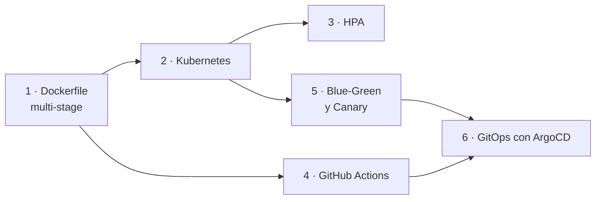
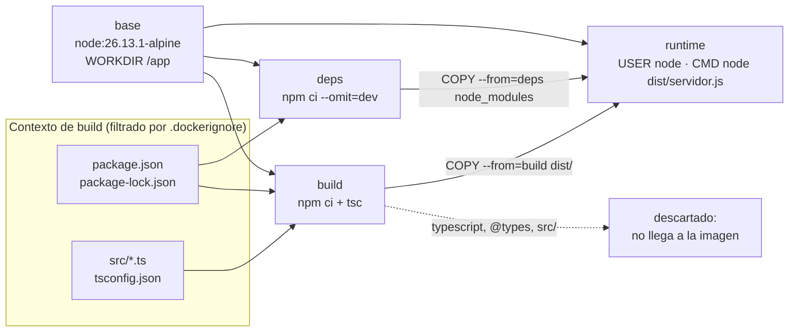
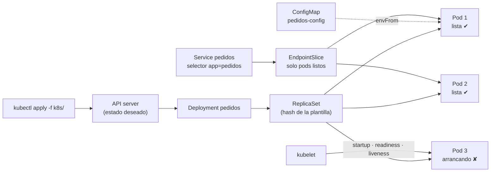
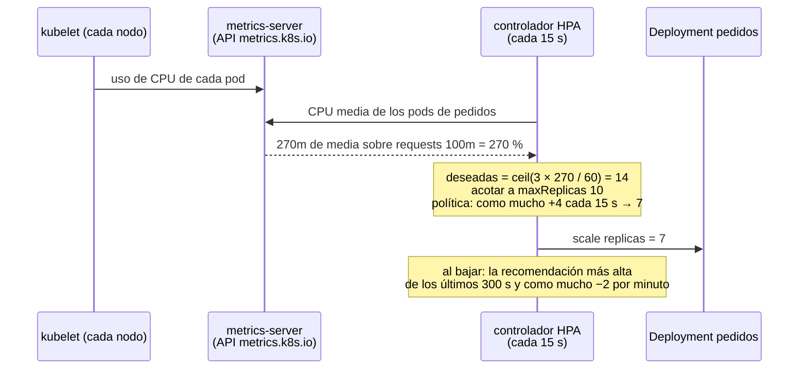
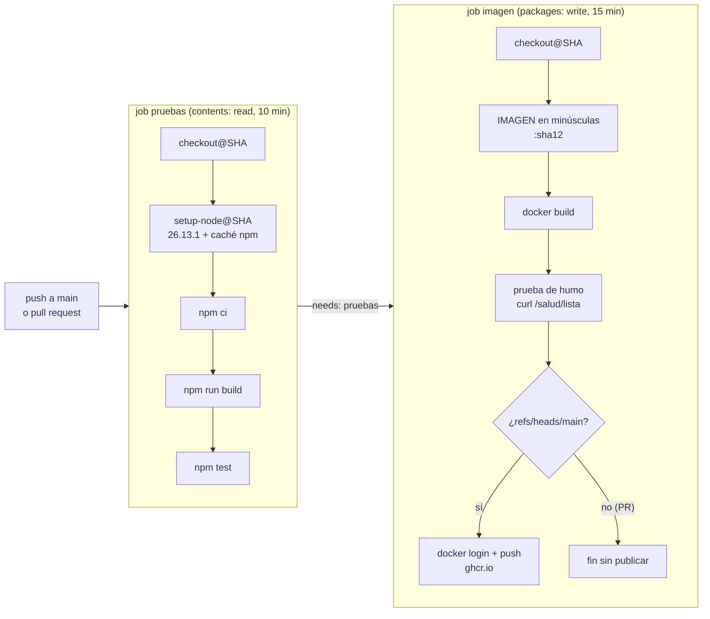
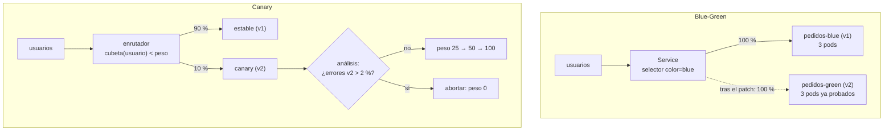
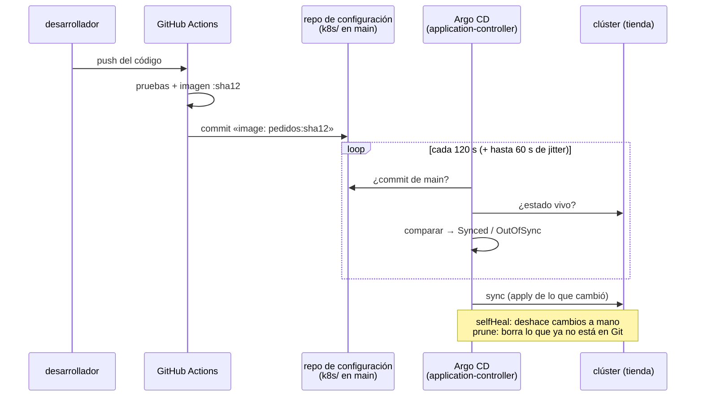

# Módulo 23 · Docker, Kubernetes y CI/CD

**Fase 2 · Node.js de cero a experto** (una semana de 12). **Duración:** 12 h (6 temas de unos 100 min y 2 h de
laboratorio integrador). **Dificultad:** 4 de 5. **Dependencias:** Módulo 0.5 (primer Dockerfile y Docker Compose) y
Módulo 21 (observabilidad: las métricas que miran el HPA y el canary); ayuda haber hecho el Módulo 13 (graceful
shutdown) y el Módulo 19 (timeouts). **Herramientas:**Node.js 26.13.1 LTS**, **TypeScript 6.0.3**, **express
5.3.0**, **yaml 2.9.1**, imagen **`node:26.13.1-alpine`**, **Docker Engine 29.10.0** con **Compose v5.6.1** o
posterior, **Kubernetes 1.37** en **kind v0.33.0**, **metrics-server v0.9.1**, **GitHub Actions** (`actions/checkout`
v7.0.1 y `actions/setup-node` v7.1.0 fijadas por SHA), **Argo Rollouts v1.10.1** y **Argo CD v3.5.6**.

fichas sin Docker; los comandos de verificación indicados construye la imagen y, si tienes kind y kubectl, despliega en un clúster
local y comprueba el HPA).

Hasta aquí tu servicio corría con `node servidor.js` en tu portátil. En producción nadie hace eso: el código se
**empaqueta** en una imagen pequeña y segura, un **orquestador** la arranca muchas veces, la reinicia si se cuelga y
añade copias cuando sube la carga, y una **cadena automática** prueba, construye y despliega cada cambio sin que nadie
copie archivos a mano. En este módulo llevas el servicio «pedidos» por ese camino completo: Dockerfile de varias etapas,
manifiestos de Kubernetes con probes, autoescalado con el HPA, pipeline de GitHub Actions, despliegues Blue-Green y
Canary que limitan el daño de una versión rota y GitOps, donde Git es la única fuente de verdad del clúster.



**Texto alternativo:** mapa del módulo. El tema 1 (Dockerfile multi-stage) produce la imagen que usan el tema 2
(Kubernetes) y el tema 4 (GitHub Actions). Kubernetes lleva al tema 3 (HPA) y al tema 5 (Blue-Green y Canary). GitHub
Actions y Blue-Green/Canary desembocan en el tema 6 (GitOps con ArgoCD), que une la cadena: el pipeline escribe en Git
y Argo CD despliega lo que hay en Git.

**Qué se ejecutó aquí y qué falta.** Todo el código Node.js, los 29 tests y los scripts de las fichas se ejecutaron con
Node 26.13.1 en Linux, y sus salidas están pegadas tal cual. La imagen de F142 se construyó aquí con Docker 29.10.0
sobre un **sustituto local** de `node:26.13.1-alpine` (este entorno no llega a Docker Hub), así que el tamaño final y
la parte de Alpine se verifican en tu Mac. **kind, kubectl, metrics-server, Argo Rollouts, Argo CD y la ejecución en
GitHub no se pudieron ejecutar aquí:** sus pasos están completos y marcados como «pendiente de verificar en el Mac»
en `verificacion/microservicios/pendiente.md`; donde no hay salida real se describe qué debes ver, sin inventar
números.

**Cómo usar el laboratorio.** Con Node 26 (y Docker para `--compose`):

```bash
npm ci && npm run build
  # 29 tests + scripts de las 6 fichas → «RESULTADO: OK»
los comandos de verificación indicados    # además imagen con Docker/Compose y, con kind y kubectl, el clúster «curso»
```

run build`. Lee el `README.md` para el mapa de
carpetas.

`package.json` del laboratorio (con `package-lock.json` que fija el árbol completo):

```json
{
  "name": "modulo-23-docker-kubernetes-cicd",
  "version": "1.0.0",
  "private": true,
  "description": "Módulo 23 (Fase 2): Docker, Kubernetes y CI/CD para un servicio Node.js (Dockerfile multi-stage, Kubernetes, HPA, GitHub Actions, Blue-Green y Canary, GitOps con Argo CD).",
  "type": "module",
  "engines": {
    "node": ">=26.13.1"
  },
  "scripts": {
    "build": "tsc -p tsconfig.json",
    "start": "node dist/servidor.js",
    "test": "node --test --test-concurrency=1 'f1*/*.test.js'"
  },
  "dependencies": {
    "express": "5.3.0"
  },
  "devDependencies": {
    "@types/express": "5.0.6",
    "@types/node": "26.6.6",
    "typescript": "6.0.3",
    "yaml": "2.9.1"
  }
}
```

El servicio que empaquetas y despliegas en todo el módulo, `src/app.ts`:

```typescript
// Módulo 23 · Servicio «pedidos» que el módulo empaqueta, despliega y escala.
// Requisitos: Node.js 26.13.1 LTS, express 5.3.0, TypeScript 6.0.3 (npm run build compila a dist/).
import express from 'express';
import { createHash } from 'node:crypto';

export interface Estado {
  listo: boolean;        // false mientras arranca o cuando recibe SIGTERM: Kubernetes deja de enviarle tráfico
  version: string;       // la etiqueta de la imagen (v1, v2…): Blue-Green y Canary la usan para distinguir versiones
  tasaError: number;     // 0..1 · solo para el laboratorio: fracción de pedidos que fallan en una versión defectuosa (F146)
}

export function crearApp(estado: Estado) {
  const app = express();
  app.disable('x-powered-by');

  // Liveness: «el proceso responde». Si falla, el kubelet reinicia el contenedor. No consulta dependencias.
  app.get('/salud/viva', (_req, res) => { res.json({ estado: 'viva' }); });

  // Readiness: «puedo atender tráfico». Si falla, el pod sale de los Endpoints del Service, sin reiniciarse.
  app.get('/salud/lista', (_req, res) => {
    if (estado.listo) res.json({ estado: 'lista' });
    else res.status(503).json({ estado: 'no lista' });
  });

  app.get('/version', (_req, res) => { res.json({ version: estado.version, pod: process.env.HOSTNAME ?? 'local' }); });

  app.get('/pedidos/:id', (req, res) => {
    // Fallo DETERMINISTA: el mismo id falla siempre en una versión defectuosa (así la simulación es repetible).
    const cubeta = Number.parseInt(createHash('sha256').update(req.params.id).digest('hex').slice(0, 8), 16) % 100;
    if (cubeta < estado.tasaError * 100) { res.status(500).json({ error: 'fallo simulado', version: estado.version }); return; }
    res.json({ id: req.params.id, estado: 'pagado', version: estado.version });
  });

  // Trabajo de CPU para que el HPA tenga algo que medir (F144): ?ms=50 quema unos 50 ms de CPU.
  app.get('/trabajo', (req, res) => {
    const ms = Math.min(Number(req.query.ms ?? 50), 1000);
    const fin = performance.now() + ms;
    let h = 'x';
    while (performance.now() < fin) h = createHash('sha256').update(h).digest('hex');
    res.json({ ms, version: estado.version });
  });
  return app;
}
```

`src/servidor.ts` (arranque y apagado ordenado):

```typescript
// Módulo 23 · Arranque y apagado ordenado del servicio «pedidos».
// En Kubernetes, al borrar un pod llega SIGTERM; el pod tiene terminationGracePeriodSeconds (30 s por defecto)
// antes de SIGKILL. Aquí: (1) dejamos de estar «listos», (2) esperamos a que el Service nos saque de sus Endpoints,
// (3) cerramos el servidor dejando terminar las peticiones en curso y (4) salimos con código 0.
import { crearApp, type Estado } from './app.js';

const puerto = Number(process.env.PORT ?? 8080);
const esperaDrenadoMs = Number(process.env.ESPERA_DRENADO_MS ?? 5000);
const estado: Estado = {
  listo: false,
  version: process.env.VERSION ?? 'dev',
  tasaError: Number(process.env.TASA_ERROR ?? 0),
};

const servidor = crearApp(estado).listen(puerto, () => {
  estado.listo = true;
  console.log(JSON.stringify({ msg: 'escuchando', puerto, version: estado.version, pid: process.pid }));
});

process.on('SIGTERM', () => {
  console.log(JSON.stringify({ msg: 'SIGTERM: dejo de estar lista y drenando', esperaDrenadoMs }));
  estado.listo = false;
  setTimeout(() => {
    servidor.close(() => {
      console.log(JSON.stringify({ msg: 'cerrado limpio', codigo: 0 }));
      process.exit(0);
    });
    servidor.closeIdleConnections();
  }, esperaDrenadoMs);
});
```

`tsconfig.json`:

```jsonc
{
  // Módulo 23 · TypeScript 6.0.3 COMPILA src/ a dist/ (npm run build). La etapa «build» del Dockerfile hace lo mismo.
  "compilerOptions": {
    "target": "es2024",
    "module": "nodenext",
    "moduleResolution": "nodenext",
    "rootDir": "src",
    "outDir": "dist",
    "strict": true,
    "verbatimModuleSyntax": true,
    "types": ["node"],
    "skipLibCheck": true
  },
  "include": ["src"]
}
```

---

### Dockerfile multi-stage

#### 1. UBICACIÓN

Módulo 23, Lección 1 de 6 · Fase 2.

#### 2. PRERREQUISITOS

- Imagen, contenedor, capa y `docker build`/`docker run` (Módulo 0.5).
- `npm ci`, `dependencies` frente a `devDependencies` y lockfile (Módulo 13).
- Señales y graceful shutdown en Node (Módulo 13).

#### 3. OBJETIVO DE APRENDIZAJE

**Construir** una imagen de producción con un Dockerfile de tres etapas (dependencias, compilación y ejecución),
**justificar** cada instrucción por tamaño, caché, seguridad y señales, y **demostrar** que la imagen final no lleva
compilador ni corre como root. Lo compruebas cuando `node --test f142-dockerfile/dockerfile.test.js` pasa 4 de 4 y
`docker image inspect pedidos:1.0.0 --format '{{.Config.User}}'` responde `node`.

#### 4. ANALOGÍA VISUAL

Dibuja una **panadería** con dos salas. En el **obrador** (la etapa de compilación) hay sacos de harina, batidoras,
moldes, el horno y restos por el suelo: todo lo necesario para **hacer** el pan. En el **mostrador** (la imagen final)
solo hay una vitrina limpia con el pan terminado y un dependiente. El cliente nunca entra al obrador: recibe el pan, no
la batidora. Un Dockerfile de una sola etapa es como vender el pan **dentro del obrador**: el cliente se lleva también
la harina, el horno y la llave del local (root). Una flecha va del horno a la vitrina con una etiqueta: «`COPY --from=build`
solo el pan».

#### 5. DIAGRAMA TÉCNICO



**Texto alternativo:** diagrama de flujo de un Dockerfile de tres etapas. El contexto de build, filtrado por
.dockerignore, aporta package.json con su lockfile y el código TypeScript. Las tres etapas parten de la misma base
node:26.13.1-alpine. La etapa deps instala solo las dependencias de producción; la etapa build instala todas y compila
con tsc. La etapa runtime recibe de deps la carpeta node_modules y de build la carpeta dist, corre como el usuario node
y arranca con node dist/servidor.js. Una flecha cortada indica que typescript, los tipos y el código fuente no llegan a
la imagen final.

#### 6. EXPLICACIÓN NIVEL 0

- Una **imagen** es una caja con todo lo que tu programa necesita para arrancar: el sistema mínimo, Node.js, tu código y
  sus librerías. El **Dockerfile** es la receta para llenar esa caja.
- Para **preparar** el programa necesitas herramientas (el compilador de TypeScript, por ejemplo) que **no** necesitas
  para **ejecutarlo**. Si las dejas dentro, la caja pesa más, tarda más en viajar y tiene más piezas que un atacante
  puede aprovechar.
- Un Dockerfile **multi-stage** tiene varias recetas seguidas (etapas). Las primeras preparan; la última copia **solo
  el resultado**. Lo demás se tira.
- Además, la última etapa usa un **usuario sin permisos de administrador**: si alguien entra en el programa, no puede
  tocar el resto de la caja.

#### 7. EXPLICACIÓN INTERMEDIA

- **Cada `FROM` abre una etapa**; `AS nombre` le pone nombre y `COPY --from=nombre` copia archivos de una etapa
  anterior. Solo la **última** etapa (o la que elijas con `docker build --target`) es la imagen resultante.
- **Caché de capas:** Docker reutiliza una capa si su instrucción y sus archivos de entrada no cambiaron. Por eso se
  copia **primero** `package.json` y `package-lock.json`, se instala, y **después** se copia `src/`: cambiar una línea
  de código no reinstala las dependencias.
- **`npm ci`** instala exactamente lo del lockfile (y falla si no coincide con `package.json`); `--omit=dev` deja fuera
  las `devDependencies`. La etapa `deps` hace eso y la etapa `build` instala todo para poder compilar.
- **`.dockerignore`** filtra el contexto que se envía al daemon: sin él, tu `node_modules` local (que puede traer
  binarios de macOS), `dist/`, `.git` y tus `.env` acabarían dentro con un `COPY` descuidado.
- **Seguridad y señales** (guía oficial de las imágenes de Node, `docker-node/docs/BestPractices.md`, consultada el
  2026-11-20): las imágenes traen el usuario `node` con uid 1000 para no correr como root; se recomienda
  `NODE_ENV=production`; y conviene arrancar con `CMD ["node", "…"]` en forma exec para que las señales `SIGTERM` y
  `SIGINT` lleguen al proceso de Node (la misma guía advierte que Node no se diseñó para ser el PID 1 y sugiere
  `docker run --init` o Tini cuando hace falta un init).
- **Tamaño de la base** (Docker Hub, consultado el 2026-11-20, tamaños comprimidos para amd64): `node:26.13.1` pesa
  444 894 615 bytes (unos 445 MB) y `node:26.13.1-alpine` 62 954 415 bytes (unos 63 MB).

#### 8. EXPLICACIÓN MAESTRA

- **Alpine frente a Debian slim frente a distroless.** *Alpine* (musl libc) es la más pequeña de las oficiales, pero
  algunos módulos nativos compilados para glibc no funcionan o hay que compilarlos; *`node:26.13.1-slim`* (Debian)
  pesa más y evita sorpresas con glibc; las imágenes **distroless** de Google no traen shell ni gestor de paquetes
  (menos superficie, pero depurar es más difícil: no hay `sh` para entrar). Elige por tus dependencias nativas y por
  cómo depuras, no solo por el tamaño.
- **Compilar o no compilar.** Node 26 ejecuta TypeScript «borrando los tipos» (lo usaste en el Módulo 19), así que
  podrías saltarte la etapa `build`. Compilar con `tsc` sigue teniendo ventajas en producción: el error de tipos se
  detecta al construir y no al arrancar, y la imagen no depende de una función de Node con sus propias limitaciones
  (solo sintaxis «borrable»). La etapa `deps` sigue siendo útil en ambos casos.
- **Fijar la base por digest.** `node:26.13.1-alpine` es una etiqueta que el equipo de la imagen **reconstruye** con
  parches de Alpine; `node:26.13.1-alpine@sha256:…` es inmutable. Fijar por digest da builds repetibles, a cambio de
  tener que actualizar el digest (Renovate o Dependabot lo hacen). Lo que **nunca** debes usar en producción es
  `:latest` o solo la mayor (`node:26`), porque cada build puede traer otra versión.
- **Caché de BuildKit.** Con `RUN --mount=type=cache,target=/root/.npm npm ci` la caché de npm sobrevive entre builds
  sin entrar en la imagen; en CI acelera mucho. No la usamos aquí para que el Dockerfile funcione igual con el
  constructor clásico.
- **Cuándo NO hace falta multi-stage:** si tu servicio es JavaScript puro sin paso de build ni `devDependencies`
  relevantes, una sola etapa con `npm ci --omit=dev`, usuario `node` y `.dockerignore` da casi el mismo resultado.
  Lo que nunca sobra es el usuario sin root, la versión fija y la forma exec del `CMD`.

#### 9. CÓDIGO EJECUTABLE

Versiones: **Node.js 26.13.1 LTS**, **TypeScript 6.0.3**, **express 5.3.0**, imagen **`node:26.13.1-alpine`** y
**Docker Engine 29.10.0**.

`f142-dockerfile/Dockerfile`:

```dockerfile
# syntax=docker/dockerfile:1
# Módulo 23 · F142 · Dockerfile multi-stage del servicio «pedidos» (Node.js 26.13.1 LTS + TypeScript 6.0.3).
# Construye desde la raíz del laboratorio:  docker build -f f142-dockerfile/Dockerfile -t pedidos:1.0.0 .
# Tres etapas que parten de la misma base: «deps» (solo dependencias de producción), «build» (compila TypeScript
# con las de desarrollo) y «runtime» (lo único que se publica: dist/ + node_modules de producción, usuario sin root).
ARG NODE_VERSION=26.13.1

FROM node:${NODE_VERSION}-alpine AS base
WORKDIR /app

# 1) Dependencias de PRODUCCIÓN. Solo se repite si cambian package.json o package-lock.json (caché de capas).
FROM base AS deps
COPY package.json package-lock.json ./
RUN npm ci --omit=dev --no-audit --no-fund

# 2) Compilación: necesita typescript y @types (devDependencies), que NUNCA llegan a la imagen final.
FROM base AS build
COPY package.json package-lock.json ./
RUN npm ci --no-audit --no-fund
COPY tsconfig.json ./
COPY src ./src
RUN npm run build

# 3) Imagen final: sin compilador, sin código fuente TypeScript, sin npm ci de desarrollo.
FROM base AS runtime
ENV NODE_ENV=production \
    PORT=8080
# Los archivos quedan de root y solo legibles para «node»: el proceso no puede reescribir su propio código.
COPY --from=deps /app/node_modules ./node_modules
COPY --from=build /app/dist ./dist
COPY package.json ./
# Las imágenes oficiales traen el usuario «node» (uid 1000).
USER node
EXPOSE 8080
# Docker y Compose usan HEALTHCHECK; Kubernetes lo ignora y usa sus probes (F143).
HEALTHCHECK --interval=10s --timeout=3s --retries=3 \
  CMD ["node", "-e", "fetch('http://127.0.0.1:8080/salud/viva').then((r) => process.exit(r.ok ? 0 : 1), () => process.exit(1))"]
# Forma exec: node es el PID 1 y recibe SIGTERM directamente (con «npm start» la señal se queda en npm).
CMD ["node", "dist/servidor.js"]
```

`.dockerignore` (en la raíz del laboratorio, que es el contexto del build):

```text
# Módulo 23 · F142 · Lo que NO entra en el contexto de build: dependencias locales, compilados, logs, git y secretos.
node_modules
dist
logs
.git
.env
.env.*
**/*.test.js
f14*/
k8s/
```

Para comparar, `f142-dockerfile/Dockerfile.antes` (una sola etapa):

```dockerfile
# Módulo 23 · F142 · ANTES: Dockerfile de una sola etapa. Funciona, pero NO lo copies:
# imagen completa de Debian, devDependencies y código fuente dentro, root y «npm start» como PID 1.
FROM node:26.13.1
WORKDIR /app
COPY . .
RUN npm install
RUN npm run build
EXPOSE 8080
CMD ["npm", "start"]
```

`f142-dockerfile/revisar.js`, un revisor estático que aplica siete reglas sin necesitar Docker:

```javascript
// Módulo 23 · F142 · Revisor estático de Dockerfiles: lee las instrucciones y aplica 7 reglas del módulo.
// No necesita Docker. Uso: node f142-dockerfile/revisar.js f142-dockerfile/Dockerfile [otro…]
import { readFileSync } from 'node:fs';

/** Convierte el Dockerfile en instrucciones {op, args, etapa}, uniendo líneas terminadas en «\». */
export function instrucciones(texto) {
  const lineas = texto.replace(/\\\r?\n/g, ' ').split(/\r?\n/).map((l) => l.trim()).filter((l) => l && !l.startsWith('#'));
  const res = [];
  let etapa = -1;
  for (const linea of lineas) {
    const [op, ...resto] = linea.split(/\s+/);
    const OP = op.toUpperCase();
    if (OP === 'FROM') etapa += 1;
    res.push({ op: OP, args: resto.join(' '), etapa });
  }
  return res;
}

export const REGLAS = [
  ['varias etapas (multi-stage)', (ins) => ins.filter((i) => i.op === 'FROM').length >= 2],
  ['imagen base con versión exacta (nada de :latest ni sin etiqueta)', (ins) => ins.filter((i) => i.op === 'FROM').every((i) => {
    const imagen = i.args.split(/\s+/)[0];
    return imagen.includes('@sha256:') || (/:[^:]+$/.test(imagen) && !imagen.endsWith(':latest')) || !imagen.includes('/') && !imagen.includes(':') && ins.some((x) => x.op === 'FROM' && x.args.endsWith(`AS ${imagen}`));
  })],
  ['la imagen final no corre como root (USER)', (ins) => {
    const ultima = Math.max(...ins.map((i) => i.etapa));
    const users = ins.filter((i) => i.op === 'USER' && i.etapa === ultima);
    return users.length > 0 && !/^(root|0)(:|$)/.test(users.at(-1).args);
  }],
  ['instala con npm ci (respeta el lockfile)', (ins) => ins.some((i) => i.op === 'RUN' && /npm ci\b/.test(i.args)) && !ins.some((i) => i.op === 'RUN' && /npm install\b/.test(i.args))],
  ['la etapa final no instala devDependencies', (ins) => {
    const ultima = Math.max(...ins.map((i) => i.etapa));
    const final = ins.filter((i) => i.etapa === ultima);
    return !final.some((i) => i.op === 'RUN' && /npm (ci|install)\b/.test(i.args) && !/--omit=dev/.test(i.args));
  }],
  ['no copia todo el contexto con «COPY . .»', (ins) => !ins.some((i) => i.op === 'COPY' && /^(--\S+\s+)*\.\s+\.$/.test(i.args))],
  ['CMD en forma exec y con node (no npm)', (ins) => {
    const cmd = ins.filter((i) => i.op === 'CMD').at(-1);
    return Boolean(cmd) && cmd.args.startsWith('[') && JSON.parse(cmd.args)[0] === 'node';
  }],
];

export function revisar(texto) {
  const ins = instrucciones(texto);
  return REGLAS.map(([regla, cumple]) => ({ regla, ok: cumple(ins) }));
}

if (import.meta.main) {
  let fallos = 0;
  for (const archivo of process.argv.slice(2)) {
    console.log(`== ${archivo}`);
    for (const { regla, ok } of revisar(readFileSync(archivo, 'utf8'))) {
      console.log(`   ${ok ? '✔' : '✘'} ${regla}`);
      if (!ok) fallos += 1;
    }
  }
  console.log(`reglas incumplidas: ${fallos}`);
}
```

#### 10. MINI-LABORATORIO

1. Revisa los dos Dockerfiles con el revisor:

```bash
node f142-dockerfile/revisar.js f142-dockerfile/Dockerfile.antes f142-dockerfile/Dockerfile
```

   **Output esperado:**

```text
== f142-dockerfile/Dockerfile.antes
   ✘ varias etapas (multi-stage)
   ✔ imagen base con versión exacta (nada de :latest ni sin etiqueta)
   ✘ la imagen final no corre como root (USER)
   ✘ instala con npm ci (respeta el lockfile)
   ✘ la etapa final no instala devDependencies
   ✘ no copia todo el contexto con «COPY . .»
   ✘ CMD en forma exec y con node (no npm)
== f142-dockerfile/Dockerfile
   ✔ varias etapas (multi-stage)
   ✔ imagen base con versión exacta (nada de :latest ni sin etiqueta)
   ✔ la imagen final no corre como root (USER)
   ✔ instala con npm ci (respeta el lockfile)
   ✔ la etapa final no instala devDependencies
   ✔ no copia todo el contexto con «COPY . .»
   ✔ CMD en forma exec y con node (no npm)
reglas incumplidas: 6
```

2. Mide lo que ahorra separar etapas **sin Docker**: `f142-dockerfile/etapas.js` ejecuta en dos carpetas temporales el
   mismo `npm ci` de las etapas `build` y `deps`:

```javascript
// Módulo 23 · F142 · Reproduce SIN Docker lo que hacen las etapas «deps» y «build» y mide lo que ahorra separarlas.
// Copia package.json y package-lock.json a dos carpetas temporales y ejecuta en cada una el mismo npm ci del Dockerfile.
// Requisitos: Node.js 26.13.1 LTS y npm. Ejecuta: node f142-dockerfile/etapas.js
import { execFileSync } from 'node:child_process';
import { cpSync, mkdtempSync, readdirSync, rmSync, statSync } from 'node:fs';
import { tmpdir } from 'node:os';
import { join } from 'node:path';

function tamano(ruta) { // bytes de una carpeta, recorriéndola entera
  let total = 0;
  for (const e of readdirSync(ruta, { withFileTypes: true })) {
    const p = join(ruta, e.name);
    total += e.isDirectory() ? tamano(p) : statSync(p).size;
  }
  return total;
}
const mb = (b) => `${(b / 1024 / 1024).toFixed(1)} MB`;
const paquetes = (nm) => readdirSync(nm).flatMap((n) => (n.startsWith('@') ? readdirSync(join(nm, n)) : n.startsWith('.') ? [] : [n])).length;

function etapa(nombre, argumentos) {
  const dir = mkdtempSync(join(tmpdir(), `etapa-${nombre}-`));
  for (const f of ['package.json', 'package-lock.json']) cpSync(f, join(dir, f));
  execFileSync('npm', ['ci', ...argumentos, '--no-audit', '--no-fund', '--prefer-offline', '--silent'], { cwd: dir, stdio: 'inherit' });
  const nm = join(dir, 'node_modules');
  const res = { nombre, bytes: tamano(nm), paquetes: paquetes(nm), typescript: readdirSync(nm).includes('typescript') };
  rmSync(dir, { recursive: true, force: true });
  return res;
}

const build = etapa('build', []);
const deps = etapa('deps', ['--omit=dev']);
for (const e of [build, deps]) {
  console.log(`etapa ${e.nombre.padEnd(5)} node_modules: ${mb(e.bytes).padStart(8)} · ${String(e.paquetes).padStart(2)} paquetes · typescript dentro: ${e.typescript ? 'sí' : 'no'}`);
}
console.log(`la imagen final copia solo «deps»: ${mb(build.bytes - deps.bytes)} menos (${Math.round(100 * (1 - deps.bytes / build.bytes))} %)`);
```

```bash
node f142-dockerfile/etapas.js
```

   **Output esperado** (ejecutado en Linux con npm 10.9; los MB pueden variar unas décimas con otra versión de npm):

```text
etapa build node_modules:  28.8 MB · 78 paquetes · typescript dentro: sí
etapa deps  node_modules:   2.2 MB · 65 paquetes · typescript dentro: no
la imagen final copia solo «deps»: 26.6 MB menos (92 %)
```

3. Construye y arranca la imagen con Docker Compose (`docker-compose.yml` del laboratorio):

```yaml
# Módulo 23 (modulo-27) · Construye la imagen multi-stage de F142 y la arranca como la arrancaría un orquestador.
#   docker compose up -d --build --wait     -> espera a que el HEALTHCHECK de la imagen diga «healthy»
#   curl localhost:18080/version
#   docker compose down                     -> SIGTERM, drenado de 5 s y salida limpia (mira docker compose logs)
services:
  pedidos:
    build:
      context: .
      dockerfile: f142-dockerfile/Dockerfile
    image: pedidos:1.0.0
    environment:
      VERSION: v1
      ESPERA_DRENADO_MS: "5000"
    ports: ["18080:8080"]
    read_only: true            # como readOnlyRootFilesystem en Kubernetes
    stop_grace_period: 30s     # como terminationGracePeriodSeconds
```

```bash
docker compose up -d --build --wait
curl -s localhost:18080/version; echo
docker image inspect pedidos:1.0.0 --format '{{.Config.User}}'
docker run --rm pedidos:1.0.0 ls
docker run --rm pedidos:1.0.0 sh -c 'ls node_modules/typescript || echo "sin typescript"; touch dist/x'
time docker compose stop
docker compose logs pedidos
docker image ls pedidos:1.0.0
docker compose down
```

   **Output esperado** (ejecutado aquí sobre el sustituto local de la base; el id del contenedor cambia):

```text
 Container modulo-27-pedidos-1 Healthy
{"version":"v1","pod":"2fb2ecab9af3"}
node
dist
node_modules
package.json
sin typescript
ls: cannot access 'node_modules/typescript': No such file or directory
touch: cannot touch 'dist/x': Permission denied
real	0m5.249s
pedidos-1  | {"msg":"escuchando","puerto":8080,"version":"v1","pid":1}
pedidos-1  | {"msg":"SIGTERM: dejo de estar lista y drenando","esperaDrenadoMs":5000}
pedidos-1  | {"msg":"cerrado limpio","codigo":0}
IMAGE           ID             DISK USAGE   CONTENT SIZE   EXTRA
pedidos:1.0.0   8fab381522e5        377MB         95.6MB   U
```

   **Captura comentada:** `--wait` no vuelve hasta que el `HEALTHCHECK` de la imagen dice *healthy*. El usuario es
   `node` y la imagen solo contiene `dist`, `node_modules` y `package.json`: ni `src/` ni TypeScript. El proceso no
   puede escribir en su propio código (los archivos son de root). `docker compose stop` tarda unos 5 s: es el drenado de
   `ESPERA_DRENADO_MS`, y Node, que es el PID 1, recibe `SIGTERM` y sale con código 0 en lugar de morir por `SIGKILL`
   a los 30 s. **Tamaño:** aquí la imagen midió 377 MB porque el sustituto es Ubuntu con el binario de Node; con la
   base Alpine real debe quedar muy por debajo: la base comprimida pesa unos 63 MB y tu código y dependencias añaden unos
   2 MB. Anota tu cifra: `docker image ls` en el Mac es la referencia (pendiente de verificar). La salida de `ls` y el
   mensaje de error salen por canales distintos, así que su orden puede variar.

#### 11. VERIFICACIÓN

Test que debes ejecutar (`f142-dockerfile/dockerfile.test.js`):

```javascript
// Módulo 23 · F142 · Tests del Dockerfile multi-stage (sin Docker). Ejecuta: node --test f142-dockerfile/dockerfile.test.js
import { test } from 'node:test';
import assert from 'node:assert/strict';
import { readFileSync } from 'node:fs';
import { instrucciones, revisar } from './revisar.js';

const despues = readFileSync(new URL('./Dockerfile', import.meta.url), 'utf8');
const antes = readFileSync(new URL('./Dockerfile.antes', import.meta.url), 'utf8');

test('el Dockerfile multi-stage cumple las 7 reglas', () => {
  assert.deepEqual(revisar(despues).filter((r) => !r.ok), []);
});

test('el Dockerfile de una etapa incumple 6 de las 7', () => {
  assert.equal(revisar(antes).filter((r) => !r.ok).length, 6);
});

test('la etapa final solo recibe dist/, node_modules de producción y package.json', () => {
  const ins = instrucciones(despues);
  const ultima = Math.max(...ins.map((i) => i.etapa));
  const copias = ins.filter((i) => i.op === 'COPY' && i.etapa === ultima).map((i) => i.args);
  assert.deepEqual(copias, ['--from=deps /app/node_modules ./node_modules', '--from=build /app/dist ./dist', 'package.json ./']);
});

test('.dockerignore deja fuera node_modules, dist, .git y los .env', () => {
  const ignorados = readFileSync(new URL('../.dockerignore', import.meta.url), 'utf8').split('\n');
  for (const patron of ['node_modules', 'dist', '.git', '.env', '.env.*']) assert.ok(ignorados.includes(patron), patron);
});
```

```bash
node --test f142-dockerfile/dockerfile.test.js
```

Resultado esperado:

```text
✔ el Dockerfile multi-stage cumple las 7 reglas
✔ el Dockerfile de una etapa incumple 6 de las 7
✔ la etapa final solo recibe dist/, node_modules de producción y package.json
✔ .dockerignore deja fuera node_modules, dist, .git y los .env
ℹ tests 4
ℹ pass 4
ℹ fail 0
```

**Pregunta de comprobación:** si cambias una línea de `src/app.ts`, ¿qué etapas vuelve a ejecutar Docker y cuáles salen
de la caché? *(La etapa `deps` entera y el `npm ci` de `build` salen de la caché, porque `package.json` y el lockfile no
cambiaron; se repiten `COPY src`, `npm run build` y la copia de `dist/` a `runtime`.)*

#### 12. ERROR COMÚN

**Síntoma:** en tu máquina `npm start` funciona, pero el contenedor se reinicia en bucle nada más arrancar
(`docker compose ps` muestra `Restarting`, o en Kubernetes `CrashLoopBackOff`). **Causa:** una librería que el código
usa **al ejecutarse** está en `devDependencies`; la etapa `deps` usa `--omit=dev` y no la instala.
`f142-dockerfile/error-comun.js` reproduce las dos etapas sin Docker:

```javascript
// Módulo 23 · F142 · ERROR COMÚN: una dependencia de ejecución declarada en devDependencies.
// En tu máquina funciona (npm install trae todo); en la imagen, la etapa «deps» usa --omit=dev y el contenedor muere al
// arrancar. Este script reproduce las dos etapas sin Docker. Requisitos: haber ejecutado npm run build.
// Ejecuta: node f142-dockerfile/error-comun.js
import { execFileSync, spawnSync } from 'node:child_process';
import { cpSync, mkdtempSync, readFileSync, rmSync, writeFileSync } from 'node:fs';
import { tmpdir } from 'node:os';
import { join } from 'node:path';

function imagenSimulada(moverExpressADev) {
  const dir = mkdtempSync(join(tmpdir(), 'imagen-'));
  const pkg = JSON.parse(readFileSync('package.json', 'utf8'));
  if (moverExpressADev) { pkg.devDependencies.express = pkg.dependencies.express; delete pkg.dependencies.express; }
  writeFileSync(join(dir, 'package.json'), JSON.stringify(pkg, null, 2));
  cpSync('package-lock.json', join(dir, 'package-lock.json'));
  // npm ci exige que package.json y el lockfile coincidan: usamos «npm install --omit=dev» solo para esta demostración.
  execFileSync('npm', ['install', '--omit=dev', '--no-audit', '--no-fund', '--prefer-offline', '--silent'], { cwd: dir });
  cpSync('dist', join(dir, 'dist'), { recursive: true });
  const r = spawnSync('node', ['dist/servidor.js'], { cwd: dir, env: { ...process.env, PORT: '0' }, timeout: 1500, encoding: 'utf8' });
  rmSync(dir, { recursive: true, force: true });
  return r;
}

console.log('== MAL: express en devDependencies (la etapa deps lo omite)');
const mal = imagenSimulada(true);
console.log(`   código de salida: ${mal.status}`);
console.log(`   ${mal.stderr.split('\n').find((l) => l.startsWith('Error'))}`);
console.log('== BIEN: express en dependencies');
const bien = imagenSimulada(false);
console.log(`   ${bien.stdout.trim().split('\n')[0]}`);
```

Salida real de `node f142-dockerfile/error-comun.js` (el pid y la carpeta temporal cambian):

```text
== MAL: express en devDependencies (la etapa deps lo omite)
   código de salida: 1
   Error [ERR_MODULE_NOT_FOUND]: Cannot find package 'express' imported from /tmp/imagen-ka0fCE/dist/app.js
== BIEN: express en dependencies
   {"msg":"escuchando","puerto":0,"version":"dev","pid":2857}
```

**Diagnóstico visual:** `docker logs <contenedor>` muestra `ERR_MODULE_NOT_FOUND` con el nombre del paquete; compáralo
con la lista de `docker run --rm pedidos:1.0.0 ls node_modules`. **Arreglo:** todo lo que se importa en `dist/` va en
`dependencies` (`npm install --save express`); en `devDependencies` solo compiladores, tipos, linters y frameworks de
test. El test de CI que arranca la imagen (prueba de humo de la ficha 4) atrapa este error antes de producción.

#### 13. PREGUNTA DE ENTREVISTA

**¿Cómo escribirías el Dockerfile de producción de un servicio Node.js con TypeScript y por qué?**

**Respuesta modelo:** con varias etapas que parten de la misma base con versión exacta, por ejemplo
`node:26.13.1-alpine` (o fijada por digest). Una etapa `deps` copia solo `package.json` y el lockfile y hace
`npm ci --omit=dev`; otra `build` instala todo y compila con `tsc`; la final copia `node_modules` de `deps` y `dist/` de
`build`, y nada más. Ordeno las instrucciones de lo que menos cambia a lo que más para aprovechar la caché: las
dependencias no se reinstalan por cambiar código. Uso `.dockerignore` para no enviar `node_modules`, `.git` ni `.env`.
La imagen final corre como `node` (uid 1000) y no como root, con los archivos del código sin permiso de escritura, con
`NODE_ENV=production` y con `CMD ["node", "dist/servidor.js"]` en forma exec para que `SIGTERM` llegue al proceso y el
servicio drene y salga limpio. Así gano tamaño (menos tiempo de descarga y arranque en cada nodo), superficie de ataque
(sin compilador ni código fuente) y apagados ordenados. Elegiría Debian slim si tuviera módulos nativos que dan
problemas con musl.

#### 14. ANTI-PATRÓN RELACIONADO

**El «Dockerfile de portátil»: una sola etapa, `COPY..` y `npm start`.** Evita copiar todo el contexto antes de
instalar, instalar con `npm install` y arrancar con npm como root:

```dockerfile
# MAL: cada cambio de código reinstala todo, entra tu node_modules de macOS y tu .env, la imagen trae TypeScript,
# corre como root y SIGTERM se queda en npm (el contenedor muere por SIGKILL a los 30 s y corta peticiones).
FROM node:26.13.1
COPY . .
RUN npm install && npm run build
CMD ["npm", "start"]
```

```dockerfile
# BIEN: el Dockerfile de la sección 9 (deps → build → runtime, USER node, CMD ["node", "dist/servidor.js"]).
```

En un diagrama se ve como **una sola caja enorme** con el compilador, el código fuente y la llave de root dentro, frente
a tres cajas en fila donde solo la última, pequeña, sale hacia el registro de imágenes.

---
### Kubernetes

#### 1. UBICACIÓN

Módulo 23, Lección 2 de 6 · Fase 2 manifiestos en
`k8s`.

#### 2. PRERREQUISITOS

- La imagen `pedidos:1.0.0` de la ficha anterior.
- YAML (Módulo 0.4) y puertos, DNS y HTTP (Módulo 0.4).
- Graceful shutdown con `SIGTERM` (Módulo 13).

#### 3. OBJETIVO DE APRENDIZAJE

**Desplegar** el servicio en Kubernetes con un Deployment, un Service y un ConfigMap; **configurar** startup,
readiness y liveness probes, requests y límites, y un usuario sin root; y **explicar** qué hace el clúster cuando un pod
no está listo, se cuelga o recibe `SIGTERM`. Lo compruebas cuando `node --test f143-kubernetes/kubernetes.test.js` pasa
4 de 4 y, en kind, `kubectl -n tienda rollout status deployment/pedidos` termina con `successfully rolled out`.

#### 4. ANALOGÍA VISUAL

Dibuja un **restaurante con un jefe de sala**. El jefe tiene una **hoja de pedido** pegada en la pared: «quiero siempre
3 cocineros de pasta» (el Deployment). Si un cocinero se va a casa, el jefe llama a otro sin que nadie se lo pida. Los
camareros no gritan el nombre de un cocinero: dejan las comandas en una **ventanilla** con el cartel «pasta» (el
Service), y la ventanilla reparte entre los cocineros **que tienen el delantal puesto** (readiness). Cada cierto tiempo
el jefe pregunta a cada cocinero «¿sigues ahí?» (liveness); si no contesta tres veces, lo sustituye. Cuando uno termina
su turno (`SIGTERM`), primero se quita el delantal, acaba los platos que tiene en el fuego y luego se va.

#### 5. DIAGRAMA TÉCNICO



**Texto alternativo:** diagrama de flujo. kubectl apply envía los manifiestos al API server, que guarda el estado
deseado. El Deployment pedidos crea un ReplicaSet identificado por el hash de su plantilla, y el ReplicaSet crea tres
pods; dos están listos y uno sigue arrancando. El ConfigMap pedidos-config inyecta variables de entorno en los pods. El
Service pedidos selecciona los pods con la etiqueta app=pedidos y su EndpointSlice solo contiene los dos pods listos. El
kubelet de cada nodo ejecuta las probes de arranque, preparación y vida sobre los pods.

#### 6. EXPLICACIÓN NIVEL 0

- **Kubernetes** es un programa que administra muchos contenedores en muchas máquinas. Tú no le dices «arranca este
  contenedor»; le dices **cómo quieres que esté todo** («3 copias de pedidos») y él trabaja sin parar para que sea así.
- Un **pod** es la unidad que arranca: uno o pocos contenedores que viven y mueren juntos.
- Un **Deployment** es la orden «quiero N pods iguales con esta imagen»; si uno muere, crea otro.
- Un **Service** es un nombre fijo (`pedidos`) que reparte el tráfico entre los pods que están **listos**, aunque los
  pods cambien de dirección cada vez que se reinician.
- Las **probes** son preguntas que Kubernetes le hace a tu servicio: «¿ya arrancaste?», «¿puedes atender?», «¿sigues
  vivo?». Tu código tiene que saber contestarlas.

#### 7. EXPLICACIÓN INTERMEDIA

- **Objetos de `k8s/`:** `Namespace` (espacio aislado `tienda`), `ConfigMap` (configuración no secreta como variables
  de entorno), `Deployment` (plantilla de pod + estrategia de actualización), `Service` (IP y DNS estables:
  `pedidos.tienda.svc.cluster.local`) y `HorizontalPodAutoscaler` (ficha siguiente).
- **Etiquetas y selectores** lo unen todo: el Deployment encuentra sus pods por `spec.selector.matchLabels`, y el
  Service, por `spec.selector`. Si no coinciden, nadie da error: simplemente no hay pods detrás (error común).
- **Probes:** la **startupProbe** protege el arranque (mientras no pase, las otras no cuentan); la **readinessProbe**,
  si falla, saca el pod de los Endpoints del Service **sin reiniciarlo**; la **livenessProbe**, si falla
  `failureThreshold` veces seguidas, hace que el kubelet **reinicie** el contenedor. Por eso son rutas distintas:
  `/salud/lista` puede decir «no» durante el apagado, `/salud/viva` solo dice si el proceso responde.
- **Recursos:** `requests` es lo que el scheduler reserva para el pod en un nodo (y la base del % de CPU del HPA);
  `limits.memory` es el techo: si lo supera, el contenedor muere con `OOMKilled`. No ponemos límite de CPU para no
  estrangular al proceso (un límite de CPU se aplica con *throttling*, no matando).
- **Rolling update:** con `maxSurge: 1` y `maxUnavailable: 0` Kubernetes crea un pod nuevo, espera a que esté **listo**
  y solo entonces borra uno viejo. `kubectl rollout undo` vuelve al ReplicaSet anterior.
- **Apagado:** al borrar un pod, Kubernetes envía `SIGTERM` y espera `terminationGracePeriodSeconds` (30 s por defecto)
  antes de `SIGKILL`. Mientras, el pod sale de los Endpoints; como eso tarda un poco en propagarse, el servicio sigue
  atendiendo unos segundos (`ESPERA_DRENADO_MS`) antes de cerrar.
- **Seguridad del pod:** `runAsNonRoot`, `allowPrivilegeEscalation: false`, `readOnlyRootFilesystem: true` y quitar
  todas las *capabilities* de Linux; coincide con la imagen de la ficha 1 (usuario uid 1000).

#### 8. EXPLICACIÓN MAESTRA

- **Kubernetes frente a sus alternativas.** *Docker Compose* en una máquina: simple, sin alta disponibilidad ni
  autoescalado; suficiente para un servicio interno pequeño. *Servicios gestionados de contenedores* (Cloud Run, AWS
  ECS/Fargate, Azure Container Apps): sin plano de control que mantener, con escalado incluido, a cambio de menos
  control y dependencia del proveedor. *Kubernetes* (gestionado: EKS, GKE, AKS): el estándar portátil, con un
  ecosistema enorme (HPA, Argo CD, mallas de servicio), a cambio de una complejidad operativa real.
- **Cuándo NO usar Kubernetes:** un equipo pequeño con dos o tres servicios y tráfico predecible paga más en
  aprendizaje y operación que lo que gana. Un PaaS o Compose con un buen pipeline es la respuesta adulta hasta que
  necesites lo que solo Kubernetes da.
- **Manifiestos crudos frente a Helm o Kustomize.** Los YAML crudos de `k8s/` son ideales para aprender y para un
  servicio. Con varios entornos (dev, staging, prod) que cambian réplicas, imagen o dominio, *Kustomize* (integrado en
  `kubectl apply -k`) aplica «parches» sobre una base, y *Helm* usa plantillas con valores y versiona el paquete
  (chart). Kustomize no tiene lógica; Helm sí, y con ella llegan los errores de plantilla.
- **Readiness que consulta dependencias:** tentador («no estoy listo si la base de datos cae»), pero si la base cae
  **todos** los pods dejan de estar listos a la vez y el Service se queda vacío: un fallo parcial se convierte en total.
  Mejor responder con el fallback del Módulo 19 y dejar la readiness para «este proceso puede atender».
- **Probes y tiempos:** declara siempre `periodSeconds` y `failureThreshold` (como en `k8s/20-deployment.yaml`) en vez
  de fiarte de los valores por defecto, y recuerda que `timeoutSeconds` vale 1 s si no lo pones: una probe más lenta
  cuenta como fallo. Una liveness demasiado agresiva reinicia pods que solo estaban lentos bajo carga, y eso empeora la
  carga: ajusta con datos de latencia (Módulo 21).

#### 9. CÓDIGO EJECUTABLE

Versiones: **Kubernetes 1.37** (API `apps/v1`, `v1`), imagen **`pedidos:1.0.0`** de la ficha 1, **Node.js 26.13.1 LTS**
y **yaml 2.9.1** para el validador.

`k8s/00-namespace.yaml`, `k8s/10-configmap.yaml`:

```yaml
# Módulo 23 · F143 · Espacio de nombres del laboratorio. kubectl apply -f k8s/
apiVersion: v1
kind: Namespace
metadata:
  name: tienda
---
# Módulo 23 · F143 · Configuración NO secreta del servicio (los secretos van en un Secret o un gestor, Módulo 20).
apiVersion: v1
kind: ConfigMap
metadata:
  name: pedidos-config
  namespace: tienda
data:
  PORT: "8080"
  ESPERA_DRENADO_MS: "5000"
```

`k8s/20-deployment.yaml`:

```yaml
# Módulo 23 · F143 · Deployment del servicio «pedidos» (Kubernetes 1.37). La imagen sale de f142-dockerfile/Dockerfile
# y se carga en kind con: kind load docker-image pedidos:1.0.0 --name curso
apiVersion: apps/v1
kind: Deployment
metadata:
  name: pedidos
  namespace: tienda
  labels: { app: pedidos }
spec:
  # Sin «replicas»: las decide el HPA (40-hpa.yaml, mínimo 3). Si las fijaras aquí, cada kubectl apply o cada sync de
  # Argo CD las devolvería a ese número y pelearía con el HPA (F147). Sin HPA, escribe replicas: 3.
  revisionHistoryLimit: 5
  selector:
    matchLabels: { app: pedidos }
  strategy:
    type: RollingUpdate
    rollingUpdate:
      maxUnavailable: 0        # nunca baja del número de pods listos durante un despliegue
      maxSurge: 1              # crea de uno en uno el pod nuevo antes de borrar uno viejo
  template:
    metadata:
      labels: { app: pedidos, version: v1 }
    spec:
      terminationGracePeriodSeconds: 30
      securityContext:
        runAsNonRoot: true
        runAsUser: 1000        # el usuario «node» de la imagen
        seccompProfile: { type: RuntimeDefault }
      containers:
        - name: pedidos
          image: pedidos:1.0.0
          imagePullPolicy: IfNotPresent
          ports:
            - { name: http, containerPort: 8080 }
          envFrom:
            - configMapRef: { name: pedidos-config }
          env:
            - { name: VERSION, value: v1 }
          resources:
            requests: { cpu: 100m, memory: 96Mi }   # el scheduler reserva esto; el HPA mide contra cpu.requests
            limits: { memory: 192Mi }               # si pasa de aquí: OOMKilled
          startupProbe:
            httpGet: { path: /salud/viva, port: http }
            periodSeconds: 2
            failureThreshold: 15     # hasta 30 s para arrancar antes de que cuente la liveness
          readinessProbe:
            httpGet: { path: /salud/lista, port: http }
            periodSeconds: 5
            failureThreshold: 2      # 10 s sin estar lista -> sale de los Endpoints del Service
          livenessProbe:
            httpGet: { path: /salud/viva, port: http }
            periodSeconds: 10
            failureThreshold: 3      # 30 s sin responder -> el kubelet reinicia el contenedor
          securityContext:
            allowPrivilegeEscalation: false
            readOnlyRootFilesystem: true
            capabilities: { drop: ["ALL"] }
```

`k8s/30-service.yaml`:

```yaml
# Módulo 23 · F143 · Service: un nombre DNS estable (pedidos.tienda.svc.cluster.local) delante de los pods listos.
apiVersion: v1
kind: Service
metadata:
  name: pedidos
  namespace: tienda
spec:
  type: ClusterIP
  selector: { app: pedidos }
  ports:
    - { name: http, port: 80, targetPort: http }
```

`f143-kubernetes/validar.js`, que comprueba sin clúster lo que suele romper un despliegue:

```javascript
// Módulo 23 · F143 · Validador de manifiestos SIN clúster: lee los YAML y comprueba lo que suele romper un despliegue.
// Requisitos: Node.js 26.13.1 LTS y yaml 2.9.1. Uso: node f143-kubernetes/validar.js k8s/ [otro.yaml…]
import { readdirSync, readFileSync, statSync } from 'node:fs';
import { join } from 'node:path';
import { parseAllDocuments } from 'yaml';

export function cargar(rutas) {
  const archivos = rutas.flatMap((r) => (statSync(r).isDirectory() ? readdirSync(r).filter((f) => /\.ya?ml$/.test(f)).sort().map((f) => join(r, f)) : [r]));
  return archivos.flatMap((a) => parseAllDocuments(readFileSync(a, 'utf8')).map((d) => d.toJS()).filter(Boolean));
}

const coincide = (selector, etiquetas) => Object.entries(selector ?? {}).every(([k, v]) => etiquetas?.[k] === v);

export function validar(objetos) {
  const problemas = [];
  const deployments = objetos.filter((o) => o.kind === 'Deployment');
  for (const d of deployments) {
    const id = `Deployment ${d.metadata.namespace}/${d.metadata.name}`;
    const plantilla = d.spec.template;
    if (!coincide(d.spec.selector?.matchLabels, plantilla.metadata?.labels)) problemas.push(`${id}: spec.selector no coincide con las etiquetas del pod`);
    if (d.spec.strategy?.rollingUpdate?.maxUnavailable !== 0) problemas.push(`${id}: maxUnavailable debería ser 0 para no perder capacidad al desplegar`);
    if (plantilla.spec.securityContext?.runAsNonRoot !== true) problemas.push(`${id}: falta runAsNonRoot: true`);
    for (const c of plantilla.spec.containers) {
      const cid = `${id} contenedor ${c.name}`;
      if (!/:[^:]+$/.test(c.image) || c.image.endsWith(':latest')) problemas.push(`${cid}: imagen sin versión fija (${c.image})`);
      if (!c.readinessProbe) problemas.push(`${cid}: sin readinessProbe (recibe tráfico antes de estar listo)`);
      if (!c.livenessProbe) problemas.push(`${cid}: sin livenessProbe (un proceso colgado nunca se reinicia)`);
      if (!c.resources?.requests?.cpu || !c.resources?.requests?.memory) problemas.push(`${cid}: sin requests de cpu y memoria (el HPA no puede calcular el uso)`);
      if (!c.resources?.limits?.memory) problemas.push(`${cid}: sin limits.memory`);
      if (c.livenessProbe && c.readinessProbe && c.livenessProbe.httpGet?.path === c.readinessProbe.httpGet?.path) {
        problemas.push(`${cid}: liveness y readiness usan la misma ruta (si una dependencia cae, reinicia todos los pods)`);
      }
    }
  }
  for (const s of objetos.filter((o) => o.kind === 'Service')) {
    const id = `Service ${s.metadata.namespace}/${s.metadata.name}`;
    const destino = deployments.find((d) => d.metadata.namespace === s.metadata.namespace && coincide(s.spec.selector, d.spec.template.metadata.labels));
    if (!destino) { problemas.push(`${id}: el selector ${JSON.stringify(s.spec.selector)} no elige ningún pod (Endpoints vacíos)`); continue; }
    const puertos = destino.spec.template.spec.containers.flatMap((c) => c.ports ?? []);
    for (const p of s.spec.ports) {
      const ok = typeof p.targetPort === 'number' ? puertos.some((x) => x.containerPort === p.targetPort) : puertos.some((x) => x.name === p.targetPort);
      if (!ok) problemas.push(`${id}: targetPort ${p.targetPort} no existe en el contenedor`);
    }
  }
  return problemas;
}

if (import.meta.main) {
  const objetos = cargar(process.argv.slice(2));
  console.log(`objetos: ${objetos.map((o) => `${o.kind}/${o.metadata.name}`).join(', ')}`);
  const problemas = validar(objetos);
  for (const p of problemas) console.log(`✘ ${p}`);
  console.log(problemas.length ? `${problemas.length} problemas` : '✔ sin problemas');
  process.exitCode = problemas.length ? 1 : 0;
}
```

#### 10. MINI-LABORATORIO

1. Valida los manifiestos sin clúster:

```bash
node f143-kubernetes/validar.js k8s/
```

   **Output esperado:**

```text
objetos: Namespace/tienda, ConfigMap/pedidos-config, Deployment/pedidos, Service/pedidos, HorizontalPodAutoscaler/pedidos
✔ sin problemas
```

2. Comprueba el ciclo de vida que Kubernetes espera, con el proceso real: arranca `dist/servidor.js`, mándale `SIGTERM`
   y mira la readiness durante el drenado.

```bash
PORT=18143 ESPERA_DRENADO_MS=3000 node dist/servidor.js & PID=$!
sleep 1; curl -s -w ' [%{http_code}]\n' localhost:18143/salud/lista
kill -TERM $PID; sleep 0.5
curl -s -w ' [%{http_code}]\n' localhost:18143/salud/lista
curl -s -w ' [%{http_code}]\n' localhost:18143/salud/viva
wait $PID; echo "código de salida: $?"
```

   **Output esperado** (el pid cambia):

```text
{"msg":"escuchando","puerto":18143,"version":"dev","pid":12560}
{"estado":"lista"} [200]
{"msg":"SIGTERM: dejo de estar lista y drenando","esperaDrenadoMs":3000}
{"estado":"no lista"} [503]
{"estado":"viva"} [200]
{"msg":"cerrado limpio","codigo":0}
código de salida: 0
```

3. **En tu Mac, con kind** (Docker Desktop, `brew install kind kubectl`; pendiente de verificar en el Mac). kind v0.33.0
   usa por defecto `kindest/node:v1.37.0`:

```bash
kind create cluster --name curso
kind load docker-image pedidos:1.0.0 --name curso       # la imagen local entra en el nodo de kind
kubectl apply -f k8s/
kubectl -n tienda rollout status deployment/pedidos
kubectl -n tienda get pods,svc,endpointslices -o wide
kubectl -n tienda port-forward svc/pedidos 18081:80 &
curl -s localhost:18081/version; echo
```

   **Output esperado** (descrito: aquí no hay kind): `kubectl apply` imprime una línea `… created` por objeto
   (`namespace/tienda`, `configmap/pedidos-config`, `deployment.apps/pedidos`, `service/pedidos`,
   `horizontalpodautoscaler.autoscaling/pedidos`); `rollout status` termina con `deployment "pedidos" successfully
   rolled out`; `get pods` muestra los pods `pedidos-<hash>-<id>` con `READY 1/1` y `STATUS Running` (empieza con 1 pod y
   sube a 3 cuando el HPA lee métricas; sin metrics-server, la ficha 3 explica qué ves); la EndpointSlice lista las IP
   de los pods listos; y `curl` devuelve `{"version":"v1","pod":"pedidos-…"}` con el nombre de un pod.

4. Provoca un rolling update y míralo: `kubectl -n tienda set env deployment/pedidos VERSION=v2` y, en otra terminal,
   `kubectl -n tienda get pods -w`. Debes ver aparecer **un** pod nuevo, pasar a `1/1` y solo entonces terminar uno
   viejo (`maxSurge: 1`, `maxUnavailable: 0`). `kubectl -n tienda rollout undo deployment/pedidos` vuelve a `v1`.

#### 11. VERIFICACIÓN

Test que debes ejecutar (`f143-kubernetes/kubernetes.test.js`):

```javascript
// Módulo 23 · F143 · Tests de los manifiestos y del ciclo de vida que Kubernetes espera del contenedor.
// Requisitos: npm run build (usa dist/servidor.js). Ejecuta: node --test f143-kubernetes/kubernetes.test.js
import { test } from 'node:test';
import assert from 'node:assert/strict';
import { spawn } from 'node:child_process';
import { once } from 'node:events';
import { cargar, validar } from './validar.js';

test('los manifiestos de k8s/ no tienen problemas', () => {
  assert.deepEqual(validar(cargar(['k8s'])), []);
});

test('detecta el Service cuyo selector no elige ningún pod', () => {
  assert.deepEqual(validar(cargar(['f143-kubernetes/error-comun.yaml'])), ['Service tienda/pedidos: el selector {"app":"pedido"} no elige ningún pod (Endpoints vacíos)']);
});

test('detecta probes, requests y versión de imagen ausentes', () => {
  const [d] = cargar(['k8s/20-deployment.yaml']);
  const c = d.spec.template.spec.containers[0];
  delete c.readinessProbe; delete c.resources.requests; c.image = 'pedidos:latest';
  const problemas = validar([d]).join('\n');
  assert.match(problemas, /sin readinessProbe/);
  assert.match(problemas, /sin requests de cpu y memoria/);
  assert.match(problemas, /imagen sin versión fija \(pedidos:latest\)/);
});

test('SIGTERM: readiness pasa a 503, la petición en curso termina y el proceso sale con 0', async () => {
  const hijo = spawn(process.execPath, ['dist/servidor.js'], { env: { ...process.env, PORT: '18143', ESPERA_DRENADO_MS: '400' }, stdio: ['ignore', 'pipe', 'inherit'] });
  let salida = '';
  hijo.stdout.setEncoding('utf8').on('data', (t) => { salida += t; });
  const esperarLog = async (texto) => { while (!salida.includes(texto)) await new Promise((r) => setTimeout(r, 10)); };
  await esperarLog('escuchando');
  const base = 'http://127.0.0.1:18143';
  assert.equal((await fetch(`${base}/salud/lista`)).status, 200);
  const enCurso = fetch(`${base}/trabajo?ms=150`);   // empieza antes de la señal (150 ms de CPU)
  await new Promise((r) => setTimeout(r, 20));
  hijo.kill('SIGTERM');
  assert.equal((await enCurso).status, 200);                      // la petición en curso termina bien
  await esperarLog('SIGTERM');
  assert.equal((await fetch(`${base}/salud/lista`)).status, 503); // ya no recibe tráfico nuevo
  assert.equal((await fetch(`${base}/salud/viva`)).status, 200);  // pero sigue vivo: no lo reinicies
  const [codigo] = await once(hijo, 'exit');
  assert.equal(codigo, 0);
});
```

```bash
node --test f143-kubernetes/kubernetes.test.js
```

Resultado esperado:

```text
✔ los manifiestos de k8s/ no tienen problemas
✔ detecta el Service cuyo selector no elige ningún pod
✔ detecta probes, requests y versión de imagen ausentes
✔ SIGTERM: readiness pasa a 503, la petición en curso termina y el proceso sale con 0
ℹ tests 4
ℹ pass 4
ℹ fail 0
```

**Pregunta de comprobación:** un pod responde 503 en `/salud/lista` pero 200 en `/salud/viva`. ¿Lo reinicia
Kubernetes? *(No: la readiness fallida solo lo saca de los Endpoints del Service; reiniciar es cosa de la liveness.)*

#### 12. ERROR COMÚN

**Síntoma:** `kubectl apply` dice `created` para todo, los pods están `Running` y `1/1`, pero `curl` al Service se
queda colgado o da `connection refused`. **Causa:** el selector del Service no coincide con las etiquetas de los pods
(una letra basta), así que el Service no tiene ningún pod detrás. `f143-kubernetes/error-comun.yaml`:

```yaml
# Módulo 23 · F143 · ERROR COMÚN: el Service elige «app: pedido» (sin s) y el pod se llama «app: pedidos».
# kubectl apply funciona sin quejarse, pero el Service no tiene Endpoints y nadie recibe tráfico.
apiVersion: apps/v1
kind: Deployment
metadata: { name: pedidos, namespace: tienda }
spec:
  replicas: 2
  selector: { matchLabels: { app: pedidos } }
  strategy: { type: RollingUpdate, rollingUpdate: { maxUnavailable: 0, maxSurge: 1 } }
  template:
    metadata: { labels: { app: pedidos } }
    spec:
      securityContext: { runAsNonRoot: true, runAsUser: 1000 }
      containers:
        - name: pedidos
          image: pedidos:1.0.0
          ports: [{ name: http, containerPort: 8080 }]
          resources: { requests: { cpu: 100m, memory: 96Mi }, limits: { memory: 192Mi } }
          readinessProbe: { httpGet: { path: /salud/lista, port: http } }
          livenessProbe: { httpGet: { path: /salud/viva, port: http } }
---
apiVersion: v1
kind: Service
metadata: { name: pedidos, namespace: tienda }
spec:
  selector: { app: pedido }
  ports: [{ port: 80, targetPort: http }]
```

Salida real de `node f143-kubernetes/validar.js f143-kubernetes/error-comun.yaml`:

```text
objetos: Deployment/pedidos, Service/pedidos
✘ Service tienda/pedidos: el selector {"app":"pedido"} no elige ningún pod (Endpoints vacíos)
1 problemas
```

**Diagnóstico visual:** en el clúster, `kubectl -n tienda get endpointslices -l kubernetes.io/service-name=pedidos`
muestra la columna `ENDPOINTS` vacía (`<unset>`), y `kubectl -n tienda describe service pedidos` enseña el selector
para compararlo con `kubectl -n tienda get pods --show-labels` (pendiente de pegar la salida real del Mac). **Arreglo:**
corrige el selector o las etiquetas para que coincidan, y deja el validador en el pipeline para que no vuelva a pasar.

#### 13. PREGUNTA DE ENTREVISTA

**¿Qué diferencia hay entre readiness y liveness, y qué pasa con las peticiones en curso cuando Kubernetes apaga un
pod?**

**Respuesta modelo:** la readiness dice si el pod puede recibir tráfico: si falla, sale de los Endpoints del Service y
deja de recibir peticiones nuevas, sin reiniciarse. La liveness dice si el proceso sigue vivo: si falla varias veces
seguidas, el kubelet reinicia el contenedor. Por eso no deben ser la misma ruta ni consultar dependencias: si la base de
datos cae, no quiero que todos los pods se reinicien a la vez. Al apagar un pod, Kubernetes le envía SIGTERM y lo quita
de los Endpoints en paralelo; como esa baja tarda en llegar a todos los nodos, mi servicio marca la readiness como no
lista, sigue atendiendo unos segundos, cierra el servidor dejando terminar las peticiones en curso y sale con 0, todo
dentro de `terminationGracePeriodSeconds` (30 s por defecto); si no, llega SIGKILL y se cortan peticiones. En los
despliegues uso `maxUnavailable: 0` y `maxSurge: 1` para no perder capacidad, y una startupProbe para que la liveness no
mate un arranque lento.

#### 14. ANTI-PATRÓN RELACIONADO

**Pods sin probes ni requests (y con `:latest`).** Evita desplegar un contenedor «a pelo»:

```yaml
# MAL: recibe tráfico antes de arrancar, nunca se reinicia si se cuelga, el scheduler no sabe cuánto ocupa,
# el HPA no puede calcular el uso y «latest» cambia sin que nadie lo decida.
containers:
  - name: pedidos
    image: pedidos:latest
```

```yaml
# BIEN: k8s/20-deployment.yaml (startup, readiness y liveness en rutas distintas, requests, limits.memory,
# usuario sin root y versión fija de la imagen).
```

En un diagrama se ve como un Service que envía flechas a un pod con el reloj de arena todavía girando, y un pod gris
(colgado) que nadie reinicia.

---

### HPA

#### 1. UBICACIÓN

Módulo 23, Lección 3 de 6 · Fase 2
`40-hpa.yaml`.

#### 2. PRERREQUISITOS

- Deployment, requests de CPU y probes (ficha anterior).
- Métricas y percentiles (Módulo 21).
- Redondeo hacia arriba (`ceil`) y porcentajes.

#### 3. OBJETIVO DE APRENDIZAJE

**Configurar** un HorizontalPodAutoscaler `autoscaling/v2` por uso de CPU con políticas de subida y bajada,
**calcular** a mano cuántas réplicas pedirá con la fórmula del controlador y **predecir** cuándo bajará gracias a la
ventana de estabilización. Lo compruebas cuando `node --test f144-hpa/hpa.test.js` pasa 6 de 6.

#### 4. ANALOGÍA VISUAL

Dibuja un **supermercado con un encargado de cajas** que mira cada 15 segundos las colas. Hay una regla en un cartel:
«cada cajera debe estar ocupada el 60 % del tiempo». Si las 3 cajeras están al 90 %, el encargado hace la cuenta
`3 × 90 / 60 = 4,5` y abre **5** cajas (redondea hacia arriba). Pero no abre más de 4 nuevas de golpe (no hay tantas
cajeras esperando en el vestuario) y, cuando la cola baja, **no cierra cajas enseguida**: espera 5 minutos por si vuelve
la gente, y luego cierra como mucho 2 por minuto. Nunca baja de 3 cajas ni sube de 10.

#### 5. DIAGRAMA TÉCNICO



**Texto alternativo:** diagrama de secuencia. El kubelet de cada nodo entrega el uso de CPU de los pods a
metrics-server, que lo publica en la API metrics.k8s.io. Cada 15 segundos el controlador HPA pide la CPU media de los
pods de pedidos y recibe 270 milicores de media sobre una reserva de 100, es decir 270 %. El controlador calcula
réplicas deseadas igual a techo de 3 por 270 entre 60, que da 14; lo acota al máximo de 10 y la política de subida le
deja añadir como mucho 4 pods cada 15 segundos, así que escala el Deployment a 7. Una nota indica que para bajar usa la
recomendación más alta de los últimos 300 segundos y quita como mucho 2 pods por minuto.

#### 6. EXPLICACIÓN NIVEL 0

- Cuando muchos usuarios llegan a la vez, una sola copia de tu servicio no da abasto. **Escalar horizontalmente** es
  añadir más copias iguales; desescalar es quitarlas cuando ya no hacen falta.
- El **HPA** (Horizontal Pod Autoscaler) es un vigilante automático que mira cuánto trabajan tus copias y decide
  cuántas tiene que haber, entre un mínimo y un máximo que tú eliges.
- Tú le das un **objetivo**, por ejemplo «que cada copia use el 60 % de la CPU que reservé». Si están más ocupadas,
  añade copias; si están ociosas, quita (despacio, para no equivocarse).

#### 7. EXPLICACIÓN INTERMEDIA

- **El algoritmo** (documentación de Kubernetes, «Horizontal Pod Autoscaling», consultada el 2026-11-20):
  `réplicasDeseadas = ceil(réplicasActuales × valorActual / valorObjetivo)`. Si el cociente está a menos de la
  **tolerancia** de 1,0 (0,1 por defecto, configurable con `--horizontal-pod-autoscaler-tolerance`), no hace nada.
- **Cada cuánto:** el controlador corre de forma intermitente, por defecto **cada 15 segundos**
  (`--horizontal-pod-autoscaler-sync-period` del kube-controller-manager).
- **De dónde salen las métricas:** para CPU y memoria, de la API `metrics.k8s.io`, que normalmente da el complemento
  **metrics-server** y hay que instalar aparte (kind no lo trae). El HPA admite hoy `metrics.k8s.io/v1beta1`.
- **El % de utilización es sobre `requests`:** si algún contenedor del pod no declara `requests.cpu`, la utilización
  de CPU del pod no está definida y el HPA no actúa sobre esa métrica.
- **`behavior`:** `scaleUp` y `scaleDown` tienen `stabilizationWindowSeconds` y `policies` (`Pods` o `Percent` por
  `periodSeconds`). Para bajar, la ventana por defecto es de **300 s**: el HPA usa la recomendación **más alta** de esa
  ventana, lo que evita el «aleteo». Los valores por defecto de la documentación son: bajar hasta el 100 % cada 15 s
  tras 300 s de estabilización; subir sin estabilización, lo mayor entre el 100 % y 4 pods cada 15 s.
- **Pods no listos y métricas que faltan:** el controlador los aparta y recalcula de forma conservadora (supone 100 %
  del objetivo si iba a bajar y 0 % si iba a subir) para amortiguar el cambio. El simulador de este laboratorio no
  modela esa parte.

#### 8. EXPLICACIÓN MAESTRA

- **CPU frente a métricas propias.** La CPU es fácil y casi siempre está, pero es un indicador **indirecto**: un
  servicio que espera a la base de datos puede estar saturado con poca CPU. Con un adaptador de métricas
  (`custom.metrics.k8s.io`, por ejemplo Prometheus Adapter) puedes escalar por peticiones por segundo o latencia; con
  **KEDA** escalas por eventos externos (mensajes pendientes en Kafka o RabbitMQ, Módulo 22), incluso **a cero**, cosa
  que el HPA solo no hace (su `minReplicas` es al menos 1 salvo con una *feature gate*).
- **HPA frente a VPA frente a Cluster Autoscaler.** El HPA añade pods; el **VPA** cambia las `requests` de los pods
  (no conviene usarlos sobre la misma métrica a la vez: se pisan); el **Cluster Autoscaler** o Karpenter añade
  **nodos** cuando los pods nuevos no caben. En producción el HPA sin autoescalado de nodos solo crea pods `Pending`.
- **Elegir el objetivo.** Un 60 % deja margen para absorber el pico durante el tiempo que tarda un pod nuevo en estar
  listo (arranque + startupProbe + readiness). Si tu arranque es lento, baja el objetivo o sube `minReplicas`.
- **El HPA y los despliegues GitOps:** si fijas `replicas` en el Deployment y además lo aplica una herramienta
  (kubectl, Argo CD), cada aplicación devuelve el número fijo y pelea con el HPA. Por eso `k8s/20-deployment.yaml` no
  lleva `replicas` (ficha 6).
- **Cuándo NO usar HPA:** carga muy estable (te basta un número fijo, más barato de razonar); procesos con estado que
  no se reparten solos (una base de datos no escala añadiendo réplicas iguales); o trabajos por lotes, donde un Job o
  KEDA encajan mejor.

#### 9. CÓDIGO EJECUTABLE

Versiones: **Kubernetes 1.37** (API `autoscaling/v2`), **metrics-server v0.9.1**, **Node.js 26.13.1 LTS** y **yaml
2.9.1** para el simulador.

`k8s/40-hpa.yaml`:

```yaml
# Módulo 23 · F144 · HorizontalPodAutoscaler (autoscaling/v2): entre 3 y 10 pods para mantener la CPU media en el 60 %
# de cpu.requests (100m). Necesita metrics-server en el clúster.
apiVersion: autoscaling/v2
kind: HorizontalPodAutoscaler
metadata:
  name: pedidos
  namespace: tienda
spec:
  scaleTargetRef:
    apiVersion: apps/v1
    kind: Deployment
    name: pedidos
  minReplicas: 3
  maxReplicas: 10
  metrics:
    - type: Resource
      resource:
        name: cpu
        target:
          type: Utilization
          averageUtilization: 60
  behavior:
    scaleUp:
      stabilizationWindowSeconds: 0
      policies:
        - { type: Pods, value: 4, periodSeconds: 15 }   # como mucho 4 pods nuevos cada 15 s
    scaleDown:
      stabilizationWindowSeconds: 300                   # usa la recomendación más alta de los últimos 5 min
      policies:
        - { type: Pods, value: 2, periodSeconds: 60 }   # como mucho 2 pods menos por minuto
```

`f144-hpa/simulador.js` reproduce la fórmula, la tolerancia, la ventana de estabilización y las políticas de tipo `Pods`
leyendo el mismo YAML:

```javascript
// Módulo 23 · F144 · Simulador del algoritmo del HorizontalPodAutoscaler (autoscaling/v2) para métricas de CPU.
// Reproduce lo que documenta kubernetes.io (Horizontal Pod Autoscaling, consultado el 2026-11-20):
//   deseadas = ceil(actuales × usoActual / usoObjetivo), sin cambios si el cociente está a menos de la tolerancia (0.1)
//   de 1.0; acotado a [minReplicas, maxReplicas]; para bajar usa la recomendación MÁS ALTA de la ventana de
//   estabilización; y las políticas limitan cuántos pods cambian por periodo. Simplificaciones: solo políticas de tipo
//   Pods y sin pods «no listos» ni métricas ausentes. Requisitos: Node.js 26.13.1 LTS y yaml 2.9.1.
// Ejecuta: node f144-hpa/simulador.js
import { readFileSync } from 'node:fs';
import { parse } from 'yaml';

/** Recomendación «cruda» del algoritmo (sin ventanas ni políticas). utilizacion = % medio de cpu.requests. */
export function recomendar(actuales, utilizacion, objetivo, tolerancia = 0.1) {
  if (utilizacion == null) return actuales;              // sin requests o sin métricas: el HPA no actúa
  const cociente = utilizacion / objetivo;
  if (Math.abs(cociente - 1) <= tolerancia) return actuales;
  return Math.ceil(actuales * cociente);
}

export class Hpa {
  constructor(spec, replicas) {
    this.spec = spec;
    this.replicas = replicas;
    this.historial = [{ t: 0, replicas }];   // réplicas aplicadas, para las políticas por periodo
    this.recomendaciones = [];               // {t, deseadas}, para la ventana de estabilización
  }

  paso(t, utilizacion) {
    const { minReplicas, maxReplicas, behavior } = this.spec;
    const objetivo = this.spec.metrics[0].resource.target.averageUtilization;
    let deseadas = Math.min(maxReplicas, Math.max(minReplicas, recomendar(this.replicas, utilizacion, objetivo)));
    this.recomendaciones.push({ t, deseadas });
    const enVentana = (seg) => this.recomendaciones.filter((r) => r.t > t - seg || r.t === t).map((r) => r.deseadas);
    if (deseadas < this.replicas) deseadas = Math.max(...enVentana(behavior.scaleDown.stabilizationWindowSeconds ?? 300));
    else if (deseadas > this.replicas) deseadas = Math.min(...enVentana(behavior.scaleUp.stabilizationWindowSeconds ?? 0));
    const base = (seg) => [...this.historial].reverse().find((h) => h.t <= t - seg)?.replicas ?? this.historial[0].replicas;
    if (deseadas > this.replicas) {
      const p = behavior.scaleUp.policies.find((x) => x.type === 'Pods');
      if (p) deseadas = Math.min(deseadas, base(p.periodSeconds) + p.value);
    } else if (deseadas < this.replicas) {
      const p = behavior.scaleDown.policies.find((x) => x.type === 'Pods');
      if (p) deseadas = Math.max(deseadas, base(p.periodSeconds) - p.value);
    }
    if (deseadas !== this.replicas) this.historial.push({ t, replicas: deseadas });
    this.replicas = deseadas;
    return deseadas;
  }
}

export function cargarSpec(ruta = 'k8s/40-hpa.yaml') {
  return parse(readFileSync(ruta, 'utf8')).spec;
}

if (import.meta.main) {
  // Demanda total de CPU en milicores: tranquila, un pico de 4 minutos y otra vez tranquila. Cada pod pide 100m.
  const demanda = (t) => (t >= 120 && t < 360 ? 900 : 150);
  const hpa = new Hpa(cargarSpec(), 3);
  console.log('   t   demanda  uso/pod  réplicas');
  for (let t = 0; t <= 900; t += 15) {          // el controlador evalúa cada 15 s
    const uso = Math.round(demanda(t) / (hpa.replicas * 100) * 100);
    const antes = hpa.replicas;
    const despues = hpa.paso(t, uso);
    if (despues !== antes || t % 120 === 0) console.log(`${String(t).padStart(4)}s ${String(demanda(t)).padStart(6)}m ${String(uso).padStart(6)} %   ${antes} -> ${despues}`);
  }
}
```

`f144-hpa/carga.js` (para el clúster real):

```javascript
// Módulo 23 · F144 · Generador de carga para ver escalar al HPA: N peticiones concurrentes a /trabajo durante S segundos.
// Requisitos: Node.js 26.13.1 LTS. Uso: node f144-hpa/carga.js http://127.0.0.1:8080 [concurrencia=20] [segundos=120]
const [base = 'http://127.0.0.1:8080', concurrencia = '20', segundos = '120'] = process.argv.slice(2);
const fin = Date.now() + Number(segundos) * 1000;
let ok = 0, errores = 0;
const versiones = new Map();

async function trabajador() {
  while (Date.now() < fin) {
    try {
      const r = await fetch(`${base}/trabajo?ms=50`, { signal: AbortSignal.timeout(5000) });
      const { version } = await r.json();
      r.ok ? ok++ : errores++;
      versiones.set(version, (versiones.get(version) ?? 0) + 1);
    } catch { errores++; }
  }
}
const reloj = setInterval(() => console.log(`${new Date().toISOString().slice(11, 19)} ok=${ok} errores=${errores}`), 10_000);
await Promise.all(Array.from({ length: Number(concurrencia) }, trabajador));
clearInterval(reloj);
console.log(`total ok=${ok} errores=${errores} versiones=${JSON.stringify(Object.fromEntries(versiones))}`);
```

#### 10. MINI-LABORATORIO

1. Ejecuta el simulador con un pico de 4 minutos:

```bash
node f144-hpa/simulador.js
```

   **Output esperado:**

```text
   t   demanda  uso/pod  réplicas
   0s    150m     50 %   3 -> 3
 120s    900m    300 %   3 -> 7
 135s    900m    129 %   7 -> 10
 240s    900m     90 %   10 -> 10
 360s    150m     15 %   10 -> 10
 480s    150m     15 %   10 -> 10
 600s    150m     15 %   10 -> 10
 645s    150m     15 %   10 -> 8
 705s    150m     19 %   8 -> 6
 720s    150m     25 %   6 -> 6
 765s    150m     25 %   6 -> 4
 825s    150m     38 %   4 -> 3
 840s    150m     50 %   3 -> 3
```

   **Captura comentada:** a los 120 s la carga se multiplica por 6; la fórmula pide `ceil(3 × 300 / 60) = 15` (acotado a
   10), pero la política solo deja **+4**: 7 pods. Quince segundos después llega a 10. La carga baja a los 360 s y el
   HPA **no baja** hasta los 645 s: la recomendación «10» de los 345 s sigue dentro de la ventana de 300 s. Después
   baja **2 pods por minuto** hasta `minReplicas`. Cambia `stabilizationWindowSeconds` a 0 en una copia del YAML y
   verás bajar a 3 en cuanto cae la carga.

2. **En tu Mac, con el clúster de la ficha 2** (pendiente de verificar en el Mac). Instala metrics-server v0.9.1; en
   kind el kubelet usa un certificado que metrics-server no puede validar, así que solo **para kind** se añade
   `--kubelet-insecure-tls`:

```bash
kubectl apply -f https://github.com/kubernetes-sigs/metrics-server/releases/download/v0.9.1/components.yaml
kubectl -n kube-system patch deployment metrics-server --type=json \
  -p '[{"op":"add","path":"/spec/template/spec/containers/0/args/-","value":"--kubelet-insecure-tls"}]'
kubectl -n kube-system rollout status deployment/metrics-server
kubectl -n tienda get hpa pedidos -w        # en otra terminal, déjalo mirando
kubectl -n tienda run carga --image=pedidos:1.0.0 --image-pull-policy=IfNotPresent --restart=Never --command -- \
  node -e "const fin=Date.now()+90000;const go=async()=>{while(Date.now()<fin){try{await fetch('http://pedidos/trabajo?ms=50')}catch{}}};Promise.all(Array.from({length:30},go))"
```

   **Output esperado** (descrito: aquí no hay clúster): la columna `TARGETS` de `get hpa` pasa de `<unknown>/60%` a un
   porcentaje real cuando metrics-server publica datos; durante la carga sube por encima del 60 % y `REPLICAS` crece de
   3 hacia 10 en saltos de hasta 4; unos 5 minutos después de terminar la carga, `REPLICAS` baja de 2 en 2.
   `kubectl -n tienda describe hpa pedidos` muestra en `Events` eventos `SuccessfulRescale` con el tamaño nuevo y el
   motivo (la utilización de CPU por encima del objetivo). los comandos de verificación indicados hace lo mismo y comprueba
   que las réplicas pasan de 3.

#### 11. VERIFICACIÓN

Test que debes ejecutar (`f144-hpa/hpa.test.js`):

```javascript
// Módulo 23 · F144 · Tests del algoritmo del HPA y del manifiesto. Ejecuta: node --test f144-hpa/hpa.test.js
import { test } from 'node:test';
import assert from 'node:assert/strict';
import { Hpa, cargarSpec, recomendar } from './simulador.js';

test('fórmula: 3 pods al 90 % con objetivo 60 % -> ceil(4.5) = 5', () => {
  assert.equal(recomendar(3, 90, 60), 5);
});

test('tolerancia de 0.1: 65 % o 55 % con objetivo 60 % no cambia nada', () => {
  assert.equal(recomendar(4, 65, 60), 4);
  assert.equal(recomendar(4, 55, 60), 4);
});

test('sin métrica (pods sin cpu.requests) el HPA no actúa', () => {
  assert.equal(recomendar(3, null, 60), 3);
});

test('el manifiesto usa autoscaling/v2 con min 3, max 10 y objetivo 60 %', () => {
  const spec = cargarSpec();
  assert.equal(spec.minReplicas, 3);
  assert.equal(spec.maxReplicas, 10);
  assert.equal(spec.metrics[0].resource.target.averageUtilization, 60);
});

test('subida limitada por la política (4 pods / 15 s) y acotada a maxReplicas', () => {
  const hpa = new Hpa(cargarSpec(), 3);
  assert.equal(hpa.paso(0, 300), 7);   // pide 9, la política deja 3 + 4
  assert.equal(hpa.paso(15, 129), 10); // pide 10 (15 acotado a max), la política dejaría 11
});

test('bajada: espera la ventana de 300 s y luego baja de 2 en 2 por minuto', () => {
  const hpa = new Hpa(cargarSpec(), 10);
  hpa.paso(0, 90);
  const replicas = [];
  for (let t = 15; t <= 480; t += 15) replicas.push([t, hpa.paso(t, 15)]);
  assert.equal(replicas.find(([t]) => t === 285)[1], 10);  // dentro de la ventana: sigue en 10
  assert.equal(replicas.find(([t]) => t === 300)[1], 8);   // sale el 10 de la ventana -> baja 2
  assert.equal(replicas.at(-1)[1], 3);                     // termina en minReplicas
});
```

```bash
node --test f144-hpa/hpa.test.js
```

Resultado esperado:

```text
✔ fórmula: 3 pods al 90 % con objetivo 60 % -> ceil(4.5) = 5
✔ tolerancia de 0.1: 65 % o 55 % con objetivo 60 % no cambia nada
✔ sin métrica (pods sin cpu.requests) el HPA no actúa
✔ el manifiesto usa autoscaling/v2 con min 3, max 10 y objetivo 60 %
✔ subida limitada por la política (4 pods / 15 s) y acotada a maxReplicas
✔ bajada: espera la ventana de 300 s y luego baja de 2 en 2 por minuto
ℹ tests 6
ℹ pass 6
ℹ fail 0
```

**Pregunta de comprobación:** 4 pods al 75 % con objetivo 60 %, ¿cuántas réplicas pide la fórmula? *(El cociente es
1,25, fuera de la tolerancia: `ceil(4 × 1,25) = 5`.)*

#### 12. ERROR COMÚN

**Síntoma:** `kubectl get hpa` muestra `TARGETS <unknown>/60%` para siempre y el HPA no escala aunque los pods estén al
máximo. **Causas posibles y cómo distinguirlas:** (1) **no hay metrics-server**: `kubectl top pods -n tienda` también falla, porque
la API de métricas no existe; (2) **el contenedor no declara `requests.cpu`**: `kubectl top` sí funciona, pero
`kubectl describe hpa` muestra en `Conditions`/`Events` que no puede calcular la utilización por falta de *request*.
La documentación lo dice así: si algún contenedor del pod no tiene la *request* correspondiente, la utilización de CPU
del pod no está definida y el autoescalador no actúa por esa métrica. El simulador lo representa con
`recomendar(3, null, 60)`, que devuelve 3 (test «sin métrica»), y `validar.js` de la ficha 2 lo atrapa antes de
desplegar:

```bash
node -e "
import('./f143-kubernetes/validar.js').then(({ cargar, validar }) => {
  const [d] = cargar(['k8s/20-deployment.yaml']);
  delete d.spec.template.spec.containers[0].resources.requests;
  console.log(validar([d]).join('\n'));
});"
```

Salida real:

```text
Deployment tienda/pedidos contenedor pedidos: sin requests de cpu y memoria (el HPA no puede calcular el uso)
```

**Diagnóstico visual:** `kubectl -n tienda describe hpa pedidos` (mira `Conditions` y `Events`) y `kubectl top pods -n
tienda` (pendiente de pegar los mensajes exactos del Mac). **Arreglo:** instala metrics-server y declara
`resources.requests.cpu` en **todos** los contenedores del pod (también en los *sidecars*).

#### 13. PREGUNTA DE ENTREVISTA

**Tu servicio tiene un HPA por CPU al 60 % y, en cada pico, los usuarios ven errores durante el primer minuto. ¿Qué
miras y qué cambias?**

**Respuesta modelo:** primero el tiempo que tarda un pod nuevo en estar **listo**: el HPA decide cada 15 s, pero el pod
tiene que programarse, descargar la imagen, arrancar y pasar la readiness; si eso tarda un minuto, el pico lo sufren
los pods viejos. Miro también si hay nodos libres o los pods nuevos quedan `Pending` esperando al autoescalado de
nodos. Luego ajusto: más `minReplicas` en las horas de pico o un objetivo más bajo para tener margen, una
`scaleUp` más agresiva (más pods por periodo), imagen más pequeña y arranque más rápido. Si la CPU no refleja la
saturación (el servicio espera E/S), escalo por una métrica propia como peticiones por segundo o mensajes pendientes
con un adaptador o con KEDA. Y para bajar mantengo la ventana de estabilización de 5 minutos para no quitar pods que
vuelvo a necesitar enseguida.

#### 14. ANTI-PATRÓN RELACIONADO

**Escalar dos veces la misma cosa: HPA y VPA por CPU sobre el mismo Deployment** (o un HPA sobre un servicio con
estado en memoria). El HPA añade pods porque la CPU está alta mientras el VPA sube las `requests` porque la CPU está
alta; el % de utilización cambia de base a cada momento y los dos se persiguen.

```yaml
# MAL: dos autoescaladores leyendo la misma señal sobre el mismo objetivo.
kind: HorizontalPodAutoscaler   # escala réplicas por cpu
# …
kind: VerticalPodAutoscaler     # cambia requests de cpu del mismo Deployment
```

```yaml
# BIEN: el HPA de k8s/40-hpa.yaml decide las réplicas por cpu; si usas VPA, en modo recomendación
# (updateMode: "Off") solo para elegir bien las requests.
```

En un diagrama se ve como dos termostatos conectados al mismo radiador, cada uno corrigiendo lo que hizo el otro.

---
### GitHub Actions

#### 1. UBICACIÓN

Módulo 23, Lección 4 de 6 · Fase 2.

#### 2. PRERREQUISITOS

- Git: ramas, commits, *pull requests* (Módulo 0.4).
- `npm ci`, `npm run build` y `npm test` del laboratorio.
- El Dockerfile de la ficha 1.

#### 3. OBJETIVO DE APRENDIZAJE

**Escribir** un workflow de GitHub Actions que prueba cada *pull request* y, en `main`, construye, prueba de humo y
publica la imagen; **aplicar** mínimo privilegio, acciones fijadas por SHA, `timeout-minutes` y `concurrency`; y
**evitar** la inyección de scripts. Lo compruebas cuando `node --test f145-github-actions/workflow.test.js` pasa 5 de 5
y `node f145-github-actions/simular-ci.js pruebas` termina en `job pruebas: OK`.

#### 4. ANALOGÍA VISUAL

Dibuja una **cadena de montaje de coches** con estaciones en fila: «revisar piezas» (instalar), «montar» (compilar),
«control de calidad» (tests), «prueba en pista» (prueba de humo de la imagen) y «muelle de carga» (publicar). Una cinta
lleva cada coche de una estación a la siguiente y, si una estación enciende la **luz roja**, la cinta se para y el coche
no llega al muelle. Cada operario lleva una **tarjeta de acceso**: el de control de calidad solo abre la puerta del
taller; solo el del muelle abre el almacén (permisos). Las herramientas de cada estación llevan un **número de serie
grabado** (SHA): nadie puede cambiarlas por otras con el mismo nombre durante la noche.

#### 5. DIAGRAMA TÉCNICO



**Texto alternativo:** diagrama de flujo de un workflow. Un push a main o un pull request dispara el job pruebas, con
permiso de solo lectura y 10 minutos de límite: checkout y setup-node fijados por SHA con Node 26.13.1 y caché de npm, y
después npm ci, npm run build y npm test. Solo si pasa, el job imagen, con permiso para escribir paquetes y 15 minutos
de límite, hace checkout, calcula el nombre de la imagen en minúsculas con los 12 primeros caracteres del commit,
construye con docker build y hace una prueba de humo con curl a /salud/lista. Si la rama es main, inicia sesión y
publica en ghcr.io; si es un pull request, termina sin publicar.

#### 6. EXPLICACIÓN NIVEL 0

- **CI** (integración continua) significa que, cada vez que alguien sube un cambio, una máquina lo **prueba sola**:
  instala, compila y ejecuta los tests. Si algo se rompe, te enteras en minutos y no el día del despliegue.
- **CD** (entrega o despliegue continuo) da un paso más: si todo pasa, la máquina **empaqueta y publica** la versión.
- **GitHub Actions** es el servicio de GitHub que hace eso. Le describes los pasos en un archivo YAML dentro de
  `.github/workflows/` y GitHub los ejecuta en una máquina limpia cada vez que ocurre el evento que elijas.
- La regla de oro: el robot debe hacer **exactamente** lo mismo que haces tú en tu máquina (`npm ci`, `npm run build`,
  `npm test`), para que «en mi máquina funciona» deje de ser una excusa.

#### 7. EXPLICACIÓN INTERMEDIA

- **Estructura:** `on` (eventos: `pull_request`, `push` a `main`), `jobs` (cada uno en una máquina nueva,
  `runs-on: ubuntu-24.04`), `steps` (`uses:` ejecuta una acción publicada; `run:` ejecuta comandos en bash). Los jobs
  corren en paralelo salvo que declares `needs`.
- **Caché:** `actions/setup-node` con `cache: npm` guarda la caché de npm entre ejecuciones según el lockfile.
- **`GITHUB_TOKEN` y `permissions`:** cada ejecución recibe un token temporal. La documentación de seguridad de GitHub
  pide darle **los permisos mínimos**: aquí `contents: read` para todo el workflow y `packages: write` solo en el job
  que publica.
- **Fijar acciones por SHA:** `uses: actions/checkout@v7` apunta a una etiqueta que su dueño puede mover; un SHA de 40
  caracteres no. GitHub lo recomienda para mitigar que alguien meta una puerta trasera en el repositorio de la acción, y
  pide comprobar que el SHA es del repositorio de la acción y no de un *fork*. El comentario `# v7.0.1` es para humanos.
- **Inyección de scripts:** `${{ … }}` se sustituye **antes** de que bash vea el script. Si metes ahí un dato que
  controla otra persona (el título de un PR) o un secreto, puede acabar ejecutándose o en los logs. La mitigación que
  recomienda GitHub es pasar el valor a una **variable de entorno intermedia** (`env:`) y usar `"$VARIABLE"` en el script.
- **`concurrency`** con `cancel-in-progress` cancela la ejecución anterior de la misma rama cuando llega un push nuevo;
  **`timeout-minutes`** evita jobs colgados consumiendo minutos.
- **`GITHUB_ENV`:** un paso escribe `NOMBRE=valor` en ese archivo y los pasos siguientes del job lo ven como variable.

#### 8. EXPLICACIÓN MAESTRA

- **GitHub Actions frente a GitLab CI frente a Jenkins.** *Actions:* integrado en GitHub, miles de acciones listas,
  runners gestionados; dependes de GitHub y de acciones de terceros (riesgo de cadena de suministro). *GitLab CI:* mismo
  modelo YAML integrado en GitLab, con registro de contenedores y entornos incluidos. *Jenkins:* autoalojado y extensible
  con plugins, sin límites del proveedor, pero tú mantienes servidor, plugins y seguridad.
- **Del SHA al lockfile.** La documentación de seguridad de GitHub (consultada el 2026-11-20) describe un *workflow
  dependency lockfile* que registra el commit exacto de cada acción, incluidas las transitivas, y verifica la identidad
  del repositorio en tiempo de ejecución; dice que es la protección más fuerte y que sustituye al fijado por SHA en los
  repositorios que lo adoptan. Fijar por SHA (lo que hace este laboratorio) sigue siendo el mínimo; mantén los SHA al
  día con Dependabot.
- **Construir una vez, promover muchas.** La imagen se etiqueta con el commit (`:a1b2c3d4e5f6`) y **la misma** pasa
  por staging y producción; reconstruir por entorno rompe la garantía de que pruebas lo que despliegas. `:latest` en un
  registro de producción no dice qué código corre.
- **¿El pipeline despliega?** Con *push* (el pipeline ejecuta `kubectl apply` con credenciales del clúster) el CI
  necesita acceso a producción. Con **GitOps** (ficha 6) el CI solo publica la imagen y cambia una línea en el
  repositorio de configuración; el clúster se actualiza solo y el CI no tiene llaves del clúster.
- **Cuándo NO montar un pipeline completo:** un prototipo de una tarde. Pero en cuanto hay dos personas o un usuario
  real, el job de pruebas en cada PR es de lo más rentable que existe.

#### 9. CÓDIGO EJECUTABLE

Versiones: **GitHub Actions** (servicio), **`actions/checkout` v7.0.1** (SHA `3d3c42e5aac5ba805825da76410c181273ba90b1`)
y **`actions/setup-node` v7.1.0** (SHA `949feb2413d6458794dcd2491c4babbbce0c15c1`), leídos de la página *Latest
release* de cada repositorio y confirmados con `git ls-remote` contra esas etiquetas el 2026-11-20; runner **`ubuntu-24.04`**; **Node.js 26.13.1**.

`f145-github-actions/ci.yml` (cópialo a `.github/workflows/ci.yml` de un repositorio cuya raíz sea este laboratorio):

```yaml
# Módulo 23 · F145 · Pipeline de CI/CD del servicio «pedidos» con GitHub Actions.
# Cópialo a .github/workflows/ci.yml de un repositorio cuya raíz sea este laboratorio (package.json, src/, f142-dockerfile/).
# Acciones fijadas por SHA de commit (consultado el 2026-11-20): actions/checkout v7.0.1 y actions/setup-node v7.1.0.
name: ci-pedidos

on:
  pull_request:
  push:
    branches: [main]

# Mínimo privilegio: el GITHUB_TOKEN solo puede leer el código, salvo donde un job pida más.
permissions:
  contents: read

# Un push nuevo a la misma rama cancela la ejecución anterior que sigue en marcha.
concurrency:
  group: ci-${{ github.ref }}
  cancel-in-progress: true

jobs:
  pruebas:
    runs-on: ubuntu-24.04
    timeout-minutes: 10
    steps:
      - uses: actions/checkout@3d3c42e5aac5ba805825da76410c181273ba90b1 # v7.0.1
      - uses: actions/setup-node@949feb2413d6458794dcd2491c4babbbce0c15c1 # v7.1.0
        with:
          node-version: 26.13.1
          cache: npm
      - run: npm ci
      - run: npm run build
      - run: npm test

  imagen:
    needs: pruebas
    runs-on: ubuntu-24.04
    timeout-minutes: 15
    permissions:
      contents: read
      packages: write   # solo este job puede publicar en ghcr.io
    steps:
      - uses: actions/checkout@3d3c42e5aac5ba805825da76410c181273ba90b1 # v7.0.1
      - name: Nombre de la imagen (en minúsculas, etiquetada con el commit)
        run: echo "IMAGEN=ghcr.io/$(echo "$GITHUB_REPOSITORY" | tr '[:upper:]' '[:lower:]')/pedidos:${GITHUB_SHA:0:12}" >> "$GITHUB_ENV"
      - name: Construir
        run: docker build -f f142-dockerfile/Dockerfile -t "$IMAGEN" .
      - name: Prueba de humo
        run: |
          docker run -d --name humo -p 8080:8080 "$IMAGEN"
          for i in $(seq 1 20); do curl -fs localhost:8080/salud/lista && break; sleep 1; done
          curl -fs localhost:8080/version
      - name: Publicar (solo en main)
        if: github.ref == 'refs/heads/main'
        env:
          TOKEN: ${{ secrets.GITHUB_TOKEN }}   # entra como variable de entorno, nunca interpolado en el script
        run: |
          echo "$TOKEN" | docker login ghcr.io -u "$GITHUB_ACTOR" --password-stdin
          docker push "$IMAGEN"
```

`f145-github-actions/validar.js` revisa seis reglas en cualquier workflow:

```javascript
// Módulo 23 · F145 · Revisa un workflow de GitHub Actions contra 6 reglas de seguridad y reproducibilidad.
// Requisitos: Node.js 26.13.1 LTS y yaml 2.9.1. Uso: node f145-github-actions/validar.js f145-github-actions/ci.yml
import { readFileSync } from 'node:fs';
import { parse } from 'yaml';

export function validar(texto) {
  const wf = parse(texto);
  const jobs = Object.entries(wf.jobs ?? {});
  const pasos = jobs.flatMap(([, j]) => j.steps ?? []);
  const reglas = [
    ['acciones fijadas por SHA de 40 caracteres', pasos.filter((p) => p.uses).every((p) => /@[0-9a-f]{40}$/.test(p.uses))],
    ['permissions explícitos (contents: read por defecto)', wf.permissions?.contents === 'read'],
    ['timeout-minutes en cada job', jobs.every(([, j]) => Number.isInteger(j['timeout-minutes']))],
    ['concurrency para cancelar ejecuciones viejas', Boolean(wf.concurrency?.group)],
    ['versión de Node exacta (no latest ni solo la mayor)', pasos.filter((p) => p.with?.['node-version'] != null).every((p) => /^\d+\.\d+\.\d+$/.test(String(p.with['node-version'])))],
    ['sin ${{ secrets.* }} ni ${{ github.* }} dentro de run: (inyección)', pasos.every((p) => !/\$\{\{\s*(secrets|github)\./.test(p.run ?? ''))],
  ];
  return reglas.map(([regla, ok]) => ({ regla, ok }));
}

if (import.meta.main) {
  for (const archivo of process.argv.slice(2)) {
    const r = validar(readFileSync(archivo, 'utf8'));
    console.log(`== ${archivo}`);
    for (const { regla, ok } of r) console.log(`   ${ok ? '✔' : '✘'} ${regla}`);
  }
}
```

#### 10. MINI-LABORATORIO

1. Compara el workflow «de tutorial» `ci.antes.yml` con el bueno:

```yaml
# Módulo 23 · F145 · ANTES: un workflow que funciona pero NO debes copiar (mira validar.js para los 6 problemas).
name: ci
on: [push, pull_request]
jobs:
  todo:
    runs-on: ubuntu-latest
    steps:
      - uses: actions/checkout@main
      - uses: actions/setup-node@v7
        with:
          node-version: latest
      - run: npm install && npm run build && npm test
      - run: |
          docker build -t ghcr.io/${{ github.repository }}/pedidos:latest -f f142-dockerfile/Dockerfile .
          echo "${{ secrets.GITHUB_TOKEN }}" | docker login ghcr.io -u ${{ github.actor }} --password-stdin
          docker push ghcr.io/${{ github.repository }}/pedidos:latest
```

```bash
node f145-github-actions/validar.js f145-github-actions/ci.antes.yml f145-github-actions/ci.yml
```

   **Output esperado:**

```text
== f145-github-actions/ci.antes.yml
   ✘ acciones fijadas por SHA de 40 caracteres
   ✘ permissions explícitos (contents: read por defecto)
   ✘ timeout-minutes en cada job
   ✘ concurrency para cancelar ejecuciones viejas
   ✘ versión de Node exacta (no latest ni solo la mayor)
   ✘ sin ${{ secrets.* }} ni ${{ github.* }} dentro de run: (inyección)
== f145-github-actions/ci.yml
   ✔ acciones fijadas por SHA de 40 caracteres
   ✔ permissions explícitos (contents: read por defecto)
   ✔ timeout-minutes en cada job
   ✔ concurrency para cancelar ejecuciones viejas
   ✔ versión de Node exacta (no latest ni solo la mayor)
   ✔ sin ${{ secrets.* }} ni ${{ github.* }} dentro de run: (inyección)
```

2. Ejecuta en local los pasos `run:` del job `pruebas`, en el mismo orden que el runner. `simular-ci.js`:

```javascript
// Módulo 23 · F145 · Ejecuta EN LOCAL los pasos «run:» de un job de ci.yml, en orden y con bash, como haría el runner.
// Los pasos «uses:» (checkout, setup-node) los hace GitHub: aquí se anuncian y se saltan. Emula GITHUB_ENV, GITHUB_SHA,
// GITHUB_REPOSITORY y GITHUB_REF, y salta los pasos con «if:» que exigen main. Requisitos: Node.js 26.13.1 LTS, yaml 2.9.1.
// Uso (desde la raíz del laboratorio): node f145-github-actions/simular-ci.js pruebas   |   ... imagen (necesita Docker)
import { spawnSync } from 'node:child_process';
import { mkdtempSync, readFileSync, writeFileSync } from 'node:fs';
import { tmpdir } from 'node:os';
import { join } from 'node:path';
import { parse } from 'yaml';

const nombreJob = process.argv[2] ?? 'pruebas';
const job = parse(readFileSync(new URL('./ci.yml', import.meta.url), 'utf8')).jobs[nombreJob];
const archivoEnv = join(mkdtempSync(join(tmpdir(), 'gha-')), 'env');
writeFileSync(archivoEnv, '');
const base = { ...process.env, GITHUB_ENV: archivoEnv, GITHUB_REPOSITORY: 'Estudiante/Tienda', GITHUB_ACTOR: 'estudiante', GITHUB_REF: 'refs/heads/rama-local', GITHUB_SHA: 'a1b2c3d4e5f60718293a4b5c6d7e8f9012345678', CI: 'true' };

let fallo = false;
for (const paso of job.steps) {
  const titulo = paso.name ?? paso.uses ?? paso.run.split('\n')[0];
  if (paso.uses) { console.log(`– ${titulo} (acción de GitHub: se salta en local)`); continue; }
  if (paso.if && !paso.if.includes('refs/heads/rama-local')) { console.log(`– ${titulo} (if: ${paso.if} → falso en local)`); continue; }
  const extra = Object.fromEntries(readFileSync(archivoEnv, 'utf8').split('\n').filter(Boolean).map((l) => l.split(/=(.*)/s).slice(0, 2)));
  const inicio = Date.now();
  const r = spawnSync('bash', ['-eo', 'pipefail', '-c', paso.run], { env: { ...base, ...extra }, encoding: 'utf8' });
  const seg = ((Date.now() - inicio) / 1000).toFixed(1);
  if (r.status === 0) {
    console.log(`✔ ${titulo} (${seg} s)`);
    if (r.stdout.trim() && !paso.run.startsWith('npm')) console.log(`    ${r.stdout.trim().split('\n').slice(-1)[0]}`);
  } else {
    console.log(`✘ ${titulo} (código ${r.status})\n${(r.stdout + r.stderr).trim().split('\n').slice(-15).join('\n')}`);
    fallo = true;
    break;
  }
}
const env = readFileSync(archivoEnv, 'utf8').trim();
if (env) console.log(`GITHUB_ENV: ${env}`);
console.log(fallo ? `job ${nombreJob}: FALLA` : `job ${nombreJob}: OK`);
process.exitCode = fallo ? 1 : 0;
```

```bash
node f145-github-actions/simular-ci.js pruebas
```

   **Output esperado** (los segundos cambian):

```text
– actions/checkout@3d3c42e5aac5ba805825da76410c181273ba90b1 (acción de GitHub: se salta en local)
– actions/setup-node@949feb2413d6458794dcd2491c4babbbce0c15c1 (acción de GitHub: se salta en local)
✔ npm ci (0.7 s)
✔ npm run build (1.0 s)
✔ npm test (2.2 s)
job pruebas: OK
```

   Con Docker, `node f145-github-actions/simular-ci.js imagen` ejecuta también el job `imagen` (construir y prueba de
   humo; el paso de publicar se salta porque la rama simulada no es `main`). Aquí solo llegó a calcular el nombre:
   `GITHUB_ENV: IMAGEN=ghcr.io/estudiante/tienda/pedidos:a1b2c3d4e5f6` (el build necesita Docker Hub; pendiente de
   verificar en el Mac con los comandos de verificación indicados).

3. **En GitHub** (pendiente de verificar con tu cuenta): crea un repositorio con el contenido de
   `modulo-27`, copia `ci.yml` a `.github/workflows/ci.yml`, sube a una rama y abre un PR.
   **Qué debes ver:** en la pestaña *Actions*, el job `pruebas` en verde con sus pasos `npm ci`, `npm run build` y
   `npm test`, y el job `imagen` construyendo y pasando la prueba de humo **sin** el paso «Publicar» (marcado como
   omitido). Al fusionar en `main`, el paso «Publicar» se ejecuta y la imagen aparece en *Packages* con la etiqueta de
   12 caracteres del commit.

#### 11. VERIFICACIÓN

Test que debes ejecutar (`f145-github-actions/workflow.test.js`):

```javascript
// Módulo 23 · F145 · Tests del workflow de GitHub Actions. Ejecuta: node --test f145-github-actions/workflow.test.js
import { test } from 'node:test';
import assert from 'node:assert/strict';
import { readFileSync } from 'node:fs';
import { parse } from 'yaml';
import { validar } from './validar.js';

const texto = readFileSync(new URL('./ci.yml', import.meta.url), 'utf8');
const wf = parse(texto);

test('ci.yml cumple las 6 reglas', () => {
  assert.deepEqual(validar(texto).filter((r) => !r.ok), []);
});

test('ci.antes.yml incumple las 6', () => {
  assert.equal(validar(readFileSync(new URL('./ci.antes.yml', import.meta.url), 'utf8')).filter((r) => !r.ok).length, 6);
});

test('la imagen solo se construye si pasan las pruebas y solo ese job puede escribir paquetes', () => {
  assert.equal(wf.jobs.imagen.needs, 'pruebas');
  assert.deepEqual(wf.jobs.imagen.permissions, { contents: 'read', packages: 'write' });
  assert.equal(wf.jobs.pruebas.permissions, undefined); // hereda contents: read
});

test('se publica solo en main y con el token en una variable de entorno', () => {
  const publicar = wf.jobs.imagen.steps.find((p) => p.name?.startsWith('Publicar'));
  assert.equal(publicar.if, "github.ref == 'refs/heads/main'");
  assert.equal(publicar.env.TOKEN, '${{ secrets.GITHUB_TOKEN }}');
  assert.match(publicar.run, /--password-stdin/);
});

test('el job de pruebas ejecuta lo mismo que el desarrollador: npm ci, build y test', () => {
  assert.deepEqual(wf.jobs.pruebas.steps.filter((p) => p.run).map((p) => p.run), ['npm ci', 'npm run build', 'npm test']);
});
```

```bash
node --test f145-github-actions/workflow.test.js
```

Resultado esperado:

```text
✔ ci.yml cumple las 6 reglas
✔ ci.antes.yml incumple las 6
✔ la imagen solo se construye si pasan las pruebas y solo ese job puede escribir paquetes
✔ se publica solo en main y con el token en una variable de entorno
✔ el job de pruebas ejecuta lo mismo que el desarrollador: npm ci, build y test
ℹ tests 5
ℹ pass 5
ℹ fail 0
```

**Pregunta de comprobación:** ¿por qué el job `pruebas` no declara `permissions`? *(Porque hereda el `contents: read`
del nivel del workflow; solo `imagen` necesita más y lo pide para él.)*

#### 12. ERROR COMÚN

**Síntoma:** el paso de construir falla en GitHub aunque en tu máquina funciona. **Causa:** el nombre de la imagen se
arma con `github.repository`, que conserva las mayúsculas del usuario (`NICORUIZ93/the_imperial_book`), y Docker exige
nombres de repositorio en minúsculas. Salida real de Docker 29.10.0 en este entorno:

```bash
docker tag ubuntu:24.04 ghcr.io/NICORUIZ93/the_imperial_book/pedidos:abc
```

```text
error parsing reference: "ghcr.io/NICORUIZ93/the_imperial_book/pedidos:abc" is not a valid repository/tag: invalid reference format: repository name (NICORUIZ93/the_imperial_book/pedidos) must be lowercase
```

**Diagnóstico visual:** en el log del paso, busca `must be lowercase` y mira el nombre que aparece entre paréntesis.
**Arreglo:** el paso «Nombre de la imagen» de `ci.yml` pasa el nombre por `tr '[:upper:]' '[:lower:]'` y lo guarda en
`GITHUB_ENV`; `simular-ci.js` lo demuestra con `Estudiante/Tienda` → `ghcr.io/estudiante/tienda/pedidos:…`.

#### 13. PREGUNTA DE ENTREVISTA

**¿Qué medidas de seguridad pones en un pipeline de GitHub Actions que publica imágenes?**

**Respuesta modelo:** mínimo privilegio del `GITHUB_TOKEN`: `contents: read` por defecto y `packages: write` solo en el
job que publica, que además depende de que pasen las pruebas y solo publica desde `main`. Fijo las acciones de terceros
por SHA completo (o con el lockfile de dependencias de workflows) y las actualizo con Dependabot, porque una etiqueta se
puede mover. Nunca interpolo `${{ secrets.* }}` ni datos del evento (título de PR, nombre de rama) dentro de `run:`: los
paso por `env:` para evitar inyección de scripts y fugas en logs. Pongo `timeout-minutes` y `concurrency`, construyo la
imagen una vez, la etiqueto con el commit y le hago una prueba de humo antes de publicarla. Y, si despliego, prefiero
que el pipeline no tenga credenciales del clúster: con GitOps solo escribe en el repositorio de configuración.

#### 14. ANTI-PATRÓN RELACIONADO

**El secreto interpolado en el script** (y el PR de un desconocido que lo lee):

```yaml
# MAL: GitHub sustituye el secreto ANTES de ejecutar bash; el texto queda en el script generado y cualquier dato
# del evento interpolado así (p. ej. ${{ github.event.pull_request.title }}) puede inyectar comandos.
- run: echo "${{ secrets.GITHUB_TOKEN }}" | docker login ghcr.io -u ${{ github.actor }} --password-stdin
```

```yaml
# BIEN (ci.yml): el valor entra por env y el script solo ve una variable.
- env:
    TOKEN: ${{ secrets.GITHUB_TOKEN }}
  run: echo "$TOKEN" | docker login ghcr.io -u "$GITHUB_ACTOR" --password-stdin
```

En un diagrama se ve como una llave pegada con cinta adhesiva en el exterior de la cinta de montaje, a la vista de
cualquiera que pase, frente a una caja fuerte (variable de entorno) que solo abre el operario del muelle.

---

### Blue-Green y Canary

#### 1. UBICACIÓN

Módulo 23, Lección 5 de 6 · Fase 2.

#### 2. PRERREQUISITOS

- Deployment, Service, selectores y rolling update (ficha 2).
- Tasa de error y métricas (Módulo 21).
- Funciones hash (Módulo 20).

#### 3. OBJETIVO DE APRENDIZAJE

**Comparar** rolling update, Blue-Green y Canary por riesgo, coste y velocidad de vuelta atrás; **implementar** un
canary por usuario con análisis automático que aborta si la versión nueva falla más; y **aplicar** Blue-Green con un
Service de Kubernetes y Canary con Argo Rollouts. Lo compruebas cuando `node --test
f146-blue-green-canary/despliegue.test.js` pasa 5 de 5 y la simulación aborta el canary roto en el primer paso.

#### 4. ANALOGÍA VISUAL

Dibuja dos **puentes** sobre un río. **Blue-Green:** hay un puente azul por el que pasan todos los coches y, al lado,
uno verde nuevo ya terminado e inspeccionado. Un operario mueve **una sola barrera** y todos los coches pasan al verde;
si cruje, vuelve a mover la barrera y todos vuelven al azul. **Canary:** un único puente nuevo al que, al principio,
solo dejas pasar **1 de cada 10 coches** (siempre los mismos conductores); un inspector mira si esos coches llegan bien.
Si sí, abre a 1 de cada 4, luego a la mitad, luego a todos; si uno se cae, cierra el paso nuevo al instante y solo esos
pocos coches tuvieron el susto. El nombre viene del **canario** que los mineros bajaban a la mina para detectar gas
antes que las personas.

#### 5. DIAGRAMA TÉCNICO



**Texto alternativo:** dos diagramas. En Blue-Green, los usuarios llegan a un Service cuyo selector apunta al color
blue, que recibe el 100 % del tráfico con la versión v1 en tres pods; tras un cambio del selector, el 100 % pasa a
pedidos-green con la versión v2, ya desplegada y probada. En Canary, un enrutador calcula una cubeta por usuario y, con
peso 10, manda el 90 % a la versión estable y el 10 % a la canary. Un análisis comprueba si la tasa de errores de v2
supera el 2 %: si no, el peso sube a 25, 50 y 100; si sí, se aborta y el peso vuelve a 0.

#### 6. EXPLICACIÓN NIVEL 0

- Desplegar una versión nueva siempre tiene riesgo: puede traer un error que los tests no vieron.
- **Blue-Green:** tienes **dos copias completas** del sistema. Los usuarios usan una (azul) mientras preparas y pruebas
  la otra (verde). Cuando está lista, **cambias el interruptor** y todos pasan a la verde. Si algo va mal, vuelves a
  cambiar el interruptor: es instantáneo.
- **Canary:** en lugar de cambiar a todos, mandas a la versión nueva **un poquito de gente** (el 10 %) y **miras** si les
  va bien. Si sí, aumentas poco a poco; si no, los devuelves a la versión vieja. Si hay un error, solo lo sufre ese
  10 %.

#### 7. EXPLICACIÓN INTERMEDIA

- **Rolling update** (lo que hace el Deployment por defecto): sustituye pods de uno en uno. Barato, pero durante un rato
  conviven v1 y v2 sin control de quién va a cuál, y volver atrás es **otro** rolling update.
- **Blue-Green en Kubernetes:** dos Deployments (`pedidos-blue`, `pedidos-green`) con etiqueta `color`, y un Service que
  elige uno con su selector. El cambio es un `kubectl patch service` (un solo objeto) y el rollback, el mismo patch al
  revés. Coste: el doble de capacidad mientras conviven. Riesgo: si v2 está rota, la rompes para **todos** a la vez.
- **Canary:** reparte un **peso** entre versiones. Hacerlo **por usuario** (una cubeta 0–99 a partir de un hash del
  id) mantiene a cada usuario en la misma versión; subir el peso de 10 a 25 solo **añade** usuarios. El **análisis**
  compara la tasa de error (o la latencia) de la canary con la estable y decide: esperar si aún no hay datos, abortar
  si es peor, continuar si va bien.
- **Argo Rollouts** (v1.10.1) es un controlador que sustituye al Deployment por un recurso `Rollout` con
  `strategy.canary.steps` (`setWeight`, `pause`). Sin un *router* de tráfico (Istio, NGINX…), aproxima el peso con
  réplicas: con 10 réplicas, `setWeight: 10` significa 1 pod nuevo y 9 viejos (documentación de Argo Rollouts,
  «Canary», consultada el 2026-11-20). Una pausa sin `duration` espera a `kubectl argo rollouts promote`.

#### 8. EXPLICACIÓN MAESTRA

- **Comparativa.** *Rolling:* sin coste extra, rollback lento, sin control del radio de impacto. *Blue-Green:* rollback
  instantáneo y pruebas sobre el entorno verde real antes del cambio, a cambio del doble de recursos y de que el error
  afecta al 100 % al cambiar. *Canary:* radio de impacto pequeño y decisión con datos reales, a cambio de un enrutado más
  complejo, de necesitar métricas fiables por versión y de que el despliegue tarde más.
- **La base de datos es el límite.** Ninguna de las tres arregla un cambio de esquema incompatible: v1 y v2 conviven
  (en canary siempre, en blue-green al menos durante el rollback), así que las migraciones deben ser **compatibles
  hacia atrás** (expandir y contraer: primero añades la columna, despliegas, luego dejas de usar la vieja y la borras en
  otra versión).
- **Análisis automático y significación.** Con 20 peticiones, 4 errores (20 %) es una señal clara; 1 error en 20 puede
  ser ruido. Por eso el análisis pide un mínimo de peticiones y compara con la estable (si la estable también falla, el
  problema no es la versión). En producción se usa un `AnalysisTemplate` de Argo Rollouts o Flagger con consultas a
  Prometheus (Módulo 21).
- **Por usuario frente a por petición frente a por cabecera.** Por usuario da coherencia; por petición (`Math.random`)
  mezcla versiones en la misma sesión (error común); por cabecera o cookie permite que el equipo interno pruebe primero
  (`x-canary: si`), útil como paso 0.
- **Cuándo NO usar canary:** con poco tráfico (el 10 % de casi nada no da datos: mejor blue-green con pruebas de humo),
  o cuando el cambio no se puede mezclar (un formato de mensaje nuevo que la versión vieja no entiende).

#### 9. CÓDIGO EJECUTABLE

Versiones: **Node.js 26.13.1 LTS** (sin dependencias para la lógica), **Kubernetes 1.37** y **Argo Rollouts v1.10.1**
(`argoproj.io/v1alpha1`).

`f146-blue-green-canary/despliegue.js`:

```javascript
// Módulo 23 · F146 · Lógica de Blue-Green y Canary, sin dependencias: a qué versión va cada usuario y cuándo abortar.
// Requisitos: Node.js 26.13.1 LTS.
import { createHash } from 'node:crypto';

/** Cubeta estable 0..99 por usuario: el mismo usuario cae siempre en la misma versión (sesiones coherentes). */
export function cubeta(usuario) {
  return Number.parseInt(createHash('sha256').update(String(usuario)).digest('hex').slice(0, 8), 16) % 100;
}

/** Blue-Green: TODO el tráfico va al color activo; cambiar es un solo paso atómico (y volver atrás, también). */
export class BlueGreen {
  constructor(activo = 'blue') { this.activo = activo; }
  elegir() { return this.activo; }
  cambiar() { this.activo = this.activo === 'blue' ? 'green' : 'blue'; return this.activo; }
}

/** Canary: un porcentaje del tráfico (por usuario) va a la versión nueva. */
export class Canary {
  constructor(peso = 0) { this.peso = peso; }
  elegir(usuario) { return cubeta(usuario) < this.peso ? 'canary' : 'estable'; }
}

/**
 * Análisis del canary: compara la tasa de error de la versión nueva con la estable.
 * Devuelve 'esperar' si aún no hay datos suficientes, 'abortar' si la nueva es peor que el umbral, o 'continuar'.
 */
export function analizar({ estable, canary }, { minPeticiones = 20, maxTasaError = 0.02, maxDiferencia = 0.01 } = {}) {
  if (canary.total < minPeticiones) return 'esperar';
  const tasa = canary.errores / canary.total;
  const base = estable.total ? estable.errores / estable.total : 0;
  return tasa > maxTasaError || tasa - base > maxDiferencia ? 'abortar' : 'continuar';
}
```

`f146-blue-green-canary/simulacion.js` arranca **dos procesos reales** del servicio (v1 sana y v2 con la tasa de error
que elijas) y un enrutador HTTP delante:

```javascript
// Módulo 23 · F146 · Simulación de despliegue Canary y Blue-Green con procesos reales del servicio «pedidos».
// Arranca v1 (estable) y v2 (nueva) con dist/servidor.js, pone delante un enrutador HTTP y envía tráfico de 400 usuarios.
// Requisitos: Node.js 26.13.1 LTS y npm run build. Uso: node f146-blue-green-canary/simulacion.js [tasaErrorV2=0.2]
import { spawn } from 'node:child_process';
import { createServer } from 'node:http';
import { once } from 'node:events';
import { BlueGreen, Canary, analizar } from './despliegue.js';

const tasaErrorV2 = process.argv[2] ?? '0.2';
const PASOS = [10, 25, 50, 100];

async function arrancar(version, puerto, tasaError) {
  const p = spawn(process.execPath, ['dist/servidor.js'], { env: { ...process.env, PORT: String(puerto), VERSION: version, TASA_ERROR: tasaError, ESPERA_DRENADO_MS: '0' }, stdio: ['ignore', 'pipe', 'inherit'] });
  await new Promise((ok) => p.stdout.on('data', (t) => String(t).includes('escuchando') && ok()));
  return p;
}
const v1 = await arrancar('v1', 18461, '0');
const v2 = await arrancar('v2', 18462, tasaErrorV2);
const destinos = { estable: 18461, canary: 18462, blue: 18461, green: 18462 };

let politica = new Canary(0);
const metricas = { estable: { total: 0, errores: 0 }, canary: { total: 0, errores: 0 } };
const enrutador = createServer(async (req, res) => {
  const destino = politica.elegir(req.headers['x-usuario']);
  const r = await fetch(`http://127.0.0.1:${destinos[destino]}${req.url}`);
  if (metricas[destino]) { metricas[destino].total++; if (r.status >= 500) metricas[destino].errores++; }
  res.writeHead(r.status, { 'content-type': 'application/json' }).end(await r.text());
}).listen(0);
await once(enrutador, 'listening');
const base = `http://127.0.0.1:${enrutador.address().port}`;

async function trafico(n, desde = 0) { // n peticiones de usuarios distintos; devuelve {v1: x, v2: y, errores: z}
  const cuenta = { v1: 0, v2: 0, errores: 0 };
  for (let i = desde; i < desde + n; i++) {
    const r = await fetch(`${base}/pedidos/p${i}`, { headers: { 'x-usuario': `u${i % 400}` } });
    const { version } = await r.json();
    cuenta[version]++;
    if (r.status >= 500) cuenta.errores++;
  }
  return cuenta;
}

console.log(`== CANARY: v2 con tasa de error ${tasaErrorV2}`);
let resultado = 'promovida';
for (const peso of PASOS) {
  politica.peso = peso;
  metricas.estable = { total: 0, errores: 0 }; metricas.canary = { total: 0, errores: 0 };
  const c = await trafico(200, peso * 1000);
  const decision = peso === 100 ? (analizar(metricas) === 'abortar' ? 'abortar' : 'fin') : analizar(metricas);
  console.log(`   peso ${String(peso).padStart(3)} % -> v1=${String(c.v1).padStart(3)} v2=${String(c.v2).padStart(3)} errores v2=${metricas.canary.errores}/${metricas.canary.total} -> ${decision}`);
  if (decision === 'abortar') { politica.peso = 0; resultado = 'abortada: todo el tráfico vuelve a v1'; break; }
}
console.log(`   resultado: ${resultado}`);
const tras = await trafico(100, 90_000);
console.log(`   después: v1=${tras.v1} v2=${tras.v2} errores=${tras.errores}`);

console.log('== BLUE-GREEN: blue=v1 activo, green=v2 desplegado y probado aparte');
politica = new BlueGreen('blue');
const antes = await trafico(100, 95_000);
politica.cambiar();
const despues = await trafico(100, 96_000);
politica.cambiar();
const vuelta = await trafico(100, 97_000);
console.log(`   blue activo  -> v1=${antes.v1} v2=${antes.v2}`);
console.log(`   cambio a green -> v1=${despues.v1} v2=${despues.v2} errores=${despues.errores}`);
console.log(`   rollback a blue -> v1=${vuelta.v1} v2=${vuelta.v2}`);

enrutador.close(); v1.kill(); v2.kill();
```

`f146-blue-green-canary/blue-green.yaml`:

```yaml
# Módulo 23 · F146 · Blue-Green en Kubernetes «a mano»: dos Deployments completos y un Service que apunta a UNO.
# Cambiar de color = cambiar el selector del Service (un solo objeto, efecto inmediato):
#   kubectl -n tienda patch service pedidos -p '{"spec":{"selector":{"app":"pedidos","color":"green"}}}'
# Volver atrás = el mismo patch con "blue". El color inactivo se queda arriba hasta que confíes en el nuevo.
apiVersion: apps/v1
kind: Deployment
metadata: { name: pedidos-blue, namespace: tienda }
spec:
  replicas: 3
  selector: { matchLabels: { app: pedidos, color: blue } }
  strategy: { type: RollingUpdate, rollingUpdate: { maxUnavailable: 0, maxSurge: 1 } }
  template:
    metadata: { labels: { app: pedidos, color: blue } }
    spec:
      securityContext: { runAsNonRoot: true, runAsUser: 1000 }
      containers:
        - name: pedidos
          image: pedidos:1.0.0
          imagePullPolicy: IfNotPresent
          env: [{ name: VERSION, value: v1 }]
          ports: [{ name: http, containerPort: 8080 }]
          resources: { requests: { cpu: 100m, memory: 96Mi }, limits: { memory: 192Mi } }
          readinessProbe: { httpGet: { path: /salud/lista, port: http }, periodSeconds: 5 }
          livenessProbe: { httpGet: { path: /salud/viva, port: http }, periodSeconds: 10 }
---
apiVersion: apps/v1
kind: Deployment
metadata: { name: pedidos-green, namespace: tienda }
spec:
  replicas: 3
  selector: { matchLabels: { app: pedidos, color: green } }
  strategy: { type: RollingUpdate, rollingUpdate: { maxUnavailable: 0, maxSurge: 1 } }
  template:
    metadata: { labels: { app: pedidos, color: green } }
    spec:
      securityContext: { runAsNonRoot: true, runAsUser: 1000 }
      containers:
        - name: pedidos
          image: pedidos:1.0.0
          imagePullPolicy: IfNotPresent
          env: [{ name: VERSION, value: v2 }]
          ports: [{ name: http, containerPort: 8080 }]
          resources: { requests: { cpu: 100m, memory: 96Mi }, limits: { memory: 192Mi } }
          readinessProbe: { httpGet: { path: /salud/lista, port: http }, periodSeconds: 5 }
          livenessProbe: { httpGet: { path: /salud/viva, port: http }, periodSeconds: 10 }
---
apiVersion: v1
kind: Service
metadata: { name: pedidos, namespace: tienda }
spec:
  selector: { app: pedidos, color: blue }
  ports: [{ name: http, port: 80, targetPort: http }]
```

`f146-blue-green-canary/rollout-canary.yaml`:

```yaml
# Módulo 23 · F146 · Canary con Argo Rollouts v1.10.1 (CRD argoproj.io/v1alpha1). Sustituye al Deployment «pedidos».
# Sin un router de tráfico (Istio, NGINX…), Argo Rollouts aproxima el peso con réplicas: con 10 réplicas,
# setWeight 10 = 1 pod nuevo y 9 viejos. Avanza solo tras cada pausa; «kubectl argo rollouts abort pedidos -n tienda»
# vuelve al 100 % estable y «promote» se salta la pausa actual.
apiVersion: argoproj.io/v1alpha1
kind: Rollout
metadata: { name: pedidos, namespace: tienda }
spec:
  replicas: 10
  selector: { matchLabels: { app: pedidos } }
  template:
    metadata: { labels: { app: pedidos } }
    spec:
      securityContext: { runAsNonRoot: true, runAsUser: 1000 }
      containers:
        - name: pedidos
          image: pedidos:1.0.0
          imagePullPolicy: IfNotPresent
          env: [{ name: VERSION, value: v1 }]
          ports: [{ name: http, containerPort: 8080 }]
          resources: { requests: { cpu: 100m, memory: 96Mi }, limits: { memory: 192Mi } }
          readinessProbe: { httpGet: { path: /salud/lista, port: http }, periodSeconds: 5 }
          livenessProbe: { httpGet: { path: /salud/viva, port: http }, periodSeconds: 10 }
  strategy:
    canary:
      steps:
        - setWeight: 10
        - pause: { duration: 2m }
        - setWeight: 25
        - pause: { duration: 2m }
        - setWeight: 50
        - pause: {}            # se queda aquí hasta «kubectl argo rollouts promote pedidos -n tienda»
```

#### 10. MINI-LABORATORIO

1. Despliega una v2 que falla en el 20 % de los pedidos:

```bash
node f146-blue-green-canary/simulacion.js 0.2
```

   **Output esperado** (el fallo de v2 es determinista por id de pedido, así que la salida se repite):

```text
== CANARY: v2 con tasa de error 0.2
   peso  10 % -> v1=180 v2= 20 errores v2=4/20 -> abortar
   resultado: abortada: todo el tráfico vuelve a v1
   después: v1=100 v2=0 errores=0
== BLUE-GREEN: blue=v1 activo, green=v2 desplegado y probado aparte
   blue activo  -> v1=100 v2=0
   cambio a green -> v1=0 v2=100 errores=20
   rollback a blue -> v1=100 v2=0
```

2. Repite con una v2 sana:

```bash
node f146-blue-green-canary/simulacion.js 0
```

   **Output esperado:**

```text
== CANARY: v2 con tasa de error 0
   peso  10 % -> v1=180 v2= 20 errores v2=0/20 -> continuar
   peso  25 % -> v1=139 v2= 61 errores v2=0/61 -> continuar
   peso  50 % -> v1=115 v2= 85 errores v2=0/85 -> continuar
   peso 100 % -> v1=  0 v2=200 errores v2=0/200 -> fin
   resultado: promovida
   después: v1=0 v2=100 errores=0
== BLUE-GREEN: blue=v1 activo, green=v2 desplegado y probado aparte
   blue activo  -> v1=100 v2=0
   cambio a green -> v1=0 v2=100 errores=0
   rollback a blue -> v1=100 v2=0
```

   **Captura comentada:** con la v2 rota, el canary la detecta con **20** peticiones (4 errores) y solo esos usuarios la
   sufrieron; el blue-green, al cambiar, entrega la misma v2 rota al **100 %** (20 errores de 100) hasta el rollback.
   Con la v2 sana, los pesos reales (61 de 200 al 25 %, 85 de 200 al 50 %) no son exactos porque cada paso usa 200
   usuarios: la cubeta reparte **usuarios**, no peticiones.

3. **En tu Mac, con kind** (pendiente de verificar en el Mac): Blue-Green con el Service. Aplica
   `kubectl apply -f f146-blue-green-canary/blue-green.yaml` (en un clúster sin el Deployment de `k8s/`, o borra antes
   `kubectl -n tienda delete deployment pedidos`), abre `kubectl -n tienda port-forward svc/pedidos 18082:80` y en
   otra terminal ejecuta `while true; do curl -s localhost:18082/version; echo; sleep 1; done`. Haz
   `kubectl -n tienda patch service pedidos -p '{"spec":{"selector":{"app":"pedidos","color":"green"}}}'`.
   **Qué debes ver:** `"version":"v1"` hasta el patch y `"version":"v2"` después. Un port-forward abierto se queda
   conectado al pod que eligió al empezar, así que tras el patch reinícialo para ver el cambio (por eso, para medir
   de verdad, se prueba desde un pod del clúster: `kubectl -n tienda run prueba --rm -it --image=pedidos:1.0.0 --
   node -e "fetch('http://pedidos/version').then(r=>r.text()).then(console.log)"`).

#### 11. VERIFICACIÓN

Test que debes ejecutar (`f146-blue-green-canary/despliegue.test.js`):

```javascript
// Módulo 23 · F146 · Tests de Blue-Green y Canary. Ejecuta: node --test f146-blue-green-canary/despliegue.test.js
import { test } from 'node:test';
import assert from 'node:assert/strict';
import { readFileSync } from 'node:fs';
import { parseAllDocuments } from 'yaml';
import { BlueGreen, Canary, analizar, cubeta } from './despliegue.js';

const usuarios = Array.from({ length: 1000 }, (_, i) => `u${i}`);

test('canary al 10 %: cerca del 10 % de los usuarios va a la versión nueva', () => {
  const c = new Canary(10);
  const nuevos = usuarios.filter((u) => c.elegir(u) === 'canary').length;
  assert.ok(nuevos > 70 && nuevos < 130, `${nuevos}`);
});

test('el mismo usuario cae siempre en la misma versión, y subir el peso no saca a nadie del canary', () => {
  assert.equal(cubeta('u42'), cubeta('u42'));
  const al10 = usuarios.filter((u) => new Canary(10).elegir(u) === 'canary');
  assert.ok(al10.every((u) => new Canary(25).elegir(u) === 'canary'));
});

test('análisis: espera sin datos, aborta si la nueva falla más y continúa si está sana', () => {
  const estable = { total: 180, errores: 0 };
  assert.equal(analizar({ estable, canary: { total: 5, errores: 5 } }), 'esperar');
  assert.equal(analizar({ estable, canary: { total: 20, errores: 4 } }), 'abortar');
  assert.equal(analizar({ estable, canary: { total: 20, errores: 0 } }), 'continuar');
});

test('blue-green: el cambio y el rollback son un solo paso', () => {
  const bg = new BlueGreen('blue');
  assert.equal(bg.cambiar(), 'green');
  assert.ok(usuarios.every((u) => bg.elegir(u) === 'green'));
  assert.equal(bg.cambiar(), 'blue');
});

test('manifiestos: el Service elige solo el color blue y el Rollout pausa en 10, 25 y 50 %', () => {
  const docs = parseAllDocuments(readFileSync(new URL('./blue-green.yaml', import.meta.url), 'utf8')).map((d) => d.toJS());
  assert.deepEqual(docs.find((d) => d.kind === 'Service').spec.selector, { app: 'pedidos', color: 'blue' });
  const rollout = parseAllDocuments(readFileSync(new URL('./rollout-canary.yaml', import.meta.url), 'utf8'))[0].toJS();
  assert.deepEqual(rollout.spec.strategy.canary.steps.filter((s) => s.setWeight).map((s) => s.setWeight), [10, 25, 50]);
});
```

```bash
node --test f146-blue-green-canary/despliegue.test.js
```

Resultado esperado:

```text
✔ canary al 10 %: cerca del 10 % de los usuarios va a la versión nueva
✔ el mismo usuario cae siempre en la misma versión, y subir el peso no saca a nadie del canary
✔ análisis: espera sin datos, aborta si la nueva falla más y continúa si está sana
✔ blue-green: el cambio y el rollback son un solo paso
✔ manifiestos: el Service elige solo el color blue y el Rollout pausa en 10, 25 y 50 %
ℹ tests 5
ℹ pass 5
ℹ fail 0
```

**Pregunta de comprobación:** con 50 peticiones al día, ¿elegirías canary o blue-green? *(Blue-green con prueba de
humo: un canary al 10 % recibiría 5 peticiones al día, demasiado pocas para decidir nada.)*

#### 12. ERROR COMÚN

**Síntoma:** durante el canary, usuarios que se quejan de que «la página cambia» o de un carrito que aparece y
desaparece, aunque la tasa de error de la canary es buena. **Causa:** el enrutado es **por petición** con
`Math.random()`: cada clic tira la moneda otra vez y el mismo usuario salta entre v1 y v2.
`f146-blue-green-canary/error-comun.js`:

```javascript
// Módulo 23 · F146 · ERROR COMÚN: canary por petición (Math.random) en vez de por usuario.
// El 10 % de las PETICIONES va a v2, pero casi todos los USUARIOS acaban viendo las dos versiones mezcladas.
// Ejecuta: node f146-blue-green-canary/error-comun.js
import { Canary } from './despliegue.js';

const usuarios = Array.from({ length: 1000 }, (_, i) => `u${i}`);
const PETICIONES_POR_USUARIO = 20;
function mezclados(elegir) {
  let ambos = 0;
  for (const u of usuarios) {
    const vistas = new Set(Array.from({ length: PETICIONES_POR_USUARIO }, () => elegir(u)));
    if (vistas.size > 1) ambos++;
  }
  return ambos;
}
console.log(`MAL  (Math.random() < 0.10 por petición): ${mezclados(() => (Math.random() < 0.1 ? 'canary' : 'estable'))} de 1000 usuarios vieron v1 y v2`);
const c = new Canary(10);
console.log(`BIEN (cubeta por usuario, peso 10 %):      ${mezclados((u) => c.elegir(u))} de 1000 usuarios vieron v1 y v2`);
```

Salida real de `node f146-blue-green-canary/error-comun.js` (la primera cifra cambia en cada ejecución, alrededor de
880: es `1 − 0,9²⁰ − 0,1²⁰` de 1000):

```text
MAL  (Math.random() < 0.10 por petición): 889 de 1000 usuarios vieron v1 y v2
BIEN (cubeta por usuario, peso 10 %):      0 de 1000 usuarios vieron v1 y v2
```

**Diagnóstico visual:** en los logs o trazas (Módulo 21), agrupa por usuario y cuenta versiones distintas: más de una
por usuario en el mismo minuto delata el enrutado por petición. **Arreglo:** cubeta estable por usuario (hash del id),
o afinidad por cookie o cabecera en el router de tráfico.

#### 13. PREGUNTA DE ENTREVISTA

**Explica la diferencia entre Blue-Green y Canary y cuándo usarías cada uno.**

**Respuesta modelo:** en Blue-Green mantengo dos entornos completos; despliego la versión nueva en el inactivo, la pruebo
allí y cambio todo el tráfico de golpe (en Kubernetes, el selector de un Service o el backend de un balanceador). El
rollback es instantáneo y lo pruebo sobre la infraestructura real, pero pago el doble de capacidad y, si se me escapó un
error, lo sufre el 100 % de los usuarios. En Canary envío un porcentaje pequeño de usuarios, de forma estable por
usuario, a la versión nueva, comparo sus métricas con las de la estable y subo el peso por pasos o aborto
automáticamente; limita el radio de impacto, pero necesita tráfico suficiente, métricas por versión y un enrutador
(Argo Rollouts, Flagger, una malla de servicios). Uso canary en servicios con mucho tráfico y métricas buenas, y
blue-green cuando hay poco tráfico o necesito un corte limpio. En ambos casos las migraciones de base de datos deben ser
compatibles hacia atrás, porque las dos versiones conviven.

#### 14. ANTI-PATRÓN RELACIONADO

**El canary sin análisis («lo dejamos un rato al 10 % y si nadie se queja, al 100 %»).** Sin un criterio medible, el
canary solo retrasa el desastre:

```yaml
# MAL: pausas por tiempo y nadie mira nada; a los 30 min pasa al 100 % aunque la v2 falle un 20 %.
steps:
  - setWeight: 10
  - pause: { duration: 30m }
  - setWeight: 100
```

```javascript
// BIEN (despliegue.js): cada paso decide con datos y aborta solo.
const decision = analizar(metricas, { minPeticiones: 20, maxTasaError: 0.02, maxDiferencia: 0.01 });
if (decision === 'abortar') canary.peso = 0;
```

En un diagrama se ve como una escalera de porcentajes sin ningún rombo de decisión entre los escalones.

---

### GitOps con ArgoCD

#### 1. UBICACIÓN

Módulo 23, Lección 6 de 6 · Fase 2.

#### 2. PRERREQUISITOS

- Git: commits, `git revert`, historial (Módulo 0.4).
- Manifiestos de `k8s/` (fichas 2 y 3) y el pipeline de la ficha 4.

#### 3. OBJETIVO DE APRENDIZAJE

**Explicar** el bucle de reconciliación GitOps (deseado en Git, vivo en el clúster, diferencia, sincronización),
**configurar** una `Application` de Argo CD con sincronización automática, `prune` y `selfHeal`, y **predecir** qué
pasa con un cambio hecho a mano, un archivo borrado de Git y un `git revert`. Lo compruebas cuando `node --test
f147-gitops-argocd/gitops.test.js` pasa 5 de 5.

#### 4. ANALOGÍA VISUAL

Dibuja un **jardín con un plano** clavado en la puerta: «rosas en la fila 1, tres naranjos al fondo». Un **jardinero**
da una vuelta cada pocos minutos con el plano en la mano. Si alguien planta un cactus que no está en el plano, el
jardinero lo arranca (prune). Si alguien poda un naranjo «porque sí», el jardinero lo vuelve a dejar como dice el plano
(selfHeal). Si quieres cambiar el jardín, **no** coges una pala: cambias el **plano** (un commit), con tu firma y la
fecha, y el jardinero hace el resto. Para volver al jardín de ayer, pegas el plano de ayer (`git revert`).

#### 5. DIAGRAMA TÉCNICO



**Texto alternativo:** diagrama de secuencia. El desarrollador hace push del código; GitHub Actions ejecuta las pruebas,
construye la imagen etiquetada con el commit y hace un commit en el repositorio de configuración cambiando la imagen. En
un bucle cada 120 segundos más hasta 60 de margen aleatorio, Argo CD lee el commit de main, lee el estado vivo del
clúster y los compara para decidir si está sincronizado o no. Cuando hay diferencia, sincroniza aplicando lo que
cambió. Una nota indica que selfHeal deshace los cambios hechos a mano y prune borra lo que ya no está en Git.

#### 6. EXPLICACIÓN NIVEL 0

- En lugar de que una persona (o un script) entre al clúster a cambiar cosas, **todo lo que debe haber en el clúster
  está escrito en un repositorio Git**.
- Un programa (**Argo CD**) vive dentro del clúster y compara, cada pocos minutos, lo que dice Git con lo que hay. Si
  no coinciden, corrige el clúster para que coincida con Git.
- Para desplegar haces un commit. Para saber quién cambió qué y cuándo, miras el historial de Git. Para volver atrás,
  deshaces el commit.

#### 7. EXPLICACIÓN INTERMEDIA

- **Los cuatro principios** de GitOps (OpenGitOps, opengitops.dev, consultado el 2026-11-20): el estado deseado es
  **declarativo** (YAML), está **versionado e inmutable** con historial completo (Git), los agentes lo **extraen
  automáticamente** de la fuente (el clúster *tira* de Git, nadie *empuja* al clúster) y lo **reconcilian
  continuamente** observando el estado real.
- **`Application`** (Argo CD v3.5.6): `source` (repo, rama o `targetRevision`, `path`), `destination` (clúster y
  espacio de nombres) y `syncPolicy`.
- **Reglas de la sincronización automática** (documentación «Automated Sync Policy», consultada el 2026-11-20): solo
  sincroniza si la aplicación está *OutOfSync*; intenta **una vez por combinación de commit y parámetros** (si ese
  intento falla, no reintenta solo); por defecto **no borra** lo que desaparece de Git (hay que activar `prune`) y
  **no corrige** los cambios hechos en el clúster (hay que activar `selfHeal`). El intervalo de comprobación es
  `timeout.reconciliation`: 120 s más hasta 60 s de *jitter*, como máximo 3 minutos (un *webhook* de Git lo acelera).
- **Diferencia sobre lo declarado:** Argo CD compara los campos que están en Git; lo que el clúster añade (estado,
  valores por defecto, las `replicas` que gestiona un HPA si no están en Git) no cuenta como deriva. El reconciliador del
  laboratorio imita eso con `contiene()` y aplica fusionando, como `kubectl apply`.
- **Buenas prácticas de Argo CD** (documentación «Best Practices», consultada el 2026-11-20): repositorio de
  configuración **separado** del de código (historial limpio, permisos distintos, sin bucles CI → commit → CI) y dejar
  hueco a la automatización: si el HPA controla las réplicas, **no incluyas `replicas`** en los manifiestos.

#### 8. EXPLICACIÓN MAESTRA

- **GitOps (pull) frente a CI que despliega (push).** *Push:* el pipeline ejecuta `kubectl apply`; simple, pero el CI
  guarda credenciales de producción y el clúster puede derivar sin que nadie lo note. *Pull (Argo CD, Flux):* el clúster
  no expone credenciales hacia fuera, la deriva se detecta y corrige, y Git es la auditoría; a cambio, otra pieza que
  operar y una forma nueva de pensar (nadie toca el clúster a mano, ni en una emergencia: el arreglo urgente también es
  un commit).
- **Argo CD frente a Flux.** *Argo CD:* interfaz web, modelo de `Application`/`ApplicationSet`, multi-clúster desde un
  punto central. *Flux:* conjunto de controladores sin interfaz propia, muy integrado con Kustomize y Helm, más «nativo
  de Kubernetes». Los dos aplican los mismos cuatro principios.
- **Secretos en GitOps.** Git no debe tener secretos en claro: Sealed Secrets o SOPS (cifrados en Git) o External
  Secrets Operator (referencias a Vault o a un gestor en la nube, Módulo 20).
- **Promoción entre entornos:** una carpeta o rama por entorno (`envs/staging`, `envs/prod`) y la promoción es un PR que
  copia la etiqueta de imagen; el PR es la aprobación.
- **Cuándo NO usar GitOps:** un único entorno pequeño con un solo responsable, o recursos muy dinámicos que crea una
  aplicación en tiempo de ejecución (un *namespace* por cliente creado por tu API): forzarlos a pasar por Git solo añade
  latencia.

#### 9. CÓDIGO EJECUTABLE

Versiones: **Argo CD v3.5.6** (`argoproj.io/v1alpha1`), **Kubernetes 1.37**, **Node.js 26.13.1 LTS**, **git** y **yaml
2.9.1** para el reconciliador.

`f147-gitops-argocd/application.yaml`:

```yaml
# Módulo 23 · F147 · Application de Argo CD v3.5.6: «lo que hay en la carpeta k8s/ de la rama main ES el clúster».
# Cambia repoURL por TU repositorio de configuración (público, o registrado en Argo CD con credenciales).
#   kubectl apply -n argocd -f f147-gitops-argocd/application.yaml
apiVersion: argoproj.io/v1alpha1
kind: Application
metadata:
  name: pedidos
  namespace: argocd
spec:
  project: default
  source:
    repoURL: https://github.com/tu-usuario/tienda-gitops.git
    targetRevision: main
    path: k8s
  destination:
    server: https://kubernetes.default.svc   # el mismo clúster donde corre Argo CD
    namespace: tienda
  syncPolicy:
    automated:
      prune: true      # borra del clúster lo que ya no está en Git (por defecto NO lo hace)
      selfHeal: true   # deshace los cambios hechos a mano en el clúster (por defecto NO lo hace)
    syncOptions:
      - CreateNamespace=true
```

`f147-gitops-argocd/reconciliador.js`, el mismo bucle que Argo CD en miniatura (Git real, clúster en memoria):

```javascript
// Módulo 23 · F147 · Un reconciliador GitOps en miniatura: el mismo bucle que Argo CD, sin Kubernetes.
// «Deseado» = los YAML de una carpeta en un commit de Git. «Vivo» = un mapa en memoria que hace de clúster.
// Reglas copiadas de la documentación de Argo CD (Automated Sync Policy, consultada el 2026-11-20):
//  - solo sincroniza si la aplicación está OutOfSync;
//  - un intento automático por commit; con selfHeal también corrige la deriva del clúster en el mismo commit;
//  - sin prune, lo que desaparece de Git se queda en el clúster (y la app sigue OutOfSync).
// Como Argo CD, solo compara los campos que están en Git: lo que el clúster añade (p. ej. replicas que gestiona un
// HPA y no están en Git) no cuenta como diferencia. Aplicar = fusionar lo de Git sobre lo vivo (como kubectl apply).
// Requisitos: Node.js 26.13.1 LTS, git y yaml 2.9.1.
import { execFileSync } from 'node:child_process';
import { parseAllDocuments } from 'yaml';

const git = (repo, ...args) => execFileSync('git', ['-C', repo, ...args], { encoding: 'utf8' }).trim();
export const clave = (o) => `${o.kind}/${o.metadata.namespace ?? '-'}/${o.metadata.name}`;

/** Lee los objetos de `ruta` en la revisión `rev` del repositorio (como hace el repo-server de Argo CD). */
export function deseado(repo, rev, ruta) {
  const sha = git(repo, 'rev-parse', rev);
  const archivos = git(repo, 'ls-tree', '--name-only', `${sha}:${ruta}`).split('\n').filter((f) => /\.ya?ml$/.test(f));
  const objetos = new Map();
  for (const f of archivos) {
    for (const d of parseAllDocuments(git(repo, 'show', `${sha}:${ruta}/${f}`))) {
      const o = d.toJS();
      if (o) objetos.set(clave(o), o);
    }
  }
  return { sha, objetos };
}

/** ¿Todo lo que dice Git está igual en el objeto vivo? (los campos extra del vivo se ignoran) */
export function contiene(deseado, vivo) {
  if (Array.isArray(deseado)) return Array.isArray(vivo) && deseado.length === vivo.length && deseado.every((d, i) => contiene(d, vivo[i]));
  if (deseado && typeof deseado === 'object') return Boolean(vivo) && typeof vivo === 'object' && Object.keys(deseado).every((k) => contiene(deseado[k], vivo[k]));
  return deseado === vivo;
}

/** Fusiona lo deseado sobre lo vivo: los objetos se mezclan, las listas y los valores se reemplazan. */
export function aplicar(deseado, vivo) {
  if (!deseado || typeof deseado !== 'object' || Array.isArray(deseado) || !vivo || typeof vivo !== 'object') return structuredClone(deseado);
  const res = { ...vivo };
  for (const k of Object.keys(deseado)) res[k] = aplicar(deseado[k], vivo[k]);
  return res;
}

export function comparar(deseados, vivo) {
  const crear = [], cambiar = [], sobrantes = [];
  for (const [k, o] of deseados) {
    if (!vivo.has(k)) crear.push(k);
    else if (!contiene(o, vivo.get(k))) cambiar.push(k);
  }
  for (const k of vivo.keys()) if (!deseados.has(k)) sobrantes.push(k);
  return { crear, cambiar, sobrantes };
}

export class Aplicacion {
  constructor({ repo, rama = 'main', ruta = 'k8s', prune = false, selfHeal = false }) {
    Object.assign(this, { repo, rama, ruta, prune, selfHeal });
    this.vivo = new Map();          // el «clúster»
    this.ultimoIntento = null;      // commit del último sync automático
  }

  /** Un ciclo de reconciliación: compara, decide y (si toca) sincroniza. Devuelve lo que pasó. */
  reconciliar() {
    const { sha, objetos } = deseado(this.repo, this.rama, this.ruta);
    const dif = comparar(objetos, this.vivo);
    const pendientes = dif.crear.length + dif.cambiar.length + dif.sobrantes.length;
    if (pendientes === 0) return { sha, estado: 'Synced', accion: 'nada' };
    const commitNuevo = this.ultimoIntento !== sha;
    if (!commitNuevo && !this.selfHeal) return { sha, estado: 'OutOfSync', accion: 'espera (mismo commit, sin selfHeal)', dif };
    for (const k of [...dif.crear, ...dif.cambiar]) this.vivo.set(k, aplicar(objetos.get(k), this.vivo.get(k)));
    if (this.prune) for (const k of dif.sobrantes) this.vivo.delete(k);
    this.ultimoIntento = sha;
    const quedan = comparar(objetos, this.vivo);
    const estado = quedan.crear.length + quedan.cambiar.length + quedan.sobrantes.length ? 'OutOfSync' : 'Synced';
    return { sha, estado, accion: 'sync', dif };
  }
}
```

`f147-gitops-argocd/demo.js`:

```javascript
// Módulo 23 · F147 · Demostración del bucle GitOps: commit -> sync, cambio a mano -> selfHeal, borrar -> prune,
// git revert -> rollback. Crea un repositorio Git temporal con una copia de k8s/. Ejecuta: node f147-gitops-argocd/demo.js
import { execFileSync } from 'node:child_process';
import { cpSync, mkdtempSync, readFileSync, rmSync, writeFileSync } from 'node:fs';
import { tmpdir } from 'node:os';
import { join } from 'node:path';
import { Aplicacion } from './reconciliador.js';

const repo = mkdtempSync(join(tmpdir(), 'tienda-gitops-'));
const git = (...a) => execFileSync('git', ['-C', repo, '-c', 'user.name=Estudiante', '-c', 'user.email=estudiante@ejemplo.dev', ...a], { encoding: 'utf8' }).trim();
git('init', '-q', '-b', 'main');
cpSync('k8s', join(repo, 'k8s'), { recursive: true });
git('add', '.'); git('commit', '-q', '-m', 'pedidos 1.0.0');

const app = new Aplicacion({ repo, prune: true, selfHeal: true });
const ver = (titulo) => {
  const r = app.reconciliar();
  const d = r.dif ? ` crear=${r.dif.crear.length} cambiar=${r.dif.cambiar.length} sobrantes=${r.dif.sobrantes.length}` : '';
  console.log(`${titulo.padEnd(44)} commit ${r.sha.slice(0, 7)} -> ${r.accion}${d} -> ${r.estado}`);
};
const imagen = () => app.vivo.get('Deployment/tienda/pedidos').spec.template.spec.containers[0].image;

ver('1. primer ciclo (clúster vacío)');
ver('2. siguiente ciclo, sin cambios');
app.vivo.get('Deployment/tienda/pedidos').spec.template.spec.containers[0].image = 'pedidos:parche-urgente';
console.log(`   (a mano: kubectl set image -> imagen viva = ${imagen()})`);
ver('3. ciclo tras el cambio a mano');
console.log(`   imagen viva = ${imagen()} (selfHeal devolvió lo que dice Git)`);

const dep = join(repo, 'k8s/20-deployment.yaml');
writeFileSync(dep, readFileSync(dep, 'utf8').replace('image: pedidos:1.0.0', 'image: pedidos:1.1.0'));
git('commit', '-q', '-am', 'pedidos 1.1.0');
ver('4. commit «pedidos 1.1.0»');
console.log(`   imagen viva = ${imagen()}`);

git('rm', '-q', 'k8s/40-hpa.yaml'); git('commit', '-q', '-m', 'quito el HPA');
ver('5. commit que borra el HPA (prune: true)');
console.log(`   ¿HPA en el clúster? ${app.vivo.has('HorizontalPodAutoscaler/tienda/pedidos') ? 'sí' : 'no'}`);

git('revert', '--no-edit', 'HEAD~1');
ver('6. git revert del commit 1.1.0 (rollback)');
console.log(`   imagen viva = ${imagen()} · historial: ${git('log', '--format=%s', '-4').split('\n').join(' | ')}`);
rmSync(repo, { recursive: true, force: true });
```

#### 10. MINI-LABORATORIO

1. Ejecuta el bucle GitOps sobre un repositorio Git temporal con una copia de `k8s/`:

```bash
node f147-gitops-argocd/demo.js
```

   **Output esperado** (los hashes de commit cambian en cada ejecución):

```text
1. primer ciclo (clúster vacío)              commit 8204450 -> sync crear=5 cambiar=0 sobrantes=0 -> Synced
2. siguiente ciclo, sin cambios              commit 8204450 -> nada -> Synced
   (a mano: kubectl set image -> imagen viva = pedidos:parche-urgente)
3. ciclo tras el cambio a mano               commit 8204450 -> sync crear=0 cambiar=1 sobrantes=0 -> Synced
   imagen viva = pedidos:1.0.0 (selfHeal devolvió lo que dice Git)
4. commit «pedidos 1.1.0»                    commit 26b6d70 -> sync crear=0 cambiar=1 sobrantes=0 -> Synced
   imagen viva = pedidos:1.1.0
5. commit que borra el HPA (prune: true)     commit d8211f2 -> sync crear=0 cambiar=0 sobrantes=1 -> Synced
   ¿HPA en el clúster? no
6. git revert del commit 1.1.0 (rollback)    commit d9282c8 -> sync crear=0 cambiar=1 sobrantes=0 -> Synced
   imagen viva = pedidos:1.0.0 · historial: Revert "pedidos 1.1.0" | quito el HPA | pedidos 1.1.0 | pedidos 1.0.0
```

   **Captura comentada:** el ciclo 3 ocurre en el **mismo** commit que el 2: sin `selfHeal` no habría hecho nada
   (prueba con `selfHeal: false` en `demo.js`). El rollback del paso 6 no borra historia: es un commit nuevo que
   deshace el 1.1.0, y el historial cuenta exactamente qué pasó.

2. **En tu Mac, con kind y Argo CD** (pendiente de verificar en el Mac). Crea un repositorio público en GitHub con la
   carpeta `k8s/` en `main`, pon su URL en `repoURL` de `application.yaml` y:

```bash
kubectl create namespace argocd
kubectl apply -n argocd --server-side --force-conflicts \
  -f https://raw.githubusercontent.com/argoproj/argo-cd/v3.5.6/manifests/install.yaml
kubectl -n argocd rollout status deployment/argocd-repo-server
kubectl apply -n argocd -f f147-gitops-argocd/application.yaml
kubectl -n argocd get applications.argoproj.io pedidos -w
```

   **Qué debes ver:** la aplicación pasa a `SYNC STATUS: Synced` y `HEALTH STATUS: Healthy` (en hasta 3 minutos).
   Después: `kubectl -n tienda set image deployment/pedidos pedidos=pedidos:parche` → al siguiente ciclo vuelve la
   imagen de Git; cambia la imagen **en Git** → se despliega sola. Para la interfaz web (guía «Getting Started» de
   Argo CD): `kubectl port-forward svc/argocd-server -n argocd 8080:443`, abre https://localhost:8080 (certificado
   autofirmado) y entra como `admin` con la contraseña que da `argocd admin initial-password -n argocd` (CLI `argocd`)
   o el secreto `argocd-initial-admin-secret`. La guía fija la versión en la URL para producción: aquí, `v3.5.6`.

#### 11. VERIFICACIÓN

Test que debes ejecutar (`f147-gitops-argocd/gitops.test.js`):

```javascript
// Módulo 23 · F147 · Tests del reconciliador GitOps y de la Application de Argo CD.
// Requisitos: git. Ejecuta: node --test f147-gitops-argocd/gitops.test.js
import { test } from 'node:test';
import assert from 'node:assert/strict';
import { execFileSync } from 'node:child_process';
import { cpSync, mkdtempSync, readFileSync, rmSync } from 'node:fs';
import { tmpdir } from 'node:os';
import { join } from 'node:path';
import { parse } from 'yaml';
import { Aplicacion, contiene } from './reconciliador.js';

function repoTemporal() {
  const repo = mkdtempSync(join(tmpdir(), 'gitops-test-'));
  const git = (...a) => execFileSync('git', ['-C', repo, '-c', 'user.name=T', '-c', 'user.email=t@ejemplo.dev', ...a], { encoding: 'utf8' });
  git('init', '-q', '-b', 'main');
  cpSync('k8s', join(repo, 'k8s'), { recursive: true });
  git('add', '.'); git('commit', '-q', '-m', 'inicial');
  return { repo, git, fin: () => rmSync(repo, { recursive: true, force: true }) };
}
const IMAGEN = (app) => app.vivo.get('Deployment/tienda/pedidos').spec.template.spec.containers[0];

test('contiene() ignora los campos que solo existen en el clúster', () => {
  assert.equal(contiene({ a: 1 }, { a: 1, status: { listo: true } }), true);
  assert.equal(contiene({ a: 1 }, { a: 2 }), false);
});

test('sin selfHeal, un cambio a mano se queda (OutOfSync); con selfHeal se corrige', () => {
  const { repo, fin } = repoTemporal();
  for (const selfHeal of [false, true]) {
    const app = new Aplicacion({ repo, selfHeal });
    app.reconciliar();
    IMAGEN(app).image = 'pedidos:a-mano';
    const r = app.reconciliar();
    assert.equal(r.estado, selfHeal ? 'Synced' : 'OutOfSync');
    assert.equal(IMAGEN(app).image, selfHeal ? 'pedidos:1.0.0' : 'pedidos:a-mano');
  }
  fin();
});

test('sin prune, lo borrado de Git sigue en el clúster; con prune desaparece', () => {
  const { repo, git, fin } = repoTemporal();
  const apps = [new Aplicacion({ repo, prune: false }), new Aplicacion({ repo, prune: true })];
  apps.forEach((a) => a.reconciliar());
  git('rm', '-q', 'k8s/40-hpa.yaml'); git('commit', '-q', '-m', 'sin hpa');
  const [sinPrune, conPrune] = apps.map((a) => a.reconciliar());
  assert.equal(sinPrune.estado, 'OutOfSync');
  assert.equal(apps[0].vivo.has('HorizontalPodAutoscaler/tienda/pedidos'), true);
  assert.equal(conPrune.estado, 'Synced');
  assert.equal(apps[1].vivo.has('HorizontalPodAutoscaler/tienda/pedidos'), false);
  fin();
});

test('un commit nuevo se despliega en el siguiente ciclo', () => {
  const { repo, git, fin } = repoTemporal();
  const app = new Aplicacion({ repo });
  app.reconciliar();
  execFileSync('sed', ['-i.bak', 's/pedidos:1.0.0/pedidos:1.1.0/', join(repo, 'k8s/20-deployment.yaml')]);
  rmSync(join(repo, 'k8s/20-deployment.yaml.bak'));
  git('commit', '-q', '-am', '1.1.0');
  assert.equal(app.reconciliar().accion, 'sync');
  assert.equal(IMAGEN(app).image, 'pedidos:1.1.0');
  fin();
});

test('la Application de Argo CD sigue main/k8s con prune y selfHeal', () => {
  const a = parse(readFileSync(new URL('./application.yaml', import.meta.url), 'utf8'));
  assert.equal(a.kind, 'Application');
  assert.deepEqual([a.spec.source.targetRevision, a.spec.source.path], ['main', 'k8s']);
  assert.deepEqual(a.spec.syncPolicy.automated, { prune: true, selfHeal: true });
});
```

```bash
node --test f147-gitops-argocd/gitops.test.js
```

Resultado esperado:

```text
✔ contiene() ignora los campos que solo existen en el clúster
✔ sin selfHeal, un cambio a mano se queda (OutOfSync); con selfHeal se corrige
✔ sin prune, lo borrado de Git sigue en el clúster; con prune desaparece
✔ un commit nuevo se despliega en el siguiente ciclo
✔ la Application de Argo CD sigue main/k8s con prune y selfHeal
ℹ tests 5
ℹ pass 5
ℹ fail 0
```

**Pregunta de comprobación:** activas `automated` sin `prune` y borras `40-hpa.yaml` de Git. ¿Qué pasa con el HPA del
clúster? *(Sigue ahí y la aplicación queda OutOfSync hasta que actives `prune` o lo borres con una sincronización
manual con poda.)*

#### 12. ERROR COMÚN

**Síntoma:** con Argo CD y un HPA, los pods nacen y mueren sin parar en cada pico de carga; en la interfaz de Argo CD
el Deployment aparece una y otra vez como *OutOfSync* y vuelve a sincronizarse. **Causa:** el Deployment de Git fija
`replicas: 3`; el HPA lo sube a 7, Argo CD ve la diferencia en un campo **que está en Git**, `selfHeal` lo devuelve a 3,
y el HPA vuelve a subirlo. `f147-gitops-argocd/error-comun.js`:

```javascript
// Módulo 23 · F147 · ERROR COMÚN: «replicas» fijado en Git + HPA + selfHeal. El HPA sube a 7 pods por la carga y Argo CD
// los devuelve a 3 en cada ciclo: los dos controladores se pelean y los pods nacen y mueren sin parar.
// Ejecuta: node f147-gitops-argocd/error-comun.js
import { execFileSync } from 'node:child_process';
import { cpSync, mkdtempSync, readFileSync, rmSync, writeFileSync } from 'node:fs';
import { tmpdir } from 'node:os';
import { join } from 'node:path';
import { Aplicacion } from './reconciliador.js';

function escenario(titulo, conReplicas) {
  const repo = mkdtempSync(join(tmpdir(), 'pelea-hpa-'));
  const git = (...a) => execFileSync('git', ['-C', repo, '-c', 'user.name=E', '-c', 'user.email=e@ejemplo.dev', ...a], { encoding: 'utf8' });
  git('init', '-q', '-b', 'main');
  cpSync('k8s', join(repo, 'k8s'), { recursive: true });
  const dep = join(repo, 'k8s/20-deployment.yaml');
  if (conReplicas) writeFileSync(dep, readFileSync(dep, 'utf8').replace('  revisionHistoryLimit: 5', '  replicas: 3\n  revisionHistoryLimit: 5'));
  git('add', '.'); git('commit', '-q', '-m', 'inicial');
  const app = new Aplicacion({ repo, prune: true, selfHeal: true });
  app.reconciliar();
  const serie = [];
  for (let ciclo = 0; ciclo < 4; ciclo++) {
    app.vivo.get('Deployment/tienda/pedidos').spec.replicas = 7;   // el HPA escala por la carga
    const r = app.reconciliar();                                   // y Argo CD reconcilia
    serie.push(`${r.accion === 'sync' ? 'sync' : 'nada'}→${app.vivo.get('Deployment/tienda/pedidos').spec.replicas}`);
  }
  console.log(`${titulo}: ${serie.join('  ')}`);
  rmSync(repo, { recursive: true, force: true });
}
escenario('MAL  replicas: 3 en Git', true);
escenario('BIEN sin replicas en Git', false);
```

Salida real de `node f147-gitops-argocd/error-comun.js`:

```text
MAL  replicas: 3 en Git: sync→3  sync→3  sync→3  sync→3
BIEN sin replicas en Git: nada→7  nada→7  nada→7  nada→7
```

**Diagnóstico visual:** en `kubectl -n tienda describe hpa pedidos` verás eventos `SuccessfulRescale` hacia arriba
seguidos, en el historial de Argo CD, de sincronizaciones que devuelven `replicas` al valor de Git. **Arreglo:** quita
`replicas` del Deployment cuando lo gestiona un HPA (es lo que recomiendan las buenas prácticas de Argo CD y lo que
hace `k8s/20-deployment.yaml`); si no puedes tocar el manifiesto, `ignoreDifferences` sobre `/spec/replicas` en la
`Application`.

#### 13. PREGUNTA DE ENTREVISTA

**¿Qué es GitOps y qué ganas frente a un pipeline que hace `kubectl apply`?**

**Respuesta modelo:** GitOps es operar el clúster con un estado deseado declarativo, versionado en Git, que un agente
dentro del clúster (Argo CD o Flux) extrae y reconcilia continuamente. Frente a un pipeline que empuja con `kubectl
apply` gano tres cosas: el CI ya no necesita credenciales del clúster (solo escribe en el repositorio de
configuración), la deriva se detecta y, con `selfHeal`, se corrige (nadie deja un parche manual olvidado), y Git es la
auditoría y el mecanismo de rollback (`git revert`). Separo el repositorio de configuración del de código, no guardo
secretos en claro (Sealed Secrets, SOPS o External Secrets), activo `prune` con cuidado porque borra recursos, y dejo
fuera de Git lo que gestionan otros controladores, como las réplicas de un HPA. El coste es operar Argo CD y la
disciplina de que todo cambio, incluso uno urgente, sea un commit.

#### 14. ANTI-PATRÓN RELACIONADO

**«GitOps» con `kubectl` a mano «solo esta vez».** Evita mezclar cambios manuales en el clúster con un repositorio
GitOps sin `selfHeal`: el clúster deja de parecerse a Git, la próxima sincronización pisa el parche (o no, según qué
campo) y nadie sabe cuál es la verdad.

```bash
# MAL: el arreglo urgente vive solo en el clúster; Git dice otra cosa y el próximo commit lo deshace en silencio.
kubectl -n tienda set image deployment/pedidos pedidos=pedidos:parche-urgente
```

```bash
# BIEN: el arreglo urgente también es un commit (revisado, auditado y reversible).
git commit -am "pedidos: parche-urgente para el error del cobro" && git push
```

En un diagrama se ve como dos flechas que escriben en el clúster (una desde Git y otra desde el portátil de alguien)
frente a una sola flecha que sale de Git.

---
