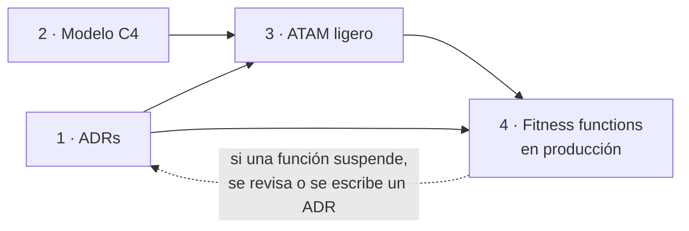
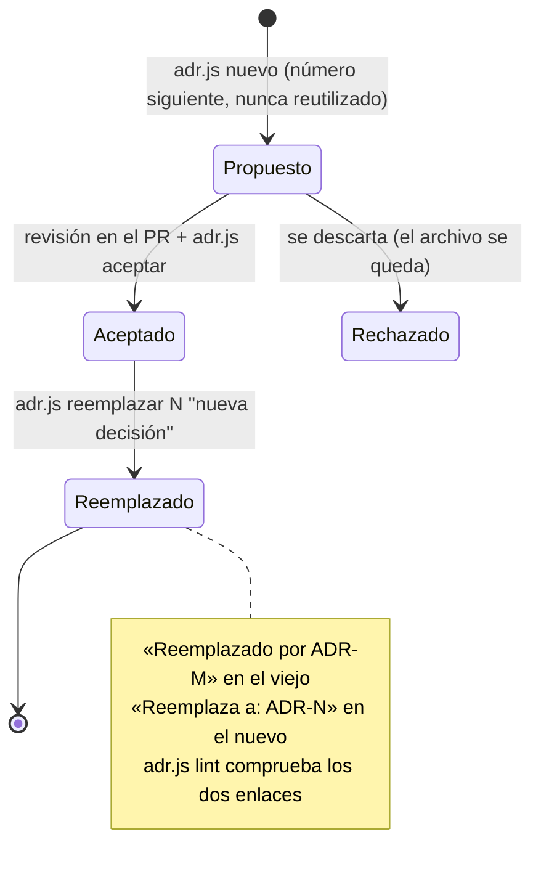
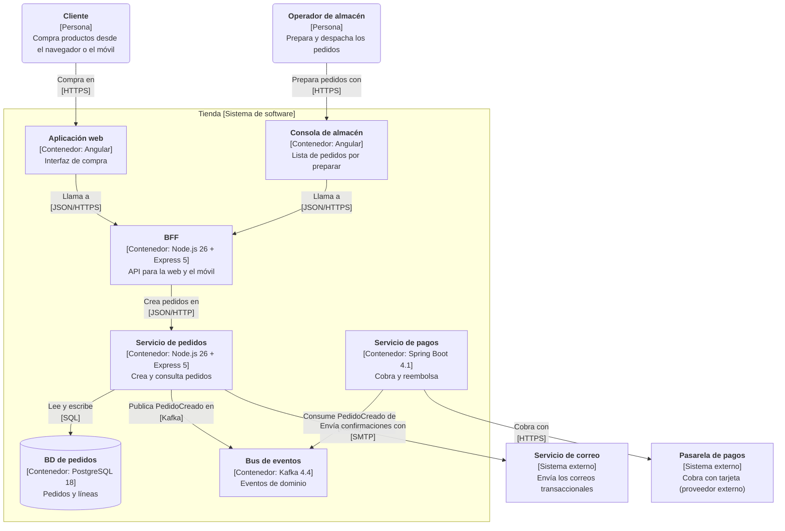
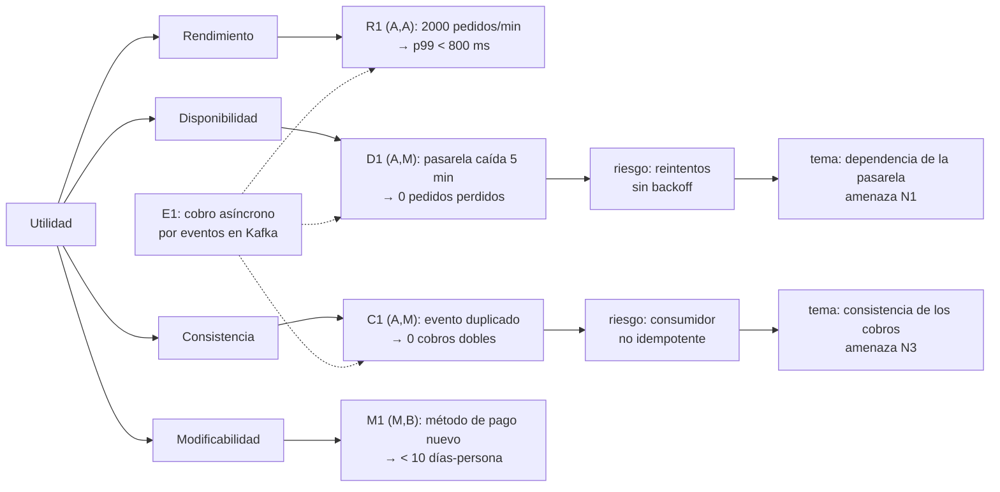
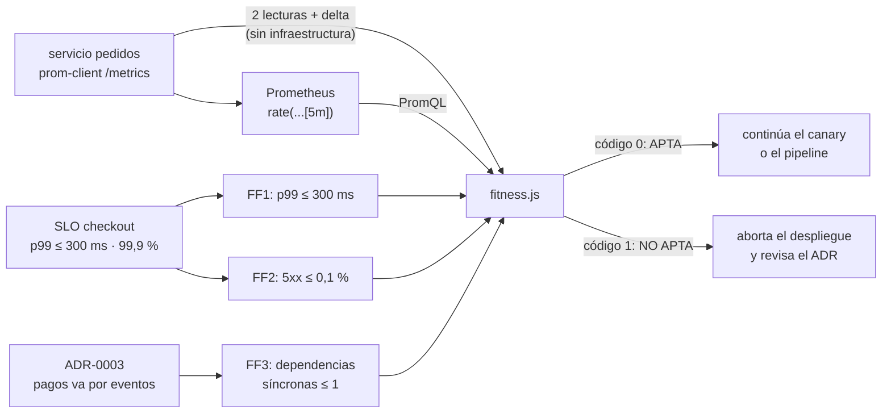

# Módulo 24 · Gobernanza arquitectónica

**Fase 3 · Nivel maestro: arquitectura avanzada** (media semana de 8). **Duración:** 6 h (4 temas de unos 75 min y 1 h
de laboratorio integrador). **Dificultad:** 4 de 5. **Dependencias:** la Fase 1 o la Fase 2 completa (necesitas haber
construido y desplegado servicios para tener decisiones que gobernar); ayudan el Módulo 21 (observabilidad: las
métricas de la ficha 4) y el Módulo 23 (canary y GitOps, donde las fitness functions hacen de puerta).
**Herramientas:**Node.js 26.13.1 LTS**, **prom-client 15.1.3**, **Prometheus v3.15.1** (solo para la ficha 4 con
`--compose`) y, como alternativa para C4, **Structurizr DSL**.
(los comandos de verificación indicados ejecuta 21 tests y los scripts de las cuatro fichas sin infraestructura; los comandos de verificación indicados
añade Prometheus).

En la Fase 1 y la Fase 2 aprendiste a **construir** microservicios. En la Fase 3 aprendes a **decidir** y a que las
decisiones **duren**. Un sistema de veinte servicios y cuatro equipos no se rompe por un `if` mal escrito: se rompe
porque nadie recuerda por qué se eligió Kafka, porque cada equipo dibuja la arquitectura a su manera, porque nadie
comprobó qué pasa con el cobro si la pasarela cae, o porque una regla («pagos va por eventos») se dejó de cumplir en
silencio. Gobernar la arquitectura es poner por escrito las decisiones (**ADRs**), dibujarlas con un lenguaje común
(**C4**), evaluarlas contra los atributos de calidad antes de que cuesten caro (**ATAM ligero**) y vigilarlas de forma
automática en producción (**fitness functions**). Sin burocracia: todo vive en el repositorio y se revisa en un PR.



**Texto alternativo:** mapa del módulo. Los ADRs (tema 1) y el modelo C4 (tema 2) alimentan el ATAM ligero (tema 3),
que evalúa decisiones y diagramas contra escenarios de calidad. El ATAM y los ADRs llevan a las fitness functions en
producción (tema 4), que vigilan que las decisiones se sigan cumpliendo; una flecha punteada vuelve del tema 4 al tema 1:
si una función suspende, se revisa la decisión o se escribe un ADR nuevo.

**Qué se ejecutó aquí y qué falta.** Todo el código, los 21 tests y los scripts se ejecutaron con Node 26.13.1 en
Linux y sus salidas están pegadas tal cual. **No se pudieron ejecutar aquí** (y están en
`verificacion/microservicios/pendiente.md`): el `docker-compose.yml` de la ficha 4 con Prometheus v3.15.1 (este entorno
no llega a Docker Hub; la lectura de la API de Prometheus se probó contra un doble local) y el `workspace.dsl` de
Structurizr de la ficha 2.

**Cómo usar el laboratorio.** Con Node 26:

```bash
npm ci
  # 21 tests + scripts de las 4 fichas → «RESULTADO: OK»
los comandos de verificación indicados    # además Prometheus v3.15.1 y las fitness functions con PromQL
```

`README.md` tiene el mapa de carpetas.

`package.json` del laboratorio (con `package-lock.json`):

```json
{
  "name": "modulo-24-gobernanza-arquitectonica",
  "version": "1.0.0",
  "private": true,
  "description": "Módulo 24 (Fase 3): Gobernanza arquitectónica (ADRs, modelo C4, ATAM ligero y fitness functions en producción).",
  "type": "module",
  "engines": {
    "node": ">=26.13.1"
  },
  "scripts": {
    "test": "node --test --test-concurrency=1 'f1*/*.test.js'"
  },
  "dependencies": {
    "prom-client": "15.1.3"
  }
}
```

---


### ADRs

<details open>
<summary><strong>Capa 1 — Lectura</strong></summary>

#### ► DE QUÉ TRATA
Redactar un ADR con contexto medible, al menos dos alternativas con su trade-off, decisión, consecuencias, fitness function y condición de revisión; reemplazar una decisión sin borrar la historia; y automatizar su control con un lint en CI. Lo compruebas cuando node --test f148-a…

#### ► LA IDEA EN UNA FRASE
**Redactar un ADR con contexto medible, al menos dos alternativas con su trade-off, decisión, consecuencias, fitness function y condición de revisión; reemplazar una decisión sin borrar la historia; y automatizar su control con un lint en CI.**

#### ► POR QUÉ EXISTE ESTO
Resuelve un problema real de diseño o implementación y evita decisiones a ciegas.

#### ► LA ANALOGÍA
Piensa en adrs como una herramienta de taller: útil cuando conoces su propósito y sus límites.
**Dónde se rompe la analogía:** en software, los efectos dependen del contexto, la escala y los trade-offs.

#### ► CÓMO FUNCIONA


1. En un proyecto se toman decisiones grandes: qué base de datos usar, cómo se comunican los servicios, qué se divide y
2. Un **ADR** (*Architecture Decision Record*, registro de decisión de arquitectura) es un archivo de texto corto que
3. Los ADRs se guardan **junto al código**, numerados, y no se borran: si una decisión cambia, se escribe otro ADR que

#### ► LO QUE PUEDE SALIR MAL
| Síntoma | Causa probable | Arreglo |
|---|---|---|
| ADRs se aplica pero el resultado no mejora | Se usó sin medir el problema real | Mide antes y compara contra la alternativa simple |
| Aparece complejidad inesperada | Se adoptó la técnica sin comprender sus trade-offs | Vuelve a la sección de trade-offs y reduce el alcance |
| Falla en un caso límite | Se asumió un contexto que no se cumple | Prueba el caso límite y documenta cuándo NO usarlo |

#### ► TRADE-OFFS
| Opción | Cuándo usarla | Cuándo NO usarla |
|---|---|---|
| Usar ADRs | Cuando el problema coincide con su propósito y el beneficio es observable | Cuando agrega complejidad sin resolver un problema real |
| Alternativa más simple | Cuando el contexto es pequeño, estable o fácil de razonar | Cuando ya demostró no escalar o no cumplir el requisito |
| Postergar la decisión | Cuando falta evidencia del problema | Cuando el costo de esperar es mayor que el costo de probar |

#### ► CUÁNDO NO USAR ESTO
Las decisiones que viven en el chat (o en la cabeza de una persona). Evita que la única huella de una decisión sea un hilo de mensajería o una reunión:

#### ► DE VUELTA A LA ANALOGÍA
Volviendo a la analogía: adrs funciona como el modelo inicial, pero recuerda dónde se rompe: en producción importan la evidencia, la escala y el costo de equivocarte.

#### ► LO QUE DEBES RECORDAR
- En un proyecto se toman decisiones grandes: qué base de datos usar, cómo se comunican los servicios, qué se divide y
- Un **ADR** (*Architecture Decision Record*, registro de decisión de arquitectura) es un archivo de texto corto que
- Los ADRs se guardan **junto al código**, numerados, y no se borran: si una decisión cambia, se escribe otro ADR que

#### ► PREGUNTAS PARA PENSAR
1. ¿Qué problema concreto resuelve adrs en tu contexto?
2. ¿Cómo sabrías que adrs no está funcionando bien?
3. ¿Qué alternativa más simple considerarías antes de usar adrs?

</details>

<details>
<summary><strong>Capa 2 — Construcción</strong></summary>

#### Código y verificación


```javascript
// Módulo 24 · F148 · Herramienta de ADRs (Architecture Decision Records) en Markdown, sin dependencias.
// Formato de docs/microservicios/07-plantillas.md (Nygard 2011 + alternativas con trade-off + fitness function).
// Requisitos: Node.js 26.13.1 LTS.
// Uso: node f148-adrs/adr.js <carpeta> nuevo "Usamos Kafka para los eventos de pedidos"
//      node f148-adrs/adr.js <carpeta> aceptar 3
//      node f148-adrs/adr.js <carpeta> reemplazar 2 "Usamos RabbitMQ con colas de quórum"
//      node f148-adrs/adr.js <carpeta> lint        |   node f148-adrs/adr.js <carpeta> indice
import { existsSync, mkdirSync, readFileSync, readdirSync, writeFileSync } from 'node:fs';
import { join } from 'node:path';

export const SECCIONES = ['Contexto', 'Opciones consideradas', 'Decisión', 'Consecuencias', 'Fitness function', 'Cuándo revisar esta decisión'];
const ESTADO = /^(Propuesto|Aceptado|Rechazado|Reemplazado por ADR-\d{4})$/;
const num = (n) => String(n).padStart(4, '0');
const slug = (t) => t.normalize('NFD').replace(/[\u0300-\u036f]/g, '').toLowerCase().replace(/[^a-z0-9]+/g, '-').replace(/^-|-$/g, '').slice(0, 60);

export function listar(dir) {
  if (!existsSync(dir)) return [];
  return readdirSync(dir).filter((f) => /^\d{4}-.+\.md$/.test(f)).sort().map((archivo) => {
    const texto = readFileSync(join(dir, archivo), 'utf8');
    return {
      archivo,
      numero: Number(archivo.slice(0, 4)),
      titulo: texto.match(/^# ADR-(\d{4}): (.+)$/m)?.[2] ?? null,
      numeroTitulo: Number(texto.match(/^# ADR-(\d{4}):/m)?.[1] ?? NaN),
      estado: texto.match(/^- \*\*Estado:\*\* (.+)$/m)?.[1]?.trim() ?? null,
      fecha: texto.match(/^- \*\*Fecha:\*\* (.+)$/m)?.[1]?.trim() ?? null,
      reemplazaA: Number(texto.match(/^- \*\*Reemplaza a:\*\* ADR-(\d{4})$/m)?.[1] ?? NaN),
      texto,
    };
  });
}

export function nuevo(dir, titulo, { fecha = new Date().toISOString().slice(0, 10), reemplazaA } = {}) {
  mkdirSync(dir, { recursive: true });
  const numero = Math.max(0, ...listar(dir).map((a) => a.numero)) + 1; // nunca se reutiliza un número
  const archivo = `${num(numero)}-${slug(titulo)}.md`;
  const plantilla = readFileSync(new URL('./plantilla.md', import.meta.url), 'utf8')
    .replace('NNNN', num(numero)).replace('<título>', titulo).replace('AAAA-MM-DD', fecha)
    .replace('- **Reemplaza a:** —\n', reemplazaA ? `- **Reemplaza a:** ADR-${num(reemplazaA)}\n` : '');
  writeFileSync(join(dir, archivo), plantilla);
  return archivo;
}

function cambiarEstado(dir, numero, estado) {
  const adr = listar(dir).find((a) => a.numero === numero);
  if (!adr) throw new Error(`no existe ADR-${num(numero)}`);
  writeFileSync(join(dir, adr.archivo), adr.texto.replace(/^- \*\*Estado:\*\* .+$/m, `- **Estado:** ${estado}`));
}
export const aceptar = (dir, numero) => cambiarEstado(dir, numero, 'Aceptado');

/** Una decisión aceptada NO se edita: se escribe otra que la reemplaza y la vieja queda enlazada. */
export function reemplazar(dir, viejo, titulo, opciones) {
  const archivo = nuevo(dir, titulo, { ...opciones, reemplazaA: viejo });
  cambiarEstado(dir, viejo, `Reemplazado por ADR-${archivo.slice(0, 4)}`);
  return archivo;
}

export function lint(dir) {
  const adrs = listar(dir);
  const problemas = [];
  adrs.forEach((a, i) => {
    const id = a.archivo;
    if (a.numero !== i + 1) problemas.push(`${id}: numeración con huecos o repetida (esperaba ${num(i + 1)})`);
    if (a.numeroTitulo !== a.numero) problemas.push(`${id}: el título no es «# ADR-${num(a.numero)}: …»`);
    if (!a.estado || !ESTADO.test(a.estado)) problemas.push(`${id}: estado inválido «${a.estado}»`);
    if (!/^\d{4}-\d{2}-\d{2}$/.test(a.fecha ?? '')) problemas.push(`${id}: fecha que no es AAAA-MM-DD`);
    for (const s of SECCIONES) if (!new RegExp(`^## ${s}$`, 'm').test(a.texto)) problemas.push(`${id}: falta la sección «${s}»`);
    const tabla = a.texto.split(/^## Opciones consideradas$/m)[1]?.split(/^## /m)[0] ?? '';
    const opciones = tabla.split('\n').filter((l) => /^\| [A-Z]\. /.test(l));
    if (opciones.length < 2) problemas.push(`${id}: ${opciones.length} opciones en la tabla; un ADR compara al menos 2`);
    if (/<[^>]+>/.test(a.texto.replace(/```

```/g, '')) && a.estado !== 'Propuesto') problemas.push(`${id}: quedan huecos <…> de la plantilla`);
    const reemplazo = a.estado?.match(/ADR-(\d{4})/)?.[1];
    if (reemplazo && listar(dir).find((b) => b.numero === Number(reemplazo))?.reemplazaA !== a.numero) {
      problemas.push(`${id}: dice «Reemplazado por ADR-${reemplazo}», pero ese ADR no dice «Reemplaza a: ADR-${num(a.numero)}»`);
    }
  });
  return problemas;
}

export function indice(dir) {
  return ['| ADR | Decisión | Estado | Fecha |', '|---|---|---|---|',
    ...listar(dir).map((a) => `| [ADR-${num(a.numero)}](${a.archivo}) | ${a.titulo} | ${a.estado} | ${a.fecha} |`)].join('\n');
}

if (import.meta.main) {
  const [dir, orden, ...resto] = process.argv.slice(2);
  if (orden === 'nuevo') console.log(`creado ${nuevo(dir, resto.join(' '))}`);
  else if (orden === 'aceptar') { aceptar(dir, Number(resto[0])); console.log(`ADR-${num(resto[0])} aceptado`); }
  else if (orden === 'reemplazar') console.log(`creado ${reemplazar(dir, Number(resto[0]), resto.slice(1).join(' '))}; ADR-${num(resto[0])} queda reemplazado`);
  else if (orden === 'indice') console.log(indice(dir));
  else if (orden === 'lint') {
    const p = lint(dir);
    for (const x of p) console.log(`✘ ${x}`);
    console.log(p.length ? `${p.length} problemas en ${listar(dir).length} ADRs` : `✔ ${listar(dir).length} ADRs sin problemas`);
    process.exitCode = p.length ? 1 : 0;
  } else console.log('órdenes: nuevo <título> · aceptar <n> · reemplazar <n> <título> · lint · indice');
}
```

```markdown
# ADR-NNNN: <título>

- **Estado:** Propuesto
- **Fecha:** AAAA-MM-DD
- **Decisores:** <nombres o roles>
- **Reemplaza a:** —
- **Módulos o servicios afectados:** <lista>

## Contexto

<Qué problema hay, qué fuerzas actúan (requisitos, restricciones, plazos, equipo) y qué pasa si no decidimos.
Incluye números: carga esperada, latencia objetivo (p99), coste máximo, tamaño del equipo.>

## Opciones consideradas

| Opción | A favor | En contra | Coste aproximado |
|---|---|---|---|
| A. <opción elegida> | | | |
| B. <alternativa 1> | | | |

## Decisión

<Qué elegimos y por qué, en relación directa con el contexto.>

## Consecuencias

- **Positivas:** <qué mejora>
- **Negativas (trade-off aceptado):** <qué empeora o qué deuda asumimos>
- **Riesgos y mitigación:** <riesgo → acción>

## Fitness function

<Cómo comprobaremos automáticamente que la decisión se sigue cumpliendo.>

## Cuándo revisar esta decisión

<Condición concreta que obliga a reabrirla.>
```

```markdown
# ADR-0002: Publicamos los eventos de pedidos en RabbitMQ

- **Estado:** Reemplazado por ADR-0003
- **Fecha:** 2026-11-05
- **Decisores:** equipo de la tienda
- **Módulos o servicios afectados:** pedidos, inventario, notificaciones

## Contexto

Pedidos debe avisar a inventario y a notificaciones sin llamarlos de forma síncrona. Carga esperada: 20 pedidos/s en
pico. Solo hay consumidores que procesan cada evento una vez.

## Opciones consideradas

| Opción | A favor | En contra | Coste aproximado |
|---|---|---|---|
| A. RabbitMQ con colas de quórum | El equipo ya lo conoce (Módulo 22), confirmaciones y reintentos sencillos | No guarda el historial para releer eventos | 1 nodo pequeño |
| B. Kafka | Retención y relectura, mucho caudal | Más piezas que operar para 20 eventos/s | 3 brokers |

## Decisión

Usamos RabbitMQ: cubre el caudal con margen y el equipo lo opera desde el Módulo 22.

## Consecuencias

- **Positivas:** puesta en marcha en una semana.
- **Negativas (trade-off aceptado):** si un servicio nuevo necesita releer eventos pasados, no podrá.
- **Riesgos y mitigación:** pérdida de mensajes → publisher confirms y colas de quórum.

## Fitness function

Alerta si la cola `pedidos.creados` supera 1000 mensajes pendientes durante 10 minutos.

## Cuándo revisar esta decisión

Si aparece un consumidor que necesite reprocesar el historial de eventos.
```

```markdown
# ADR-0003: Publicamos los eventos de pedidos en Kafka

- **Estado:** Aceptado
- **Fecha:** 2026-11-18
- **Decisores:** equipo de la tienda y equipo de analítica
- **Reemplaza a:** ADR-0002
- **Módulos o servicios afectados:** pedidos, inventario, notificaciones, analítica

## Contexto

Se cumplió la condición de revisión del ADR-0002: analítica necesita reprocesar 90 días de pedidos para recalcular
sus modelos, y RabbitMQ borra cada mensaje al confirmarlo. La carga sigue siendo de 20 pedidos/s en pico.

## Opciones consideradas

| Opción | A favor | En contra | Coste aproximado |
|---|---|---|---|
| A. Kafka con retención de 90 días | Relectura por offset, varios grupos de consumidores | Operar un clúster de 3 brokers | 3 brokers pequeños |
| B. Seguir con RabbitMQ y copiar a un almacén para analítica | Sin cambios para los servicios actuales | Dos fuentes de verdad, retraso en analítica | Un job ETL |
| C. RabbitMQ Streams | Mismo producto que ya operamos, admite relectura | Menos ecosistema de conectores que Kafka | Igual que hoy |

## Decisión

Usamos Kafka con retención de 90 días para `pedidos.v1`, porque analítica necesita relectura y los conectores
de Kafka Connect que ya usa.

## Consecuencias

- **Positivas:** cualquier servicio nuevo puede leer desde el principio del tema.
- **Negativas (trade-off aceptado):** más operación y la migración de los dos consumidores actuales.
- **Riesgos y mitigación:** duplicados al migrar → consumidores idempotentes (Módulo 25).

## Fitness function

Alerta si el *lag* del grupo `inventario` supera 10 000 mensajes durante 10 minutos.

## Cuándo revisar esta decisión

Si el coste del clúster supera el 15 % del presupuesto de infraestructura de la tienda.
```

</details>

### Modelo C4

<details open>
<summary><strong>Capa 1 — Lectura</strong></summary>

#### ► DE QUÉ TRATA
Modelar un sistema con los niveles 1 (Contexto) y 2 (Contenedores) del modelo C4, generar los diagramas desde un único modelo como código y detectar los errores típicos de notación (flechas sin verbo, contenedores sin tecnología, niveles mezclados). Lo compruebas cuando node --te…

#### ► LA IDEA EN UNA FRASE
**Modelar un sistema con los niveles 1 (Contexto) y 2 (Contenedores) del modelo C4, generar los diagramas desde un único modelo como código y detectar los errores típicos de notación (flechas sin verbo, contenedores sin tecnología, niveles mezclados).**

#### ► POR QUÉ EXISTE ESTO
Resuelve un problema real de diseño o implementación y evita decisiones a ciegas.

#### ► LA ANALOGÍA
Piensa en modelo c4 como una herramienta de taller: útil cuando conoces su propósito y sus límites.
**Dónde se rompe la analogía:** en software, los efectos dependen del contexto, la escala y los trade-offs.

#### ► CÓMO FUNCIONA


1. Cuando explicas un sistema, cada persona dibuja cajas y flechas a su manera y nadie entiende el dibujo del otro.
2. El **modelo C4** propone dibujar el sistema **a distintos niveles de zoom**, siempre con las mismas reglas: primero
3. Cada caja dice **qué es, de qué tipo es y con qué está hecha**; cada flecha dice **qué hace** («publica pedidos en»)

#### ► LO QUE PUEDE SALIR MAL
| Síntoma | Causa probable | Arreglo |
|---|---|---|
| Modelo C4 se aplica pero el resultado no mejora | Se usó sin medir el problema real | Mide antes y compara contra la alternativa simple |
| Aparece complejidad inesperada | Se adoptó la técnica sin comprender sus trade-offs | Vuelve a la sección de trade-offs y reduce el alcance |
| Falla en un caso límite | Se asumió un contexto que no se cumple | Prueba el caso límite y documenta cuándo NO usarlo |

#### ► TRADE-OFFS
| Opción | Cuándo usarla | Cuándo NO usarla |
|---|---|---|
| Usar Modelo C4 | Cuando el problema coincide con su propósito y el beneficio es observable | Cuando agrega complejidad sin resolver un problema real |
| Alternativa más simple | Cuando el contexto es pequeño, estable o fácil de razonar | Cuando ya demostró no escalar o no cumplir el requisito |
| Postergar la decisión | Cuando falta evidencia del problema | Cuando el costo de esperar es mayor que el costo de probar |

#### ► CUÁNDO NO USAR ESTO
El diagrama «mapa del metro de Tokio»: todos los servicios, todas las flechas, todos los niveles en uno.

#### ► DE VUELTA A LA ANALOGÍA
Volviendo a la analogía: modelo c4 funciona como el modelo inicial, pero recuerda dónde se rompe: en producción importan la evidencia, la escala y el costo de equivocarte.

#### ► LO QUE DEBES RECORDAR
- Cuando explicas un sistema, cada persona dibuja cajas y flechas a su manera y nadie entiende el dibujo del otro.
- El **modelo C4** propone dibujar el sistema **a distintos niveles de zoom**, siempre con las mismas reglas: primero
- Cada caja dice **qué es, de qué tipo es y con qué está hecha**; cada flecha dice **qué hace** («publica pedidos en»)

#### ► PREGUNTAS PARA PENSAR
1. ¿Qué problema concreto resuelve modelo c4 en tu contexto?
2. ¿Cómo sabrías que modelo c4 no está funcionando bien?
3. ¿Qué alternativa más simple considerarías antes de usar modelo c4?

</details>

<details>
<summary><strong>Capa 2 — Construcción</strong></summary>

#### Código y verificación


```json
{
  "nombre": "Tienda en línea",
  "personas": [
    { "id": "cliente", "nombre": "Cliente", "descripcion": "Compra productos desde el navegador o el móvil" },
    { "id": "operador", "nombre": "Operador de almacén", "descripcion": "Prepara y despacha los pedidos" }
  ],
  "externos": [
    { "id": "pasarela", "nombre": "Pasarela de pagos", "descripcion": "Cobra con tarjeta (proveedor externo)" },
    { "id": "correo", "nombre": "Servicio de correo", "descripcion": "Envía los correos transaccionales" }
  ],
  "sistema": {
    "id": "tienda",
    "nombre": "Tienda",
    "descripcion": "Catálogo, pedidos y pagos de la tienda",
    "contenedores": [
      { "id": "web", "nombre": "Aplicación web", "tecnologia": "Angular", "descripcion": "Interfaz de compra" },
      { "id": "bff", "nombre": "BFF", "tecnologia": "Node.js 26 + Express 5", "descripcion": "API para la web y el móvil" },
      { "id": "pedidos", "nombre": "Servicio de pedidos", "tecnologia": "Node.js 26 + Express 5", "descripcion": "Crea y consulta pedidos" },
      { "id": "pagos", "nombre": "Servicio de pagos", "tecnologia": "Spring Boot 4.1", "descripcion": "Cobra y reembolsa" },
      { "id": "bdpedidos", "nombre": "BD de pedidos", "tecnologia": "PostgreSQL 18", "descripcion": "Pedidos y líneas", "tipo": "base de datos" },
      { "id": "broker", "nombre": "Bus de eventos", "tecnologia": "Kafka 4.4", "descripcion": "Eventos de dominio", "tipo": "cola" },
      { "id": "almacen", "nombre": "Consola de almacén", "tecnologia": "Angular", "descripcion": "Lista de pedidos por preparar" }
    ]
  },
  "relaciones": [
    { "de": "cliente", "a": "web", "descripcion": "Compra en", "tecnologia": "HTTPS" },
    { "de": "web", "a": "bff", "descripcion": "Llama a", "tecnologia": "JSON/HTTPS" },
    { "de": "bff", "a": "pedidos", "descripcion": "Crea pedidos en", "tecnologia": "JSON/HTTP" },
    { "de": "pedidos", "a": "bdpedidos", "descripcion": "Lee y escribe", "tecnologia": "SQL" },
    { "de": "pedidos", "a": "broker", "descripcion": "Publica PedidoCreado en", "tecnologia": "Kafka" },
    { "de": "pagos", "a": "broker", "descripcion": "Consume PedidoCreado de", "tecnologia": "Kafka" },
    { "de": "pagos", "a": "pasarela", "descripcion": "Cobra con", "tecnologia": "HTTPS" },
    { "de": "pedidos", "a": "correo", "descripcion": "Envía confirmaciones con", "tecnologia": "SMTP" },
    { "de": "operador", "a": "almacen", "descripcion": "Prepara pedidos con", "tecnologia": "HTTPS" },
    { "de": "almacen", "a": "bff", "descripcion": "Llama a", "tecnologia": "JSON/HTTPS" }
  ]
}
```

```javascript
// Módulo 24 · F149 · Modelo C4 como código: un único modelo JSON y dos vistas generadas (Contexto y Contenedores)
// en Mermaid, más un validador de reglas de notación. Requisitos: Node.js 26.13.1 LTS (sin dependencias).
// Uso: node f149-c4/c4.js f149-c4/modelo.json [contexto|contenedores|validar]
import { readFileSync } from 'node:fs';

const etiqueta = (nombre, tipo, descripcion) => `"<b>${nombre}</b><br/>[${tipo}]<br/>${descripcion}"`;

export function validar(m) {
  const problemas = [];
  const elementos = [...m.personas, ...m.externos, { id: m.sistema.id }, ...m.sistema.contenedores];
  const ids = elementos.map((e) => e.id);
  for (const id of new Set(ids)) if (ids.filter((x) => x === id).length > 1) problemas.push(`id repetido: ${id}`);
  for (const c of m.sistema.contenedores) {
    if (!c.tecnologia) problemas.push(`el contenedor «${c.nombre}» no dice su tecnología`);
    if (!c.descripcion) problemas.push(`el contenedor «${c.nombre}» no tiene descripción`);
    if (/\.(java|ts|js|py)$/.test(c.nombre) || /^clase/i.test(c.tecnologia ?? '')) problemas.push(`«${c.nombre}» es código (nivel 4), no un contenedor: mezcla niveles`);
  }
  const personas = new Set(m.personas.map((p) => p.id));
  const datos = new Set(m.sistema.contenedores.filter((c) => c.tipo).map((c) => c.id));
  for (const r of m.relaciones) {
    const nombre = `${r.de} -> ${r.a}`;
    if (!ids.includes(r.de) || !ids.includes(r.a)) problemas.push(`relación ${nombre}: apunta a un elemento que no existe`);
    if (!r.descripcion) problemas.push(`relación ${nombre}: sin descripción (una flecha sin verbo no dice nada)`);
    if (!r.tecnologia) problemas.push(`relación ${nombre}: sin tecnología o protocolo`);
    if (personas.has(r.de) && datos.has(r.a)) problemas.push(`relación ${nombre}: una persona no usa directamente un almacén de datos`);
  }
  const usados = new Set(m.relaciones.flatMap((r) => [r.de, r.a]));
  for (const c of m.sistema.contenedores) if (!usados.has(c.id)) problemas.push(`el contenedor «${c.nombre}» no se relaciona con nada`);
  return problemas;
}

/** Nivel 1 · Contexto: el sistema como UNA caja, sus personas y los sistemas externos. */
export function contexto(m) {
  const internos = new Set(m.sistema.contenedores.map((c) => c.id));
  const caja = (id) => (internos.has(id) ? m.sistema.id : id);
  const vistas = new Map();
  for (const r of m.relaciones) {
    const [de, a] = [caja(r.de), caja(r.a)];
    if (de !== a && !vistas.has(`${de}>${a}`)) vistas.set(`${de}>${a}`, r);
  }
  return [
    `flowchart TB`,
    ...m.personas.map((p) => `    ${p.id}(${etiqueta(p.nombre, 'Persona', p.descripcion)})`),
    `    ${m.sistema.id}[${etiqueta(m.sistema.nombre, 'Sistema de software', m.sistema.descripcion)}]`,
    ...m.externos.map((e) => `    ${e.id}[${etiqueta(e.nombre, 'Sistema externo', e.descripcion)}]`),
    ...[...vistas].map(([k, r]) => { const [de, a] = k.split('>'); return `    ${de} -- "${r.descripcion}<br/>[${r.tecnologia}]" --> ${a}`; }),
  ].join('\n');
}

/** Nivel 2 · Contenedores: lo que hay DENTRO de la caja del sistema (aplicaciones y almacenes de datos). */
export function contenedores(m) {
  const forma = (c) => (c.tipo === 'base de datos' ? `[(${etiqueta(c.nombre, `Contenedor: ${c.tecnologia}`, c.descripcion)})]` : `[${etiqueta(c.nombre, `Contenedor: ${c.tecnologia}`, c.descripcion)}]`);
  return [
    `flowchart TB`,
    ...m.personas.map((p) => `    ${p.id}(${etiqueta(p.nombre, 'Persona', p.descripcion)})`),
    `    subgraph ${m.sistema.id}["${m.sistema.nombre} [Sistema de software]"]`,
    ...m.sistema.contenedores.map((c) => `        ${c.id}${forma(c)}`),
    `    end`,
    ...m.externos.map((e) => `    ${e.id}[${etiqueta(e.nombre, 'Sistema externo', e.descripcion)}]`),
    ...m.relaciones.map((r) => `    ${r.de} -- "${r.descripcion}<br/>[${r.tecnologia}]" --> ${r.a}`),
  ].join('\n');
}

if (import.meta.main) {
  const [archivo = 'f149-c4/modelo.json', vista = 'validar'] = process.argv.slice(2);
  const m = JSON.parse(readFileSync(archivo, 'utf8'));
  if (vista === 'contexto') console.log(contexto(m));
  else if (vista === 'contenedores') console.log(contenedores(m));
  else {
    const p = validar(m);
    for (const x of p) console.log(`✘ ${x}`);
    console.log(p.length ? `${p.length} problemas` : `✔ modelo «${m.nombre}»: ${m.personas.length} personas, ${m.externos.length} sistemas externos, ${m.sistema.contenedores.length} contenedores, ${m.relaciones.length} relaciones`);
    process.exitCode = p.length ? 1 : 0;
  }
}
```

```text
// Módulo 24 · F149 · El mismo modelo en Structurizr DSL (alternativa a c4.js). Pégalo en https://playground.structurizr.com
// o ábrelo con Structurizr Lite. Solo contexto y contenedores principales.
workspace "Tienda en línea" "Modelo C4 del curso" {
    model {
        cliente = person "Cliente" "Compra productos desde el navegador o el móvil"
        pasarela = softwareSystem "Pasarela de pagos" "Cobra con tarjeta (proveedor externo)"
        tienda = softwareSystem "Tienda" "Catálogo, pedidos y pagos de la tienda" {
            web = container "Aplicación web" "Interfaz de compra" "Angular"
            bff = container "BFF" "API para la web y el móvil" "Node.js 26 + Express 5"
            pedidos = container "Servicio de pedidos" "Crea y consulta pedidos" "Node.js 26 + Express 5"
            bdpedidos = container "BD de pedidos" "Pedidos y líneas" "PostgreSQL 18" {
                tags "Database"
            }
        }
        cliente -> web "Compra en" "HTTPS"
        web -> bff "Llama a" "JSON/HTTPS"
        bff -> pedidos "Crea pedidos en" "JSON/HTTP"
        pedidos -> bdpedidos "Lee y escribe" "SQL"
        tienda -> pasarela "Cobra con" "HTTPS"
    }
    views {
        systemContext tienda "Contexto" {
            include *
            autolayout lr
        }
        container tienda "Contenedores" {
            include *
            autolayout lr
        }
        styles {
            element "Database" {
                shape cylinder
            }
        }
    }
}
```

```bash
node f149-c4/c4.js f149-c4/modelo.json validar
node f149-c4/c4.js f149-c4/modelo.json contexto
```

```text
✔ modelo «Tienda en línea»: 2 personas, 2 sistemas externos, 7 contenedores, 10 relaciones
flowchart TB
    cliente("<b>Cliente</b><br/>[Persona]<br/>Compra productos desde el navegador o el móvil")
    operador("<b>Operador de almacén</b><br/>[Persona]<br/>Prepara y despacha los pedidos")
    tienda["<b>Tienda</b><br/>[Sistema de software]<br/>Catálogo, pedidos y pagos de la tienda"]
    pasarela["<b>Pasarela de pagos</b><br/>[Sistema externo]<br/>Cobra con tarjeta (proveedor externo)"]
    correo["<b>Servicio de correo</b><br/>[Sistema externo]<br/>Envía los correos transaccionales"]
    cliente -- "Compra en<br/>[HTTPS]" --> tienda
    tienda -- "Cobra con<br/>[HTTPS]" --> pasarela
    tienda -- "Envía confirmaciones con<br/>[SMTP]" --> correo
    operador -- "Prepara pedidos con<br/>[HTTPS]" --> tienda
```

</details>

### ATAM ligero

<details open>
<summary><strong>Capa 1 — Lectura</strong></summary>

#### ► DE QUÉ TRATA
Construir un árbol de utilidad con escenarios de calidad medibles, priorizarlos por importancia y dificultad, identificar puntos de sensibilidad, trade-offs, riesgos y no riesgos de las decisiones, y resumir los riesgos en temas ligados a objetivos de negocio. Lo compruebas cuand…

#### ► LA IDEA EN UNA FRASE
**Construir un árbol de utilidad con escenarios de calidad medibles, priorizarlos por importancia y dificultad, identificar puntos de sensibilidad, trade-offs, riesgos y no riesgos de las decisiones, y resumir los riesgos en temas ligados a objetivos de negocio.**

#### ► POR QUÉ EXISTE ESTO
Resuelve un problema real de diseño o implementación y evita decisiones a ciegas.

#### ► LA ANALOGÍA
Piensa en atam ligero como una herramienta de taller: útil cuando conoces su propósito y sus límites.
**Dónde se rompe la analogía:** en software, los efectos dependen del contexto, la escala y los trade-offs.

#### ► CÓMO FUNCIONA


1. Una arquitectura no es «buena» o «mala» en general: es buena **para algo**. Una tienda quiere vender rápido en Black
2. **ATAM** es un método para revisar una arquitectura **antes** de que fallar salga caro: se escriben situaciones
3. El resultado no es una nota: es una lista de **riesgos** (lo que puede salir mal), de lo que está bien resuelto, y de

#### ► LO QUE PUEDE SALIR MAL
| Síntoma | Causa probable | Arreglo |
|---|---|---|
| ATAM ligero se aplica pero el resultado no mejora | Se usó sin medir el problema real | Mide antes y compara contra la alternativa simple |
| Aparece complejidad inesperada | Se adoptó la técnica sin comprender sus trade-offs | Vuelve a la sección de trade-offs y reduce el alcance |
| Falla en un caso límite | Se asumió un contexto que no se cumple | Prueba el caso límite y documenta cuándo NO usarlo |

#### ► TRADE-OFFS
| Opción | Cuándo usarla | Cuándo NO usarla |
|---|---|---|
| Usar ATAM ligero | Cuando el problema coincide con su propósito y el beneficio es observable | Cuando agrega complejidad sin resolver un problema real |
| Alternativa más simple | Cuando el contexto es pequeño, estable o fácil de razonar | Cuando ya demostró no escalar o no cumplir el requisito |
| Postergar la decisión | Cuando falta evidencia del problema | Cuando el costo de esperar es mayor que el costo de probar |

#### ► CUÁNDO NO USAR ESTO
La revisión de arquitectura por gusto («a mí me parece que Kafka es mejor»). Evaluar sin escenarios convierte la revisión en una discusión de preferencias que gana quien más habla:

#### ► DE VUELTA A LA ANALOGÍA
Volviendo a la analogía: atam ligero funciona como el modelo inicial, pero recuerda dónde se rompe: en producción importan la evidencia, la escala y el costo de equivocarte.

#### ► LO QUE DEBES RECORDAR
- Una arquitectura no es «buena» o «mala» en general: es buena **para algo**. Una tienda quiere vender rápido en Black
- **ATAM** es un método para revisar una arquitectura **antes** de que fallar salga caro: se escriben situaciones
- El resultado no es una nota: es una lista de **riesgos** (lo que puede salir mal), de lo que está bien resuelto, y de

#### ► PREGUNTAS PARA PENSAR
1. ¿Qué problema concreto resuelve atam ligero en tu contexto?
2. ¿Cómo sabrías que atam ligero no está funcionando bien?
3. ¿Qué alternativa más simple considerarías antes de usar atam ligero?

</details>

<details>
<summary><strong>Capa 2 — Construcción</strong></summary>

#### Código y verificación


```json
{
  "sistema": "Tienda en línea",
  "objetivosDeNegocio": [
    { "id": "N1", "texto": "Vender sin cortes durante el Black Friday (10x el tráfico normal)" },
    { "id": "N2", "texto": "Lanzar un método de pago nuevo en menos de 2 semanas" },
    { "id": "N3", "texto": "No cobrar dos veces el mismo pedido" }
  ],
  "escenarios": [
    { "id": "R1", "atributo": "Rendimiento", "refinamiento": "Latencia del checkout", "objetivo": "N1",
      "fuente": "clientes", "estimulo": "2000 pedidos por minuto durante 1 hora", "artefacto": "BFF + pedidos + pagos",
      "entorno": "pico de Black Friday", "respuesta": "el pedido queda confirmado", "medida": "p99 < 800 ms",
      "importancia": "A", "dificultad": "A" },
    { "id": "D1", "atributo": "Disponibilidad", "refinamiento": "Fallo de la pasarela de pagos", "objetivo": "N1",
      "fuente": "pasarela externa", "estimulo": "la pasarela no responde durante 5 minutos", "artefacto": "servicio de pagos",
      "entorno": "operación normal", "respuesta": "los pedidos se aceptan y el cobro se reintenta", "medida": "0 pedidos perdidos y cobro en < 30 min",
      "importancia": "A", "dificultad": "M" },
    { "id": "C1", "atributo": "Consistencia", "refinamiento": "Cobro único", "objetivo": "N3",
      "fuente": "Kafka", "estimulo": "el evento PedidoCreado llega 2 veces", "artefacto": "consumidor de pagos",
      "entorno": "reintento tras un rebalanceo", "respuesta": "se cobra una sola vez", "medida": "0 cobros duplicados en 1 millón de eventos",
      "importancia": "A", "dificultad": "M" },
    { "id": "M1", "atributo": "Modificabilidad", "refinamiento": "Método de pago nuevo", "objetivo": "N2",
      "fuente": "producto", "estimulo": "pide añadir pago por transferencia inmediata", "artefacto": "servicio de pagos",
      "entorno": "desarrollo", "respuesta": "se añade sin tocar pedidos ni el BFF", "medida": "< 10 días-persona y 1 solo servicio desplegado",
      "importancia": "M", "dificultad": "B" },
    { "id": "O1", "atributo": "Observabilidad", "refinamiento": "Diagnóstico de un pedido", "objetivo": "N1",
      "fuente": "soporte", "estimulo": "un cliente reclama un pedido sin confirmar", "artefacto": "toda la cadena",
      "entorno": "operación normal", "respuesta": "se encuentra la traza del pedido", "medida": "< 5 minutos",
      "importancia": "M", "dificultad": "M" }
  ],
  "enfoques": [
    { "id": "E1", "nombre": "Cobro asíncrono por eventos en Kafka (pedidos publica, pagos consume)", "escenarios": ["R1", "D1", "C1"],
      "sensibilidad": ["el número de particiones de pedidos.v1 limita el paralelismo de pagos (R1)"],
      "tradeoffs": ["el cobro asíncrono mejora disponibilidad y latencia (R1, D1) pero el cliente no sabe al instante si se cobró (experiencia)"],
      "riesgos": [
        { "texto": "el consumidor de pagos no es idempotente: un evento duplicado cobra dos veces (C1)", "tema": "Consistencia de los cobros" },
        { "texto": "no hay límite de reintentos: con la pasarela caída 5 min se acumulan reintentos sin backoff (D1)", "tema": "Dependencia de la pasarela" }
      ],
      "noRiesgos": ["2000 pedidos/min caben con 6 particiones y 3 consumidores (medido en la prueba de carga del equipo)"] },
    { "id": "E2", "nombre": "Un servicio de pagos con adaptadores por método (puertos y adaptadores)", "escenarios": ["M1"],
      "sensibilidad": ["la interfaz del puerto MetodoDePago: si cambia, cambian todos los adaptadores"],
      "tradeoffs": [],
      "riesgos": [],
      "noRiesgos": ["un método nuevo es un adaptador nuevo y un despliegue de pagos"] }
  ]
}
```

```javascript
// Módulo 24 · F150 · ATAM ligero: árbol de utilidad, prioridades y temas de riesgo a partir de un JSON revisable en PR.
// Requisitos: Node.js 26.13.1 LTS (sin dependencias). Uso: node f150-atam/atam.js f150-atam/atam.json
import { readFileSync } from 'node:fs';

const PESO = { A: 3, M: 2, B: 1 };
const PARTES = ['fuente', 'estimulo', 'artefacto', 'entorno', 'respuesta', 'medida'];

export function validar(a) {
  const problemas = [];
  const objetivos = new Set(a.objetivosDeNegocio.map((o) => o.id));
  for (const e of a.escenarios) {
    for (const p of PARTES) if (!e[p]) problemas.push(`${e.id}: falta «${p}»`);
    if (e.medida && !/\d/.test(e.medida)) problemas.push(`${e.id}: la medida «${e.medida}» no tiene un número (no se puede comprobar)`);
    if (!objetivos.has(e.objetivo)) problemas.push(`${e.id}: no se relaciona con ningún objetivo de negocio`);
    if (!PESO[e.importancia] || !PESO[e.dificultad]) problemas.push(`${e.id}: importancia y dificultad deben ser A, M o B`);
  }
  return problemas;
}

/** Orden ATAM: primero (A,A), luego (A,M)… La importancia la da el negocio; la dificultad, el arquitecto. */
export const priorizar = (escenarios) => [...escenarios].sort((x, y) => PESO[y.importancia] - PESO[x.importancia] || PESO[y.dificultad] - PESO[x.dificultad] || x.id.localeCompare(y.id));

export function analizar(a) {
  const analizados = new Set(a.enfoques.flatMap((e) => e.escenarios));
  const sinAnalizar = priorizar(a.escenarios).filter((e) => e.importancia === 'A' && !analizados.has(e.id)).map((e) => e.id);
  const temas = new Map();
  for (const enfoque of a.enfoques) {
    for (const r of enfoque.riesgos) {
      const escenarios = [...r.texto.matchAll(/\(([A-Z]\d(?:, [A-Z]\d)*)\)/g)].flatMap((m) => m[1].split(', '));
      const objetivosAfectados = escenarios.map((id) => a.escenarios.find((e) => e.id === id)?.objetivo).filter(Boolean);
      const t = temas.get(r.tema) ?? { riesgos: 0, objetivos: new Set() };
      t.riesgos += 1;
      objetivosAfectados.forEach((o) => t.objetivos.add(o));
      temas.set(r.tema, t);
    }
  }
  return { sinAnalizar, temas };
}

export function informe(a) {
  const lineas = [`ATAM ligero · ${a.sistema}`, '', 'Árbol de utilidad (importancia, dificultad):'];
  const porAtributo = Map.groupBy(a.escenarios, (e) => e.atributo);
  for (const [atributo, escenarios] of porAtributo) {
    lineas.push(`  ${atributo}`);
    for (const e of escenarios) lineas.push(`    └ ${e.refinamiento}: (${e.importancia},${e.dificultad}) ${e.id} · ${e.estimulo} → ${e.medida}`);
  }
  lineas.push('', `Prioridad: ${priorizar(a.escenarios).map((e) => `${e.id}(${e.importancia},${e.dificultad})`).join(' > ')}`);
  const { sinAnalizar, temas } = analizar(a);
  lineas.push('', 'Puntos de sensibilidad:', ...a.enfoques.flatMap((e) => e.sensibilidad.map((s) => `  · ${e.id}: ${s}`)));
  lineas.push('', 'Trade-offs:', ...a.enfoques.flatMap((e) => e.tradeoffs.map((t) => `  · ${e.id}: ${t}`)));
  lineas.push('', 'Riesgos:', ...a.enfoques.flatMap((e) => e.riesgos.map((r) => `  ✘ ${e.id}: ${r.texto}`)));
  lineas.push('', 'No riesgos:', ...a.enfoques.flatMap((e) => e.noRiesgos.map((r) => `  ✔ ${e.id}: ${r}`)));
  lineas.push('', 'Temas de riesgo (para la dirección):');
  for (const [tema, t] of temas) lineas.push(`  ▲ ${tema}: ${t.riesgos} riesgo(s) · amenaza ${[...t.objetivos].map((o) => `${o} «${a.objetivosDeNegocio.find((x) => x.id === o).texto}»`).join(', ')}`);
  lineas.push('', sinAnalizar.length ? `Escenarios de importancia A sin analizar: ${sinAnalizar.join(', ')}` : 'Todos los escenarios de importancia A están analizados');
  return lineas.join('\n');
}

if (import.meta.main) {
  const a = JSON.parse(readFileSync(process.argv[2] ?? 'f150-atam/atam.json', 'utf8'));
  const problemas = validar(a);
  if (problemas.length) { for (const p of problemas) console.log(`✘ ${p}`); console.log(`${problemas.length} problemas: corrige los escenarios antes de analizar`); process.exitCode = 1; }
  else console.log(informe(a));
}
```

```bash
node f150-atam/atam.js f150-atam/atam.json
```

```text
ATAM ligero · Tienda en línea

Árbol de utilidad (importancia, dificultad):
  Rendimiento
    └ Latencia del checkout: (A,A) R1 · 2000 pedidos por minuto durante 1 hora → p99 < 800 ms
  Disponibilidad
    └ Fallo de la pasarela de pagos: (A,M) D1 · la pasarela no responde durante 5 minutos → 0 pedidos perdidos y cobro en < 30 min
  Consistencia
    └ Cobro único: (A,M) C1 · el evento PedidoCreado llega 2 veces → 0 cobros duplicados en 1 millón de eventos
  Modificabilidad
    └ Método de pago nuevo: (M,B) M1 · pide añadir pago por transferencia inmediata → < 10 días-persona y 1 solo servicio desplegado
  Observabilidad
    └ Diagnóstico de un pedido: (M,M) O1 · un cliente reclama un pedido sin confirmar → < 5 minutos

Prioridad: R1(A,A) > C1(A,M) > D1(A,M) > O1(M,M) > M1(M,B)

Puntos de sensibilidad:
  · E1: el número de particiones de pedidos.v1 limita el paralelismo de pagos (R1)
  · E2: la interfaz del puerto MetodoDePago: si cambia, cambian todos los adaptadores

Trade-offs:
  · E1: el cobro asíncrono mejora disponibilidad y latencia (R1, D1) pero el cliente no sabe al instante si se cobró (experiencia)

Riesgos:
  ✘ E1: el consumidor de pagos no es idempotente: un evento duplicado cobra dos veces (C1)
  ✘ E1: no hay límite de reintentos: con la pasarela caída 5 min se acumulan reintentos sin backoff (D1)

No riesgos:
  ✔ E1: 2000 pedidos/min caben con 6 particiones y 3 consumidores (medido en la prueba de carga del equipo)
  ✔ E2: un método nuevo es un adaptador nuevo y un despliegue de pagos

Temas de riesgo (para la dirección):
  ▲ Consistencia de los cobros: 1 riesgo(s) · amenaza N3 «No cobrar dos veces el mismo pedido»
  ▲ Dependencia de la pasarela: 1 riesgo(s) · amenaza N1 «Vender sin cortes durante el Black Friday (10x el tráfico normal)»

Todos los escenarios de importancia A están analizados
```

```javascript
// Módulo 24 · F150 · Tests del ATAM ligero. Ejecuta: node --test f150-atam/atam.test.js
import { test } from 'node:test';
import assert from 'node:assert/strict';
import { readFileSync } from 'node:fs';
import { analizar, informe, priorizar, validar } from './atam.js';

const leer = (f) => JSON.parse(readFileSync(new URL(f, import.meta.url), 'utf8'));
const atam = leer('./atam.json');

test('los escenarios de la tienda tienen sus 6 partes, medida con número y objetivo de negocio', () => {
  assert.deepEqual(validar(atam), []);
});

test('prioriza (A,A) antes que (A,M) y (M,B) al final', () => {
  assert.deepEqual(priorizar(atam.escenarios).map((e) => e.id), ['R1', 'C1', 'D1', 'O1', 'M1']);
});

test('agrupa los riesgos en temas y los liga a los objetivos de negocio que amenazan', () => {
  const { temas, sinAnalizar } = analizar(atam);
  assert.deepEqual([...temas.keys()], ['Consistencia de los cobros', 'Dependencia de la pasarela']);
  assert.deepEqual([...temas.get('Consistencia de los cobros').objetivos], ['N3']);
  assert.deepEqual(sinAnalizar, []);
});

test('avisa de un escenario de importancia A que ningún enfoque analiza', () => {
  const copia = structuredClone(atam);
  copia.enfoques[0].escenarios = ['R1', 'D1'];
  assert.deepEqual(analizar(copia).sinAnalizar, ['C1']);
  assert.match(informe(copia), /Escenarios de importancia A sin analizar: C1/);
});

test('los escenarios vagos no se pueden analizar', () => {
  assert.deepEqual(validar(leer('./error-comun.json')), [
    'R1: la medida «rápido» no tiene un número (no se puede comprobar)',
    'S1: falta «fuente»',
    'S1: falta «artefacto»',
    'S1: la medida «bien» no tiene un número (no se puede comprobar)',
    'S1: no se relaciona con ningún objetivo de negocio',
  ]);
});
```

</details>

### Fitness functions en producción

<details open>
<summary><strong>Capa 1 — Lectura</strong></summary>

#### ► DE QUÉ TRATA
Convertir decisiones de arquitectura y SLOs en fitness functions automáticas que se evalúan con métricas reales de producción (latencia p99, tasa de errores, dependencias síncronas), calcularlas bien (cuantiles de histograma y ventanas, no medias ni totales desde el arranque) y u…

#### ► LA IDEA EN UNA FRASE
**Convertir decisiones de arquitectura y SLOs en fitness functions automáticas que se evalúan con métricas reales de producción (latencia p99, tasa de errores, dependencias síncronas), calcularlas bien (cuantiles de histograma y ventanas, no medias ni totales desde el arranque) y usarlas como puerta de un despliegue.**

#### ► POR QUÉ EXISTE ESTO
Resuelve un problema real de diseño o implementación y evita decisiones a ciegas.

#### ► LA ANALOGÍA
Piensa en fitness functions en producción como una herramienta de taller: útil cuando conoces su propósito y sus límites.
**Dónde se rompe la analogía:** en software, los efectos dependen del contexto, la escala y los trade-offs.

#### ► CÓMO FUNCIONA


1. Cuando el equipo decide algo («el servicio de pagos se avisa por mensajes, no con llamadas directas» o «la página de
2. Una **fitness function** es una **comprobación automática** de que una decisión de arquitectura se sigue cumpliendo:
3. **En producción** significa que la comprobación mira el sistema **real** funcionando con usuarios reales, no solo el

#### ► LO QUE PUEDE SALIR MAL
| Síntoma | Causa probable | Arreglo |
|---|---|---|
| Fitness functions en producción se aplica pero el resultado no mejora | Se usó sin medir el problema real | Mide antes y compara contra la alternativa simple |
| Aparece complejidad inesperada | Se adoptó la técnica sin comprender sus trade-offs | Vuelve a la sección de trade-offs y reduce el alcance |
| Falla en un caso límite | Se asumió un contexto que no se cumple | Prueba el caso límite y documenta cuándo NO usarlo |

#### ► TRADE-OFFS
| Opción | Cuándo usarla | Cuándo NO usarla |
|---|---|---|
| Usar Fitness functions en producción | Cuando el problema coincide con su propósito y el beneficio es observable | Cuando agrega complejidad sin resolver un problema real |
| Alternativa más simple | Cuando el contexto es pequeño, estable o fácil de razonar | Cuando ya demostró no escalar o no cumplir el requisito |
| Postergar la decisión | Cuando falta evidencia del problema | Cuando el costo de esperar es mayor que el costo de probar |

#### ► CUÁNDO NO USAR ESTO
La decisión «vigilada» por una página de wiki. El ADR dice «pagos va por eventos», pero nada lo comprueba; seis meses después, alguien añade un fetch síncrono a pagos «solo para este caso» y nadie se entera hasta el primer corte de la pasarela.

#### ► DE VUELTA A LA ANALOGÍA
Volviendo a la analogía: fitness functions en producción funciona como el modelo inicial, pero recuerda dónde se rompe: en producción importan la evidencia, la escala y el costo de equivocarte.

#### ► LO QUE DEBES RECORDAR
- Cuando el equipo decide algo («el servicio de pagos se avisa por mensajes, no con llamadas directas» o «la página de
- Una **fitness function** es una **comprobación automática** de que una decisión de arquitectura se sigue cumpliendo:
- **En producción** significa que la comprobación mira el sistema **real** funcionando con usuarios reales, no solo el

#### ► PREGUNTAS PARA PENSAR
1. ¿Qué problema concreto resuelve fitness functions en producción en tu contexto?
2. ¿Cómo sabrías que fitness functions en producción no está funcionando bien?
3. ¿Qué alternativa más simple considerarías antes de usar fitness functions en producción?

</details>

<details>
<summary><strong>Capa 2 — Construcción</strong></summary>

#### Código y verificación


```javascript
// Módulo 24 · F151 · Servicio «pedidos» instrumentado con prom-client: latencia (histograma), respuestas por código y
// llamadas a otros servicios. Las variables de entorno simulan una versión degradada de forma DETERMINISTA (por id).
// Requisitos: Node.js 26.13.1 LTS y prom-client 15.1.3. Ejecuta: node f151-fitness/servicio.js   (:3151)
//   PCT_LENTAS=2 LENTA_MS=450 TASA_ERROR=0.01 DEPENDENCIAS=inventario,pagos node f151-fitness/servicio.js
import { createServer } from 'node:http';
import { createHash } from 'node:crypto';
import client from 'prom-client';

const PCT_LENTAS = Number(process.env.PCT_LENTAS ?? 0);        // % de pedidos que tardan LENTA_MS
const LENTA_MS = Number(process.env.LENTA_MS ?? 450);
const TASA_ERROR = Number(process.env.TASA_ERROR ?? 0);        // fracción de pedidos que fallan con 500
const DEPENDENCIAS = (process.env.DEPENDENCIAS ?? 'inventario').split(',').filter(Boolean); // a quién llama en síncrono

const registro = new client.Registry();
const duracion = new client.Histogram({
  name: 'http_request_duration_seconds', help: 'Duración de las peticiones HTTP', labelNames: ['ruta'],
  buckets: [0.025, 0.05, 0.1, 0.2, 0.3, 0.5, 0.8, 1, 2], registers: [registro],
});
const peticiones = new client.Counter({ name: 'http_requests_total', help: 'Peticiones HTTP por código', labelNames: ['ruta', 'codigo'], registers: [registro] });
const llamadas = new client.Counter({ name: 'dependencias_llamadas_total', help: 'Llamadas síncronas a otros servicios', labelNames: ['destino'], registers: [registro] });

const cubeta = (id, sal) => Number.parseInt(createHash('sha256').update(sal + id).digest('hex').slice(0, 8), 16) % 10000;
const esperar = (ms) => new Promise((r) => setTimeout(r, ms));

export function crearServidor() {
  return createServer(async (req, res) => {
    if (req.url === '/metrics') {
      res.writeHead(200, { 'content-type': registro.contentType }).end(await registro.metrics());
      return;
    }
    const m = req.url.match(/^\/pedidos\/([\w-]+)$/);
    if (!m) { res.writeHead(404).end(); return; }
    const fin = duracion.startTimer({ ruta: '/pedidos' });
    const lenta = cubeta(m[1], 'lenta') < PCT_LENTAS * 100;
    await esperar(lenta ? LENTA_MS : 10);
    for (const d of DEPENDENCIAS) llamadas.inc({ destino: d }); // aquí iría el fetch real al servicio d
    const codigo = cubeta(m[1], 'error') < TASA_ERROR * 10000 ? 500 : 200;
    res.writeHead(codigo, { 'content-type': 'application/json' }).end(JSON.stringify({ id: m[1], codigo }));
    peticiones.inc({ ruta: '/pedidos', codigo: String(codigo) });
    fin();
  });
}

if (import.meta.main) {
  const puerto = Number(process.env.PORT ?? 3151);
  crearServidor().listen(puerto, () => console.log(JSON.stringify({ msg: 'escuchando', puerto, PCT_LENTAS, LENTA_MS, TASA_ERROR, DEPENDENCIAS })));
}
```

```javascript
// Módulo 24 · F151 · Fitness functions en producción: comprueban con métricas REALES que la arquitectura sigue
// cumpliendo lo que prometen los ADRs. Dos fuentes: (1) dos lecturas de /metrics del propio servicio y su diferencia
// (sin infraestructura), o (2) consultas PromQL a Prometheus (con --prometheus). Código de salida 1 si alguna falla:
// sirve como puerta de un canary o de un pipeline. Requisitos: Node.js 26.13.1 LTS.
// Uso: node f151-fitness/fitness.js --prometheus http://127.0.0.1:19090 --job pedidos-v1

/** Umbrales: cada uno sale de una decisión escrita (ADR, SLO). */
export const FUNCIONES = [
  { id: 'FF1', nombre: 'latencia p99 de /pedidos', limite: 0.3, unidad: 's', origen: 'SLO de checkout: p99 ≤ 300 ms' },
  { id: 'FF2', nombre: 'tasa de errores 5xx de /pedidos', limite: 0.001, unidad: '', origen: 'SLO de disponibilidad 99,9 %' },
  { id: 'FF3', nombre: 'dependencias síncronas de pedidos', limite: 1, unidad: '', origen: 'ADR-0003: pedidos solo llama en síncrono a inventario; pagos va por eventos' },
];

/** Formato de texto de Prometheus → [{nombre, etiquetas, valor}]. */
export function parsear(texto) {
  return texto.split('\n').filter((l) => l && !l.startsWith('#')).map((l) => {
    const m = l.match(/^([a-zA-Z_:][\w:]*)(?:\{(.*)\})? (\S+)$/);
    const etiquetas = Object.fromEntries([...(m[2] ?? '').matchAll(/(\w+)="([^"]*)"/g)].map((x) => [x[1], x[2]]));
    return { nombre: m[1], etiquetas, valor: Number(m[3]) };
  });
}

/** Diferencia entre dos lecturas de contadores: lo que pasó DURANTE la ventana, no desde que arrancó el proceso. */
export function delta(antes, despues) {
  const clave = (s) => `${s.nombre}${JSON.stringify(s.etiquetas)}`;
  const previo = new Map(antes.map((s) => [clave(s), s.valor]));
  return despues.map((s) => ({ ...s, valor: s.valor - (previo.get(clave(s)) ?? 0) }));
}

/** Cuantil de un histograma acumulado, interpolando dentro del cubo como histogram_quantile de Prometheus. */
export function cuantil(q, cubos) {
  const ordenados = [...cubos].sort((a, b) => a.le - b.le);
  const total = ordenados.at(-1)?.cuenta ?? 0;
  if (total === 0) return NaN;
  const objetivo = q * total;
  let inferior = 0, cuentaInferior = 0;
  for (const { le, cuenta } of ordenados) {
    if (cuenta >= objetivo) {
      if (le === Infinity) return inferior;     // cae en +Inf: Prometheus devuelve el límite del cubo anterior
      return inferior + (le - inferior) * ((objetivo - cuentaInferior) / (cuenta - cuentaInferior));
    }
    inferior = le; cuentaInferior = cuenta;
  }
  return NaN;
}

/** Calcula los valores de FF1–FF3 a partir de muestras (ya restadas con delta). */
export function medir(muestras) {
  const cubos = muestras.filter((s) => s.nombre === 'http_request_duration_seconds_bucket' && s.etiquetas.ruta === '/pedidos')
    .map((s) => ({ le: s.etiquetas.le === '+Inf' ? Infinity : Number(s.etiquetas.le), cuenta: s.valor }));
  const resp = muestras.filter((s) => s.nombre === 'http_requests_total' && s.etiquetas.ruta === '/pedidos');
  const total = resp.reduce((a, s) => a + s.valor, 0);
  const errores = resp.filter((s) => s.etiquetas.codigo.startsWith('5')).reduce((a, s) => a + s.valor, 0);
  const destinos = muestras.filter((s) => s.nombre === 'dependencias_llamadas_total' && s.valor > 0).map((s) => s.etiquetas.destino);
  return { FF1: cuantil(0.99, cubos), FF2: total ? errores / total : 0, FF3: destinos.length, peticiones: total, destinos };
}

export function evaluar(valores) {
  return FUNCIONES.map((f) => ({ ...f, valor: valores[f.id], ok: valores[f.id] <= f.limite }));
}

export function imprimir(resultados, extra = '') {
  for (const r of resultados) {
    const v = r.unidad === 's' ? `${Math.round(r.valor * 1000)} ms` : r.id === 'FF2' ? `${(r.valor * 100).toFixed(2)} %` : String(r.valor);
    const l = r.unidad === 's' ? `${r.limite * 1000} ms` : r.id === 'FF2' ? `${r.limite * 100} %` : String(r.limite);
    console.log(`   ${r.ok ? '✔' : '✘'} ${r.id} ${r.nombre.padEnd(34)} ${v.padStart(8)} (límite ${l}) · ${r.origen}`);
  }
  if (extra) console.log(`   ${extra}`);
}

/** Fuente 2: Prometheus. Ventana de 5 minutos; cada consulta devuelve un único número para el job indicado. */
export function consultas(job) {
  const j = `job="${job}"`;
  return {
    FF1: `histogram_quantile(0.99, sum by (le) (rate(http_request_duration_seconds_bucket{${j},ruta="/pedidos"}[5m])))`,
    // «or vector(0)»: si una versión nunca respondió 5xx, esa serie no existe, la división da un vector vacío y la
    // función saldría NaN (falla aunque el servicio esté sano). Visto en el Mac con Prometheus v3.15.1.
    FF2: `(sum(rate(http_requests_total{${j},ruta="/pedidos",codigo=~"5.."}[5m])) or vector(0)) / sum(rate(http_requests_total{${j},ruta="/pedidos"}[5m]))`,
    FF3: `count(sum by (destino) (rate(dependencias_llamadas_total{${j}}[5m])) > 0)`,
  };
}
export async function medirEnPrometheus(base, job) {
  const valores = {};
  for (const [id, q] of Object.entries(consultas(job))) {
    const r = await fetch(`${base}/api/v1/query?query=${encodeURIComponent(q)}`).then((x) => x.json());
    if (r.status !== 'success') throw new Error(`${id}: ${r.error}`);
    valores[id] = r.data.result.length ? Number(r.data.result[0].value[1]) : NaN;
  }
  return valores;
}

if (import.meta.main) {
  const arg = (nombre, defecto) => { const i = process.argv.indexOf(nombre); return i > 0 ? process.argv[i + 1] : defecto; };
  const base = arg('--prometheus', 'http://127.0.0.1:19090');
  const job = arg('--job', 'pedidos-v1');
  const resultados = evaluar(await medirEnPrometheus(base, job));
  console.log(`Fitness functions de ${job} contra ${base} (ventana 5 min):`);
  imprimir(resultados);
  process.exitCode = resultados.every((r) => r.ok) ? 0 : 1;
}
```

```javascript
// Módulo 24 · F151 · Simulación sin infraestructura: arranca la versión sana y la degradada del servicio, les envía
// 1000 pedidos y evalúa las fitness functions sobre la DIFERENCIA de dos lecturas de /metrics.
// Requisitos: Node.js 26.13.1 LTS y prom-client 15.1.3. Ejecuta: node f151-fitness/simulacion.js
import { spawn } from 'node:child_process';
import { delta, evaluar, imprimir, medir, parsear } from './fitness.js';

async function version(nombre, entorno, puerto) {
  const p = spawn(process.execPath, ['f151-fitness/servicio.js'], { env: { ...process.env, ...entorno, PORT: String(puerto) }, stdio: ['ignore', 'pipe', 'inherit'] });
  await new Promise((ok) => p.stdout.on('data', (t) => String(t).includes('escuchando') && ok()));
  const base = `http://127.0.0.1:${puerto}`;
  const leer = async () => parsear(await fetch(`${base}/metrics`).then((r) => r.text()));
  await fetch(`${base}/pedidos/calentamiento`);                 // tráfico ANTES de la ventana: no debe contar
  const antes = await leer();
  for (let lote = 0; lote < 10; lote++) {                       // 1000 pedidos, de 100 en 100 en paralelo
    await Promise.all(Array.from({ length: 100 }, (_, i) => fetch(`${base}/pedidos/p${lote * 100 + i}`).then((r) => r.text())));
  }
  const valores = medir(delta(antes, await leer()));
  p.kill();
  const resultados = evaluar(valores);
  console.log(`== ${nombre}: ${valores.peticiones} peticiones en la ventana · dependencias: ${valores.destinos.join(', ')}`);
  imprimir(resultados);
  console.log(`   ${resultados.every((r) => r.ok) ? 'APTA: la arquitectura sigue cumpliendo' : 'NO APTA: bloquea el despliegue y revisa el ADR'}`);
}

await version('v1 (sana)', { PCT_LENTAS: '0', TASA_ERROR: '0', DEPENDENCIAS: 'inventario' }, 3151);
await version('v2 (degradada)', { PCT_LENTAS: '2', LENTA_MS: '450', TASA_ERROR: '0.01', DEPENDENCIAS: 'inventario,pagos' }, 3152);
```

```bash
node f151-fitness/simulacion.js
```

```text
== v1 (sana): 1000 peticiones en la ventana · dependencias: inventario
   ✔ FF1 latencia p99 de /pedidos              25 ms (límite 300 ms) · SLO de checkout: p99 ≤ 300 ms
   ✔ FF2 tasa de errores 5xx de /pedidos      0.00 % (límite 0.1 %) · SLO de disponibilidad 99,9 %
   ✔ FF3 dependencias síncronas de pedidos         1 (límite 1) · ADR-0003: pedidos solo llama en síncrono a inventario; pagos va por eventos
   APTA: la arquitectura sigue cumpliendo
== v2 (degradada): 1000 peticiones en la ventana · dependencias: inventario, pagos
   ✘ FF1 latencia p99 de /pedidos             367 ms (límite 300 ms) · SLO de checkout: p99 ≤ 300 ms
   ✘ FF2 tasa de errores 5xx de /pedidos      1.30 % (límite 0.1 %) · SLO de disponibilidad 99,9 %
   ✘ FF3 dependencias síncronas de pedidos         2 (límite 1) · ADR-0003: pedidos solo llama en síncrono a inventario; pagos va por eventos
   NO APTA: bloquea el despliegue y revisa el ADR
```

</details>
