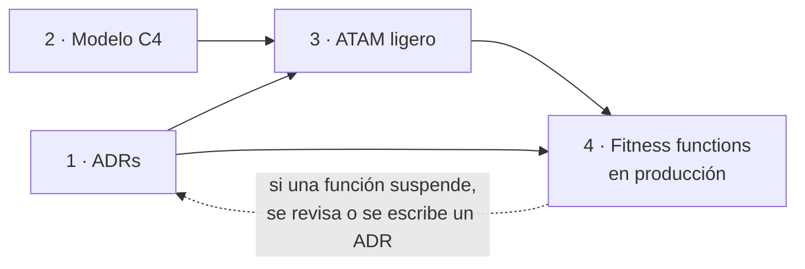
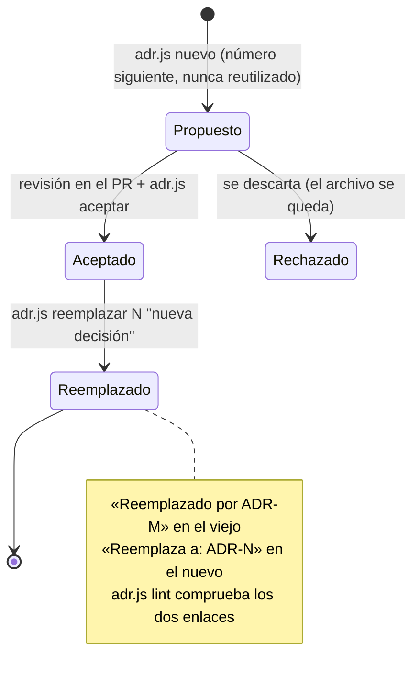
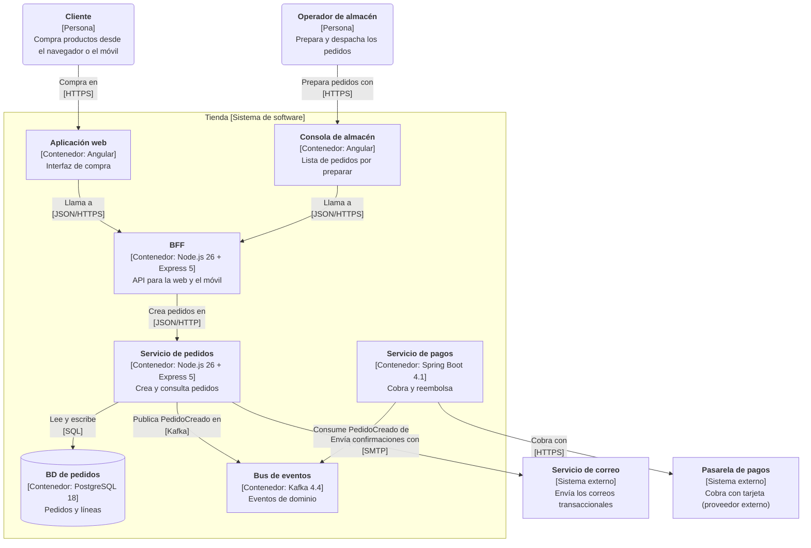
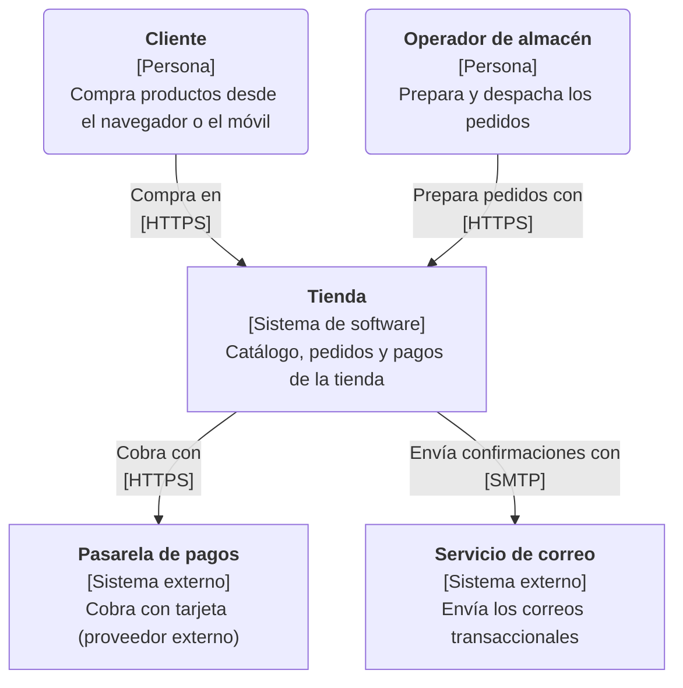
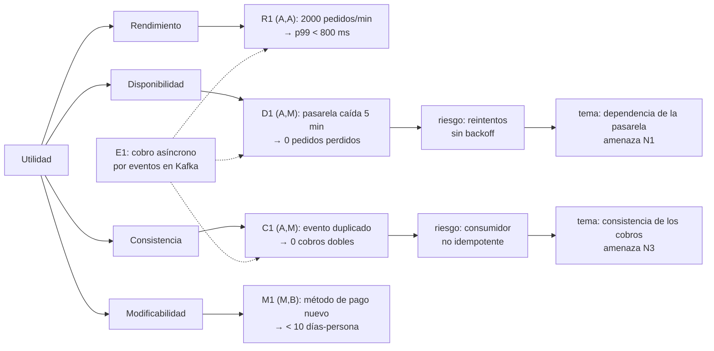
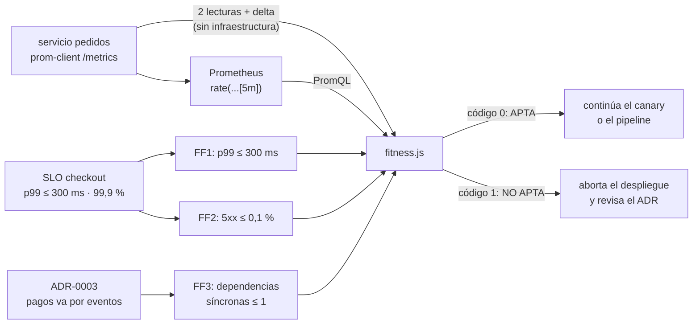

# Módulo 24 · Gobernanza arquitectónica

**Fase 3 · Nivel maestro: arquitectura avanzada** (media semana de 8). **Duración:** 6 h (4 temas de unos 75 min y 1 h
de laboratorio integrador). **Dificultad:** 4 de 5. **Dependencias:** la Fase 1 o la Fase 2 completa (necesitas haber
construido y desplegado servicios para tener decisiones que gobernar); ayudan el Módulo 21 (observabilidad: las
métricas de la ficha 4) y el Módulo 23 (canary y GitOps, donde las fitness functions hacen de puerta).
**Herramientas:** **Node.js 26.13.1 LTS**, **prom-client 15.1.3**, **Prometheus v3.15.1** (solo para la ficha 4 con
`--compose`) y, como alternativa para C4, **Structurizr DSL**. **Laboratorio:** `examples/microservicios/modulo-28/`
(`./verificar.sh` ejecuta 21 tests y los scripts de las cuatro fichas sin infraestructura; `./verificar.sh --compose`
añade Prometheus).

En la Fase 1 y la Fase 2 aprendiste a **construir** microservicios. En la Fase 3 aprendes a **decidir** y a que las
decisiones **duren**. Un sistema de veinte servicios y cuatro equipos no se rompe por un `if` mal escrito: se rompe
porque nadie recuerda por qué se eligió Kafka, porque cada equipo dibuja la arquitectura a su manera, porque nadie
comprobó qué pasa con el cobro si la pasarela cae, o porque una regla («pagos va por eventos») se dejó de cumplir en
silencio. Gobernar la arquitectura es poner por escrito las decisiones (**ADRs**), dibujarlas con un lenguaje común
(**C4**), evaluarlas contra los atributos de calidad antes de que cuesten caro (**ATAM ligero**) y vigilarlas de forma
automática en producción (**fitness functions**). Sin burocracia: todo vive en el repositorio y se revisa en un PR.



**Texto alternativo:** mapa del módulo. Los ADRs (tema 1) y el modelo C4 (tema 2) alimentan el ATAM ligero (tema 3),
que evalúa decisiones y diagramas contra escenarios de calidad. El ATAM y los ADRs llevan a las fitness functions en
producción (tema 4), que vigilan que las decisiones se sigan cumpliendo; una flecha punteada vuelve del tema 4 al tema 1:
si una función suspende, se revisa la decisión o se escribe un ADR nuevo.

**Qué se ejecutó aquí y qué falta.** Todo el código, los 21 tests y los scripts se ejecutaron con Node 26.13.1 en
Linux y sus salidas están pegadas tal cual. **No se pudieron ejecutar aquí** (y están en
`verificacion/microservicios/pendiente.md`): el `docker-compose.yml` de la ficha 4 con Prometheus v3.15.1 (este entorno
no llega a Docker Hub; la lectura de la API de Prometheus se probó contra un doble local) y el `workspace.dsl` de
Structurizr de la ficha 2.

**Cómo usar el laboratorio.** Con Node 26:

```bash
cd examples/microservicios/modulo-28
npm ci
./verificar.sh              # 21 tests + scripts de las 4 fichas → «RESULTADO: OK»
./verificar.sh --compose    # además Prometheus v3.15.1 y las fitness functions con PromQL
```

Todas las órdenes de las fichas se ejecutan **desde `examples/microservicios/modulo-28`** después de `npm ci`. El
[README del laboratorio](../../../examples/microservicios/modulo-28/README.md) tiene el mapa de carpetas.

`package.json` del laboratorio (con `package-lock.json`):

```json
{
  "name": "modulo-24-gobernanza-arquitectonica",
  "version": "1.0.0",
  "private": true,
  "description": "Módulo 24 (Fase 3): Gobernanza arquitectónica (ADRs, modelo C4, ATAM ligero y fitness functions en producción).",
  "type": "module",
  "engines": {
    "node": ">=26.13.1"
  },
  "scripts": {
    "test": "node --test --test-concurrency=1 'f1*/*.test.js'"
  },
  "dependencies": {
    "prom-client": "15.1.3"
  }
}
```

---

### ADRs

#### 1. UBICACIÓN

Módulo 24, Lección 1 de 4 · Fase 3 · Laboratorio `examples/microservicios/modulo-28/f148-adrs/`.

#### 2. PRERREQUISITOS

- Git y Markdown (Módulo 0.4); revisar un *pull request*.
- Haber tomado al menos una decisión con alternativas en el curso (por ejemplo, qué broker usar en el Módulo 11 o en
  el Módulo 22, o una base de datos por servicio).
- La plantilla de ADR del curso: `docs/microservicios/07-plantillas.md`, sección 7.1.

#### 3. OBJETIVO DE APRENDIZAJE

**Redactar** un ADR con contexto medible, al menos dos alternativas con su trade-off, decisión, consecuencias, fitness
function y condición de revisión; **reemplazar** una decisión sin borrar la historia; y **automatizar** su control con
un lint en CI. Lo compruebas cuando `node --test f148-adrs/adr.test.js` pasa 5 de 5 y `node f148-adrs/adr.js
f148-adrs/docs/adr lint` dice `✔ 3 ADRs sin problemas`.

#### 4. ANALOGÍA VISUAL

Dibuja el **cuaderno de bitácora de un barco**. Cada página tiene fecha, quién firmó y una entrada: «cambiamos el rumbo
a 270° porque se acerca una tormenta por el norte; consideramos esperar en el puerto, pero perdíamos la marea». Las
páginas **nunca se arrancan ni se tachan**: si al día siguiente se vuelve al rumbo anterior, se escribe una página
nueva («volvemos a 300°, la tormenta pasó; anula la entrada del día 5») y en el margen de la página del día 5 se anota
«ver día 6». Años después, cualquiera que lea el cuaderno entiende **por qué** el barco hizo lo que hizo.

#### 5. DIAGRAMA TÉCNICO



**Texto alternativo:** diagrama de estados de un ADR. Nace como Propuesto con el número siguiente, que nunca se
reutiliza. Tras la revisión en el pull request pasa a Aceptado, o a Rechazado si se descarta, y el archivo se conserva.
Un ADR aceptado pasa a Reemplazado cuando otro lo sustituye. Una nota indica que el viejo dice «Reemplazado por ADR-M»,
el nuevo dice «Reemplaza a: ADR-N» y el lint comprueba los dos enlaces.

#### 6. EXPLICACIÓN NIVEL 0

- En un proyecto se toman decisiones grandes: qué base de datos usar, cómo se comunican los servicios, qué se divide y
  qué no. Meses después, alguien pregunta «¿por qué hicimos esto?» y nadie se acuerda.
- Un **ADR** (*Architecture Decision Record*, registro de decisión de arquitectura) es un archivo de texto corto que
  responde: **qué** problema había, **qué opciones** se pensaron, **qué** se eligió, **por qué** y **qué consecuencias**
  trae.
- Los ADRs se guardan **junto al código**, numerados, y no se borran: si una decisión cambia, se escribe otro ADR que
  dice «reemplaza al número tal».

#### 7. EXPLICACIÓN INTERMEDIA

- **Origen:** Michael Nygard, «Documenting Architecture Decisions» (blog de Cognitect, 15 de noviembre de 2011). Sus
  secciones: **Título** (frase nominal corta), **Contexto** (las fuerzas en juego, técnicas, políticas, sociales y del
  proyecto, en lenguaje factual), **Decisión** (la respuesta a esas fuerzas, en voz activa: «usaremos…»), **Estado**
  (propuesto o aceptado; más tarde, obsoleto o reemplazado, con enlace al sustituto) y **Consecuencias** (todas:
  positivas, negativas y neutras). Propone guardarlos en el repositorio, numerados en secuencia **sin reutilizar
  números**, conservar los revertidos marcados como reemplazados y que ocupen una o dos páginas.
- **Plantilla del curso** (`07-plantillas.md`): añade lo que pide el prompt del curso: **tabla de opciones** con al
  menos dos alternativas y su trade-off, una **fitness function** que vigile la decisión y **cuándo revisarla**.
- **Qué merece un ADR:** decisiones caras de cambiar o que afectan a varios equipos (estilo de comunicación, almacén de
  datos, límites de servicio, proveedor). No hace falta para elegir el nombre de una variable.
- **Ciclo en el repositorio:** el ADR entra en el **mismo PR** que el cambio (o antes, como propuesta); la discusión
  del PR es la revisión; al fusionar queda Aceptado. `adr.js lint` en CI evita ADRs incompletos y enlaces rotos.

#### 8. EXPLICACIÓN MAESTRA

- **Formatos.** *Nygard* (cinco secciones): mínimo y rápido. *MADR* (Markdown Architectural Decision Record; guía de
  Olaf Zimmermann en ozimmer.ch, consultada el 2026-11-20): plantilla completa con contexto y problema, *decision
  drivers*, opciones consideradas, resultado, consecuencias, una sección opcional de **confirmación** (cómo se
  comprobará que se cumple, pariente de nuestra fitness function) y pros y contras de cada opción; buena para
  decisiones con muchas alternativas. *Y-statements*: la decisión entera en una sola frase estructurada; MADR nació en
  parte de ellos. La plantilla del curso es Nygard + tabla de opciones + fitness function: un punto medio.
- **ADR frente a documento de diseño (RFC).** El RFC explora y propone antes de decidir (puede ser largo); el ADR
  registra la decisión tomada (corto). Muchas organizaciones usan los dos: el RFC termina en uno o varios ADRs.
- **Inmutabilidad con matices.** Corregir una errata o añadir un enlace no cambia la decisión; cambiar la decisión
  sí exige un ADR nuevo. Si editas en sitio el texto de una decisión aceptada, pierdes justamente lo que querías
  guardar: por qué se pensó distinto en su momento.
- **Gobernanza ligera frente a comité.** Un comité que aprueba todo crea colas y decisiones tomadas lejos del código.
  Con ADRs en PR, decide quien tiene el contexto y la revisión es asíncrona; el arquitecto revisa los ADRs de impacto
  alto (los que tocan a varios equipos).
- **Cuándo NO escribir un ADR:** decisiones reversibles en minutos, locales a un módulo y sin impacto en otros equipos.
  Escribir ADRs de todo los convierte en ruido y nadie los lee.

#### 9. CÓDIGO EJECUTABLE

Versiones: **Node.js 26.13.1 LTS** (sin dependencias) y Markdown. `f148-adrs/adr.js`:

```javascript
// Módulo 24 · F148 · Herramienta de ADRs (Architecture Decision Records) en Markdown, sin dependencias.
// Formato de docs/microservicios/07-plantillas.md (Nygard 2011 + alternativas con trade-off + fitness function).
// Requisitos: Node.js 26.13.1 LTS.
// Uso: node f148-adrs/adr.js <carpeta> nuevo "Usamos Kafka para los eventos de pedidos"
//      node f148-adrs/adr.js <carpeta> aceptar 3
//      node f148-adrs/adr.js <carpeta> reemplazar 2 "Usamos RabbitMQ con colas de quórum"
//      node f148-adrs/adr.js <carpeta> lint        |   node f148-adrs/adr.js <carpeta> indice
import { existsSync, mkdirSync, readFileSync, readdirSync, writeFileSync } from 'node:fs';
import { join } from 'node:path';

export const SECCIONES = ['Contexto', 'Opciones consideradas', 'Decisión', 'Consecuencias', 'Fitness function', 'Cuándo revisar esta decisión'];
const ESTADO = /^(Propuesto|Aceptado|Rechazado|Reemplazado por ADR-\d{4})$/;
const num = (n) => String(n).padStart(4, '0');
const slug = (t) => t.normalize('NFD').replace(/[\u0300-\u036f]/g, '').toLowerCase().replace(/[^a-z0-9]+/g, '-').replace(/^-|-$/g, '').slice(0, 60);

export function listar(dir) {
  if (!existsSync(dir)) return [];
  return readdirSync(dir).filter((f) => /^\d{4}-.+\.md$/.test(f)).sort().map((archivo) => {
    const texto = readFileSync(join(dir, archivo), 'utf8');
    return {
      archivo,
      numero: Number(archivo.slice(0, 4)),
      titulo: texto.match(/^# ADR-(\d{4}): (.+)$/m)?.[2] ?? null,
      numeroTitulo: Number(texto.match(/^# ADR-(\d{4}):/m)?.[1] ?? NaN),
      estado: texto.match(/^- \*\*Estado:\*\* (.+)$/m)?.[1]?.trim() ?? null,
      fecha: texto.match(/^- \*\*Fecha:\*\* (.+)$/m)?.[1]?.trim() ?? null,
      reemplazaA: Number(texto.match(/^- \*\*Reemplaza a:\*\* ADR-(\d{4})$/m)?.[1] ?? NaN),
      texto,
    };
  });
}

export function nuevo(dir, titulo, { fecha = new Date().toISOString().slice(0, 10), reemplazaA } = {}) {
  mkdirSync(dir, { recursive: true });
  const numero = Math.max(0, ...listar(dir).map((a) => a.numero)) + 1; // nunca se reutiliza un número
  const archivo = `${num(numero)}-${slug(titulo)}.md`;
  const plantilla = readFileSync(new URL('./plantilla.md', import.meta.url), 'utf8')
    .replace('NNNN', num(numero)).replace('<título>', titulo).replace('AAAA-MM-DD', fecha)
    .replace('- **Reemplaza a:** —\n', reemplazaA ? `- **Reemplaza a:** ADR-${num(reemplazaA)}\n` : '');
  writeFileSync(join(dir, archivo), plantilla);
  return archivo;
}

function cambiarEstado(dir, numero, estado) {
  const adr = listar(dir).find((a) => a.numero === numero);
  if (!adr) throw new Error(`no existe ADR-${num(numero)}`);
  writeFileSync(join(dir, adr.archivo), adr.texto.replace(/^- \*\*Estado:\*\* .+$/m, `- **Estado:** ${estado}`));
}
export const aceptar = (dir, numero) => cambiarEstado(dir, numero, 'Aceptado');

/** Una decisión aceptada NO se edita: se escribe otra que la reemplaza y la vieja queda enlazada. */
export function reemplazar(dir, viejo, titulo, opciones) {
  const archivo = nuevo(dir, titulo, { ...opciones, reemplazaA: viejo });
  cambiarEstado(dir, viejo, `Reemplazado por ADR-${archivo.slice(0, 4)}`);
  return archivo;
}

export function lint(dir) {
  const adrs = listar(dir);
  const problemas = [];
  adrs.forEach((a, i) => {
    const id = a.archivo;
    if (a.numero !== i + 1) problemas.push(`${id}: numeración con huecos o repetida (esperaba ${num(i + 1)})`);
    if (a.numeroTitulo !== a.numero) problemas.push(`${id}: el título no es «# ADR-${num(a.numero)}: …»`);
    if (!a.estado || !ESTADO.test(a.estado)) problemas.push(`${id}: estado inválido «${a.estado}»`);
    if (!/^\d{4}-\d{2}-\d{2}$/.test(a.fecha ?? '')) problemas.push(`${id}: fecha que no es AAAA-MM-DD`);
    for (const s of SECCIONES) if (!new RegExp(`^## ${s}$`, 'm').test(a.texto)) problemas.push(`${id}: falta la sección «${s}»`);
    const tabla = a.texto.split(/^## Opciones consideradas$/m)[1]?.split(/^## /m)[0] ?? '';
    const opciones = tabla.split('\n').filter((l) => /^\| [A-Z]\. /.test(l));
    if (opciones.length < 2) problemas.push(`${id}: ${opciones.length} opciones en la tabla; un ADR compara al menos 2`);
    if (/<[^>]+>/.test(a.texto.replace(/```[\s\S]*?```/g, '')) && a.estado !== 'Propuesto') problemas.push(`${id}: quedan huecos <…> de la plantilla`);
    const reemplazo = a.estado?.match(/ADR-(\d{4})/)?.[1];
    if (reemplazo && listar(dir).find((b) => b.numero === Number(reemplazo))?.reemplazaA !== a.numero) {
      problemas.push(`${id}: dice «Reemplazado por ADR-${reemplazo}», pero ese ADR no dice «Reemplaza a: ADR-${num(a.numero)}»`);
    }
  });
  return problemas;
}

export function indice(dir) {
  return ['| ADR | Decisión | Estado | Fecha |', '|---|---|---|---|',
    ...listar(dir).map((a) => `| [ADR-${num(a.numero)}](${a.archivo}) | ${a.titulo} | ${a.estado} | ${a.fecha} |`)].join('\n');
}

if (import.meta.main) {
  const [dir, orden, ...resto] = process.argv.slice(2);
  if (orden === 'nuevo') console.log(`creado ${nuevo(dir, resto.join(' '))}`);
  else if (orden === 'aceptar') { aceptar(dir, Number(resto[0])); console.log(`ADR-${num(resto[0])} aceptado`); }
  else if (orden === 'reemplazar') console.log(`creado ${reemplazar(dir, Number(resto[0]), resto.slice(1).join(' '))}; ADR-${num(resto[0])} queda reemplazado`);
  else if (orden === 'indice') console.log(indice(dir));
  else if (orden === 'lint') {
    const p = lint(dir);
    for (const x of p) console.log(`✘ ${x}`);
    console.log(p.length ? `${p.length} problemas en ${listar(dir).length} ADRs` : `✔ ${listar(dir).length} ADRs sin problemas`);
    process.exitCode = p.length ? 1 : 0;
  } else console.log('órdenes: nuevo <título> · aceptar <n> · reemplazar <n> <título> · lint · indice');
}
```

`f148-adrs/plantilla.md`:

```markdown
# ADR-NNNN: <título>

- **Estado:** Propuesto
- **Fecha:** AAAA-MM-DD
- **Decisores:** <nombres o roles>
- **Reemplaza a:** —
- **Módulos o servicios afectados:** <lista>

## Contexto

<Qué problema hay, qué fuerzas actúan (requisitos, restricciones, plazos, equipo) y qué pasa si no decidimos.
Incluye números: carga esperada, latencia objetivo (p99), coste máximo, tamaño del equipo.>

## Opciones consideradas

| Opción | A favor | En contra | Coste aproximado |
|---|---|---|---|
| A. <opción elegida> | | | |
| B. <alternativa 1> | | | |

## Decisión

<Qué elegimos y por qué, en relación directa con el contexto.>

## Consecuencias

- **Positivas:** <qué mejora>
- **Negativas (trade-off aceptado):** <qué empeora o qué deuda asumimos>
- **Riesgos y mitigación:** <riesgo → acción>

## Fitness function

<Cómo comprobaremos automáticamente que la decisión se sigue cumpliendo.>

## Cuándo revisar esta decisión

<Condición concreta que obliga a reabrirla.>
```

Dos de los tres ADRs de ejemplo (`f148-adrs/docs/adr/`), uno reemplazado por el otro:

```markdown
# ADR-0002: Publicamos los eventos de pedidos en RabbitMQ

- **Estado:** Reemplazado por ADR-0003
- **Fecha:** 2026-11-05
- **Decisores:** equipo de la tienda
- **Módulos o servicios afectados:** pedidos, inventario, notificaciones

## Contexto

Pedidos debe avisar a inventario y a notificaciones sin llamarlos de forma síncrona. Carga esperada: 20 pedidos/s en
pico. Solo hay consumidores que procesan cada evento una vez.

## Opciones consideradas

| Opción | A favor | En contra | Coste aproximado |
|---|---|---|---|
| A. RabbitMQ con colas de quórum | El equipo ya lo conoce (Módulo 22), confirmaciones y reintentos sencillos | No guarda el historial para releer eventos | 1 nodo pequeño |
| B. Kafka | Retención y relectura, mucho caudal | Más piezas que operar para 20 eventos/s | 3 brokers |

## Decisión

Usamos RabbitMQ: cubre el caudal con margen y el equipo lo opera desde el Módulo 22.

## Consecuencias

- **Positivas:** puesta en marcha en una semana.
- **Negativas (trade-off aceptado):** si un servicio nuevo necesita releer eventos pasados, no podrá.
- **Riesgos y mitigación:** pérdida de mensajes → publisher confirms y colas de quórum.

## Fitness function

Alerta si la cola `pedidos.creados` supera 1000 mensajes pendientes durante 10 minutos.

## Cuándo revisar esta decisión

Si aparece un consumidor que necesite reprocesar el historial de eventos.
```

```markdown
# ADR-0003: Publicamos los eventos de pedidos en Kafka

- **Estado:** Aceptado
- **Fecha:** 2026-11-18
- **Decisores:** equipo de la tienda y equipo de analítica
- **Reemplaza a:** ADR-0002
- **Módulos o servicios afectados:** pedidos, inventario, notificaciones, analítica

## Contexto

Se cumplió la condición de revisión del ADR-0002: analítica necesita reprocesar 90 días de pedidos para recalcular
sus modelos, y RabbitMQ borra cada mensaje al confirmarlo. La carga sigue siendo de 20 pedidos/s en pico.

## Opciones consideradas

| Opción | A favor | En contra | Coste aproximado |
|---|---|---|---|
| A. Kafka con retención de 90 días | Relectura por offset, varios grupos de consumidores | Operar un clúster de 3 brokers | 3 brokers pequeños |
| B. Seguir con RabbitMQ y copiar a un almacén para analítica | Sin cambios para los servicios actuales | Dos fuentes de verdad, retraso en analítica | Un job ETL |
| C. RabbitMQ Streams | Mismo producto que ya operamos, admite relectura | Menos ecosistema de conectores que Kafka | Igual que hoy |

## Decisión

Usamos Kafka con retención de 90 días para `pedidos.v1`, porque analítica necesita relectura y los conectores
de Kafka Connect que ya usa.

## Consecuencias

- **Positivas:** cualquier servicio nuevo puede leer desde el principio del tema.
- **Negativas (trade-off aceptado):** más operación y la migración de los dos consumidores actuales.
- **Riesgos y mitigación:** duplicados al migrar → consumidores idempotentes (Módulo 25).

## Fitness function

Alerta si el *lag* del grupo `inventario` supera 10 000 mensajes durante 10 minutos.

## Cuándo revisar esta decisión

Si el coste del clúster supera el 15 % del presupuesto de infraestructura de la tienda.
```

#### 10. MINI-LABORATORIO

1. Revisa los ADRs de ejemplo y genera su índice:

```bash
node f148-adrs/adr.js f148-adrs/docs/adr lint
node f148-adrs/adr.js f148-adrs/docs/adr indice
```

   **Output esperado:**

```text
✔ 3 ADRs sin problemas
| ADR | Decisión | Estado | Fecha |
|---|---|---|---|
| [ADR-0001](0001-registramos-las-decisiones-de-arquitectura-con-adrs.md) | Registramos las decisiones de arquitectura con ADRs en el repositorio | Aceptado | 2026-11-02 |
| [ADR-0002](0002-publicamos-los-eventos-de-pedidos-en-rabbitmq.md) | Publicamos los eventos de pedidos en RabbitMQ | Reemplazado por ADR-0003 | 2026-11-05 |
| [ADR-0003](0003-publicamos-los-eventos-de-pedidos-en-kafka.md) | Publicamos los eventos de pedidos en Kafka | Aceptado | 2026-11-18 |
```

2. Haz el ciclo completo en una carpeta tuya: crea, intenta aceptar sin rellenar, y reemplaza:

```bash
node f148-adrs/adr.js /tmp/adr-demo nuevo "Usamos PostgreSQL para pedidos"
node f148-adrs/adr.js /tmp/adr-demo lint
node f148-adrs/adr.js /tmp/adr-demo aceptar 1
node f148-adrs/adr.js /tmp/adr-demo lint
node f148-adrs/adr.js /tmp/adr-demo reemplazar 1 "Usamos PostgreSQL con réplicas de lectura"
node f148-adrs/adr.js /tmp/adr-demo indice
grep -E "Estado|Reemplaza" /tmp/adr-demo/*.md
```

   **Output esperado** (la fecha es la de hoy):

```text
creado 0001-usamos-postgresql-para-pedidos.md
✔ 1 ADRs sin problemas
ADR-0001 aceptado
✘ 0001-usamos-postgresql-para-pedidos.md: quedan huecos <…> de la plantilla
1 problemas en 1 ADRs
creado 0002-usamos-postgresql-con-replicas-de-lectura.md; ADR-0001 queda reemplazado
| ADR | Decisión | Estado | Fecha |
|---|---|---|---|
| [ADR-0001](0001-usamos-postgresql-para-pedidos.md) | Usamos PostgreSQL para pedidos | Reemplazado por ADR-0002 | 2026-11-20 |
| [ADR-0002](0002-usamos-postgresql-con-replicas-de-lectura.md) | Usamos PostgreSQL con réplicas de lectura | Propuesto | 2026-11-20 |
/tmp/adr-demo/0001-usamos-postgresql-para-pedidos.md:- **Estado:** Reemplazado por ADR-0002
/tmp/adr-demo/0002-usamos-postgresql-con-replicas-de-lectura.md:- **Estado:** Propuesto
/tmp/adr-demo/0002-usamos-postgresql-con-replicas-de-lectura.md:- **Reemplaza a:** ADR-0001
```

   **Captura comentada:** un ADR **propuesto** puede tener huecos (`<…>`) porque se está discutiendo; en cuanto se
   acepta, el lint exige que estén rellenos. El reemplazo no toca el texto de la decisión vieja: solo su estado, y los
   dos archivos quedan enlazados.

3. Rellena el ADR-0002 de `/tmp/adr-demo` con un caso real de tu trabajo (contexto con números, dos opciones,
   fitness function y condición de revisión), acéptalo con `aceptar 2` y pasa el lint.

#### 11. VERIFICACIÓN

Test que debes ejecutar (`f148-adrs/adr.test.js`):

```javascript
// Módulo 24 · F148 · Tests de la herramienta de ADRs. Ejecuta: node --test f148-adrs/adr.test.js
import { test } from 'node:test';
import assert from 'node:assert/strict';
import { mkdtempSync, readFileSync, rmSync, writeFileSync } from 'node:fs';
import { tmpdir } from 'node:os';
import { join } from 'node:path';
import { aceptar, indice, lint, listar, nuevo, reemplazar } from './adr.js';

const temporal = () => mkdtempSync(join(tmpdir(), 'adr-'));
const rellenar = (dir, archivo) => { // simula que el autor completó la plantilla
  const ruta = join(dir, archivo);
  writeFileSync(ruta, readFileSync(ruta, 'utf8').replace(/<[^>]+>/g, 'texto'));
};

test('los ADRs de ejemplo pasan el lint', () => {
  assert.deepEqual(lint('f148-adrs/docs/adr'), []);
});

test('nuevo numera de forma correlativa y crea el nombre del archivo sin tildes', () => {
  const dir = temporal();
  assert.equal(nuevo(dir, 'Usamos Kafka', { fecha: '2026-11-20' }), '0001-usamos-kafka.md');
  assert.equal(nuevo(dir, 'Separamos la base de datos de pagos', { fecha: '2026-11-20' }), '0002-separamos-la-base-de-datos-de-pagos.md');
  assert.equal(listar(dir)[1].estado, 'Propuesto');
  rmSync(dir, { recursive: true });
});

test('un propuesto puede tener huecos; al aceptarlo sin rellenar, el lint lo detecta', () => {
  const dir = temporal();
  nuevo(dir, 'Usamos Kafka', { fecha: '2026-11-20' });
  assert.deepEqual(lint(dir), []);
  aceptar(dir, 1);
  assert.deepEqual(lint(dir), ['0001-usamos-kafka.md: quedan huecos <…> de la plantilla']);
  rmSync(dir, { recursive: true });
});

test('reemplazar enlaza los dos ADRs y no reutiliza números', () => {
  const dir = temporal();
  rellenar(dir, nuevo(dir, 'Usamos RabbitMQ', { fecha: '2026-11-01' }));
  aceptar(dir, 1);
  const nuevoArchivo = reemplazar(dir, 1, 'Usamos Kafka', { fecha: '2026-11-20' });
  rellenar(dir, nuevoArchivo);
  const [viejo, actual] = listar(dir);
  assert.equal(viejo.estado, 'Reemplazado por ADR-0002');
  assert.equal(actual.reemplazaA, 1);
  assert.deepEqual(lint(dir), []);
  assert.match(indice(dir), /\| \[ADR-0001\]\(0001-usamos-rabbitmq\.md\) \| Usamos RabbitMQ \| Reemplazado por ADR-0002 \| 2026-11-01 \|/);
  rmSync(dir, { recursive: true });
});

test('el ADR «registro de una línea» incumple 5 reglas', () => {
  const problemas = lint('f148-adrs/error-comun');
  assert.equal(problemas.length, 5);
  assert.ok(problemas.includes('0001-usamos-mongodb.md: 0 opciones en la tabla; un ADR compara al menos 2'));
});
```

```bash
node --test f148-adrs/adr.test.js
```

Resultado esperado:

```text
✔ los ADRs de ejemplo pasan el lint
✔ nuevo numera de forma correlativa y crea el nombre del archivo sin tildes
✔ un propuesto puede tener huecos; al aceptarlo sin rellenar, el lint lo detecta
✔ reemplazar enlaza los dos ADRs y no reutiliza números
✔ el ADR «registro de una línea» incumple 5 reglas
ℹ tests 5
ℹ pass 5
ℹ fail 0
```

**Pregunta de comprobación:** el ADR-0003 cambió de opinión respecto al ADR-0002. ¿Por qué no se editó el 0002?
*(Porque se perdería el razonamiento original, que era correcto con el contexto de entonces; el 0003 explica qué
cambió en el contexto, y el 0002 queda marcado como reemplazado.)*

#### 12. ERROR COMÚN

**Síntoma:** hay una carpeta `docs/adr/` llena de archivos, pero cuando alguien pregunta «¿por qué MongoDB?», el ADR no
responde: dice qué se eligió y nada más. **Causa:** el ADR se escribió como **registro de una línea** (la decisión, sin
contexto ni alternativas), normalmente después de implementarla. `f148-adrs/error-comun/0001-usamos-mongodb.md`:

```markdown
# ADR-0001: Usamos MongoDB

- **Estado:** Aceptado
- **Fecha:** 2026-11-10

## Decisión

Usamos MongoDB para todos los servicios porque es más flexible.

## Consecuencias

- Más flexibilidad.
```

Salida real de `node f148-adrs/adr.js f148-adrs/error-comun lint`:

```text
✘ 0001-usamos-mongodb.md: falta la sección «Contexto»
✘ 0001-usamos-mongodb.md: falta la sección «Opciones consideradas»
✘ 0001-usamos-mongodb.md: falta la sección «Fitness function»
✘ 0001-usamos-mongodb.md: falta la sección «Cuándo revisar esta decisión»
✘ 0001-usamos-mongodb.md: 0 opciones en la tabla; un ADR compara al menos 2
5 problemas en 1 ADRs
```

**Diagnóstico visual:** abre el ADR y tapa la línea de la decisión: si lo que queda no te permite adivinar qué se
eligió ni por qué, el ADR no sirve. **Arreglo:** escribe el ADR **antes** o durante la decisión, con el contexto medible
(«20 pedidos/s», «3 personas»), al menos dos alternativas reales con su trade-off y la condición que obligaría a
revisarla; pon el lint en CI.

#### 13. PREGUNTA DE ENTREVISTA

**¿Cómo documentas las decisiones de arquitectura en un equipo de microservicios y cómo evitas que se queden
desactualizadas?**

**Respuesta modelo:** con ADRs en Markdown dentro del repositorio, numerados y revisados en el mismo PR que el cambio.
Cada ADR tiene contexto con números, al menos dos alternativas con su trade-off, la decisión, las consecuencias
positivas y negativas, una fitness function que vigila que se siga cumpliendo y una condición concreta de revisión.
Nunca edito una decisión aceptada: si cambia, escribo un ADR nuevo que la reemplaza y enlazo los dos, así la historia
explica por qué pensábamos distinto. Para que no se queden desactualizados uso tres cosas: el lint en CI, la condición
de revisión (cuando se cumple, se reabre el ADR) y las fitness functions, que avisan si la realidad se separó de lo
decidido. Solo escribo ADRs para decisiones caras de revertir o que afectan a otros equipos; si documento todo, nadie
lee nada.

#### 14. ANTI-PATRÓN RELACIONADO

**Las decisiones que viven en el chat (o en la cabeza de una persona).** Evita que la única huella de una decisión
sea un hilo de mensajería o una reunión:

```text
MAL  [chat, 3 de marzo] — ¿Kafka o Rabbit? — Rabbit, ya lo conocemos. — 👍
     (seis meses después: nadie sabe que analítica necesitaba relectura ni que se descartó por eso)
```

```text
BIEN docs/adr/0002-publicamos-los-eventos-de-pedidos-en-rabbitmq.md, con contexto, dos opciones,
     condición de revisión («si aparece un consumidor que necesite reprocesar el historial») y su reemplazo 0003.
```

En un diagrama se ve como flechas de decisión que salen de burbujas de conversación y se pierden fuera del repositorio,
frente a una pila numerada de documentos junto al código.

---
### Modelo C4

#### 1. UBICACIÓN

Módulo 24, Lección 2 de 4 · Fase 3 · Laboratorio `examples/microservicios/modulo-28/f149-c4/`.

#### 2. PRERREQUISITOS

- Diagramas Mermaid (los has leído en todo el curso).
- JSON (Módulo 0.4).
- Distinguir un servicio, una base de datos y un sistema externo (Fase 1 o Fase 2).

#### 3. OBJETIVO DE APRENDIZAJE

**Modelar** un sistema con los niveles 1 (Contexto) y 2 (Contenedores) del modelo C4, **generar** los diagramas desde
un único modelo como código y **detectar** los errores típicos de notación (flechas sin verbo, contenedores sin
tecnología, niveles mezclados). Lo compruebas cuando `node --test f149-c4/c4.test.js` pasa 4 de 4.

#### 4. ANALOGÍA VISUAL

Dibuja **cuatro mapas de la misma ciudad** apilados como en Google Maps cuando haces zoom. El primero es el **país**:
tu ciudad es un punto, con las carreteras a otras ciudades y quién viaja por ellas (Contexto). El segundo es la
**ciudad**: barrios, el puerto, el aeropuerto y las autopistas entre ellos (Contenedores). El tercero, **un barrio**:
sus calles y edificios (Componentes). El cuarto, **el plano de un edificio** (Código). Cada mapa tiene **leyenda** y
cada carretera tiene **nombre**. Nadie dibuja los enchufes de un edificio en el mapa del país.

#### 5. DIAGRAMA TÉCNICO

El diagrama de este punto **es** la salida real de `node f149-c4/c4.js f149-c4/modelo.json contenedores` (nivel 2):



**Texto alternativo:** diagrama C4 de contenedores de la tienda en línea. Fuera del sistema están dos personas, el
cliente y el operador de almacén, y dos sistemas externos, la pasarela de pagos y el servicio de correo. Dentro de la
caja «Tienda» hay siete contenedores: aplicación web y consola de almacén en Angular, BFF y servicio de pedidos en
Node.js 26 con Express 5, servicio de pagos en Spring Boot 4.1, la base de datos de pedidos en PostgreSQL 18 dibujada
como cilindro y el bus de eventos en Kafka 4.4. El cliente compra en la web por HTTPS; la web y la consola llaman al BFF
con JSON por HTTPS; el BFF crea pedidos en el servicio de pedidos; pedidos lee y escribe en su base de datos por SQL,
publica PedidoCreado en Kafka y envía confirmaciones por SMTP; pagos consume PedidoCreado de Kafka y cobra con la
pasarela por HTTPS; el operador prepara pedidos con la consola de almacén.

#### 6. EXPLICACIÓN NIVEL 0

- Cuando explicas un sistema, cada persona dibuja cajas y flechas a su manera y nadie entiende el dibujo del otro.
- El **modelo C4** propone dibujar el sistema **a distintos niveles de zoom**, siempre con las mismas reglas: primero
  el sistema entero como una caja con quién lo usa; luego las piezas grandes que lo forman; luego el interior de una
  pieza; y, si hace falta, el código.
- Cada caja dice **qué es, de qué tipo es y con qué está hecha**; cada flecha dice **qué hace** («publica pedidos en»)
  y **cómo** (HTTPS, SQL). Así el dibujo se entiende sin que lo explique su autor.

#### 7. EXPLICACIÓN INTERMEDIA

- **Origen:** lo creó Simon Brown entre 2006 y 2011; es independiente de la notación y de la herramienta (c4model.com,
  consultado el 2026-11-20). Los niveles 1 a 3 usan cinco elementos: **personas**, **sistemas de software**,
  **contenedores**, **componentes** y **relaciones**.
- **Los cuatro niveles:** (1) **Contexto**: el sistema en el centro, sus usuarios y los otros sistemas con los que se
  relaciona; (2) **Contenedores**: el sistema descompuesto en contenedores relacionados, donde un contenedor es **una
  aplicación o un almacén de datos** (no un contenedor de Docker: una SPA, un servicio, una base de datos, un *bucket*);
  (3) **Componentes**: un contenedor descompuesto en componentes y su relación con otros contenedores o sistemas;
  (4) **Código**: el detalle que se mapea al código (normalmente lo genera el IDE, o se omite).
- **Diagramas complementarios:** paisaje de sistemas (*system landscape*), dinámico (una secuencia concreta) y de
  despliegue (dónde corre cada contenedor: nodos, Kubernetes, nube).
- **Reglas de notación** que recomienda: título y **leyenda** en cada diagrama, etiquetas claras; en la práctica, cada
  elemento con nombre, tipo, tecnología (en contenedores y componentes) y descripción, y cada relación con una
  descripción y, cuando aplica, la tecnología o el protocolo.
- **Modelo frente a diagrama:** si dibujas cada vista a mano, el día que cambia un nombre tienes que actualizar cinco
  dibujos. Con un **modelo** (aquí `modelo.json`; en Structurizr, un `workspace.dsl`) cada vista se **genera**: el de
  contexto colapsa los contenedores en una sola caja y el de contenedores la abre.

#### 8. EXPLICACIÓN MAESTRA

- **C4 frente a UML frente a arc42.** *UML* tiene semántica formal y muchos tipos de diagrama, pero pocos equipos lo
  usan bien y a nivel de sistema se queda corto para «quién llama a quién y con qué». *C4* es deliberadamente simple y
  se aprende en una tarde; para el detalle de nivel 4 se apoya en UML o en diagramas entidad-relación. *arc42* es una
  plantilla de **documento** de arquitectura (12 secciones) que no compite con C4: lo usa para sus vistas.
- **Herramientas:** *Mermaid* (en el repositorio, en GitHub y en esta academia; lo usa `c4.js`); *Structurizr DSL*
  (modelo propio con vistas, estilos y despliegue; `workspace.dsl` del laboratorio); *PlantUML con C4-PlantUML*; o una
  herramienta de dibujo libre siguiendo la notación. Lo importante es **un único modelo** del que salen las vistas.
- **Qué nivel para quién:** Contexto para negocio y nuevos del equipo; Contenedores para el equipo y operaciones (es
  el más útil en microservicios); Componentes solo para contenedores complejos; Código casi nunca a mano.
- **Diagrama vivo:** el modelo en el repositorio, validado en CI (como `c4.js validar`) y regenerado en cada PR. Un
  diagrama en una herramienta aparte se queda viejo en semanas.
- **Cuándo NO hace falta C4:** un servicio con su base de datos y nada más; ahí un párrafo y un diagrama de secuencia
  bastan.

#### 9. CÓDIGO EJECUTABLE

Versiones: **Node.js 26.13.1 LTS** (sin dependencias) y **Mermaid** (el de la academia). `f149-c4/modelo.json`:

```json
{
  "nombre": "Tienda en línea",
  "personas": [
    { "id": "cliente", "nombre": "Cliente", "descripcion": "Compra productos desde el navegador o el móvil" },
    { "id": "operador", "nombre": "Operador de almacén", "descripcion": "Prepara y despacha los pedidos" }
  ],
  "externos": [
    { "id": "pasarela", "nombre": "Pasarela de pagos", "descripcion": "Cobra con tarjeta (proveedor externo)" },
    { "id": "correo", "nombre": "Servicio de correo", "descripcion": "Envía los correos transaccionales" }
  ],
  "sistema": {
    "id": "tienda",
    "nombre": "Tienda",
    "descripcion": "Catálogo, pedidos y pagos de la tienda",
    "contenedores": [
      { "id": "web", "nombre": "Aplicación web", "tecnologia": "Angular", "descripcion": "Interfaz de compra" },
      { "id": "bff", "nombre": "BFF", "tecnologia": "Node.js 26 + Express 5", "descripcion": "API para la web y el móvil" },
      { "id": "pedidos", "nombre": "Servicio de pedidos", "tecnologia": "Node.js 26 + Express 5", "descripcion": "Crea y consulta pedidos" },
      { "id": "pagos", "nombre": "Servicio de pagos", "tecnologia": "Spring Boot 4.1", "descripcion": "Cobra y reembolsa" },
      { "id": "bdpedidos", "nombre": "BD de pedidos", "tecnologia": "PostgreSQL 18", "descripcion": "Pedidos y líneas", "tipo": "base de datos" },
      { "id": "broker", "nombre": "Bus de eventos", "tecnologia": "Kafka 4.4", "descripcion": "Eventos de dominio", "tipo": "cola" },
      { "id": "almacen", "nombre": "Consola de almacén", "tecnologia": "Angular", "descripcion": "Lista de pedidos por preparar" }
    ]
  },
  "relaciones": [
    { "de": "cliente", "a": "web", "descripcion": "Compra en", "tecnologia": "HTTPS" },
    { "de": "web", "a": "bff", "descripcion": "Llama a", "tecnologia": "JSON/HTTPS" },
    { "de": "bff", "a": "pedidos", "descripcion": "Crea pedidos en", "tecnologia": "JSON/HTTP" },
    { "de": "pedidos", "a": "bdpedidos", "descripcion": "Lee y escribe", "tecnologia": "SQL" },
    { "de": "pedidos", "a": "broker", "descripcion": "Publica PedidoCreado en", "tecnologia": "Kafka" },
    { "de": "pagos", "a": "broker", "descripcion": "Consume PedidoCreado de", "tecnologia": "Kafka" },
    { "de": "pagos", "a": "pasarela", "descripcion": "Cobra con", "tecnologia": "HTTPS" },
    { "de": "pedidos", "a": "correo", "descripcion": "Envía confirmaciones con", "tecnologia": "SMTP" },
    { "de": "operador", "a": "almacen", "descripcion": "Prepara pedidos con", "tecnologia": "HTTPS" },
    { "de": "almacen", "a": "bff", "descripcion": "Llama a", "tecnologia": "JSON/HTTPS" }
  ]
}
```

`f149-c4/c4.js`:

```javascript
// Módulo 24 · F149 · Modelo C4 como código: un único modelo JSON y dos vistas generadas (Contexto y Contenedores)
// en Mermaid, más un validador de reglas de notación. Requisitos: Node.js 26.13.1 LTS (sin dependencias).
// Uso: node f149-c4/c4.js f149-c4/modelo.json [contexto|contenedores|validar]
import { readFileSync } from 'node:fs';

const etiqueta = (nombre, tipo, descripcion) => `"<b>${nombre}</b><br/>[${tipo}]<br/>${descripcion}"`;

export function validar(m) {
  const problemas = [];
  const elementos = [...m.personas, ...m.externos, { id: m.sistema.id }, ...m.sistema.contenedores];
  const ids = elementos.map((e) => e.id);
  for (const id of new Set(ids)) if (ids.filter((x) => x === id).length > 1) problemas.push(`id repetido: ${id}`);
  for (const c of m.sistema.contenedores) {
    if (!c.tecnologia) problemas.push(`el contenedor «${c.nombre}» no dice su tecnología`);
    if (!c.descripcion) problemas.push(`el contenedor «${c.nombre}» no tiene descripción`);
    if (/\.(java|ts|js|py)$/.test(c.nombre) || /^clase/i.test(c.tecnologia ?? '')) problemas.push(`«${c.nombre}» es código (nivel 4), no un contenedor: mezcla niveles`);
  }
  const personas = new Set(m.personas.map((p) => p.id));
  const datos = new Set(m.sistema.contenedores.filter((c) => c.tipo).map((c) => c.id));
  for (const r of m.relaciones) {
    const nombre = `${r.de} -> ${r.a}`;
    if (!ids.includes(r.de) || !ids.includes(r.a)) problemas.push(`relación ${nombre}: apunta a un elemento que no existe`);
    if (!r.descripcion) problemas.push(`relación ${nombre}: sin descripción (una flecha sin verbo no dice nada)`);
    if (!r.tecnologia) problemas.push(`relación ${nombre}: sin tecnología o protocolo`);
    if (personas.has(r.de) && datos.has(r.a)) problemas.push(`relación ${nombre}: una persona no usa directamente un almacén de datos`);
  }
  const usados = new Set(m.relaciones.flatMap((r) => [r.de, r.a]));
  for (const c of m.sistema.contenedores) if (!usados.has(c.id)) problemas.push(`el contenedor «${c.nombre}» no se relaciona con nada`);
  return problemas;
}

/** Nivel 1 · Contexto: el sistema como UNA caja, sus personas y los sistemas externos. */
export function contexto(m) {
  const internos = new Set(m.sistema.contenedores.map((c) => c.id));
  const caja = (id) => (internos.has(id) ? m.sistema.id : id);
  const vistas = new Map();
  for (const r of m.relaciones) {
    const [de, a] = [caja(r.de), caja(r.a)];
    if (de !== a && !vistas.has(`${de}>${a}`)) vistas.set(`${de}>${a}`, r);
  }
  return [
    `flowchart TB`,
    ...m.personas.map((p) => `    ${p.id}(${etiqueta(p.nombre, 'Persona', p.descripcion)})`),
    `    ${m.sistema.id}[${etiqueta(m.sistema.nombre, 'Sistema de software', m.sistema.descripcion)}]`,
    ...m.externos.map((e) => `    ${e.id}[${etiqueta(e.nombre, 'Sistema externo', e.descripcion)}]`),
    ...[...vistas].map(([k, r]) => { const [de, a] = k.split('>'); return `    ${de} -- "${r.descripcion}<br/>[${r.tecnologia}]" --> ${a}`; }),
  ].join('\n');
}

/** Nivel 2 · Contenedores: lo que hay DENTRO de la caja del sistema (aplicaciones y almacenes de datos). */
export function contenedores(m) {
  const forma = (c) => (c.tipo === 'base de datos' ? `[(${etiqueta(c.nombre, `Contenedor: ${c.tecnologia}`, c.descripcion)})]` : `[${etiqueta(c.nombre, `Contenedor: ${c.tecnologia}`, c.descripcion)}]`);
  return [
    `flowchart TB`,
    ...m.personas.map((p) => `    ${p.id}(${etiqueta(p.nombre, 'Persona', p.descripcion)})`),
    `    subgraph ${m.sistema.id}["${m.sistema.nombre} [Sistema de software]"]`,
    ...m.sistema.contenedores.map((c) => `        ${c.id}${forma(c)}`),
    `    end`,
    ...m.externos.map((e) => `    ${e.id}[${etiqueta(e.nombre, 'Sistema externo', e.descripcion)}]`),
    ...m.relaciones.map((r) => `    ${r.de} -- "${r.descripcion}<br/>[${r.tecnologia}]" --> ${r.a}`),
  ].join('\n');
}

if (import.meta.main) {
  const [archivo = 'f149-c4/modelo.json', vista = 'validar'] = process.argv.slice(2);
  const m = JSON.parse(readFileSync(archivo, 'utf8'));
  if (vista === 'contexto') console.log(contexto(m));
  else if (vista === 'contenedores') console.log(contenedores(m));
  else {
    const p = validar(m);
    for (const x of p) console.log(`✘ ${x}`);
    console.log(p.length ? `${p.length} problemas` : `✔ modelo «${m.nombre}»: ${m.personas.length} personas, ${m.externos.length} sistemas externos, ${m.sistema.contenedores.length} contenedores, ${m.relaciones.length} relaciones`);
    process.exitCode = p.length ? 1 : 0;
  }
}
```

Alternativa con **Structurizr DSL** (`f149-c4/workspace.dsl`, parte del mismo modelo; pendiente de verificar en el Mac
con el *playground* de Structurizr):

```text
// Módulo 24 · F149 · El mismo modelo en Structurizr DSL (alternativa a c4.js). Pégalo en https://playground.structurizr.com
// o ábrelo con Structurizr Lite. Solo contexto y contenedores principales.
workspace "Tienda en línea" "Modelo C4 del curso" {
    model {
        cliente = person "Cliente" "Compra productos desde el navegador o el móvil"
        pasarela = softwareSystem "Pasarela de pagos" "Cobra con tarjeta (proveedor externo)"
        tienda = softwareSystem "Tienda" "Catálogo, pedidos y pagos de la tienda" {
            web = container "Aplicación web" "Interfaz de compra" "Angular"
            bff = container "BFF" "API para la web y el móvil" "Node.js 26 + Express 5"
            pedidos = container "Servicio de pedidos" "Crea y consulta pedidos" "Node.js 26 + Express 5"
            bdpedidos = container "BD de pedidos" "Pedidos y líneas" "PostgreSQL 18" {
                tags "Database"
            }
        }
        cliente -> web "Compra en" "HTTPS"
        web -> bff "Llama a" "JSON/HTTPS"
        bff -> pedidos "Crea pedidos en" "JSON/HTTP"
        pedidos -> bdpedidos "Lee y escribe" "SQL"
        tienda -> pasarela "Cobra con" "HTTPS"
    }
    views {
        systemContext tienda "Contexto" {
            include *
            autolayout lr
        }
        container tienda "Contenedores" {
            include *
            autolayout lr
        }
        styles {
            element "Database" {
                shape cylinder
            }
        }
    }
}
```

#### 10. MINI-LABORATORIO

1. Valida el modelo y genera la vista de **contexto**:

```bash
node f149-c4/c4.js f149-c4/modelo.json validar
node f149-c4/c4.js f149-c4/modelo.json contexto
```

   **Output esperado:**

```text
✔ modelo «Tienda en línea»: 2 personas, 2 sistemas externos, 7 contenedores, 10 relaciones
flowchart TB
    cliente("<b>Cliente</b><br/>[Persona]<br/>Compra productos desde el navegador o el móvil")
    operador("<b>Operador de almacén</b><br/>[Persona]<br/>Prepara y despacha los pedidos")
    tienda["<b>Tienda</b><br/>[Sistema de software]<br/>Catálogo, pedidos y pagos de la tienda"]
    pasarela["<b>Pasarela de pagos</b><br/>[Sistema externo]<br/>Cobra con tarjeta (proveedor externo)"]
    correo["<b>Servicio de correo</b><br/>[Sistema externo]<br/>Envía los correos transaccionales"]
    cliente -- "Compra en<br/>[HTTPS]" --> tienda
    tienda -- "Cobra con<br/>[HTTPS]" --> pasarela
    tienda -- "Envía confirmaciones con<br/>[SMTP]" --> correo
    operador -- "Prepara pedidos con<br/>[HTTPS]" --> tienda
```

   Esa salida, pegada en un bloque `mermaid`, se ve así:



   **Texto alternativo:** diagrama C4 de contexto. En el centro, la Tienda como una sola caja. El cliente compra en ella
   por HTTPS y el operador de almacén prepara pedidos con ella por HTTPS. La Tienda cobra con la pasarela de pagos por
   HTTPS y envía confirmaciones con el servicio de correo por SMTP.

   **Captura comentada:** las diez relaciones del modelo se reducen a **cuatro**: las internas (web → BFF, pedidos →
   Kafka…) desaparecen porque en este nivel la tienda es una caja negra. La vista de contenedores (punto 5 de la ficha)
   sale del **mismo** JSON con `contenedores`.

2. Añade al modelo un contenedor «Servicio de inventario» (Node.js 26) que consume `PedidoCreado` de Kafka, ejecuta
   `validar` y genera de nuevo las dos vistas: el de contexto no cambia (sigue siendo una caja) y el de contenedores
   tiene una caja y una flecha más. Pega las dos salidas en un `.md` y míralas en el visor de Markdown de tu editor.

#### 11. VERIFICACIÓN

Test que debes ejecutar (`f149-c4/c4.test.js`):

```javascript
// Módulo 24 · F149 · Tests del modelo C4. Ejecuta: node --test f149-c4/c4.test.js
import { test } from 'node:test';
import assert from 'node:assert/strict';
import { readFileSync } from 'node:fs';
import { contenedores, contexto, validar } from './c4.js';

const leer = (f) => JSON.parse(readFileSync(new URL(f, import.meta.url), 'utf8'));
const modelo = leer('./modelo.json');

test('el modelo de la tienda cumple las reglas de notación', () => {
  assert.deepEqual(validar(modelo), []);
});

test('Contexto: la tienda es UNA caja y no aparece ningún contenedor', () => {
  const texto = contexto(modelo);
  assert.match(texto, /tienda\["<b>Tienda<\/b><br\/>\[Sistema de software\]/);
  for (const c of modelo.sistema.contenedores) assert.doesNotMatch(texto, new RegExp(`\\b${c.id}\\[`));
  assert.match(texto, /cliente -- "Compra en<br\/>\[HTTPS\]" --> tienda/);
  assert.equal(texto.split('\n').filter((l) => l.includes('-->')).length, 4); // relaciones internas colapsadas
});

test('Contenedores: cada contenedor con su tecnología y la BD con forma de cilindro', () => {
  const texto = contenedores(modelo);
  assert.match(texto, /subgraph tienda\["Tienda \[Sistema de software\]"\]/);
  assert.match(texto, /bdpedidos\[\("<b>BD de pedidos<\/b><br\/>\[Contenedor: PostgreSQL 18\]/);
  assert.equal(texto.split('\n').filter((l) => l.includes('-->')).length, modelo.relaciones.length);
});

test('el diagrama de pizarra incumple 5 reglas', () => {
  assert.deepEqual(validar(leer('./error-comun.json')), [
    'el contenedor «API» no dice su tecnología',
    '«PedidoService.java» es código (nivel 4), no un contenedor: mezcla niveles',
    'relación cliente -> api: sin descripción (una flecha sin verbo no dice nada)',
    'relación cliente -> bd: una persona no usa directamente un almacén de datos',
    'el contenedor «PedidoService.java» no se relaciona con nada',
  ]);
});
```

```bash
node --test f149-c4/c4.test.js
```

Resultado esperado:

```text
✔ el modelo de la tienda cumple las reglas de notación
✔ Contexto: la tienda es UNA caja y no aparece ningún contenedor
✔ Contenedores: cada contenedor con su tecnología y la BD con forma de cilindro
✔ el diagrama de pizarra incumple 5 reglas
ℹ tests 4
ℹ pass 4
ℹ fail 0
```

**Pregunta de comprobación:** ¿en qué nivel de C4 aparece la base de datos de pedidos y por qué no en el otro?
*(En Contenedores, porque es un almacén de datos del sistema; en Contexto el sistema es una sola caja y sus partes
internas no se ven.)*

#### 12. ERROR COMÚN

**Síntoma:** el «diagrama de arquitectura» de la wiki mezcla una clase Java con la base de datos y una flecha sin texto
del cliente a la API; en la revisión, cada persona lo interpreta distinto. **Causa:** se dibujó sin elegir un nivel y
sin reglas de notación. `f149-c4/error-comun.json`:

```json
{
  "nombre": "Diagrama de pizarra",
  "personas": [{ "id": "cliente", "nombre": "Cliente", "descripcion": "Compra" }],
  "externos": [],
  "sistema": {
    "id": "tienda", "nombre": "Tienda", "descripcion": "Todo",
    "contenedores": [
      { "id": "api", "nombre": "API", "descripcion": "Backend" },
      { "id": "bd", "nombre": "BD", "tecnologia": "PostgreSQL 18", "descripcion": "Datos", "tipo": "base de datos" },
      { "id": "pedidoService", "nombre": "PedidoService.java", "tecnologia": "clase Java", "descripcion": "Lógica" }
    ]
  },
  "relaciones": [
    { "de": "cliente", "a": "api", "tecnologia": "HTTPS" },
    { "de": "cliente", "a": "bd", "descripcion": "Consulta", "tecnologia": "SQL" }
  ]
}
```

Salida real de `node f149-c4/c4.js f149-c4/error-comun.json validar`:

```text
✘ el contenedor «API» no dice su tecnología
✘ «PedidoService.java» es código (nivel 4), no un contenedor: mezcla niveles
✘ relación cliente -> api: sin descripción (una flecha sin verbo no dice nada)
✘ relación cliente -> bd: una persona no usa directamente un almacén de datos
✘ el contenedor «PedidoService.java» no se relaciona con nada
5 problemas
```

**Diagnóstico visual:** en el dibujo busca cajas sin tecnología, flechas sin texto y cajas de tamaños de zoom
distintos (una clase al lado de un sistema). **Arreglo:** un diagrama por nivel, cada caja con nombre, tipo, tecnología
y descripción, cada flecha con verbo y protocolo, y el modelo validado en CI.

#### 13. PREGUNTA DE ENTREVISTA

**Te piden documentar la arquitectura de 15 microservicios para un equipo nuevo. ¿Qué diagramas haces y cómo los
mantienes al día?**

**Respuesta modelo:** uso el modelo C4. Un diagrama de **contexto** para todos (qué hace el sistema, quién lo usa, con
qué sistemas externos habla), uno de **contenedores**, que en microservicios es el más útil (cada servicio, su base de
datos, el broker, con tecnología y protocolos en cada flecha), y diagramas **dinámicos** para los dos o tres flujos
críticos, como el checkout. Componentes solo para el servicio más complejo y código nunca a mano. Cada diagrama con
título y leyenda. Para que no se queden viejos, no los dibujo: escribo un **modelo** como código en el repositorio
(Structurizr DSL o un JSON como el del laboratorio) del que se **generan** todas las vistas, lo valido en CI y lo
actualizo en el mismo PR que añade o quita un servicio. Si tengo un catálogo de servicios o trazas, contrasto el
modelo con las llamadas reales para detectar dependencias no declaradas.

#### 14. ANTI-PATRÓN RELACIONADO

**El diagrama «mapa del metro de Tokio»: todos los servicios, todas las flechas, todos los niveles en uno.**

```text
MAL  1 diagrama · 40 cajas (servicios, tablas, clases, colas, el balanceador) · 120 flechas sin texto · sin leyenda
```

```text
BIEN contexto (1 caja + 4 relaciones) → contenedores (7 cajas + 10 relaciones) → componentes solo donde haga falta,
     todo generado de f149-c4/modelo.json
```

En un diagrama se ve como una maraña de líneas cruzadas en la que no se distingue el borde del sistema, frente a
cuatro mapas apilados con zoom creciente.

---

### ATAM ligero

#### 1. UBICACIÓN

Módulo 24, Lección 3 de 4 · Fase 3 · Laboratorio `examples/microservicios/modulo-28/f150-atam/`.

#### 2. PRERREQUISITOS

- ADRs y modelo C4 (fichas 1 y 2).
- Atributos de calidad vistos en el curso: rendimiento (Módulo 21), disponibilidad (Módulo 19), consistencia
  (Módulo 22).
- p99 y SLO (Módulo 21).

#### 3. OBJETIVO DE APRENDIZAJE

**Construir** un árbol de utilidad con escenarios de calidad medibles, **priorizarlos** por importancia y dificultad,
**identificar** puntos de sensibilidad, trade-offs, riesgos y no riesgos de las decisiones, y **resumir** los riesgos
en temas ligados a objetivos de negocio. Lo compruebas cuando `node --test f150-atam/atam.test.js` pasa 5 de 5.

#### 4. ANALOGÍA VISUAL

Dibuja una **inspección técnica de un edificio antes de comprarlo**. La familia dice qué le importa («que aguante un
terremoto», «que se pueda añadir un piso», «que no se inunde el sótano»): son los **objetivos**. El inspector convierte
cada deseo en una **prueba concreta** («terremoto de 6,5 grados: sin grietas estructurales») y las ordena por lo que
importa a la familia y lo difícil que es cumplirlas. Recorre los planos y marca con **rojo** lo que no aguanta
(riesgos), con **verde** lo que sí (no riesgos), con **amarillo** las vigas de las que depende todo (puntos de
sensibilidad) y con **naranja** las decisiones que mejoran una cosa y empeoran otra (ventanales grandes: más luz, menos
resistencia). Al final entrega **una página** con tres frases para la familia.

#### 5. DIAGRAMA TÉCNICO



**Texto alternativo:** árbol de utilidad de la tienda. La raíz, utilidad, se divide en rendimiento, disponibilidad,
consistencia y modificabilidad. Cada atributo tiene un escenario con su importancia y dificultad: R1 (alta, alta),
2000 pedidos por minuto con p99 menor de 800 ms; D1 (alta, media), pasarela caída 5 minutos sin pedidos perdidos; C1
(alta, media), evento duplicado sin cobros dobles; M1 (media, baja), método de pago nuevo en menos de 10 días-persona.
El enfoque E1, cobro asíncrono por eventos en Kafka, se analiza contra R1, D1 y C1. De C1 sale el riesgo de un
consumidor no idempotente y de D1 el de reintentos sin backoff; cada riesgo se agrupa en un tema que amenaza un
objetivo de negocio: consistencia de los cobros amenaza N3 y dependencia de la pasarela amenaza N1.

#### 6. EXPLICACIÓN NIVEL 0

- Una arquitectura no es «buena» o «mala» en general: es buena **para algo**. Una tienda quiere vender rápido en Black
  Friday, no cobrar dos veces y poder añadir métodos de pago.
- **ATAM** es un método para revisar una arquitectura **antes** de que fallar salga caro: se escriben situaciones
  concretas («si llegan 2000 pedidos por minuto, el pedido se confirma en menos de 0,8 s»), se ordenan por importancia y
  se comprueba si el diseño las cumple.
- El resultado no es una nota: es una lista de **riesgos** (lo que puede salir mal), de lo que está bien resuelto, y de
  las decisiones que **mejoran una cosa a costa de otra**.

#### 7. EXPLICACIÓN INTERMEDIA

- **ATAM** (*Architecture Tradeoff Analysis Method*) es del Software Engineering Institute (SEI) de Carnegie Mellon.
  Sus **nueve pasos**: (1) presentar el método, (2) presentar los objetivos de negocio, (3) presentar la arquitectura,
  (4) identificar los enfoques arquitectónicos, (5) generar el **árbol de utilidad**, (6) analizar los enfoques,
  (7) generar y priorizar escenarios con todos los interesados, (8) analizar de nuevo con esos escenarios y
  (9) presentar resultados. Sus salidas: trade-offs, puntos de sensibilidad, riesgos y no riesgos, que se agrupan en
  **temas de riesgo** con su impacto (resumen de Wikipedia «Architecture tradeoff analysis method», consultado el
  2026-11-20).
- **Escenario de calidad** en seis partes: **fuente** (quién o qué lo provoca), **estímulo**, **artefacto** (la parte
  afectada), **entorno** (en qué situación), **respuesta** y **medida** de la respuesta, que **debe** ser un número
  comprobable.
- **Árbol de utilidad:** atributo → refinamiento → escenario, cada uno con dos notas: **importancia** para el negocio
  y **dificultad** técnica (A, M, B). Se analiza primero lo (A,A).
- **Vocabulario:** *punto de sensibilidad*, una decisión de la que depende mucho un atributo (las particiones de Kafka
  para el rendimiento); *trade-off*, una decisión que es punto de sensibilidad de **varios** atributos en sentidos
  opuestos (cobro asíncrono: mejor disponibilidad, peor inmediatez); *riesgo*, una decisión que puede impedir cumplir un
  escenario importante; *no riesgo*, una decisión que se comprobó que lo cumple.
- **ATAM ligero:** el ATAM completo dura días y reúne a muchos interesados. La versión ligera, que hace este módulo,
  la hace el equipo en una o dos sesiones con los pasos 2 a 6 y 9, sobre un JSON revisable en un PR.

#### 8. EXPLICACIÓN MAESTRA

- **ATAM completo frente a ligero frente a revisión informal.** *Completo:* las voces de todos los interesados y
  escenarios muy priorizados; caro (varios días de varias personas), justificado en sistemas críticos o contratos
  grandes. *Ligero:* el equipo y uno o dos interesados clave, medio día; encuentra la mayoría de riesgos graves.
  *Revisión informal* («¿qué os parece el diseño?»): barata, pero sin escenarios medibles todo queda en opiniones.
- **Otros métodos:** el *Architecture Review Board* que verás en el Módulo 32 decide sobre propuestas; *Risk-Storming*
  dibuja el C4 y cada persona pega riesgos encima; los *pre-mortems* imaginan que el sistema ya falló y buscan por
  qué. ATAM es el más estructurado.
- **Del ATAM a la operación:** cada riesgo aceptado se convierte en un ADR (ficha 1) y cada escenario A en una
  **fitness function** (ficha 4): «p99 < 800 ms» deja de ser una frase del informe y pasa a ser una alerta o una puerta
  del canary.
- **Trampas:** escenarios sin número («rápido»), importancia puesta por los técnicos y no por negocio, y analizar solo
  lo fácil. El informe del laboratorio avisa de los escenarios de importancia A que nadie analizó.
- **Cuándo NO hacer un ATAM:** decisiones pequeñas y reversibles, o un sistema que se va a tirar en tres meses; ahí
  un ADR con dos alternativas es suficiente.

#### 9. CÓDIGO EJECUTABLE

Versiones: **Node.js 26.13.1 LTS** (sin dependencias; usa `Map.groupBy`). `f150-atam/atam.json` (los datos del
análisis, revisables en un PR):

```json
{
  "sistema": "Tienda en línea",
  "objetivosDeNegocio": [
    { "id": "N1", "texto": "Vender sin cortes durante el Black Friday (10x el tráfico normal)" },
    { "id": "N2", "texto": "Lanzar un método de pago nuevo en menos de 2 semanas" },
    { "id": "N3", "texto": "No cobrar dos veces el mismo pedido" }
  ],
  "escenarios": [
    { "id": "R1", "atributo": "Rendimiento", "refinamiento": "Latencia del checkout", "objetivo": "N1",
      "fuente": "clientes", "estimulo": "2000 pedidos por minuto durante 1 hora", "artefacto": "BFF + pedidos + pagos",
      "entorno": "pico de Black Friday", "respuesta": "el pedido queda confirmado", "medida": "p99 < 800 ms",
      "importancia": "A", "dificultad": "A" },
    { "id": "D1", "atributo": "Disponibilidad", "refinamiento": "Fallo de la pasarela de pagos", "objetivo": "N1",
      "fuente": "pasarela externa", "estimulo": "la pasarela no responde durante 5 minutos", "artefacto": "servicio de pagos",
      "entorno": "operación normal", "respuesta": "los pedidos se aceptan y el cobro se reintenta", "medida": "0 pedidos perdidos y cobro en < 30 min",
      "importancia": "A", "dificultad": "M" },
    { "id": "C1", "atributo": "Consistencia", "refinamiento": "Cobro único", "objetivo": "N3",
      "fuente": "Kafka", "estimulo": "el evento PedidoCreado llega 2 veces", "artefacto": "consumidor de pagos",
      "entorno": "reintento tras un rebalanceo", "respuesta": "se cobra una sola vez", "medida": "0 cobros duplicados en 1 millón de eventos",
      "importancia": "A", "dificultad": "M" },
    { "id": "M1", "atributo": "Modificabilidad", "refinamiento": "Método de pago nuevo", "objetivo": "N2",
      "fuente": "producto", "estimulo": "pide añadir pago por transferencia inmediata", "artefacto": "servicio de pagos",
      "entorno": "desarrollo", "respuesta": "se añade sin tocar pedidos ni el BFF", "medida": "< 10 días-persona y 1 solo servicio desplegado",
      "importancia": "M", "dificultad": "B" },
    { "id": "O1", "atributo": "Observabilidad", "refinamiento": "Diagnóstico de un pedido", "objetivo": "N1",
      "fuente": "soporte", "estimulo": "un cliente reclama un pedido sin confirmar", "artefacto": "toda la cadena",
      "entorno": "operación normal", "respuesta": "se encuentra la traza del pedido", "medida": "< 5 minutos",
      "importancia": "M", "dificultad": "M" }
  ],
  "enfoques": [
    { "id": "E1", "nombre": "Cobro asíncrono por eventos en Kafka (pedidos publica, pagos consume)", "escenarios": ["R1", "D1", "C1"],
      "sensibilidad": ["el número de particiones de pedidos.v1 limita el paralelismo de pagos (R1)"],
      "tradeoffs": ["el cobro asíncrono mejora disponibilidad y latencia (R1, D1) pero el cliente no sabe al instante si se cobró (experiencia)"],
      "riesgos": [
        { "texto": "el consumidor de pagos no es idempotente: un evento duplicado cobra dos veces (C1)", "tema": "Consistencia de los cobros" },
        { "texto": "no hay límite de reintentos: con la pasarela caída 5 min se acumulan reintentos sin backoff (D1)", "tema": "Dependencia de la pasarela" }
      ],
      "noRiesgos": ["2000 pedidos/min caben con 6 particiones y 3 consumidores (medido en la prueba de carga del equipo)"] },
    { "id": "E2", "nombre": "Un servicio de pagos con adaptadores por método (puertos y adaptadores)", "escenarios": ["M1"],
      "sensibilidad": ["la interfaz del puerto MetodoDePago: si cambia, cambian todos los adaptadores"],
      "tradeoffs": [],
      "riesgos": [],
      "noRiesgos": ["un método nuevo es un adaptador nuevo y un despliegue de pagos"] }
  ]
}
```

`f150-atam/atam.js`:

```javascript
// Módulo 24 · F150 · ATAM ligero: árbol de utilidad, prioridades y temas de riesgo a partir de un JSON revisable en PR.
// Requisitos: Node.js 26.13.1 LTS (sin dependencias). Uso: node f150-atam/atam.js f150-atam/atam.json
import { readFileSync } from 'node:fs';

const PESO = { A: 3, M: 2, B: 1 };
const PARTES = ['fuente', 'estimulo', 'artefacto', 'entorno', 'respuesta', 'medida'];

export function validar(a) {
  const problemas = [];
  const objetivos = new Set(a.objetivosDeNegocio.map((o) => o.id));
  for (const e of a.escenarios) {
    for (const p of PARTES) if (!e[p]) problemas.push(`${e.id}: falta «${p}»`);
    if (e.medida && !/\d/.test(e.medida)) problemas.push(`${e.id}: la medida «${e.medida}» no tiene un número (no se puede comprobar)`);
    if (!objetivos.has(e.objetivo)) problemas.push(`${e.id}: no se relaciona con ningún objetivo de negocio`);
    if (!PESO[e.importancia] || !PESO[e.dificultad]) problemas.push(`${e.id}: importancia y dificultad deben ser A, M o B`);
  }
  return problemas;
}

/** Orden ATAM: primero (A,A), luego (A,M)… La importancia la da el negocio; la dificultad, el arquitecto. */
export const priorizar = (escenarios) => [...escenarios].sort((x, y) => PESO[y.importancia] - PESO[x.importancia] || PESO[y.dificultad] - PESO[x.dificultad] || x.id.localeCompare(y.id));

export function analizar(a) {
  const analizados = new Set(a.enfoques.flatMap((e) => e.escenarios));
  const sinAnalizar = priorizar(a.escenarios).filter((e) => e.importancia === 'A' && !analizados.has(e.id)).map((e) => e.id);
  const temas = new Map();
  for (const enfoque of a.enfoques) {
    for (const r of enfoque.riesgos) {
      const escenarios = [...r.texto.matchAll(/\(([A-Z]\d(?:, [A-Z]\d)*)\)/g)].flatMap((m) => m[1].split(', '));
      const objetivosAfectados = escenarios.map((id) => a.escenarios.find((e) => e.id === id)?.objetivo).filter(Boolean);
      const t = temas.get(r.tema) ?? { riesgos: 0, objetivos: new Set() };
      t.riesgos += 1;
      objetivosAfectados.forEach((o) => t.objetivos.add(o));
      temas.set(r.tema, t);
    }
  }
  return { sinAnalizar, temas };
}

export function informe(a) {
  const lineas = [`ATAM ligero · ${a.sistema}`, '', 'Árbol de utilidad (importancia, dificultad):'];
  const porAtributo = Map.groupBy(a.escenarios, (e) => e.atributo);
  for (const [atributo, escenarios] of porAtributo) {
    lineas.push(`  ${atributo}`);
    for (const e of escenarios) lineas.push(`    └ ${e.refinamiento}: (${e.importancia},${e.dificultad}) ${e.id} · ${e.estimulo} → ${e.medida}`);
  }
  lineas.push('', `Prioridad: ${priorizar(a.escenarios).map((e) => `${e.id}(${e.importancia},${e.dificultad})`).join(' > ')}`);
  const { sinAnalizar, temas } = analizar(a);
  lineas.push('', 'Puntos de sensibilidad:', ...a.enfoques.flatMap((e) => e.sensibilidad.map((s) => `  · ${e.id}: ${s}`)));
  lineas.push('', 'Trade-offs:', ...a.enfoques.flatMap((e) => e.tradeoffs.map((t) => `  · ${e.id}: ${t}`)));
  lineas.push('', 'Riesgos:', ...a.enfoques.flatMap((e) => e.riesgos.map((r) => `  ✘ ${e.id}: ${r.texto}`)));
  lineas.push('', 'No riesgos:', ...a.enfoques.flatMap((e) => e.noRiesgos.map((r) => `  ✔ ${e.id}: ${r}`)));
  lineas.push('', 'Temas de riesgo (para la dirección):');
  for (const [tema, t] of temas) lineas.push(`  ▲ ${tema}: ${t.riesgos} riesgo(s) · amenaza ${[...t.objetivos].map((o) => `${o} «${a.objetivosDeNegocio.find((x) => x.id === o).texto}»`).join(', ')}`);
  lineas.push('', sinAnalizar.length ? `Escenarios de importancia A sin analizar: ${sinAnalizar.join(', ')}` : 'Todos los escenarios de importancia A están analizados');
  return lineas.join('\n');
}

if (import.meta.main) {
  const a = JSON.parse(readFileSync(process.argv[2] ?? 'f150-atam/atam.json', 'utf8'));
  const problemas = validar(a);
  if (problemas.length) { for (const p of problemas) console.log(`✘ ${p}`); console.log(`${problemas.length} problemas: corrige los escenarios antes de analizar`); process.exitCode = 1; }
  else console.log(informe(a));
}
```

#### 10. MINI-LABORATORIO

1. Genera el informe del ATAM ligero de la tienda:

```bash
node f150-atam/atam.js f150-atam/atam.json
```

   **Output esperado:**

```text
ATAM ligero · Tienda en línea

Árbol de utilidad (importancia, dificultad):
  Rendimiento
    └ Latencia del checkout: (A,A) R1 · 2000 pedidos por minuto durante 1 hora → p99 < 800 ms
  Disponibilidad
    └ Fallo de la pasarela de pagos: (A,M) D1 · la pasarela no responde durante 5 minutos → 0 pedidos perdidos y cobro en < 30 min
  Consistencia
    └ Cobro único: (A,M) C1 · el evento PedidoCreado llega 2 veces → 0 cobros duplicados en 1 millón de eventos
  Modificabilidad
    └ Método de pago nuevo: (M,B) M1 · pide añadir pago por transferencia inmediata → < 10 días-persona y 1 solo servicio desplegado
  Observabilidad
    └ Diagnóstico de un pedido: (M,M) O1 · un cliente reclama un pedido sin confirmar → < 5 minutos

Prioridad: R1(A,A) > C1(A,M) > D1(A,M) > O1(M,M) > M1(M,B)

Puntos de sensibilidad:
  · E1: el número de particiones de pedidos.v1 limita el paralelismo de pagos (R1)
  · E2: la interfaz del puerto MetodoDePago: si cambia, cambian todos los adaptadores

Trade-offs:
  · E1: el cobro asíncrono mejora disponibilidad y latencia (R1, D1) pero el cliente no sabe al instante si se cobró (experiencia)

Riesgos:
  ✘ E1: el consumidor de pagos no es idempotente: un evento duplicado cobra dos veces (C1)
  ✘ E1: no hay límite de reintentos: con la pasarela caída 5 min se acumulan reintentos sin backoff (D1)

No riesgos:
  ✔ E1: 2000 pedidos/min caben con 6 particiones y 3 consumidores (medido en la prueba de carga del equipo)
  ✔ E2: un método nuevo es un adaptador nuevo y un despliegue de pagos

Temas de riesgo (para la dirección):
  ▲ Consistencia de los cobros: 1 riesgo(s) · amenaza N3 «No cobrar dos veces el mismo pedido»
  ▲ Dependencia de la pasarela: 1 riesgo(s) · amenaza N1 «Vender sin cortes durante el Black Friday (10x el tráfico normal)»

Todos los escenarios de importancia A están analizados
```

   **Captura comentada:** R1 va primero por ser (A,A); C1 y D1 empatan en (A,M) y se ordenan por id. Los dos riesgos
   del enfoque E1 se elevan a **temas** que la dirección entiende porque nombran el objetivo de negocio que amenazan
   (N3: no cobrar dos veces; N1: vender en Black Friday). El trade-off del cobro asíncrono queda explícito.

2. Quita `"C1"` de los escenarios del enfoque E1 en una copia de `atam.json` y vuelve a generar el informe: la última
   línea pasa a ser `Escenarios de importancia A sin analizar: C1`.

3. Añade un escenario de **seguridad** (fuente: atacante; estímulo: 1000 intentos de login por minuto; medida: «0
   cuentas comprometidas y bloqueo en < 1 min») con su enfoque y riesgos, y comprueba que `validar` lo acepta.

#### 11. VERIFICACIÓN

Test que debes ejecutar (`f150-atam/atam.test.js`):

```javascript
// Módulo 24 · F150 · Tests del ATAM ligero. Ejecuta: node --test f150-atam/atam.test.js
import { test } from 'node:test';
import assert from 'node:assert/strict';
import { readFileSync } from 'node:fs';
import { analizar, informe, priorizar, validar } from './atam.js';

const leer = (f) => JSON.parse(readFileSync(new URL(f, import.meta.url), 'utf8'));
const atam = leer('./atam.json');

test('los escenarios de la tienda tienen sus 6 partes, medida con número y objetivo de negocio', () => {
  assert.deepEqual(validar(atam), []);
});

test('prioriza (A,A) antes que (A,M) y (M,B) al final', () => {
  assert.deepEqual(priorizar(atam.escenarios).map((e) => e.id), ['R1', 'C1', 'D1', 'O1', 'M1']);
});

test('agrupa los riesgos en temas y los liga a los objetivos de negocio que amenazan', () => {
  const { temas, sinAnalizar } = analizar(atam);
  assert.deepEqual([...temas.keys()], ['Consistencia de los cobros', 'Dependencia de la pasarela']);
  assert.deepEqual([...temas.get('Consistencia de los cobros').objetivos], ['N3']);
  assert.deepEqual(sinAnalizar, []);
});

test('avisa de un escenario de importancia A que ningún enfoque analiza', () => {
  const copia = structuredClone(atam);
  copia.enfoques[0].escenarios = ['R1', 'D1'];
  assert.deepEqual(analizar(copia).sinAnalizar, ['C1']);
  assert.match(informe(copia), /Escenarios de importancia A sin analizar: C1/);
});

test('los escenarios vagos no se pueden analizar', () => {
  assert.deepEqual(validar(leer('./error-comun.json')), [
    'R1: la medida «rápido» no tiene un número (no se puede comprobar)',
    'S1: falta «fuente»',
    'S1: falta «artefacto»',
    'S1: la medida «bien» no tiene un número (no se puede comprobar)',
    'S1: no se relaciona con ningún objetivo de negocio',
  ]);
});
```

```bash
node --test f150-atam/atam.test.js
```

Resultado esperado:

```text
✔ los escenarios de la tienda tienen sus 6 partes, medida con número y objetivo de negocio
✔ prioriza (A,A) antes que (A,M) y (M,B) al final
✔ agrupa los riesgos en temas y los liga a los objetivos de negocio que amenazan
✔ avisa de un escenario de importancia A que ningún enfoque analiza
✔ los escenarios vagos no se pueden analizar
ℹ tests 5
ℹ pass 5
ℹ fail 0
```

**Pregunta de comprobación:** ¿por qué «el cobro asíncrono» es un trade-off y «las particiones de Kafka» solo un punto
de sensibilidad? *(El cobro asíncrono afecta a varios atributos en sentidos opuestos, disponibilidad a mejor e
inmediatez a peor; las particiones solo condicionan el rendimiento.)*

#### 12. ERROR COMÚN

**Síntoma:** tras dos horas de reunión, el informe dice «el sistema debe ser rápido y escalable» y nadie sabe si el
diseño lo cumple. **Causa:** escenarios **sin medida** y sin conexión con un objetivo de negocio.
`f150-atam/error-comun.json`:

```json
{
  "sistema": "Tienda en línea",
  "objetivosDeNegocio": [{ "id": "N1", "texto": "Vender sin cortes durante el Black Friday" }],
  "escenarios": [
    { "id": "R1", "atributo": "Rendimiento", "refinamiento": "Rapidez", "objetivo": "N1",
      "fuente": "usuarios", "estimulo": "muchos usuarios", "artefacto": "el sistema",
      "entorno": "siempre", "respuesta": "responde", "medida": "rápido", "importancia": "A", "dificultad": "A" },
    { "id": "S1", "atributo": "Escalabilidad", "refinamiento": "Escalar", "objetivo": "N9",
      "estimulo": "crece el negocio", "entorno": "futuro", "respuesta": "escala", "medida": "bien", "importancia": "A", "dificultad": "M" }
  ],
  "enfoques": []
}
```

Salida real de `node f150-atam/atam.js f150-atam/error-comun.json`:

```text
✘ R1: la medida «rápido» no tiene un número (no se puede comprobar)
✘ S1: falta «fuente»
✘ S1: falta «artefacto»
✘ S1: la medida «bien» no tiene un número (no se puede comprobar)
✘ S1: no se relaciona con ningún objetivo de negocio
5 problemas: corrige los escenarios antes de analizar
```

**Diagnóstico visual:** subraya en cada escenario la **medida**: si no puedes escribir un test o una alerta con ella,
el escenario no sirve. **Arreglo:** reescribe con las seis partes y un número («2000 pedidos por minuto durante 1 hora
→ p99 < 800 ms») y conéctalo con el objetivo de negocio que lo justifica.

#### 13. PREGUNTA DE ENTREVISTA

**¿Cómo evaluarías si una arquitectura de microservicios propuesta es adecuada antes de construirla?**

**Respuesta modelo:** con un ATAM ligero. Primero pido los objetivos de negocio y los convierto en escenarios de calidad
medibles de seis partes: fuente, estímulo, artefacto, entorno, respuesta y medida con número. Los ordeno en un árbol de
utilidad por importancia para el negocio y dificultad técnica y empiezo por los (A,A). Recorro las decisiones de la
arquitectura (cobro asíncrono, base de datos por servicio, broker) contra esos escenarios y anoto puntos de
sensibilidad, trade-offs, riesgos y no riesgos. Agrupo los riesgos en temas que conecto con los objetivos de negocio
que amenazan, porque eso es lo que entiende la dirección. Cada riesgo aceptado acaba en un ADR y cada escenario
importante en una fitness function que lo vigila en producción. Si los escenarios no justifican microservicios (poco
tráfico, un solo equipo), lo digo: un monolito modular puede cumplirlos con menos riesgo.

#### 14. ANTI-PATRÓN RELACIONADO

**La revisión de arquitectura por gusto («a mí me parece que Kafka es mejor»).** Evaluar sin escenarios convierte la
revisión en una discusión de preferencias que gana quien más habla:

```text
MAL  «¿Escala?» «Sí, es microservicios.»  «¿Es seguro?» «Usamos JWT.»   → ninguna medida, ningún riesgo registrado
```

```text
BIEN R1 (A,A) 2000 pedidos/min → p99 < 800 ms · E1 lo cumple con 6 particiones (no riesgo) ·
     C1 (A,M) evento duplicado → 0 cobros dobles · E1 NO lo cumple: consumidor no idempotente (riesgo → ADR)
```

En un diagrama se ve como una balanza sin pesas, frente a un árbol con hojas numeradas y marcas rojas y verdes.

---

### Fitness functions en producción

#### 1. UBICACIÓN

Módulo 24, Lección 4 de 4 · Fase 3 · Laboratorio `examples/microservicios/modulo-28/f151-fitness/`.

#### 2. PRERREQUISITOS

- Métricas, histogramas, percentiles y Prometheus (Módulo 21).
- ADRs y escenarios del ATAM (fichas 1 y 3).
- Canary y GitOps (Módulo 23).

#### 3. OBJETIVO DE APRENDIZAJE

**Convertir** decisiones de arquitectura y SLOs en **fitness functions** automáticas que se evalúan con métricas reales
de producción (latencia p99, tasa de errores, dependencias síncronas), **calcularlas** bien (cuantiles de histograma y
ventanas, no medias ni totales desde el arranque) y **usarlas** como puerta de un despliegue. Lo compruebas cuando
`node --test f151-fitness/fitness.test.js` pasa 7 de 7 y la simulación marca la versión degradada como NO APTA.

#### 4. ANALOGÍA VISUAL

Dibuja el **salpicadero de un coche** con tres testigos: temperatura del motor, presión del aceite y frenos. Cada
testigo tiene una **raya roja** que alguien decidió cuando diseñó el coche («el motor no debe pasar de 110 °C»). No
miras el motor una vez al año en el taller: los testigos lo vigilan **mientras conduces**, y si uno se enciende, paras
antes de romper el motor. Un detalle: el testigo mira la temperatura **de ahora**, no la media desde que compraste el
coche, y avisa por el pico, no por el promedio.

#### 5. DIAGRAMA TÉCNICO



**Texto alternativo:** diagrama de flujo. El ADR-0003, que dice que pagos va por eventos, define la fitness function
FF3: como mucho una dependencia síncrona. El SLO del checkout, p99 de 300 ms y 99,9 % de disponibilidad, define FF1
(p99 hasta 300 ms) y FF2 (errores 5xx hasta 0,1 %). El servicio de pedidos publica métricas con prom-client; fitness.js
las lee de dos formas: dos lecturas de /metrics y su diferencia, sin infraestructura, o consultas PromQL con rate en
ventana de 5 minutos a Prometheus. Si todas se cumplen devuelve código 0 y el canary o el pipeline continúa; si no,
código 1, se aborta el despliegue y se revisa el ADR.

#### 6. EXPLICACIÓN NIVEL 0

- Cuando el equipo decide algo («el servicio de pagos se avisa por mensajes, no con llamadas directas» o «la página de
  pago responde en menos de 0,3 s»), esa decisión **se olvida** con el tiempo y alguien la rompe sin querer.
- Una **fitness function** es una **comprobación automática** de que una decisión de arquitectura se sigue cumpliendo:
  un test, una alerta, una métrica con un límite.
- **En producción** significa que la comprobación mira el sistema **real** funcionando con usuarios reales, no solo el
  código en tu máquina. Si se rompe, salta antes de que los clientes lo noten mucho, o bloquea el despliegue.

#### 7. EXPLICACIÓN INTERMEDIA

- **Definición** (Ford, Parsons y Kua, *Building Evolutionary Architectures*, capítulo 2): una *architectural fitness
  function* da una **evaluación objetiva de la integridad** de alguna característica de la arquitectura. El libro las
  clasifica, entre otras, en atómicas u holísticas, **disparadas o continuas**, estáticas o **dinámicas**, automáticas o
  manuales. Las de producción son **continuas** y **dinámicas**: miden el sistema en marcha.
- **Tres fuentes de verdad** para el servicio del laboratorio: un **histograma** de duración
  (`http_request_duration_seconds`, para cuantiles), un **contador** de respuestas por código (`http_requests_total`,
  para la tasa de errores) y un contador de **llamadas síncronas por destino** (`dependencias_llamadas_total`, para
  vigilar el acoplamiento que prohíbe un ADR).
- **Calcular bien:** (1) **percentiles, no medias**: la media esconde la cola (error común); (2) **ventana**: con
  contadores acumulados desde el arranque, el tráfico antiguo diluye un problema nuevo; se resta una lectura de otra
  (`delta`) o se usa `rate(...[5m])` en Prometheus; (3) el cuantil de un histograma se **interpola** dentro del cubo, como
  `histogram_quantile`: elige cubos cerca de tus límites (aquí hay uno en 0,3 s).
- **Presupuesto de errores:** con un SLO del 99,9 %, el presupuesto es el 0,1 % de las peticiones. La *burn rate* mide
  lo rápido que se gasta, relativa al SLO; el *SRE Workbook* de Google (capítulo «Alerting on SLOs», tabla 5-8)
  recomienda para un 99,9 % avisar con *burn rate* 14,4 en 1 h (ventana corta de 5 min), 6 en 6 h (30 min) y abrir un
  ticket con 1 en 3 días (6 h).
- **Dónde actúan:** como **alerta** (continuas), como **puerta** de un canary o de un pipeline (código de salida 1 =
  no se promociona) y como **informe** periódico del ATAM («¿seguimos cumpliendo R1?»).

#### 8. EXPLICACIÓN MAESTRA

- **Estáticas frente a dinámicas.** Las *estáticas* (ArchUnit en el Módulo 3, reglas de dependencias, el lint de ADRs)
  corren en CI y son baratas, pero no ven el comportamiento real: un servicio puede no importar el cliente de pagos y
  aun así llamarlo por HTTP. Las *dinámicas en producción* ven lo que pasa de verdad, a cambio de depender de buena
  instrumentación y de llegar **después** del despliegue (por eso se combinan con canary: la ven pocos usuarios).
- **Fitness function frente a alerta de SLO.** Se solapan: un SLO es una fitness function de una característica
  (disponibilidad, latencia). Lo que añade la mirada arquitectónica son funciones sobre la **estructura** en
  producción: dependencias síncronas reales (trazas o contadores), *fan-out* de llamadas, acoplamiento temporal, tamaño
  de mensajes, coste por petición (lo verás en el Módulo 28).
- **Herramientas:** reglas de alerta de Prometheus y Alertmanager para las continuas; `AnalysisTemplate` de Argo
  Rollouts o Flagger para las puertas del canary (consultan PromQL igual que `fitness.js`); dependencias reales a
  partir de trazas de OpenTelemetry (Módulo 21) en lugar de contadores a mano.
- **Diseño:** cada función **cita su origen** (ADR o SLO) para que, si suspende, sepas qué decisión revisar; si una
  función suspende a menudo sin que nadie actúe, o el límite está mal o la decisión ya no vale: se cambia con un ADR,
  no se silencia.
- **Cuándo NO:** no conviertas cada métrica en una fitness function. Solo las características que una decisión
  explícita protege; el resto es monitorización normal.

#### 9. CÓDIGO EJECUTABLE

Versiones: **Node.js 26.13.1 LTS**, **prom-client 15.1.3** y, con `--compose`, **Prometheus v3.15.1**.
`f151-fitness/servicio.js`:

```javascript
// Módulo 24 · F151 · Servicio «pedidos» instrumentado con prom-client: latencia (histograma), respuestas por código y
// llamadas a otros servicios. Las variables de entorno simulan una versión degradada de forma DETERMINISTA (por id).
// Requisitos: Node.js 26.13.1 LTS y prom-client 15.1.3. Ejecuta: node f151-fitness/servicio.js   (:3151)
//   PCT_LENTAS=2 LENTA_MS=450 TASA_ERROR=0.01 DEPENDENCIAS=inventario,pagos node f151-fitness/servicio.js
import { createServer } from 'node:http';
import { createHash } from 'node:crypto';
import client from 'prom-client';

const PCT_LENTAS = Number(process.env.PCT_LENTAS ?? 0);        // % de pedidos que tardan LENTA_MS
const LENTA_MS = Number(process.env.LENTA_MS ?? 450);
const TASA_ERROR = Number(process.env.TASA_ERROR ?? 0);        // fracción de pedidos que fallan con 500
const DEPENDENCIAS = (process.env.DEPENDENCIAS ?? 'inventario').split(',').filter(Boolean); // a quién llama en síncrono

const registro = new client.Registry();
const duracion = new client.Histogram({
  name: 'http_request_duration_seconds', help: 'Duración de las peticiones HTTP', labelNames: ['ruta'],
  buckets: [0.025, 0.05, 0.1, 0.2, 0.3, 0.5, 0.8, 1, 2], registers: [registro],
});
const peticiones = new client.Counter({ name: 'http_requests_total', help: 'Peticiones HTTP por código', labelNames: ['ruta', 'codigo'], registers: [registro] });
const llamadas = new client.Counter({ name: 'dependencias_llamadas_total', help: 'Llamadas síncronas a otros servicios', labelNames: ['destino'], registers: [registro] });

const cubeta = (id, sal) => Number.parseInt(createHash('sha256').update(sal + id).digest('hex').slice(0, 8), 16) % 10000;
const esperar = (ms) => new Promise((r) => setTimeout(r, ms));

export function crearServidor() {
  return createServer(async (req, res) => {
    if (req.url === '/metrics') {
      res.writeHead(200, { 'content-type': registro.contentType }).end(await registro.metrics());
      return;
    }
    const m = req.url.match(/^\/pedidos\/([\w-]+)$/);
    if (!m) { res.writeHead(404).end(); return; }
    const fin = duracion.startTimer({ ruta: '/pedidos' });
    const lenta = cubeta(m[1], 'lenta') < PCT_LENTAS * 100;
    await esperar(lenta ? LENTA_MS : 10);
    for (const d of DEPENDENCIAS) llamadas.inc({ destino: d }); // aquí iría el fetch real al servicio d
    const codigo = cubeta(m[1], 'error') < TASA_ERROR * 10000 ? 500 : 200;
    res.writeHead(codigo, { 'content-type': 'application/json' }).end(JSON.stringify({ id: m[1], codigo }));
    peticiones.inc({ ruta: '/pedidos', codigo: String(codigo) });
    fin();
  });
}

if (import.meta.main) {
  const puerto = Number(process.env.PORT ?? 3151);
  crearServidor().listen(puerto, () => console.log(JSON.stringify({ msg: 'escuchando', puerto, PCT_LENTAS, LENTA_MS, TASA_ERROR, DEPENDENCIAS })));
}
```

`f151-fitness/fitness.js`:

```javascript
// Módulo 24 · F151 · Fitness functions en producción: comprueban con métricas REALES que la arquitectura sigue
// cumpliendo lo que prometen los ADRs. Dos fuentes: (1) dos lecturas de /metrics del propio servicio y su diferencia
// (sin infraestructura), o (2) consultas PromQL a Prometheus (con --prometheus). Código de salida 1 si alguna falla:
// sirve como puerta de un canary o de un pipeline. Requisitos: Node.js 26.13.1 LTS.
// Uso: node f151-fitness/fitness.js --prometheus http://127.0.0.1:19090 --job pedidos-v1

/** Umbrales: cada uno sale de una decisión escrita (ADR, SLO). */
export const FUNCIONES = [
  { id: 'FF1', nombre: 'latencia p99 de /pedidos', limite: 0.3, unidad: 's', origen: 'SLO de checkout: p99 ≤ 300 ms' },
  { id: 'FF2', nombre: 'tasa de errores 5xx de /pedidos', limite: 0.001, unidad: '', origen: 'SLO de disponibilidad 99,9 %' },
  { id: 'FF3', nombre: 'dependencias síncronas de pedidos', limite: 1, unidad: '', origen: 'ADR-0003: pedidos solo llama en síncrono a inventario; pagos va por eventos' },
];

/** Formato de texto de Prometheus → [{nombre, etiquetas, valor}]. */
export function parsear(texto) {
  return texto.split('\n').filter((l) => l && !l.startsWith('#')).map((l) => {
    const m = l.match(/^([a-zA-Z_:][\w:]*)(?:\{(.*)\})? (\S+)$/);
    const etiquetas = Object.fromEntries([...(m[2] ?? '').matchAll(/(\w+)="([^"]*)"/g)].map((x) => [x[1], x[2]]));
    return { nombre: m[1], etiquetas, valor: Number(m[3]) };
  });
}

/** Diferencia entre dos lecturas de contadores: lo que pasó DURANTE la ventana, no desde que arrancó el proceso. */
export function delta(antes, despues) {
  const clave = (s) => `${s.nombre}${JSON.stringify(s.etiquetas)}`;
  const previo = new Map(antes.map((s) => [clave(s), s.valor]));
  return despues.map((s) => ({ ...s, valor: s.valor - (previo.get(clave(s)) ?? 0) }));
}

/** Cuantil de un histograma acumulado, interpolando dentro del cubo como histogram_quantile de Prometheus. */
export function cuantil(q, cubos) {
  const ordenados = [...cubos].sort((a, b) => a.le - b.le);
  const total = ordenados.at(-1)?.cuenta ?? 0;
  if (total === 0) return NaN;
  const objetivo = q * total;
  let inferior = 0, cuentaInferior = 0;
  for (const { le, cuenta } of ordenados) {
    if (cuenta >= objetivo) {
      if (le === Infinity) return inferior;     // cae en +Inf: Prometheus devuelve el límite del cubo anterior
      return inferior + (le - inferior) * ((objetivo - cuentaInferior) / (cuenta - cuentaInferior));
    }
    inferior = le; cuentaInferior = cuenta;
  }
  return NaN;
}

/** Calcula los valores de FF1–FF3 a partir de muestras (ya restadas con delta). */
export function medir(muestras) {
  const cubos = muestras.filter((s) => s.nombre === 'http_request_duration_seconds_bucket' && s.etiquetas.ruta === '/pedidos')
    .map((s) => ({ le: s.etiquetas.le === '+Inf' ? Infinity : Number(s.etiquetas.le), cuenta: s.valor }));
  const resp = muestras.filter((s) => s.nombre === 'http_requests_total' && s.etiquetas.ruta === '/pedidos');
  const total = resp.reduce((a, s) => a + s.valor, 0);
  const errores = resp.filter((s) => s.etiquetas.codigo.startsWith('5')).reduce((a, s) => a + s.valor, 0);
  const destinos = muestras.filter((s) => s.nombre === 'dependencias_llamadas_total' && s.valor > 0).map((s) => s.etiquetas.destino);
  return { FF1: cuantil(0.99, cubos), FF2: total ? errores / total : 0, FF3: destinos.length, peticiones: total, destinos };
}

export function evaluar(valores) {
  return FUNCIONES.map((f) => ({ ...f, valor: valores[f.id], ok: valores[f.id] <= f.limite }));
}

export function imprimir(resultados, extra = '') {
  for (const r of resultados) {
    const v = r.unidad === 's' ? `${Math.round(r.valor * 1000)} ms` : r.id === 'FF2' ? `${(r.valor * 100).toFixed(2)} %` : String(r.valor);
    const l = r.unidad === 's' ? `${r.limite * 1000} ms` : r.id === 'FF2' ? `${r.limite * 100} %` : String(r.limite);
    console.log(`   ${r.ok ? '✔' : '✘'} ${r.id} ${r.nombre.padEnd(34)} ${v.padStart(8)} (límite ${l}) · ${r.origen}`);
  }
  if (extra) console.log(`   ${extra}`);
}

/** Fuente 2: Prometheus. Ventana de 5 minutos; cada consulta devuelve un único número para el job indicado. */
export function consultas(job) {
  const j = `job="${job}"`;
  return {
    FF1: `histogram_quantile(0.99, sum by (le) (rate(http_request_duration_seconds_bucket{${j},ruta="/pedidos"}[5m])))`,
    FF2: `sum(rate(http_requests_total{${j},ruta="/pedidos",codigo=~"5.."}[5m])) / sum(rate(http_requests_total{${j},ruta="/pedidos"}[5m]))`,
    FF3: `count(sum by (destino) (rate(dependencias_llamadas_total{${j}}[5m])) > 0)`,
  };
}
export async function medirEnPrometheus(base, job) {
  const valores = {};
  for (const [id, q] of Object.entries(consultas(job))) {
    const r = await fetch(`${base}/api/v1/query?query=${encodeURIComponent(q)}`).then((x) => x.json());
    if (r.status !== 'success') throw new Error(`${id}: ${r.error}`);
    valores[id] = r.data.result.length ? Number(r.data.result[0].value[1]) : NaN;
  }
  return valores;
}

if (import.meta.main) {
  const arg = (nombre, defecto) => { const i = process.argv.indexOf(nombre); return i > 0 ? process.argv[i + 1] : defecto; };
  const base = arg('--prometheus', 'http://127.0.0.1:19090');
  const job = arg('--job', 'pedidos-v1');
  const resultados = evaluar(await medirEnPrometheus(base, job));
  console.log(`Fitness functions de ${job} contra ${base} (ventana 5 min):`);
  imprimir(resultados);
  process.exitCode = resultados.every((r) => r.ok) ? 0 : 1;
}
```

`f151-fitness/simulacion.js`:

```javascript
// Módulo 24 · F151 · Simulación sin infraestructura: arranca la versión sana y la degradada del servicio, les envía
// 1000 pedidos y evalúa las fitness functions sobre la DIFERENCIA de dos lecturas de /metrics.
// Requisitos: Node.js 26.13.1 LTS y prom-client 15.1.3. Ejecuta: node f151-fitness/simulacion.js
import { spawn } from 'node:child_process';
import { delta, evaluar, imprimir, medir, parsear } from './fitness.js';

async function version(nombre, entorno, puerto) {
  const p = spawn(process.execPath, ['f151-fitness/servicio.js'], { env: { ...process.env, ...entorno, PORT: String(puerto) }, stdio: ['ignore', 'pipe', 'inherit'] });
  await new Promise((ok) => p.stdout.on('data', (t) => String(t).includes('escuchando') && ok()));
  const base = `http://127.0.0.1:${puerto}`;
  const leer = async () => parsear(await fetch(`${base}/metrics`).then((r) => r.text()));
  await fetch(`${base}/pedidos/calentamiento`);                 // tráfico ANTES de la ventana: no debe contar
  const antes = await leer();
  for (let lote = 0; lote < 10; lote++) {                       // 1000 pedidos, de 100 en 100 en paralelo
    await Promise.all(Array.from({ length: 100 }, (_, i) => fetch(`${base}/pedidos/p${lote * 100 + i}`).then((r) => r.text())));
  }
  const valores = medir(delta(antes, await leer()));
  p.kill();
  const resultados = evaluar(valores);
  console.log(`== ${nombre}: ${valores.peticiones} peticiones en la ventana · dependencias: ${valores.destinos.join(', ')}`);
  imprimir(resultados);
  console.log(`   ${resultados.every((r) => r.ok) ? 'APTA: la arquitectura sigue cumpliendo' : 'NO APTA: bloquea el despliegue y revisa el ADR'}`);
}

await version('v1 (sana)', { PCT_LENTAS: '0', TASA_ERROR: '0', DEPENDENCIAS: 'inventario' }, 3151);
await version('v2 (degradada)', { PCT_LENTAS: '2', LENTA_MS: '450', TASA_ERROR: '0.01', DEPENDENCIAS: 'inventario,pagos' }, 3152);
```

#### 10. MINI-LABORATORIO

1. Evalúa una versión sana y una degradada (2 % de pedidos a 450 ms, 1 % de errores y una llamada síncrona a pagos que
   el ADR-0003 prohíbe), con dos procesos reales del servicio:

```bash
node f151-fitness/simulacion.js
```

   **Output esperado** (la cifra de FF1 de la v1 depende de tu máquina: 25 ms significa que todo cayó en el primer
   cubo, de 25 ms; en un equipo más lento puede salir otro valor por debajo de 300 ms):

```text
== v1 (sana): 1000 peticiones en la ventana · dependencias: inventario
   ✔ FF1 latencia p99 de /pedidos              25 ms (límite 300 ms) · SLO de checkout: p99 ≤ 300 ms
   ✔ FF2 tasa de errores 5xx de /pedidos      0.00 % (límite 0.1 %) · SLO de disponibilidad 99,9 %
   ✔ FF3 dependencias síncronas de pedidos         1 (límite 1) · ADR-0003: pedidos solo llama en síncrono a inventario; pagos va por eventos
   APTA: la arquitectura sigue cumpliendo
== v2 (degradada): 1000 peticiones en la ventana · dependencias: inventario, pagos
   ✘ FF1 latencia p99 de /pedidos             367 ms (límite 300 ms) · SLO de checkout: p99 ≤ 300 ms
   ✘ FF2 tasa de errores 5xx de /pedidos      1.30 % (límite 0.1 %) · SLO de disponibilidad 99,9 %
   ✘ FF3 dependencias síncronas de pedidos         2 (límite 1) · ADR-0003: pedidos solo llama en síncrono a inventario; pagos va por eventos
   NO APTA: bloquea el despliegue y revisa el ADR
```

   **Captura comentada:** la v2 suspende las **tres**: p99 de 367 ms (el 2 % lento cae en el cubo de 0,3 a 0,5 s y la
   interpolación da 367 ms), 1,30 % de errores (el fallo es determinista por id de pedido) y 2 dependencias síncronas.
   La simulación cuenta solo lo que pasa **entre** las dos lecturas de `/metrics`: la petición de calentamiento no entra.

2. **Con Prometheus** (Docker; pendiente de verificar en el Mac). El `docker-compose.yml` del laboratorio:

```yaml
# Módulo 24 (modulo-28) · F151 · Fitness functions contra Prometheus: dos versiones del servicio y Prometheus v3.15.1.
#   npm ci                                   (el contenedor usa el node_modules del laboratorio, montado de solo lectura)
#   docker compose up -d --wait
#   node f151-fitness/carga.js 3              -> 3 minutos de pedidos contra :13151 (v1) y :13152 (v2)
#   node f151-fitness/fitness.js --prometheus http://127.0.0.1:19090 --job pedidos-v1   (y pedidos-v2)
#   docker compose down
services:
  pedidos-v1:
    image: node:26.13.1-alpine
    working_dir: /app
    volumes: ["./:/app:ro"]
    command: ["node", "f151-fitness/servicio.js"]
    environment: { DEPENDENCIAS: inventario }
    ports: ["13151:3151"]
    healthcheck:
      test: ["CMD", "node", "-e", "fetch('http://127.0.0.1:3151/metrics').then((r) => process.exit(r.ok ? 0 : 1), () => process.exit(1))"]
      interval: 3s
      retries: 20
  pedidos-v2:
    image: node:26.13.1-alpine
    working_dir: /app
    volumes: ["./:/app:ro"]
    command: ["node", "f151-fitness/servicio.js"]
    environment: { PCT_LENTAS: "2", LENTA_MS: "450", TASA_ERROR: "0.01", DEPENDENCIAS: "inventario,pagos" }
    ports: ["13152:3151"]
    healthcheck:
      test: ["CMD", "node", "-e", "fetch('http://127.0.0.1:3151/metrics').then((r) => process.exit(r.ok ? 0 : 1), () => process.exit(1))"]
      interval: 3s
      retries: 20
  prometheus:
    image: prom/prometheus:v3.15.1
    volumes: ["./f151-fitness/prometheus/prometheus.yml:/etc/prometheus/prometheus.yml:ro"]
    ports: ["19090:9090"]
    healthcheck:
      test: ["CMD", "wget", "-qO-", "http://127.0.0.1:9090/-/ready"]
      interval: 3s
      retries: 20
```

   `f151-fitness/prometheus/prometheus.yml`:

```yaml
# Módulo 24 · F151 · Prometheus v3.15.1 lee las métricas de las dos versiones del servicio cada 5 s.
global:
  scrape_interval: 5s
scrape_configs:
  - job_name: pedidos-v1
    static_configs:
      - targets: ["pedidos-v1:3151"]
  - job_name: pedidos-v2
    static_configs:
      - targets: ["pedidos-v2:3151"]
```

```bash
docker compose up -d --wait
node f151-fitness/carga.js 2
node f151-fitness/fitness.js --prometheus http://127.0.0.1:19090 --job pedidos-v1; echo "código: $?"
node f151-fitness/fitness.js --prometheus http://127.0.0.1:19090 --job pedidos-v2; echo "código: $?"
docker compose down
```

   **Qué debes ver** (descrito: aquí no hay Prometheus): para `pedidos-v1`, tres líneas con `✔` y `código: 0`; para
   `pedidos-v2`, tres líneas con `✘` (p99 por encima de 300 ms, errores en torno al 1 % y `FF3 … 2`) y `código: 1`.
   En http://127.0.0.1:19090 puedes pegar las consultas de `consultas()` en la pestaña *Graph* y ver las curvas.

#### 11. VERIFICACIÓN

Test que debes ejecutar (`f151-fitness/fitness.test.js`):

```javascript
// Módulo 24 · F151 · Tests de las fitness functions. Ejecuta: node --test f151-fitness/fitness.test.js
import { test } from 'node:test';
import assert from 'node:assert/strict';
import { once } from 'node:events';
import { createServer } from 'node:http';
import { consultas, cuantil, delta, evaluar, medir, medirEnPrometheus, parsear } from './fitness.js';
import { crearServidor } from './servicio.js';

test('cuantil interpola dentro del cubo como histogram_quantile', () => {
  // 1000 observaciones: 980 en ≤ 0.3 s y 20 entre 0.3 y 0.5 s -> p99 = 0.3 + 0.2 × (990 − 980) / 20 = 0.4
  const cubos = [{ le: 0.1, cuenta: 900 }, { le: 0.3, cuenta: 980 }, { le: 0.5, cuenta: 1000 }, { le: Infinity, cuenta: 1000 }];
  assert.ok(Math.abs(cuantil(0.99, cubos) - 0.4) < 1e-9);
  assert.ok(Math.abs(cuantil(0.5, cubos) - 0.1 * 500 / 900) < 1e-9);
});

test('parsear lee nombre, etiquetas y valor del formato de texto de Prometheus', () => {
  const [s] = parsear('# HELP x y\nhttp_requests_total{ruta="/pedidos",codigo="500"} 3\n');
  assert.deepEqual(s, { nombre: 'http_requests_total', etiquetas: { ruta: '/pedidos', codigo: '500' }, valor: 3 });
});

test('delta cuenta solo lo ocurrido en la ventana', () => {
  const antes = parsear('http_requests_total{ruta="/pedidos",codigo="200"} 9000');
  const despues = parsear('http_requests_total{ruta="/pedidos",codigo="200"} 9990\nhttp_requests_total{ruta="/pedidos",codigo="500"} 10');
  assert.deepEqual(delta(antes, despues).map((s) => s.valor), [990, 10]);
  assert.equal(medir(delta(antes, despues)).FF2, 0.01);
});

test('evaluar marca cada función con su límite', () => {
  const r = evaluar({ FF1: 0.25, FF2: 0.002, FF3: 1 });
  assert.deepEqual(r.map((x) => [x.id, x.ok]), [['FF1', true], ['FF2', false], ['FF3', true]]);
});

test('con el servicio real: 200 pedidos sanos cumplen las tres funciones', async () => {
  const servidor = crearServidor().listen(0);
  await once(servidor, 'listening');
  try {
    const base = `http://127.0.0.1:${servidor.address().port}`;
    const leer = async () => parsear(await fetch(`${base}/metrics`).then((r) => r.text()));
    const antes = await leer();
    // En tandas de 20: 200 conexiones a la vez agotan la cola de escucha en macOS (ECONNRESET).
    for (let i = 0; i < 200; i += 20) {
      await Promise.all(Array.from({ length: 20 }, (_, j) => fetch(`${base}/pedidos/t${i + j}`).then((r) => r.text())));
    }
    const valores = medir(delta(antes, await leer()));
    assert.equal(valores.peticiones, 200);
    assert.deepEqual(valores.destinos, ['inventario']);
    assert.ok(evaluar(valores).every((r) => r.ok), JSON.stringify(valores));
  } finally {
    // Cerrar SIEMPRE: si una petición falla y el servidor queda escuchando, el proceso de test no termina nunca.
    servidor.closeAllConnections();
    servidor.close();
  }
});

test('las consultas PromQL filtran por job y usan rate en ventana de 5 minutos', () => {
  for (const q of Object.values(consultas('pedidos-v2'))) assert.match(q, /rate\(\w+\{job="pedidos-v2".*\}\[5m\]\)/);
});

test('medirEnPrometheus lee la respuesta de /api/v1/query (doble local de la API de Prometheus)', async () => {
  const respuestas = { histogram_quantile: '0.367', sum: '0.013', count: '2' };
  const doble = createServer((req, res) => {
    const q = new URL(req.url, 'http://x').searchParams.get('query');
    const valor = respuestas[Object.keys(respuestas).find((k) => q.startsWith(k))];
    res.end(JSON.stringify({ status: 'success', data: { resultType: 'vector', result: [{ metric: {}, value: [1795148263.5, valor] }] } }));
  }).listen(0);
  await once(doble, 'listening');
  const valores = await medirEnPrometheus(`http://127.0.0.1:${doble.address().port}`, 'pedidos-v2');
  doble.close();
  assert.deepEqual(valores, { FF1: 0.367, FF2: 0.013, FF3: 2 });
  assert.deepEqual(evaluar(valores).map((r) => r.ok), [false, false, false]);
});
```

```bash
node --test f151-fitness/fitness.test.js
```

Resultado esperado:

```text
✔ cuantil interpola dentro del cubo como histogram_quantile
✔ parsear lee nombre, etiquetas y valor del formato de texto de Prometheus
✔ delta cuenta solo lo ocurrido en la ventana
✔ evaluar marca cada función con su límite
✔ con el servicio real: 200 pedidos sanos cumplen las tres funciones
✔ las consultas PromQL filtran por job y usan rate en ventana de 5 minutos
✔ medirEnPrometheus lee la respuesta de /api/v1/query (doble local de la API de Prometheus)
ℹ tests 7
ℹ pass 7
ℹ fail 0
```

**Pregunta de comprobación:** un servicio lleva 30 días sano y hace 10 minutos empezó a fallar el 5 %. ¿Por qué una
fitness function que divide errores totales entre peticiones totales desde el arranque no lo detecta? *(Porque 10
minutos de fallos pesan muy poco frente a 30 días de tráfico; hay que medir en una ventana: `delta` o `rate[5m]`.)*

#### 12. ERROR COMÚN

**Síntoma:** la fitness function de latencia está en verde y, sin embargo, soporte recibe quejas de pagos que tardan
casi medio segundo. **Causa:** la función usa la **media** (`_sum / _count`), y un 2 % de peticiones lentas apenas la
mueve. `f151-fitness/error-comun.js`:

```javascript
// Módulo 24 · F151 · ERROR COMÚN: la fitness function mide la MEDIA de latencia. La versión degradada (2 % de pedidos a
// 450 ms) pasa con nota si miras la media, y suspende si miras el p99, que es lo que sufren los clientes.
// Requisitos: Node.js 26.13.1 LTS y prom-client 15.1.3. Ejecuta: node f151-fitness/error-comun.js
import { once } from 'node:events';
import { cuantil, parsear } from './fitness.js';

process.env.PCT_LENTAS = '2'; process.env.LENTA_MS = '450';
const { crearServidor } = await import('./servicio.js');
const servidor = crearServidor().listen(0);
await once(servidor, 'listening');
const base = `http://127.0.0.1:${servidor.address().port}`;
for (let lote = 0; lote < 10; lote++) await Promise.all(Array.from({ length: 100 }, (_, i) => fetch(`${base}/pedidos/p${lote * 100 + i}`).then((r) => r.text())));
const m = parsear(await fetch(`${base}/metrics`).then((r) => r.text()));
const valor = (nombre) => m.find((s) => s.nombre === nombre && s.etiquetas.ruta === '/pedidos').valor;
const media = valor('http_request_duration_seconds_sum') / valor('http_request_duration_seconds_count');
const p99 = cuantil(0.99, m.filter((s) => s.nombre === 'http_request_duration_seconds_bucket').map((s) => ({ le: s.etiquetas.le === '+Inf' ? Infinity : Number(s.etiquetas.le), cuenta: s.valor })));
console.log(`MAL  media de latencia: ${Math.round(media * 1000)} ms  -> ${media <= 0.3 ? '✔ «pasa»' : '✘'} (límite 300 ms)`);
console.log(`BIEN p99 de latencia:   ${Math.round(p99 * 1000)} ms -> ${p99 <= 0.3 ? '✔' : '✘ suspende'} (límite 300 ms)`);
servidor.close();
```

Salida real de `node f151-fitness/error-comun.js` (la media puede variar un milisegundo):

```text
MAL  media de latencia: 20 ms  -> ✔ «pasa» (límite 300 ms)
BIEN p99 de latencia:   367 ms -> ✘ suspende (límite 300 ms)
```

**Diagnóstico visual:** en Grafana, pinta en la misma gráfica la media y el p99: si están muy separados, la media te
está escondiendo a los clientes de la cola. **Arreglo:** cuantiles (p99, p99,9) calculados en una ventana y con cubos
cerca del límite.

#### 13. PREGUNTA DE ENTREVISTA

**¿Qué es una fitness function y cómo la usarías para que una decisión de arquitectura no se degrade con el tiempo?**

**Respuesta modelo:** es una evaluación objetiva y automática de que una característica de la arquitectura se cumple.
Por cada decisión importante, que tengo en un ADR o sale de un escenario del ATAM, defino una o varias: estáticas en CI
(reglas de dependencias, ArchUnit) y dinámicas en producción sobre métricas reales, como el p99 de una ruta, la tasa de
errores frente al SLO o el número de dependencias síncronas reales de un servicio. Las calculo bien: cuantiles de
histograma, no medias, y siempre en una ventana (`rate[5m]`), no con totales desde el arranque. Las uso de tres formas:
como alerta continua con *burn rates* multiventana para el SLO, como puerta del canary o del pipeline (si suspende, no
se promociona) y como informe periódico. Cada función cita el ADR o el SLO del que nace; si suspende a menudo, se
revisa la decisión con un ADR nuevo en vez de subir el límite en silencio.

#### 14. ANTI-PATRÓN RELACIONADO

**La decisión «vigilada» por una página de wiki.** El ADR dice «pagos va por eventos», pero nada lo comprueba; seis
meses después, alguien añade un `fetch` síncrono a pagos «solo para este caso» y nadie se entera hasta el primer corte
de la pasarela.

```javascript
// MAL: la regla vive solo en un documento; el código la rompe sin que nada falle.
await fetch('http://pagos/cobros', { method: 'POST', body }); // «temporal»
```

```javascript
// BIEN (fitness.js): la regla del ADR-0003 es una función que se evalúa en producción y bloquea el canary.
{ id: 'FF3', nombre: 'dependencias síncronas de pedidos', limite: 1, origen: 'ADR-0003: pedidos solo llama en síncrono a inventario; pagos va por eventos' }
```

En un diagrama se ve como un ADR archivado en un cajón, frente a un ADR conectado por un cable a un testigo del
salpicadero.

---
