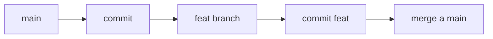
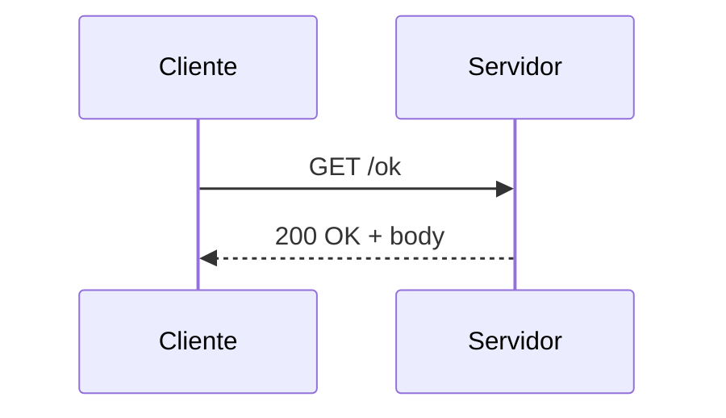

# Módulo 0.4 · Git, terminal, HTTP, JSON, YAML, variables de entorno

Antes de escribir microservicios, necesitas las herramientas transversales: versionar cambios, operar por terminal, entender HTTP, leer/escribir JSON/YAML y configurar por variables de entorno. Son herramientas de piso: si fallan, todo lo de arriba falla.

**Entorno de referencia verificado (2026-05-22):** git, bash/zsh, curl, Node.js v24.18.0, Python 3.x para parseo YAML en ejemplos locales.

## Aprende construyendo

### Tema 1: Git · Básico · 120 min

Caso guía: guardar historia, trabajar en rama y revisar cambios con seguridad.

#### Repositorio y commit

**Definición formal.** Un repositorio Git almacena historial de commits; un commit es un snapshot inmutable referenciado por hash, con padres, autor, fecha y mensaje.

**Para qué sirve.** Trazabilidad, colaboración y reversión.

**Cuándo usarlo / cuándo no.** En todo código/config. No commitees secretos, binarios gigantes innecesarios ni artefactos generados.

**Ejemplo mínimo enfocado (ejecutable).**

```bash
mkdir -p ms3-git
cd ms3-git
git init -q -b main
git config user.name test
git config user.email t@t.local
echo hola > a.txt
git add a.txt
git commit -q -m "init"
git log --oneline | wc -l | tr -d ' '
```

**Error común.** Commits gigantes con mensaje “fix”. Corrección: commit pequeño con intención.

**Verificación (2026-05-22).** `1`.

#### Staging, rama y merge

**Definición formal.** El index/staging selecciona lo que entra al próximo commit. Una rama es un puntero móvil a commits. Merge integra historias.



**Ejemplo mínimo enfocado (ejecutable).**

```bash
cd ms3-git
git checkout -q -b feat
echo v2 > a.txt
git commit -qam "change"
git checkout -q main
git merge -q feat
cat a.txt
```

**Error común.** Trabajar directo en main para todo. Corrección: rama corta, revisión, merge.

**Verificación (2026-05-22).** `v2`.

### Tema 2: Terminal · Básico · 120 min

Caso guía: inspeccionar archivos y componer comandos.

#### Shell, comando y exit code

**Definición formal.** La shell ejecuta comandos como procesos con stdin/stdout/stderr y exit code.

**Ejemplo mínimo enfocado (ejecutable).**

```bash
mkdir -p ms3-sh
cd ms3-sh
echo hi > f.txt
wc -c < f.txt | tr -d ' '
false || echo fallback
```

**Error común.** Ignorar exit code en scripts. Corrección: `set -euo pipefail`.

**Verificación (2026-05-22).** `3`, `fallback`.

#### Pipes y redirección

**Definición formal.** `|` conecta stdout con stdin; `>`, `>>`, `2>` redirigen salida.

**Ejemplo mínimo enfocado (ejecutable).**

```bash
cd ms3-sh
printf "a\nb\na\n" | sort | uniq -c | awk '{print $1,$2}'
```

**Error común.** Sobrescribir archivo con `>` por accidente. Corrección: verificar ruta/destino.

**Verificación (2026-05-22).** `2 a`, `1 b`.

### Tema 3: HTTP · Básico · 120 min

Caso guía: pedir un recurso y entender status.

#### Request/Response

**Definición formal.** HTTP es un protocolo request-response: método, URI, headers, body opcional; respuesta con status, headers, body.



**Ejemplo mínimo enfocado (ejecutable).**

```bash
mkdir -p ms3-http
cd ms3-http
```

Crea el archivo `server.mjs`:

```js
import http from 'node:http';
const s = http.createServer((req, res) => {
  if (req.url === '/ok') { res.writeHead(200, {'Content-Type':'text/plain'}); return res.end('OK'); }
  res.writeHead(404); res.end();
});
s.listen(0, '127.0.0.1', async () => {
  const b = `http://127.0.0.1:${s.address().port}`;
  const r = await fetch(b + '/ok');
  console.log(r.status, await r.text());
  s.close();
});
```

```bash
node server.mjs
```

**Error común.** Usar 200 para errores. Corrección: status semántico.

**Verificación (Node 24.18.0, 2026-05-22).** `200 OK`.

#### Idempotencia y métodos

**Definición formal.** GET/PUT/DELETE son idempotentes en semántica HTTP; POST normalmente no.

**Ejemplo mínimo enfocado (ejecutable).**

```bash
mkdir -p ms3-idem
cd ms3-idem
```

Crea el archivo `idem.mjs`:

```js
const store = new Map();
function put(id, val) { store.set(id, val); return store.get(id); }
console.log(put('a', 1));
console.log(put('a', 1));
```

```bash
node idem.mjs
```

**Error común.** Reintentar POST no idempotente sin idempotency key. Corrección: key de idempotencia.

**Verificación (2026-05-22).** `1`, `1`.

### Tema 4: JSON · Básico · 120 min

Caso guía: intercambiar datos entre servicios.

#### JSON y validación

**Definición formal.** JSON es un formato textual de datos estructurados. Validar es comprobar sintaxis y esquema/tipos.

**Ejemplo mínimo enfocado (ejecutable).**

```bash
mkdir -p ms3-json
cd ms3-json
```

Crea el archivo `json.mjs`:

```js
const s = JSON.stringify({ id: 1, ok: true });
console.log(s);
try { JSON.parse('{bad}'); } catch { console.log('invalid'); }
```

```bash
node json.mjs
```

**Error común.** Confiar en input JSON sin validar. Corrección: schema/validación en borde.

**Verificación (2026-05-22).** `{"id":1,"ok":true}`, `invalid`.

### Tema 5: YAML · Básico · 120 min

Caso guía: configuración declarativa legible.

#### YAML

**Definición formal.** Formato de serialización legible por humanos basado en indentación, mapas y listas.

**Ejemplo mínimo enfocado (ejecutable).**

```bash
mkdir -p ms3-yaml
cd ms3-yaml
```

Crea el archivo `app.yaml`:

```yaml
service:
  port: 8080
  enabled: true
```

```bash
python3 -c "import yaml; d=yaml.safe_load(open('app.yaml')); print(d['service']['port'], d['service']['enabled'])"
```

**Error común.** Indentación con tabs/mezcla. Corrección: espacios consistentes y linter.

**Verificación (2026-05-22).** `8080 True`.

#### YAML seguro

**Definición formal.** Cargar YAML con safe loader evita ejecutar tipos/constructores peligrosos en implementaciones que lo soportan.

**Error común.** Usar loader inseguro con input no confiable. Corrección: `safe_load`.

### Tema 6: Variables de entorno · Básico · 120 min

Caso guía: configurar puerto y secreto sin hardcodear.

#### Variables de entorno

**Definición formal.** Pares clave/valor inyectados por el entorno del proceso en tiempo de ejecución.

**Para qué sirve.** Separar config del código; cambiar comportamiento por entorno.

**Cuándo usarlo / cuándo no.** Para config y secretos (con manejo seguro). No hardcodees secretos en repo.

**Ejemplo mínimo enfocado (ejecutable).**

```bash
mkdir -p ms3-env
cd ms3-env
```

Crea el archivo `env.mjs`:

```js
const port = Number(process.env.PORT ?? 3000);
console.log(port);
```

```bash
PORT=8080 node env.mjs
node env.mjs
```

**Error común.** Asumir que la env var existe. Corrección: default seguro o fail-fast si es obligatoria.

**Verificación (Node 24.18.0, 2026-05-22).** `8080`, `3000`.

#### Secretos y `.env`

**Definición formal.** `.env` es un archivo local de conveniencia para cargar variables; no debe commitearse si contiene secretos.

**Error común.** Commitear `.env` con credenciales. Corrección: `.env.example` sin secretos, secret manager en prod.

## Cierre

Estas herramientas son la base operativa: Git para historia, terminal para operar, HTTP para contrato, JSON/YAML para datos/config, env vars para configuración segura.

## Checklist

- Sé crear commits y ramas.
- Leo exit codes y uso pipes/redirección.
- Entiendo request/response, status e idempotencia.
- Valido JSON/YAML.
- Configuro por env vars y no commiteo secretos.
