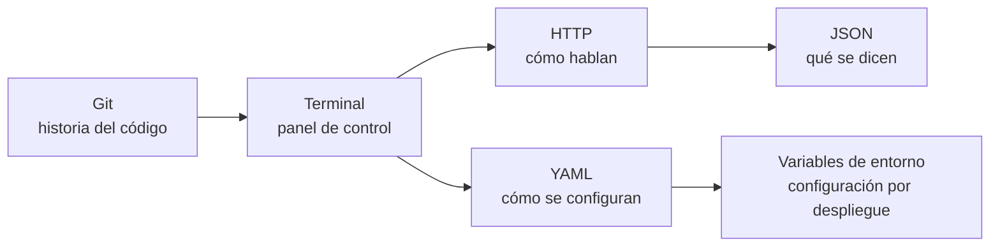
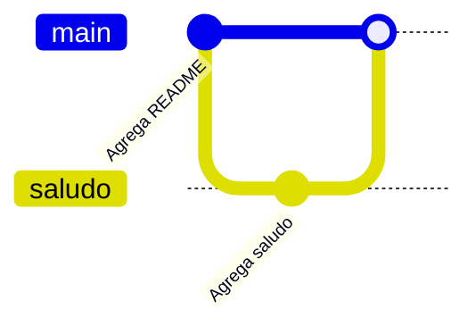
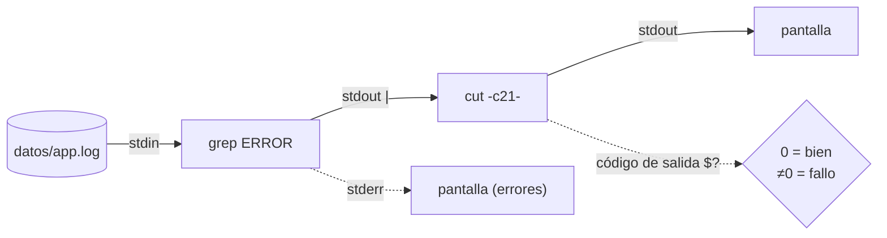
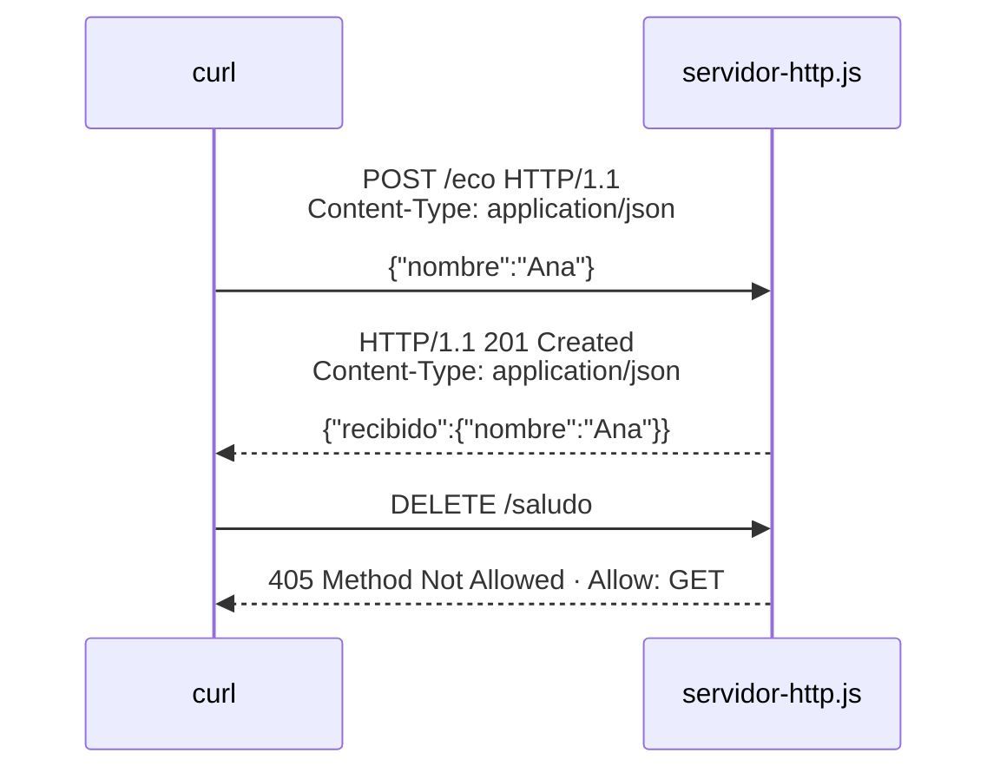
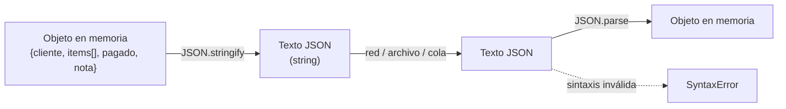
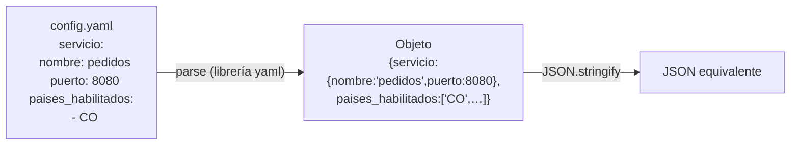
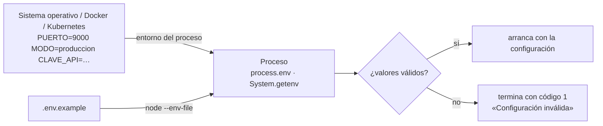

# Módulo 0.4 · Git, terminal, HTTP, JSON, YAML, variables de entorno

**Fase 0 · Fundamentos absolutos** (semanas 2 y 3 de 4). **Duración:** 12 h (6 temas de 2 h). **Dificultad:** 2 de
5. **Dependencias:** Módulos 0.1 a 0.3 (servidor, API, ejecutar Java y Node, leer tests). **Herramientas:** Git
2.4x o posterior (la que traiga tu sistema), bash o zsh, `curl`, **Node.js 26.13.1 LTS**, **JDK 25 LTS** y la
librería npm `yaml` 2.9.1..

Estas seis herramientas aparecen en **cada** microservicio que construyas: Git guarda la historia del código, la
terminal es tu panel de control, HTTP es el idioma con el que hablan los servicios, JSON es el formato de los
mensajes, YAML es el formato de la configuración (Docker Compose, Kubernetes, Spring Boot) y las variables de
entorno son la forma de configurar un servicio sin tocar su código.



**Texto alternativo:** seis cajas conectadas. Git lleva a la terminal; de la terminal salen dos ramas: HTTP, que
lleva a JSON, y YAML, que lleva a variables de entorno.

---


### Git

<details open>
<summary><strong>Capa 1 — Lectura</strong></summary>

#### ► DE QUÉ TRATA
Crear un repositorio, registrar cambios con el ciclo editar → add → commit, crear y unir una rama y leer la historia con git log; lo compruebas cuando git/test-git.sh pasa 4 de 4.

#### ► LA IDEA EN UNA FRASE
**Crear un repositorio, registrar cambios con el ciclo editar → add → commit, crear y unir una rama y leer la historia con git log; lo compruebas cuando git/test-git.sh pasa 4 de 4.**

#### ► POR QUÉ EXISTE ESTO
Git es un programa que guarda la historia de una carpeta: cada vez que lo decides, toma una «foto» de tus archivos y la guarda con un mensaje. Así puedes ver qué cambió, quién y cuándo, y volver atrás si algo se rompe.

#### ► LA ANALOGÍA
Piensa en git como una herramienta de taller: útil cuando conoces su propósito y sus límites.
**Dónde se rompe la analogía:** en software, los efectos dependen del contexto, la escala y los trade-offs.

#### ► CÓMO FUNCIONA


1. **Repositorio:** la carpeta que Git vigila (contiene una carpeta oculta `.git` con toda la historia).
2. **Commit:** una foto guardada con un mensaje.
3. **Staging (`git add`):** elegir qué cambios entran en la próxima foto.
4. **Rama:** una línea de trabajo paralela para probar algo sin tocar la principal (`main`).

#### ► LO QUE PUEDE SALIR MAL
| Síntoma | Causa probable | Arreglo |
|---|---|---|
| Git se aplica pero el resultado no mejora | Se usó sin medir el problema real | Mide antes y compara contra la alternativa simple |
| Aparece complejidad inesperada | Se adoptó la técnica sin comprender sus trade-offs | Vuelve a la sección de trade-offs y reduce el alcance |
| Falla en un caso límite | Se asumió un contexto que no se cumple | Prueba el caso límite y documenta cuándo NO usarlo |

#### ► TRADE-OFFS
| Opción | Cuándo usarla | Cuándo NO usarla |
|---|---|---|
| Usar Git | Cuando el problema coincide con su propósito y el beneficio es observable | Cuando agrega complejidad sin resolver un problema real |
| Alternativa más simple | Cuando el contexto es pequeño, estable o fácil de razonar | Cuando ya demostró no escalar o no cumplir el requisito |
| Postergar la decisión | Cuando falta evidencia del problema | Cuando el costo de esperar es mayor que el costo de probar |

#### ► CUÁNDO NO USAR ESTO
Commits gigantes con mensajes vacíos de significado:

#### ► DE VUELTA A LA ANALOGÍA
Volviendo a la analogía: git funciona como el modelo inicial, pero recuerda dónde se rompe: en producción importan la evidencia, la escala y el costo de equivocarte.

#### ► LO QUE DEBES RECORDAR
- **Repositorio:** la carpeta que Git vigila (contiene una carpeta oculta `.git` con toda la historia).
- **Commit:** una foto guardada con un mensaje.
- **Staging (`git add`):** elegir qué cambios entran en la próxima foto.
- **Rama:** una línea de trabajo paralela para probar algo sin tocar la principal (`main`).

#### ► PREGUNTAS PARA PENSAR
1. ¿Qué problema concreto resuelve git en tu contexto?
2. ¿Cómo sabrías que git no está funcionando bien?
3. ¿Qué alternativa más simple considerarías antes de usar git?

</details>

<details>
<summary><strong>Capa 2 — Construcción</strong></summary>

#### Código y verificación


```bash
#!/usr/bin/env bash
# Módulo 0.4 · Git: crea un repositorio de práctica y recorre el ciclo editar -> preparar -> confirmar.
# Requisitos: Git 2.4x o posterior, la que traiga tu sistema (mínimo 2.28, que añadió `git init -b`). Probado con 2.43.0.
# Uso: ./practica.sh [carpeta]   (por defecto crea una carpeta nueva en /tmp)
set -euo pipefail
DIR="${1:-$(mktemp -d /tmp/practica-git.XXXX)}"
mkdir -p "$DIR" && cd "$DIR"

git init -q -b main                                  # 1. crea el repositorio (la carpeta oculta .git)
git config user.name "Estudiante"                     #    identidad SOLO para este repositorio
git config user.email "estudiante@example.com"

echo "# Mi primer repositorio" > README.md            # 2. editar
git status --short                                    #    ?? = archivo nuevo que Git aún no sigue
git add README.md                                     # 3. preparar (staging)
git commit -q -m "Agrega README"                      # 4. confirmar: una foto del proyecto

git switch -q -c saludo                               # 5. rama: una línea de trabajo paralela
echo "Hola, Git" > saludo.txt
git add saludo.txt && git commit -q -m "Agrega saludo"
git switch -q main
git merge -q saludo                                   # 6. unir la rama a main

echo "== Historia (del más nuevo al más viejo)"
git log --format='%s'
echo "== Ramas"
git branch --format='%(refname:short)'
echo "== Archivos en la última foto"
git ls-files
echo "Repositorio en: $DIR"
```

```bash
   ./git/practica.sh /tmp/mi-primer-repo
   ```

```bash
   cd /tmp/mi-primer-repo
   git log --oneline --graph --all
   ls -a
   ```

```bash
   echo "cambio" >> README.md
   git commit -m "Intento sin add"
   ```

```text
?? README.md
== Historia (del más nuevo al más viejo)
Agrega saludo
Agrega README
== Ramas
main
saludo
== Archivos en la última foto
README.md
saludo.txt
Repositorio en: /tmp/mi-primer-repo
```

</details>

### Terminal

<details open>
<summary><strong>Capa 1 — Lectura</strong></summary>

#### ► DE QUÉ TRATA
Navegar carpetas, inspeccionar archivos, combinar comandos con tuberías (|) y redirecciones (>, 2>) e interpretar códigos de salida en un guion que analiza un log; lo compruebas cuando terminal/test-terminal.sh pasa 4 de 4.

#### ► LA IDEA EN UNA FRASE
**Navegar carpetas, inspeccionar archivos, combinar comandos con tuberías (|) y redirecciones (>, 2>) e interpretar códigos de salida en un guion que analiza un log; lo compruebas cuando terminal/test-terminal.sh pasa 4 de 4.**

#### ► POR QUÉ EXISTE ESTO
La terminal es una ventana donde escribes órdenes en texto en lugar de hacer clic. El programa que las interpreta se llama shell (bash o zsh). Todo lo que hagas con microservicios (arrancar contenedores, leer logs, desplegar) se hace aquí, porque los servidores no tienen pantalla ni ratón.

#### ► LA ANALOGÍA
Piensa en terminal como una herramienta de taller: útil cuando conoces su propósito y sus límites.
**Dónde se rompe la analogía:** en software, los efectos dependen del contexto, la escala y los trade-offs.

#### ► CÓMO FUNCIONA


| Comando | Qué hace | Ejemplo |
|---|---|---|
| `pwd` | dónde estoy | `/Users/ana/curso` |
| `ls` | qué hay aquí | `ls -l datos` |
| `cd` | moverme de carpeta | `cd terminal`, `cd ..` (subir) |
| `mkdir` | crear carpeta | `mkdir logs` |
| `cat` | mostrar un archivo | `cat datos/app.log` |
| `grep` | buscar líneas con un texto | `grep ERROR datos/app.log` |
| `wc -l` | contar líneas | `wc -l datos/app.log` |
| `echo` | escribir un texto | `echo hola > saludo.txt` |

#### ► LO QUE PUEDE SALIR MAL
| Síntoma | Causa probable | Arreglo |
|---|---|---|
| Terminal se aplica pero el resultado no mejora | Se usó sin medir el problema real | Mide antes y compara contra la alternativa simple |
| Aparece complejidad inesperada | Se adoptó la técnica sin comprender sus trade-offs | Vuelve a la sección de trade-offs y reduce el alcance |
| Falla en un caso límite | Se asumió un contexto que no se cumple | Prueba el caso límite y documenta cuándo NO usarlo |

#### ► TRADE-OFFS
| Opción | Cuándo usarla | Cuándo NO usarla |
|---|---|---|
| Usar Terminal | Cuando el problema coincide con su propósito y el beneficio es observable | Cuando agrega complejidad sin resolver un problema real |
| Alternativa más simple | Cuando el contexto es pequeño, estable o fácil de razonar | Cuando ya demostró no escalar o no cumplir el requisito |
| Postergar la decisión | Cuando falta evidencia del problema | Cuando el costo de esperar es mayor que el costo de probar |

#### ► CUÁNDO NO USAR ESTO
Copiar y pegar comandos de internet que se ejecutan con privilegios sin leerlos:

#### ► DE VUELTA A LA ANALOGÍA
Volviendo a la analogía: terminal funciona como el modelo inicial, pero recuerda dónde se rompe: en producción importan la evidencia, la escala y el costo de equivocarte.

#### ► LO QUE DEBES RECORDAR
- La terminal es una ventana donde escribes órdenes en texto en lugar de hacer clic.
- El programa que las interpreta se llama shell (bash o zsh).
- Todo lo que hagas con microservicios (arrancar contenedores, leer logs, desplegar) se hace aquí, porque los servidores no tienen pantalla ni ratón.

#### ► PREGUNTAS PARA PENSAR
1. ¿Qué problema concreto resuelve terminal en tu contexto?
2. ¿Cómo sabrías que terminal no está funcionando bien?
3. ¿Qué alternativa más simple considerarías antes de usar terminal?

</details>

<details>
<summary><strong>Capa 2 — Construcción</strong></summary>

#### Código y verificación


```bash
#!/usr/bin/env bash
# Módulo 0.4 · Terminal: cuenta las líneas ERROR de un log y muestra cuáles son.
# Requisitos: bash 3.2+ (el de macOS sirve) y grep. Sin otras dependencias.
# Uso: ./contar-errores.sh datos/app.log
set -euo pipefail
ARCHIVO="${1:?Uso: $0 ARCHIVO_DE_LOG}"     # ${1:?...} = si falta el argumento, error con este mensaje
if [ ! -f "$ARCHIVO" ]; then
  echo "No existe el archivo: $ARCHIVO" >&2  # >&2 = escribir en la salida de errores
  exit 2                                     # código de salida distinto de 0 = algo falló
fi
TOTAL=$(grep -c "ERROR" "$ARCHIVO" || true) # $( ) = guarda la salida de un comando en una variable
echo "Errores encontrados: $TOTAL"
grep "ERROR" "$ARCHIVO" | cut -c21- || true  # tubería |: la salida de grep entra a cut (quita la fecha)
```

```bash
   pwd
   ls datos
   cat datos/app.log
   ```

```bash
   grep ERROR datos/app.log | wc -l
   grep -c INFO datos/app.log
   ```

```bash
   ./contar-errores.sh datos/app.log; echo "código: $?"
   ./contar-errores.sh; echo "código: $?"
   ./contar-errores.sh no-existe.log; echo "código: $?"
   ```

```text
Errores encontrados: 2
ERROR no hay conexión con la base de datos
ERROR tiempo de espera agotado en /api/pedidos
código: 0
./contar-errores.sh: line 6: 1: Uso: ./contar-errores.sh ARCHIVO_DE_LOG
código: 1
No existe el archivo: no-existe.log
código: 2
```

</details>

### HTTP

<details open>
<summary><strong>Capa 1 — Lectura</strong></summary>

#### ► DE QUÉ TRATA
Identificar las partes de un mensaje HTTP (línea de petición, cabeceras, cuerpo, código de estado), provocar respuestas 200, 201, 400, 404, 405 y 415 con curl y elegir el código correcto para cada situación; lo compruebas cuando http/servidor-http.test.js pasa 6 de 6.

#### ► LA IDEA EN UNA FRASE
**Identificar las partes de un mensaje HTTP (línea de petición, cabeceras, cuerpo, código de estado), provocar respuestas 200, 201, 400, 404, 405 y 415 con curl y elegir el código correcto para cada situación; lo compruebas cuando http/servidor-http.test.js pasa 6 de 6.**

#### ► POR QUÉ EXISTE ESTO
HTTP es el idioma con el que hablan los navegadores, las apps y los microservicios. Siempre es una conversación de dos turnos: el cliente envía una petición y el servidor contesta con una respuesta.

#### ► LA ANALOGÍA
Piensa en http como una herramienta de taller: útil cuando conoces su propósito y sus límites.
**Dónde se rompe la analogía:** en software, los efectos dependen del contexto, la escala y los trade-offs.

#### ► CÓMO FUNCIONA


| Grupo | Significado | Ejemplos |
|---|---|---|
| 2xx | éxito | 200 OK, 201 Created |
| 3xx | ve a otro lado | 301, 304 |
| 4xx | **tú** (el cliente) pediste mal | 400, 404, 405, 415 |
| 5xx | **yo** (el servidor) fallé | 500, 503 |

#### ► LO QUE PUEDE SALIR MAL
| Síntoma | Causa probable | Arreglo |
|---|---|---|
| HTTP se aplica pero el resultado no mejora | Se usó sin medir el problema real | Mide antes y compara contra la alternativa simple |
| Aparece complejidad inesperada | Se adoptó la técnica sin comprender sus trade-offs | Vuelve a la sección de trade-offs y reduce el alcance |
| Falla en un caso límite | Se asumió un contexto que no se cumple | Prueba el caso límite y documenta cuándo NO usarlo |

#### ► TRADE-OFFS
| Opción | Cuándo usarla | Cuándo NO usarla |
|---|---|---|
| Usar HTTP | Cuando el problema coincide con su propósito y el beneficio es observable | Cuando agrega complejidad sin resolver un problema real |
| Alternativa más simple | Cuando el contexto es pequeño, estable o fácil de razonar | Cuando ya demostró no escalar o no cumplir el requisito |
| Postergar la decisión | Cuando falta evidencia del problema | Cuando el costo de esperar es mayor que el costo de probar |

#### ► CUÁNDO NO USAR ESTO
«Todo es POST y todo responde 200» (RPC disfrazado de REST):

#### ► DE VUELTA A LA ANALOGÍA
Volviendo a la analogía: http funciona como el modelo inicial, pero recuerda dónde se rompe: en producción importan la evidencia, la escala y el costo de equivocarte.

#### ► LO QUE DEBES RECORDAR
- HTTP es el idioma con el que hablan los navegadores, las apps y los microservicios.
- Siempre es una conversación de dos turnos: el cliente envía una petición y el servidor contesta con una respuesta.

#### ► PREGUNTAS PARA PENSAR
1. ¿Qué problema concreto resuelve http en tu contexto?
2. ¿Cómo sabrías que http no está funcionando bien?
3. ¿Qué alternativa más simple considerarías antes de usar http?

</details>

<details>
<summary><strong>Capa 2 — Construcción</strong></summary>

#### Código y verificación


```json
{
  "name": "modulo-0-4-herramientas",
  "version": "1.0.0",
  "private": true,
  "type": "module",
  "engines": { "node": ">=26.13.1" },
  "scripts": { "test": "node --test" },
  "dependencies": { "yaml": "2.9.1" }
}
```

```javascript
// Módulo 0.4 · HTTP: un servidor que muestra las piezas de HTTP (método, ruta, cabeceras, estado, cuerpo).
// Requisitos: Node.js 26.13.1 LTS (funciona desde Node 22). Usa solo 'node:http'.
// Ejecuta: node http/servidor-http.js   y en otra terminal:  curl -i http://localhost:3002/saludo

import http from 'node:http';

export function crearServidor() {
  return http.createServer(async (req, res) => {
    // LÍNEA DE PETICIÓN: método + ruta.  CABECERAS: req.headers (en minúsculas).
    const idioma = req.headers['accept-language']?.startsWith('en') ? 'en' : 'es';

    if (req.url === '/saludo') {
      if (req.method !== 'GET') {
        // 405: la ruta existe, pero no acepta ese método. La cabecera Allow dice cuáles sí.
        res.writeHead(405, { Allow: 'GET', 'Content-Type': 'text/plain; charset=utf-8' });
        return res.end('Método no permitido\n');
      }
      res.writeHead(200, { 'Content-Type': 'text/plain; charset=utf-8', 'X-Curso': 'microservicios' });
      return res.end(idioma === 'en' ? 'Hello\n' : 'Hola\n');
    }

    if (req.url === '/eco' && req.method === 'POST') {
      let cuerpo = '';
      for await (const trozo of req) cuerpo += trozo;
      if (!req.headers['content-type']?.startsWith('application/json')) {
        res.writeHead(415, { 'Content-Type': 'text/plain; charset=utf-8' }); // 415: formato no soportado
        return res.end('Envía Content-Type: application/json\n');
      }
      let datos;
      try {
        datos = JSON.parse(cuerpo);
      } catch {
        res.writeHead(400, { 'Content-Type': 'text/plain; charset=utf-8' }); // 400: petición mal formada
        return res.end('El cuerpo no es JSON válido\n');
      }
      res.writeHead(201, { 'Content-Type': 'application/json' }); // 201: se creó algo
      return res.end(JSON.stringify({ recibido: datos }));
    }

    res.writeHead(404, { 'Content-Type': 'text/plain; charset=utf-8' }); // 404: no existe
    res.end('No encontrado\n');
  });
}

if (import.meta.main) {
  const puerto = Number(process.env.PORT ?? 3002);
  crearServidor().listen(puerto, () => console.log(`HTTP de práctica en http://localhost:${puerto}`));
}
```

```bash
   curl -i http://localhost:3002/saludo
   curl -i -X DELETE http://localhost:3002/saludo
   curl -i -X POST http://localhost:3002/eco -H 'Content-Type: application/json' -d '{"nombre":"Ana"}'
   ```

```bash
   curl -s -H 'Accept-Language: en' http://localhost:3002/saludo
   curl -s -X POST http://localhost:3002/eco -d 'nombre=Ana' -w '[%{http_code}]\n'
   curl -s -X POST http://localhost:3002/eco -H 'Content-Type: application/json' -d "{'nombre':'Ana'}" -w '[%{http_code}]\n'
   curl -s -o /dev/null -w '%{http_code}\n' http://localhost:3002/nada
   ```

```text
HTTP/1.1 200 OK
Content-Type: text/plain; charset=utf-8
X-Curso: microservicios
Date: Fri, 20 Nov 2026 01:57:39 GMT
Connection: keep-alive
Keep-Alive: timeout=5
Transfer-Encoding: chunked

Hola
HTTP/1.1 405 Method Not Allowed
Allow: GET
Content-Type: text/plain; charset=utf-8
…
Método no permitido
HTTP/1.1 201 Created
Content-Type: application/json
…
{"recibido":{"nombre":"Ana"}}
```

</details>

### JSON

<details open>
<summary><strong>Capa 1 — Lectura</strong></summary>

#### ► DE QUÉ TRATA
Convertir texto JSON en datos (JSON.parse) y datos en texto (JSON.stringify), reconocer los seis tipos de JSON y diagnosticar los errores de sintaxis más frecuentes; lo compruebas cuando json/json.test.js pasa 4 de 4.

#### ► LA IDEA EN UNA FRASE
**Convertir texto JSON en datos (JSON.parse) y datos en texto (JSON.stringify), reconocer los seis tipos de JSON y diagnosticar los errores de sintaxis más frecuentes; lo compruebas cuando json/json.test.js pasa 4 de 4.**

#### ► POR QUÉ EXISTE ESTO
JSON (*JavaScript Object Notation*) es una forma de escribir datos como texto para que dos programas (aunque estén en lenguajes distintos, como Java y Node) se entiendan. Es el formato que usarán casi todas las APIs del curso.

#### ► LA ANALOGÍA
Piensa en json como una herramienta de taller: útil cuando conoces su propósito y sus límites.
**Dónde se rompe la analogía:** en software, los efectos dependen del contexto, la escala y los trade-offs.

#### ► CÓMO FUNCIONA


| Tipo | Ejemplo |
|---|---|
| texto (*string*) | `"Ana"` (siempre comillas **dobles**) |
| número | `2`, `4500.5` |
| booleano | `true`, `false` |
| nulo | `null` |
| objeto | `{"clave": valor, ...}` |
| lista (*array*) | `[valor, valor]` |

#### ► LO QUE PUEDE SALIR MAL
| Síntoma | Causa probable | Arreglo |
|---|---|---|
| JSON se aplica pero el resultado no mejora | Se usó sin medir el problema real | Mide antes y compara contra la alternativa simple |
| Aparece complejidad inesperada | Se adoptó la técnica sin comprender sus trade-offs | Vuelve a la sección de trade-offs y reduce el alcance |
| Falla en un caso límite | Se asumió un contexto que no se cumple | Prueba el caso límite y documenta cuándo NO usarlo |

#### ► TRADE-OFFS
| Opción | Cuándo usarla | Cuándo NO usarla |
|---|---|---|
| Usar JSON | Cuando el problema coincide con su propósito y el beneficio es observable | Cuando agrega complejidad sin resolver un problema real |
| Alternativa más simple | Cuando el contexto es pequeño, estable o fácil de razonar | Cuando ya demostró no escalar o no cumplir el requisito |
| Postergar la decisión | Cuando falta evidencia del problema | Cuando el costo de esperar es mayor que el costo de probar |

#### ► CUÁNDO NO USAR ESTO
Construir JSON concatenando textos a mano:

#### ► DE VUELTA A LA ANALOGÍA
Volviendo a la analogía: json funciona como el modelo inicial, pero recuerda dónde se rompe: en producción importan la evidencia, la escala y el costo de equivocarte.

#### ► LO QUE DEBES RECORDAR
- JSON (*JavaScript Object Notation*) es una forma de escribir datos como texto para que dos programas (aunque estén en lenguajes distintos, como Java y Node) se entiendan.
- Es el formato que usarán casi todas las APIs del curso.

#### ► PREGUNTAS PARA PENSAR
1. ¿Qué problema concreto resuelve json en tu contexto?
2. ¿Cómo sabrías que json no está funcionando bien?
3. ¿Qué alternativa más simple considerarías antes de usar json?

</details>

<details>
<summary><strong>Capa 2 — Construcción</strong></summary>

#### Código y verificación


```javascript
// Módulo 0.4 · JSON: convertir texto JSON en datos (parse) y datos en texto JSON (stringify).
// Requisitos: Node.js 26.13.1 LTS (funciona desde Node 22). JSON viene incluido en JavaScript.
// Ejecuta: node json/json.js

// Así llega un pedido por la red: es TEXTO, aunque parezca un objeto.
const texto = '{"cliente":"Ana","items":[{"plato":"Arepa","cantidad":2}],"pagado":false,"nota":null}';

// parse: texto -> datos que el programa puede usar
export function leerPedido(textoJson) {
  try {
    return { ok: true, datos: JSON.parse(textoJson) };
  } catch (e) {
    return { ok: false, error: e.message };
  }
}

// stringify: datos -> texto para enviar o guardar (con sangría de 2 espacios para leerlo)
export function escribirPedido(pedido) {
  return JSON.stringify(pedido, null, 2);
}

if (import.meta.main) {
  const { datos } = leerPedido(texto);
  console.log(`typeof texto = ${typeof texto}, typeof datos = ${typeof datos}`);
  console.log(`Cliente: ${datos.cliente}, primer plato: ${datos.items[0].plato} x${datos.items[0].cantidad}`);
  datos.pagado = true;
  console.log(escribirPedido(datos));
  // JSON inválido: comillas simples y coma final NO están permitidas en JSON.
  console.log(leerPedido("{'cliente':'Ana',}"));
}
```

```bash
   node json/json.js
   ```

```bash
   node -e "console.log(JSON.parse('{\"id\": 9007199254740993}').id)"
   ```

```bash
   echo '{"platoId":2,"cantidad":3}' > /tmp/pedido.json
   node -e "JSON.parse(require('fs').readFileSync('/tmp/pedido.json','utf8')); console.log('JSON válido')"
   ```

```text
typeof texto = string, typeof datos = object
Cliente: Ana, primer plato: Arepa x2
{
  "cliente": "Ana",
  "items": [
    {
      "plato": "Arepa",
      "cantidad": 2
    }
  ],
  "pagado": true,
  "nota": null
}
{
  ok: false,
  error: "Expected property name or '}' in JSON at position 1 (line 1 column 2)"
}
```

</details>

### YAML

<details open>
<summary><strong>Capa 1 — Lectura</strong></summary>

#### ► DE QUÉ TRATA
Leer un archivo de configuración YAML, traducirlo mentalmente a su JSON equivalente y evitar los dos errores clásicos (tabulaciones en la sangría y valores que YAML convierte de tipo sin avisar); lo compruebas cuando yaml/leer-config.test.js pasa 5 de 5.

#### ► LA IDEA EN UNA FRASE
**Leer un archivo de configuración YAML, traducirlo mentalmente a su JSON equivalente y evitar los dos errores clásicos (tabulaciones en la sangría y valores que YAML convierte de tipo sin avisar); lo compruebas cuando yaml/leer-config.test.js pasa 5 de 5.**

#### ► POR QUÉ EXISTE ESTO
YAML es otro formato de texto para datos, pensado para que personas lo escriban y lean con comodidad. Lo encontrarás en archivos de configuración: Docker Compose (docker-compose.yml), Kubernetes, GitHub Actions y Spring Boot (application.yml).

#### ► LA ANALOGÍA
Piensa en yaml como una herramienta de taller: útil cuando conoces su propósito y sus límites.
**Dónde se rompe la analogía:** en software, los efectos dependen del contexto, la escala y los trade-offs.

#### ► CÓMO FUNCIONA


1. `clave: valor` en cada línea;
2. la **sangría** (espacios al inicio) indica qué está dentro de qué;
3. un **guion** `-` inicia cada elemento de una lista;
4. `#` empieza un **comentario** (JSON no los tiene).

#### ► LO QUE PUEDE SALIR MAL
| Síntoma | Causa probable | Arreglo |
|---|---|---|
| YAML se aplica pero el resultado no mejora | Se usó sin medir el problema real | Mide antes y compara contra la alternativa simple |
| Aparece complejidad inesperada | Se adoptó la técnica sin comprender sus trade-offs | Vuelve a la sección de trade-offs y reduce el alcance |
| Falla en un caso límite | Se asumió un contexto que no se cumple | Prueba el caso límite y documenta cuándo NO usarlo |

#### ► TRADE-OFFS
| Opción | Cuándo usarla | Cuándo NO usarla |
|---|---|---|
| Usar YAML | Cuando el problema coincide con su propósito y el beneficio es observable | Cuando agrega complejidad sin resolver un problema real |
| Alternativa más simple | Cuando el contexto es pequeño, estable o fácil de razonar | Cuando ya demostró no escalar o no cumplir el requisito |
| Postergar la decisión | Cuando falta evidencia del problema | Cuando el costo de esperar es mayor que el costo de probar |

#### ► CUÁNDO NO USAR ESTO
Copiar y pegar bloques YAML idénticos entre entornos y servicios:

#### ► DE VUELTA A LA ANALOGÍA
Volviendo a la analogía: yaml funciona como el modelo inicial, pero recuerda dónde se rompe: en producción importan la evidencia, la escala y el costo de equivocarte.

#### ► LO QUE DEBES RECORDAR
- `clave: valor` en cada línea;
- la **sangría** (espacios al inicio) indica qué está dentro de qué;
- un **guion** `-` inicia cada elemento de una lista;
- `#` empieza un **comentario** (JSON no los tiene).

#### ► PREGUNTAS PARA PENSAR
1. ¿Qué problema concreto resuelve yaml en tu contexto?
2. ¿Cómo sabrías que yaml no está funcionando bien?
3. ¿Qué alternativa más simple considerarías antes de usar yaml?

</details>

<details>
<summary><strong>Capa 2 — Construcción</strong></summary>

#### Código y verificación


```yaml
# Módulo 0.4 · YAML: configuración de un servicio. Los espacios de la izquierda SON la estructura.
# Regla: sangría con ESPACIOS (nunca tabulaciones). Un "-" inicia un elemento de lista.
servicio:
  nombre: pedidos
  puerto: 8080
  depuracion: false
base_de_datos:
  url: "postgres://localhost:5432/pedidos"
  pool: 10
paises_habilitados:
  - CO
  - MX
  - "NO"   # entre comillas: así siempre es el texto "NO" (Noruega), en cualquier versión de YAML
```

```javascript
// Módulo 0.4 · YAML: leer un archivo de configuración YAML y usarlo como datos.
// Requisitos: Node.js 26.13.1 LTS y la librería yaml 2.9.1 (npm install, ver package.json).
// Ejecuta (desde la carpeta yaml/):  npm install && node leer-config.js

import { readFileSync } from 'node:fs';
import { parse } from 'yaml';

export function leerConfig(textoYaml) {
  return parse(textoYaml);
}

if (import.meta.main) {
  const config = leerConfig(readFileSync(new URL('./config.yaml', import.meta.url), 'utf8'));
  console.log(`Servicio: ${config.servicio.nombre} en el puerto ${config.servicio.puerto} (tipo ${typeof config.servicio.puerto})`);
  console.log(`Depuración: ${config.servicio.depuracion} (tipo ${typeof config.servicio.depuracion})`);
  console.log(`Países: ${config.paises_habilitados.join(', ')}`);
  console.log('Mismo contenido en JSON:', JSON.stringify(config));
}
```

```bash
   npm install
   cd yaml
   node leer-config.js
   ```

```bash
   printf 'servicio:\n\tnombre: pedidos\n' > /tmp/tab.yaml
   node -e "import('yaml').then(y => { try { y.parse(require('fs').readFileSync('/tmp/tab.yaml','utf8')) } catch (e) { console.log(e.name + ': ' + e.message) } })"
   ```

```bash
   node -e "import('yaml').then(y => console.log(y.parse('pais: NO'), y.parse('pais: NO', { version: '1.1' })))"
   ```

</details>

### Variables de entorno

<details open>
<summary><strong>Capa 1 — Lectura</strong></summary>

#### ► DE QUÉ TRATA
Configurar un programa en Node.js y en Java con variables de entorno, cargar valores desde un archivo con node --env-file y validar la configuración al arrancar para fallar rápido; lo compruebas cuando env/config.test.js pasa 5 de 5 y java ConfigTest.java pasa 3 de 3.

#### ► LA IDEA EN UNA FRASE
**Configurar un programa en Node.js y en Java con variables de entorno, cargar valores desde un archivo con node --env-file y validar la configuración al arrancar para fallar rápido; lo compruebas cuando env/config.test.js pasa 5 de 5 y java ConfigTest.java pasa 3 de 3.**

#### ► POR QUÉ EXISTE ESTO
Una variable de entorno es un par NOMBRE=valor que el sistema operativo le entrega a cada programa al arrancarlo. Sirven para configurar un programa sin cambiar su código: en tu computador el servicio usa el puerto 8080 y una base de datos de prueba; en producción, otro puerto y la base real. El código es el mismo; solo cambia el entorno.

#### ► LA ANALOGÍA
Piensa en variables de entorno como una herramienta de taller: útil cuando conoces su propósito y sus límites.
**Dónde se rompe la analogía:** en software, los efectos dependen del contexto, la escala y los trade-offs.

#### ► CÓMO FUNCIONA


1. `PUERTO=9000 node config.js` define la variable **solo para ese comando**;
2. `export PUERTO=9000` la define para todos los comandos siguientes de esa terminal;
3. `echo $PUERTO` muestra su valor.

#### ► LO QUE PUEDE SALIR MAL
| Síntoma | Causa probable | Arreglo |
|---|---|---|
| Variables de entorno se aplica pero el resultado no mejora | Se usó sin medir el problema real | Mide antes y compara contra la alternativa simple |
| Aparece complejidad inesperada | Se adoptó la técnica sin comprender sus trade-offs | Vuelve a la sección de trade-offs y reduce el alcance |
| Falla en un caso límite | Se asumió un contexto que no se cumple | Prueba el caso límite y documenta cuándo NO usarlo |

#### ► TRADE-OFFS
| Opción | Cuándo usarla | Cuándo NO usarla |
|---|---|---|
| Usar Variables de entorno | Cuando el problema coincide con su propósito y el beneficio es observable | Cuando agrega complejidad sin resolver un problema real |
| Alternativa más simple | Cuando el contexto es pequeño, estable o fácil de razonar | Cuando ya demostró no escalar o no cumplir el requisito |
| Postergar la decisión | Cuando falta evidencia del problema | Cuando el costo de esperar es mayor que el costo de probar |

#### ► CUÁNDO NO USAR ESTO
Configuración y secretos «quemados» en el código o en la imagen:

#### ► DE VUELTA A LA ANALOGÍA
Volviendo a la analogía: variables de entorno funciona como el modelo inicial, pero recuerda dónde se rompe: en producción importan la evidencia, la escala y el costo de equivocarte.

#### ► LO QUE DEBES RECORDAR
- `PUERTO=9000 node config.js` define la variable **solo para ese comando**;
- `export PUERTO=9000` la define para todos los comandos siguientes de esa terminal;
- `echo $PUERTO` muestra su valor.

#### ► PREGUNTAS PARA PENSAR
1. ¿Qué problema concreto resuelve variables de entorno en tu contexto?
2. ¿Cómo sabrías que variables de entorno no está funcionando bien?
3. ¿Qué alternativa más simple considerarías antes de usar variables de entorno?

</details>

<details>
<summary><strong>Capa 2 — Construcción</strong></summary>

#### Código de referencia / ejecutable
Versiones: **Node.js 26.13.1 LTS** (`--env-file` desde Node 20.6) y **JDK 25 LTS**. Sin dependencias.
`config.js`:

```javascript
// Módulo 0.4 · Variables de entorno: la configuración llega DESDE FUERA del código.
// Requisitos: Node.js 26.13.1 LTS (--env-file existe desde Node 20.6). Sin dependencias.
// Ejecuta (desde la carpeta env/):
//   node config.js                              -> usa los valores por defecto
//   PUERTO=9000 MODO=produccion node config.js   -> los define solo para este comando
//   node --env-file=.env.example config.js      -> los lee de un archivo

export function leerConfig(env) {
  const puerto = Number(env.PUERTO ?? 8080); // ?? = "si no existe, usa esto"
  if (!Number.isInteger(puerto) || puerto < 1 || puerto > 65535) {
    throw new Error(`PUERTO inválido: "${env.PUERTO}"`); // fallar al arrancar, no a medianoche
  }
  const modo = env.MODO ?? 'desarrollo';
  if (!['desarrollo', 'produccion'].includes(modo)) {
    throw new Error(`MODO inválido: "${modo}" (usa desarrollo o produccion)`);
  }
  // Un secreto nunca tiene valor por defecto y nunca se imprime completo.
  const claveApi = env.CLAVE_API;
  if (modo === 'produccion' && !claveApi) {
    throw new Error('En produccion CLAVE_API es obligatoria');
  }
  return { puerto, modo, claveApi };
}

if (import.meta.main) {
  try {
    const c = leerConfig(process.env);
    console.log(`puerto=${c.puerto} modo=${c.modo} claveApi=${c.claveApi ? c.claveApi.slice(0, 3) + '***' : '(sin definir)'}`);
  } catch (e) {
    console.error(`Configuración inválida: ${e.message}`);
    process.exit(1);
  }
}
```

`.env.example` (valores falsos, para practicar):

```bash
# Archivo de ejemplo: valores FALSOS para practicar. El .env real nunca se sube a Git.
PUERTO=8081
MODO=produccion
CLAVE_API=abc123-falsa
```

`Config.java`:

```java
// Módulo 0.4 · Variables de entorno en Java: System.getenv lee el entorno del proceso.
// Requisitos: JDK 25 LTS (funciona desde JDK 11 con `java Config.java`). Sin dependencias.
// Ejecuta (desde la carpeta env/):
//   java Config.java
//   PUERTO=9000 java Config.java

public class Config {
    public static void main(String[] args) {
        // getenv devuelve null si la variable no existe; Objects.requireNonNullElse pone el valor por defecto.
        String textoPuerto = java.util.Objects.requireNonNullElse(System.getenv("PUERTO"), "8080");
        String modo = java.util.Objects.requireNonNullElse(System.getenv("MODO"), "desarrollo");
        int puerto;
        try {
            puerto = Integer.parseInt(textoPuerto);
        } catch (NumberFormatException e) {
            System.err.println("Configuración inválida: PUERTO inválido: \"" + textoPuerto + "\"");
            System.exit(1);
            return;
        }
        System.out.println("puerto=" + puerto + " modo=" + modo);
    }
}
```

</details>
