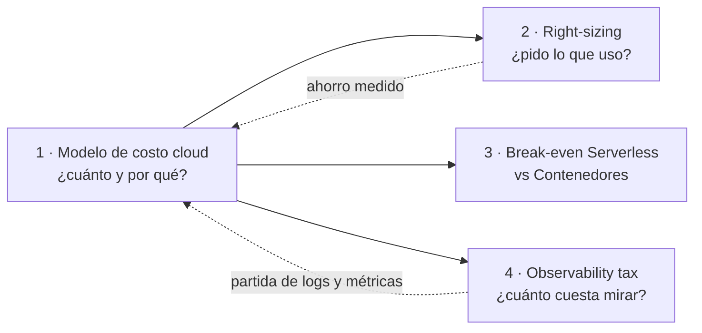
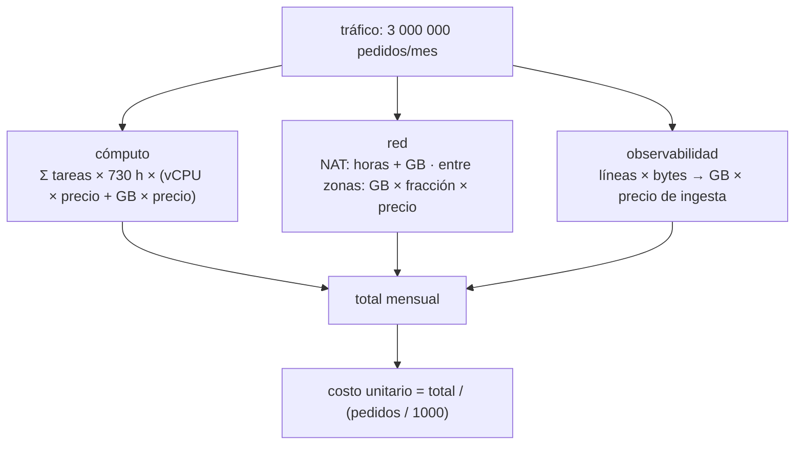
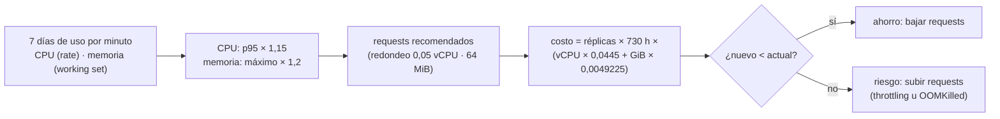
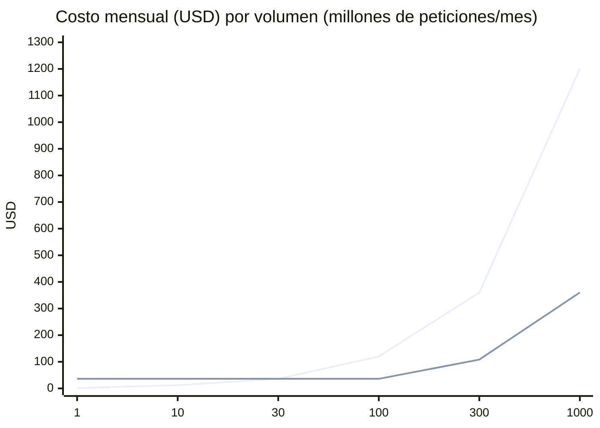
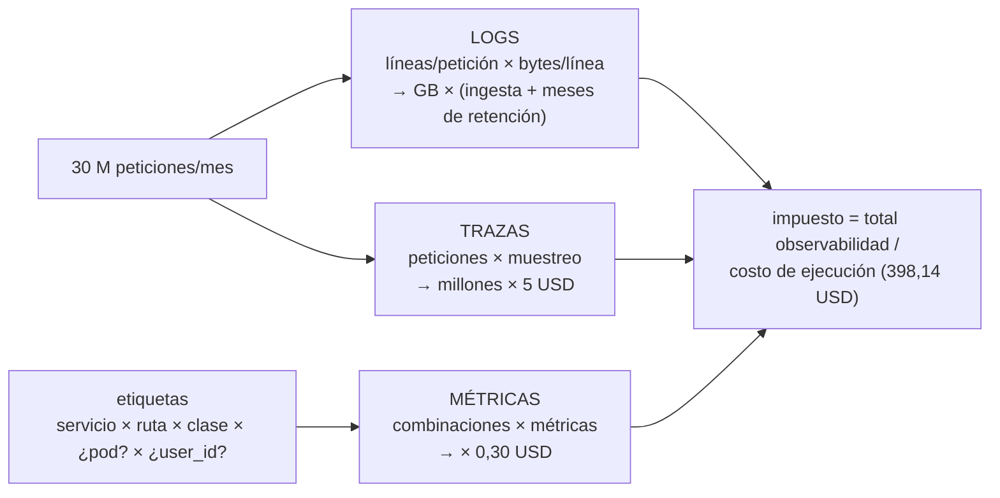

# Módulo 28 · FinOps y costo de arquitectura

**Fase 3 · Nivel maestro: arquitectura avanzada** (media semana de 8). **Duración:** 6 h (4 temas de unos 75 min y 1 h
de laboratorio integrador). **Dificultad:** 4 de 5. **Dependencias:** Módulo 12 o 23 (Kubernetes: requests, limits,
HPA), Módulo 10 o 21 (observabilidad: logs, métricas y trazas) y Módulo 27 (la malla, que también cuesta). Viene bien
haber leído `docs/microservicios/09-costos.md`. **Herramientas:**Node.js 26.13.1 LTS** sin dependencias y los
precios oficiales de **AWS** (Fargate, Lambda, NAT gateway, CloudWatch, X-Ray, EKS) y **GKE Autopilot**, consultados el
2026-11-19 y el 2026-11-20. 
y los scripts de las cuatro fichas; no necesita Docker ni cuenta en ninguna nube).

Una arquitectura no está terminada cuando funciona: está terminada cuando sabes **cuánto cuesta** y **por qué**. En
microservicios la factura crece por sitios que no aparecen en el diagrama: el tráfico entre zonas, los NAT gateways, los
logs de treinta servicios, la memoria pedida «por si acaso», una etiqueta de métrica que explota. FinOps es la práctica
de que ingeniería, finanzas y negocio decidan con esos números a la vista. En este módulo construyes un **modelo de
costo** con precios reales, ajustas los recursos a lo que se usa (**right-sizing**), calculas cuándo conviene
**serverless** o **contenedores** y le pones precio a ver el sistema (**observability tax**).



**Texto alternativo:** mapa del módulo. El modelo de costo (tema 1) responde cuánto cuesta y por qué, y lleva a los
otros tres: right-sizing (tema 2, si se pide lo que se usa), el break-even entre serverless y contenedores (tema 3) y el
impuesto de observabilidad (tema 4). Dos flechas punteadas vuelven al tema 1: el ahorro medido del right-sizing y la
partida de logs y métricas del tema 4 actualizan el modelo.

**Qué se ejecutó aquí.** Todo: los 18 tests y los scripts de las cuatro fichas se ejecutaron con Node 26.13.1 y sus
salidas están pegadas tal cual. Los datos de uso del right-sizing son **sintéticos** (generados con una semilla fija para
que obtengas los mismos números); los precios son **reales**, de las páginas oficiales, y cada uno lleva su URL en
`comun/precios.js`. Los de AWS se contrastaron el 2026-11-20 con sus páginas oficiales de precios (EKS, Lambda,
Fargate, CloudWatch, X-Ray y el tráfico entre zonas, que AWS cobra en **cada sentido**). Queda **por confirmar** solo el
NAT gateway: la página lo da en un ejemplo de US East (Ohio), no en la tabla de N. Virginia; está anotado en
`verificacion/microservicios/pendiente.md`.

**Cómo usar el laboratorio.** Con Node 26:

```bash
npm ci
  # 18 tests + scripts de las 4 fichas → «RESULTADO: OK»
```

`README.md` tiene el mapa de carpetas.

`package.json` del laboratorio (sin dependencias; el `package-lock.json` existe para que `npm ci` funcione igual que en
los demás módulos):

```json
{
  "name": "modulo-28-finops",
  "version": "1.0.0",
  "private": true,
  "description": "Módulo 28 (Fase 3): FinOps y costo de arquitectura (modelo de costo cloud, right-sizing, break-even serverless vs contenedores y observability tax).",
  "type": "module",
  "engines": {
    "node": ">=26.13.1"
  },
  "scripts": {
    "test": "node --test --test-concurrency=1 'f1*/*.test.js'"
  }
}
```

Los precios de todo el módulo (`comun/precios.js`). Un mes son **730 horas**, la convención de las calculadoras de AWS
y Google:

```javascript
// Módulo 28 · precios unitarios en USD, bajo demanda, sin impuestos ni descuentos. Consultados en las páginas oficiales
// el 2026-11-19 y el 2026-11-20 (ver «fuente»). Los precios cambian: vuelve a mirarlos antes de decidir con ellos.
export const HORAS_MES = 730; // convención de AWS y Google para «un mes» en sus calculadoras (24 × 365 / 12)

export const PRECIOS = {
  eksPlanoControlHora: { usd: 0.10, fuente: 'https://aws.amazon.com/eks/pricing/' },
  autopilotVcpuHora: { usd: 0.0445, fuente: 'https://cloud.google.com/kubernetes-engine/pricing (Autopilot, uso general, us-central1)' },
  autopilotGibHora: { usd: 0.0049225, fuente: 'https://cloud.google.com/kubernetes-engine/pricing (Autopilot, uso general, us-central1)' },
  fargateVcpuSegundo: { usd: 0.000011244, fuente: 'https://aws.amazon.com/fargate/pricing/ (Linux/x86, US East N. Virginia, ejemplo 1)' },
  fargateGbSegundo: { usd: 0.000001235, fuente: 'https://aws.amazon.com/fargate/pricing/ (Linux/x86, US East N. Virginia, ejemplo 1)' },
  lambdaMillonPeticiones: { usd: 0.20, fuente: 'https://aws.amazon.com/lambda/pricing/ (US East N. Virginia)' },
  lambdaGbSegundo: { usd: 0.0000166667, fuente: 'https://aws.amazon.com/lambda/pricing/ (x86, primer tramo)' },
  lambdaGratisPeticiones: { cantidad: 1_000_000, fuente: 'https://aws.amazon.com/lambda/pricing/ (capa gratuita mensual)' },
  lambdaGratisGbSegundo: { cantidad: 400_000, fuente: 'https://aws.amazon.com/lambda/pricing/ (capa gratuita mensual)' },
  natHora: { usd: 0.045, fuente: 'https://aws.amazon.com/vpc/pricing/ (ejemplo de NAT gateway, US East Ohio; por confirmar en la tabla de N. Virginia)' },
  natGb: { usd: 0.045, fuente: 'https://aws.amazon.com/vpc/pricing/ (ejemplo de NAT gateway, US East Ohio; por confirmar en la tabla de N. Virginia)' },
  entreZonasGb: { usd: 0.01, fuente: 'https://aws.amazon.com/vpc/pricing/ (datos que cruzan zonas de disponibilidad en la misma región: por GB y en CADA sentido, entrada y salida)' },
  logsIngestaGb: { usd: 0.50, fuente: 'https://aws.amazon.com/cloudwatch/pricing/ (Logs, ingesta; ejemplos de la página, basados en US East N. Virginia)' },
  logsAlmacenGbMes: { usd: 0.03, fuente: 'https://aws.amazon.com/cloudwatch/pricing/ (almacenamiento de logs; ejemplos de la página, basados en US East N. Virginia)' },
  metricaMes: { usd: 0.30, fuente: 'https://aws.amazon.com/cloudwatch/pricing/ (métricas personalizadas, primeras 10 000; ejemplos de la página, basados en US East N. Virginia)' },
  millonTrazas: { usd: 5.00, fuente: 'https://aws.amazon.com/cloudwatch/pricing/ (X-Ray, 0.000005 USD por traza registrada en los ejemplos; primeras 100 000 gratis al mes)' },
};

export const usd = (n, decimales = 2) => `${n.toLocaleString('en-US', { minimumFractionDigits: decimales, maximumFractionDigits: decimales })} USD`;
export const p = (clave) => PRECIOS[clave].usd;
```

---

### Modelo de costo cloud

#### 1. UBICACIÓN

Módulo 28, Lección 1 de 4 · Fase 3 · 75 min.

#### 2. PRERREQUISITOS

- Qué es una tarea o un pod con vCPU y memoria pedidas (Módulo 12 o 23).
- Zonas de disponibilidad y NAT gateway: idea general de una VPC (Módulo 12 o 23).
- `docs/microservicios/09-costos.md` (precios de clúster del curso).

#### 3. OBJETIVO DE APRENDIZAJE

**Construir** un modelo de costo mensual de una arquitectura con partidas de cómputo, red y observabilidad a precios
reales, **calcular** el costo unitario (USD por cada 1000 pedidos) y **comparar** un monolito modular con seis
microservicios para el mismo tráfico. Lo compruebas cuando `node --test f165-modelo-costo/modelo.test.js` pasa 4 de 4.

#### 4. ANALOGÍA VISUAL

La **factura de la luz de un edificio**. Dibuja un medidor general y, detrás, el desglose: lo que gastan los
apartamentos (el cómputo), el **ascensor** que funciona aunque nadie suba (los NAT gateways cobrados por hora), las
**escaleras entre bloques** que se pagan por cada viaje (tráfico entre zonas) y las **cámaras de seguridad** grabando
24 horas (logs). Un edificio de 6 bloques con su ascensor cada uno paga más ascensor que uno de un bloque, aunque viva
la misma gente. Al final, una etiqueta en la puerta: «costo por habitante» (el costo unitario).

#### 5. DIAGRAMA TÉCNICO



**Texto alternativo:** diagrama de flujo. El tráfico de tres millones de pedidos al mes alimenta tres partidas: cómputo
(suma de tareas por 730 horas por el precio de la vCPU y de la memoria), red (horas y gigabytes del NAT gateway y
gigabytes que cruzan zonas por la fracción que cruza y su precio) y observabilidad (líneas de log por bytes, convertidas
a gigabytes y multiplicadas por el precio de ingesta). Las tres suman el total mensual, que dividido entre los miles de
pedidos da el costo unitario.

#### 6. EXPLICACIÓN NIVEL 0

- En la nube no compras máquinas: **alquilas por horas** (o por segundos) potencia de cálculo, memoria, tráfico y
  almacenamiento.
- La factura tiene muchas líneas. Algunas dependen de **cuánto trabajas** (tráfico, logs) y otras de **cuánto tiempo
  está encendido** algo, aunque no haga nada.
- Un **modelo de costo** es una hoja de cálculo honesta: cada línea con su precio real y su cantidad, para saber cuánto
  pagarás antes de que llegue la factura.
- El número que más importa no es el total, sino el **costo por unidad de negocio** (por pedido, por usuario): si el
  negocio crece y ese número baja, vas bien.

#### 7. EXPLICACIÓN INTERMEDIA

- **Cómputo en Fargate:** se paga vCPU y GB **pedidos** por tarea, por segundo con un mínimo de 1 minuto (página de
  precios de Fargate). Con precios por segundo de US East (N. Virginia), Linux/x86: 0.000011244 USD por vCPU y
  0.000001235 USD por GB. 730 h al mes.
- **NAT gateway:** cobra por hora encendido **y** por GB procesado (0.045 USD/h y 0.045 USD/GB en el ejemplo de la
  página de VPC). Una arquitectura que pone uno por zona para alta disponibilidad paga tres.
- **Tráfico entre zonas:** cada llamada de un servicio a una réplica en otra zona cruza la frontera y se paga por GB **en cada sentido** (0.01 USD al que envía y 0.01 USD al que
  recibe: 0.02 USD por GB que cruza). Con
  3 zonas y balanceo uniforme, unas **2 de cada 3** llamadas cruzan (`fraccionEntreZonas: 0.67`).
- **Logs:** se paga por GB ingerido (0.50 USD/GB en CloudWatch Logs) y por GB almacenado al mes.
- **Costo unitario:** total / (pedidos / 1000). Es la métrica que se presenta a negocio y la que una decisión de
  arquitectura debe mejorar o justificar.

#### 8. EXPLICACIÓN MAESTRA

| Método de estimación | Ventaja | Límite | Cuándo |
|---|---|---|---|
| **Calculadora del proveedor** (AWS Pricing Calculator, Google Cloud Pricing Calculator) | Precios oficiales al día, todos los servicios | Manual, no versionada, no se prueba | Primer presupuesto y para confirmar el modelo |
| **Modelo como código** (este `modelo.js` o Infracost sobre Terraform) | Versionado, revisable en un PR, se recalcula con cada cambio | Hay que mantener los precios | Decisiones de arquitectura (ADR con su costo) |
| **Medición real** (Cost Explorer, OpenCost/Kubecost en Kubernetes, etiquetas de costo por equipo) | Lo que de verdad pagas, por servicio y equipo | Llega después de gastar | Operación: *showback* y *chargeback* |

- **Los microservicios cuestan más por pedido** que un monolito con el mismo tráfico: más réplicas mínimas (alta
  disponibilidad por servicio), más red (llamadas internas), más logs. En el laboratorio, 0.1327 frente a 0.0363 USD por
  cada 1000 pedidos: **3,7 veces**. Lo que compran a cambio (despliegues independientes, equipos autónomos, escalar solo
  lo que lo necesita) tiene que valer esa diferencia.
- **Costos fijos frente a variables:** los NAT por hora, el plano de control de EKS (0.10 USD/h) y las réplicas
  mínimas no bajan cuando baja el tráfico. Con poco tráfico dominan la factura; con mucho, dominan los variables.
- **Compromisos:** Savings Plans, instancias reservadas o descuentos por uso comprometido abaratan el cómputo estable;
  Spot (`docs/microservicios/09-costos.md`) lo abarata más a cambio de interrupciones. Modela primero bajo demanda y aplica
  descuentos después.
- **Cuándo NO** invertir en un modelo detallado: un prototipo de una semana o una factura de 50 USD al mes. Ahí basta la
  calculadora del proveedor y una alerta de presupuesto.

#### 9. CÓDIGO EJECUTABLE

Versiones: **Node.js 26.13.1 LTS**, sin dependencias; precios de `comun/precios.js` (consultados 2026-11-19/20).

`f165-modelo-costo/modelo.js`:

```javascript
// Módulo 28 · F165 · Modelo de costo cloud de una arquitectura: cómputo + red + observabilidad, y costo por unidad.
// Proveedor del ejemplo: AWS con ECS sobre Fargate (se paga vCPU y GB pedidos por cada tarea, por segundo).
// Uso: node f165-modelo-costo/modelo.js f165-modelo-costo/microservicios.json [--solo-computo]
import { readFileSync } from 'node:fs';
import { pathToFileURL } from 'node:url';
import { HORAS_MES, p, usd } from '../comun/precios.js';

const SEG_MES = HORAS_MES * 3600;
const GB = 1024 ** 3;
const SENTIDOS_COBRADOS = 2;

/** Devuelve las partidas mensuales en USD y el costo por cada 1000 pedidos. */
export function costear(arq, { soloComputo = false } = {}) {
  const partidas = {};
  partidas['cómputo (Fargate)'] = arq.servicios.reduce((s, sv) =>
    s + sv.tareas * SEG_MES * (sv.vcpu * p('fargateVcpuSegundo') + sv.gb * p('fargateGbSegundo')), 0);
  if (!soloComputo) {
    const r = arq.red;
    partidas['NAT gateway (horas)'] = r.natGateways * HORAS_MES * p('natHora');
    partidas['NAT gateway (GB)'] = r.gbSalientesMes * p('natGb');
    const gbInternos = arq.pedidosMes * r.llamadasInternasPorPedido * r.kbPorLlamada * 1024 / GB;
    // AWS cobra el GB que cruza de zona dos veces: al que lo envía (salida) y al que lo recibe (entrada).
    partidas['tráfico entre zonas'] = gbInternos * r.fraccionEntreZonas * p('entreZonasGb') * SENTIDOS_COBRADOS;
    const gbLogs = arq.pedidosMes * arq.logs.lineasPorPedido * arq.logs.bytesPorLinea / GB;
    partidas['logs (ingesta)'] = gbLogs * p('logsIngestaGb');
  }
  const total = Object.values(partidas).reduce((a, b) => a + b, 0);
  return { partidas, total, por1000: total / (arq.pedidosMes / 1000) };
}

export function informe(arq, opciones) {
  const { partidas, total, por1000 } = costear(arq, opciones);
  const lineas = [`${arq.nombre} · ${arq.pedidosMes.toLocaleString('en-US')} pedidos/mes`];
  for (const [k, v] of Object.entries(partidas)) {
    lineas.push(`  ${k.padEnd(22)} ${usd(v).padStart(14)}  ${((v / total) * 100).toFixed(1).padStart(5)} %`);
  }
  lineas.push(`  ${'TOTAL'.padEnd(22)} ${usd(total).padStart(14)}`);
  lineas.push(`  costo unitario: ${usd(por1000, 4)} por cada 1000 pedidos`);
  return lineas.join('\n');
}

if (import.meta.url === pathToFileURL(process.argv[1]).href) {
  const arq = JSON.parse(readFileSync(process.argv[2], 'utf8'));
  console.log(informe(arq, { soloComputo: process.argv.includes('--solo-computo') }));
}
```

Las dos arquitecturas, con el mismo tráfico (`monolito.json` y `microservicios.json`):

```json
{
  "nombre": "Monolito modular (2 tareas)",
  "pedidosMes": 3000000,
  "servicios": [
    { "nombre": "tienda", "tareas": 2, "vcpu": 1, "gb": 2 }
  ],
  "red": { "natGateways": 1, "gbSalientesMes": 50, "llamadasInternasPorPedido": 0, "kbPorLlamada": 0, "fraccionEntreZonas": 0 },
  "logs": { "lineasPorPedido": 4, "bytesPorLinea": 300 }
}
```

```json
{
  "nombre": "Microservicios (6 servicios, 3 zonas)",
  "pedidosMes": 3000000,
  "servicios": [
    { "nombre": "gateway",    "tareas": 3, "vcpu": 0.5,  "gb": 1 },
    { "nombre": "pedidos",    "tareas": 3, "vcpu": 0.5,  "gb": 1 },
    { "nombre": "pagos",      "tareas": 3, "vcpu": 0.5,  "gb": 1 },
    { "nombre": "inventario", "tareas": 3, "vcpu": 0.5,  "gb": 1 },
    { "nombre": "catalogo",   "tareas": 3, "vcpu": 0.25, "gb": 0.5 },
    { "nombre": "envios",     "tareas": 3, "vcpu": 0.25, "gb": 0.5 }
  ],
  "red": { "natGateways": 3, "gbSalientesMes": 150, "llamadasInternasPorPedido": 12, "kbPorLlamada": 8, "fraccionEntreZonas": 0.67 },
  "logs": { "lineasPorPedido": 30, "bytesPorLinea": 450 }
}
```

#### 10. MINI-LABORATORIO

1. Costea el monolito y los microservicios:

```bash
node f165-modelo-costo/modelo.js f165-modelo-costo/monolito.json
node f165-modelo-costo/modelo.js f165-modelo-costo/microservicios.json
```

   **Output esperado:**

```text
Monolito modular (2 tareas) · 3,000,000 pedidos/mes
  cómputo (Fargate)           72.08 USD   66.2 %
  NAT gateway (horas)         32.85 USD   30.2 %
  NAT gateway (GB)             2.25 USD    2.1 %
  tráfico entre zonas          0.00 USD    0.0 %
  logs (ingesta)               1.68 USD    1.5 %
  TOTAL                      108.86 USD
  costo unitario: 0.0363 USD por cada 1000 pedidos
Microservicios (6 servicios, 3 zonas) · 3,000,000 pedidos/mes
  cómputo (Fargate)          270.30 USD   67.9 %
  NAT gateway (horas)         98.55 USD   24.8 %
  NAT gateway (GB)             6.75 USD    1.7 %
  tráfico entre zonas          3.68 USD    0.9 %
  logs (ingesta)              18.86 USD    4.7 %
  TOTAL                      398.14 USD
  costo unitario: 0.1327 USD por cada 1000 pedidos
```

   **Captura comentada:** con el mismo tráfico, la arquitectura de microservicios cuesta **3,7 veces** más. El cómputo
   sigue siendo la partida mayor, pero casi un **25 %** son NAT gateways que cobran por estar encendidos, y los logs pasan de
   1.68 a 18.86 USD porque cada pedido deja 30 líneas en 6 servicios en lugar de 4 en uno.

2. Haz tu propio cambio: pon `"natGateways": 1` en `microservicios.json` (un solo NAT para las tres zonas) y vuelve a
   ejecutar. Ahorras unos 65 USD al mes, a cambio de que la caída de esa zona deje sin salida a internet a las otras dos
   (y de pagar el tráfico entre zonas hasta el NAT). Es una decisión de arquitectura: escríbela en un ADR con su costo.

#### 11. VERIFICACIÓN

Test que debes ejecutar (`f165-modelo-costo/modelo.test.js`):

```javascript
// Módulo 28 · F165 · tests: node --test f165-modelo-costo/modelo.test.js
import { test } from 'node:test';
import assert from 'node:assert/strict';
import { readFileSync } from 'node:fs';
import { costear } from './modelo.js';

const leer = (f) => JSON.parse(readFileSync(new URL(f, import.meta.url)));
const cerca = (a, b) => assert.ok(Math.abs(a - b) < 0.01, `${a} ≠ ${b}`);

test('cómputo Fargate del monolito: 2 tareas × 730 h × (1 vCPU + 2 GB)', () => {
  cerca(costear(leer('./monolito.json')).partidas['cómputo (Fargate)'], 2 * 730 * 3600 * (0.000011244 + 2 * 0.000001235));
});

test('los microservicios cuestan más por pedido que el monolito con el mismo tráfico', () => {
  assert.ok(costear(leer('./microservicios.json')).por1000 > costear(leer('./monolito.json')).por1000);
});

test('NAT por horas: 3 gateways × 730 h × 0.045 USD', () => {
  cerca(costear(leer('./microservicios.json')).partidas['NAT gateway (horas)'], 98.55);
});

test('las partidas suman el total y el modelo completo supera al de solo cómputo', () => {
  const arq = leer('./microservicios.json');
  const c = costear(arq);
  cerca(Object.values(c.partidas).reduce((a, b) => a + b, 0), c.total);
  assert.ok(c.total > costear(arq, { soloComputo: true }).total);
});
```

```bash
node --test f165-modelo-costo/modelo.test.js
```

```text
✔ cómputo Fargate del monolito: 2 tareas × 730 h × (1 vCPU + 2 GB)
✔ los microservicios cuestan más por pedido que el monolito con el mismo tráfico
✔ NAT por horas: 3 gateways × 730 h × 0.045 USD
✔ las partidas suman el total y el modelo completo supera al de solo cómputo
ℹ tests 4
ℹ suites 0
ℹ pass 4
ℹ fail 0
ℹ cancelled 0
ℹ skipped 0
ℹ todo 0
ℹ duration_ms …
```

**Pregunta de comprobación:** si el tráfico baja a la mitad, ¿baja a la mitad la factura de los microservicios? (No: el
cómputo con réplicas mínimas y los NAT por hora son fijos; solo bajan los GB de NAT, el tráfico entre zonas y los logs.
El costo unitario **sube**.)

#### 12. ERROR COMÚN

**Síntoma:** el presupuesto aprobado era de 270 USD al mes y la primera factura llega en casi 400. **Causa:** se
presupuestó solo el cómputo («6 servicios × 3 tareas») y se olvidaron red y observabilidad. `f165-modelo-costo/error-comun.js`:

```javascript
// Módulo 28 · F165 · ERROR COMÚN: presupuestar solo el cómputo («6 servicios × 3 tareas») y olvidar la red y los logs.
// Ejecuta: node f165-modelo-costo/error-comun.js
import { readFileSync } from 'node:fs';
import { costear } from './modelo.js';
import { usd } from '../comun/precios.js';

const arq = JSON.parse(readFileSync(new URL('./microservicios.json', import.meta.url)));
const solo = costear(arq, { soloComputo: true }).total;
const real = costear(arq).total;
console.log(`presupuesto «solo cómputo»: ${usd(solo)}/mes`);
console.log(`modelo completo:            ${usd(real)}/mes`);
console.log(`infravaloración:            ${usd(real - solo)}/mes (${(((real - solo) / real) * 100).toFixed(1)} % de la factura)`);
```

Salida real de `node f165-modelo-costo/error-comun.js`:

```text
presupuesto «solo cómputo»: 270.30 USD/mes
modelo completo:            398.14 USD/mes
infravaloración:            127.84 USD/mes (32.1 % de la factura)
```

**Diagnóstico visual:** en Cost Explorer agrupa por *servicio* y por *tipo de uso*: las barras de «EC2-Other» (donde
AWS suele agrupar NAT gateway y transferencia de datos) y de CloudWatch aparecen junto a la de Fargate. **Arreglo:**
modelo con todas las partidas desde el primer día, y una alerta de presupuesto al 80 %.

#### 13. PREGUNTA DE ENTREVISTA

**Te piden migrar un monolito a microservicios. ¿Cómo estimas el impacto en la factura cloud?**

**Respuesta modelo:** construyo un modelo de costo como código con todas las partidas, no solo el cómputo: tareas o pods
por servicio con sus réplicas mínimas por alta disponibilidad y sus vCPU y memoria pedidas; red (NAT gateways por hora
y por GB, tráfico entre zonas multiplicado por las llamadas internas por petición y su tamaño, balanceadores); y
observabilidad (GB de logs, métricas y trazas). Uso precios oficiales con su fuente y fecha, calculo el total y sobre
todo el **costo unitario** (por pedido o por usuario activo) antes y después. Con un ejemplo realista, los
microservicios cuestan varias veces más por pedido para el mismo tráfico, así que la migración tiene que justificarse
por otra cosa: velocidad de entrega, autonomía de equipos, escalado selectivo. Lo documento en el ADR, valido el modelo
con la calculadora del proveedor y, ya en producción, lo comparo con la factura real por etiquetas de costo.

#### 14. ANTI-PATRÓN RELACIONADO

**Arquitectura sin dueño del costo:** decidir la topología (un servicio por entidad, réplicas en tres zonas, un NAT por
zona, logs en DEBUG) sin que ninguna decisión lleve su número, y descubrir la factura un mes después.

```json
// MAL: el ADR dice «usaremos 3 réplicas por servicio en 3 zonas» y nada más.
// BIEN: el ADR lleva el modelo y su resultado:
{ "decision": "3 réplicas × 6 servicios en 3 zonas", "costoMes": 398.14, "costoPor1000Pedidos": 0.1327,
  "alternativa": "monolito modular, 2 tareas", "costoMesAlternativa": 108.86 }
```

En un diagrama se ve como cajas y flechas sin ningún número, frente al mismo diagrama con el costo mensual escrito
junto a cada caja y cada flecha.

---

### Right-sizing

#### 1. UBICACIÓN

Módulo 28, Lección 2 de 4 · Fase 3 · 75 min.

#### 2. PRERREQUISITOS

- `requests` y `limits` de CPU y memoria en Kubernetes, OOMKilled y *throttling* (Módulo 12 o 23).
- Percentiles (p50, p95, p99) de la observabilidad (Módulo 10 o 21).
- Ficha anterior: cómputo cobrado por lo pedido.

#### 3. OBJETIVO DE APRENDIZAJE

**Calcular** requests de CPU (p95 con margen) y de memoria (máximo con margen) a partir de una semana de uso medido,
**cuantificar** el ahorro con precios de GKE Autopilot (que cobra por lo pedido) y **detectar** tanto servicios
sobredimensionados como infradimensionados. Lo compruebas cuando `node --test f166-right-sizing/rightsizing.test.js`
pasa 5 de 5.

#### 4. ANALOGÍA VISUAL

El **armario de un hotel**. Cada huésped reserva perchas al llegar (requests) y el hotel cobra por perchas reservadas,
se usen o no. Dibuja tres armarios: el de *pedidos*, con 20 perchas reservadas y 5 camisas colgadas; el de *catalogo*,
igual de vacío; y el de *pagos*, con 5 perchas y 7 camisas amontonadas en el suelo. Right-sizing es el botones que
mira una semana cómo usa cada huésped su armario y le ajusta las perchas: quita en los dos primeros y **añade** en el
tercero. Las camisas (memoria) necesitan percha siempre; los calcetines (CPU) pueden esperar en un cajón un rato.

#### 5. DIAGRAMA TÉCNICO



**Texto alternativo:** diagrama de flujo. Siete días de uso por minuto de CPU y memoria se resumen en el percentil 95 de
CPU por 1,15 y el máximo de memoria por 1,2. Eso, redondeado a pasos de 0,05 vCPU y 64 MiB, da los requests
recomendados, cuyo costo es réplicas por 730 horas por el precio de la vCPU y del GiB en GKE Autopilot. Si el costo
nuevo es menor, se ahorra bajando requests; si es mayor, hay un riesgo de rendimiento y se suben.

#### 6. EXPLICACIÓN NIVEL 0

- Cuando despliegas un servicio, le dices a Kubernetes cuánta CPU y memoria **reservar** para él. Si reservas de más,
  pagas recursos que nadie usa. Si reservas de menos, el servicio va lento o se reinicia.
- **Right-sizing** es mirar cuánto usa de verdad durante una semana y ajustar la reserva a eso, con un margen.
- Para la CPU basta cubrir casi todos los momentos (el 95 %): si un instante falta, va un poco más lento. Para la
  memoria hay que cubrir **el peor momento**: si falta memoria, el programa se cae.

#### 7. EXPLICACIÓN INTERMEDIA

- **Qué medir:** CPU con `rate(container_cpu_usage_seconds_total[5m])` y memoria con
  `container_memory_working_set_bytes`, por contenedor, al menos una semana (para ver el ciclo diario y el fin de
  semana). El laboratorio genera esa forma de datos con una semilla fija.
- **CPU es comprimible:** si el contenedor pide más de lo que tiene, el kernel lo **estrangula** (*throttling*) y va más
  lento, pero no muere. Por eso un percentil alto (p95) con margen basta.
- **Memoria no es comprimible:** si supera su límite, el kernel lo **mata** (OOMKilled, código de salida 137). Por eso se
  usa el **máximo** observado con margen, y límite = request para que el pod tenga calidad de servicio predecible.
- **Por qué cobra lo pedido:** en GKE Autopilot pagas los requests de los pods (0.0445 USD por vCPU-hora y 0.0049225 USD
  por GiB-hora en us-central1); en Fargate, el tamaño de la tarea. En nodos propios (EKS, AKS) pagas el nodo, pero los
  requests deciden cuántos pods caben, así que el efecto es el mismo con un escalón.
- **Herramientas:** el *Vertical Pod Autoscaler* (VPA) en modo recomendación calcula requests a partir del histórico;
  Goldilocks lo presenta por namespace; OpenCost/Kubecost cruzan requests y uso con precios.

#### 8. EXPLICACIÓN MAESTRA

| Estrategia | Ahorro | Riesgo | Cuándo |
|---|---|---|---|
| **Manual con percentiles** (este laboratorio) | Alto, controlado | Requiere repetirlo cuando cambia el código | Pocas decenas de servicios, revisión trimestral |
| **VPA en modo recomendación** + revisión en PR | Alto, continuo | Recomendaciones sesgadas si el histórico es corto | La mayoría de los equipos |
| **VPA en modo automático** | Máximo | Reinicia pods para cambiar requests; choca con un HPA por CPU sobre el mismo recurso | Cargas *batch* o tolerantes a reinicios |
| **HPA (horizontal) + requests pequeños** | Escala con la carga real | Requests demasiado pequeños hacen que el HPA reaccione tarde o en exceso | Servicios sin estado con tráfico variable |

- **Right-sizing también sube:** `pagos` en el laboratorio pide 0.25 vCPU y su p95 es 0.223: con margen, la
  recomendación es 0.3. Bajar todo a ciegas es tan peligroso como no tocar nada.
- **El margen es una decisión de negocio:** 15 % en CPU y 20 % en memoria son puntos de partida; un servicio de pagos con
  picos de campaña necesita más margen o un HPA.
- **Cuándo NO:** servicios con picos raros pero críticos (cierre de mes, Black Friday) que una semana normal no
  captura; ahí mide sobre el periodo que incluye el pico o deja margen explícito en un ADR.

#### 9. CÓDIGO EJECUTABLE

Versiones: **Node.js 26.13.1 LTS**, sin dependencias; precios de GKE Autopilot de `comun/precios.js`.

El uso medido de 7 días (`f166-right-sizing/uso.js`):

```javascript
// Módulo 28 · F166 · uso medido de 7 días, minuto a minuto (10 080 muestras por servicio), generado con una semilla fija
// para que la salida sea idéntica en cada máquina. Imita lo que darían `container_cpu_usage_seconds_total` (rate) y
// `container_memory_working_set_bytes` de Prometheus: ciclo diario, ruido y algún pico.
function mulberry32(semilla) {
  let a = semilla;
  return () => { a |= 0; a = (a + 0x6d2b79f5) | 0; let t = Math.imul(a ^ (a >>> 15), 1 | a); t = (t + Math.imul(t ^ (t >>> 7), 61 | t)) ^ t; return ((t ^ (t >>> 14)) >>> 0) / 4294967296; };
}

/** perfil: { cpuBase, cpuDia, memBase, memDia, picos } -> { cpu: [vCPU], mem: [MiB] } */
export function generarUso(perfil, semilla = 2026) {
  const azar = mulberry32(semilla);
  const cpu = [], mem = [];
  for (let m = 0; m < 7 * 1440; m++) {
    const dia = Math.max(0, Math.sin(((m % 1440) / 1440) * 2 * Math.PI - Math.PI / 2)); // 0 de noche, 1 a mediodía
    const pico = azar() < perfil.picos ? 1.8 : 1;
    cpu.push(+(Math.max(0.01, (perfil.cpuBase + perfil.cpuDia * dia) * pico * (0.9 + azar() * 0.2))).toFixed(4));
    mem.push(Math.round((perfil.memBase + perfil.memDia * dia) * (0.97 + azar() * 0.06) + (pico > 1 ? perfil.memDia * 0.5 : 0)));
  }
  return { cpu, mem };
}

/** Los tres servicios del ejemplo, con lo que piden hoy (requests) y cómo se comportan de verdad. */
export const SERVICIOS = [
  { nombre: 'pedidos', replicas: 3, pide: { vcpu: 1, mib: 2048 }, perfil: { cpuBase: 0.05, cpuDia: 0.18, memBase: 380, memDia: 120, picos: 0.004 } },
  { nombre: 'catalogo', replicas: 3, pide: { vcpu: 0.5, mib: 1024 }, perfil: { cpuBase: 0.03, cpuDia: 0.06, memBase: 210, memDia: 40, picos: 0.002 } },
  { nombre: 'pagos', replicas: 2, pide: { vcpu: 0.25, mib: 512 }, perfil: { cpuBase: 0.08, cpuDia: 0.14, memBase: 300, memDia: 90, picos: 0.004 } },
];
```

El recomendador (`f166-right-sizing/rightsizing.js`):

```javascript
// Módulo 28 · F166 · Right-sizing: recomendar requests de CPU y memoria a partir del uso medido y calcular el ahorro.
//   CPU (comprimible: si falta, el contenedor se ralentiza)   -> request = p95 × 1,15
//   memoria (no comprimible: si falta, OOMKilled)              -> request = límite = máximo × 1,2
// Precio: GKE Autopilot cobra por lo que PIDEN los pods (vCPU-hora y GiB-hora), así que el ahorro es directo.
// Uso: node f166-right-sizing/rightsizing.js
import { pathToFileURL } from 'node:url';
import { HORAS_MES, p, usd } from '../comun/precios.js';
import { generarUso, SERVICIOS } from './uso.js';

export function percentil(valores, q) {
  const v = [...valores].sort((a, b) => a - b);
  return v[Math.min(v.length - 1, Math.ceil(q * v.length) - 1)];
}
const arriba = (x, paso) => Math.ceil(x / paso - 1e-9) * paso;

export function recomendar(uso, { qCpu = 0.95, margenCpu = 1.15, margenMem = 1.2 } = {}) {
  return {
    vcpu: +arriba(percentil(uso.cpu, qCpu) * margenCpu, 0.05).toFixed(2),
    mib: arriba(Math.max(...uso.mem) * margenMem, 64),
  };
}

export const costoMes = ({ vcpu, mib }, replicas) =>
  replicas * HORAS_MES * (vcpu * p('autopilotVcpuHora') + (mib / 1024) * p('autopilotGibHora'));

export function informe(servicios = SERVICIOS) {
  let antes = 0, despues = 0;
  const filas = ['servicio  réplicas  pide hoy           p95 CPU  máx mem   recomendado        costo hoy     costo nuevo'];
  servicios.forEach((s, i) => {
    const uso = generarUso(s.perfil, 2026 + i);
    const r = recomendar(uso);
    const a = costoMes(s.pide, s.replicas), d = costoMes(r, s.replicas);
    antes += a; despues += d;
    filas.push(`${s.nombre.padEnd(9)} ${String(s.replicas).padStart(8)}  ${`${s.pide.vcpu} vCPU/${s.pide.mib} MiB`.padEnd(18)} ${percentil(uso.cpu, 0.95).toFixed(3).padStart(7)}  ${`${Math.max(...uso.mem)} MiB`.padStart(8)}  ${`${r.vcpu} vCPU/${r.mib} MiB`.padEnd(18)} ${usd(a).padStart(12)}  ${usd(d).padStart(12)}`);
  });
  filas.push(`TOTAL al mes: ${usd(antes)} -> ${usd(despues)} · ahorro ${usd(antes - despues)} (${(((antes - despues) / antes) * 100).toFixed(1)} %)`);
  return filas.join('\n');
}

if (import.meta.url === pathToFileURL(process.argv[1]).href) console.log(informe());
```

#### 10. MINI-LABORATORIO

1. Calcula las recomendaciones y el ahorro:

```bash
node f166-right-sizing/rightsizing.js
```

   **Output esperado:**

```text
servicio  réplicas  pide hoy           p95 CPU  máx mem   recomendado        costo hoy     costo nuevo
pedidos          3  1 vCPU/2048 MiB      0.231   559 MiB  0.3 vCPU/704 MiB     119.02 USD     36.65 USD
catalogo         3  0.5 vCPU/1024 MiB    0.091   268 MiB  0.15 vCPU/384 MiB     59.51 USD     18.66 USD
pagos            2  0.25 vCPU/512 MiB    0.223   437 MiB  0.3 vCPU/576 MiB      19.84 USD     23.53 USD
TOTAL al mes: 198.36 USD -> 78.84 USD · ahorro 119.52 USD (60.3 %)
```

   **Captura comentada:** `pedidos` y `catalogo` pedían de 3 a 4 veces lo que usan; bajarlos hace que el total
   pase de 198.36 a 78.84 USD (un 60 % menos).
   `pagos` es lo contrario: su p95 (0.223 vCPU) está pegado a lo que pide (0.25) y su máximo de memoria (437 MiB)
   cerca del límite (512): la recomendación **sube** su costo de 19.84 a 23.53 USD, y es lo correcto.

2. Cambia el margen: en `rightsizing.js`, llama a `recomendar(uso, { qCpu: 0.99 })` y vuelve a ejecutar. El ahorro baja
   un poco y la CPU de los picos queda cubierta. Compara las dos tablas y decide cuál defenderías ante el equipo de pagos.

#### 11. VERIFICACIÓN

Test que debes ejecutar (`f166-right-sizing/rightsizing.test.js`):

```javascript
// Módulo 28 · F166 · tests: node --test f166-right-sizing/rightsizing.test.js
import { test } from 'node:test';
import assert from 'node:assert/strict';
import { generarUso, SERVICIOS } from './uso.js';
import { recomendar, percentil, costoMes } from './rightsizing.js';

test('percentil: p95 de 1..100 es 95', () => {
  assert.equal(percentil(Array.from({ length: 100 }, (_, i) => i + 1), 0.95), 95);
});

test('la memoria recomendada nunca queda por debajo del uso medido (0 OOMKilled)', () => {
  SERVICIOS.forEach((s, i) => {
    const uso = generarUso(s.perfil, 2026 + i);
    const r = recomendar(uso);
    assert.equal(uso.mem.filter((m) => m > r.mib).length, 0, s.nombre);
  });
});

test('pedidos está sobredimensionado y pagos infradimensionado', () => {
  const [pedidos, , pagos] = SERVICIOS;
  assert.ok(recomendar(generarUso(pedidos.perfil, 2026)).vcpu < pedidos.pide.vcpu);
  assert.ok(recomendar(generarUso(pagos.perfil, 2028)).vcpu > pagos.pide.vcpu);
});

test('costo Autopilot: 1 vCPU y 1 GiB, 1 réplica, 730 h', () => {
  assert.ok(Math.abs(costoMes({ vcpu: 1, mib: 1024 }, 1) - 730 * (0.0445 + 0.0049225)) < 1e-9);
});

test('el uso generado es reproducible (misma semilla, mismos datos)', () => {
  assert.deepEqual(generarUso(SERVICIOS[0].perfil, 7).mem.slice(0, 5), generarUso(SERVICIOS[0].perfil, 7).mem.slice(0, 5));
});
```

```bash
node --test f166-right-sizing/rightsizing.test.js
```

```text
✔ percentil: p95 de 1..100 es 95
✔ la memoria recomendada nunca queda por debajo del uso medido (0 OOMKilled)
✔ pedidos está sobredimensionado y pagos infradimensionado
✔ costo Autopilot: 1 vCPU y 1 GiB, 1 réplica, 730 h
✔ el uso generado es reproducible (misma semilla, mismos datos)
ℹ tests 5
ℹ suites 0
ℹ pass 5
ℹ fail 0
ℹ cancelled 0
ℹ skipped 0
ℹ todo 0
ℹ duration_ms …
```

**Pregunta de comprobación:** ¿por qué la CPU se dimensiona con el p95 y la memoria con el máximo? (La CPU que falta se
convierte en lentitud; la memoria que falta, en un pod muerto.)

#### 12. ERROR COMÚN

**Síntoma:** después de «optimizar costos», `kubectl get pods` muestra reinicios y `kubectl describe pod` dice
`Last State: Terminated · Reason: OOMKilled · Exit Code: 137`. **Causa:** la memoria se dimensionó con la media o el
p50, como si fuera CPU. `f166-right-sizing/error-comun.js`:

```javascript
// Módulo 28 · F166 · ERROR COMÚN: dimensionar la memoria con la MEDIA (o el p50) del uso, como si fuera CPU.
// La memoria no se comprime: cada minuto por encima del límite es un contenedor que el kernel mata (OOMKilled).
// Ejecuta: node f166-right-sizing/error-comun.js
import { generarUso, SERVICIOS } from './uso.js';
import { recomendar, percentil } from './rightsizing.js';

const s = SERVICIOS[0]; // pedidos
const uso = generarUso(s.perfil, 2026);
const media = uso.mem.reduce((a, b) => a + b, 0) / uso.mem.length;
const casos = [
  ['MAL  media × 1,2', Math.ceil(media * 1.2)],
  ['MAL  p50 × 1,2', Math.ceil(percentil(uso.mem, 0.5) * 1.2)],
  ['BIEN máximo × 1,2', recomendar(uso).mib],
];
for (const [nombre, limite] of casos) {
  const fuera = uso.mem.filter((m) => m > limite).length;
  console.log(`${nombre.padEnd(18)} límite ${String(limite).padStart(4)} MiB -> ${String(fuera).padStart(4)} minutos de 10080 por encima (${fuera ? 'OOMKilled' : 'sin reinicios'})`);
}
```

Salida real de `node f166-right-sizing/error-comun.js`:

```text
MAL  media × 1,2   límite  503 MiB ->  343 minutos de 10080 por encima (OOMKilled)
MAL  p50 × 1,2     límite  468 MiB -> 2380 minutos de 10080 por encima (OOMKilled)
BIEN máximo × 1,2  límite  704 MiB ->    0 minutos de 10080 por encima (sin reinicios)
```

**Diagnóstico visual:** en Grafana, superpón `container_memory_working_set_bytes` y la línea del límite
(`kube_pod_container_resource_limits{resource="memory"}`): cada vez que la curva toca la línea hay un reinicio
(`kube_pod_container_status_restarts_total` sube). **Arreglo:** memoria = máximo de una semana representativa × margen,
límite igual al request.

#### 13. PREGUNTA DE ENTREVISTA

**¿Cómo harías right-sizing de 40 microservicios en Kubernetes sin provocar incidentes?**

**Respuesta modelo:** primero mido: al menos una semana (mejor un ciclo de negocio con su pico) de uso de CPU y memoria
por contenedor en Prometheus. Recomiendo CPU con un percentil alto con margen (p95 × 1,15) porque la CPU se estrangula
pero no mata, y memoria con el máximo con margen (× 1,2) y límite igual al request, porque la memoria que falta es un
OOMKilled. Uso el VPA en modo recomendación para no hacerlo a mano y Goldilocks u OpenCost para verlo por namespace y en
dinero. Aplico los cambios por PR, empezando por los más sobredimensionados y con más ahorro, en canary, vigilando
reinicios, throttling y latencia p99. Y no solo bajo: los servicios cerca de su límite los subo. Repito cada trimestre o
cuando cambia mucho el código; si el servicio tiene HPA por CPU, no activo el VPA automático sobre la CPU.

#### 14. ANTI-PATRÓN RELACIONADO

**Requests copiados de la plantilla:** todos los servicios con `cpu: "1"` y `memory: 2Gi` porque así venía el Helm
chart de ejemplo, sin medir nunca.

```yaml
# MAL: igual para todos, decidido el primer día.
resources: { requests: { cpu: "1", memory: 2Gi }, limits: { memory: 2Gi } }
# BIEN: medido (p95 × 1,15 y máximo × 1,2) y revisado cada trimestre.
resources: { requests: { cpu: 300m, memory: 704Mi }, limits: { memory: 704Mi } }
```

En un diagrama se ve como cajas del mismo tamaño para todos los servicios, frente a cajas proporcionales a lo que usa
cada uno.

---

### Break-even Serverless vs Contenedores

#### 1. UBICACIÓN

Módulo 28, Lección 3 de 4 · Fase 3 · 75 min.

#### 2. PRERREQUISITOS

- Ficha 1 (modelo de costo y precios de Fargate).
- Qué es una función serverless (AWS Lambda): código que se ejecuta por evento y se cobra por ejecución.
- Peticiones por segundo, picos y capacidad de una réplica (Módulos 8 y 19).

#### 3. OBJETIVO DE APRENDIZAJE

**Calcular** el costo mensual de una API en AWS Lambda y en ECS sobre Fargate en función del volumen, **encontrar** el
punto de equilibrio (break-even) y **explicar** cómo lo mueven la duración, la memoria, el pico y la alta
disponibilidad. Lo compruebas cuando `node --test f167-break-even/breakeven.test.js` pasa 4 de 4.

#### 4. ANALOGÍA VISUAL

**Taxi frente a coche propio.** Dibuja una gráfica: en el eje horizontal, kilómetros al mes; en el vertical, euros. El
taxi (Lambda) es una línea recta que sale de cero: pagas por cada viaje y nada si no viajas. El coche propio (Fargate)
es una línea plana alta (seguro, aparcamiento: pagas aunque no lo uses) que sube en **escalones** cuando necesitas un
segundo coche para la familia. Donde las líneas se cruzan está el **break-even**: por debajo, taxi; por encima, coche.
Y si en el taxi te toca esperar en un atasco (el servicio lento al que llamas), el taxímetro sigue corriendo.

#### 5. DIAGRAMA TÉCNICO



**Texto alternativo:** gráfica de líneas con el volumen mensual en millones de peticiones (1, 10, 30, 100, 300 y 1000)
en el eje horizontal y el costo en dólares en el vertical. La línea de Lambda crece en proporción: 1,2; 12; 36; 120;
360 y 1200 dólares. La línea de Fargate es plana en 36,04 dólares (dos tareas mínimas) hasta 100 millones, y después
sube en escalones: 108,12 dólares con 6 tareas en 300 millones y 360,40 con 20 tareas en 1000 millones. Se cruzan cerca
de 30 millones de peticiones al mes.

#### 6. EXPLICACIÓN NIVEL 0

- **Serverless** (por ejemplo AWS Lambda): subes tu código y la nube lo ejecuta cada vez que llega una petición. Pagas
  **por cada ejecución**. Si no llega nada, no pagas nada.
- **Contenedores** (por ejemplo Fargate): tienes tu servicio **siempre encendido**, esperando peticiones. Pagas por las
  horas que está encendido, lleguen muchas peticiones o ninguna.
- Con poco tráfico gana serverless; con mucho tráfico constante, el contenedor. El **break-even** es el volumen en el que
  cuestan lo mismo.

#### 7. EXPLICACIÓN INTERMEDIA

- **Lambda** (US East N. Virginia): 0.20 USD por millón de peticiones + 0.0000166667 USD por GB-segundo (x86, primer
  tramo). GB-segundos = peticiones × duración (s) × memoria (GB). Capa gratuita mensual: 1 millón de peticiones y 400 000
  GB-segundos.
- **Fargate:** tareas encendidas × segundos del mes × (vCPU × 0.000011244 + GB × 0.000001235). Mínimo 2 tareas (una por
  zona) para alta disponibilidad; más tareas cuando el **pico** supera la capacidad de cada una.
- **Break-even** con el mínimo de tareas: `N = costoFijoFargate / costoLambdaPorPetición`. Con 120 ms y 512 MB, cada
  petición en Lambda cuesta 0.0000012 USD y dos tareas de 0.5 vCPU/1 GB cuestan 36.04 USD: N ≈ 30 millones/mes (11,4
  peticiones por segundo de media).
- **Qué lo mueve:** la **duración** (cada ms cuenta en Lambda), la **memoria** asignada (que en Lambda también da CPU),
  el **factor de pico** (Fargate dimensiona para el pico; Lambda escala solo) y el número **mínimo** de tareas.

#### 8. EXPLICACIÓN MAESTRA

| Opción | Costo con poco tráfico | Costo con mucho tráfico | Operación | Cuándo |
|---|---|---|---|---|
| **Lambda** | Casi cero | Lineal: el más caro | Mínima; arranques en frío; límites de duración | Tráfico bajo, a ráfagas o impredecible; eventos |
| **Fargate (ECS)** | Fijo (réplicas mínimas) | Escalones: barato | Imágenes, escalado, despliegues | Tráfico sostenido, conexiones largas, latencia estable |
| **Kubernetes con nodos propios + Spot** | Alto (clúster) | El más barato por unidad | La más alta | Muchos servicios y equipo de plataforma |
| **Contenedores serverless con escala a cero** (Cloud Run, Knative, Container Apps) | Casi cero | Intermedio | Media | Quieres contenedor y escala a cero |

- **No es solo dinero:** Lambda trae arranques en frío (latencia del primer request tras un rato sin tráfico), límites
  de duración y de conexiones a la base de datos (cada ejecución concurrente abre las suyas: suele hacer falta un proxy
  de conexiones). Fargate trae capacidad que alguien tiene que dimensionar y un HPA o autoescalado.
- **Mezclar es válido:** la API principal en contenedores y los trabajos esporádicos (generar facturas, procesar
  imágenes) en funciones.
- **Cuándo NO** decidir solo por el break-even: si el equipo no tiene experiencia operando contenedores, la diferencia
  de 50 USD al mes no paga las horas de aprendizaje; y si el tráfico es tan bajo que Lambda cuesta céntimos, quizá la
  pregunta es si hacía falta un servicio aparte.

#### 9. CÓDIGO EJECUTABLE

Versiones: **Node.js 26.13.1 LTS**, sin dependencias; precios de Lambda y Fargate (US East N. Virginia) de
`comun/precios.js`.

`f167-break-even/breakeven.js`:

```javascript
// Módulo 28 · F167 · Break-even Serverless (AWS Lambda) vs Contenedores (ECS sobre Fargate) para la API de catálogo.
// Lambda: paga por petición + GB-segundo de ejecución (con capa gratuita mensual).
// Fargate: paga por tarea encendida (vCPU y GB por segundo), haya tráfico o no; mínimo 2 tareas para alta disponibilidad
// y más tareas cuando el pico supera la capacidad de cada una.
// Uso: node f167-break-even/breakeven.js
import { pathToFileURL } from 'node:url';
import { HORAS_MES, PRECIOS, p, usd } from '../comun/precios.js';

export const CARGA = { duracionMs: 120, memoriaMb: 512, factorPico: 3 };
export const TAREA = { vcpu: 0.5, gb: 1, rpsPorTarea: 60, minimo: 2 };
const SEG_MES = HORAS_MES * 3600;

export function costoLambda(peticiones, { duracionMs, memoriaMb } = CARGA, { capaGratuita = false } = {}) {
  let pet = peticiones, gbs = peticiones * (duracionMs / 1000) * (memoriaMb / 1024);
  if (capaGratuita) { pet = Math.max(0, pet - PRECIOS.lambdaGratisPeticiones.cantidad); gbs = Math.max(0, gbs - PRECIOS.lambdaGratisGbSegundo.cantidad); }
  return (pet / 1e6) * p('lambdaMillonPeticiones') + gbs * p('lambdaGbSegundo');
}

export function tareasNecesarias(peticiones, carga = CARGA, tarea = TAREA) {
  const rpsPico = (peticiones / SEG_MES) * carga.factorPico;
  return Math.max(tarea.minimo, Math.ceil(rpsPico / tarea.rpsPorTarea));
}

export function costoFargate(peticiones, carga = CARGA, tarea = TAREA) {
  return tareasNecesarias(peticiones, carga, tarea) * SEG_MES * (tarea.vcpu * p('fargateVcpuSegundo') + tarea.gb * p('fargateGbSegundo'));
}

/** Volumen mensual a partir del cual Fargate (mínimo de tareas) sale más barato que Lambda. */
export function breakEven(carga = CARGA, tarea = TAREA) {
  const porPeticion = costoLambda(1, carga);
  const fijo = tarea.minimo * SEG_MES * (tarea.vcpu * p('fargateVcpuSegundo') + tarea.gb * p('fargateGbSegundo'));
  return fijo / porPeticion;
}

export function tabla(volumenes = [1e5, 1e6, 1e7, 3e7, 1e8, 3e8, 1e9]) {
  const filas = ['peticiones/mes   Lambda        Fargate (tareas)      más barato'];
  for (const n of volumenes) {
    const l = costoLambda(n), f = costoFargate(n);
    filas.push(`${n.toExponential(0).padStart(14)}  ${usd(l).padStart(12)}  ${usd(f).padStart(12)} (${String(tareasNecesarias(n)).padStart(2)})   ${l < f ? 'Lambda' : 'Fargate'}`);
  }
  const be = breakEven();
  filas.push(`break-even: ${Math.round(be).toLocaleString('en-US')} peticiones/mes (${(be / SEG_MES).toFixed(1)} peticiones/s de media)`);
  return filas.join('\n');
}

if (import.meta.url === pathToFileURL(process.argv[1]).href) {
  console.log(`Carga: ${CARGA.duracionMs} ms y ${CARGA.memoriaMb} MB por petición en Lambda · Fargate: tareas de ${TAREA.vcpu} vCPU/${TAREA.gb} GB, ${TAREA.rpsPorTarea} pet/s cada una, mínimo ${TAREA.minimo}, pico = media × ${CARGA.factorPico}`);
  console.log(tabla());
}
```

#### 10. MINI-LABORATORIO

1. Calcula la tabla y el break-even:

```bash
node f167-break-even/breakeven.js
```

   **Output esperado:**

```text
Carga: 120 ms y 512 MB por petición en Lambda · Fargate: tareas de 0.5 vCPU/1 GB, 60 pet/s cada una, mínimo 2, pico = media × 3
peticiones/mes   Lambda        Fargate (tareas)      más barato
          1e+5      0.12 USD     36.04 USD ( 2)   Lambda
          1e+6      1.20 USD     36.04 USD ( 2)   Lambda
          1e+7     12.00 USD     36.04 USD ( 2)   Lambda
          3e+7     36.00 USD     36.04 USD ( 2)   Lambda
          1e+8    120.00 USD     36.04 USD ( 2)   Fargate
          3e+8    360.00 USD    108.12 USD ( 6)   Fargate
          1e+9  1,200.00 USD    360.40 USD (20)   Fargate
break-even: 30,033,610 peticiones/mes (11.4 peticiones/s de media)
```

   **Captura comentada:** con 30 millones de peticiones al mes las dos opciones cuestan prácticamente lo mismo (36.00
   frente a 36.04 USD). Con 1000 millones, Fargate necesita 20 tareas para el pico y aun así cuesta menos de un tercio
   que Lambda.

2. Mueve el punto de equilibrio: en `breakeven.js` cambia `memoriaMb: 512` por `1024` (más memoria también da más CPU
   en Lambda, así que la duración real podría bajar; aquí la dejas igual) y vuelve a ejecutar. El break-even baja a unos
   16,4 millones (no a la mitad exacta, porque los 0.20 USD por millón de peticiones no cambian). Después prueba `minimo: 3` en `TAREA` (tres zonas): sube a unos 45 millones.

#### 11. VERIFICACIÓN

Test que debes ejecutar (`f167-break-even/breakeven.test.js`):

```javascript
// Módulo 28 · F167 · tests: node --test f167-break-even/breakeven.test.js
import { test } from 'node:test';
import assert from 'node:assert/strict';
import { costoLambda, costoFargate, breakEven, tareasNecesarias } from './breakeven.js';

const cerca = (a, b, tol = 0.01) => assert.ok(Math.abs(a - b) < tol, `${a} ≠ ${b}`);

test('Lambda: 1 millón de peticiones de 120 ms y 512 MB = 0.20 + 60 000 GB-s × 0.0000166667', () => {
  cerca(costoLambda(1e6), 0.20 + 60_000 * 0.0000166667);
});

test('la capa gratuita cubre 1 millón de peticiones y 400 000 GB-s', () => {
  assert.equal(costoLambda(1e6, undefined, { capaGratuita: true }), 0);
});

test('en el break-even Lambda y Fargate (mínimo de tareas) cuestan lo mismo', () => {
  const n = breakEven();
  cerca(costoLambda(n), costoFargate(n));
});

test('Fargate escala por el pico: 1e9 pet/mes con pico ×3 necesita 20 tareas de 60 pet/s', () => {
  assert.equal(tareasNecesarias(1e9), 20);
  assert.ok(costoFargate(1e9) < costoLambda(1e9));
});
```

```bash
node --test f167-break-even/breakeven.test.js
```

```text
✔ Lambda: 1 millón de peticiones de 120 ms y 512 MB = 0.20 + 60 000 GB-s × 0.0000166667
✔ la capa gratuita cubre 1 millón de peticiones y 400 000 GB-s
✔ en el break-even Lambda y Fargate (mínimo de tareas) cuestan lo mismo
✔ Fargate escala por el pico: 1e9 pet/mes con pico ×3 necesita 20 tareas de 60 pet/s
ℹ tests 4
ℹ suites 0
ℹ pass 4
ℹ fail 0
ℹ cancelled 0
ℹ skipped 0
ℹ todo 0
ℹ duration_ms …
```

**Pregunta de comprobación:** tu API recibe 5 millones de peticiones al mes, casi todas entre las 9 y las 11 de la
mañana. ¿Lambda o Fargate? (Lambda: está muy por debajo del break-even, y las ráfagas obligarían a dimensionar Fargate
para un pico que dura dos horas.)

#### 12. ERROR COMÚN

**Síntoma:** la factura de Lambda es tres veces la estimada. **Causa:** se estimó con el tiempo de CPU de la función y
se pagó el tiempo de **reloj**, incluida la espera a una dependencia lenta. `f167-break-even/error-comun.js`:

```javascript
// Módulo 28 · F167 · ERROR COMÚN: calcular Lambda con el tiempo de CPU y olvidar que se paga el tiempo de RELOJ,
// incluida la espera a la base de datos o a otro servicio. Una dependencia lenta multiplica la factura de Lambda;
// en Fargate esa espera la absorbe la concurrencia de la tarea (si no se satura).
// Ejecuta: node f167-break-even/error-comun.js
import { costoLambda, breakEven, CARGA } from './breakeven.js';
import { usd } from '../comun/precios.js';

const n = 50_000_000;
for (const [nombre, duracionMs] of [['estimado (solo CPU)', 120], ['real (espera a pagos 280 ms)', 400]]) {
  const carga = { ...CARGA, duracionMs };
  console.log(`${nombre.padEnd(28)} ${String(duracionMs).padStart(3)} ms -> Lambda ${usd(costoLambda(n, carga)).padStart(10)} con 5e+7 pet/mes · break-even ${Math.round(breakEven(carga)).toLocaleString('en-US')} pet/mes`);
}
```

Salida real de `node f167-break-even/error-comun.js`:

```text
estimado (solo CPU)          120 ms -> Lambda  60.00 USD con 5e+7 pet/mes · break-even 30,033,610 pet/mes
real (espera a pagos 280 ms) 400 ms -> Lambda 176.67 USD con 5e+7 pet/mes · break-even 10,200,092 pet/mes
```

**Diagnóstico visual:** en las métricas de Lambda, compara `Duration` (lo que pagas) con el tiempo de la traza de la
dependencia: si la mayor parte de la duración es una barra de espera en la traza (Módulo 21), pagas por esperar.
**Arreglo:** estimar con la duración medida de extremo a extremo, poner timeouts cortos a las dependencias, y si la
espera es estructural, considerar contenedores (donde una tarea atiende muchas peticiones mientras espera).

#### 13. PREGUNTA DE ENTREVISTA

**¿Cuándo elegirías serverless y cuándo contenedores para un microservicio, desde el punto de vista del costo?**

**Respuesta modelo:** calculo el break-even con mis números: costo por petición en Lambda (0.20 USD por millón más
GB-segundos según duración y memoria medidas de extremo a extremo) frente al costo fijo de las réplicas mínimas en
contenedores y sus escalones por el pico. Con 120 ms y 512 MB frente a dos tareas de 0.5 vCPU, el equilibrio está en
unos 30 millones de peticiones al mes, 11 por segundo de media. Por debajo, o con tráfico muy irregular, serverless; por
encima y sostenido, contenedores. Después ajusto por lo que no es dinero: arranques en frío, conexiones a la base de
datos, límites de duración, experiencia del equipo. Y reviso la duración real: si la función pasa la mayor parte del
tiempo esperando a otro servicio, pago esa espera y el break-even baja a un tercio.

#### 14. ANTI-PATRÓN RELACIONADO

**Elegir por moda y no por números:** «todo serverless» o «todo Kubernetes» como norma de empresa, sin mirar el
volumen ni la forma del tráfico de cada servicio.

```javascript
// MAL: la decisión no depende de nada medible.
const plataforma = 'lambda'; // «porque es lo moderno»

// BIEN: la decisión sale del volumen y de la carga medidos, y se revisa cuando cambian.
const plataforma = peticionesMes < breakEven(cargaMedida) ? 'lambda' : 'fargate';
```

En un diagrama se ve como una única caja de plataforma para todos los servicios, frente a una gráfica con la línea de
cada servicio marcada a un lado u otro del cruce.

---

### Observability tax

#### 1. UBICACIÓN

Módulo 28, Lección 4 de 4 · Fase 3 · 75 min.

#### 2. PRERREQUISITOS

- Logs estructurados con pino, métricas con etiquetas y trazas con OpenTelemetry (Módulo 21 o 10).
- Histogramas de Prometheus (`_bucket`, `_sum`, `_count`) (Módulo 21).
- Ficha 1 (el total de ejecución de 398.14 USD).

#### 3. OBJETIVO DE APRENDIZAJE

**Estimar** la factura mensual de logs, métricas y trazas a partir del tráfico y de las decisiones de instrumentación,
**calcular** la cardinalidad de un histograma con sus etiquetas, y **reducir** el impuesto de observabilidad con niveles
de log, muestreo de trazas y etiquetas acotadas sin perder la capacidad de diagnosticar. Lo compruebas cuando
`node --test f168-observability-tax/observabilidad.test.js` pasa 5 de 5.

#### 4. ANALOGÍA VISUAL

**Las cámaras de seguridad de una tienda.** Dibuja dos tiendas iguales. La primera tiene 12 cámaras grabando en 4K las
24 horas y guarda todo un año: el disco duro cuesta más que la mercancía. La segunda graba en calidad normal, guarda un
mes, y solo graba en alta calidad **una de cada diez** veces que alguien entra, salvo si suena la alarma. Las dos ven al
ladrón. Y en la primera, alguien tuvo la idea de poner una **cámara por cliente** (la etiqueta `user_id`): el almacén de
cámaras ocupa más que la tienda.

#### 5. DIAGRAMA TÉCNICO



**Texto alternativo:** diagrama de flujo. Treinta millones de peticiones al mes producen logs (líneas por petición por
bytes por línea, convertidos en gigabytes y multiplicados por la ingesta y los meses de retención) y trazas (peticiones
por el porcentaje de muestreo, en millones por 5 dólares). Las etiquetas (servicio, ruta, clase de código y, si se
añaden, pod o user_id) multiplican las combinaciones de métricas, que se cobran a 0,30 dólares cada una. Las tres
partidas, divididas entre el costo de ejecución de 398,14 dólares, dan el impuesto de observabilidad.

#### 6. EXPLICACIÓN NIVEL 0

- Para saber qué pasa dentro de un sistema, los servicios escriben **logs** (un diario), publican **métricas** (números
  que cambian, como un velocímetro) y dejan **trazas** (el recorrido de cada petición).
- Todo eso se guarda y se paga: por cada GB de logs, por cada métrica distinta, por cada traza.
- Si registras todo, siempre y para siempre, ver el sistema puede costar **más** que ejecutarlo. Eso es el «impuesto de
  observabilidad».
- La solución no es dejar de mirar: es mirar **con criterio** (qué guardar, cuánto tiempo y con cuánto detalle).

#### 7. EXPLICACIÓN INTERMEDIA

- **Logs:** GB/mes = peticiones × líneas por petición × bytes por línea. En CloudWatch Logs, 0.50 USD/GB de ingesta y
  0.03 USD/GB-mes de almacenamiento; con 12 meses de retención, en régimen estable guardas 12 meses de GB. El laboratorio
  mide los bytes de una línea JSON real con `Buffer.byteLength` (357 bytes con el cuerpo y el `user_id`, 301 sin ellos).
- **Métricas:** cada **combinación de valores de etiquetas** es una serie distinta. Un histograma de Prometheus expone,
  por combinación, un `_bucket` por cada límite más `+Inf`, un `_sum` y un `_count`: con 10 límites, **13 series**. En un
  servicio gestionado se paga por serie o por métrica (0.30 USD por métrica y mes en el primer tramo de CloudWatch); en
  un Prometheus propio, en memoria y disco.
- **Trazas:** se paga por traza registrada (5 USD por millón en X-Ray, tras 100 000 gratis). El **muestreo** decide
  cuántas: de cabeza (*head sampling*, decide al empezar, p. ej. 10 %) o de cola (*tail sampling* en el OpenTelemetry
  Collector: guarda todas las que fallan o son lentas y un porcentaje del resto).
- **Impuesto** = costo de observabilidad / costo de ejecución. No hay una cifra universal; lo importante es medirlo y
  que cada decisión de instrumentación tenga su precio.

#### 8. EXPLICACIÓN MAESTRA

| Palanca | Ahorro | Qué pierdes | Cuándo |
|---|---|---|---|
| **Nivel de log** (INFO → WARN + 1 línea de acceso por petición) | Lineal en GB | Detalle de las peticiones que van bien | Siempre en producción; sube el nivel por servicio cuando investigas |
| **Retención por niveles** (30 días caliente, archivo barato después) | Grande en almacenamiento | Consultas rápidas sobre lo viejo | Si nadie consulta logs de hace un año |
| **Muestreo de trazas de cola** | 80–95 % de trazas | Trazas de peticiones normales | Guardando el 100 % de errores y lentas |
| **Etiquetas acotadas** (clase `2xx/4xx/5xx`, sin `pod`, sin IDs) | Multiplicativo | Desglose por pod o por usuario en la métrica | Siempre: el detalle por usuario va al log o a la traza |
| **Agregar antes de enviar** (recording rules, Collector) | Grande en métricas | Resolución original | Métricas de alta frecuencia |

- **La cardinalidad es el riesgo más caro:** los logs crecen con el tráfico; las métricas crecen con el **producto** de
  las etiquetas. Una sola etiqueta sin límite (`user_id`, `pedido_id`, una URL con parámetros) convierte 2 808 series en
  140 millones. Ponle una alerta a la cardinalidad (en Prometheus, `prometheus_tsdb_head_series`).
- **Alta cardinalidad donde es barata:** el `user_id` cabe sin problema como campo del log o atributo de la traza, que se
  pagan por volumen, no por combinación.
- **Cuándo NO recortar:** durante un incidente o en el primer mes de un servicio nuevo, más detalle vale su precio.
  Recorta con datos (qué consultas se hacen de verdad), no a ciegas.

#### 9. CÓDIGO EJECUTABLE

Versiones: **Node.js 26.13.1 LTS**, sin dependencias; precios de CloudWatch Logs, métricas personalizadas y X-Ray de
`comun/precios.js`.

`f168-observability-tax/observabilidad.js`:

```javascript
// Módulo 28 · F168 · Observability tax: cuánto cuesta ver el sistema (logs, métricas y trazas) frente a lo que cuesta
// ejecutarlo. Precios de CloudWatch Logs, métricas personalizadas y X-Ray (comun/precios.js).
// Uso: node f168-observability-tax/observabilidad.js
import { pathToFileURL } from 'node:url';
import { p, usd } from '../comun/precios.js';

const GB = 1024 ** 3;

/** Bytes reales de una línea de log JSON como la que escribe pino (Módulo 21), medidos con Buffer.byteLength. */
export function bytesPorLinea(extra = {}) {
  const linea = {
    level: 30, time: 1795147884123, pid: 1, hostname: 'pedidos-7d9c6b5f4-x2k8q', servicio: 'pedidos',
    trace_id: '4bf92f3577b34da6a3ce929d0e0e4736', span_id: '00f067aa0ba902b7',
    req: { method: 'POST', url: '/pedidos', id: 'req-1b2c' }, res: { statusCode: 201 }, responseTime: 37, msg: 'request completed',
    ...extra,
  };
  return Buffer.byteLength(JSON.stringify(linea) + '\n');
}

/**
 * Series temporales de un histograma de Prometheus: por cada combinación de etiquetas, un _bucket por cada límite
 * más el +Inf, un _sum y un _count.
 */
export function seriesHistograma(cardinalidades, buckets) {
  const combinaciones = Object.values(cardinalidades).reduce((a, b) => a * b, 1);
  return combinaciones * (buckets + 1 + 2);
}

/** Combinaciones de etiquetas (dimensiones): el producto de cuántos valores distintos toma cada una. */
export const combinaciones = (dims) => Object.values(dims).reduce((a, b) => a * b, 1);

/**
 * Factura mensual de observabilidad. Métricas al precio del PRIMER tramo de CloudWatch (0.30 USD por métrica y mes):
 * por encima de 10 000 métricas el precio por métrica baja, así que para el escenario grande es una cota superior.
 */
export function factura({ peticionesMes, lineasPorPeticion, bytesLinea, retencionMeses, dimensiones, metricasPorCombinacion, muestreoTrazas }) {
  const gbLogs = (peticionesMes * lineasPorPeticion * bytesLinea) / GB;
  return {
    'logs: ingesta': gbLogs * p('logsIngestaGb'),
    'logs: almacenamiento': gbLogs * retencionMeses * p('logsAlmacenGbMes'),
    'métricas': combinaciones(dimensiones) * metricasPorCombinacion * p('metricaMes'),
    'trazas': ((peticionesMes * muestreoTrazas) / 1e6) * p('millonTrazas'),
  };
}

export const ESCENARIOS = {
  ingenuo: {
    nombre: 'Por defecto: INFO en todo, 100 % de trazas, etiqueta pod y código exacto',
    peticionesMes: 30_000_000, lineasPorPeticion: 12, bytesLinea: bytesPorLinea({ user_id: 'u-1029384', body: { items: 3, total: 129900 } }),
    retencionMeses: 12,
    dimensiones: { servicio: 6, ruta: 12, codigo: 5, pod: 60 }, metricasPorCombinacion: 2,
    muestreoTrazas: 1,
  },
  disciplinado: {
    nombre: 'Disciplinado: 1 línea por petición + WARN, 10 % de trazas, sin pod, clase de código',
    peticionesMes: 30_000_000, lineasPorPeticion: 1.2, bytesLinea: bytesPorLinea(),
    retencionMeses: 1,
    dimensiones: { servicio: 6, ruta: 12, clase: 3 }, metricasPorCombinacion: 2,
    muestreoTrazas: 0.1,
  },
};

export function informe(computoMes = 398.14) {
  const lineas = [];
  for (const e of Object.values(ESCENARIOS)) {
    const f = factura(e);
    const total = Object.values(f).reduce((a, b) => a + b, 0);
    lineas.push(`${e.nombre}`);
    lineas.push(`  ${e.bytesLinea} bytes/línea · ${(combinaciones(e.dimensiones) * e.metricasPorCombinacion).toLocaleString('en-US')} métricas · muestreo ${e.muestreoTrazas * 100} % · en Prometheus: ${seriesHistograma(e.dimensiones, 10).toLocaleString('en-US')} series del histograma de latencia`);
    for (const [k, v] of Object.entries(f)) lineas.push(`  ${k.padEnd(22)} ${usd(v).padStart(14)}`);
    lineas.push(`  ${'TOTAL'.padEnd(22)} ${usd(total).padStart(14)}  -> ${((total / computoMes) * 100).toFixed(0)} % de lo que cuesta ejecutar el sistema (${usd(computoMes)}, F165)`);
  }
  return lineas.join('\n');
}

if (import.meta.url === pathToFileURL(process.argv[1]).href) console.log(informe());
```

#### 10. MINI-LABORATORIO

1. Compara los dos escenarios con los mismos 30 millones de peticiones al mes (los 3 millones de pedidos de la ficha 1,
   con unas 10 peticiones entre gateway y servicios por pedido):

```bash
node f168-observability-tax/observabilidad.js
```

   **Output esperado:**

```text
Por defecto: INFO en todo, 100 % de trazas, etiqueta pod y código exacto
  357 bytes/línea · 43,200 métricas · muestreo 100 % · en Prometheus: 280,800 series del histograma de latencia
  logs: ingesta               59.85 USD
  logs: almacenamiento        43.09 USD
  métricas                12,960.00 USD
  trazas                     150.00 USD
  TOTAL                   13,212.94 USD  -> 3319 % de lo que cuesta ejecutar el sistema (398.14 USD, F165)
Disciplinado: 1 línea por petición + WARN, 10 % de trazas, sin pod, clase de código
  301 bytes/línea · 432 métricas · muestreo 10 % · en Prometheus: 2,808 series del histograma de latencia
  logs: ingesta                5.05 USD
  logs: almacenamiento         0.30 USD
  métricas                   129.60 USD
  trazas                      15.00 USD
  TOTAL                      149.95 USD  -> 38 % de lo que cuesta ejecutar el sistema (398.14 USD, F165)
```

   **Captura comentada:** el escenario por defecto cuesta **33 veces** lo que cuesta ejecutar el sistema, y casi todo
   es la etiqueta `pod` (60 pods distintos en el mes por los despliegues) multiplicando las métricas; es una cota
   superior porque usa el precio del primer tramo, pero el orden de magnitud es real. El escenario disciplinado baja a
   149.95 USD (38 % de la factura de ejecución) y sigue teniendo logs de cada petición, métricas por servicio, ruta y
   clase de respuesta, y una de cada diez trazas.

2. Encuentra la palanca: en `ESCENARIOS.disciplinado`, cambia `muestreoTrazas: 0.1` por `1` y luego `clase: 3` por
   `codigo: 5`. Anota cuánto sube cada cambio y decide cuál justificarías ante el equipo de guardia.

#### 11. VERIFICACIÓN

Test que debes ejecutar (`f168-observability-tax/observabilidad.test.js`):

```javascript
// Módulo 28 · F168 · tests: node --test f168-observability-tax/observabilidad.test.js
import { test } from 'node:test';
import assert from 'node:assert/strict';
import { seriesHistograma, combinaciones, factura, bytesPorLinea, ESCENARIOS } from './observabilidad.js';

test('un histograma con 10 límites expone 13 series por combinación (10 + +Inf, _sum, _count)', () => {
  assert.equal(seriesHistograma({ ruta: 1 }, 10), 13);
  assert.equal(seriesHistograma({ servicio: 6, ruta: 12, clase: 3 }, 10), 216 * 13);
});

test('añadir una etiqueta multiplica las combinaciones', () => {
  assert.equal(combinaciones({ a: 6, b: 12 }) * 50, combinaciones({ a: 6, b: 12, user_id: 50 }));
});

test('la línea de log se mide en bytes reales (UTF-8 + salto de línea)', () => {
  assert.ok(bytesPorLinea() > 250 && bytesPorLinea() < 400);
  assert.equal(bytesPorLinea({ msg: 'ñ' }) - bytesPorLinea({ msg: 'n' }), 1); // «ñ» ocupa 2 bytes en UTF-8
});

test('el escenario disciplinado cuesta menos del 1,5 % del ingenuo', () => {
  const total = (e) => Object.values(factura(e)).reduce((a, b) => a + b, 0);
  assert.ok(total(ESCENARIOS.disciplinado) < total(ESCENARIOS.ingenuo) * 0.015);
});

test('trazas: 30 millones al 10 % = 3 millones × 5 USD', () => {
  assert.equal(factura(ESCENARIOS.disciplinado).trazas, 15);
});
```

```bash
node --test f168-observability-tax/observabilidad.test.js
```

```text
✔ un histograma con 10 límites expone 13 series por combinación (10 + +Inf, _sum, _count)
✔ añadir una etiqueta multiplica las combinaciones
✔ la línea de log se mide en bytes reales (UTF-8 + salto de línea)
✔ el escenario disciplinado cuesta menos del 1,5 % del ingenuo
✔ trazas: 30 millones al 10 % = 3 millones × 5 USD
ℹ tests 5
ℹ suites 0
ℹ pass 5
ℹ fail 0
ℹ cancelled 0
ℹ skipped 0
ℹ todo 0
ℹ duration_ms …
```

**Pregunta de comprobación:** un histograma de latencia con las etiquetas `servicio` (6), `ruta` (12) y `clase` (3) y
10 límites, ¿cuántas series tiene? (6 × 12 × 3 = 216 combinaciones × 13 = 2 808.)

#### 12. ERROR COMÚN

**Síntoma:** Prometheus se queda sin memoria (o la factura de métricas se dispara) días después de un despliegue que
«solo añadía una etiqueta». **Causa:** la etiqueta era un identificador sin límite. `f168-observability-tax/error-comun.js`:

```javascript
// Módulo 28 · F168 · ERROR COMÚN: poner un identificador sin límite (user_id, pedido_id, URL con parámetros) como
// ETIQUETA de una métrica. Cada valor nuevo crea series nuevas: la cardinalidad (y la factura o la RAM de Prometheus)
// crece con el número de usuarios, no con el número de servicios.
// Ejecuta: node f168-observability-tax/error-comun.js
import { seriesHistograma, combinaciones } from './observabilidad.js';
import { p, usd } from '../comun/precios.js';

const base = { servicio: 6, ruta: 12, clase: 3 };
for (const [nombre, dims] of [
  ['BIEN etiquetas acotadas      ', base],
  ['MAL  + user_id (1 000 activos)', { ...base, user_id: 1_000 }],
  ['MAL  + user_id (50 000 activos)', { ...base, user_id: 50_000 }],
]) {
  const metricas = combinaciones(dims) * 2;
  console.log(`${nombre.padEnd(31)} -> ${seriesHistograma(dims, 10).toLocaleString('en-US').padStart(13)} series en Prometheus · ${metricas.toLocaleString('en-US').padStart(11)} métricas · cota CloudWatch ${usd(metricas * p('metricaMes')).padStart(16)}/mes`);
}
console.log('Arreglo: el user_id va en el LOG o en el atributo de la TRAZA (alta cardinalidad barata), nunca en la etiqueta.');
```

Salida real de `node f168-observability-tax/error-comun.js`:

```text
BIEN etiquetas acotadas         ->         2,808 series en Prometheus ·         432 métricas · cota CloudWatch       129.60 USD/mes
MAL  + user_id (1 000 activos)  ->     2,808,000 series en Prometheus ·     432,000 métricas · cota CloudWatch   129,600.00 USD/mes
MAL  + user_id (50 000 activos) ->   140,400,000 series en Prometheus ·  21,600,000 métricas · cota CloudWatch 6,480,000.00 USD/mes
Arreglo: el user_id va en el LOG o en el atributo de la TRAZA (alta cardinalidad barata), nunca en la etiqueta.
```

**Diagnóstico visual:** en Prometheus, la gráfica de `prometheus_tsdb_head_series` sube en escalera desde el
despliegue; la consulta `topk(10, count by (__name__)({__name__=~".+"}))` señala la métrica culpable, y
`count(count by (user_id)(http_server_duration_seconds_bucket))` muestra cuántos valores tiene la etiqueta. **Arreglo:**
quitar la etiqueta (o cambiarla por una acotada) y llevar el identificador al log o a la traza.

#### 13. PREGUNTA DE ENTREVISTA

**La factura de observabilidad ya es la mitad de la de infraestructura. ¿Qué haces?**

**Respuesta modelo:** primero la desgloso: GB de logs por servicio y nivel, número de series por métrica y por
etiqueta, trazas por servicio. Casi siempre hay tres culpables: logs en INFO o DEBUG con cuerpos completos, retención
larga en almacenamiento caliente, y alguna etiqueta de alta cardinalidad. Aplico las palancas en ese orden de
impacto: etiquetas acotadas (el identificador va al log o a la traza, nunca a la métrica), una línea de acceso por
petición más WARN y errores, retención de 30 días en caliente y archivo barato después, y muestreo de cola en el
Collector que guarda el 100 % de errores y lentas y un porcentaje del resto. Mido el impuesto antes y después y
compruebo con el equipo de guardia que los últimos incidentes se habrían podido diagnosticar con la configuración
nueva. Y pongo alertas a la cardinalidad y al volumen de logs para que no vuelva a crecer sin que nadie lo decida.

#### 14. ANTI-PATRÓN RELACIONADO

**Instrumentar «por si acaso» sin presupuesto:** cada equipo añade etiquetas, niveles DEBUG y retención infinita
porque «la observabilidad es buena», y nadie mira cuánto cuesta.

```javascript
// MAL: identificadores sin límite como etiquetas de la métrica.
duracion.labels({ servicio, ruta, codigo, pod: os.hostname(), user_id: req.user.id }).observe(segundos);

// BIEN: etiquetas acotadas en la métrica; el detalle va al log y a la traza.
duracion.labels({ servicio, ruta, clase: `${Math.floor(codigo / 100)}xx` }).observe(segundos);
log.info({ user_id: req.user.id, trace_id }, 'request completed');
```

En un diagrama se ve como un embudo invertido: un servicio pequeño arriba y un almacén de telemetría enorme abajo,
frente a un embudo con filtros (nivel, muestreo, etiquetas) entre los dos.
