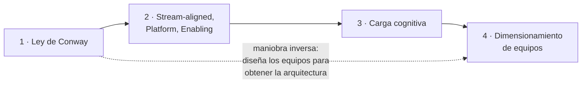
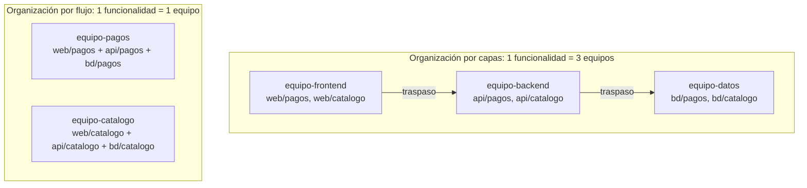
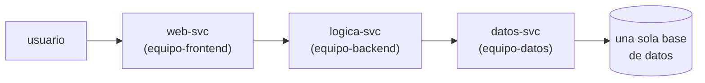
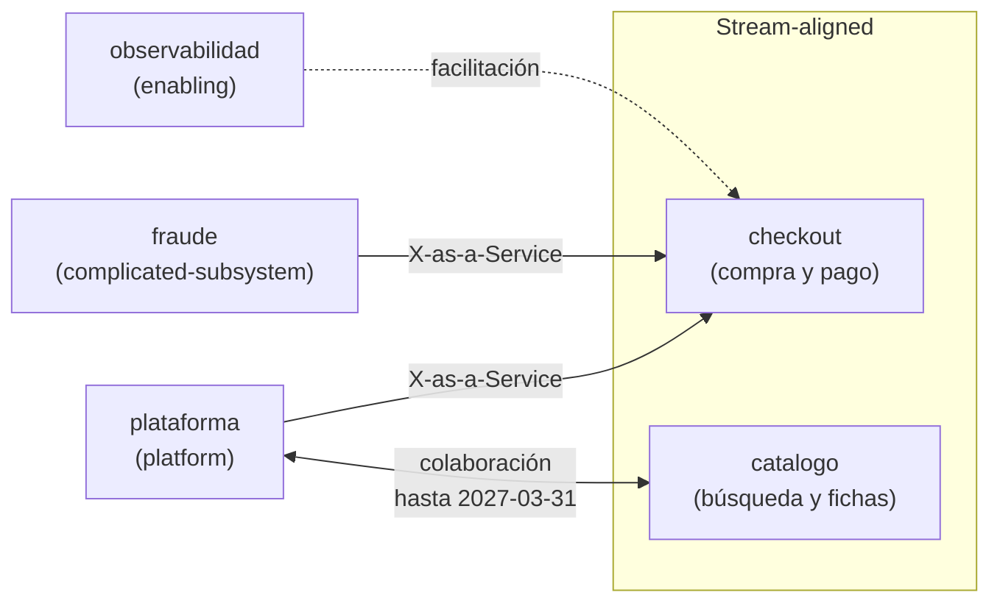
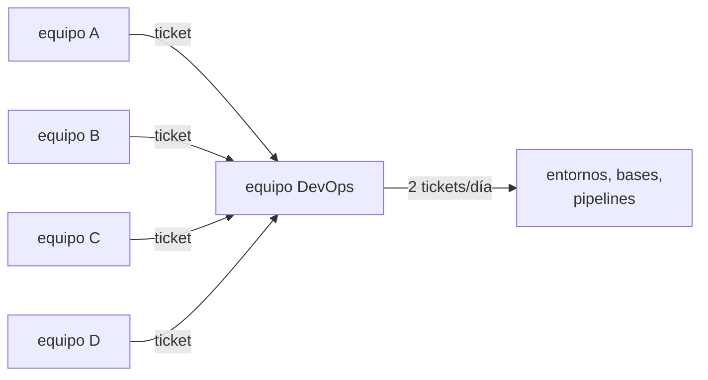
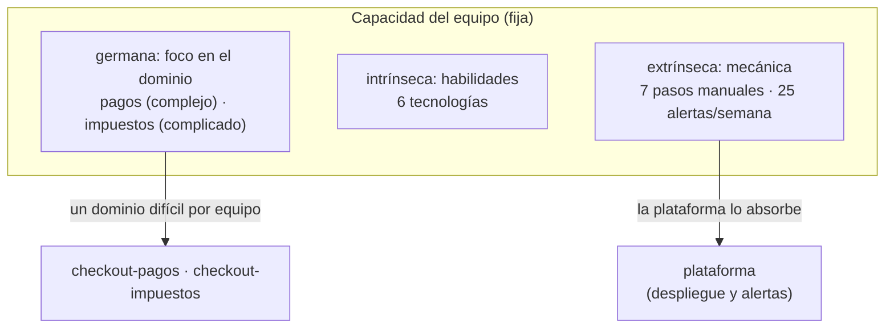
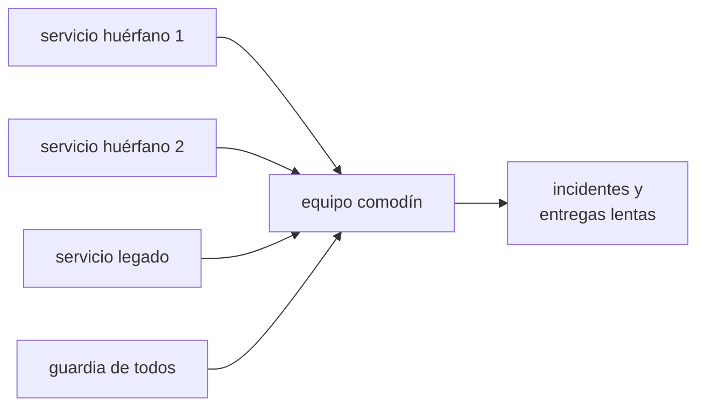
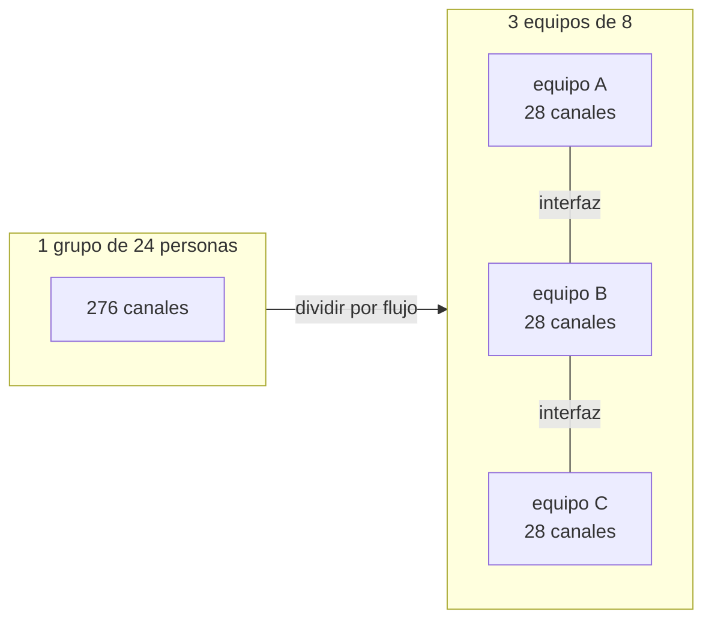
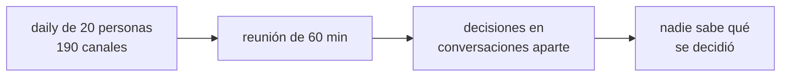

# Módulo 29 · Team Topologies y organización

**Fase 3 · Nivel maestro: arquitectura avanzada** (media semana; semana 4 de 8). **Duración:** 6 h (4 temas de unos
75 min y 1 h de laboratorio integrador). **Dificultad:** 3 de 5. **Dependencias:** Módulo 24 (ADRs y modelo C4: aquí
decides quién es dueño de cada caja del diagrama) y Módulo 5 (bounded contexts: la frontera natural de un equipo).
**Herramientas:**Node.js 26.13.1 LTS** y **Git** (el de tu sistema, 2.x); sin dependencias de npm ni
infraestructura. **Laboratorio:** `modulo-33` (`./verificar.sh` ejecuta 17 tests y los
scripts de las cuatro fichas; `--compose` se acepta, pero este módulo no levanta contenedores).

Hasta aquí todo el curso ha tratado de **software**. Este módulo trata de **personas**, porque en un sistema de
microservicios la forma de los equipos acaba siendo la forma del sistema. Si cuatro equipos tienen que ponerse de
acuerdo para cada funcionalidad, da igual lo bien que estén separados los servicios en el diagrama: el sistema se
moverá a la velocidad de la reunión más lenta. Vas a **medir** esto con datos reales (un historial de Git), a modelar
los cuatro tipos de equipo y los tres modos de interacción de *Team Topologies* (Matthew Skelton y Manuel Pais, IT
Revolution, 2019), a convertir la «carga cognitiva» en algo que se puede revisar cada trimestre y a dimensionar
equipos con aritmética en lugar de intuición.



**Texto alternativo:** mapa del módulo. La Ley de Conway (tema 1) explica por qué la estructura de los equipos se
copia en el sistema; de ahí salen los tipos de equipo y sus interacciones (tema 2), que se eligen para limitar la
carga cognitiva de cada equipo (tema 3), y esa carga junto con los canales de comunicación decide el tamaño de los
equipos (tema 4). Una flecha punteada vuelve del tema 1 al 4: la maniobra inversa de Conway consiste en diseñar los
equipos para obtener la arquitectura deseada.

**Cómo usar el laboratorio.** Con Node 26 y Git:

```bash
npm ci                    # no instala nada: el laboratorio no tiene dependencias, pero así se comprueba el lockfile
./verificar.sh            # tests + demos + errores comunes de las 4 fichas → «RESULTADO: OK»
```

`package.json` del laboratorio:

```json
{
  "name": "modulo-29-team-topologies-organizacion",
  "version": "1.0.0",
  "private": true,
  "description": "Módulo 29 (Fase 3): Team Topologies y organización (Ley de Conway medida en Git, tipos de equipo e interacciones, carga cognitiva, dimensionamiento de equipos).",
  "type": "module",
  "engines": {
    "node": ">=26.13.1"
  },
  "scripts": {
    "test": "node --test --test-concurrency=1 'f1*/*.test.js'"
  }
}
```

**Fuentes de este módulo** (consultadas el 2026-11-20): el artículo original de Melvin Conway, «How Do Committees
Invent?», *Datamation*, abril de 1968 (https://www.melconway.com/Home/Committees_Paper.html); los conceptos clave de
*Team Topologies* (https://teamtopologies.com/key-concepts) y el extracto oficial del libro publicado por IT Revolution
(https://itrevolution.com/wp-content/uploads/2022/06/TTOP_excerpt.pdf), de donde salen las citas de tamaño de equipo y
de la figura 3.2; la entrevista de InfoQ a los autores sobre carga cognitiva
(https://www.infoq.com/news/2019/07/team-topologies-cognitive-loa) y la reseña de Martin Fowler
(https://martinfowler.com/bliki/TeamTopologies.html); y la documentación de CODEOWNERS de GitHub
(https://docs.github.com/en/repositories/managing-your-repositorys-settings-and-features/customizing-your-repository/about-code-owners).

**Lo que se ejecutó al escribir este módulo** (Node 26.13.1, Git 2.43.0, bash 5.2): todo. Las salidas que ves son
las reales. Queda por repetir en el Mac con bash 3.2 y el Git de Xcode (anotado en
`verificacion/microservicios/pendiente.md`).

---

### Ley de Conway

#### 1. UBICACIÓN

Módulo 29, Lección 1 de 4 · Fase 3.

#### 2. PRERREQUISITOS

- Git: commits, `git log` (Módulo 0.4, ficha de Git).
- Bounded contexts (Módulo 5, ficha 2) y monolito frente a microservicios (Módulo 5, ficha 1).
- Modelo C4 (Módulo 24, ficha 2): saber leer un diagrama de contenedores.

#### 3. OBJETIVO DE APRENDIZAJE

**Explicar** la Ley de Conway con la cita original, **medirla** sobre un historial de Git real (cuántos equipos toca
cada funcionalidad) y **aplicar** la maniobra inversa: cambiar a la vez la estructura de los equipos y la del código
para que una funcionalidad la termine un solo equipo. Lo compruebas cuando `conway.test.js` pasa 4 de 4 y sabes
explicar por qué la reorganización del error común no reduce la coordinación.

#### 4. ANALOGÍA VISUAL

Dibuja **una casa construida por tres cuadrillas** que no se hablan entre sí: la de cimientos, la de paredes y la de
tejado. Cada una trabaja muy bien en lo suyo, pero para poner **una ventana** hacen falta las tres: los cimientos
deben aguantar el peso, la pared necesita el hueco y el tejado un alero encima. La ventana tarda semanas, no por
difícil, sino por las **tres agendas**. Al lado, dibuja otra casa construida por cuadrillas **por habitación**: la
cuadrilla de la cocina pone su ventana sola, de abajo arriba, en una tarde. Las dos casas acaban teniendo la forma de
sus cuadrillas: la primera, por **capas** horizontales; la segunda, por **habitaciones**.

#### 5. DIAGRAMA TÉCNICO



**Texto alternativo:** dos organizaciones sobre el mismo código. Arriba, por capas: el equipo de frontend es dueño de
web/pagos y web/catalogo, el de backend de api/pagos y api/catalogo, y el de datos de bd/pagos y bd/catalogo; cada
funcionalidad pasa por los tres con dos traspasos. Abajo, por flujo: el equipo de pagos es dueño de web, api y bd de
pagos, y el de catálogo de lo mismo para catálogo; cada funcionalidad la termina un solo equipo, sin traspasos.

#### 6. EXPLICACIÓN NIVEL 0

- En 1968, Melvin Conway escribió que las organizaciones que diseñan sistemas «están obligadas a producir diseños que
  son copias de las estructuras de comunicación de esas organizaciones».
- Dicho fácil: **el software se parece a los equipos que lo hacen**. Si hay un equipo de pantallas, uno de servidor y
  uno de base de datos, el sistema tendrá tres capas que solo cambian cuando los tres se ponen de acuerdo.
- Por eso, antes de dibujar microservicios, conviene preguntar: **¿qué equipo va a cambiar cada pieza?** Si la
  respuesta es «varios», esa pieza será lenta de cambiar.

#### 7. EXPLICACIÓN INTERMEDIA

- **La cita completa** (conclusión del artículo): «organizations which design systems (in the broad sense used here)
  are constrained to produce designs which are copies of the communication structures of these organizations». El
  mismo artículo añade que, dada una organización, hay alternativas de diseño que **no puede** seguir porque «the
  necessary communication paths do not exist».
- **Cómo se mide.** Un *commit* (o un PR) es una unidad de cambio de negocio. Si asignas un dueño a cada ruta del
  repositorio (como hace un archivo `CODEOWNERS` de GitHub, donde «the last matching pattern takes the most
  precedence»), puedes contar **cuántos equipos toca cada cambio**. `conway.js` lo hace leyendo `git log
  --name-only`: con la organización por capas, 6 de 6 funcionalidades tocan 3 equipos (12 traspasos); con la
  organización por flujo, 0 de 6.
- **Los pares que cambian juntos** (`equipo-backend ↔ equipo-datos: 6`) son la estructura de comunicación que tu
  código **exige**. Si esos equipos no se hablan a diario, cada funcionalidad espera.
- **Maniobra inversa de Conway.** *Team Topologies* recoge la idea de *Accelerate*: las organizaciones deberían
  evolucionar su estructura de equipos para conseguir la arquitectura deseada. Primero decides los flujos (pagos,
  catálogo), después formas equipos por flujo y **a la vez** mueves el código para que cada equipo tenga sus piezas.

#### 8. EXPLICACIÓN MAESTRA

- **Conway no es una recomendación, es una fuerza.** No puedes «desactivarla»; solo elegir a favor de qué trabaja.
  Una arquitectura que contradice la organización se erosiona: los equipos crean atajos (una tabla compartida, una
  librería común) que siguen sus canales reales de comunicación.
- **Trade-off por capas frente a por flujo.** Por capas maximiza la especialización (el DBA solo ve SQL) y la
  consistencia técnica de cada capa, pero cada funcionalidad cruza todos los equipos y la entrega depende de colas.
  Por flujo maximiza la autonomía y el tiempo de entrega, pero duplica algo de conocimiento técnico en cada equipo y
  necesita una plataforma y equipos facilitadores (ficha 2) para no reinventar lo mismo cinco veces.
- **Alternativas a la maniobra inversa:** (1) **aceptar la organización** y diseñar los servicios según ella (útil si
  no puedes mover a la gente, por ejemplo con proveedores externos: cada contrato es una frontera); (2) **equipos de
  funcionalidad temporales** (*feature teams*) que cruzan componentes con dueños fijos, a cambio de más revisiones
  entre equipos; (3) **monolito modular** con módulos por flujo, que aplica Conway sin pagar la red.
- **Cuándo NO hacer la maniobra:** con un solo equipo (menos de ~9 personas) no hay estructura que copiar: dividir el
  sistema en servicios por «equipos futuros» solo añade red. Y no reorganices sin mover el código: el error común de
  esta ficha muestra que solo cambiar el organigrama devuelve la coordinación por la puerta de atrás.
- **Señales en producción:** PRs que necesitan aprobación de varios equipos, servicios con commits de muchos equipos,
  reuniones de «sincronización» semanales entre los mismos dos equipos. Las tres se miden con Git y la herramienta de
  revisiones.

#### 9. CÓDIGO EJECUTABLE

Versiones: **Node.js 26.13.1 LTS** y **Git 2.x** (se probó con 2.43.0), sin dependencias de npm.

`f169-conway/conway.js`:

```javascript
// Módulo 29 · F169 · Ley de Conway medida sobre un historial de Git real.
// Idea: si cada cambio de negocio (un commit) toca archivos de varios equipos, la arquitectura obliga a coordinar
// a esos equipos. Comparamos la MISMA base de código con dos organizaciones: por capas y por flujo de negocio.
// Requisitos: Node.js 26.13.1 LTS y Git (cualquier 2.x). Sin dependencias de npm.
import { execFileSync } from 'node:child_process';

// Reglas de propiedad al estilo CODEOWNERS: [patrón, equipo]. El patrón es una expresión regular sobre la ruta.
// Como en CODEOWNERS de GitHub, si varias reglas coinciden, gana la ÚLTIMA.
export function propietario(ruta, reglas) {
  let dueno = 'sin-dueño';
  for (const [patron, equipo] of reglas) if (new RegExp(patron).test(ruta)) dueno = equipo;
  return dueno;
}

// Lee el historial: un objeto por commit con el autor y los archivos que tocó.
export function leerHistorial(dirRepo) {
  const salida = execFileSync('git', ['-C', dirRepo, 'log', '--reverse', '--format=@@%s', '--name-only'], {
    encoding: 'utf8',
  });
  const commits = [];
  for (const linea of salida.split('\n')) {
    if (linea.startsWith('@@')) commits.push({ mensaje: linea.slice(2), archivos: [] });
    else if (linea.trim()) commits.at(-1).archivos.push(linea.trim());
  }
  return commits;
}

// Para cada commit: qué equipos tuvo que tocar. Un commit con 3 equipos = 3 agendas que coordinar y 2 traspasos.
export function analizar(commits, reglas) {
  const porCommit = commits.map((c) => {
    const equipos = [...new Set(c.archivos.map((a) => propietario(a, reglas)))].sort();
    return { mensaje: c.mensaje, equipos, traspasos: equipos.length - 1 };
  });
  const cruzados = porCommit.filter((c) => c.equipos.length > 1).length;
  const traspasos = porCommit.reduce((s, c) => s + c.traspasos, 0);
  // Pares de equipos que cambian juntos: la «estructura de comunicación» que la base de código exige.
  const pares = new Map();
  for (const { equipos } of porCommit)
    for (let i = 0; i < equipos.length; i++)
      for (let j = i + 1; j < equipos.length; j++) {
        const clave = `${equipos[i]} ↔ ${equipos[j]}`;
        pares.set(clave, (pares.get(clave) ?? 0) + 1);
      }
  return {
    commits: porCommit.length,
    cruzados,
    porcentajeCruzados: Math.round((100 * cruzados) / porCommit.length),
    traspasos,
    pares: Object.fromEntries([...pares].sort((a, b) => b[1] - a[1])),
  };
}

// Las dos organizaciones que comparamos sobre el mismo código (carpetas capa/flujo, p. ej. web/pagos).
export const POR_CAPAS = [
  ['^web/', 'equipo-frontend'],
  ['^api/', 'equipo-backend'],
  ['^bd/', 'equipo-datos'],
];
export const POR_FLUJO = [
  ['/pagos/', 'equipo-pagos'],
  ['/catalogo/', 'equipo-catalogo'],
];
```

`f169-conway/repo.js` (crea el repositorio de ejemplo en una carpeta temporal):

```javascript
// Módulo 29 · F169 · Crea un repositorio Git de ejemplo en una carpeta temporal con 6 commits de negocio.
// Cada funcionalidad (pagos o catálogo) toca su pantalla (web/), su API (api/) y su tabla (bd/), como en la vida real.
import { execFileSync } from 'node:child_process';
import { mkdirSync, mkdtempSync, writeFileSync } from 'node:fs';
import { tmpdir } from 'node:os';
import { dirname, join } from 'node:path';

const FUNCIONALIDADES = [
  ['pagos', 'Pagar con tarjeta'],
  ['catalogo', 'Buscar productos por nombre'],
  ['pagos', 'Reembolso parcial'],
  ['catalogo', 'Filtrar por precio'],
  ['pagos', 'Pagar con PSE'],
  ['catalogo', 'Productos agotados ocultos'],
];

export function crearRepoDeEjemplo() {
  const dir = mkdtempSync(join(tmpdir(), 'conway-'));
  const git = (...args) => execFileSync('git', ['-C', dir, ...args], { stdio: 'pipe' });
  git('init', '-q');
  git('config', 'user.name', 'Academia');
  git('config', 'user.email', 'academia@example.com');
  git('config', 'commit.gpgsign', 'false');
  FUNCIONALIDADES.forEach(([flujo, titulo], i) => {
    for (const archivo of [`web/${flujo}/pantalla.js`, `api/${flujo}/rutas.js`, `bd/${flujo}/V${i + 1}.sql`]) {
      mkdirSync(dirname(join(dir, archivo)), { recursive: true });
      writeFileSync(join(dir, archivo), `// ${titulo} (cambio ${i + 1})\n`, { flag: 'a' });
    }
    git('add', '-A');
    git('commit', '-q', '-m', titulo);
  });
  return dir;
}
```

`f169-conway/demo.js`:

```javascript
// Módulo 29 · F169 · Ejecuta: node f169-conway/demo.js
// Mismo código, dos organizaciones: ¿cuántos equipos hay que coordinar por cada funcionalidad?
import { rmSync } from 'node:fs';
import { analizar, leerHistorial, POR_CAPAS, POR_FLUJO } from './conway.js';
import { crearRepoDeEjemplo } from './repo.js';

const dir = crearRepoDeEjemplo();
const commits = leerHistorial(dir);
for (const [nombre, reglas] of [['por capas', POR_CAPAS], ['por flujo', POR_FLUJO]]) {
  const r = analizar(commits, reglas);
  console.log(`Organización ${nombre}: ${r.cruzados}/${r.commits} funcionalidades cruzan equipos (${r.porcentajeCruzados} %) · traspasos: ${r.traspasos}`);
  for (const [par, veces] of Object.entries(r.pares)) console.log(`   ${par}: ${veces} funcionalidades juntas`);
}
rmSync(dir, { recursive: true, force: true });
```

#### 10. MINI-LABORATORIO

1. Compara las dos organizaciones sobre el mismo historial de Git:

```bash
node f169-conway/demo.js
```

**Output esperado** (real):

```text
Organización por capas: 6/6 funcionalidades cruzan equipos (100 %) · traspasos: 12
   equipo-backend ↔ equipo-datos: 6 funcionalidades juntas
   equipo-backend ↔ equipo-frontend: 6 funcionalidades juntas
   equipo-datos ↔ equipo-frontend: 6 funcionalidades juntas
Organización por flujo: 0/6 funcionalidades cruzan equipos (0 %) · traspasos: 0
```

2. Mira el historial real que se analizó. Copia la ruta temporal añadiendo `console.log(dir)` en `demo.js` antes de
   `rmSync`, o crea el repositorio a mano:

```bash
node -e "import('./f169-conway/repo.js').then(m => console.log(m.crearRepoDeEjemplo()))"
git -C <la ruta que imprimió> log --oneline --name-only | head -8
```

**Output esperado** (real; los hashes cambian en cada ejecución):

```text
<hash> Productos agotados ocultos
api/catalogo/rutas.js
bd/catalogo/V6.sql
web/catalogo/pantalla.js
<hash> Pagar con PSE
api/pagos/rutas.js
bd/pagos/V5.sql
web/pagos/pantalla.js
```

**Captura comentada:** cada commit toca las tres carpetas de capa, pero solo **un** flujo; por eso con las reglas por flujo el
resultado es 0 traspasos.

3. Aplica el análisis a **tu** repositorio: copia `conway.js`, escribe tus reglas `[patrón, equipo]` (o tradúcelas de
   tu `CODEOWNERS`) y ejecuta `analizar(leerHistorial('.'), reglas)`. **Captura comentada:** el porcentaje de commits
   que cruzan equipos y los tres pares de equipos que más cambian juntos.

#### 11. VERIFICACIÓN

Tests con Git real (`f169-conway/conway.test.js`):

```javascript
// Módulo 29 · F169 · Tests (Git real en una carpeta temporal). Ejecuta: node --test f169-conway/conway.test.js
import assert from 'node:assert/strict';
import { rmSync } from 'node:fs';
import { after, test } from 'node:test';
import { analizar, leerHistorial, POR_CAPAS, POR_FLUJO, propietario } from './conway.js';
import { crearRepoDeEjemplo } from './repo.js';

const dir = crearRepoDeEjemplo();
after(() => rmSync(dir, { recursive: true, force: true }));

test('propietario: como en CODEOWNERS, gana la última regla que coincide', () => {
  const reglas = [['^api/', 'equipo-backend'], ['^api/pagos/', 'equipo-pagos']];
  assert.equal(propietario('api/pagos/rutas.js', reglas), 'equipo-pagos');
  assert.equal(propietario('api/catalogo/rutas.js', reglas), 'equipo-backend');
  assert.equal(propietario('README.md', reglas), 'sin-dueño');
});

test('el historial de Git tiene 6 funcionalidades de 3 archivos cada una', () => {
  const commits = leerHistorial(dir);
  assert.equal(commits.length, 6);
  assert.ok(commits.every((c) => c.archivos.length === 3));
});

test('por capas: cada funcionalidad obliga a coordinar 3 equipos (2 traspasos)', () => {
  const r = analizar(leerHistorial(dir), POR_CAPAS);
  assert.equal(r.cruzados, 6);
  assert.equal(r.traspasos, 12);
  assert.equal(r.pares['equipo-backend ↔ equipo-datos'], 6);
});

test('por flujo: cada funcionalidad la termina un solo equipo', () => {
  const r = analizar(leerHistorial(dir), POR_FLUJO);
  assert.equal(r.cruzados, 0);
  assert.equal(r.traspasos, 0);
  assert.deepEqual(r.pares, {});
});
```

```bash
node --test --test-reporter=spec f169-conway/conway.test.js
```

**Output esperado** (real): `ℹ tests 4` y `ℹ pass 4`.

**Pregunta de comprobación:** si en la organización por capas el equipo de frontend se divide en «frontend-pagos» y
«frontend-catálogo», ¿cuántos traspasos quedan por funcionalidad? (Siguen siendo 2: cada funcionalidad aún toca un
equipo de frontend, el de backend y el de datos. Dividir **una** capa no cambia la forma del flujo.)

#### 12. ERROR COMÚN

**Síntoma:** después de «reorganizar por producto», los equipos nuevos siguen bloqueándose entre sí y piden una
reunión semanal de sincronización. **Causa:** se cambió el organigrama pero no el código: hay un módulo común que
ambos equipos editan en cada funcionalidad.

```javascript
// Módulo 29 · F169 · Error común: «reorganizamos los equipos por flujo» pero el código sigue con una pieza compartida.
// Los equipos nuevos se pisan en el módulo común y la coordinación vuelve: si solo cambias el organigrama, Conway gana.
// Ejecuta: node f169-conway/error-comun.js
import { analizar, POR_FLUJO } from './conway.js';

// Historial tras la reorganización: cada funcionalidad toca su flujo… y también api/comun/modelos.js, que siguen
// editando los dos equipos. Lo marcamos con una regla más: el módulo común «es de todos» (en la práctica, de nadie).
const reglas = [...POR_FLUJO, ['^api/comun/', 'equipo-compartido']];
const commits = [
  { mensaje: 'Pagar con tarjeta', archivos: ['web/pagos/a.js', 'api/pagos/b.js', 'api/comun/modelos.js'] },
  { mensaje: 'Filtrar por precio', archivos: ['web/catalogo/a.js', 'api/catalogo/b.js', 'api/comun/modelos.js'] },
  { mensaje: 'Pagar con PSE', archivos: ['web/pagos/c.js', 'api/pagos/d.js', 'api/comun/modelos.js'] },
];
const mal = analizar(commits, reglas);
console.log(`MAL  → solo organigrama: ${mal.cruzados}/${mal.commits} cambios cruzan equipos · pares: ${JSON.stringify(mal.pares)}`);

// Arreglo: partir el módulo común para que cada flujo tenga sus propios modelos (el código sigue a los equipos).
const arreglado = [
  { mensaje: 'Pagar con tarjeta', archivos: ['web/pagos/a.js', 'api/pagos/b.js', 'api/pagos/modelos.js'] },
  { mensaje: 'Filtrar por precio', archivos: ['web/catalogo/a.js', 'api/catalogo/b.js', 'api/catalogo/modelos.js'] },
  { mensaje: 'Pagar con PSE', archivos: ['web/pagos/c.js', 'api/pagos/d.js', 'api/pagos/modelos.js'] },
];
const bien = analizar(arreglado, reglas);
console.log(`BIEN → organigrama + código: ${bien.cruzados}/${bien.commits} cambios cruzan equipos`);
```

Salida real de `node f169-conway/error-comun.js`:

```text
MAL  → solo organigrama: 3/3 cambios cruzan equipos · pares: {"equipo-compartido ↔ equipo-pagos":2,"equipo-catalogo ↔ equipo-compartido":1}
BIEN → organigrama + código: 0/3 cambios cruzan equipos
```

**Diagnóstico visual:** ordena los archivos por número de equipos distintos que los tocaron en los últimos 90 días
(`git log --since=90.days --name-only` con las reglas de dueño): los «imanes» con 2 o más equipos son la estructura
de comunicación que sobrevivió a la reorganización. **Arreglo:** partir el módulo común por flujo (cada equipo con sus
modelos), o darle un dueño único que lo ofrezca como servicio con un contrato versionado.

#### 13. PREGUNTA DE ENTREVISTA

**¿Qué dice la Ley de Conway y cómo la usarías al diseñar microservicios?**

**Respuesta modelo:** Conway observó en 1968 que las organizaciones que diseñan sistemas acaban produciendo diseños
que copian sus estructuras de comunicación. En microservicios significa que las fronteras entre servicios tienden a
coincidir con las fronteras entre equipos, y que una frontera de servicio que cruza a varios equipos se vuelve lenta
de cambiar. La uso de dos formas: para diagnosticar, midiendo en Git cuántos equipos toca cada cambio y qué pares de
equipos cambian juntos; y para diseñar, con la maniobra inversa: defino primero los flujos de negocio, formo equipos
por flujo y muevo el código para que cada equipo sea dueño de sus servicios de punta a punta. Como trade-off, la
organización por flujo duplica algo de conocimiento técnico, que compenso con un equipo de plataforma y equipos
facilitadores. Y no aplico la maniobra si hay un solo equipo: ahí un monolito modular basta.

#### 14. ANTI-PATRÓN RELACIONADO

**Microservicios por capa técnica** («servicio de frontend», «servicio de lógica», «servicio de datos») mantenidos
por equipos por capa: el sistema tiene la red de los microservicios y la coordinación de un monolito.



**Texto alternativo:** cadena de servicios por capa: el usuario llama a web-svc del equipo de frontend, que llama a
logica-svc del equipo de backend, que llama a datos-svc del equipo de datos, que usa una sola base de datos. Cualquier
funcionalidad atraviesa los tres servicios y los tres equipos.

---

### Stream-aligned, Platform, Enabling teams

#### 1. UBICACIÓN

Módulo 29, Lección 2 de 4 · Fase 3.

#### 2. PRERREQUISITOS

- Ley de Conway (ficha 1).
- Kubernetes, CI/CD y GitOps (Módulo 12 o 23): lo que suele ofrecer una plataforma interna.
- Observabilidad (Módulo 10 o 21): lo que suele enseñar un equipo facilitador.

#### 3. OBJETIVO DE APRENDIZAJE

**Distinguir** los cuatro tipos de equipo de *Team Topologies* (stream-aligned, platform, enabling y
complicated-subsystem) y sus tres modos de interacción (colaboración, X-as-a-Service y facilitación), **detectar** con
un revisor automático una topología mal planteada y **cuantificar** por qué una plataforma debe ser autoservicio. Lo
compruebas cuando `topologia.test.js` pasa 4 de 4 y sabes corregir los cinco avisos de la topología inicial.

#### 4. ANALOGÍA VISUAL

Dibuja **un hospital**. Los **equipos de planta** (cardiología, pediatría) atienden a sus pacientes de principio a
fin: son los stream-aligned. La **farmacia, el laboratorio y la lavandería** son la plataforma: cualquier planta pide
lo que necesita por un formulario o una ventanilla y lo recibe sin reunirse con nadie (X-as-a-Service). El **equipo
de control de infecciones** pasa unas semanas en una planta enseñando protocolos nuevos y luego se va a otra: es el
enabling (facilitación). El **servicio de radioterapia**, con físicos médicos que nadie más entiende, es el
complicated-subsystem. Si la farmacia exigiera una reunión por cada receta, las plantas pasarían el día en el pasillo.

#### 5. DIAGRAMA TÉCNICO



**Texto alternativo:** la topología corregida de la tienda. Dos equipos stream-aligned: checkout (compra y pago) y
catálogo (búsqueda y fichas). La plataforma da servicio a checkout como X-as-a-Service y colabora con catálogo hasta el
31 de marzo de 2027. El equipo de fraude, complicated-subsystem, da su modelo a checkout como X-as-a-Service. El
equipo de observabilidad, enabling, facilita a checkout con una línea punteada.

#### 6. EXPLICACIÓN NIVEL 0

- La mayoría de los equipos deberían **entregar valor directamente a los usuarios** en un área del negocio: son los
  equipos «alineados al flujo».
- Para que esos equipos no tengan que saber de todo, otros equipos los **ayudan**: uno les da herramientas listas
  para usar (la plataforma), otro les enseña cosas nuevas por un tiempo (el facilitador) y otro se ocupa de una pieza
  muy especializada (el de subsistema complicado).
- Además del **tipo** de equipo importa **cómo se relacionan**: trabajando juntos un tiempo, dando un servicio que el
  otro usa solo, o enseñando.

#### 7. EXPLICACIÓN INTERMEDIA

Las definiciones, tal como aparecen en los conceptos clave del libro:

| Tipo | Definición (Team Topologies) | En la tienda |
|---|---|---|
| Stream-aligned | «aligned to a flow of work from (usually) a segment of the business domain» | checkout, catálogo |
| Enabling | «helps a Stream-aligned team to overcome obstacles. Also detects missing capabilities» | observabilidad |
| Complicated-subsystem | «where significant mathematics/calculation/technical expertise is needed» | fraude |
| Platform | «a grouping of other team types that provide a compelling internal product» | plataforma |

| Modo | Definición | Duración |
|---|---|---|
| Colaboración | «working together for a defined period of time to discover new things» | temporal (fecha de fin) |
| X-as-a-Service | «one team provides and one team consumes something "as a Service"» | estable |
| Facilitación | «one team helps and mentors another team» | hasta que el otro aprende |

- `revisar()` convierte esas definiciones en reglas: un stream-aligned **sin flujo** no lo es (es una capa); un
  enabling que interactúa por X-as-a-Service está **operando** cosas para otros, no enseñando; una colaboración **sin
  fecha de fin** deja de ser colaboración y se vuelve dependencia; una plataforma **sin consumidores** por servicio
  no es un producto. La quinta regla (no más de una colaboración a la vez por equipo) es una heurística de este curso:
  la colaboración es intensa y consume la capacidad del equipo.
- `simularEspera()` cuantifica la diferencia entre una «plataforma» por tickets y una de autoservicio: con 10 equipos
  pidiendo una base de datos y 2 tickets atendidos al día, la espera media es 3 días y la peor 5; con autoservicio, 15
  minutos para todos.

#### 8. EXPLICACIÓN MAESTRA

- **El stream-aligned es el tipo principal**; los otros tres existen para **reducir su carga cognitiva** (Fowler: «the
  primary benefit of a platform is to reduce the cognitive load on stream-aligned teams»). Si tu organización tiene
  más equipos de plataforma que stream-aligned, revisa para quién trabajan.
- **Los modos cambian con el tiempo.** Lo sano es empezar con colaboración para descubrir una API nueva y pasar a
  X-as-a-Service cuando está estable. Una colaboración permanente indica una frontera mal puesta: esos dos equipos
  deberían ser uno, o la API no está madura.
- **Plataforma mínima viable.** La plataforma no es «todo lo de infraestructura»: es lo mínimo que los stream-aligned
  necesitan para ir solos (*Thinnest Viable Platform*, en palabras de los autores). A veces es una página wiki con
  plantillas; a veces, un portal interno. Medir la espera (como en la simulación) dice cuándo invertir más.
- **Alternativas:** (1) **modelo de squads y tribus** (popularizado por Spotify, con capítulos y gremios): organiza por
  flujo, pero no define tipos de equipo de apoyo ni modos de interacción; (2) **equipos de componentes**
  con dueños por servicio técnico, que vuelven al problema de Conway de la ficha 1; (3) **DevOps «tú lo construyes,
  tú lo operas»** sin plataforma, que funciona con pocos servicios y satura a los equipos cuando crecen.
- **Cuándo NO montar esta estructura:** con uno o dos equipos no hay plataforma ni enabling que formar; basta un
  equipo stream-aligned con buenas herramientas gestionadas (un PaaS) y un ADR que diga quién decide qué.

#### 9. CÓDIGO EJECUTABLE

Versiones: **Node.js 26.13.1 LTS**, sin dependencias.

`f170-topologias/topologia.js`:

```javascript
// Módulo 29 · F170 · Tipos de equipo e interacciones de Team Topologies (Skelton y Pais, 2019) como datos revisables,
// y una simulación del tiempo que espera un equipo stream-aligned según cómo le llega la infraestructura.
// Requisitos: Node.js 26.13.1 LTS. Sin dependencias de npm.

export const TIPOS = ['stream-aligned', 'platform', 'enabling', 'complicated-subsystem'];
export const MODOS = ['colaboracion', 'x-as-a-service', 'facilitacion'];

// Revisa una topología { equipos: [{nombre, tipo, flujo?}], interacciones: [{de, a, modo, hasta?}] }.
// Las reglas 1–4 salen de las definiciones del libro; la 5 es una heurística de este curso.
export function revisar({ equipos, interacciones }) {
  const avisos = [];
  const tipo = new Map(equipos.map((e) => [e.nombre, e.tipo]));
  for (const e of equipos) {
    if (!TIPOS.includes(e.tipo)) avisos.push(`${e.nombre}: tipo desconocido «${e.tipo}»`);
    // 1. Un stream-aligned se alinea a un flujo de trabajo del negocio: si no sabes cuál, no lo es.
    if (e.tipo === 'stream-aligned' && !e.flujo) avisos.push(`${e.nombre}: stream-aligned sin flujo de negocio`);
  }
  for (const i of interacciones) {
    if (!MODOS.includes(i.modo)) avisos.push(`${i.de} → ${i.a}: modo desconocido «${i.modo}»`);
    // 2. Un enabling ayuda y enseña (facilitación); si construye y opera cosas para otros, es otro tipo de equipo.
    if (tipo.get(i.de) === 'enabling' && i.modo !== 'facilitacion')
      avisos.push(`${i.de} → ${i.a}: un enabling interactúa por facilitación, no por ${i.modo}`);
    // 3. La colaboración es intensa y temporal: debe tener fecha de fin.
    if (i.modo === 'colaboracion' && !i.hasta) avisos.push(`${i.de} ↔ ${i.a}: colaboración sin fecha de fin`);
  }
  // 4. Una plataforma es un producto interno: si nadie la consume como servicio, no está cumpliendo su papel.
  for (const p of equipos.filter((e) => e.tipo === 'platform'))
    if (!interacciones.some((i) => i.de === p.nombre && i.modo === 'x-as-a-service'))
      avisos.push(`${p.nombre}: plataforma sin consumidores x-as-a-service`);
  // 5. (Heurística del curso) Un equipo en más de una colaboración a la vez se queda sin tiempo para su flujo.
  const colaboraciones = new Map();
  for (const i of interacciones.filter((x) => x.modo === 'colaboracion'))
    for (const n of [i.de, i.a]) colaboraciones.set(n, (colaboraciones.get(n) ?? 0) + 1);
  for (const [n, c] of colaboraciones) if (c > 1) avisos.push(`${n}: ${c} colaboraciones a la vez`);
  return avisos;
}

// Simulación: `pedidos` equipos stream-aligned piden cada uno una base de datos nueva el mismo día.
//  - por tickets: un equipo de operaciones atiende `capacidadDia` tickets al día, en orden de llegada.
//  - autoservicio: la plataforma lo ofrece como servicio (una orden o un formulario) y tarda `minutosAutoservicio`.
export function simularEspera({ pedidos, capacidadDia, minutosAutoservicio }) {
  const diasTicket = Array.from({ length: pedidos }, (_, i) => Math.floor(i / capacidadDia) + 1);
  const media = diasTicket.reduce((s, d) => s + d, 0) / pedidos;
  return {
    porTickets: { mediaDias: Math.round(media * 10) / 10, peorDias: diasTicket.at(-1) },
    autoservicio: { minutos: minutosAutoservicio },
  };
}
```

`f170-topologias/ejemplo.js`:

```javascript
// Módulo 29 · F170 · Dos topologías de la tienda en línea: la inicial (con problemas) y la corregida.
export const INICIAL = {
  equipos: [
    { nombre: 'checkout', tipo: 'stream-aligned', flujo: 'compra y pago' },
    { nombre: 'catalogo', tipo: 'stream-aligned', flujo: 'búsqueda y fichas de producto' },
    { nombre: 'backend', tipo: 'stream-aligned' }, // ¿alineado a qué flujo? a ninguno: es una capa
    { nombre: 'plataforma', tipo: 'platform' },
    { nombre: 'observabilidad', tipo: 'enabling' },
  ],
  interacciones: [
    { de: 'plataforma', a: 'checkout', modo: 'colaboracion' }, // sin fecha de fin: colaboración eterna
    { de: 'plataforma', a: 'catalogo', modo: 'colaboracion', hasta: '2027-03-31' },
    { de: 'observabilidad', a: 'checkout', modo: 'x-as-a-service' }, // el enabling opera el stack por ellos
  ],
};

export const CORREGIDA = {
  equipos: [
    { nombre: 'checkout', tipo: 'stream-aligned', flujo: 'compra y pago' },
    { nombre: 'catalogo', tipo: 'stream-aligned', flujo: 'búsqueda y fichas de producto' },
    { nombre: 'fraude', tipo: 'complicated-subsystem' }, // modelo de riesgo: necesita especialistas
    { nombre: 'plataforma', tipo: 'platform' },
    { nombre: 'observabilidad', tipo: 'enabling' },
  ],
  interacciones: [
    { de: 'plataforma', a: 'checkout', modo: 'x-as-a-service' },
    { de: 'plataforma', a: 'catalogo', modo: 'colaboracion', hasta: '2027-03-31' }, // descubren juntos la API de búsqueda
    { de: 'fraude', a: 'checkout', modo: 'x-as-a-service' },
    { de: 'observabilidad', a: 'checkout', modo: 'facilitacion' }, // enseña a instrumentar y se retira
  ],
};
```

`f170-topologias/demo.js`:

```javascript
// Módulo 29 · F170 · Ejecuta: node f170-topologias/demo.js
import { CORREGIDA, INICIAL } from './ejemplo.js';
import { revisar, simularEspera } from './topologia.js';

for (const [nombre, t] of [['inicial', INICIAL], ['corregida', CORREGIDA]]) {
  const avisos = revisar(t);
  console.log(`Topología ${nombre}: ${avisos.length} avisos`);
  for (const a of avisos) console.log(`   - ${a}`);
}
const s = simularEspera({ pedidos: 10, capacidadDia: 2, minutosAutoservicio: 15 });
console.log(`10 equipos piden una base de datos: por tickets esperan ${s.porTickets.mediaDias} días de media (el último, ${s.porTickets.peorDias}); con autoservicio, ${s.autoservicio.minutos} minutos`);
```

#### 10. MINI-LABORATORIO

1. Revisa las dos topologías y la simulación de espera:

```bash
node f170-topologias/demo.js
```

**Output esperado** (real):

```text
Topología inicial: 5 avisos
   - backend: stream-aligned sin flujo de negocio
   - plataforma ↔ checkout: colaboración sin fecha de fin
   - observabilidad → checkout: un enabling interactúa por facilitación, no por x-as-a-service
   - plataforma: plataforma sin consumidores x-as-a-service
   - plataforma: 2 colaboraciones a la vez
Topología corregida: 0 avisos
10 equipos piden una base de datos: por tickets esperan 3 días de media (el último, 5); con autoservicio, 15 minutos
```

2. En `ejemplo.js`, añade a `CORREGIDA` una interacción `{ de: 'fraude', a: 'catalogo', modo: 'colaboracion' }` y
   vuelve a ejecutar. **Output esperado:** `Topología corregida: 2 avisos`, con `fraude ↔ catalogo: colaboración sin
   fecha de fin` y `catalogo: 2 colaboraciones a la vez`. Si le pones `hasta: '2027-01-31'`, queda solo el segundo:
   catálogo ya colabora con la plataforma, así que la colaboración con fraude debería esperar.

3. Dibuja (papel o Excalidraw) la topología de tu empresa o de un proyecto que conozcas con los cuatro tipos y los
   tres modos, y pásala por `revisar()`. **Captura comentada:** el diagrama con un color por tipo de equipo, el
   número de avisos y qué cambiarías primero.

#### 11. VERIFICACIÓN

Tests (`f170-topologias/topologia.test.js`):

```javascript
// Módulo 29 · F170 · Tests. Ejecuta: node --test f170-topologias/topologia.test.js
import assert from 'node:assert/strict';
import { test } from 'node:test';
import { CORREGIDA, INICIAL } from './ejemplo.js';
import { revisar, simularEspera } from './topologia.js';

test('la topología inicial tiene 5 problemas detectables', () => {
  const avisos = revisar(INICIAL);
  assert.equal(avisos.length, 5);
  assert.ok(avisos.includes('backend: stream-aligned sin flujo de negocio'));
  assert.ok(avisos.includes('observabilidad → checkout: un enabling interactúa por facilitación, no por x-as-a-service'));
  assert.ok(avisos.includes('plataforma ↔ checkout: colaboración sin fecha de fin'));
  assert.ok(avisos.includes('plataforma: plataforma sin consumidores x-as-a-service'));
  assert.ok(avisos.includes('plataforma: 2 colaboraciones a la vez'));
});

test('la topología corregida no tiene avisos', () => {
  assert.deepEqual(revisar(CORREGIDA), []);
});

test('una plataforma que nadie consume como servicio es un aviso', () => {
  const avisos = revisar({ equipos: [{ nombre: 'p', tipo: 'platform' }], interacciones: [] });
  assert.deepEqual(avisos, ['p: plataforma sin consumidores x-as-a-service']);
});

test('por tickets la espera crece con la cola; con autoservicio no', () => {
  const s = simularEspera({ pedidos: 10, capacidadDia: 2, minutosAutoservicio: 15 });
  assert.deepEqual(s.porTickets, { mediaDias: 3, peorDias: 5 });
  assert.equal(s.autoservicio.minutos, 15);
});
```

```bash
node --test --test-reporter=spec f170-topologias/topologia.test.js
```

**Output esperado** (real): `ℹ tests 4` y `ℹ pass 4`.

**Pregunta de comprobación:** el equipo de observabilidad instala y opera Grafana para todos y los demás le piden
paneles por tickets. ¿Qué tipo de equipo es en realidad y qué modo usa? (Es un equipo de plataforma que ofrece
observabilidad por X-as-a-Service, mal ejecutado porque usa tickets; si quieres que sea enabling, debe enseñar a cada
equipo a instrumentar y hacer sus paneles, y retirarse.)

#### 12. ERROR COMÚN

**Síntoma:** «creamos un equipo de plataforma» y el tiempo de entrega de los equipos stream-aligned no mejora; empeora
a medida que se crean equipos nuevos. **Causa:** se renombró el equipo de operaciones, pero sigue atendiendo tickets
uno a uno: la cola crece con el número de clientes.

```javascript
// Módulo 29 · F170 · Error común: renombrar el equipo de operaciones a «plataforma» sin cambiar cómo trabaja.
// Sigue atendiendo tickets uno a uno, así que la espera de los equipos stream-aligned crece con cada equipo nuevo.
// Ejecuta: node f170-topologias/error-comun.js
import { simularEspera } from './topologia.js';

for (const pedidos of [4, 10, 20]) {
  const mal = simularEspera({ pedidos, capacidadDia: 2, minutosAutoservicio: 15 });
  console.log(`MAL  → «plataforma» por tickets, ${pedidos} equipos: espera media ${mal.porTickets.mediaDias} días, la peor ${mal.porTickets.peorDias}`);
}
console.log('BIEN → plataforma como producto (autoservicio): 15 minutos, haya 4, 10 o 20 equipos');
```

Salida real de `node f170-topologias/error-comun.js`:

```text
MAL  → «plataforma» por tickets, 4 equipos: espera media 1.5 días, la peor 2
MAL  → «plataforma» por tickets, 10 equipos: espera media 3 días, la peor 5
MAL  → «plataforma» por tickets, 20 equipos: espera media 5.5 días, la peor 10
BIEN → plataforma como producto (autoservicio): 15 minutos, haya 4, 10 o 20 equipos
```

**Diagnóstico visual:** grafica el tiempo desde que un equipo pide un recurso (base de datos, pipeline, DNS) hasta que
lo tiene, por mes; si sube cuando crece el número de equipos, la plataforma es una cola, no un producto. **Arreglo:**
convertir las peticiones más frecuentes en autoservicio (módulos de Terraform, plantillas de repositorio, un
formulario que ejecuta un pipeline) y tratar a los stream-aligned como clientes: documentación, versión y encuestas.

#### 13. PREGUNTA DE ENTREVISTA

**¿Qué tipos de equipo y modos de interacción propone Team Topologies y cómo los aplicarías en una empresa con
microservicios?**

**Respuesta modelo:** propone cuatro tipos: stream-aligned, alineado a un flujo de trabajo del negocio y el principal;
platform, que ofrece un producto interno para que los stream-aligned vayan solos; enabling, que ayuda a superar
obstáculos y enseña capacidades nuevas; y complicated-subsystem, para piezas que requieren especialistas. Y tres
modos: colaboración, temporal, para descubrir algo juntos; X-as-a-Service, donde uno ofrece y otro consume; y
facilitación, donde uno enseña al otro. Lo aplicaría alineando cada equipo stream-aligned a un bounded context,
ofreciendo despliegue, bases de datos y observabilidad como autoservicio de la plataforma, usando colaboración con
fecha de fin para APIs nuevas y pasando a X-as-a-Service cuando se estabilizan. Mediría el tiempo de espera de las
peticiones a la plataforma: si crece con el número de equipos, la plataforma funciona como cola y hay que convertirla
en autoservicio.

#### 14. ANTI-PATRÓN RELACIONADO

**El equipo «de arquitectura» o «de DevOps» como cuello de botella**: todos los equipos le piden cosas, nadie puede
hacerlas solo y la colaboración nunca termina.



**Texto alternativo:** cuatro equipos envían tickets a un único equipo DevOps, que atiende dos al día y es el único
que puede crear entornos, bases de datos y pipelines; todos esperan en su cola.

---

### Carga cognitiva

#### 1. UBICACIÓN

Módulo 29, Lección 3 de 4 · Fase 3.

#### 2. PRERREQUISITOS

- Tipos de equipo e interacciones (ficha 2).
- Bounded contexts y subdominios (Módulo 5, ficha 2).
- Alertas basadas en p99 (Módulo 10, ficha 5): qué es una alerta ruidosa.

#### 3. OBJETIVO DE APRENDIZAJE

**Distinguir** los tres tipos de carga cognitiva (intrínseca, extrínseca y germana), **medir** la de un equipo con
indicadores que se pueden revisar cada trimestre (dominios difíciles, tecnologías, pasos manuales, alertas y una
encuesta 1–5) y **proponer** cómo reducirla. Lo compruebas cuando `carga.test.js` pasa 4 de 4 y sabes explicar por
qué «tienen 3 servicios cada uno» no dice nada de la carga.

#### 4. ANALOGÍA VISUAL

Dibuja **la mesa de un estudiante** antes de un examen. Encima están: el libro de la asignatura (lo que tiene que
aprender: carga **germana**), una calculadora científica que aún no sabe usar bien (la habilidad que exige la tarea:
carga **intrínseca**) y, alrededor, el móvil vibrando, una impresora que se atasca cada diez hojas y tres formularios
de matrícula (lo que no tiene nada que ver con el examen: carga **extrínseca**). Su cabeza es una **mochila de tamaño
fijo**: cada cosa ocupa espacio. Para que estudie mejor, no le das una mochila más grande; le **quitas el móvil y la
impresora** y, si son dos asignaturas difíciles, no las pones el mismo día.

#### 5. DIAGRAMA TÉCNICO



**Texto alternativo:** la capacidad fija del equipo checkout se reparte en tres cajas: carga germana (el foco en los
dominios pagos, complejo, e impuestos, complicado), intrínseca (seis tecnologías) y extrínseca (siete pasos manuales
por despliegue y veinticinco alertas por semana). Una flecha lleva la carga extrínseca a la plataforma, que absorbe
despliegue y alertas, y otra divide los dominios difíciles en dos equipos: checkout-pagos y checkout-impuestos.

#### 6. EXPLICACIÓN NIVEL 0

- Una persona solo puede tener **cierta cantidad de cosas en la cabeza** a la vez. Un equipo también.
- Si a un equipo le das demasiados temas difíciles, herramientas distintas y tareas repetitivas, **se equivoca más y
  va más lento**, aunque sea muy bueno.
- Los autores de *Team Topologies* lo comparan con un ordenador: igual que una CPU saturada vuelve lento al equipo
  informático, un equipo saturado toma malas decisiones y se mueve despacio.

#### 7. EXPLICACIÓN INTERMEDIA

- **Tres tipos** (como los nombran Skelton y Pais en la entrevista de InfoQ): **intrínseca** (las habilidades que
  exige el trabajo), **extrínseca** (la mecánica que no aporta al problema) y **germana** (el foco en el dominio). El
  objetivo es reducir las dos primeras para dejar espacio a la germana, que es la que crea valor.
- **No hay una medida exacta, pero sí una relativa.** Los autores sugieren comparar la complejidad de los dominios y
  preguntar a los equipos, del 1 al 5, cuánto entienden los sistemas que operan. `carga.js` combina eso con
  indicadores objetivos y umbrales del curso (que debes ajustar a tu organización):
  - dominios complicados o complejos > 1 → aviso de carga germana (el libro titula su figura 3.2 «No More than One
    Complicated or Complex Domain per Team»);
  - tecnologías distintas > 4 → intrínseca;
  - pasos manuales por despliegue > 3 o alertas por semana > 10 → extrínseca;
  - media de la encuesta < 3 → aviso.
- **La propuesta** de `proponer()` sigue la regla de la figura 3.2: un equipo por dominio difícil, y los dominios
  simples se quedan con el primero para no crear equipos sin un flujo con sentido. La carga extrínseca no se arregla
  dividiendo equipos: se arregla con la **plataforma** (ficha 2).

#### 8. EXPLICACIÓN MAESTRA

- **La carga cognitiva fija el tamaño de los servicios, no al revés.** La recomendación de los autores es limitar el
  tamaño del software que posee un equipo a la carga que puede manejar. Eso da un criterio para la granularidad de
  los microservicios más útil que «líneas de código» o «una entidad por servicio» (Módulo 30, ficha 2).
- **Mide la tendencia, no el número.** El umbral de «4 tecnologías» es arbitrario; lo valioso es ver si el mismo
  equipo pasa de 3 a 7 avisos en dos trimestres. Repite la encuesta con las mismas preguntas y guárdala.
- **Trade-offs al reducirla.** Partir un equipo reduce la carga germana pero añade una interfaz entre equipos (ficha
  4); mover lo extrínseco a la plataforma exige que la plataforma exista y sea buena; estandarizar tecnologías reduce
  la intrínseca pero puede obligar a usar una herramienta peor para un caso concreto.
- **Alternativas para reducirla sin reorganizar:** un **monolito modular** (menos piezas desplegables que operar), un
  **equipo complicated-subsystem** que se lleve la parte matemática (fraude, precios dinámicos), **DDD** para separar
  el núcleo del dominio de los subdominios genéricos que se pueden comprar como SaaS.
- **Cuándo NO usar la medida:** como evaluación del rendimiento de las personas. Si la encuesta se usa para juzgar,
  la gente responde lo que conviene y el indicador deja de servir.

#### 9. CÓDIGO EJECUTABLE

Versiones: **Node.js 26.13.1 LTS**, sin dependencias.

`f171-carga-cognitiva/carga.js`:

```javascript
// Módulo 29 · F171 · Carga cognitiva de un equipo: una medida RELATIVA (no existe una exacta) a partir de su inventario
// y de una encuesta 1–5, separando los tres tipos de carga: intrínseca (habilidades), extrínseca (mecánica) y germana
// (foco en el dominio), como los nombran Skelton y Pais.
// Requisitos: Node.js 26.13.1 LTS. Sin dependencias de npm.

// Umbrales del curso (ajústalos a tu organización; lo importante es compararlos en el tiempo y entre equipos).
export const UMBRALES = {
  dominiosDificiles: 1, // Team Topologies, figura 3.2: «no más de un dominio complicado o complejo por equipo»
  tecnologias: 4, // lenguajes, bases de datos y brokers distintos que el equipo opera
  pasosManuales: 3, // pasos manuales para desplegar
  alertasSemana: 10, // alertas que despiertan a alguien cada semana
  encuestaMinima: 3, // media de «¿cuánto entiendes los sistemas que operas?» (1 = nada, 5 = todo)
};

export function evaluar(equipo, u = UMBRALES) {
  const dificiles = equipo.dominios.filter((d) => d.complejidad !== 'simple');
  const encuesta = equipo.encuesta.reduce((s, x) => s + x, 0) / equipo.encuesta.length;
  const avisos = [];
  // Germana: el foco en el dominio de negocio, la carga que SÍ queremos… pero no más de un dominio difícil.
  if (dificiles.length > u.dominiosDificiles)
    avisos.push(`germana: ${dificiles.length} dominios complicados o complejos (${dificiles.map((d) => d.nombre).join(', ')})`);
  // Intrínseca: las habilidades que exige el trabajo (cada tecnología distinta hay que dominarla).
  if (equipo.tecnologias.length > u.tecnologias)
    avisos.push(`intrínseca: ${equipo.tecnologias.length} tecnologías distintas`);
  // Extrínseca: la mecánica que no aporta al problema (despliegues manuales, ruido de alertas).
  if (equipo.pasosManuales > u.pasosManuales) avisos.push(`extrínseca: ${equipo.pasosManuales} pasos manuales por despliegue`);
  if (equipo.alertasSemana > u.alertasSemana) avisos.push(`extrínseca: ${equipo.alertasSemana} alertas por semana`);
  if (encuesta < u.encuestaMinima) avisos.push(`encuesta: entienden sus sistemas ${encuesta.toFixed(1)} de 5`);
  return { equipo: equipo.nombre, encuesta: Number(encuesta.toFixed(1)), avisos, sobrecargado: avisos.length > 0 };
}

// Propuesta: un dominio difícil por equipo stream-aligned; lo extrínseco, a la plataforma.
export function proponer(equipo) {
  const dificiles = equipo.dominios.filter((d) => d.complejidad !== 'simple');
  const simples = equipo.dominios.filter((d) => d.complejidad === 'simple');
  if (dificiles.length <= 1) return [{ nombre: equipo.nombre, dominios: equipo.dominios.map((d) => d.nombre) }];
  return dificiles.map((d, i) => ({
    nombre: `${equipo.nombre}-${d.nombre}`,
    // Los dominios simples se quedan con el primer equipo para no crear equipos sin un flujo con sentido.
    dominios: [d.nombre, ...(i === 0 ? simples.map((s) => s.nombre) : [])],
  }));
}
```

`f171-carga-cognitiva/demo.js`:

```javascript
// Módulo 29 · F171 · Ejecuta: node f171-carga-cognitiva/demo.js
import { evaluar, proponer } from './carga.js';

const checkout = {
  nombre: 'checkout',
  dominios: [
    { nombre: 'pagos', complejidad: 'complejo' },
    { nombre: 'impuestos', complejidad: 'complicado' },
    { nombre: 'cupones', complejidad: 'simple' },
  ],
  tecnologias: ['Java', 'Node.js', 'PostgreSQL', 'Kafka', 'Redis', 'Terraform'],
  pasosManuales: 7,
  alertasSemana: 25,
  encuesta: [2, 3, 2, 2, 3, 2],
};

const antes = evaluar(checkout);
console.log(`Antes: ${antes.avisos.length} avisos · encuesta ${antes.encuesta}/5`);
for (const a of antes.avisos) console.log(`   - ${a}`);
console.log(`Propuesta: ${proponer(checkout).map((e) => `${e.nombre} [${e.dominios.join(', ')}]`).join(' · ')}`);

// Después: un equipo por dominio difícil y la plataforma absorbe despliegue y alertas (lo extrínseco).
const pagos = { ...checkout, nombre: 'checkout-pagos', dominios: checkout.dominios.filter((d) => d.nombre !== 'impuestos'),
  tecnologias: ['Java', 'PostgreSQL', 'Kafka'], pasosManuales: 0, alertasSemana: 4, encuesta: [4, 4, 3, 4, 4] };
const despues = evaluar(pagos);
console.log(`Después (checkout-pagos): ${despues.avisos.length} avisos · encuesta ${despues.encuesta}/5`);
```

#### 10. MINI-LABORATORIO

1. Evalúa al equipo checkout antes y después de dividirlo y de pasar lo extrínseco a la plataforma:

```bash
node f171-carga-cognitiva/demo.js
```

**Output esperado** (real):

```text
Antes: 5 avisos · encuesta 2.3/5
   - germana: 2 dominios complicados o complejos (pagos, impuestos)
   - intrínseca: 6 tecnologías distintas
   - extrínseca: 7 pasos manuales por despliegue
   - extrínseca: 25 alertas por semana
   - encuesta: entienden sus sistemas 2.3 de 5
Propuesta: checkout-pagos [pagos, cupones] · checkout-impuestos [impuestos]
Después (checkout-pagos): 0 avisos · encuesta 3.8/5
```

2. Cambia en `demo.js` la complejidad de `impuestos` a `'simple'` y vuelve a ejecutar. **Output esperado:** desaparece
   el aviso `germana: …` y la propuesta es un solo equipo, `checkout [pagos, impuestos, cupones]`.

3. Pasa la encuesta a tu equipo (o a compañeros de curso) con tres preguntas puntuadas del 1 al 5: «¿cuánto
   entiendes los sistemas que operas?», «¿cuánto tiempo pierdes en tareas que no son del dominio?» (invertida) y
   «¿cuánto confías en desplegar un viernes?». **Captura comentada:** la tabla con las medias y los avisos de
   `evaluar()` con tus datos.

#### 11. VERIFICACIÓN

Tests (`f171-carga-cognitiva/carga.test.js`):

```javascript
// Módulo 29 · F171 · Tests. Ejecuta: node --test f171-carga-cognitiva/carga.test.js
import assert from 'node:assert/strict';
import { test } from 'node:test';
import { evaluar, proponer } from './carga.js';

const base = { nombre: 'x', dominios: [{ nombre: 'envios', complejidad: 'complicado' }], tecnologias: ['Node.js', 'PostgreSQL'],
  pasosManuales: 0, alertasSemana: 2, encuesta: [4, 4, 5] };

test('un equipo con un solo dominio difícil y poco ruido no está sobrecargado', () => {
  assert.equal(evaluar(base).sobrecargado, false);
});

test('dos dominios difíciles: aviso de carga germana', () => {
  const e = evaluar({ ...base, dominios: [...base.dominios, { nombre: 'aduanas', complejidad: 'complejo' }] });
  assert.deepEqual(e.avisos, ['germana: 2 dominios complicados o complejos (envios, aduanas)']);
});

test('despliegue manual y alertas son carga extrínseca; la encuesta baja también avisa', () => {
  const e = evaluar({ ...base, pasosManuales: 5, alertasSemana: 30, encuesta: [2, 2, 3] });
  assert.deepEqual(e.avisos, [
    'extrínseca: 5 pasos manuales por despliegue',
    'extrínseca: 30 alertas por semana',
    'encuesta: entienden sus sistemas 2.3 de 5',
  ]);
});

test('la propuesta deja un dominio difícil por equipo y los simples con el primero', () => {
  const p = proponer({ ...base, nombre: 'logistica', dominios: [
    { nombre: 'envios', complejidad: 'complicado' }, { nombre: 'aduanas', complejidad: 'complejo' }, { nombre: 'etiquetas', complejidad: 'simple' }] });
  assert.deepEqual(p, [
    { nombre: 'logistica-envios', dominios: ['envios', 'etiquetas'] },
    { nombre: 'logistica-aduanas', dominios: ['aduanas'] },
  ]);
});
```

```bash
node --test --test-reporter=spec f171-carga-cognitiva/carga.test.js
```

**Output esperado** (real): `ℹ tests 4` y `ℹ pass 4`.

**Pregunta de comprobación:** un equipo con un solo dominio simple tiene 30 alertas por semana. ¿Dividirlo en dos
equipos reduce su carga? (No: el problema es extrínseco. Hay que arreglar las alertas, con umbrales por SLO y
alertas accionables, o llevar el ruido a la plataforma; dividir solo reparte el ruido entre dos equipos.)

#### 12. ERROR COMÚN

**Síntoma:** la dirección reparte el trabajo para que «todos los equipos tengan 3 microservicios» y un equipo sigue
desbordado mientras otro está cómodo. **Causa:** se mide la carga por número de servicios, que no distingue un
servicio de búsqueda de uno de facturación electrónica.

```javascript
// Módulo 29 · F171 · Error común: medir la carga del equipo por «número de microservicios».
// Dos equipos con 3 servicios cada uno parecen iguales; su carga cognitiva no lo es.
// Ejecuta: node f171-carga-cognitiva/error-comun.js
import { evaluar } from './carga.js';

const a = { nombre: 'buscador', servicios: 3, dominios: [{ nombre: 'búsqueda', complejidad: 'complicado' }],
  tecnologias: ['Node.js', 'OpenSearch'], pasosManuales: 0, alertasSemana: 3, encuesta: [4, 4, 4, 5] };
const b = { nombre: 'facturacion', servicios: 3, dominios: [{ nombre: 'facturación electrónica', complejidad: 'complejo' },
  { nombre: 'conciliación bancaria', complejidad: 'complicado' }], tecnologias: ['Java', 'Node.js', 'PostgreSQL', 'MySQL', 'RabbitMQ'],
  pasosManuales: 6, alertasSemana: 18, encuesta: [2, 3, 2, 2] };

console.log(`MAL  → por número de servicios: ${a.nombre}=${a.servicios} · ${b.nombre}=${b.servicios} → «misma carga»`);
const [ea, eb] = [evaluar(a), evaluar(b)];
console.log(`BIEN → por tipo de carga: ${ea.equipo}=${ea.avisos.length} avisos (encuesta ${ea.encuesta}) · ${eb.equipo}=${eb.avisos.length} avisos (encuesta ${eb.encuesta})`);
```

Salida real de `node f171-carga-cognitiva/error-comun.js`:

```text
MAL  → por número de servicios: buscador=3 · facturacion=3 → «misma carga»
BIEN → por tipo de carga: buscador=0 avisos (encuesta 4.3) · facturacion=5 avisos (encuesta 2.3)
```

**Diagnóstico visual:** un gráfico de barras apiladas por equipo con los avisos de cada tipo (germana, intrínseca,
extrínseca) y la media de la encuesta como punto encima: los equipos sobrecargados destacan aunque tengan los mismos
servicios. **Arreglo:** asignar por dominios y su complejidad, no por número de servicios, y revisar el gráfico cada
trimestre.

#### 13. PREGUNTA DE ENTREVISTA

**¿Qué es la carga cognitiva de un equipo y cómo influye en el diseño de microservicios?**

**Respuesta modelo:** es la cantidad de esfuerzo mental que el equipo necesita para operar y cambiar lo que posee. Se
divide en intrínseca, las habilidades que exige el trabajo; extrínseca, la mecánica que no aporta, como despliegues
manuales o alertas ruidosas; y germana, el foco en el dominio de negocio, que es la que queremos. En microservicios
fija la granularidad: un equipo no debería poseer más software del que puede entender, y como heurística, no más de
un dominio complicado o complejo. La mido de forma relativa con indicadores como dominios difíciles, tecnologías,
pasos manuales y alertas, más una encuesta del 1 al 5, y miro la tendencia. Para reducirla, saco lo extrínseco a una
plataforma de autoservicio, divido los equipos con más de un dominio difícil y, si una parte requiere especialistas,
creo un equipo complicated-subsystem.

#### 14. ANTI-PATRÓN RELACIONADO

**El equipo «comodín»**: el que mejor trabaja recibe todos los servicios huérfanos y acaba con cinco dominios, ocho
tecnologías y la guardia de todos.



**Texto alternativo:** cuatro cajas, dos servicios huérfanos, un servicio legado y la guardia de todos, apuntan al
mismo equipo comodín, que a su vez apunta a una caja de incidentes y entregas lentas.

---

### Dimensionamiento de equipos

#### 1. UBICACIÓN

Módulo 29, Lección 4 de 4 · Fase 3.

#### 2. PRERREQUISITOS

- Carga cognitiva (ficha 3) y tipos de equipo (ficha 2).
- Combinatoria básica: contar pares (Módulo 0.2, pensamiento computacional).

#### 3. OBJETIVO DE APRENDIZAJE

**Calcular** los canales de comunicación de un grupo, **aplicar** el rango de cinco a nueve personas por equipo y los
límites de agrupación de *Team Topologies* y **dividir** un grupo grande en equipos con interfaces explícitas entre
ellos. Lo compruebas cuando `tamano.test.js` pasa 5 de 5 y sabes explicar por qué añadir gente a un equipo retrasado
lo retrasa más.

#### 4. ANALOGÍA VISUAL

Dibuja **una mesa redonda con 5 personas** unidas por hilos de colores, un hilo por cada pareja: hay 10 hilos y se
distinguen bien. Ahora dibuja **una mesa con 12 personas**: 66 hilos, una maraña en la que nadie sabe quién habló con
quién. Al lado, dibuja **dos mesas de 6** con sus 15 hilos cada una y **un solo hilo grueso** entre las dos mesas (un
contrato acordado): 31 hilos en total y cada mesa sabe de qué se encarga.

#### 5. DIAGRAMA TÉCNICO



**Texto alternativo:** a la izquierda, un grupo de 24 personas con 276 canales de comunicación. Una flecha «dividir
por flujo» lleva a la derecha: tres equipos de 8 personas con 28 canales internos cada uno, 84 en total, y solo dos
interfaces entre ellos, de A a B y de B a C.

#### 6. EXPLICACIÓN NIVEL 0

- Cada **pareja** de personas que tiene que ponerse de acuerdo es un canal de comunicación.
- Con pocas personas hay pocos canales; con muchas, los canales **crecen muchísimo más rápido** que las personas.
- Por eso los equipos que funcionan bien son **pequeños** (de cinco a nueve personas), y cuando hay más gente se
  forman **varios equipos** que se comunican por acuerdos claros, no todos con todos.

#### 7. EXPLICACIÓN INTERMEDIA

- **Canales = n·(n−1)/2.** Es la fórmula de las parejas que popularizó Fred Brooks en *The Mythical Man-Month*
  (1975): 5 personas → 10, 9 → 36, 24 → 276. Añadir 3 personas a un equipo de 7 suma 24 canales (de 21 a 45).
- **Tamaño de equipo.** *Team Topologies* define un equipo como «a stable grouping of five to nine people who work
  toward a shared goal as a unit», con base en los estudios de Robin Dunbar sobre cuántas relaciones de confianza
  puede mantener una persona (el libro cita 15 como límite de confianza profunda). Fowler lo resume como un *Two Pizza
  Team*.
- **Agrupaciones de equipos.** El libro extiende los números de Dunbar: grupos de equipos de unas 50 personas (hasta
  150 con mucha confianza). `revisarAgrupacion()` comprueba ese límite.
- **Dividir no elimina la comunicación: la hace explícita.** `comparar(24, { interfaces: 2 })` cuenta 84 canales
  internos más 2 interfaces entre equipos (una API, un contrato de eventos o una reunión acordada), frente a 276. Si
  las interfaces son muchas (todos los pares), la división no ayuda: es la Ley de Conway de la ficha 1.

#### 8. EXPLICACIÓN MAESTRA

- **La Ley de Brooks.** Brooks escribió que añadir personas a un proyecto de software retrasado lo retrasa más: las
  personas nuevas necesitan formación y cada una añade canales. El error común de esta ficha lo cuantifica. La
  alternativa es reducir alcance o, si el trabajo se puede partir por flujos, crear un **equipo nuevo** con su propio
  flujo.
- **Estabilidad antes que tamaño.** El libro insiste en equipos **estables**: un equipo de 7 que lleva un año junto
  rinde más que uno de 6 que cambia de miembros cada mes. Mover personas entre equipos cada sprint destruye la
  confianza que justifica los números de Dunbar.
- **Trade-offs del tamaño.** Por debajo de 5, un equipo depende de pocas personas (vacaciones, bajas) y le cuesta
  sostener guardias; por encima de 9, aparecen subgrupos informales y reuniones largas. Entre equipos pequeños y
  muchas interfaces, o equipos grandes y pocas interfaces, elige según la carga cognitiva (ficha 3) y el número de
  flujos de negocio.
- **Alternativas al número fijo:** (1) dimensionar por **flujo de negocio** (un equipo por bounded context y ajustar
  personas a la demanda); (2) **equipos de dos niveles** (un equipo de 12 que trabaja en dos parejas de mob de 6 con
  un solo backlog); (3) **subcontratar** un flujo entero a otro equipo con un contrato claro, que aplica Conway a
  favor.
- **Cuándo NO dividir:** si solo hay un flujo de negocio y 10–12 personas, dividir crea dos equipos que tocan todo y
  necesitan coordinarse en cada cambio; es mejor un equipo algo grande con buena práctica (mob o pair programming) o
  sacar una parte complicada a un complicated-subsystem.

#### 9. CÓDIGO EJECUTABLE

Versiones: **Node.js 26.13.1 LTS**, sin dependencias.

`f172-dimensionamiento/tamano.js`:

```javascript
// Módulo 29 · F172 · Dimensionamiento de equipos: canales de comunicación, tamaño de 5 a 9 personas y límites de
// agrupación (Team Topologies, cap. 3, basado en el número de Dunbar).
// Requisitos: Node.js 26.13.1 LTS. Sin dependencias de npm.

// Canales de comunicación entre n personas: cada par es un canal → n·(n−1)/2 (Brooks, The Mythical Man-Month).
export const canales = (n) => (n * (n - 1)) / 2;

// «Un grupo estable de cinco a nueve personas que trabajan hacia un objetivo común como una unidad».
export function evaluarTamano(n) {
  if (n < 5) return 'pequeño: frágil ante vacaciones y bajas';
  if (n <= 9) return 'adecuado';
  if (n <= 15) return 'grande: solo funciona con mucha confianza; considera dividir';
  return 'demasiado grande: dividir';
}

// Reparte `personas` en el menor número de equipos de como máximo `maximo` personas, lo más parejos posible.
export function dividir(personas, maximo = 9) {
  const equipos = Math.ceil(personas / maximo);
  const base = Math.floor(personas / equipos);
  const resto = personas % equipos;
  return Array.from({ length: equipos }, (_, i) => base + (i < resto ? 1 : 0));
}

// Compara un solo grupo con la división en equipos. Entre equipos no hablan todos con todos: se comunican por
// `interfaces` explícitas (una API, un contrato o una reunión de sincronización) entre los pares que se necesitan.
export function comparar(personas, { maximo = 9, interfaces } = {}) {
  const tamanos = dividir(personas, maximo);
  const internos = tamanos.reduce((s, n) => s + canales(n), 0);
  const entreEquipos = interfaces ?? canales(tamanos.length); // por defecto, el peor caso: todos los pares
  return { unSoloGrupo: canales(personas), tamanos, canalesInternos: internos, interfacesEntreEquipos: entreEquipos };
}

// Límites de agrupación de equipos del libro: ≈50 personas por grupo de equipos (150 con mucha confianza).
export function revisarAgrupacion(tamanos, { altaConfianza = false } = {}) {
  const total = tamanos.reduce((s, n) => s + n, 0);
  const limite = altaConfianza ? 150 : 50;
  return { total, limite, ok: total <= limite };
}
```

`f172-dimensionamiento/demo.js`:

```javascript
// Módulo 29 · F172 · Ejecuta: node f172-dimensionamiento/demo.js
import { canales, comparar, evaluarTamano, revisarAgrupacion } from './tamano.js';

for (const n of [3, 7, 12, 24]) console.log(`${String(n).padStart(2)} personas → ${String(canales(n)).padStart(3)} canales · ${evaluarTamano(n)}`);
const c = comparar(24, { interfaces: 2 });
console.log(`24 personas en un grupo: ${c.unSoloGrupo} canales · en equipos ${c.tamanos.join('+')}: ${c.canalesInternos} internos + ${c.interfacesEntreEquipos} interfaces entre equipos`);
const g = revisarAgrupacion([8, 8, 8, 7, 9, 6, 8]);
console.log(`Grupo de 7 equipos: ${g.total} personas (límite ${g.limite}) → ${g.ok ? 'ok' : 'partir en dos grupos'}`);
```

#### 10. MINI-LABORATORIO

1. Calcula canales, evalúa tamaños y compara un grupo grande con su división:

```bash
node f172-dimensionamiento/demo.js
```

**Output esperado** (real):

```text
 3 personas →   3 canales · pequeño: frágil ante vacaciones y bajas
 7 personas →  21 canales · adecuado
12 personas →  66 canales · grande: solo funciona con mucha confianza; considera dividir
24 personas → 276 canales · demasiado grande: dividir
24 personas en un grupo: 276 canales · en equipos 8+8+8: 84 internos + 2 interfaces entre equipos
Grupo de 7 equipos: 54 personas (límite 50) → partir en dos grupos
```

2. Cambia en `demo.js` la llamada a `comparar(24, { interfaces: 2 })` por `comparar(24)` (sin decir cuántas
   interfaces hay: el peor caso, todos los pares de equipos) y por `comparar(24, { maximo: 5 })`. **Output
   esperado:** con 3 equipos, 3 interfaces; con máximo 5, 5 equipos (`5+5+5+5+4`), 46 canales internos y 10
   interfaces. **Captura comentada:** equipos más pequeños reducen los canales internos pero multiplican las
   interfaces; el mínimo depende de cuántas interfaces de verdad necesitas.

3. Ejercicio de diseño: 41 personas, tres flujos de negocio (búsqueda, compra, posventa) y una plataforma.
   Reparte con `dividir()` y ajusta a mano para que cada flujo tenga su equipo. **Captura comentada:** la tabla de
   equipos, su tipo, sus personas y las interfaces entre ellos.

#### 11. VERIFICACIÓN

Tests (`f172-dimensionamiento/tamano.test.js`):

```javascript
// Módulo 29 · F172 · Tests. Ejecuta: node --test f172-dimensionamiento/tamano.test.js
import assert from 'node:assert/strict';
import { test } from 'node:test';
import { canales, comparar, dividir, evaluarTamano, revisarAgrupacion } from './tamano.js';

test('canales crecen con el cuadrado: 5→10, 9→36, 24→276', () => {
  assert.deepEqual([5, 9, 24].map(canales), [10, 36, 276]);
});

test('tamaño adecuado entre 5 y 9 personas', () => {
  assert.equal(evaluarTamano(4), 'pequeño: frágil ante vacaciones y bajas');
  assert.equal(evaluarTamano(5), 'adecuado');
  assert.equal(evaluarTamano(9), 'adecuado');
  assert.match(evaluarTamano(10), /^grande/);
  assert.match(evaluarTamano(16), /^demasiado grande/);
});

test('dividir reparte parejo y nunca pasa del máximo', () => {
  assert.deepEqual(dividir(24), [8, 8, 8]);
  assert.deepEqual(dividir(20), [7, 7, 6]);
  assert.ok(dividir(41).every((n) => n <= 9));
});

test('24 personas: 276 canales en un grupo frente a 84 + 2 en tres equipos', () => {
  assert.deepEqual(comparar(24, { interfaces: 2 }), { unSoloGrupo: 276, tamanos: [8, 8, 8], canalesInternos: 84, interfacesEntreEquipos: 2 });
});

test('un grupo de equipos de 54 personas pasa del límite de 50 salvo con alta confianza', () => {
  assert.equal(revisarAgrupacion([8, 8, 8, 7, 9, 6, 8]).ok, false);
  assert.equal(revisarAgrupacion([8, 8, 8, 7, 9, 6, 8], { altaConfianza: true }).ok, true);
});
```

```bash
node --test --test-reporter=spec f172-dimensionamiento/tamano.test.js
```

**Output esperado** (real): `ℹ tests 5` y `ℹ pass 5`.

**Pregunta de comprobación:** ¿cuántos canales tiene un equipo de 9 personas y cuántos dos equipos de 4 y 5 con una
interfaz? (36 frente a 6 + 10 + 1 = 17. La división ayuda solo si cada equipo puede trabajar casi siempre sin la
interfaz.)

#### 12. ERROR COMÚN

**Síntoma:** el proyecto va tarde, se suman cinco personas al equipo y durante semanas las entregas bajan. **Causa:**
cada persona nueva añade canales (y formación); el equipo pasa de 21 a 66 canales y más tiempo coordinando que
entregando.

```javascript
// Módulo 29 · F172 · Error común: «vamos tarde, metamos más gente al mismo equipo».
// Cada persona nueva añade tantos canales como personas ya hay; el equipo pasa más tiempo coordinando que entregando.
// Ejecuta: node f172-dimensionamiento/error-comun.js
import { canales, comparar, evaluarTamano } from './tamano.js';

const n = 7;
for (const nuevas of [0, 3, 5]) {
  const total = n + nuevas;
  console.log(`MAL  → ${total} personas en un equipo: ${canales(total)} canales (+${canales(total) - canales(n)}) · ${evaluarTamano(total)}`);
}
const c = comparar(12, { interfaces: 1 });
console.log(`BIEN → 12 personas como ${c.tamanos.join('+')}: ${c.canalesInternos} canales internos + ${c.interfacesEntreEquipos} interfaz, y cada equipo con su propio flujo`);
```

Salida real de `node f172-dimensionamiento/error-comun.js`:

```text
MAL  → 7 personas en un equipo: 21 canales (+0) · adecuado
MAL  → 10 personas en un equipo: 45 canales (+24) · grande: solo funciona con mucha confianza; considera dividir
MAL  → 12 personas en un equipo: 66 canales (+45) · grande: solo funciona con mucha confianza; considera dividir
BIEN → 12 personas como 6+6: 30 canales internos + 1 interfaz, y cada equipo con su propio flujo
```

**Diagnóstico visual:** una gráfica con el número de personas del equipo y el número de funcionalidades entregadas
por semana: tras la incorporación, las personas suben en escalón y las entregas bajan antes de (quizá) recuperarse.
**Arreglo:** reducir alcance, o dividir en dos equipos con flujos distintos y una interfaz explícita; nunca crecer un
equipo por encima de nueve personas para recuperar un retraso.

#### 13. PREGUNTA DE ENTREVISTA

**¿Qué tamaño deben tener los equipos que mantienen microservicios y cómo divides un grupo grande?**

**Respuesta modelo:** entre cinco y nueve personas, estables en el tiempo, que es lo que propone Team Topologies con
base en los números de Dunbar. La razón es aritmética: los canales de comunicación crecen como n·(n−1)/2, así que un
grupo de 24 tiene 276 canales y tres equipos de 8 tienen 84 más las interfaces entre ellos. Para dividir, primero
identifico los flujos de negocio o bounded contexts y formo un equipo stream-aligned por flujo, y después hago
explícitas las pocas interfaces que necesitan, como una API versionada o un contrato de eventos. Si la división deja
muchas interfaces, es que corté mal. También vigilo los grupos de equipos, que no deberían pasar de unas 50 personas
sin una estructura propia, y no añado personas a un equipo retrasado, por la Ley de Brooks.

#### 14. ANTI-PATRÓN RELACIONADO

**El «equipo» de 20 personas con una sola daily**: todos asisten a todo, la reunión dura una hora y las decisiones se
toman en pasillos.



**Texto alternativo:** una daily de 20 personas con 190 canales lleva a una reunión de 60 minutos, que lleva a que las
decisiones se tomen en conversaciones aparte, y eso lleva a que nadie sepa qué se decidió.
