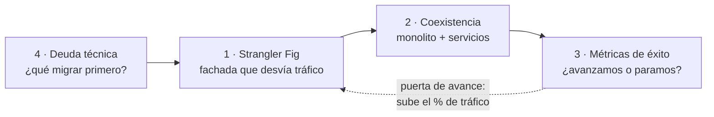
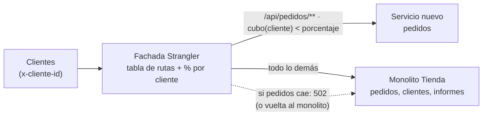
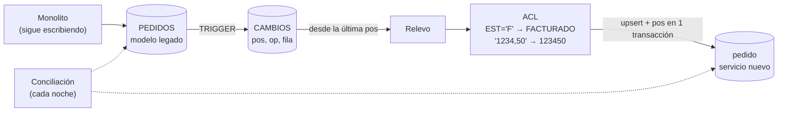
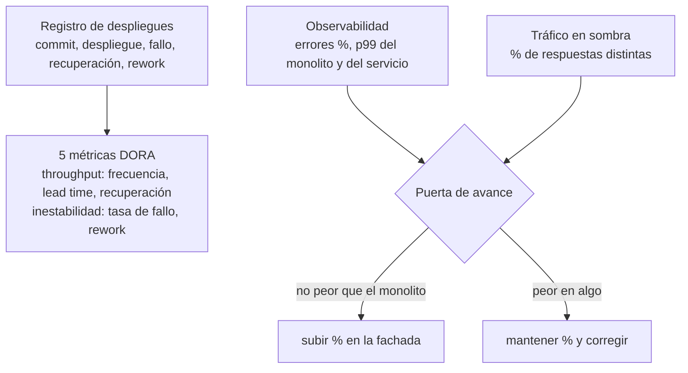
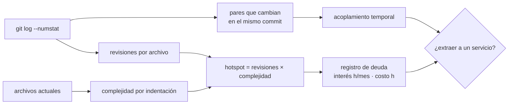

# Módulo 31 · Migración desde monolito real

**Fase 3 · Nivel maestro: arquitectura avanzada** (semana 6 de 8). **Duración:** 6 h (4 temas de unos 75 min y 1 h
de laboratorio integrador). **Dificultad:** 4 de 5. **Dependencias:** Módulo 5 (Strangler Fig y database-per-service:
allí viste la idea; aquí la llevas a un monolito con años de historia), Módulo 24 (ADR y fitness functions), Módulo 25
(outbox y CDC: la forma correcta de sacar los datos del monolito) y Módulo 30 (anti-patrones y cuándo NO usar
microservicios). **Herramientas:**Node.js 26.13.1 LTS** sin dependencias de npm (SQLite 3.54.1 viene dentro de
Node como `node:sqlite`) y **Git** (el de tu sistema, 2.x).
(los comandos de verificación indicados ejecuta 17 tests y los scripts de las cuatro fichas; `--compose` se acepta, pero este módulo no
levanta contenedores).

Casi nadie empieza un sistema de microservicios desde cero: lo normal es heredar un **monolito que factura** y que
nadie se atreve a apagar. Migrarlo es una operación a corazón abierto: el paciente (el negocio) no puede parar. En este
módulo aprendes a hacerlo **por partes y con red**: una **fachada Strangler Fig** que desvía el tráfico ruta a ruta y
cliente a cliente; la **coexistencia** de datos entre el monolito y el servicio nuevo sin dobles escrituras; las
**métricas** que dicen si la migración va bien (y las de vanidad que dicen que sí cuando va mal); y la **deuda técnica**
medida con el historial de Git, que a veces te dirá que lo correcto es **no** sacar ese módulo del monolito.



**Texto alternativo:** mapa del módulo. La deuda técnica (tema 4) decide qué parte del monolito conviene tocar primero
y alimenta el Strangler Fig (tema 1), una fachada que desvía tráfico hacia el servicio nuevo. Mientras conviven, el
monolito y el servicio comparten datos de forma controlada (tema 2) y las métricas de éxito (tema 3) deciden, con una
flecha punteada que vuelve al tema 1, si se sube el porcentaje de tráfico que va al servicio nuevo.

**Qué se ejecutó aquí.** Todo: los 17 tests y los scripts de las cuatro fichas se ejecutaron con Node 26.13.1 y Git
2.43 en Linux, y sus salidas están pegadas tal cual. Los datos de despliegues (F179) y el historial de Git (F180) son
**sintéticos y deterministas** (semilla fija y fechas fijas) para que obtengas los mismos números. La versión Spring
Boot de la fachada Strangler Fig ya la construiste en el Módulo 5
(`f045-strangler-fig`): aquí se usa Node para todo el módulo, igual que el resto de la
Fase 3.

**Cómo usar el laboratorio.** Con Node 26 y Git:

```bash
npm ci                      # no instala nada: el lockfile está vacío a propósito
  # 17 tests + scripts de las 4 fichas → «RESULTADO: OK»
```

`README.md` tiene el mapa de carpetas.

`package.json` del laboratorio:

```json
{
  "name": "modulo-31-migracion-monolito",
  "version": "1.0.0",
  "private": true,
  "description": "Módulo 31 (Fase 3): Migración desde un monolito real (Strangler Fig, coexistencia monolito + servicios, métricas de éxito y deuda técnica).",
  "type": "module",
  "engines": {
    "node": ">=26.13.1"
  },
  "scripts": {
    "test": "node --test --test-concurrency=1 'f1*/*.test.js'"
  }
}
```

Utilidades HTTP comunes (`comun/http.js`), solo con `node:http` y `fetch` nativo:

```javascript
// Módulo 31 · utilidades HTTP sin dependencias (solo node:http).
import http from 'node:http';

// Arranca un servidor en un puerto libre (0) y devuelve su URL base.
export function escuchar(servidor) {
  return new Promise((ok) => servidor.listen(0, '127.0.0.1', () => ok(`http://127.0.0.1:${servidor.address().port}`)));
}

export const cerrar = (servidor) => new Promise((ok) => servidor.close(() => ok()));

// Lee el cuerpo completo de una petición o respuesta.
export async function leerCuerpo(flujo) {
  const trozos = [];
  for await (const t of flujo) trozos.push(t);
  return Buffer.concat(trozos).toString('utf8');
}

export function json(res, estado, cuerpo, cabeceras = {}) {
  res.writeHead(estado, { 'content-type': 'application/json', ...cabeceras });
  res.end(JSON.stringify(cuerpo));
}

// Petición con fetch nativo de Node 26; devuelve estado, cabeceras útiles y cuerpo JSON (o texto).
export async function pedir(url, opciones = {}) {
  const r = await fetch(url, opciones);
  const texto = await r.text();
  let cuerpo;
  try { cuerpo = JSON.parse(texto); } catch { cuerpo = texto; }
  return { estado: r.status, servidoPor: r.headers.get('x-servido-por'), cuerpo };
}

export { http };
```

---


### Strangler Fig

<details open>
<summary><strong>Capa 1 — Lectura</strong></summary>

#### ► DE QUÉ TRATA
Construir una fachada Strangler Fig que desvíe al servicio nuevo una ruta concreta del monolito, para un porcentaje pegajoso de clientes, y comprobar que el resto del tráfico sigue llegando al monolito sin cambios. Lo compruebas cuando node --test f177-strangler-fig/fachada.test.…

#### ► LA IDEA EN UNA FRASE
**Construir una fachada Strangler Fig que desvíe al servicio nuevo una ruta concreta del monolito, para un porcentaje pegajoso de clientes, y comprobar que el resto del tráfico sigue llegando al monolito sin cambios.**

#### ► POR QUÉ EXISTE ESTO
Resuelve un problema real de diseño o implementación y evita decisiones a ciegas.

#### ► LA ANALOGÍA
Piensa en strangler fig como una herramienta de taller: útil cuando conoces su propósito y sus límites.
**Dónde se rompe la analogía:** en software, los efectos dependen del contexto, la escala y los trade-offs.

#### ► CÓMO FUNCIONA


1. Un **monolito** es un programa grande que lo hace todo. Reescribirlo de golpe es como cambiar el motor de un avión en
2. El **Strangler Fig** propone otra cosa: poner una **puerta** delante del monolito. Al principio la puerta manda todo
3. Luego construyes **una sola parte** nueva (por ejemplo, «pedidos») y le dices a la puerta: «lo de pedidos mándalo a
4. Repites parte a parte. Un día el monolito ya no recibe nada y lo apagas.

#### ► LO QUE PUEDE SALIR MAL
| Síntoma | Causa probable | Arreglo |
|---|---|---|
| Strangler Fig se aplica pero el resultado no mejora | Se usó sin medir el problema real | Mide antes y compara contra la alternativa simple |
| Aparece complejidad inesperada | Se adoptó la técnica sin comprender sus trade-offs | Vuelve a la sección de trade-offs y reduce el alcance |
| Falla en un caso límite | Se asumió un contexto que no se cumple | Prueba el caso límite y documenta cuándo NO usarlo |

#### ► TRADE-OFFS
| Opción | Cuándo usarla | Cuándo NO usarla |
|---|---|---|
| Usar Strangler Fig | Cuando el problema coincide con su propósito y el beneficio es observable | Cuando agrega complejidad sin resolver un problema real |
| Alternativa más simple | Cuando el contexto es pequeño, estable o fácil de razonar | Cuando ya demostró no escalar o no cumplir el requisito |
| Postergar la decisión | Cuando falta evidencia del problema | Cuando el costo de esperar es mayor que el costo de probar |

#### ► CUÁNDO NO USAR ESTO
Estrangulamiento eterno: la fachada lleva tres años con la mitad de las rutas en el monolito y la mitad en servicios, el código viejo de las rutas migradas sigue en el monolito «por si acaso» y cada cambio se hace en los dos lados. Pagas dos sistemas y una fachada.

#### ► DE VUELTA A LA ANALOGÍA
Volviendo a la analogía: strangler fig funciona como el modelo inicial, pero recuerda dónde se rompe: en producción importan la evidencia, la escala y el costo de equivocarte.

#### ► LO QUE DEBES RECORDAR
- Un **monolito** es un programa grande que lo hace todo. Reescribirlo de golpe es como cambiar el motor de un avión en
- El **Strangler Fig** propone otra cosa: poner una **puerta** delante del monolito. Al principio la puerta manda todo
- Luego construyes **una sola parte** nueva (por ejemplo, «pedidos») y le dices a la puerta: «lo de pedidos mándalo a
- Repites parte a parte. Un día el monolito ya no recibe nada y lo apagas.

#### ► PREGUNTAS PARA PENSAR
1. ¿Qué problema concreto resuelve strangler fig en tu contexto?
2. ¿Cómo sabrías que strangler fig no está funcionando bien?
3. ¿Qué alternativa más simple considerarías antes de usar strangler fig?

</details>

<details>
<summary><strong>Capa 2 — Construcción</strong></summary>

#### Código y verificación


```javascript
// Módulo 31 · F177 · Fachada Strangler Fig: un proxy delante del monolito que desvía, ruta a ruta y por porcentaje
// de clientes, el tráfico hacia los servicios nuevos. Todo lo que no está en la tabla sigue yendo al monolito.
// Versiones: Node.js 26.13.1 LTS, sin dependencias (node:http).
import { http } from '../comun/http.js';

// Hash FNV-1a de 32 bits: el mismo cliente cae siempre en el mismo «cubo» de 0 a 99 (asignación pegajosa).
export function cubo(clave) {
  let h = 0x811c9dc5;
  for (const c of Buffer.from(String(clave))) { h ^= c; h = Math.imul(h, 0x01000193) >>> 0; }
  return h % 100;
}

// ¿La ruta pertenece al prefijo? Solo si coincide entera o le sigue «/» o «?»: /api/pedidos-antiguos NO es /api/pedidos.
export function coincide(ruta, prefijo) {
  return ruta === prefijo || ruta.startsWith(prefijo + '/') || ruta.startsWith(prefijo + '?');
}

// Decide el destino: la regla más específica (prefijo más largo) que coincide y cuyo porcentaje incluye al cliente.
export function elegirDestino(metodo, ruta, rutas, claveCliente) {
  const candidatas = rutas
    .filter((r) => coincide(ruta, r.prefijo) && (!r.metodos || r.metodos.includes(metodo)))
    .sort((a, b) => b.prefijo.length - a.prefijo.length);
  const regla = candidatas[0];
  if (regla && cubo(claveCliente ?? 'anonimo') < (regla.porcentaje ?? 100)) return regla.destino;
  return 'monolito';
}

// Proxy: reenvía método, ruta, cabeceras y cuerpo tal cual (en streaming) y devuelve la respuesta del destino.
export function crearFachada({ rutas, destinos }) {
  return http.createServer((req, res) => {
    const destino = elegirDestino(req.method, req.url, rutas, req.headers['x-cliente-id']);
    const base = new URL(destinos[destino]);
    const salida = http.request(
      { host: base.hostname, port: base.port, method: req.method, path: req.url, headers: { ...req.headers, 'x-via-fachada': '1' } },
      (r) => { res.writeHead(r.statusCode, { ...r.headers, 'x-servido-por': r.headers['x-servido-por'] ?? destino }); r.pipe(res); },
    );
    salida.on('error', (e) => { res.writeHead(502, { 'content-type': 'application/json' }); res.end(JSON.stringify({ error: `${destino}: ${e.message}` })); });
    req.pipe(salida);
  });
}
```

```json
[
  { "prefijo": "/api/pedidos", "destino": "pedidos", "porcentaje": 100, "metodos": ["GET", "POST"] }
]
```

```javascript
// Módulo 31 · F177 · El monolito «Tienda» (legado): pedidos, clientes y un informe antiguo de pedidos.
// En un caso real es tu aplicación de años; aquí es lo mínimo para ver el enrutamiento de la fachada.
import { http, json, leerCuerpo } from '../comun/http.js';

export function crearMonolito() {
  return http.createServer(async (req, res) => {
    const url = new URL(req.url, 'http://x');
    let m;
    if (req.method === 'GET' && (m = url.pathname.match(/^\/api\/pedidos\/([\w-]+)$/))) {
      return json(res, 200, { id: m[1], estado: 'F', origen: 'monolito' }, { 'x-servido-por': 'monolito' });
    }
    if (req.method === 'POST' && url.pathname === '/api/pedidos') {
      const cuerpo = JSON.parse(await leerCuerpo(req));
      return json(res, 201, { ...cuerpo, origen: 'monolito' }, { 'x-servido-por': 'monolito' });
    }
    if (req.method === 'GET' && (m = url.pathname.match(/^\/api\/clientes\/([\w-]+)$/))) {
      return json(res, 200, { id: m[1], nombre: 'Ana', origen: 'monolito' }, { 'x-servido-por': 'monolito' });
    }
    if (req.method === 'GET' && url.pathname === '/api/pedidos-antiguos') {
      return json(res, 200, { informe: 'pedidos 2019-2024', origen: 'monolito' }, { 'x-servido-por': 'monolito' });
    }
    json(res, 404, { error: `el monolito no conoce ${req.method} ${url.pathname}` }, { 'x-servido-por': 'monolito' });
  });
}
```

```javascript
// Módulo 31 · F177 · El servicio nuevo «pedidos»: solo sabe de pedidos (la primera funcionalidad estrangulada).
import { http, json, leerCuerpo } from '../comun/http.js';

export function crearPedidosNuevo() {
  return http.createServer(async (req, res) => {
    const url = new URL(req.url, 'http://x');
    let m;
    if (req.method === 'GET' && (m = url.pathname.match(/^\/api\/pedidos\/([\w-]+)$/))) {
      return json(res, 200, { id: m[1], estado: 'FACTURADO', origen: 'pedidos-nuevo' }, { 'x-servido-por': 'pedidos-nuevo' });
    }
    if (req.method === 'POST' && url.pathname === '/api/pedidos') {
      const cuerpo = JSON.parse(await leerCuerpo(req));
      return json(res, 201, { ...cuerpo, origen: 'pedidos-nuevo' }, { 'x-servido-por': 'pedidos-nuevo' });
    }
    json(res, 404, { error: `pedidos-nuevo no conoce ${req.method} ${url.pathname}` }, { 'x-servido-por': 'pedidos-nuevo' });
  });
}
```

```javascript
// Módulo 31 · F177 · Demo: monolito + servicio nuevo + fachada. Ejecuta: node f177-strangler-fig/demo.js
import { readFileSync } from 'node:fs';
import { cerrar, escuchar, pedir } from '../comun/http.js';
import { crearMonolito } from './monolito.js';
import { crearPedidosNuevo } from './pedidos-nuevo.js';
import { crearFachada, elegirDestino } from './fachada.js';

const rutas = JSON.parse(readFileSync(new URL('./rutas.json', import.meta.url)));
const mono = crearMonolito();
const nuevo = crearPedidosNuevo();
const destinos = { monolito: await escuchar(mono), pedidos: await escuchar(nuevo) };
const fachada = crearFachada({ rutas, destinos });
const url = await escuchar(fachada);

const casos = [
  ['GET', '/api/pedidos/P-7'],
  ['POST', '/api/pedidos'],
  ['GET', '/api/clientes/C-1'],
  ['GET', '/api/pedidos-antiguos'],
];
console.log('fase 2 de la migración: /api/pedidos al 100 % en el servicio nuevo');
for (const [metodo, ruta] of casos) {
  const r = await pedir(url + ruta, metodo === 'POST'
    ? { method: 'POST', headers: { 'content-type': 'application/json', 'x-cliente-id': 'C-1' }, body: JSON.stringify({ id: 'P-8' }) }
    : { headers: { 'x-cliente-id': 'C-1' } });
  console.log(`${metodo.padEnd(4)} ${ruta.padEnd(22)} -> ${r.estado} servido por ${r.servidoPor}`);
}

// Despliegue gradual: con el 10 % de los clientes, ¿cuántos de 1000 van al servicio nuevo?
const al10 = [{ ...rutas[0], porcentaje: 10 }];
let nuevos = 0;
for (let i = 0; i < 1000; i++) if (elegirDestino('GET', '/api/pedidos/P-1', al10, `C-${i}`) === 'pedidos') nuevos++;
console.log(`fase 1 (10 %): ${nuevos} de 1000 clientes van a pedidos-nuevo; el mismo cliente siempre al mismo sitio`);

await Promise.all([cerrar(fachada), cerrar(mono), cerrar(nuevo)]);
```

</details>

### Coexistencia monolito + servicios

<details open>
<summary><strong>Capa 1 — Lectura</strong></summary>

#### ► DE QUÉ TRATA
Implementar la sincronización de datos entre un monolito y un servicio nuevo durante la coexistencia (captura de cambios, capa anticorrupción y relevo idempotente) y detectar divergencias con una conciliación. Lo compruebas cuando node --test f178-coexistencia/coexistencia.test.j…

#### ► LA IDEA EN UNA FRASE
**Implementar la sincronización de datos entre un monolito y un servicio nuevo durante la coexistencia (captura de cambios, capa anticorrupción y relevo idempotente) y detectar divergencias con una conciliación.**

#### ► POR QUÉ EXISTE ESTO
Resuelve un problema real de diseño o implementación y evita decisiones a ciegas.

#### ► LA ANALOGÍA
Piensa en coexistencia monolito + servicios como una herramienta de taller: útil cuando conoces su propósito y sus límites.
**Dónde se rompe la analogía:** en software, los efectos dependen del contexto, la escala y los trade-offs.

#### ► CÓMO FUNCIONA


1. Mientras migras, **el monolito sigue vivo**: la gente compra y él guarda los pedidos en su base de datos de siempre.
2. El servicio nuevo necesita esos pedidos, pero **no debe leer la base del monolito directamente**: si el monolito
3. Así que copiamos los cambios: cada vez que el monolito guarda algo, queda **apuntado**; un programa lee lo apuntado,
4. Y cada noche, alguien **compara** las dos bases. Si algo no cuadra, salta una alarma antes de que lo note un cliente.

#### ► LO QUE PUEDE SALIR MAL
| Síntoma | Causa probable | Arreglo |
|---|---|---|
| Coexistencia monolito + servicios se aplica pero el resultado no mejora | Se usó sin medir el problema real | Mide antes y compara contra la alternativa simple |
| Aparece complejidad inesperada | Se adoptó la técnica sin comprender sus trade-offs | Vuelve a la sección de trade-offs y reduce el alcance |
| Falla en un caso límite | Se asumió un contexto que no se cumple | Prueba el caso límite y documenta cuándo NO usarlo |

#### ► TRADE-OFFS
| Opción | Cuándo usarla | Cuándo NO usarla |
|---|---|---|
| Usar Coexistencia monolito + servicios | Cuando el problema coincide con su propósito y el beneficio es observable | Cuando agrega complejidad sin resolver un problema real |
| Alternativa más simple | Cuando el contexto es pequeño, estable o fácil de razonar | Cuando ya demostró no escalar o no cumplir el requisito |
| Postergar la decisión | Cuando falta evidencia del problema | Cuando el costo de esperar es mayor que el costo de probar |

#### ► CUÁNDO NO USAR ESTO
Base de datos de integración permanente: para «no complicarse», el servicio nuevo lee y escribe directamente las tablas del monolito. Funciona el primer día; después, cualquier cambio de esquema exige coordinar los dos despliegues y el servicio hereda EST CHAR(1) para siempre.

#### ► DE VUELTA A LA ANALOGÍA
Volviendo a la analogía: coexistencia monolito + servicios funciona como el modelo inicial, pero recuerda dónde se rompe: en producción importan la evidencia, la escala y el costo de equivocarte.

#### ► LO QUE DEBES RECORDAR
- Mientras migras, **el monolito sigue vivo**: la gente compra y él guarda los pedidos en su base de datos de siempre.
- El servicio nuevo necesita esos pedidos, pero **no debe leer la base del monolito directamente**: si el monolito
- Así que copiamos los cambios: cada vez que el monolito guarda algo, queda **apuntado**; un programa lee lo apuntado,
- Y cada noche, alguien **compara** las dos bases. Si algo no cuadra, salta una alarma antes de que lo note un cliente.

#### ► PREGUNTAS PARA PENSAR
1. ¿Qué problema concreto resuelve coexistencia monolito + servicios en tu contexto?
2. ¿Cómo sabrías que coexistencia monolito + servicios no está funcionando bien?
3. ¿Qué alternativa más simple considerarías antes de usar coexistencia monolito + servicios?

</details>

<details>
<summary><strong>Capa 2 — Construcción</strong></summary>

#### Código y verificación


```javascript
// Módulo 31 · F178 · Las dos bases de datos durante la coexistencia, con SQLite embebido en Node (node:sqlite, SQLite 3.54.1).
// - Monolito: tabla legado PEDIDOS (columnas de 2009) y un TRIGGER que anota cada cambio en CAMBIOS (captura de cambios).
// - Servicio nuevo «pedidos»: su propia base, con su propio modelo, y la posición hasta donde ha leído.
// En producción el monolito sería PostgreSQL y la captura, Debezium leyendo el WAL (Módulo 25); la idea es la misma.
import { DatabaseSync } from 'node:sqlite';

export function crearMonolitoBD() {
  const bd = new DatabaseSync(':memory:');
  bd.exec(`
    CREATE TABLE PEDIDOS (NUM_PED TEXT PRIMARY KEY, COD_CLI TEXT NOT NULL, EST CHAR(1) NOT NULL, IMPORTE TEXT NOT NULL);
    CREATE TABLE CAMBIOS (pos INTEGER PRIMARY KEY AUTOINCREMENT, op TEXT, num_ped TEXT, cod_cli TEXT, est TEXT, importe TEXT);
    CREATE TRIGGER pedidos_ins AFTER INSERT ON PEDIDOS BEGIN
      INSERT INTO CAMBIOS (op, num_ped, cod_cli, est, importe) VALUES ('c', NEW.NUM_PED, NEW.COD_CLI, NEW.EST, NEW.IMPORTE); END;
    CREATE TRIGGER pedidos_upd AFTER UPDATE ON PEDIDOS BEGIN
      INSERT INTO CAMBIOS (op, num_ped, cod_cli, est, importe) VALUES ('u', NEW.NUM_PED, NEW.COD_CLI, NEW.EST, NEW.IMPORTE); END;
    CREATE TRIGGER pedidos_del AFTER DELETE ON PEDIDOS BEGIN
      INSERT INTO CAMBIOS (op, num_ped) VALUES ('d', OLD.NUM_PED); END;`);
  return bd;
}

export function crearServicioBD() {
  const bd = new DatabaseSync(':memory:');
  bd.exec(`
    CREATE TABLE pedido (id TEXT PRIMARY KEY, cliente_id TEXT NOT NULL, estado TEXT NOT NULL, total_centimos INTEGER NOT NULL);
    CREATE TABLE posicion (fuente TEXT PRIMARY KEY, pos INTEGER NOT NULL);
    INSERT INTO posicion VALUES ('monolito', 0);`);
  return bd;
}
```

```javascript
// Módulo 31 · F178 · Capa anticorrupción (ACL): traduce el modelo del monolito al del servicio nuevo.
// El servicio nuevo nunca ve «EST='F'» ni importes como texto con coma: si el legado cambia, solo cambia este archivo.
const ESTADOS = { P: 'PENDIENTE', F: 'FACTURADO', A: 'ANULADO' };

export function traducir(cambio) {
  const estado = ESTADOS[cambio.est];
  if (!estado) throw new Error(`estado de legado desconocido: ${cambio.est}`);
  // '1234,50' (texto con coma decimal) -> 123450 céntimos (entero: nunca dinero en coma flotante).
  const [enteros, decimales = '0'] = cambio.importe.split(',');
  return { id: cambio.num_ped, clienteId: cambio.cod_cli, estado, totalCentimos: Number(enteros) * 100 + Number(decimales.padEnd(2, '0').slice(0, 2)) };
}
```

```javascript
// Módulo 31 · F178 · Relevo: lee los cambios del monolito desde la última posición, los traduce con la ACL y los
// aplica en la base del servicio nuevo. Idempotente: aplicar dos veces el mismo cambio deja el mismo estado.
import { traducir } from './acl.js';

export function sincronizar(monolito, servicio, { lote = 100 } = {}) {
  const desde = servicio.prepare("SELECT pos FROM posicion WHERE fuente = 'monolito'").get().pos;
  const cambios = monolito.prepare('SELECT * FROM CAMBIOS WHERE pos > ? ORDER BY pos LIMIT ?').all(desde, lote);
  const upsert = servicio.prepare(`INSERT INTO pedido (id, cliente_id, estado, total_centimos) VALUES (?, ?, ?, ?)
    ON CONFLICT(id) DO UPDATE SET cliente_id = excluded.cliente_id, estado = excluded.estado, total_centimos = excluded.total_centimos`);
  const borrar = servicio.prepare('DELETE FROM pedido WHERE id = ?');
  const avanzar = servicio.prepare("UPDATE posicion SET pos = ? WHERE fuente = 'monolito'");
  // El dato y la posición en la MISMA transacción local: si el proceso muere a mitad, se reintenta desde la posición.
  servicio.exec('BEGIN');
  try {
    for (const c of cambios) {
      if (c.op === 'd') borrar.run(c.num_ped);
      else { const p = traducir(c); upsert.run(p.id, p.clienteId, p.estado, p.totalCentimos); }
      avanzar.run(c.pos);
    }
    servicio.exec('COMMIT');
  } catch (e) { servicio.exec('ROLLBACK'); throw e; }
  return cambios.length;
}
```

```javascript
// Módulo 31 · F178 · Conciliación: compara las dos bases (traduciendo el legado con la misma ACL) y lista diferencias.
// Es la red de seguridad de la coexistencia: se ejecuta cada noche (o cada hora) y alerta si algo no cuadra.
import { traducir } from './acl.js';

export function conciliar(monolito, servicio) {
  const legado = new Map(monolito.prepare('SELECT NUM_PED AS num_ped, COD_CLI AS cod_cli, EST AS est, IMPORTE AS importe FROM PEDIDOS').all()
    .map((f) => [f.num_ped, traducir(f)]));
  const nuevo = new Map(servicio.prepare('SELECT id, cliente_id AS clienteId, estado, total_centimos AS totalCentimos FROM pedido').all()
    .map((f) => [f.id, { ...f }]));
  const diferencias = [];
  for (const [id, p] of legado) {
    const n = nuevo.get(id);
    if (!n) diferencias.push(`${id}: falta en el servicio nuevo`);
    else for (const campo of ['clienteId', 'estado', 'totalCentimos']) {
      if (p[campo] !== n[campo]) diferencias.push(`${id}.${campo}: monolito=${p[campo]} servicio=${n[campo]}`);
    }
  }
  for (const id of nuevo.keys()) if (!legado.has(id)) diferencias.push(`${id}: sobra en el servicio nuevo`);
  return { revisados: legado.size, diferencias };
}
```

```javascript
// Módulo 31 · F178 · Demo de coexistencia: el monolito sigue escribiendo; el servicio nuevo se alimenta de sus cambios.
// Ejecuta: node f178-coexistencia/demo.js
import { crearMonolitoBD, crearServicioBD } from './bd.js';
import { sincronizar } from './relevo.js';
import { conciliar } from './conciliar.js';

const mono = crearMonolitoBD();
const serv = crearServicioBD();
const ins = mono.prepare('INSERT INTO PEDIDOS VALUES (?, ?, ?, ?)');
ins.run('P-1', 'C-1', 'P', '120,50');
ins.run('P-2', 'C-2', 'P', '75');
ins.run('P-3', 'C-1', 'P', '9,9');
mono.prepare("UPDATE PEDIDOS SET EST = 'F' WHERE NUM_PED = 'P-1'").run();
mono.prepare("DELETE FROM PEDIDOS WHERE NUM_PED = 'P-3'").run();

console.log(`cambios aplicados: ${sincronizar(mono, serv)}`);
console.log(`segunda pasada (nada nuevo): ${sincronizar(mono, serv)}`);
for (const f of serv.prepare('SELECT * FROM pedido ORDER BY id').all()) console.log(`servicio nuevo: ${JSON.stringify({ ...f })}`);
let c = conciliar(mono, serv);
console.log(`conciliación: ${c.revisados} pedidos revisados, ${c.diferencias.length} diferencias`);

// Alguien «arregla a mano» un dato en la base nueva: la conciliación lo detecta.
serv.prepare("UPDATE pedido SET total_centimos = 12000 WHERE id = 'P-1'").run();
c = conciliar(mono, serv);
console.log(`tras un cambio manual en la base nueva: ${c.diferencias.join('; ')}`);
```

</details>

### Métricas de éxito

<details open>
<summary><strong>Capa 1 — Lectura</strong></summary>

#### ► DE QUÉ TRATA
Calcular las cinco métricas DORA de un equipo antes y después de la migración y aplicar una puerta de avance que decide, con errores, p99 y tráfico en sombra, si el servicio nuevo recibe más tráfico. Lo compruebas cuando node --test f179-metricas-exito/metricas.test.js pasa 3 de…

#### ► LA IDEA EN UNA FRASE
**Calcular las cinco métricas DORA de un equipo antes y después de la migración y aplicar una puerta de avance que decide, con errores, p99 y tráfico en sombra, si el servicio nuevo recibe más tráfico.**

#### ► POR QUÉ EXISTE ESTO
Resuelve un problema real de diseño o implementación y evita decisiones a ciegas.

#### ► LA ANALOGÍA
Piensa en métricas de éxito como una herramienta de taller: útil cuando conoces su propósito y sus límites.
**Dónde se rompe la analogía:** en software, los efectos dependen del contexto, la escala y los trade-offs.

#### ► CÓMO FUNCIONA


1. Migrar no es un fin: es una forma de conseguir algo (entregar más rápido, fallar menos). Hay que **medir ese algo**.
2. Contar «cuántos microservicios tenemos» es como medir una dieta por los táperes comprados: sube aunque no adelgaces.
3. Las métricas buenas responden: ¿sacamos cambios más a menudo?, ¿tardan menos en llegar?, ¿rompemos menos?,
4. Y antes de pasar más clientes al sistema nuevo, se comprueba que **no es peor** que el viejo.

#### ► LO QUE PUEDE SALIR MAL
| Síntoma | Causa probable | Arreglo |
|---|---|---|
| Métricas de éxito se aplica pero el resultado no mejora | Se usó sin medir el problema real | Mide antes y compara contra la alternativa simple |
| Aparece complejidad inesperada | Se adoptó la técnica sin comprender sus trade-offs | Vuelve a la sección de trade-offs y reduce el alcance |
| Falla en un caso límite | Se asumió un contexto que no se cumple | Prueba el caso límite y documenta cuándo NO usarlo |

#### ► TRADE-OFFS
| Opción | Cuándo usarla | Cuándo NO usarla |
|---|---|---|
| Usar Métricas de éxito | Cuando el problema coincide con su propósito y el beneficio es observable | Cuando agrega complejidad sin resolver un problema real |
| Alternativa más simple | Cuando el contexto es pequeño, estable o fácil de razonar | Cuando ya demostró no escalar o no cumplir el requisito |
| Postergar la decisión | Cuando falta evidencia del problema | Cuando el costo de esperar es mayor que el costo de probar |

#### ► CUÁNDO NO USAR ESTO
Migración guiada por la hoja de ruta, no por los datos: el plan dice «sacar facturación en el T3» y se saca, aunque la puerta de avance del servicio anterior siga cerrada y nadie haya mirado la línea base.

#### ► DE VUELTA A LA ANALOGÍA
Volviendo a la analogía: métricas de éxito funciona como el modelo inicial, pero recuerda dónde se rompe: en producción importan la evidencia, la escala y el costo de equivocarte.

#### ► LO QUE DEBES RECORDAR
- Migrar no es un fin: es una forma de conseguir algo (entregar más rápido, fallar menos). Hay que **medir ese algo**.
- Contar «cuántos microservicios tenemos» es como medir una dieta por los táperes comprados: sube aunque no adelgaces.
- Las métricas buenas responden: ¿sacamos cambios más a menudo?, ¿tardan menos en llegar?, ¿rompemos menos?,
- Y antes de pasar más clientes al sistema nuevo, se comprueba que **no es peor** que el viejo.

#### ► PREGUNTAS PARA PENSAR
1. ¿Qué problema concreto resuelve métricas de éxito en tu contexto?
2. ¿Cómo sabrías que métricas de éxito no está funcionando bien?
3. ¿Qué alternativa más simple considerarías antes de usar métricas de éxito?

</details>

<details>
<summary><strong>Capa 2 — Construcción</strong></summary>

#### Código y verificación


```javascript
// Módulo 31 · F179 · Datos SINTÉTICOS (semilla fija) de 90 días de despliegues: el monolito antes de migrar y el
// servicio «pedidos» después. Cada despliegue: cuándo se hizo commit, cuándo llegó a producción, si falló y cuánto
// tardó en recuperarse, y si fue un despliegue no planificado para arreglar un incidente (rework).
const HORA = 3_600_000;
const DIA = 24 * HORA;

function aleatorio(semilla) { // mulberry32: el mismo resultado en cualquier máquina
  return () => { semilla |= 0; semilla = (semilla + 0x6d2b79f5) | 0; let t = Math.imul(semilla ^ (semilla >>> 15), 1 | semilla);
    t = (t + Math.imul(t ^ (t >>> 7), 61 | t)) ^ t; return ((t ^ (t >>> 14)) >>> 0) / 4294967296; };
}

function generar({ semilla, cadaDias, leadHoras, probFallo, recuperacionHoras }) {
  const r = aleatorio(semilla);
  const inicio = Date.UTC(2026, 6, 1);
  const lista = [];
  for (let t = 0; t < 90 * DIA; t += cadaDias * DIA * (0.5 + r())) {
    const despliegue = inicio + t;
    const fallo = r() < probFallo;
    lista.push({ commit: despliegue - leadHoras * HORA * (0.5 + r()), despliegue, fallo,
      recuperacionMin: fallo ? Math.round(recuperacionHoras * 60 * (0.5 + r())) : 0, rework: false });
    if (fallo) lista.push({ commit: despliegue + HORA, despliegue: despliegue + 2 * HORA, fallo: false, recuperacionMin: 0, rework: true });
  }
  return lista;
}

export const antes = generar({ semilla: 31, cadaDias: 14, leadHoras: 240, probFallo: 0.3, recuperacionHoras: 8 });
export const despues = generar({ semilla: 32, cadaDias: 2, leadHoras: 20, probFallo: 0.08, recuperacionHoras: 1 });
```

```javascript
// Módulo 31 · F179 · Métricas de éxito de una migración: las cinco métricas DORA (dora.dev, guía de enero de 2026) y la
// «puerta de avance» que decide si el Strangler Fig sube el porcentaje de tráfico del servicio nuevo.
// Ejecuta: node f179-metricas-exito/metricas.js
import { pathToFileURL } from 'node:url';
import { antes, despues } from './datos.js';

const mediana = (xs) => { const s = [...xs].sort((a, b) => a - b); const m = s.length >> 1; return s.length % 2 ? s[m] : (s[m - 1] + s[m]) / 2; };

export function dora(despliegues, dias = 90) {
  const normales = despliegues.filter((d) => !d.rework);
  const fallidos = normales.filter((d) => d.fallo);
  return {
    frecuenciaPorSemana: despliegues.length / (dias / 7),                                   // throughput
    leadTimeHoras: mediana(despliegues.map((d) => (d.despliegue - d.commit) / 3_600_000)),   // throughput (mediana)
    recuperacionMin: fallidos.length ? mediana(fallidos.map((d) => d.recuperacionMin)) : 0,  // throughput
    tasaFallo: fallidos.length / normales.length,                                            // inestabilidad
    tasaRework: despliegues.filter((d) => d.rework).length / despliegues.length,             // inestabilidad
  };
}

// Puerta de avance: el servicio nuevo solo recibe más tráfico si NO es peor que el monolito en lo que nota el usuario.
export function puertaDeAvance({ base, nuevo, diferenciasSombra }, umbrales = { errorPp: 0.1, p99Factor: 1.1, sombra: 0.001 }) {
  const motivos = [];
  if (nuevo.errores - base.errores > umbrales.errorPp) motivos.push(`errores ${nuevo.errores} % > ${base.errores} % + ${umbrales.errorPp} pp`);
  if (nuevo.p99 > base.p99 * umbrales.p99Factor) motivos.push(`p99 ${nuevo.p99} ms > ${(base.p99 * umbrales.p99Factor).toFixed(0)} ms`);
  if (diferenciasSombra > umbrales.sombra) motivos.push(`tráfico en sombra con ${(diferenciasSombra * 100).toFixed(2)} % de respuestas distintas`);
  return { avanzar: motivos.length === 0, motivos };
}

if (import.meta.url === pathToFileURL(process.argv[1]).href) {
  const a = dora(antes); const d = dora(despues);
  const fila = (n, x, y, f) => console.log(`${n.padEnd(30)} ${f(x).padStart(10)} ${f(y).padStart(10)}`);
  console.log(`${'métrica DORA (90 días)'.padEnd(30)} ${'monolito'.padStart(10)} ${'pedidos'.padStart(10)}`);
  fila('despliegues por semana', a.frecuenciaPorSemana, d.frecuenciaPorSemana, (v) => v.toFixed(1));
  fila('lead time de cambio (h, med.)', a.leadTimeHoras, d.leadTimeHoras, (v) => v.toFixed(1));
  fila('recuperación (min, mediana)', a.recuperacionMin, d.recuperacionMin, (v) => v.toFixed(0));
  fila('tasa de fallo de cambios', a.tasaFallo, d.tasaFallo, (v) => `${(v * 100).toFixed(1)} %`);
  fila('tasa de rework', a.tasaRework, d.tasaRework, (v) => `${(v * 100).toFixed(1)} %`);
  const base = { errores: 0.40, p99: 420 };
  for (const [fase, nuevo, sombra] of [['10 % -> 50 %', { errores: 0.35, p99: 380 }, 0.0004], ['50 % -> 100 %', { errores: 0.62, p99: 510 }, 0.0004]]) {
    const r = puertaDeAvance({ base, nuevo, diferenciasSombra: sombra });
    console.log(`puerta ${fase}: ${r.avanzar ? 'AVANZAR' : 'NO AVANZAR'}${r.motivos.length ? ' · ' + r.motivos.join(' · ') : ''}`);
  }
}
```

```bash
node f179-metricas-exito/metricas.js
```

```text
métrica DORA (90 días)           monolito    pedidos
despliegues por semana                0.7        3.7
lead time de cambio (h, med.)       295.3       20.6
recuperación (min, mediana)           523         57
tasa de fallo de cambios           28.6 %      4.3 %
tasa de rework                     22.2 %      4.2 %
puerta 10 % -> 50 %: AVANZAR
puerta 50 % -> 100 %: NO AVANZAR · errores 0.62 % > 0.4 % + 0.1 pp · p99 510 ms > 462 ms
```

```javascript
// Módulo 31 · F179 · tests: node --test f179-metricas-exito/metricas.test.js
import { test } from 'node:test';
import assert from 'node:assert/strict';
import { dora, puertaDeAvance } from './metricas.js';
import { antes, despues } from './datos.js';

const H = 3_600_000;
const d = (h, fallo = false, rec = 0, rework = false) => ({ commit: 0, despliegue: h * H, fallo, recuperacionMin: rec, rework });

test('DORA a mano: 4 despliegues normales, 1 fallido (30 min) y 1 de rework en 7 días', () => {
  const m = dora([d(2), d(4), d(6, true, 30), d(8), d(1, false, 0, true)], 7);
  assert.equal(m.frecuenciaPorSemana, 5);
  assert.equal(m.leadTimeHoras, 4);
  assert.equal(m.tasaFallo, 0.25);
  assert.equal(m.recuperacionMin, 30);
  assert.equal(m.tasaRework, 0.2);
});

test('con los datos del laboratorio, el servicio nuevo mejora las cinco métricas', () => {
  const a = dora(antes); const n = dora(despues);
  assert.ok(n.frecuenciaPorSemana > a.frecuenciaPorSemana);
  assert.ok(n.leadTimeHoras < a.leadTimeHoras);
  assert.ok(n.recuperacionMin < a.recuperacionMin);
  assert.ok(n.tasaFallo < a.tasaFallo);
  assert.ok(n.tasaRework < a.tasaRework);
});

test('la puerta de avance se cierra si el servicio nuevo es peor que el monolito', () => {
  const base = { errores: 0.4, p99: 400 };
  assert.equal(puertaDeAvance({ base, nuevo: { errores: 0.45, p99: 430 }, diferenciasSombra: 0 }).avanzar, true);
  const r = puertaDeAvance({ base, nuevo: { errores: 0.4, p99: 400 }, diferenciasSombra: 0.02 });
  assert.deepEqual(r, { avanzar: false, motivos: ['tráfico en sombra con 2.00 % de respuestas distintas'] });
});
```

</details>

### Deuda técnica

<details open>
<summary><strong>Capa 1 — Lectura</strong></summary>

#### ► DE QUÉ TRATA
Priorizar la deuda técnica de un monolito con datos: hotspots (frecuencia de cambio × complejidad), acoplamiento temporal sacado de Git y un registro con interés y costo de pago; y decidir si un hotspot se extrae a un servicio o se refactoriza dentro del monolito. Lo compruebas c…

#### ► LA IDEA EN UNA FRASE
**Priorizar la deuda técnica de un monolito con datos: hotspots (frecuencia de cambio × complejidad), acoplamiento temporal sacado de Git y un registro con interés y costo de pago; y decidir si un hotspot se extrae a un servicio o se refactoriza dentro del monolito.**

#### ► POR QUÉ EXISTE ESTO
Resuelve un problema real de diseño o implementación y evita decisiones a ciegas.

#### ► LA ANALOGÍA
Piensa en deuda técnica como una herramienta de taller: útil cuando conoces su propósito y sus límites.
**Dónde se rompe la analogía:** en software, los efectos dependen del contexto, la escala y los trade-offs.

#### ► CÓMO FUNCIONA


1. **Deuda técnica** es todo lo que se hizo «rápido» y ahora hace que cada cambio cueste más. Como una deuda de dinero,
2. No toda la deuda importa igual. Un código feísimo que **nadie toca** no cobra intereses. Un código regular que se
3. Git guarda quién cambió qué y cuándo. Con eso puedes ver **dónde duele** de verdad, sin opiniones.
4. Y a veces la conclusión no es «hagamos un microservicio», sino «ordenemos esta parte por dentro».

#### ► LO QUE PUEDE SALIR MAL
| Síntoma | Causa probable | Arreglo |
|---|---|---|
| Deuda técnica se aplica pero el resultado no mejora | Se usó sin medir el problema real | Mide antes y compara contra la alternativa simple |
| Aparece complejidad inesperada | Se adoptó la técnica sin comprender sus trade-offs | Vuelve a la sección de trade-offs y reduce el alcance |
| Falla en un caso límite | Se asumió un contexto que no se cumple | Prueba el caso límite y documenta cuándo NO usarlo |

#### ► TRADE-OFFS
| Opción | Cuándo usarla | Cuándo NO usarla |
|---|---|---|
| Usar Deuda técnica | Cuando el problema coincide con su propósito y el beneficio es observable | Cuando agrega complejidad sin resolver un problema real |
| Alternativa más simple | Cuando el contexto es pequeño, estable o fácil de razonar | Cuando ya demostró no escalar o no cumplir el requisito |
| Postergar la decisión | Cuando falta evidencia del problema | Cuando el costo de esperar es mayor que el costo de probar |

#### ► CUÁNDO NO USAR ESTO
«Lo arreglamos en el microservicio»: usar la migración como excusa para no pagar deuda. Se extrae el módulo enredado tal cual a un servicio nuevo, con su complejidad intacta y ahora, además, con red de por medio.

#### ► DE VUELTA A LA ANALOGÍA
Volviendo a la analogía: deuda técnica funciona como el modelo inicial, pero recuerda dónde se rompe: en producción importan la evidencia, la escala y el costo de equivocarte.

#### ► LO QUE DEBES RECORDAR
- **Deuda técnica** es todo lo que se hizo «rápido» y ahora hace que cada cambio cueste más. Como una deuda de dinero,
- No toda la deuda importa igual. Un código feísimo que **nadie toca** no cobra intereses. Un código regular que se
- Git guarda quién cambió qué y cuándo. Con eso puedes ver **dónde duele** de verdad, sin opiniones.
- Y a veces la conclusión no es «hagamos un microservicio», sino «ordenemos esta parte por dentro».

#### ► PREGUNTAS PARA PENSAR
1. ¿Qué problema concreto resuelve deuda técnica en tu contexto?
2. ¿Cómo sabrías que deuda técnica no está funcionando bien?
3. ¿Qué alternativa más simple considerarías antes de usar deuda técnica?

</details>

<details>
<summary><strong>Capa 2 — Construcción</strong></summary>

#### Código de referencia / ejecutable
Versiones: **Node.js 26.13.1 LTS** y **Git 2.x**, sin dependencias de npm.

`f180-deuda-tecnica/generar-repo.js` (un monolito de ejemplo con historial fijo):

```javascript
// Módulo 31 · F180 · Crea un repositorio Git de ejemplo (el monolito «Tienda») con un historial fijo: mismas fechas,
// mismos autores y mismos archivos en cualquier máquina. Devuelve la ruta. Uso: node f180-deuda-tecnica/generar-repo.js [dir]
import { execFileSync } from 'node:child_process';
import { mkdtempSync, writeFileSync } from 'node:fs';
import { tmpdir } from 'node:os';
import { join } from 'node:path';
import { pathToFileURL } from 'node:url';

// Código con N niveles de anidamiento: la «complejidad por indentación» crece con lo anidado que está.
const anidado = (nombre, niveles, lineas, version) => {
  let s = `// ${nombre} v${version}\nexport function ${nombre.replace(/\W/g, '')}(p) {\n`;
  for (let i = 0; i < lineas; i++) {
    const n = 1 + (i % niveles);
    s += '  '.repeat(n) + (n < niveles ? `if (p.c${i}) {` : `p.t += ${i};`) + '\n';
  }
  return s + '}\n';
};
// [archivo, niveles de anidamiento, líneas, en cuántos commits cambia]
const ARCHIVOS = [
  ['facturacion.js', 6, 120, 18],
  ['pedidos.js', 4, 80, 9],
  ['reportes-legado.js', 9, 200, 0],
  ['clientes.js', 2, 40, 4],
  ['utilidades.js', 2, 30, 2],
];

export function generarRepo(dir = mkdtempSync(join(tmpdir(), 'tienda-'))) {
  const git = (...a) => execFileSync('git', a, { cwd: dir, env: { ...process.env, GIT_AUTHOR_DATE: fecha, GIT_COMMITTER_DATE: fecha } });
  let fecha = '2026-01-05T10:00:00Z';
  execFileSync('git', ['init', '-q', '-b', 'main'], { cwd: dir });
  execFileSync('git', ['config', 'user.email', 'equipo@tienda.local'], { cwd: dir });
  execFileSync('git', ['config', 'user.name', 'Equipo Tienda'], { cwd: dir });
  for (const [f, niv, lin] of ARCHIVOS) writeFileSync(join(dir, f), anidado(f, niv, lin, 0));
  git('add', '.'); git('commit', '-q', '-m', 'monolito inicial');
  for (let c = 1; c <= 18; c++) {
    fecha = `2026-${String(1 + Math.floor(c / 2)).padStart(2, '0')}-${String(10 + (c % 2) * 10)}T10:00:00Z`;
    for (const [f, niv, lin, cambios] of ARCHIVOS) if (c <= cambios) writeFileSync(join(dir, f), anidado(f, niv, lin + c, c));
    git('add', '.'); git('commit', '-q', '-m', `cambio ${c}`);
  }
  return dir;
}

if (import.meta.url === pathToFileURL(process.argv[1]).href) console.log(generarRepo(process.argv[2]));
```

`f180-deuda-tecnica/hotspots.js`:

```javascript
// Módulo 31 · F180 · Hotspots de deuda técnica: archivos que cambian MUCHO (git log) y son COMPLEJOS (indentación).
// Idea de «Your Code as a Crime Scene» (Adam Tornhill): la deuda que cobra intereses es la que tocas a menudo.
// Uso: node f180-deuda-tecnica/hotspots.js [repo]   (sin argumento, genera el repositorio de ejemplo)
import { execFileSync } from 'node:child_process';
import { readFileSync } from 'node:fs';
import { join } from 'node:path';
import { pathToFileURL } from 'node:url';
import { generarRepo } from './generar-repo.js';

// Complejidad por indentación: suma de niveles (2 espacios = 1 nivel) de las líneas no vacías. Barata y agnóstica del lenguaje.
export const complejidad = (texto) => texto.split('\n').filter((l) => l.trim())
  .reduce((s, l) => s + Math.floor(l.match(/^ */)[0].length / 2), 0);

export function analizar(repo) {
  const log = execFileSync('git', ['-C', repo, 'log', '--format=--%h', '--numstat'], { encoding: 'utf8' });
  const revisiones = new Map();
  const juntos = new Map(); // acoplamiento temporal: pares de archivos que cambian en el mismo commit
  for (const commit of log.split('--').slice(1)) {
    const archivos = commit.split('\n').slice(1).filter(Boolean).map((l) => l.split('\t')[2]);
    for (const a of archivos) revisiones.set(a, (revisiones.get(a) ?? 0) + 1);
    for (const a of archivos) for (const b of archivos) if (a < b) juntos.set(`${a}+${b}`, (juntos.get(`${a}+${b}`) ?? 0) + 1);
  }
  const filas = [...revisiones].map(([archivo, rev]) => {
    const cx = complejidad(readFileSync(join(repo, archivo), 'utf8'));
    return { archivo, revisiones: rev, complejidad: cx, puntuacion: rev * cx };
  }).sort((a, b) => b.puntuacion - a.puntuacion);
  const acoplamiento = (a, b) => { const k = a < b ? `${a}+${b}` : `${b}+${a}`;
    return (juntos.get(k) ?? 0) / Math.min(revisiones.get(a), revisiones.get(b)); };
  return { filas, acoplamiento };
}

if (import.meta.url === pathToFileURL(process.argv[1]).href) {
  const { filas, acoplamiento } = analizar(process.argv[2] ?? generarRepo());
  console.log('archivo               revisiones  complejidad  puntuación');
  for (const f of filas) console.log(`${f.archivo.padEnd(20)} ${String(f.revisiones).padStart(11)} ${String(f.complejidad).padStart(12)} ${String(f.puntuacion).padStart(11)}`);
  console.log(`acoplamiento temporal facturacion.js <-> pedidos.js: ${(acoplamiento('facturacion.js', 'pedidos.js') * 100).toFixed(0)} % de los commits de pedidos.js`);
}
```

`f180-deuda-tecnica/registro-deuda.js`:

```javascript
// Módulo 31 · F180 · Registro de deuda técnica con «interés»: horas que se pierden cada mes por no pagarla y horas que
// cuesta pagarla. Se prioriza por meses de recuperación (costo / interés): primero lo que antes se amortiza.
// Ejecuta: node f180-deuda-tecnica/registro-deuda.js
import { pathToFileURL } from 'node:url';

export const DEUDAS = [
  { id: 'D1', que: 'facturacion.js: cálculo de impuestos anidado 6 niveles', interesHorasMes: 30, costoHoras: 60, cuadrante: 'imprudente-deliberada' },
  { id: 'D2', que: 'pedidos y facturación comparten tablas (cambian juntos)', interesHorasMes: 20, costoHoras: 120, cuadrante: 'prudente-inadvertida' },
  { id: 'D3', que: 'reportes-legado.js: 9 niveles, nadie lo toca desde 2026-01', interesHorasMes: 0.5, costoHoras: 80, cuadrante: 'imprudente-inadvertida' },
  { id: 'D4', que: 'sin tests de contrato entre la fachada y pedidos-nuevo', interesHorasMes: 12, costoHoras: 16, cuadrante: 'prudente-deliberada' },
  { id: 'D5', que: 'despliegue manual del monolito (2 h por release)', interesHorasMes: 8, costoHoras: 40, cuadrante: 'prudente-deliberada' },
];

export function priorizar(deudas) {
  return deudas.map((d) => ({ ...d, mesesRecuperacion: d.costoHoras / d.interesHorasMes }))
    .sort((a, b) => a.mesesRecuperacion - b.mesesRecuperacion);
}

if (import.meta.url === pathToFileURL(process.argv[1]).href) {
  console.log('id  interés h/mes  costo h  se recupera en  qué');
  for (const d of priorizar(DEUDAS)) {
    console.log(`${d.id}  ${String(d.interesHorasMes).padStart(13)}  ${String(d.costoHoras).padStart(7)}  ${(d.mesesRecuperacion.toFixed(1) + ' meses').padStart(14)}  ${d.que}`);
  }
  const total = DEUDAS.reduce((s, d) => s + d.interesHorasMes, 0);
  console.log(`interés total: ${total} h/mes (${(total / 160 * 100).toFixed(0)} % de una persona a tiempo completo)`);
}
```

`f180-deuda-tecnica/decision.js`:

```javascript
// Módulo 31 · F180 · EJERCICIO DE DECISIÓN: «facturación es nuestro peor hotspot; ¿lo sacamos a un microservicio?».
// Evalúa los criterios del curso (Módulos 5 y 30) con los datos del laboratorio. Ejecuta: node f180-deuda-tecnica/decision.js
import { pathToFileURL } from 'node:url';

// Cada criterio a favor de extraer un servicio: ¿se cumple?
export function decidir(c) {
  const aFavor = [
    ['necesita escalar distinto que el resto', c.escalaDistinto],
    ['otro equipo lo despliega a otro ritmo', c.equipoPropio],
    ['frontera estable: cambia sola, no junto a otro módulo', c.acoplamientoTemporal < 0.3],
    ['requisito propio (aislamiento, regulación, tecnología)', c.requisitoPropio],
  ];
  const cumplidos = aFavor.filter(([, si]) => si).length;
  return { aFavor, extraer: cumplidos >= 2 && c.acoplamientoTemporal < 0.3 };
}

if (import.meta.url === pathToFileURL(process.argv[1]).href) {
  const facturacion = { escalaDistinto: false, equipoPropio: false, acoplamientoTemporal: 1.0, requisitoPropio: false };
  const r = decidir(facturacion);
  for (const [criterio, si] of r.aFavor) console.log(`${si ? '✔' : '✘'} ${criterio}`);
  console.log(r.extraer ? 'DECISIÓN: extraer a un microservicio'
    : 'DECISIÓN: NO usar microservicios. Refactorizar facturación DENTRO del monolito (módulo con interfaz propia) y medir');
}
```

#### Verificación
Test que debes ejecutar (`f180-deuda-tecnica/deuda.test.js`):

```javascript
// Módulo 31 · F180 · tests: node --test f180-deuda-tecnica/deuda.test.js
import { test } from 'node:test';
import assert from 'node:assert/strict';
import { analizar, complejidad } from './hotspots.js';
import { generarRepo } from './generar-repo.js';
import { DEUDAS, priorizar } from './registro-deuda.js';
import { decidir } from './decision.js';

test('complejidad por indentación: 2 espacios = 1 nivel, las líneas vacías no cuentan', () => {
  assert.equal(complejidad('a\n  b\n\n    c\n'), 3);
});

const { filas, acoplamiento } = analizar(generarRepo());

test('el hotspot es facturacion.js, no el archivo más complejo (reportes-legado.js)', () => {
  assert.equal(filas[0].archivo, 'facturacion.js');
  const masComplejo = [...filas].sort((a, b) => b.complejidad - a.complejidad)[0];
  assert.equal(masComplejo.archivo, 'reportes-legado.js');
  assert.equal(masComplejo.revisiones, 1);
});

test('facturación y pedidos cambian siempre juntos (acoplamiento temporal del 100 %)', () => {
  assert.equal(acoplamiento('facturacion.js', 'pedidos.js'), 1);
});

test('el registro prioriza por meses de recuperación: D4 primero, D3 el último', () => {
  const orden = priorizar(DEUDAS).map((d) => d.id);
  assert.equal(orden[0], 'D4');
  assert.equal(orden.at(-1), 'D3');
});

test('ejercicio de decisión: con acoplamiento del 100 % y sin criterios a favor, NO extraer', () => {
  assert.equal(decidir({ escalaDistinto: false, equipoPropio: false, acoplamientoTemporal: 1, requisitoPropio: false }).extraer, false);
  assert.equal(decidir({ escalaDistinto: true, equipoPropio: true, acoplamientoTemporal: 0.1, requisitoPropio: false }).extraer, true);
});
```

```bash
node --test f180-deuda-tecnica/deuda.test.js
```

```text
✔ complejidad por indentación: 2 espacios = 1 nivel, las líneas vacías no cuentan
✔ el hotspot es facturacion.js, no el archivo más complejo (reportes-legado.js)
✔ facturación y pedidos cambian siempre juntos (acoplamiento temporal del 100 %)
✔ el registro prioriza por meses de recuperación: D4 primero, D3 el último
✔ ejercicio de decisión: con acoplamiento del 100 % y sin criterios a favor, NO extraer
ℹ tests 5
ℹ suites 0
ℹ pass 5
ℹ fail 0
ℹ cancelled 0
ℹ skipped 0
ℹ todo 0
ℹ duration_ms …
```

**Pregunta de comprobación:** ¿por qué D3 (`reportes-legado.js`, 9 niveles de anidamiento) va la última del registro
si es el código más complejo? (Porque casi no cobra intereses: nadie lo cambia. Pagarla costaría 80 horas para ahorrar
media hora al mes: 160 meses de recuperación.)

</details>
