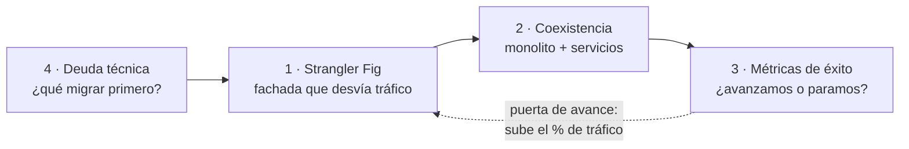
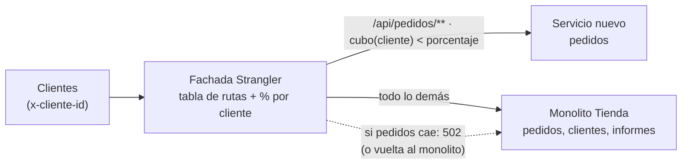
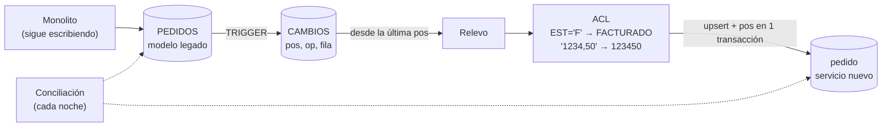
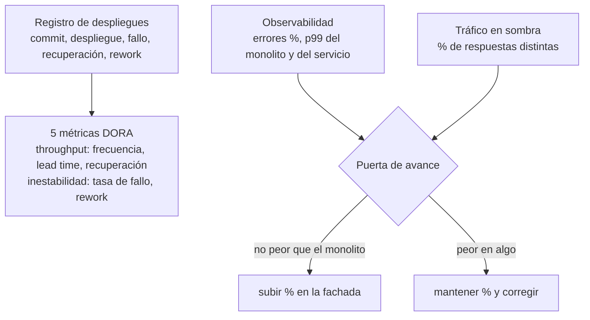
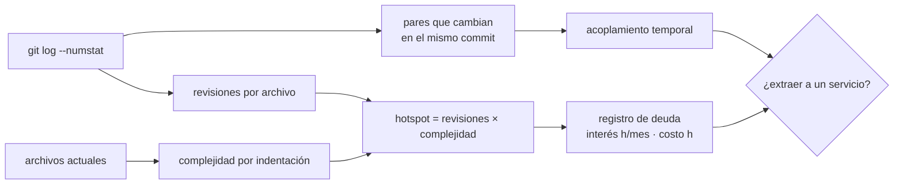

# Módulo 31 · Migración desde monolito real

**Fase 3 · Nivel maestro: arquitectura avanzada** (semana 6 de 8). **Duración:** 6 h (4 temas de unos 75 min y 1 h
de laboratorio integrador). **Dificultad:** 4 de 5. **Dependencias:** Módulo 5 (Strangler Fig y database-per-service:
allí viste la idea; aquí la llevas a un monolito con años de historia), Módulo 24 (ADR y fitness functions), Módulo 25
(outbox y CDC: la forma correcta de sacar los datos del monolito) y Módulo 30 (anti-patrones y cuándo NO usar
microservicios). **Herramientas:**Node.js 26.13.1 LTS** sin dependencias de npm (SQLite 3.54.1 viene dentro de
Node como `node:sqlite`) y **Git** (el de tu sistema, 2.x).
(los comandos de verificación indicados ejecuta 17 tests y los scripts de las cuatro fichas; `--compose` se acepta, pero este módulo no
levanta contenedores).

Casi nadie empieza un sistema de microservicios desde cero: lo normal es heredar un **monolito que factura** y que
nadie se atreve a apagar. Migrarlo es una operación a corazón abierto: el paciente (el negocio) no puede parar. En este
módulo aprendes a hacerlo **por partes y con red**: una **fachada Strangler Fig** que desvía el tráfico ruta a ruta y
cliente a cliente; la **coexistencia** de datos entre el monolito y el servicio nuevo sin dobles escrituras; las
**métricas** que dicen si la migración va bien (y las de vanidad que dicen que sí cuando va mal); y la **deuda técnica**
medida con el historial de Git, que a veces te dirá que lo correcto es **no** sacar ese módulo del monolito.



**Texto alternativo:** mapa del módulo. La deuda técnica (tema 4) decide qué parte del monolito conviene tocar primero
y alimenta el Strangler Fig (tema 1), una fachada que desvía tráfico hacia el servicio nuevo. Mientras conviven, el
monolito y el servicio comparten datos de forma controlada (tema 2) y las métricas de éxito (tema 3) deciden, con una
flecha punteada que vuelve al tema 1, si se sube el porcentaje de tráfico que va al servicio nuevo.

**Qué se ejecutó aquí.** Todo: los 17 tests y los scripts de las cuatro fichas se ejecutaron con Node 26.13.1 y Git
2.43 en Linux, y sus salidas están pegadas tal cual. Los datos de despliegues (F179) y el historial de Git (F180) son
**sintéticos y deterministas** (semilla fija y fechas fijas) para que obtengas los mismos números. La versión Spring
Boot de la fachada Strangler Fig ya la construiste en el Módulo 5
(`f045-strangler-fig`): aquí se usa Node para todo el módulo, igual que el resto de la
Fase 3.

**Cómo usar el laboratorio.** Con Node 26 y Git:

```bash
npm ci                      # no instala nada: el lockfile está vacío a propósito
  # 17 tests + scripts de las 4 fichas → «RESULTADO: OK»
```

`README.md` tiene el mapa de carpetas.

`package.json` del laboratorio:

```json
{
  "name": "modulo-31-migracion-monolito",
  "version": "1.0.0",
  "private": true,
  "description": "Módulo 31 (Fase 3): Migración desde un monolito real (Strangler Fig, coexistencia monolito + servicios, métricas de éxito y deuda técnica).",
  "type": "module",
  "engines": {
    "node": ">=26.13.1"
  },
  "scripts": {
    "test": "node --test --test-concurrency=1 'f1*/*.test.js'"
  }
}
```

Utilidades HTTP comunes (`comun/http.js`), solo con `node:http` y `fetch` nativo:

```javascript
// Módulo 31 · utilidades HTTP sin dependencias (solo node:http).
import http from 'node:http';

// Arranca un servidor en un puerto libre (0) y devuelve su URL base.
export function escuchar(servidor) {
  return new Promise((ok) => servidor.listen(0, '127.0.0.1', () => ok(`http://127.0.0.1:${servidor.address().port}`)));
}

export const cerrar = (servidor) => new Promise((ok) => servidor.close(() => ok()));

// Lee el cuerpo completo de una petición o respuesta.
export async function leerCuerpo(flujo) {
  const trozos = [];
  for await (const t of flujo) trozos.push(t);
  return Buffer.concat(trozos).toString('utf8');
}

export function json(res, estado, cuerpo, cabeceras = {}) {
  res.writeHead(estado, { 'content-type': 'application/json', ...cabeceras });
  res.end(JSON.stringify(cuerpo));
}

// Petición con fetch nativo de Node 26; devuelve estado, cabeceras útiles y cuerpo JSON (o texto).
export async function pedir(url, opciones = {}) {
  const r = await fetch(url, opciones);
  const texto = await r.text();
  let cuerpo;
  try { cuerpo = JSON.parse(texto); } catch { cuerpo = texto; }
  return { estado: r.status, servidoPor: r.headers.get('x-servido-por'), cuerpo };
}

export { http };
```

---

### Strangler Fig

#### 1. UBICACIÓN

Módulo 31, Lección 1 de 4 · Fase 3 · 75 min.

#### 2. PRERREQUISITOS

- La idea de Strangler Fig y de fachada del Módulo 5 (allí, en Spring Boot con `RestClient`).
- Qué es un proxy inverso y un API Gateway (Módulos 7 y 17).
- Despliegues canary (Módulos 12 y 23): mandar un porcentaje del tráfico a la versión nueva.

#### 3. OBJETIVO DE APRENDIZAJE

**Construir** una fachada Strangler Fig que desvíe al servicio nuevo una ruta concreta del monolito, para un
**porcentaje pegajoso** de clientes, y **comprobar** que el resto del tráfico sigue llegando al monolito sin cambios. Lo
compruebas cuando `node --test f177-strangler-fig/fachada.test.js` pasa 5 de 5.

#### 4. ANALOGÍA VISUAL

La **higuera estranguladora** de la selva, que da nombre al patrón. Dibuja un árbol viejo y enorme (el monolito). Una
semilla cae en su copa y lanza raíces finas que bajan por el tronco (los servicios nuevos). Año tras año las raíces
engordan y se entrelazan, hasta que forman un tronco hueco propio; el árbol viejo, por dentro, se ha ido secando sin
que el conjunto dejara nunca de estar en pie. En el dibujo, una **puerta giratoria** en la base del tronco reparte a
los visitantes: los que buscan «pedidos» suben por la raíz nueva; los demás, por el tronco viejo.

#### 5. DIAGRAMA TÉCNICO



**Texto alternativo:** diagrama de flujo. Los clientes, identificados por la cabecera x-cliente-id, llegan a la
fachada Strangler, que tiene una tabla de rutas y un porcentaje por cliente. Las peticiones a /api/pedidos de los
clientes cuyo cubo cae por debajo del porcentaje van al servicio nuevo de pedidos; todo lo demás va al monolito Tienda.
Una flecha punteada indica que, si el servicio nuevo cae, la fachada responde 502 o puede volver al monolito.

#### 6. EXPLICACIÓN NIVEL 0

- Un **monolito** es un programa grande que lo hace todo. Reescribirlo de golpe es como cambiar el motor de un avión en
  pleno vuelo: si sale mal, se cae todo.
- El **Strangler Fig** propone otra cosa: poner una **puerta** delante del monolito. Al principio la puerta manda todo
  al monolito, así que nadie nota nada.
- Luego construyes **una sola parte** nueva (por ejemplo, «pedidos») y le dices a la puerta: «lo de pedidos mándalo a
  la parte nueva». Si algo va mal, se lo quitas y vuelve todo al monolito en segundos.
- Repites parte a parte. Un día el monolito ya no recibe nada y lo apagas.

#### 7. EXPLICACIÓN INTERMEDIA

- **Tabla de rutas** (`rutas.json`): prefijo, destino, porcentaje y métodos. Gana la regla **más específica** (el
  prefijo más largo); si ninguna coincide, el destino es **siempre el monolito**. Así, añadir una regla nunca rompe lo
  que no toca.
- **Límite de segmento:** `/api/pedidos` coincide con `/api/pedidos/P-7` y `/api/pedidos?pagina=2`, pero **no** con
  `/api/pedidos-antiguos`. Es el error común de esta ficha.
- **Porcentaje pegajoso:** un hash FNV-1a del identificador del cliente da un número de 0 a 99; el cliente va al
  servicio nuevo si ese número es menor que el porcentaje. El mismo cliente cae siempre en el mismo lado, así que no ve
  datos «saltando» entre dos sistemas de una petición a otra.
- **Streaming:** la fachada reenvía método, ruta, cabeceras y cuerpo con `pipe`, sin leerlos enteros en memoria, y
  marca la respuesta con `x-servido-por` para diagnosticar.
- **Fallo del destino:** si el servicio nuevo no responde, la fachada contesta **502** en lugar de colgar la petición.

#### 8. EXPLICACIÓN MAESTRA

| Dónde poner la fachada | A favor | En contra | Cuándo |
|---|---|---|---|
| **Proxy propio** (este `fachada.js`, o el `FachadaStrangler` de Spring del Módulo 5) | reglas a medida (por cliente, por tenant, por cabecera); se prueba con tests | es código tuyo en la ruta crítica | reglas de negocio en el enrutado |
| **API Gateway existente** (Spring Cloud Gateway, Kong, NGINX, Envoy) | ya está en producción; rutas por configuración | reglas por cliente más difíciles; la configuración también es código | rutas simples por prefijo |
| **Malla de servicios** (VirtualService de Istio con pesos, Módulo 27) | porcentajes y reintentos sin tocar código | solo ve HTTP, no reglas de negocio; exige malla | si ya operas Istio o Linkerd |
| **Dentro del monolito** (*branch by abstraction*: una interfaz con dos implementaciones) | sin salto de red | el monolito se sigue desplegando para cada cambio | cuando lo que migras es una librería, no una ruta |

- **Qué migrar primero:** algo con frontera clara, valor visible y poco acoplado (lo mide F180). El primer corte
  enseña a hacer los demás; no empieces por el núcleo más enredado.
- **Escrituras:** desviar lecturas es fácil; desviar escrituras exige decidir quién es el dueño del dato durante la
  coexistencia (F178). Empieza por rutas de solo lectura o por funcionalidades nuevas.
- **Tráfico en sombra (*shadowing*):** la fachada puede mandar una copia de la petición al servicio nuevo, descartar su
  respuesta y compararla con la del monolito. Se usa antes de servir de verdad (F179 lo usa como puerta de avance).
- **Cuándo NO:** si el monolito es pequeño y el equipo cabe en una mesa, un **monolito modular** bien separado da casi
  todo lo bueno sin el coste de la red (Módulo 30). Y si la fachada se queda para siempre con el 50 % de las rutas, has
  creado un tercer sistema que mantener (anti-patrón de esta ficha).

#### 9. CÓDIGO EJECUTABLE

Versiones: **Node.js 26.13.1 LTS**, sin dependencias (`node:http` y `fetch` nativo).

`f177-strangler-fig/fachada.js`:

```javascript
// Módulo 31 · F177 · Fachada Strangler Fig: un proxy delante del monolito que desvía, ruta a ruta y por porcentaje
// de clientes, el tráfico hacia los servicios nuevos. Todo lo que no está en la tabla sigue yendo al monolito.
// Versiones: Node.js 26.13.1 LTS, sin dependencias (node:http).
import { http } from '../comun/http.js';

// Hash FNV-1a de 32 bits: el mismo cliente cae siempre en el mismo «cubo» de 0 a 99 (asignación pegajosa).
export function cubo(clave) {
  let h = 0x811c9dc5;
  for (const c of Buffer.from(String(clave))) { h ^= c; h = Math.imul(h, 0x01000193) >>> 0; }
  return h % 100;
}

// ¿La ruta pertenece al prefijo? Solo si coincide entera o le sigue «/» o «?»: /api/pedidos-antiguos NO es /api/pedidos.
export function coincide(ruta, prefijo) {
  return ruta === prefijo || ruta.startsWith(prefijo + '/') || ruta.startsWith(prefijo + '?');
}

// Decide el destino: la regla más específica (prefijo más largo) que coincide y cuyo porcentaje incluye al cliente.
export function elegirDestino(metodo, ruta, rutas, claveCliente) {
  const candidatas = rutas
    .filter((r) => coincide(ruta, r.prefijo) && (!r.metodos || r.metodos.includes(metodo)))
    .sort((a, b) => b.prefijo.length - a.prefijo.length);
  const regla = candidatas[0];
  if (regla && cubo(claveCliente ?? 'anonimo') < (regla.porcentaje ?? 100)) return regla.destino;
  return 'monolito';
}

// Proxy: reenvía método, ruta, cabeceras y cuerpo tal cual (en streaming) y devuelve la respuesta del destino.
export function crearFachada({ rutas, destinos }) {
  return http.createServer((req, res) => {
    const destino = elegirDestino(req.method, req.url, rutas, req.headers['x-cliente-id']);
    const base = new URL(destinos[destino]);
    const salida = http.request(
      { host: base.hostname, port: base.port, method: req.method, path: req.url, headers: { ...req.headers, 'x-via-fachada': '1' } },
      (r) => { res.writeHead(r.statusCode, { ...r.headers, 'x-servido-por': r.headers['x-servido-por'] ?? destino }); r.pipe(res); },
    );
    salida.on('error', (e) => { res.writeHead(502, { 'content-type': 'application/json' }); res.end(JSON.stringify({ error: `${destino}: ${e.message}` })); });
    req.pipe(salida);
  });
}
```

`f177-strangler-fig/rutas.json` (fase 2 de la migración: pedidos al 100 % para GET y POST):

```json
[
  { "prefijo": "/api/pedidos", "destino": "pedidos", "porcentaje": 100, "metodos": ["GET", "POST"] }
]
```

El monolito (`f177-strangler-fig/monolito.js`):

```javascript
// Módulo 31 · F177 · El monolito «Tienda» (legado): pedidos, clientes y un informe antiguo de pedidos.
// En un caso real es tu aplicación de años; aquí es lo mínimo para ver el enrutamiento de la fachada.
import { http, json, leerCuerpo } from '../comun/http.js';

export function crearMonolito() {
  return http.createServer(async (req, res) => {
    const url = new URL(req.url, 'http://x');
    let m;
    if (req.method === 'GET' && (m = url.pathname.match(/^\/api\/pedidos\/([\w-]+)$/))) {
      return json(res, 200, { id: m[1], estado: 'F', origen: 'monolito' }, { 'x-servido-por': 'monolito' });
    }
    if (req.method === 'POST' && url.pathname === '/api/pedidos') {
      const cuerpo = JSON.parse(await leerCuerpo(req));
      return json(res, 201, { ...cuerpo, origen: 'monolito' }, { 'x-servido-por': 'monolito' });
    }
    if (req.method === 'GET' && (m = url.pathname.match(/^\/api\/clientes\/([\w-]+)$/))) {
      return json(res, 200, { id: m[1], nombre: 'Ana', origen: 'monolito' }, { 'x-servido-por': 'monolito' });
    }
    if (req.method === 'GET' && url.pathname === '/api/pedidos-antiguos') {
      return json(res, 200, { informe: 'pedidos 2019-2024', origen: 'monolito' }, { 'x-servido-por': 'monolito' });
    }
    json(res, 404, { error: `el monolito no conoce ${req.method} ${url.pathname}` }, { 'x-servido-por': 'monolito' });
  });
}
```

El servicio nuevo (`f177-strangler-fig/pedidos-nuevo.js`):

```javascript
// Módulo 31 · F177 · El servicio nuevo «pedidos»: solo sabe de pedidos (la primera funcionalidad estrangulada).
import { http, json, leerCuerpo } from '../comun/http.js';

export function crearPedidosNuevo() {
  return http.createServer(async (req, res) => {
    const url = new URL(req.url, 'http://x');
    let m;
    if (req.method === 'GET' && (m = url.pathname.match(/^\/api\/pedidos\/([\w-]+)$/))) {
      return json(res, 200, { id: m[1], estado: 'FACTURADO', origen: 'pedidos-nuevo' }, { 'x-servido-por': 'pedidos-nuevo' });
    }
    if (req.method === 'POST' && url.pathname === '/api/pedidos') {
      const cuerpo = JSON.parse(await leerCuerpo(req));
      return json(res, 201, { ...cuerpo, origen: 'pedidos-nuevo' }, { 'x-servido-por': 'pedidos-nuevo' });
    }
    json(res, 404, { error: `pedidos-nuevo no conoce ${req.method} ${url.pathname}` }, { 'x-servido-por': 'pedidos-nuevo' });
  });
}
```

La demo (`f177-strangler-fig/demo.js`) arranca los tres en puertos libres:

```javascript
// Módulo 31 · F177 · Demo: monolito + servicio nuevo + fachada. Ejecuta: node f177-strangler-fig/demo.js
import { readFileSync } from 'node:fs';
import { cerrar, escuchar, pedir } from '../comun/http.js';
import { crearMonolito } from './monolito.js';
import { crearPedidosNuevo } from './pedidos-nuevo.js';
import { crearFachada, elegirDestino } from './fachada.js';

const rutas = JSON.parse(readFileSync(new URL('./rutas.json', import.meta.url)));
const mono = crearMonolito();
const nuevo = crearPedidosNuevo();
const destinos = { monolito: await escuchar(mono), pedidos: await escuchar(nuevo) };
const fachada = crearFachada({ rutas, destinos });
const url = await escuchar(fachada);

const casos = [
  ['GET', '/api/pedidos/P-7'],
  ['POST', '/api/pedidos'],
  ['GET', '/api/clientes/C-1'],
  ['GET', '/api/pedidos-antiguos'],
];
console.log('fase 2 de la migración: /api/pedidos al 100 % en el servicio nuevo');
for (const [metodo, ruta] of casos) {
  const r = await pedir(url + ruta, metodo === 'POST'
    ? { method: 'POST', headers: { 'content-type': 'application/json', 'x-cliente-id': 'C-1' }, body: JSON.stringify({ id: 'P-8' }) }
    : { headers: { 'x-cliente-id': 'C-1' } });
  console.log(`${metodo.padEnd(4)} ${ruta.padEnd(22)} -> ${r.estado} servido por ${r.servidoPor}`);
}

// Despliegue gradual: con el 10 % de los clientes, ¿cuántos de 1000 van al servicio nuevo?
const al10 = [{ ...rutas[0], porcentaje: 10 }];
let nuevos = 0;
for (let i = 0; i < 1000; i++) if (elegirDestino('GET', '/api/pedidos/P-1', al10, `C-${i}`) === 'pedidos') nuevos++;
console.log(`fase 1 (10 %): ${nuevos} de 1000 clientes van a pedidos-nuevo; el mismo cliente siempre al mismo sitio`);

await Promise.all([cerrar(fachada), cerrar(mono), cerrar(nuevo)]);
```

#### 10. MINI-LABORATORIO

1. Ejecuta la demo:

```bash
node f177-strangler-fig/demo.js
```

   **Output esperado:**

```text
fase 2 de la migración: /api/pedidos al 100 % en el servicio nuevo
GET  /api/pedidos/P-7       -> 200 servido por pedidos-nuevo
POST /api/pedidos           -> 201 servido por pedidos-nuevo
GET  /api/clientes/C-1      -> 200 servido por monolito
GET  /api/pedidos-antiguos  -> 200 servido por monolito
fase 1 (10 %): 104 de 1000 clientes van a pedidos-nuevo; el mismo cliente siempre al mismo sitio
```

   **Captura comentada:** las dos peticiones de pedidos (GET y POST) las sirve `pedidos-nuevo`; clientes y el informe
   antiguo siguen en el monolito aunque su ruta «empiece» por `/api/pedidos`. Con la regla al 10 %, 104 de 1000
   clientes van al servicio nuevo: no es exactamente 100 porque el hash reparte de forma pseudoaleatoria, pero siempre
   igual para cada cliente.

2. Simula la **fase 1** de la migración: cambia `"porcentaje": 100` por `10` en `rutas.json`, vuelve a ejecutar y
   observa que `GET /api/pedidos/P-7` del cliente `C-1` va ahora al monolito (su cubo es mayor que 10). Ponlo a `0` y
   tendrás el **botón de vuelta atrás**: todo al monolito sin desplegar nada.
3. Rompe el servicio nuevo: en `demo.js`, cambia `pedidos: await escuchar(nuevo)` por
   `pedidos: 'http://127.0.0.1:9'` (un puerto sin nadie). Las peticiones de pedidos responden **502** y las demás
   siguen funcionando: el fallo queda aislado.

#### 11. VERIFICACIÓN

Test que debes ejecutar (`f177-strangler-fig/fachada.test.js`):

```javascript
// Módulo 31 · F177 · tests: node --test f177-strangler-fig/fachada.test.js
import { test } from 'node:test';
import assert from 'node:assert/strict';
import { cerrar, escuchar, pedir } from '../comun/http.js';
import { crearMonolito } from './monolito.js';
import { crearPedidosNuevo } from './pedidos-nuevo.js';
import { coincide, crearFachada, cubo, elegirDestino } from './fachada.js';

const rutas = [{ prefijo: '/api/pedidos', destino: 'pedidos', porcentaje: 100, metodos: ['GET', 'POST'] }];

test('lo que no está en la tabla sigue yendo al monolito', () => {
  assert.equal(elegirDestino('GET', '/api/clientes/C-1', rutas, 'C-1'), 'monolito');
  assert.equal(elegirDestino('DELETE', '/api/pedidos/P-1', rutas, 'C-1'), 'monolito');
});

test('el prefijo respeta el límite del segmento: /api/pedidos-antiguos no es /api/pedidos', () => {
  assert.equal(coincide('/api/pedidos/P-1', '/api/pedidos'), true);
  assert.equal(coincide('/api/pedidos?pagina=2', '/api/pedidos'), true);
  assert.equal(coincide('/api/pedidos-antiguos', '/api/pedidos'), false);
});

test('el despliegue por porcentaje es pegajoso y se acerca al porcentaje pedido', () => {
  const al25 = [{ ...rutas[0], porcentaje: 25 }];
  let nuevos = 0;
  for (let i = 0; i < 2000; i++) if (elegirDestino('GET', '/api/pedidos/1', al25, `C-${i}`) === 'pedidos') nuevos++;
  assert.ok(nuevos > 400 && nuevos < 600, `${nuevos} de 2000`);
  assert.equal(cubo('C-42'), cubo('C-42'));
});

test('extremo a extremo: la fachada reenvía el cuerpo del POST y marca quién respondió', async () => {
  const mono = crearMonolito(); const nuevo = crearPedidosNuevo();
  const destinos = { monolito: await escuchar(mono), pedidos: await escuchar(nuevo) };
  const fachada = crearFachada({ rutas, destinos });
  const url = await escuchar(fachada);
  try {
    const post = await pedir(url + '/api/pedidos', { method: 'POST', headers: { 'content-type': 'application/json' }, body: '{"id":"P-9"}' });
    assert.deepEqual([post.estado, post.servidoPor, post.cuerpo.id], [201, 'pedidos-nuevo', 'P-9']);
    const cli = await pedir(url + '/api/clientes/C-1');
    assert.deepEqual([cli.estado, cli.servidoPor], [200, 'monolito']);
  } finally { await Promise.all([cerrar(fachada), cerrar(mono), cerrar(nuevo)]); }
});

test('si el servicio nuevo está caído, la fachada responde 502 (y no cuelga)', async () => {
  const mono = crearMonolito();
  const destinos = { monolito: await escuchar(mono), pedidos: 'http://127.0.0.1:9' };
  const fachada = crearFachada({ rutas, destinos });
  const url = await escuchar(fachada);
  try { assert.equal((await pedir(url + '/api/pedidos/P-1')).estado, 502); }
  finally { await Promise.all([cerrar(fachada), cerrar(mono)]); }
});
```

```bash
node --test f177-strangler-fig/fachada.test.js
```

```text
✔ lo que no está en la tabla sigue yendo al monolito
✔ el prefijo respeta el límite del segmento: /api/pedidos-antiguos no es /api/pedidos
✔ el despliegue por porcentaje es pegajoso y se acerca al porcentaje pedido
✔ extremo a extremo: la fachada reenvía el cuerpo del POST y marca quién respondió
✔ si el servicio nuevo está caído, la fachada responde 502 (y no cuelga)
ℹ tests 5
ℹ suites 0
ℹ pass 5
ℹ fail 0
ℹ cancelled 0
ℹ skipped 0
ℹ todo 0
ℹ duration_ms …
```

**Pregunta de comprobación:** tienes la regla de pedidos al 25 % y un cliente se queja de que «a veces ve su pedido y a
veces no». ¿Es culpa del porcentaje? (No, si el reparto es pegajoso: el mismo cliente siempre va al mismo sitio. Lo
más probable es que los **datos** no estén sincronizados entre los dos sistemas: eso es F178.)

#### 12. ERROR COMÚN

**Síntoma:** tras activar la regla de pedidos, el informe `/api/pedidos-antiguos`, que nadie ha migrado, empieza a
dar **404**. **Causa:** la fachada compara con `ruta.startsWith('/api/pedidos')`, sin respetar el límite del segmento.
`f177-strangler-fig/error-comun.js`:

```javascript
// Módulo 31 · F177 · ERROR COMÚN: enrutar con ruta.startsWith(prefijo) sin respetar el límite del segmento.
// /api/pedidos-antiguos «empieza por» /api/pedidos y acaba en el servicio nuevo, que no lo conoce: 404 en producción.
// Ejecuta: node f177-strangler-fig/error-comun.js
import { cerrar, escuchar, pedir, http } from '../comun/http.js';
import { crearMonolito } from './monolito.js';
import { crearPedidosNuevo } from './pedidos-nuevo.js';

const mono = crearMonolito();
const nuevo = crearPedidosNuevo();
const destinos = { monolito: await escuchar(mono), pedidos: await escuchar(nuevo) };

// La fachada «ingenua»: misma idea que fachada.js, pero con startsWith a secas.
const ingenua = http.createServer((req, res) => {
  const destino = req.url.startsWith('/api/pedidos') ? 'pedidos' : 'monolito';
  const base = new URL(destinos[destino]);
  const salida = http.request({ host: base.hostname, port: base.port, method: req.method, path: req.url, headers: req.headers },
    (r) => { res.writeHead(r.statusCode, r.headers); r.pipe(res); });
  req.pipe(salida);
});
const url = await escuchar(ingenua);
const r = await pedir(url + '/api/pedidos-antiguos');
console.log(`GET /api/pedidos-antiguos -> ${r.estado} servido por ${r.servidoPor}: ${JSON.stringify(r.cuerpo)}`);
await Promise.all([cerrar(ingenua), cerrar(mono), cerrar(nuevo)]);
```

Salida real de `node f177-strangler-fig/error-comun.js`:

```text
GET /api/pedidos-antiguos -> 404 servido por pedidos-nuevo: {"error":"pedidos-nuevo no conoce GET /api/pedidos-antiguos"}
```

**Diagnóstico visual:** en los logs o en las trazas, filtra las respuestas 404 por la cabecera `x-servido-por`: si las
sirve el servicio nuevo con rutas que nunca se le asignaron, la regla es demasiado ancha. **Arreglo:** la función
`coincide()` de `fachada.js` (igual, `/`, `?`) y un test por cada ruta vecina del prefijo.

#### 13. PREGUNTA DE ENTREVISTA

**Te piden migrar un monolito de diez años a microservicios. ¿Por dónde empiezas y cómo evitas un «big bang»?**

**Respuesta modelo:** primero pregunto qué problema resolvemos (velocidad de entrega, escalado, equipos que se pisan)
y lo mido, porque a veces la respuesta es modularizar el monolito. Si migrar compensa, pongo una **fachada Strangler
Fig** delante del monolito que al principio lo manda todo a él, con observabilidad para ver qué rutas se usan. Elijo un
primer candidato con frontera clara y poco acoplamiento (lo saco del historial de Git: archivos que cambian solos),
construyo el servicio, lo pruebo con **tráfico en sombra** y lo activo por **porcentaje pegajoso** de clientes, con una
**puerta de avance** basada en errores y p99 comparados con el monolito. Los datos los mueve CDC u outbox desde el
monolito, nunca dobles escrituras desde la aplicación, y una conciliación vigila que cuadren. La vuelta atrás es poner
el porcentaje a 0. Cuando el servicio sirve el 100 % y el código viejo no recibe tráfico, se borra del monolito; así
la fachada no se queda para siempre.

#### 14. ANTI-PATRÓN RELACIONADO

**Estrangulamiento eterno:** la fachada lleva tres años con la mitad de las rutas en el monolito y la mitad en
servicios, el código viejo de las rutas migradas sigue en el monolito «por si acaso» y cada cambio se hace en los dos
lados. Pagas dos sistemas y una fachada.

```json
// MAL: reglas al 50 % durante años y ninguna fecha de retirada.
[{ "prefijo": "/api/pedidos", "destino": "pedidos", "porcentaje": 50 }]
// BIEN: cada regla con su dueño, su porcentaje objetivo y la fecha en que se borra el código del monolito.
[{ "prefijo": "/api/pedidos", "destino": "pedidos", "porcentaje": 100, "duenio": "equipo-pedidos", "retirarMonolito": "2026-12-15" }]
```

En un diagrama se ve como la higuera con el árbol viejo **todavía verde por dentro**: dos troncos vivos que hay que
regar.

---

### Coexistencia monolito + servicios

#### 1. UBICACIÓN

Módulo 31, Lección 2 de 4 · Fase 3 · 75 min.

#### 2. PRERREQUISITOS

- Database-per-service (Módulos 5 y 15): cada servicio es dueño de sus datos.
- Outbox y CDC con Debezium (Módulo 25): sacar cambios de una base sin dobles escrituras.
- Idempotencia en consumidores (Módulo 25).

#### 3. OBJETIVO DE APRENDIZAJE

**Implementar** la sincronización de datos entre un monolito y un servicio nuevo durante la coexistencia (captura de
cambios, capa anticorrupción y relevo idempotente) y **detectar** divergencias con una conciliación. Lo compruebas
cuando `node --test f178-coexistencia/coexistencia.test.js` pasa 4 de 4.

#### 4. ANALOGÍA VISUAL

Una **mudanza por fases entre dos casas** con un **traductor** en la puerta. Dibuja la casa vieja (el monolito), donde
la familia sigue viviendo, con un cuaderno en la entrada donde se apunta cada cosa que entra, sale o se cambia de
sitio (el registro de cambios). Un mensajero (el relevo) lee el cuaderno desde la última página que leyó y lleva cada
cambio a la casa nueva, pasando por un traductor que convierte las etiquetas antiguas («EST=F», «1234,50») al idioma de
la casa nueva («FACTURADO», 123450 céntimos). Cada noche, un inspector (la conciliación) recorre las dos casas con una
lista y apunta lo que no coincide.

#### 5. DIAGRAMA TÉCNICO



**Texto alternativo:** diagrama de flujo. El monolito sigue escribiendo en su tabla PEDIDOS con el modelo legado; un
trigger anota cada cambio en la tabla CAMBIOS con su posición. El relevo lee los cambios desde la última posición, los
pasa por la capa anticorrupción, que traduce el estado F a FACTURADO y el importe 1234,50 a 123450 céntimos, y los
aplica en la tabla pedido del servicio nuevo junto con la posición en una sola transacción. Una conciliación nocturna
compara, con líneas punteadas, las dos tablas.

#### 6. EXPLICACIÓN NIVEL 0

- Mientras migras, **el monolito sigue vivo**: la gente compra y él guarda los pedidos en su base de datos de siempre.
- El servicio nuevo necesita esos pedidos, pero **no debe leer la base del monolito directamente**: si el monolito
  cambia una columna, el servicio nuevo se rompe.
- Así que copiamos los cambios: cada vez que el monolito guarda algo, queda **apuntado**; un programa lee lo apuntado,
  lo **traduce** al formato nuevo y lo guarda en la base del servicio nuevo.
- Y cada noche, alguien **compara** las dos bases. Si algo no cuadra, salta una alarma antes de que lo note un cliente.

#### 7. EXPLICACIÓN INTERMEDIA

- **Captura de cambios:** aquí con *triggers* de SQLite que escriben en `CAMBIOS`; en producción, **Debezium leyendo el
  WAL de PostgreSQL** (Módulo 25), que no toca el esquema del monolito ni añade latencia a sus escrituras.
- **Capa anticorrupción (ACL):** el único sitio que conoce el modelo legado. Traduce estados por tabla
  (`P/F/A → PENDIENTE/FACTURADO/ANULADO`) y el dinero a **céntimos enteros** (nunca coma flotante). Si llega un estado
  desconocido, **falla**: mejor parar que inventar.
- **Relevo idempotente:** aplica cada cambio con `INSERT … ON CONFLICT DO UPDATE` (upsert) y guarda la posición leída
  **en la misma transacción** que el dato. Si el proceso muere a mitad, rehace el lote desde la última posición y el
  resultado es el mismo.
- **Conciliación:** traduce el legado con la misma ACL y compara campo a campo: faltantes, sobrantes y distintos.
- **Dirección del dato:** en esta fase el dueño de los pedidos es el **monolito** y el servicio nuevo es una réplica de
  lectura. Cuando la fachada (F177) desvíe también las escrituras, se invierte: el servicio nuevo pasa a ser el dueño y
  el flujo de cambios va hacia el monolito, que aún los necesita para sus informes.

#### 8. EXPLICACIÓN MAESTRA

| Cómo sincronizar | A favor | En contra | Cuándo |
|---|---|---|---|
| **CDC del log de la base** (Debezium, Módulo 25) | no toca el código ni el esquema del monolito; orden garantizado | infraestructura (Kafka Connect); acoplado al esquema físico | casi siempre: es la opción por defecto |
| **Outbox en el monolito** | eventos con significado de negocio, no filas | hay que tocar el código del monolito en cada escritura | si puedes cambiar el monolito y quieres eventos de dominio |
| **Triggers** (este laboratorio) | sin infraestructura extra | añaden trabajo a cada escritura del monolito; lógica escondida en la base | bases sin log accesible o volúmenes pequeños |
| **Doble escritura desde la aplicación** | parece lo más simple | sin atomicidad: divergencia silenciosa (error común) | nunca como mecanismo principal |
| **Base compartida** (el servicio nuevo lee las tablas del monolito) | cero copias | el servicio queda atado al esquema legado; no es un microservicio | solo como paso de días, con fecha de fin |

- **Consistencia eventual visible:** entre la escritura en el monolito y su llegada al servicio nuevo pasan segundos.
  Mide ese retraso (diferencia entre la hora del cambio y la de aplicación) y ponle un SLO.
- **Orden:** los cambios de una misma fila deben aplicarse en orden; por eso el relevo lee por posición. Si paralelizas,
  hazlo **por clave** (todas las filas de `P-1` en el mismo hilo), como las particiones de Kafka.
- **Cuándo NO** montar todo esto: si el servicio nuevo puede **nacer vacío** (una funcionalidad nueva sin histórico) o
  si basta una **migración única** de datos con una ventana de mantenimiento corta.

#### 9. CÓDIGO EJECUTABLE

Versiones: **Node.js 26.13.1 LTS** con `node:sqlite` (SQLite **3.54.1**, incluido en Node), sin dependencias.

`f178-coexistencia/bd.js`:

```javascript
// Módulo 31 · F178 · Las dos bases de datos durante la coexistencia, con SQLite embebido en Node (node:sqlite, SQLite 3.54.1).
// - Monolito: tabla legado PEDIDOS (columnas de 2009) y un TRIGGER que anota cada cambio en CAMBIOS (captura de cambios).
// - Servicio nuevo «pedidos»: su propia base, con su propio modelo, y la posición hasta donde ha leído.
// En producción el monolito sería PostgreSQL y la captura, Debezium leyendo el WAL (Módulo 25); la idea es la misma.
import { DatabaseSync } from 'node:sqlite';

export function crearMonolitoBD() {
  const bd = new DatabaseSync(':memory:');
  bd.exec(`
    CREATE TABLE PEDIDOS (NUM_PED TEXT PRIMARY KEY, COD_CLI TEXT NOT NULL, EST CHAR(1) NOT NULL, IMPORTE TEXT NOT NULL);
    CREATE TABLE CAMBIOS (pos INTEGER PRIMARY KEY AUTOINCREMENT, op TEXT, num_ped TEXT, cod_cli TEXT, est TEXT, importe TEXT);
    CREATE TRIGGER pedidos_ins AFTER INSERT ON PEDIDOS BEGIN
      INSERT INTO CAMBIOS (op, num_ped, cod_cli, est, importe) VALUES ('c', NEW.NUM_PED, NEW.COD_CLI, NEW.EST, NEW.IMPORTE); END;
    CREATE TRIGGER pedidos_upd AFTER UPDATE ON PEDIDOS BEGIN
      INSERT INTO CAMBIOS (op, num_ped, cod_cli, est, importe) VALUES ('u', NEW.NUM_PED, NEW.COD_CLI, NEW.EST, NEW.IMPORTE); END;
    CREATE TRIGGER pedidos_del AFTER DELETE ON PEDIDOS BEGIN
      INSERT INTO CAMBIOS (op, num_ped) VALUES ('d', OLD.NUM_PED); END;`);
  return bd;
}

export function crearServicioBD() {
  const bd = new DatabaseSync(':memory:');
  bd.exec(`
    CREATE TABLE pedido (id TEXT PRIMARY KEY, cliente_id TEXT NOT NULL, estado TEXT NOT NULL, total_centimos INTEGER NOT NULL);
    CREATE TABLE posicion (fuente TEXT PRIMARY KEY, pos INTEGER NOT NULL);
    INSERT INTO posicion VALUES ('monolito', 0);`);
  return bd;
}
```

`f178-coexistencia/acl.js`:

```javascript
// Módulo 31 · F178 · Capa anticorrupción (ACL): traduce el modelo del monolito al del servicio nuevo.
// El servicio nuevo nunca ve «EST='F'» ni importes como texto con coma: si el legado cambia, solo cambia este archivo.
const ESTADOS = { P: 'PENDIENTE', F: 'FACTURADO', A: 'ANULADO' };

export function traducir(cambio) {
  const estado = ESTADOS[cambio.est];
  if (!estado) throw new Error(`estado de legado desconocido: ${cambio.est}`);
  // '1234,50' (texto con coma decimal) -> 123450 céntimos (entero: nunca dinero en coma flotante).
  const [enteros, decimales = '0'] = cambio.importe.split(',');
  return { id: cambio.num_ped, clienteId: cambio.cod_cli, estado, totalCentimos: Number(enteros) * 100 + Number(decimales.padEnd(2, '0').slice(0, 2)) };
}
```

`f178-coexistencia/relevo.js`:

```javascript
// Módulo 31 · F178 · Relevo: lee los cambios del monolito desde la última posición, los traduce con la ACL y los
// aplica en la base del servicio nuevo. Idempotente: aplicar dos veces el mismo cambio deja el mismo estado.
import { traducir } from './acl.js';

export function sincronizar(monolito, servicio, { lote = 100 } = {}) {
  const desde = servicio.prepare("SELECT pos FROM posicion WHERE fuente = 'monolito'").get().pos;
  const cambios = monolito.prepare('SELECT * FROM CAMBIOS WHERE pos > ? ORDER BY pos LIMIT ?').all(desde, lote);
  const upsert = servicio.prepare(`INSERT INTO pedido (id, cliente_id, estado, total_centimos) VALUES (?, ?, ?, ?)
    ON CONFLICT(id) DO UPDATE SET cliente_id = excluded.cliente_id, estado = excluded.estado, total_centimos = excluded.total_centimos`);
  const borrar = servicio.prepare('DELETE FROM pedido WHERE id = ?');
  const avanzar = servicio.prepare("UPDATE posicion SET pos = ? WHERE fuente = 'monolito'");
  // El dato y la posición en la MISMA transacción local: si el proceso muere a mitad, se reintenta desde la posición.
  servicio.exec('BEGIN');
  try {
    for (const c of cambios) {
      if (c.op === 'd') borrar.run(c.num_ped);
      else { const p = traducir(c); upsert.run(p.id, p.clienteId, p.estado, p.totalCentimos); }
      avanzar.run(c.pos);
    }
    servicio.exec('COMMIT');
  } catch (e) { servicio.exec('ROLLBACK'); throw e; }
  return cambios.length;
}
```

`f178-coexistencia/conciliar.js`:

```javascript
// Módulo 31 · F178 · Conciliación: compara las dos bases (traduciendo el legado con la misma ACL) y lista diferencias.
// Es la red de seguridad de la coexistencia: se ejecuta cada noche (o cada hora) y alerta si algo no cuadra.
import { traducir } from './acl.js';

export function conciliar(monolito, servicio) {
  const legado = new Map(monolito.prepare('SELECT NUM_PED AS num_ped, COD_CLI AS cod_cli, EST AS est, IMPORTE AS importe FROM PEDIDOS').all()
    .map((f) => [f.num_ped, traducir(f)]));
  const nuevo = new Map(servicio.prepare('SELECT id, cliente_id AS clienteId, estado, total_centimos AS totalCentimos FROM pedido').all()
    .map((f) => [f.id, { ...f }]));
  const diferencias = [];
  for (const [id, p] of legado) {
    const n = nuevo.get(id);
    if (!n) diferencias.push(`${id}: falta en el servicio nuevo`);
    else for (const campo of ['clienteId', 'estado', 'totalCentimos']) {
      if (p[campo] !== n[campo]) diferencias.push(`${id}.${campo}: monolito=${p[campo]} servicio=${n[campo]}`);
    }
  }
  for (const id of nuevo.keys()) if (!legado.has(id)) diferencias.push(`${id}: sobra en el servicio nuevo`);
  return { revisados: legado.size, diferencias };
}
```

`f178-coexistencia/demo.js`:

```javascript
// Módulo 31 · F178 · Demo de coexistencia: el monolito sigue escribiendo; el servicio nuevo se alimenta de sus cambios.
// Ejecuta: node f178-coexistencia/demo.js
import { crearMonolitoBD, crearServicioBD } from './bd.js';
import { sincronizar } from './relevo.js';
import { conciliar } from './conciliar.js';

const mono = crearMonolitoBD();
const serv = crearServicioBD();
const ins = mono.prepare('INSERT INTO PEDIDOS VALUES (?, ?, ?, ?)');
ins.run('P-1', 'C-1', 'P', '120,50');
ins.run('P-2', 'C-2', 'P', '75');
ins.run('P-3', 'C-1', 'P', '9,9');
mono.prepare("UPDATE PEDIDOS SET EST = 'F' WHERE NUM_PED = 'P-1'").run();
mono.prepare("DELETE FROM PEDIDOS WHERE NUM_PED = 'P-3'").run();

console.log(`cambios aplicados: ${sincronizar(mono, serv)}`);
console.log(`segunda pasada (nada nuevo): ${sincronizar(mono, serv)}`);
for (const f of serv.prepare('SELECT * FROM pedido ORDER BY id').all()) console.log(`servicio nuevo: ${JSON.stringify({ ...f })}`);
let c = conciliar(mono, serv);
console.log(`conciliación: ${c.revisados} pedidos revisados, ${c.diferencias.length} diferencias`);

// Alguien «arregla a mano» un dato en la base nueva: la conciliación lo detecta.
serv.prepare("UPDATE pedido SET total_centimos = 12000 WHERE id = 'P-1'").run();
c = conciliar(mono, serv);
console.log(`tras un cambio manual en la base nueva: ${c.diferencias.join('; ')}`);
```

#### 10. MINI-LABORATORIO

1. Ejecuta la demo:

```bash
node f178-coexistencia/demo.js
```

   **Output esperado:**

```text
cambios aplicados: 5
segunda pasada (nada nuevo): 0
servicio nuevo: {"id":"P-1","cliente_id":"C-1","estado":"FACTURADO","total_centimos":12050}
servicio nuevo: {"id":"P-2","cliente_id":"C-2","estado":"PENDIENTE","total_centimos":7500}
conciliación: 2 pedidos revisados, 0 diferencias
tras un cambio manual en la base nueva: P-1.totalCentimos: monolito=12050 servicio=12000
```

   **Captura comentada:** 5 cambios (3 altas, 1 cambio de estado, 1 baja) llegan al servicio nuevo con su modelo
   propio: `P-1` aparece FACTURADO con 12050 céntimos y `P-3`, borrado en el monolito, no existe. La segunda pasada no
   aplica nada (la posición ya avanzó). La conciliación da 0 diferencias hasta que alguien toca a mano la base nueva.

2. Rompe la ACL: en `demo.js` inserta un pedido con estado `'X'` antes de sincronizar. El relevo lanza
   `estado de legado desconocido: X` y **no avanza la posición** (lo comprueba el tercer test): cuando arregles la ACL,
   el cambio se aplicará, no se habrá perdido.

#### 11. VERIFICACIÓN

Test que debes ejecutar (`f178-coexistencia/coexistencia.test.js`):

```javascript
// Módulo 31 · F178 · tests: node --test f178-coexistencia/coexistencia.test.js
import { test } from 'node:test';
import assert from 'node:assert/strict';
import { crearMonolitoBD, crearServicioBD } from './bd.js';
import { traducir } from './acl.js';
import { sincronizar } from './relevo.js';
import { conciliar } from './conciliar.js';

test('la ACL traduce estados y convierte el importe con coma a céntimos enteros', () => {
  assert.deepEqual(traducir({ num_ped: 'P-1', cod_cli: 'C-1', est: 'F', importe: '1234,5' }),
    { id: 'P-1', clienteId: 'C-1', estado: 'FACTURADO', totalCentimos: 123450 });
  assert.throws(() => traducir({ num_ped: 'P-1', cod_cli: 'C-1', est: 'X', importe: '1' }), /desconocido: X/);
});

test('el relevo aplica altas, cambios y bajas en orden y es idempotente', () => {
  const m = crearMonolitoBD(); const s = crearServicioBD();
  m.prepare("INSERT INTO PEDIDOS VALUES ('P-1','C-1','P','10')").run();
  m.prepare("UPDATE PEDIDOS SET EST='A' WHERE NUM_PED='P-1'").run();
  m.prepare("INSERT INTO PEDIDOS VALUES ('P-2','C-1','P','5')").run();
  m.prepare("DELETE FROM PEDIDOS WHERE NUM_PED='P-2'").run();
  assert.equal(sincronizar(m, s), 4);
  assert.equal(sincronizar(m, s), 0);
  assert.deepEqual(s.prepare('SELECT id, estado FROM pedido').all().map((f) => ({ ...f })), [{ id: 'P-1', estado: 'ANULADO' }]);
});

test('si un cambio no se puede traducir, no avanza la posición (se reintenta, no se pierde)', () => {
  const m = crearMonolitoBD(); const s = crearServicioBD();
  m.prepare("INSERT INTO PEDIDOS VALUES ('P-1','C-1','P','10')").run();
  m.prepare("INSERT INTO PEDIDOS VALUES ('P-2','C-1','Z','10')").run();
  assert.throws(() => sincronizar(m, s), /desconocido: Z/);
  assert.equal(s.prepare("SELECT pos FROM posicion").get().pos, 0);
  assert.equal(s.prepare('SELECT count(*) AS n FROM pedido').get().n, 0);
});

test('la conciliación detecta faltantes, sobrantes y campos distintos', () => {
  const m = crearMonolitoBD(); const s = crearServicioBD();
  m.prepare("INSERT INTO PEDIDOS VALUES ('P-1','C-1','P','10')").run();
  sincronizar(m, s);
  assert.deepEqual(conciliar(m, s).diferencias, []);
  m.prepare("INSERT INTO PEDIDOS VALUES ('P-2','C-1','P','10')").run(); // aún no sincronizado
  s.prepare("INSERT INTO pedido VALUES ('P-9','C-9','PENDIENTE',1)").run();
  s.prepare("UPDATE pedido SET estado='FACTURADO' WHERE id='P-1'").run();
  assert.deepEqual(conciliar(m, s).diferencias.sort(), [
    'P-1.estado: monolito=PENDIENTE servicio=FACTURADO', 'P-2: falta en el servicio nuevo', 'P-9: sobra en el servicio nuevo']);
});
```

```bash
node --test f178-coexistencia/coexistencia.test.js
```

```text
✔ la ACL traduce estados y convierte el importe con coma a céntimos enteros
✔ el relevo aplica altas, cambios y bajas en orden y es idempotente
✔ si un cambio no se puede traducir, no avanza la posición (se reintenta, no se pierde)
✔ la conciliación detecta faltantes, sobrantes y campos distintos
ℹ tests 4
ℹ suites 0
ℹ pass 4
ℹ fail 0
ℹ cancelled 0
ℹ skipped 0
ℹ todo 0
ℹ duration_ms …
```

**Pregunta de comprobación:** ¿por qué la posición del relevo se guarda en la base del **servicio nuevo** y no en la
del monolito? (Porque así el dato aplicado y la posición se confirman en la misma transacción local: o se guardan los
dos o ninguno. Si estuvieran en bases distintas, volverías al problema de la doble escritura.)

#### 12. ERROR COMÚN

**Síntoma:** semanas después de empezar la coexistencia, soporte encuentra pedidos que existen en el monolito y no en
el servicio nuevo, sin ningún error en los logs del relevo. **Causa:** un equipo añadió una **doble escritura** desde la
aplicación «para ir más rápido»: guarda en el monolito y luego llama al servicio nuevo; cuando esa llamada falla, nadie
se entera. `f178-coexistencia/error-comun.js`:

```javascript
// Módulo 31 · F178 · ERROR COMÚN: «doble escritura» desde la aplicación. El monolito guarda el pedido y luego llama al
// servicio nuevo; si esa segunda escritura falla (red, despliegue, timeout), las dos bases divergen sin que nadie lo sepa.
// Ejecuta: node f178-coexistencia/error-comun.js
import { crearMonolitoBD, crearServicioBD } from './bd.js';
import { traducir } from './acl.js';
import { conciliar } from './conciliar.js';

const mono = crearMonolitoBD();
const serv = crearServicioBD();
let llamada = 0;
function escribirEnServicioNuevo(p) { // simula la llamada HTTP al servicio nuevo: la 2.ª falla por timeout
  if (++llamada === 2) throw new Error('ETIMEDOUT llamando a pedidos-nuevo');
  serv.prepare('INSERT INTO pedido VALUES (?, ?, ?, ?)').run(p.id, p.clienteId, p.estado, p.totalCentimos);
}
for (const [num, cli, est, imp] of [['P-1', 'C-1', 'P', '10'], ['P-2', 'C-2', 'P', '20'], ['P-3', 'C-3', 'P', '30']]) {
  mono.prepare('INSERT INTO PEDIDOS VALUES (?, ?, ?, ?)').run(num, cli, est, imp); // 1.ª escritura: hecha
  try { escribirEnServicioNuevo(traducir({ num_ped: num, cod_cli: cli, est, importe: imp })); } // 2.ª: puede fallar
  catch (e) { console.log(`${num}: ${e.message} (el monolito ya lo guardó; el usuario vio «OK»)`); }
}
const c = conciliar(mono, serv);
console.log(`conciliación: ${c.revisados} revisados, ${c.diferencias.length} diferencia(s): ${c.diferencias.join('; ')}`);
```

Salida real de `node f178-coexistencia/error-comun.js`:

```text
P-2: ETIMEDOUT llamando a pedidos-nuevo (el monolito ya lo guardó; el usuario vio «OK»)
conciliación: 3 revisados, 1 diferencia(s): P-2: falta en el servicio nuevo
```

**Diagnóstico visual:** un panel con el número de diferencias de la conciliación por noche: si deja de ser 0 y sube a
escalones, alguien escribe por un camino que no pasa por la captura de cambios. **Arreglo:** borrar la doble escritura;
todo cambio sale del monolito por CDC u outbox, y la conciliación queda como alarma.

#### 13. PREGUNTA DE ENTREVISTA

**Durante la migración, el monolito y el nuevo servicio de pedidos necesitan los mismos datos. ¿Cómo los mantienes
coherentes?**

**Respuesta modelo:** defino un **dueño único** por dato en cada fase: al principio el monolito. El servicio nuevo
recibe los cambios por **CDC** (Debezium sobre el WAL) o por un **outbox** en el monolito, nunca por doble escritura
desde la aplicación, porque sin transacción común las dos escrituras divergen en silencio. Entre medias pongo una **capa
anticorrupción** que traduce el modelo legado al nuevo, para que el servicio no herede columnas crípticas. El consumidor
es **idempotente** (upsert por clave) y guarda su posición en la misma transacción que el dato. Mido el retraso de
réplica y monto una **conciliación** periódica que compara ambos lados y alerta. Cuando la fachada desvía las
escrituras, el dueño pasa a ser el servicio nuevo y el flujo de cambios se invierte hacia el monolito hasta que este
deje de necesitarlos.

#### 14. ANTI-PATRÓN RELACIONADO

**Base de datos de integración permanente:** para «no complicarse», el servicio nuevo lee y escribe directamente las
tablas del monolito. Funciona el primer día; después, cualquier cambio de esquema exige coordinar los dos despliegues y
el servicio hereda `EST CHAR(1)` para siempre.

```javascript
// MAL: el servicio «nuevo» habla el idioma del monolito y depende de su esquema.
const p = monolito.prepare("SELECT EST, IMPORTE FROM PEDIDOS WHERE NUM_PED = ?").get(id);
// BIEN: el servicio lee SU base, alimentada por CDC y traducida por la ACL.
const p = servicio.prepare('SELECT estado, total_centimos FROM pedido WHERE id = ?').get(id);
```

En un diagrama se ve como dos cajas de servicio con flechas a **la misma** base de datos: un monolito distribuido.

---

### Métricas de éxito

#### 1. UBICACIÓN

Módulo 31, Lección 3 de 4 · Fase 3 · 75 min.

#### 2. PRERREQUISITOS

- Percentiles (p99) y tasas de error (Módulos 10 y 21).
- CI/CD y despliegues (Módulos 12 y 23).
- Fitness functions (Módulo 24).

#### 3. OBJETIVO DE APRENDIZAJE

**Calcular** las cinco métricas DORA de un equipo antes y después de la migración y **aplicar** una puerta de avance
que decide, con errores, p99 y tráfico en sombra, si el servicio nuevo recibe más tráfico. Lo compruebas cuando
`node --test f179-metricas-exito/metricas.test.js` pasa 3 de 3.

#### 4. ANALOGÍA VISUAL

El **tablero de un coche** frente al **cuentakilómetros pintado en la puerta**. Dibuja dos coches: el primero lleva en
la puerta un número enorme, «14 piezas nuevas», y está parado con humo en el capó. El segundo muestra en el tablero
cinco relojes: velocidad (despliegues por semana), tiempo de viaje (lead time), testigos de avería (tasa de fallo),
tiempo en el taller (recuperación) y vueltas para corregir el rumbo (rework). Junto a la carretera, un **semáforo** (la
puerta de avance) solo se pone en verde si el coche nuevo va al menos tan bien como el viejo.

#### 5. DIAGRAMA TÉCNICO



**Texto alternativo:** diagrama de flujo de arriba abajo. El registro de despliegues, con hora del commit, hora del
despliegue, si falló, cuánto tardó en recuperarse y si fue un despliegue de corrección, produce las cinco métricas DORA,
agrupadas en throughput (frecuencia, lead time y recuperación) e inestabilidad (tasa de fallo y rework). Por otro lado,
la observabilidad aporta el porcentaje de errores y el p99 del monolito y del servicio, y el tráfico en sombra el
porcentaje de respuestas distintas; las dos entran en la puerta de avance, que sube el porcentaje en la fachada si el
servicio no es peor que el monolito o lo mantiene y obliga a corregir si es peor en algo.

#### 6. EXPLICACIÓN NIVEL 0

- Migrar no es un fin: es una forma de conseguir algo (entregar más rápido, fallar menos). Hay que **medir ese algo**.
- Contar «cuántos microservicios tenemos» es como medir una dieta por los táperes comprados: sube aunque no adelgaces.
- Las métricas buenas responden: ¿sacamos cambios más a menudo?, ¿tardan menos en llegar?, ¿rompemos menos?,
  ¿arreglamos antes?
- Y antes de pasar más clientes al sistema nuevo, se comprueba que **no es peor** que el viejo.

#### 7. EXPLICACIÓN INTERMEDIA

Las métricas DORA según la guía de dora.dev (actualizada el 2026-01-05), que pasó de las «cuatro claves» a **cinco**:

| Grupo | Métrica | Definición (dora.dev) | Cómo la calcula `metricas.js` |
|---|---|---|---|
| Throughput | Change lead time | tiempo desde el commit hasta producción | mediana de `despliegue − commit` |
| Throughput | Deployment frequency | despliegues en un periodo | despliegues / semanas |
| Throughput | Failed deployment recovery time | tiempo en recuperarse de un despliegue fallido | mediana de `recuperacionMin` de los fallidos |
| Inestabilidad | Change fail rate | proporción de despliegues que exigen intervención inmediata | fallidos / despliegues normales |
| Inestabilidad | Deployment rework rate | proporción de despliegues no planificados por un incidente | despliegues `rework` / total |

- **Mediana, no media**, para tiempos: un despliegue atascado una semana no debe esconder que el resto tarda horas.
- **Puerta de avance** (`puertaDeAvance`): el servicio nuevo sube de porcentaje solo si su tasa de errores no supera la
  del monolito en más de 0,1 puntos, su p99 no supera el del monolito en más de un 10 % y el tráfico en sombra da menos
  de un 0,1 % de respuestas distintas. Los umbrales son parámetros: acuérdalos con negocio **antes** de empezar.

#### 8. EXPLICACIÓN MAESTRA

| Tipo de métrica | Ejemplos | Para qué | Riesgo |
|---|---|---|---|
| **Resultado de entrega** (DORA) | lead time, frecuencia, fallo, recuperación, rework | saber si la migración cumple su promesa | tardan semanas en moverse; mídelas desde **antes** de empezar |
| **Calidad para el usuario** (SLO) | errores %, p99, disponibilidad | puerta de avance de cada paso | comparar con una línea base mala |
| **Progreso de la migración** | % de tráfico por la fachada al servicio nuevo, rutas retiradas del monolito | planificar | se convierten en vanidad si sustituyen a las anteriores |
| **Costo** (Módulo 28) | USD por cada 1000 pedidos | que la migración no salga más cara de lo justificado | el costo unitario suele **subir** al principio |
| **Personas** (Módulo 29) | carga cognitiva, guardias, encuestas | detectar equipos desbordados | subjetivas: úsalas como tendencia |

- **Línea base:** mide el monolito **antes** del primer corte; sin ella no hay comparación honesta.
- **Ley de Goodhart:** cuando una medida se convierte en objetivo, deja de ser buena medida. Si premias «despliegues por
  semana», aparecerán despliegues vacíos; combina siempre throughput con inestabilidad.
- **Cuándo NO** medir tanto: un monolito pequeño con un equipo que ya despliega a diario no necesita una migración, ni
  sus métricas.

#### 9. CÓDIGO EJECUTABLE

Versiones: **Node.js 26.13.1 LTS**, sin dependencias.

`f179-metricas-exito/datos.js` (90 días sintéticos con semilla fija):

```javascript
// Módulo 31 · F179 · Datos SINTÉTICOS (semilla fija) de 90 días de despliegues: el monolito antes de migrar y el
// servicio «pedidos» después. Cada despliegue: cuándo se hizo commit, cuándo llegó a producción, si falló y cuánto
// tardó en recuperarse, y si fue un despliegue no planificado para arreglar un incidente (rework).
const HORA = 3_600_000;
const DIA = 24 * HORA;

function aleatorio(semilla) { // mulberry32: el mismo resultado en cualquier máquina
  return () => { semilla |= 0; semilla = (semilla + 0x6d2b79f5) | 0; let t = Math.imul(semilla ^ (semilla >>> 15), 1 | semilla);
    t = (t + Math.imul(t ^ (t >>> 7), 61 | t)) ^ t; return ((t ^ (t >>> 14)) >>> 0) / 4294967296; };
}

function generar({ semilla, cadaDias, leadHoras, probFallo, recuperacionHoras }) {
  const r = aleatorio(semilla);
  const inicio = Date.UTC(2026, 6, 1);
  const lista = [];
  for (let t = 0; t < 90 * DIA; t += cadaDias * DIA * (0.5 + r())) {
    const despliegue = inicio + t;
    const fallo = r() < probFallo;
    lista.push({ commit: despliegue - leadHoras * HORA * (0.5 + r()), despliegue, fallo,
      recuperacionMin: fallo ? Math.round(recuperacionHoras * 60 * (0.5 + r())) : 0, rework: false });
    if (fallo) lista.push({ commit: despliegue + HORA, despliegue: despliegue + 2 * HORA, fallo: false, recuperacionMin: 0, rework: true });
  }
  return lista;
}

export const antes = generar({ semilla: 31, cadaDias: 14, leadHoras: 240, probFallo: 0.3, recuperacionHoras: 8 });
export const despues = generar({ semilla: 32, cadaDias: 2, leadHoras: 20, probFallo: 0.08, recuperacionHoras: 1 });
```

`f179-metricas-exito/metricas.js`:

```javascript
// Módulo 31 · F179 · Métricas de éxito de una migración: las cinco métricas DORA (dora.dev, guía de enero de 2026) y la
// «puerta de avance» que decide si el Strangler Fig sube el porcentaje de tráfico del servicio nuevo.
// Ejecuta: node f179-metricas-exito/metricas.js
import { pathToFileURL } from 'node:url';
import { antes, despues } from './datos.js';

const mediana = (xs) => { const s = [...xs].sort((a, b) => a - b); const m = s.length >> 1; return s.length % 2 ? s[m] : (s[m - 1] + s[m]) / 2; };

export function dora(despliegues, dias = 90) {
  const normales = despliegues.filter((d) => !d.rework);
  const fallidos = normales.filter((d) => d.fallo);
  return {
    frecuenciaPorSemana: despliegues.length / (dias / 7),                                   // throughput
    leadTimeHoras: mediana(despliegues.map((d) => (d.despliegue - d.commit) / 3_600_000)),   // throughput (mediana)
    recuperacionMin: fallidos.length ? mediana(fallidos.map((d) => d.recuperacionMin)) : 0,  // throughput
    tasaFallo: fallidos.length / normales.length,                                            // inestabilidad
    tasaRework: despliegues.filter((d) => d.rework).length / despliegues.length,             // inestabilidad
  };
}

// Puerta de avance: el servicio nuevo solo recibe más tráfico si NO es peor que el monolito en lo que nota el usuario.
export function puertaDeAvance({ base, nuevo, diferenciasSombra }, umbrales = { errorPp: 0.1, p99Factor: 1.1, sombra: 0.001 }) {
  const motivos = [];
  if (nuevo.errores - base.errores > umbrales.errorPp) motivos.push(`errores ${nuevo.errores} % > ${base.errores} % + ${umbrales.errorPp} pp`);
  if (nuevo.p99 > base.p99 * umbrales.p99Factor) motivos.push(`p99 ${nuevo.p99} ms > ${(base.p99 * umbrales.p99Factor).toFixed(0)} ms`);
  if (diferenciasSombra > umbrales.sombra) motivos.push(`tráfico en sombra con ${(diferenciasSombra * 100).toFixed(2)} % de respuestas distintas`);
  return { avanzar: motivos.length === 0, motivos };
}

if (import.meta.url === pathToFileURL(process.argv[1]).href) {
  const a = dora(antes); const d = dora(despues);
  const fila = (n, x, y, f) => console.log(`${n.padEnd(30)} ${f(x).padStart(10)} ${f(y).padStart(10)}`);
  console.log(`${'métrica DORA (90 días)'.padEnd(30)} ${'monolito'.padStart(10)} ${'pedidos'.padStart(10)}`);
  fila('despliegues por semana', a.frecuenciaPorSemana, d.frecuenciaPorSemana, (v) => v.toFixed(1));
  fila('lead time de cambio (h, med.)', a.leadTimeHoras, d.leadTimeHoras, (v) => v.toFixed(1));
  fila('recuperación (min, mediana)', a.recuperacionMin, d.recuperacionMin, (v) => v.toFixed(0));
  fila('tasa de fallo de cambios', a.tasaFallo, d.tasaFallo, (v) => `${(v * 100).toFixed(1)} %`);
  fila('tasa de rework', a.tasaRework, d.tasaRework, (v) => `${(v * 100).toFixed(1)} %`);
  const base = { errores: 0.40, p99: 420 };
  for (const [fase, nuevo, sombra] of [['10 % -> 50 %', { errores: 0.35, p99: 380 }, 0.0004], ['50 % -> 100 %', { errores: 0.62, p99: 510 }, 0.0004]]) {
    const r = puertaDeAvance({ base, nuevo, diferenciasSombra: sombra });
    console.log(`puerta ${fase}: ${r.avanzar ? 'AVANZAR' : 'NO AVANZAR'}${r.motivos.length ? ' · ' + r.motivos.join(' · ') : ''}`);
  }
}
```

#### 10. MINI-LABORATORIO

1. Calcula las métricas y evalúa dos puertas de avance:

```bash
node f179-metricas-exito/metricas.js
```

   **Output esperado:**

```text
métrica DORA (90 días)           monolito    pedidos
despliegues por semana                0.7        3.7
lead time de cambio (h, med.)       295.3       20.6
recuperación (min, mediana)           523         57
tasa de fallo de cambios           28.6 %      4.3 %
tasa de rework                     22.2 %      4.2 %
puerta 10 % -> 50 %: AVANZAR
puerta 50 % -> 100 %: NO AVANZAR · errores 0.62 % > 0.4 % + 0.1 pp · p99 510 ms > 462 ms
```

   **Captura comentada:** el servicio de pedidos despliega 5 veces más a menudo, con un lead time 14 veces menor y una
   recuperación 9 veces más rápida, y falla menos. Aun así, la segunda puerta se cierra: con más tráfico, el servicio
   nuevo da más errores y peor p99 que el monolito. Se queda en el 50 % hasta corregirlo.

2. Cambia en `metricas.js` el p99 del segundo caso de 510 a 450 ms y vuelve a ejecutar: la puerta sigue cerrada solo
   por los errores. Ese es el valor de tener los motivos **escritos**, no un sí o no.

#### 11. VERIFICACIÓN

Test que debes ejecutar (`f179-metricas-exito/metricas.test.js`):

```javascript
// Módulo 31 · F179 · tests: node --test f179-metricas-exito/metricas.test.js
import { test } from 'node:test';
import assert from 'node:assert/strict';
import { dora, puertaDeAvance } from './metricas.js';
import { antes, despues } from './datos.js';

const H = 3_600_000;
const d = (h, fallo = false, rec = 0, rework = false) => ({ commit: 0, despliegue: h * H, fallo, recuperacionMin: rec, rework });

test('DORA a mano: 4 despliegues normales, 1 fallido (30 min) y 1 de rework en 7 días', () => {
  const m = dora([d(2), d(4), d(6, true, 30), d(8), d(1, false, 0, true)], 7);
  assert.equal(m.frecuenciaPorSemana, 5);
  assert.equal(m.leadTimeHoras, 4);
  assert.equal(m.tasaFallo, 0.25);
  assert.equal(m.recuperacionMin, 30);
  assert.equal(m.tasaRework, 0.2);
});

test('con los datos del laboratorio, el servicio nuevo mejora las cinco métricas', () => {
  const a = dora(antes); const n = dora(despues);
  assert.ok(n.frecuenciaPorSemana > a.frecuenciaPorSemana);
  assert.ok(n.leadTimeHoras < a.leadTimeHoras);
  assert.ok(n.recuperacionMin < a.recuperacionMin);
  assert.ok(n.tasaFallo < a.tasaFallo);
  assert.ok(n.tasaRework < a.tasaRework);
});

test('la puerta de avance se cierra si el servicio nuevo es peor que el monolito', () => {
  const base = { errores: 0.4, p99: 400 };
  assert.equal(puertaDeAvance({ base, nuevo: { errores: 0.45, p99: 430 }, diferenciasSombra: 0 }).avanzar, true);
  const r = puertaDeAvance({ base, nuevo: { errores: 0.4, p99: 400 }, diferenciasSombra: 0.02 });
  assert.deepEqual(r, { avanzar: false, motivos: ['tráfico en sombra con 2.00 % de respuestas distintas'] });
});
```

```bash
node --test f179-metricas-exito/metricas.test.js
```

```text
✔ DORA a mano: 4 despliegues normales, 1 fallido (30 min) y 1 de rework en 7 días
✔ con los datos del laboratorio, el servicio nuevo mejora las cinco métricas
✔ la puerta de avance se cierra si el servicio nuevo es peor que el monolito
ℹ tests 3
ℹ suites 0
ℹ pass 3
ℹ fail 0
ℹ cancelled 0
ℹ skipped 0
ℹ todo 0
ℹ duration_ms …
```

**Pregunta de comprobación:** un equipo pasa de 1 a 10 despliegues por semana y su tasa de fallo sube del 5 % al 40 %.
¿Ha mejorado? (No se puede decir que sí: el throughput sube, pero la inestabilidad se dispara; mira también el tiempo
de recuperación y el rework antes de celebrar.)

#### 12. ERROR COMÚN

**Síntoma:** el informe trimestral de la migración dice «éxito: 14 microservicios y el 71 % del código movido», pero
los equipos se quejan de que todo va más lento. **Causa:** se mide el **progreso** en lugar del **resultado**.
`f179-metricas-exito/error-comun.js`:

```javascript
// Módulo 31 · F179 · ERROR COMÚN: medir el éxito de la migración con métricas de vanidad («cuántos microservicios
// tenemos», «% de código movido») en lugar de resultados (DORA, errores, p99). Ejecuta: node f179-metricas-exito/error-comun.js
// Datos sintéticos de 4 trimestres de un equipo que parte el monolito en servicios que se despliegan juntos.
const trimestres = [
  { t: 'T1', servicios: 1, codigoMovido: 0, leadTimeHoras: 300, despliegueCoordinado: 0 },
  { t: 'T2', servicios: 4, codigoMovido: 22, leadTimeHoras: 330, despliegueCoordinado: 0.5 },
  { t: 'T3', servicios: 9, codigoMovido: 48, leadTimeHoras: 410, despliegueCoordinado: 0.8 },
  { t: 'T4', servicios: 14, codigoMovido: 71, leadTimeHoras: 520, despliegueCoordinado: 0.9 },
];
console.log('trim  servicios  código movido  lead time (h)  despliegues que exigen coordinar');
for (const q of trimestres) {
  console.log(`${q.t}    ${String(q.servicios).padStart(9)}  ${String(q.codigoMovido + ' %').padStart(13)}  ${String(q.leadTimeHoras).padStart(13)}  ${String(Math.round(q.despliegueCoordinado * 100) + ' %').padStart(32)}`);
}
const [p, u] = [trimestres[0], trimestres.at(-1)];
console.log(`tablero de vanidad: ${p.servicios} -> ${u.servicios} servicios, ${u.codigoMovido} % del código movido => «ÉXITO»`);
console.log(`resultado real: lead time ${p.leadTimeHoras} -> ${u.leadTimeHoras} h (+${Math.round((u.leadTimeHoras / p.leadTimeHoras - 1) * 100)} %) => EMPEORA (monolito distribuido)`);
```

Salida real de `node f179-metricas-exito/error-comun.js`:

```text
trim  servicios  código movido  lead time (h)  despliegues que exigen coordinar
T1            1            0 %            300                               0 %
T2            4           22 %            330                              50 %
T3            9           48 %            410                              80 %
T4           14           71 %            520                              90 %
tablero de vanidad: 1 -> 14 servicios, 71 % del código movido => «ÉXITO»
resultado real: lead time 300 -> 520 h (+73 %) => EMPEORA (monolito distribuido)
```

**Diagnóstico visual:** dibuja en el mismo gráfico el número de servicios y el lead time: si suben juntos, y sube
también la proporción de despliegues que hay que coordinar entre equipos, tienes un monolito distribuido (Módulo 30).
**Arreglo:** el tablero de la migración lleva DORA y SLO arriba; el progreso, debajo y en pequeño.

#### 13. PREGUNTA DE ENTREVISTA

**¿Cómo demuestras a dirección que una migración a microservicios está funcionando?**

**Respuesta modelo:** con una **línea base** del monolito tomada antes de empezar y las mismas métricas después: las
cinco de DORA (frecuencia de despliegue, lead time de cambio, tiempo de recuperación de despliegues fallidos, tasa de
fallo de cambios y tasa de rework), los SLO que nota el usuario (errores y p99) y el costo por unidad de negocio. Cada
paso del Strangler Fig pasa por una **puerta de avance** con umbrales acordados de antemano y tráfico en sombra, y los
motivos de cada «no avanzar» quedan escritos. El número de servicios o el porcentaje de código movido los muestro como
progreso, nunca como éxito, porque pueden crecer mientras el lead time empeora. Si tras dos o tres trimestres las
métricas de resultado no mejoran, propongo parar y consolidar.

#### 14. ANTI-PATRÓN RELACIONADO

**Migración guiada por la hoja de ruta, no por los datos:** el plan dice «sacar facturación en el T3» y se saca, aunque
la puerta de avance del servicio anterior siga cerrada y nadie haya mirado la línea base.

```javascript
// MAL: el porcentaje sube por calendario.
if (hoy >= '2026-09-01') rutas[0].porcentaje = 100;
// BIEN: sube cuando la puerta lo permite, y queda escrito por qué no.
const r = puertaDeAvance({ base, nuevo, diferenciasSombra });
if (r.avanzar) rutas[0].porcentaje = siguiente(rutas[0].porcentaje); else registrar(r.motivos);
```

En un diagrama de Gantt se ve como barras que avanzan solas mientras el semáforo de al lado está en rojo.

---

### Deuda técnica

#### 1. UBICACIÓN

Módulo 31, Lección 4 de 4 · Fase 3 · 75 min.

#### 2. PRERREQUISITOS

- Git básico (Módulo 0.4): commits e historial.
- Acoplamiento y cohesión (Módulos 5 y 30); Ley de Conway (Módulo 29, que también usa el historial de Git).

#### 3. OBJETIVO DE APRENDIZAJE

**Priorizar** la deuda técnica de un monolito con datos: **hotspots** (frecuencia de cambio × complejidad),
**acoplamiento temporal** sacado de Git y un registro con interés y costo de pago; y **decidir** si un hotspot se
extrae a un servicio o se refactoriza dentro del monolito. Lo compruebas cuando
`node --test f180-deuda-tecnica/deuda.test.js` pasa 5 de 5.

#### 4. ANALOGÍA VISUAL

El **mapa de calor de una casa vieja**. Dibuja el plano de la casa con cada habitación coloreada: el desván, lleno de
trastos horribles, sale azul porque nadie entra nunca; la cocina, algo desordenada, sale **rojo intenso** porque se
cruza veinte veces al día y en cada paso alguien tropieza. Junto al plano, una libreta con columnas: «tropiezos al mes»
(el interés), «horas de ordenar» (el costo) y «en cuántos meses se recupera». Ordenar la cocina primero; el desván,
quizás nunca.

#### 5. DIAGRAMA TÉCNICO



**Texto alternativo:** diagrama de flujo. El comando git log con numstat da las revisiones de cada archivo y los pares
de archivos que cambian en el mismo commit. Los archivos actuales dan la complejidad por indentación. Revisiones por
complejidad dan la puntuación de hotspot, que alimenta el registro de deuda con su interés en horas al mes y su costo
en horas. Los pares que cambian juntos dan el acoplamiento temporal. El registro y el acoplamiento entran en la
decisión de si extraer un módulo a un servicio.

#### 6. EXPLICACIÓN NIVEL 0

- **Deuda técnica** es todo lo que se hizo «rápido» y ahora hace que cada cambio cueste más. Como una deuda de dinero,
  cobra **intereses**: horas perdidas cada mes.
- No toda la deuda importa igual. Un código feísimo que **nadie toca** no cobra intereses. Un código regular que se
  toca **cada semana** sí.
- Git guarda quién cambió qué y cuándo. Con eso puedes ver **dónde duele** de verdad, sin opiniones.
- Y a veces la conclusión no es «hagamos un microservicio», sino «ordenemos esta parte por dentro».

#### 7. EXPLICACIÓN INTERMEDIA

- **Hotspot** (idea de Adam Tornhill en *Your Code as a Crime Scene*): revisiones del archivo en el historial ×
  complejidad. La complejidad se aproxima con la **indentación** (2 espacios = 1 nivel): barata, sirve para cualquier
  lenguaje y crece con el anidamiento.
- **Acoplamiento temporal:** de los commits que tocan `pedidos.js`, ¿qué fracción toca también `facturacion.js`? Si es
  alta, los dos cambian juntos aunque estén en archivos distintos: separarlos en servicios convertiría cada cambio en un
  despliegue coordinado.
- **Registro de deuda:** cada entrada con interés (h/mes), costo de pago (h) y **meses de recuperación** = costo /
  interés. Se paga primero lo que antes se amortiza. El campo `cuadrante` usa el cuadrante de deuda técnica de Martin
  Fowler (deliberada o inadvertida, prudente o imprudente) para hablar de su origen sin culpar a nadie.
- **Decisión de extracción** (`decision.js`): extraer solo si hay al menos dos razones (escalado distinto, equipo
  propio con otro ritmo, requisito propio) **y** la frontera es estable (acoplamiento temporal < 30 %).

#### 8. EXPLICACIÓN MAESTRA

| Cómo pagar un hotspot | A favor | En contra | Cuándo |
|---|---|---|---|
| **Refactorizar dentro del monolito** (módulo con interfaz, Spring Modulith en el Módulo 5) | barato; sin red; reversible | sigue en el mismo despliegue | acoplamiento alto o equipo único |
| **Extraer a un servicio** (Strangler Fig, F177) | despliegue y escalado independientes | red, datos distribuidos, operación | frontera estable y razones de negocio |
| **Reescribir** | código limpio desde cero | riesgo alto: el código viejo esconde reglas no documentadas | casi nunca; solo piezas pequeñas con tests de caracterización |
| **Aceptar y aislar** | cero esfuerzo | el interés sigue | código que casi no cambia (el «desván») |

- **Tests de caracterización** antes de tocar un hotspot: fijan lo que el código hace hoy (aunque sea raro), para que
  el refactor no cambie el comportamiento sin querer.
- **Presupuesto de deuda:** reservar un porcentaje fijo de cada iteración (p. ej. 20 %) suele funcionar mejor que
  «sprints de deuda» que nunca llegan.
- **Cuándo NO** analizar con Git: historiales cortos (menos de unos meses) o repositorios donde todo se sube en commits
  gigantes; ahí el acoplamiento temporal no significa nada.

#### 9. CÓDIGO EJECUTABLE

Versiones: **Node.js 26.13.1 LTS** y **Git 2.x**, sin dependencias de npm.

`f180-deuda-tecnica/generar-repo.js` (un monolito de ejemplo con historial fijo):

```javascript
// Módulo 31 · F180 · Crea un repositorio Git de ejemplo (el monolito «Tienda») con un historial fijo: mismas fechas,
// mismos autores y mismos archivos en cualquier máquina. Devuelve la ruta. Uso: node f180-deuda-tecnica/generar-repo.js [dir]
import { execFileSync } from 'node:child_process';
import { mkdtempSync, writeFileSync } from 'node:fs';
import { tmpdir } from 'node:os';
import { join } from 'node:path';
import { pathToFileURL } from 'node:url';

// Código con N niveles de anidamiento: la «complejidad por indentación» crece con lo anidado que está.
const anidado = (nombre, niveles, lineas, version) => {
  let s = `// ${nombre} v${version}\nexport function ${nombre.replace(/\W/g, '')}(p) {\n`;
  for (let i = 0; i < lineas; i++) {
    const n = 1 + (i % niveles);
    s += '  '.repeat(n) + (n < niveles ? `if (p.c${i}) {` : `p.t += ${i};`) + '\n';
  }
  return s + '}\n';
};
// [archivo, niveles de anidamiento, líneas, en cuántos commits cambia]
const ARCHIVOS = [
  ['facturacion.js', 6, 120, 18],
  ['pedidos.js', 4, 80, 9],
  ['reportes-legado.js', 9, 200, 0],
  ['clientes.js', 2, 40, 4],
  ['utilidades.js', 2, 30, 2],
];

export function generarRepo(dir = mkdtempSync(join(tmpdir(), 'tienda-'))) {
  const git = (...a) => execFileSync('git', a, { cwd: dir, env: { ...process.env, GIT_AUTHOR_DATE: fecha, GIT_COMMITTER_DATE: fecha } });
  let fecha = '2026-01-05T10:00:00Z';
  execFileSync('git', ['init', '-q', '-b', 'main'], { cwd: dir });
  execFileSync('git', ['config', 'user.email', 'equipo@tienda.local'], { cwd: dir });
  execFileSync('git', ['config', 'user.name', 'Equipo Tienda'], { cwd: dir });
  for (const [f, niv, lin] of ARCHIVOS) writeFileSync(join(dir, f), anidado(f, niv, lin, 0));
  git('add', '.'); git('commit', '-q', '-m', 'monolito inicial');
  for (let c = 1; c <= 18; c++) {
    fecha = `2026-${String(1 + Math.floor(c / 2)).padStart(2, '0')}-${String(10 + (c % 2) * 10)}T10:00:00Z`;
    for (const [f, niv, lin, cambios] of ARCHIVOS) if (c <= cambios) writeFileSync(join(dir, f), anidado(f, niv, lin + c, c));
    git('add', '.'); git('commit', '-q', '-m', `cambio ${c}`);
  }
  return dir;
}

if (import.meta.url === pathToFileURL(process.argv[1]).href) console.log(generarRepo(process.argv[2]));
```

`f180-deuda-tecnica/hotspots.js`:

```javascript
// Módulo 31 · F180 · Hotspots de deuda técnica: archivos que cambian MUCHO (git log) y son COMPLEJOS (indentación).
// Idea de «Your Code as a Crime Scene» (Adam Tornhill): la deuda que cobra intereses es la que tocas a menudo.
// Uso: node f180-deuda-tecnica/hotspots.js [repo]   (sin argumento, genera el repositorio de ejemplo)
import { execFileSync } from 'node:child_process';
import { readFileSync } from 'node:fs';
import { join } from 'node:path';
import { pathToFileURL } from 'node:url';
import { generarRepo } from './generar-repo.js';

// Complejidad por indentación: suma de niveles (2 espacios = 1 nivel) de las líneas no vacías. Barata y agnóstica del lenguaje.
export const complejidad = (texto) => texto.split('\n').filter((l) => l.trim())
  .reduce((s, l) => s + Math.floor(l.match(/^ */)[0].length / 2), 0);

export function analizar(repo) {
  const log = execFileSync('git', ['-C', repo, 'log', '--format=--%h', '--numstat'], { encoding: 'utf8' });
  const revisiones = new Map();
  const juntos = new Map(); // acoplamiento temporal: pares de archivos que cambian en el mismo commit
  for (const commit of log.split('--').slice(1)) {
    const archivos = commit.split('\n').slice(1).filter(Boolean).map((l) => l.split('\t')[2]);
    for (const a of archivos) revisiones.set(a, (revisiones.get(a) ?? 0) + 1);
    for (const a of archivos) for (const b of archivos) if (a < b) juntos.set(`${a}+${b}`, (juntos.get(`${a}+${b}`) ?? 0) + 1);
  }
  const filas = [...revisiones].map(([archivo, rev]) => {
    const cx = complejidad(readFileSync(join(repo, archivo), 'utf8'));
    return { archivo, revisiones: rev, complejidad: cx, puntuacion: rev * cx };
  }).sort((a, b) => b.puntuacion - a.puntuacion);
  const acoplamiento = (a, b) => { const k = a < b ? `${a}+${b}` : `${b}+${a}`;
    return (juntos.get(k) ?? 0) / Math.min(revisiones.get(a), revisiones.get(b)); };
  return { filas, acoplamiento };
}

if (import.meta.url === pathToFileURL(process.argv[1]).href) {
  const { filas, acoplamiento } = analizar(process.argv[2] ?? generarRepo());
  console.log('archivo               revisiones  complejidad  puntuación');
  for (const f of filas) console.log(`${f.archivo.padEnd(20)} ${String(f.revisiones).padStart(11)} ${String(f.complejidad).padStart(12)} ${String(f.puntuacion).padStart(11)}`);
  console.log(`acoplamiento temporal facturacion.js <-> pedidos.js: ${(acoplamiento('facturacion.js', 'pedidos.js') * 100).toFixed(0)} % de los commits de pedidos.js`);
}
```

`f180-deuda-tecnica/registro-deuda.js`:

```javascript
// Módulo 31 · F180 · Registro de deuda técnica con «interés»: horas que se pierden cada mes por no pagarla y horas que
// cuesta pagarla. Se prioriza por meses de recuperación (costo / interés): primero lo que antes se amortiza.
// Ejecuta: node f180-deuda-tecnica/registro-deuda.js
import { pathToFileURL } from 'node:url';

export const DEUDAS = [
  { id: 'D1', que: 'facturacion.js: cálculo de impuestos anidado 6 niveles', interesHorasMes: 30, costoHoras: 60, cuadrante: 'imprudente-deliberada' },
  { id: 'D2', que: 'pedidos y facturación comparten tablas (cambian juntos)', interesHorasMes: 20, costoHoras: 120, cuadrante: 'prudente-inadvertida' },
  { id: 'D3', que: 'reportes-legado.js: 9 niveles, nadie lo toca desde 2026-01', interesHorasMes: 0.5, costoHoras: 80, cuadrante: 'imprudente-inadvertida' },
  { id: 'D4', que: 'sin tests de contrato entre la fachada y pedidos-nuevo', interesHorasMes: 12, costoHoras: 16, cuadrante: 'prudente-deliberada' },
  { id: 'D5', que: 'despliegue manual del monolito (2 h por release)', interesHorasMes: 8, costoHoras: 40, cuadrante: 'prudente-deliberada' },
];

export function priorizar(deudas) {
  return deudas.map((d) => ({ ...d, mesesRecuperacion: d.costoHoras / d.interesHorasMes }))
    .sort((a, b) => a.mesesRecuperacion - b.mesesRecuperacion);
}

if (import.meta.url === pathToFileURL(process.argv[1]).href) {
  console.log('id  interés h/mes  costo h  se recupera en  qué');
  for (const d of priorizar(DEUDAS)) {
    console.log(`${d.id}  ${String(d.interesHorasMes).padStart(13)}  ${String(d.costoHoras).padStart(7)}  ${(d.mesesRecuperacion.toFixed(1) + ' meses').padStart(14)}  ${d.que}`);
  }
  const total = DEUDAS.reduce((s, d) => s + d.interesHorasMes, 0);
  console.log(`interés total: ${total} h/mes (${(total / 160 * 100).toFixed(0)} % de una persona a tiempo completo)`);
}
```

`f180-deuda-tecnica/decision.js`:

```javascript
// Módulo 31 · F180 · EJERCICIO DE DECISIÓN: «facturación es nuestro peor hotspot; ¿lo sacamos a un microservicio?».
// Evalúa los criterios del curso (Módulos 5 y 30) con los datos del laboratorio. Ejecuta: node f180-deuda-tecnica/decision.js
import { pathToFileURL } from 'node:url';

// Cada criterio a favor de extraer un servicio: ¿se cumple?
export function decidir(c) {
  const aFavor = [
    ['necesita escalar distinto que el resto', c.escalaDistinto],
    ['otro equipo lo despliega a otro ritmo', c.equipoPropio],
    ['frontera estable: cambia sola, no junto a otro módulo', c.acoplamientoTemporal < 0.3],
    ['requisito propio (aislamiento, regulación, tecnología)', c.requisitoPropio],
  ];
  const cumplidos = aFavor.filter(([, si]) => si).length;
  return { aFavor, extraer: cumplidos >= 2 && c.acoplamientoTemporal < 0.3 };
}

if (import.meta.url === pathToFileURL(process.argv[1]).href) {
  const facturacion = { escalaDistinto: false, equipoPropio: false, acoplamientoTemporal: 1.0, requisitoPropio: false };
  const r = decidir(facturacion);
  for (const [criterio, si] of r.aFavor) console.log(`${si ? '✔' : '✘'} ${criterio}`);
  console.log(r.extraer ? 'DECISIÓN: extraer a un microservicio'
    : 'DECISIÓN: NO usar microservicios. Refactorizar facturación DENTRO del monolito (módulo con interfaz propia) y medir');
}
```

#### 10. MINI-LABORATORIO

1. Busca los hotspots del monolito de ejemplo (sin argumento, genera el repositorio en un directorio temporal; pásale
   la ruta de **tu** repositorio para analizar el tuyo):

```bash
node f180-deuda-tecnica/hotspots.js
```

   **Output esperado:**

```text
archivo               revisiones  complejidad  puntuación
facturacion.js                19          483        9177
pedidos.js                    10          221        2210
reportes-legado.js             1          993         993
clientes.js                    5           66         330
utilidades.js                  3           48         144
acoplamiento temporal facturacion.js <-> pedidos.js: 100 % de los commits de pedidos.js
```

   **Captura comentada:** `facturacion.js` es el hotspot claro (19 revisiones × 483 de complejidad).
   `reportes-legado.js` es **el doble de complejo**, pero solo tiene el commit inicial: no cobra intereses. Y cada
   commit que tocó `pedidos.js` tocó también `facturacion.js`.

2. Ordena el registro de deuda:

```bash
node f180-deuda-tecnica/registro-deuda.js
```

   **Output esperado:**

```text
id  interés h/mes  costo h  se recupera en  qué
D4             12       16       1.3 meses  sin tests de contrato entre la fachada y pedidos-nuevo
D1             30       60       2.0 meses  facturacion.js: cálculo de impuestos anidado 6 niveles
D5              8       40       5.0 meses  despliegue manual del monolito (2 h por release)
D2             20      120       6.0 meses  pedidos y facturación comparten tablas (cambian juntos)
D3            0.5       80     160.0 meses  reportes-legado.js: 9 niveles, nadie lo toca desde 2026-01
interés total: 70.5 h/mes (44 % de una persona a tiempo completo)
```

3. **Ejercicio de decisión.** El equipo (4 personas, un solo despliegue semanal) propone: «facturación es nuestro peor
   hotspot; saquémosla a un microservicio y así la reescribimos limpia». Antes de leer la respuesta, contesta tú con
   los datos de los pasos 1 y 2. Después ejecuta:

```bash
node f180-deuda-tecnica/decision.js
```

   **Output esperado:**

```text
✘ necesita escalar distinto que el resto
✘ otro equipo lo despliega a otro ritmo
✘ frontera estable: cambia sola, no junto a otro módulo
✘ requisito propio (aislamiento, regulación, tecnología)
DECISIÓN: NO usar microservicios. Refactorizar facturación DENTRO del monolito (módulo con interfaz propia) y medir
```

Respuesta correcta: no usar microservicios

   **Razonamiento:** ninguno de los criterios a favor se cumple. Facturación no necesita escalar distinto, la
   mantiene el mismo equipo al mismo ritmo y no tiene un requisito propio. Sobre todo, su **acoplamiento temporal con
   pedidos es del 100 %**: separarla convertiría cada cambio de pedidos en dos despliegues coordinados y una llamada de
   red más (el monolito distribuido del Módulo 30). Lo que duele es la **complejidad** del archivo (deuda D1, que se
   recupera en 2 meses), y eso se arregla **dentro del monolito**: tests de caracterización, extraer el cálculo de
   impuestos a un módulo con interfaz propia (Spring Modulith o un paquete con fronteras comprobadas por ArchUnit,
   Módulos 3 y 5) y volver a medir el hotspot. Si dentro de unos meses facturación cambia sola y aparece una razón de
   negocio (un equipo propio, un requisito fiscal de aislamiento), entonces sí será candidata para el Strangler Fig.

#### 11. VERIFICACIÓN

Test que debes ejecutar (`f180-deuda-tecnica/deuda.test.js`):

```javascript
// Módulo 31 · F180 · tests: node --test f180-deuda-tecnica/deuda.test.js
import { test } from 'node:test';
import assert from 'node:assert/strict';
import { analizar, complejidad } from './hotspots.js';
import { generarRepo } from './generar-repo.js';
import { DEUDAS, priorizar } from './registro-deuda.js';
import { decidir } from './decision.js';

test('complejidad por indentación: 2 espacios = 1 nivel, las líneas vacías no cuentan', () => {
  assert.equal(complejidad('a\n  b\n\n    c\n'), 3);
});

const { filas, acoplamiento } = analizar(generarRepo());

test('el hotspot es facturacion.js, no el archivo más complejo (reportes-legado.js)', () => {
  assert.equal(filas[0].archivo, 'facturacion.js');
  const masComplejo = [...filas].sort((a, b) => b.complejidad - a.complejidad)[0];
  assert.equal(masComplejo.archivo, 'reportes-legado.js');
  assert.equal(masComplejo.revisiones, 1);
});

test('facturación y pedidos cambian siempre juntos (acoplamiento temporal del 100 %)', () => {
  assert.equal(acoplamiento('facturacion.js', 'pedidos.js'), 1);
});

test('el registro prioriza por meses de recuperación: D4 primero, D3 el último', () => {
  const orden = priorizar(DEUDAS).map((d) => d.id);
  assert.equal(orden[0], 'D4');
  assert.equal(orden.at(-1), 'D3');
});

test('ejercicio de decisión: con acoplamiento del 100 % y sin criterios a favor, NO extraer', () => {
  assert.equal(decidir({ escalaDistinto: false, equipoPropio: false, acoplamientoTemporal: 1, requisitoPropio: false }).extraer, false);
  assert.equal(decidir({ escalaDistinto: true, equipoPropio: true, acoplamientoTemporal: 0.1, requisitoPropio: false }).extraer, true);
});
```

```bash
node --test f180-deuda-tecnica/deuda.test.js
```

```text
✔ complejidad por indentación: 2 espacios = 1 nivel, las líneas vacías no cuentan
✔ el hotspot es facturacion.js, no el archivo más complejo (reportes-legado.js)
✔ facturación y pedidos cambian siempre juntos (acoplamiento temporal del 100 %)
✔ el registro prioriza por meses de recuperación: D4 primero, D3 el último
✔ ejercicio de decisión: con acoplamiento del 100 % y sin criterios a favor, NO extraer
ℹ tests 5
ℹ suites 0
ℹ pass 5
ℹ fail 0
ℹ cancelled 0
ℹ skipped 0
ℹ todo 0
ℹ duration_ms …
```

**Pregunta de comprobación:** ¿por qué D3 (`reportes-legado.js`, 9 niveles de anidamiento) va la última del registro
si es el código más complejo? (Porque casi no cobra intereses: nadie lo cambia. Pagarla costaría 80 horas para ahorrar
media hora al mes: 160 meses de recuperación.)

#### 12. ERROR COMÚN

**Síntoma:** el equipo dedica un mes a reescribir el módulo «más feo» y, al terminar, la velocidad de entrega no ha
mejorado nada. **Causa:** se priorizó por complejidad sola, sin mirar cuánto se cambia ese código.
`f180-deuda-tecnica/error-comun.js`:

```javascript
// Módulo 31 · F180 · ERROR COMÚN: priorizar la deuda por «el código más feo» (solo complejidad) en lugar de por
// hotspot (complejidad × frecuencia de cambio). Se reescribe un archivo que nadie toca y no se recupera nada.
// Ejecuta: node f180-deuda-tecnica/error-comun.js
import { analizar } from './hotspots.js';
import { generarRepo } from './generar-repo.js';

const { filas } = analizar(generarRepo());
const masFeo = [...filas].sort((a, b) => b.complejidad - a.complejidad)[0];
const hotspot = filas[0];
console.log(`por «más feo»: ${masFeo.archivo} (complejidad ${masFeo.complejidad}, ${masFeo.revisiones - 1} cambios desde el inicial)`);
console.log(`por hotspot:   ${hotspot.archivo} (complejidad ${hotspot.complejidad}, ${hotspot.revisiones - 1} cambios desde el inicial)`);
```

Salida real de `node f180-deuda-tecnica/error-comun.js`:

```text
por «más feo»: reportes-legado.js (complejidad 993, 0 cambios desde el inicial)
por hotspot:   facturacion.js (complejidad 483, 18 cambios desde el inicial)
```

**Diagnóstico visual:** un gráfico de dispersión con complejidad en un eje y revisiones en el otro: lo que importa
está **arriba a la derecha**. Un archivo arriba a la izquierda (muy complejo, sin cambios) es el desván. **Arreglo:**
ordenar por hotspot y por meses de recuperación, no por fealdad.

#### 13. PREGUNTA DE ENTREVISTA

**Tienes un monolito con mucha deuda técnica y presión para pasar a microservicios. ¿Cómo decides qué pagar y qué
extraer?**

**Respuesta modelo:** primero mido en lugar de opinar: hotspots con el historial de Git (revisiones × complejidad) y
acoplamiento temporal (qué archivos cambian juntos). Llevo un registro de deuda con interés en horas al mes y costo de
pago, y priorizo por meses de recuperación. Para cada hotspot decido entre refactorizar dentro del monolito, extraer,
reescribir o aceptar: extraigo solo si la frontera es estable (bajo acoplamiento temporal) y hay razones de negocio
(escalado, equipo propio, requisito de aislamiento). Si el hotspot cambia siempre junto a otro módulo, sacarlo a un
servicio crea un monolito distribuido; lo correcto es modularizarlo dentro, con tests de caracterización y fronteras
comprobadas por ArchUnit, y volver a medir. Reservo un porcentaje fijo de cada iteración para deuda y lo reviso con las
métricas DORA.

#### 14. ANTI-PATRÓN RELACIONADO

**«Lo arreglamos en el microservicio»:** usar la migración como excusa para no pagar deuda. Se extrae el módulo
enredado tal cual a un servicio nuevo, con su complejidad intacta y ahora, además, con red de por medio.

```text
MAL:   monolito/facturacion.js (hotspot, 6 niveles)  ──copiar──▶  servicio-facturacion/ (hotspot, 6 niveles + HTTP)
BIEN:  monolito/facturacion.js ──tests de caracterización──▶ módulo con interfaz ──medir──▶ ¿frontera estable? ──sí──▶ Strangler Fig
```

En un mapa de hotspots se ve como la mancha roja que **cambia de repositorio** sin cambiar de color.
