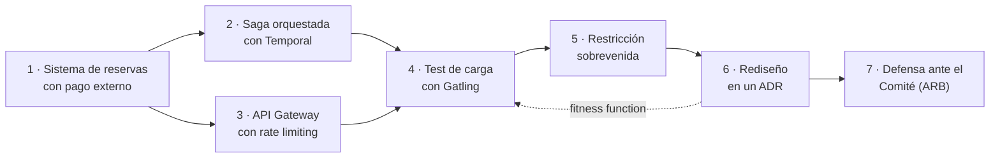
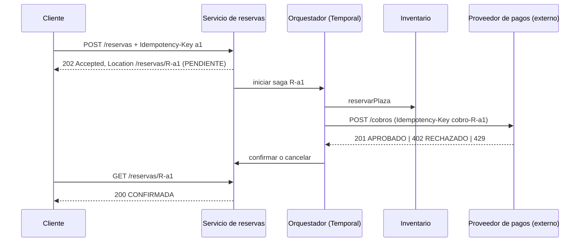
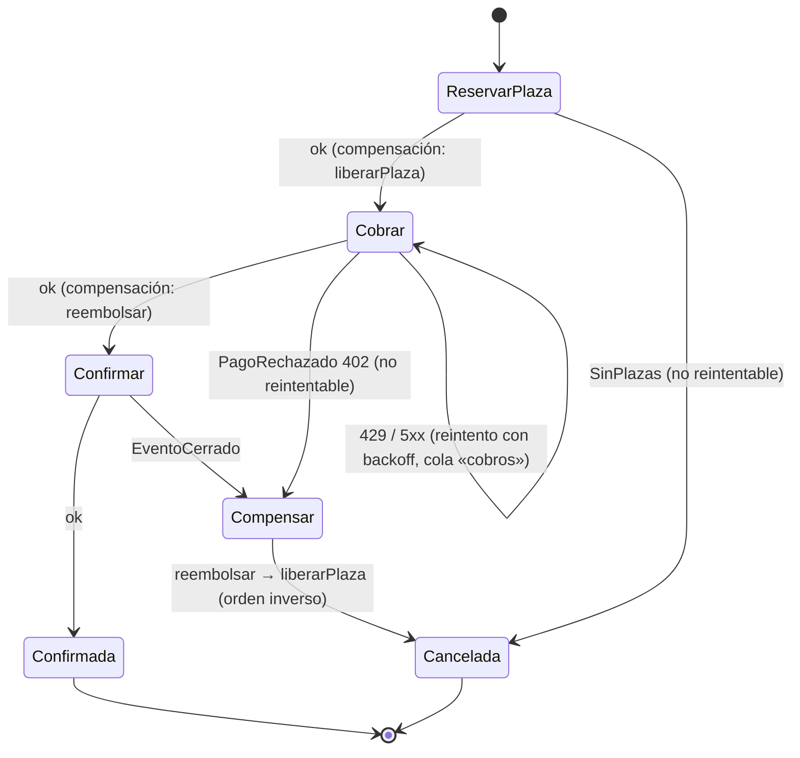
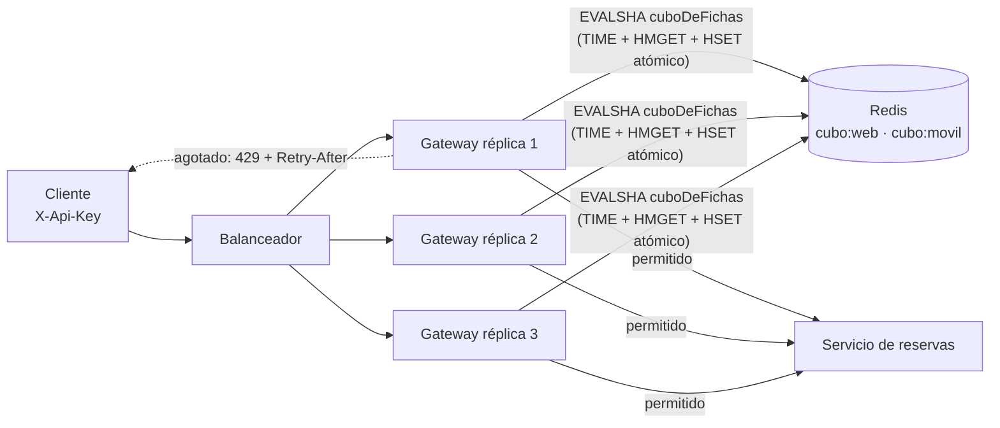
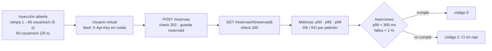
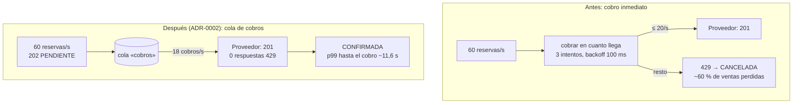
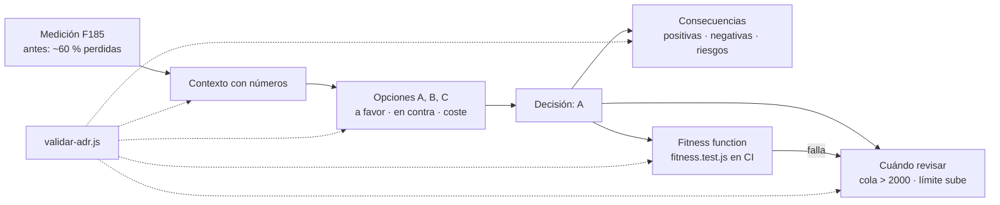
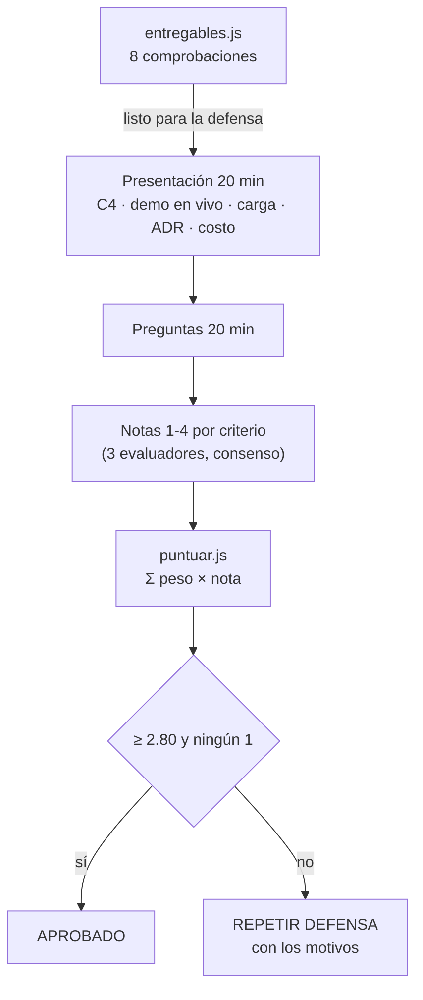

# Módulo 32 · Proyecto Final y Comité de Arquitectura

**Fase 3 · Nivel maestro: arquitectura avanzada** (semanas 7 y 8 de 8). **Duración:** 2 semanas (unas 30 h: 7 temas
de 1,5 a 2 h y el resto para tu propia versión del proyecto y la defensa). **Dificultad:** 5 de 5. **Dependencias:**
todo el curso; en especial Módulos 6/18 (comunicación), 7/17 (gateway), 8/19 (resiliencia), 24 (ADR y C4), 25 (sagas
con Temporal e idempotencia), 28 (costo) y 31 (migración). **Herramientas:** pista Node.js con **Node.js 26.13.1
LTS**, Express **5.3.0**, Temporal TypeScript SDK **1.26.0**, ioredis **6.0.0** y Gatling JS **3.16.101**; pista
Spring Boot con **JDK 25**, Spring Boot **4.1.3**, Spring Cloud Gateway **5.0.4** (tren 2025.1.4), Temporal Java SDK
**1.41.1** y Gatling **3.16.1** con el plugin `io.gatling.gradle` **3.16.0**; la pista Spring se construye con **Gradle 9.9.2**; infraestructura: Redis **8.10.2** (Docker
Compose) y Temporal Server **1.32.1** (`temporal server start-dev`).
(los comandos de verificación indicados ejecuta 26 tests, los scripts de las siete fichas, Redis real, Gatling a 60 reservas/s y las demos
JDK de la pista Spring; `--compose` añade Redis con Docker y los tests de `spring/` con Gradle).

Este es el examen final del curso, y no es un examen de memoria: es **un sistema que funciona, que se rompe a
propósito y que defiendes ante un comité**. Construyes un **sistema de reservas con pago externo** con una **saga
orquestada por Temporal**, detrás de un **API Gateway con rate limiting**; lo sometes a un **test de carga con
Gatling**; recibes una **restricción sobrevenida** (el proveedor de pagos limita a 20 peticiones/s) que rompe tu
diseño; lo **rediseñas y lo documentas en un ADR** con su fitness function ejecutable; y lo **defiendes ante el
Architecture Review Board** con la rúbrica del curso. Como pide el prompt del curso, el sistema existe **dos veces, por
separado**: una pista **Node.js** completa (la que se ejecuta entera en los comandos de verificación indicados) y una pista **Spring Boot**
con el mismo contrato, la misma saga y el mismo límite.



**Texto alternativo:** mapa del proyecto final. El sistema de reservas con pago externo (tema 1) se apoya en la saga
orquestada con Temporal (tema 2) y en el API Gateway con rate limiting (tema 3). Los dos llevan al test de carga con
Gatling (tema 4), que mide el impacto de la restricción sobrevenida (tema 5). La restricción obliga a un rediseño
documentado en un ADR (tema 6), cuya fitness function vuelve, con una flecha punteada, a la medición del tema 4. Todo
termina en la defensa ante el Comité de Arquitectura (tema 7).

**Qué se ejecutó aquí y qué queda para tu Mac.** Se ejecutó todo lo de la pista Node.js con Node 26.13.1: los 26
tests, las demos, Gatling JS 3.16.101 (motor 3.16.1, con el JDK 21 de este entorno) a 60 reservas/s durante 25 s, y
el limitador contra un **Redis 7.0.15 local** (no 8.10.2). También las demos `spring/jdk/*.java` con Java 21. **No** se
pudo ejecutar aquí: el servidor de Temporal (la descarga de `temporal.download` está bloqueada; el workflow sí se
comprobó con el empaquetador de Temporal, `bundleWorkflowCode`), los tests de la pista Spring con Gradle (Maven Central
bloqueado) ni Docker. Esos bloques están completos y anotados en `verificacion/microservicios/pendiente.md`, y el texto
lo indica en cada ficha.

**Cómo usar el laboratorio.**

```bash
npm ci
  # pista Node + Redis local (si hay) + Gatling (si hay Java) + jdk/ → «RESULTADO: OK»
los comandos de verificación indicados    # además Redis con Docker Compose y (cd spring && ./gradlew test)
```

`README.md` tiene el enunciado, el diagrama C4 y el
mapa de carpetas.

`package.json` (pista Node.js):

```json
{
  "name": "modulo-32-proyecto-final",
  "version": "1.0.0",
  "private": true,
  "description": "Módulo 32 (Fase 3): Proyecto final. Sistema de reservas con pago externo, saga orquestada con Temporal, API Gateway con rate limiting, test de carga con Gatling, restricción sobrevenida, ADR y defensa ante el Comité de Arquitectura.",
  "type": "module",
  "engines": {
    "node": ">=26.13.1"
  },
  "scripts": {
    "test": "node --test --test-concurrency=1 'f18*/*.test.js'",
    "gatling": "gatling run --sources-folder f184-carga-gatling/src --resources-folder f184-carga-gatling/resources --results-folder logs/gatling --non-interactive"
  },
  "dependencies": {
    "@temporalio/activity": "1.26.0",
    "@temporalio/client": "1.26.0",
    "@temporalio/worker": "1.26.0",
    "@temporalio/workflow": "1.26.0",
    "express": "5.3.0",
    "ioredis": "6.0.0"
  },
  "devDependencies": {
    "@gatling.io/cli": "3.16.101",
    "@gatling.io/core": "3.16.101",
    "@gatling.io/http": "3.16.101",
    "@temporalio/testing": "1.26.0"
  }
}
```

`docker-compose.yml` (Redis para el limitador compartido; Temporal va con su CLI):

```yaml
# Módulo 32 (modulo-36) · Proyecto final: Redis 8.10.2 para el limitador compartido del gateway (F183).
# Arranca:  docker compose up -d --wait      Detén: docker compose down -v
# Temporal no va aquí: usa el CLI (`temporal server start-dev`, UI en http://localhost:8233) o deja que
# f182-saga-temporal/temporal.infra.js descargue y arranque el servidor de desarrollo (TestWorkflowEnvironment.createLocal).
name: modulo-36
services:
  redis:
    image: redis:8.10.2
    ports: ["6379:6379"]
    healthcheck:
      test: ["CMD", "redis-cli", "ping"]
      interval: 2s
      timeout: 3s
      retries: 30
```

## Enunciado y rúbrica del proyecto

**Enunciado.** Una ticketera vende entradas para conciertos. Cada reserva bloquea una plaza, cobra con un **proveedor
de pagos externo** (HTTP con `Idempotency-Key`; 402 si la tarjeta no paga) y confirma. Si algo falla a mitad, se
deshace lo hecho. El tráfico entra por un gateway con límite por cliente. Objetivos: **picos de 60 reservas/s**, **p99
< 300 ms** y **< 1 % de errores** en la API, **0 reservas cobradas sin plaza** y **0 plazas bloqueadas sin cobro**. A
mitad del proyecto, el proveedor anuncia un límite de **20 peticiones/s**.

**Qué entregas** (lo comprueba `node f187-defensa-arb/entregables.js`): README con diagrama C4 de contenedores; la saga
con sus tests; el gateway con su test; la simulación de Gatling con aserciones; la medición antes/después de la
restricción; al menos 2 ADR con fitness function ejecutable; la estimación de costo con precios reales (`COSTO.md`); y
la pista Spring Boot.

**Rúbrica del Comité** (la de `docs/microservicios/07-plantillas.md`, sección 7.2; ejecutable en
`f187-defensa-arb/puntuar.js`). Cada criterio se puntúa de 1 a 4. **Aprueba quien obtiene ≥ 2.8 de media ponderada y
ningún criterio en 1.**

| # | Criterio | Peso | 3 · Competente | 4 · Maestro |
|---|---|---|---|---|
| 1 | Descomposición y límites | 15 % | contextos coherentes, cada servicio con su base de datos | justifica cada límite con el dominio y el equipo; identifica qué **no** separar |
| 2 | Consistencia y saga | 15 % | saga orquestada en Temporal con compensaciones probadas | demuestra en vivo un fallo a mitad de saga y la recuperación; explica por qué no 2PC |
| 3 | Resiliencia | 10 % | circuit breaker, retry con jitter y fallback probados | presupuesto de latencia de extremo a extremo y degradación medida |
| 4 | Seguridad | 10 % | OAuth2/OIDC con scopes, secretos en Vault, imágenes escaneadas | Zero-Trust: mTLS y token exchange justificados |
| 5 | Observabilidad | 10 % | trazas, logs estructurados y dashboard | alertas sobre p99 y SLO, y diagnóstico de un incidente con la traza |
| 6 | Rendimiento y carga | 10 % | Gatling con objetivo de p99 y throughput, resultados explicados | identifica el cuello de botella y muestra el antes/después |
| 7 | Restricción sobrevenida y ADR | 15 % | ADR con 2+ alternativas y trade-offs | ADR con fitness function y condición de revisión; el rediseño se mide |
| 8 | Costo (FinOps) | 5 % | estimación con precios reales y right-sizing | compara contenedores y serverless con break-even calculado |
| 9 | Comunicación y defensa | 10 % | diagramas C4 claros y respuestas razonadas | reconoce límites del diseño y propone alternativas sin ponerse a la defensiva |

Los niveles 1 y 2 de cada criterio están en la plantilla. Este laboratorio cubre de serie los criterios 1, 2, 6, 7 y 8;
para 3, 4 y 5 integra en tu versión lo de los Módulos 8/19 (Resilience4j u opossum delante del proveedor), 9/20/27
(OAuth2 en el gateway, la clave del proveedor en Vault, mTLS) y 10/21 (OpenTelemetry con la traza de la saga).

---


### Sistema de reservas con pago externo

<details open>
<summary><strong>Capa 1 — Lectura</strong></summary>

#### ► DE QUÉ TRATA
Construir un servicio de reservas que acepta la petición con 202 Accepted, delega el cobro en un proveedor externo a través de una saga y es idempotente ante reintentos del cliente, y demostrar con tests que un POST repetido no cobra dos veces. Lo compruebas cuando node --test f1…

#### ► LA IDEA EN UNA FRASE
**Construir un servicio de reservas que acepta la petición con 202 Accepted, delega el cobro en un proveedor externo a través de una saga y es idempotente ante reintentos del cliente, y demostrar con tests que un POST repetido no cobra dos veces.**

#### ► POR QUÉ EXISTE ESTO
Resuelve un problema real de diseño o implementación y evita decisiones a ciegas.

#### ► LA ANALOGÍA
Piensa en sistema de reservas con pago externo como una herramienta de taller: útil cuando conoces su propósito y sus límites.
**Dónde se rompe la analogía:** en software, los efectos dependen del contexto, la escala y los trade-offs.

#### ► CÓMO FUNCIONA


1. Reservar parece una sola acción, pero son **tres**: apartar la plaza, cobrar y confirmar. Y el cobro lo hace **otra
2. Por eso el sistema no te hace esperar: te da un **número de reserva** al momento y sigue trabajando por detrás.
3. Si algo falla (la tarjeta no paga, el evento se cancela), el sistema **deshace** lo que ya había hecho.
4. Si pulsas «Reservar» dos veces, el sistema reconoce que es la misma compra gracias a una **clave** que envía la app,

#### ► LO QUE PUEDE SALIR MAL
| Síntoma | Causa probable | Arreglo |
|---|---|---|
| Sistema de reservas con pago externo se aplica pero el resultado no mejora | Se usó sin medir el problema real | Mide antes y compara contra la alternativa simple |
| Aparece complejidad inesperada | Se adoptó la técnica sin comprender sus trade-offs | Vuelve a la sección de trade-offs y reduce el alcance |
| Falla en un caso límite | Se asumió un contexto que no se cumple | Prueba el caso límite y documenta cuándo NO usarlo |

#### ► TRADE-OFFS
| Opción | Cuándo usarla | Cuándo NO usarla |
|---|---|---|
| Usar Sistema de reservas con pago externo | Cuando el problema coincide con su propósito y el beneficio es observable | Cuando agrega complejidad sin resolver un problema real |
| Alternativa más simple | Cuando el contexto es pequeño, estable o fácil de razonar | Cuando ya demostró no escalar o no cumplir el requisito |
| Postergar la decisión | Cuando falta evidencia del problema | Cuando el costo de esperar es mayor que el costo de probar |

#### ► CUÁNDO NO USAR ESTO
Cobro dentro de la petición HTTP sin idempotencia: el controlador llama al proveedor, espera, y si el proveedor tarda más que el timeout del cliente, este reintenta y se cobra dos veces; si el proceso cae entre el cobro y el INSERT, el dinero queda cobrado sin reserva.

#### ► DE VUELTA A LA ANALOGÍA
Volviendo a la analogía: sistema de reservas con pago externo funciona como el modelo inicial, pero recuerda dónde se rompe: en producción importan la evidencia, la escala y el costo de equivocarte.

#### ► LO QUE DEBES RECORDAR
- Reservar parece una sola acción, pero son **tres**: apartar la plaza, cobrar y confirmar. Y el cobro lo hace **otra
- Por eso el sistema no te hace esperar: te da un **número de reserva** al momento y sigue trabajando por detrás.
- Si algo falla (la tarjeta no paga, el evento se cancela), el sistema **deshace** lo que ya había hecho.
- Si pulsas «Reservar» dos veces, el sistema reconoce que es la misma compra gracias a una **clave** que envía la app,

#### ► PREGUNTAS PARA PENSAR
1. ¿Qué problema concreto resuelve sistema de reservas con pago externo en tu contexto?
2. ¿Cómo sabrías que sistema de reservas con pago externo no está funcionando bien?
3. ¿Qué alternativa más simple considerarías antes de usar sistema de reservas con pago externo?

</details>

<details>
<summary><strong>Capa 2 — Construcción</strong></summary>

#### Código de referencia / ejecutable
Versiones: **Node.js 26.13.1 LTS**, **Express 5.3.0**, `@temporalio/activity` 1.26.0 (solo `ApplicationFailure`).

El proveedor de pagos externo simulado (`f181-sistema-reservas/proveedor-pagos.js`):

```javascript
// Módulo 32 · F181 · Simulador del PROVEEDOR DE PAGOS EXTERNO (no es nuestro: no podemos cambiar su código ni su límite).
// POST /cobros     {reservaId, importe, tarjeta}  + cabecera Idempotency-Key  -> 201 APROBADO | 402 RECHAZADO | 429
// POST /reembolsos {cobroId}                      + cabecera Idempotency-Key  -> 201 REEMBOLSADO
// Opciones: limiteRps (la «restricción sobrevenida» de F185: 429 con Retry-After), latenciaMs.
// Ejecuta solo: node f181-sistema-reservas/proveedor-pagos.js   (puerto 8090; LIMITE_RPS=20 para activar el límite)
import { pathToFileURL } from 'node:url';
import { http, json, leerCuerpo } from '../comun/http.js';
import { espera } from '../comun/estadistica.js';

export function crearProveedor({ limiteRps = Infinity, latenciaMs = 5 } = {}) {
  const stats = { peticiones: 0, cobros: 0, reembolsos: 0, rechazados429: 0, porSegundo: new Map() };
  const porClave = new Map(); // Idempotency-Key -> respuesta ya dada (se repite tal cual, sin cobrar dos veces)
  let ventana = 0; let enVentana = 0;
  const servidor = http.createServer(async (req, res) => {
    stats.peticiones++;
    const ahora = Math.floor(Date.now() / 1000);
    if (ahora !== ventana) { ventana = ahora; enVentana = 0; }
    if (++enVentana > limiteRps) { // ventana fija de 1 s, como anuncian muchos proveedores
      stats.rechazados429++;
      return json(res, 429, { error: `límite de ${limiteRps} peticiones/s superado` }, { 'retry-after': '1' });
    }
    stats.porSegundo.set(ahora, (stats.porSegundo.get(ahora) ?? 0) + 1);
    const cuerpo = JSON.parse((await leerCuerpo(req)) || '{}');
    await espera(latenciaMs);
    const clave = req.headers['idempotency-key'];
    if (clave && porClave.has(`${req.url}:${clave}`)) { const [e, c] = porClave.get(`${req.url}:${clave}`); return json(res, e, c); }
    let estado; let respuesta;
    if (req.url === '/cobros') {
      if (cuerpo.tarjeta === '4000-RECHAZAR') { estado = 402; respuesta = { estado: 'RECHAZADO', motivo: 'fondos insuficientes' }; }
      else { stats.cobros++; estado = 201; respuesta = { cobroId: `CB-${cuerpo.reservaId}`, estado: 'APROBADO', importe: cuerpo.importe }; }
    } else if (req.url === '/reembolsos') {
      stats.reembolsos++; estado = 201; respuesta = { cobroId: cuerpo.cobroId, estado: 'REEMBOLSADO' };
    } else { return json(res, 404, { error: 'no existe' }); }
    if (clave) porClave.set(`${req.url}:${clave}`, [estado, respuesta]);
    json(res, estado, respuesta);
  });
  return { servidor, stats };
}

if (import.meta.url === pathToFileURL(process.argv[1]).href) {
  const { servidor } = crearProveedor({ limiteRps: Number(process.env.LIMITE_RPS ?? Infinity) });
  servidor.listen(Number(process.env.PORT ?? 8090), () => console.log(`proveedor de pagos en :${servidor.address().port}`));
}
```

El inventario (`f181-sistema-reservas/inventario.js`) y el repositorio (`f181-sistema-reservas/repositorio.js`):

```javascript
// Módulo 32 · F181 · Inventario de plazas por evento (en memoria; en el proyecto real, PostgreSQL con su propia base).
// Las dos operaciones son idempotentes por reservaId: repetirlas (reintentos de Temporal) no cambia el resultado.
export class SinPlazas extends Error { constructor(eventoId) { super(`sin plazas en ${eventoId}`); this.name = 'SinPlazas'; } }

export function crearInventario(aforos) {
  const libres = new Map(Object.entries(aforos));
  const ocupadas = new Map(); // reservaId -> eventoId
  return {
    reservarPlaza({ reservaId, eventoId }) {
      if (ocupadas.has(reservaId)) return { reservaId, repetida: true };
      if (!libres.has(eventoId) || libres.get(eventoId) < 1) throw new SinPlazas(eventoId);
      libres.set(eventoId, libres.get(eventoId) - 1); ocupadas.set(reservaId, eventoId);
      return { reservaId, repetida: false };
    },
    liberarPlaza({ reservaId }) {
      const eventoId = ocupadas.get(reservaId);
      if (!eventoId) return { reservaId, liberada: false }; // ya liberada (o nunca reservada): no hace nada
      ocupadas.delete(reservaId); libres.set(eventoId, libres.get(eventoId) + 1);
      return { reservaId, liberada: true };
    },
    libres: (eventoId) => libres.get(eventoId),
  };
}
```

```javascript
// Módulo 32 · F181 · Repositorio de reservas (en memoria; en el proyecto real, PostgreSQL del servicio de reservas).
export function crearRepositorio() {
  const reservas = new Map();
  return {
    crear(r) { if (!reservas.has(r.reservaId)) reservas.set(r.reservaId, { ...r, estado: 'PENDIENTE', creada: Date.now() }); return reservas.get(r.reservaId); },
    actualizar(id, cambios) { reservas.set(id, { ...reservas.get(id), ...cambios, actualizada: Date.now() }); },
    obtener: (id) => reservas.get(id),
    todas: () => [...reservas.values()],
  };
}
```

El servicio de reservas (`f181-sistema-reservas/servicio-reservas.js`):

```javascript
// Módulo 32 · F181 · Servicio de reservas (API REST con Express 5.3.0 sobre Node.js 26.13.1 LTS).
// POST /reservas  -> 202 Accepted + Location: la saga (pago externo incluido) sigue en segundo plano.
// GET  /reservas/:id -> estado actual (PENDIENTE, CONFIRMADA o CANCELADA).
// El orquestador se inyecta: el local (orquestador-local.js) para desarrollo y tests, o Temporal (orquestador-temporal.js).
import express from 'express';
import { pathToFileURL } from 'node:url';

export function crearServicioReservas({ repo, orquestador }) {
  const app = express();
  app.use(express.json());
  let secuencia = 0;
  app.post('/reservas', (req, res) => {
    const { eventoId, clienteId, importe, tarjeta } = req.body ?? {};
    if (!eventoId || !clienteId || !(importe > 0) || !tarjeta) {
      return res.status(400).json({ error: 'faltan eventoId, clienteId, importe (> 0) o tarjeta' });
    }
    // Idempotency-Key del cliente: el mismo POST repetido devuelve la misma reserva (no crea otra ni cobra dos veces).
    const reservaId = req.get('idempotency-key') ? `R-${req.get('idempotency-key')}` : `R-${++secuencia}`;
    const existente = repo.obtener(reservaId);
    if (existente) return res.status(202).location(`/reservas/${reservaId}`).json(existente);
    const reserva = repo.crear({ reservaId, eventoId, clienteId, importe, tarjeta });
    orquestador.iniciar({ reservaId, eventoId, clienteId, importe, tarjeta, ...(req.body.fallarAlConfirmar ? { fallarAlConfirmar: true } : {}) })
      .catch((e) => repo.actualizar(reservaId, { estado: 'CANCELADA', motivo: `saga interrumpida: ${e.message}` }));
    res.status(202).location(`/reservas/${reservaId}`).json(reserva);
  });
  app.get('/reservas/:id', (req, res) => {
    const r = repo.obtener(req.params.id);
    return r ? res.json(r) : res.status(404).json({ error: `no existe ${req.params.id}` });
  });
  app.get('/salud', (_req, res) => res.json({ estado: 'UP' }));
  return app;
}

if (import.meta.url === pathToFileURL(process.argv[1]).href) {
  // Arranque «de verdad»: node f181-sistema-reservas/servicio-reservas.js  (ORQUESTADOR=temporal para usar Temporal)
  const { crearRepositorio } = await import('./repositorio.js');
  const repo = crearRepositorio();
  let orquestador;
  if (process.env.ORQUESTADOR === 'temporal') {
    const { crearOrquestadorTemporal } = await import('../f182-saga-temporal/orquestador-temporal.js');
    orquestador = await crearOrquestadorTemporal();
    const iniciar = orquestador.iniciar;
    orquestador.iniciar = async (r) => { const res = await iniciar(r); repo.actualizar(r.reservaId, res.estado === 'CONFIRMADA' ? { estado: res.estado } : { estado: res.estado, motivo: res.motivo }); return res; };
  } else {
    const { crearOrquestadorLocal } = await import('../f182-saga-temporal/orquestador-local.js');
    const { crearActividades } = await import('../f182-saga-temporal/actividades.js');
    const { crearInventario } = await import('./inventario.js');
    orquestador = crearOrquestadorLocal(crearActividades({ inventario: crearInventario({ 'concierto-1': 500 }), repo,
      pagosUrl: process.env.PAGOS_URL ?? 'http://localhost:8090' }));
  }
  const puerto = Number(process.env.PORT ?? 8081);
  crearServicioReservas({ repo, orquestador }).listen(puerto, () => console.log(`reservas en :${puerto} (orquestador ${process.env.ORQUESTADOR ?? 'local'})`));
}
```

El montaje del sistema en un proceso (`f181-sistema-reservas/montaje.js`), que usan la demo, los tests y F184/F185:

```javascript
// Módulo 32 · F181 · Monta el sistema completo en un proceso (puertos libres): proveedor de pagos externo, servicio de
// reservas con el orquestador local y, si se pide, el gateway (F183). Lo usan la demo, los tests y F184/F185.
import { cerrar, escuchar } from '../comun/http.js';
import { crearProveedor } from './proveedor-pagos.js';
import { crearInventario } from './inventario.js';
import { crearRepositorio } from './repositorio.js';
import { crearServicioReservas } from './servicio-reservas.js';
import { crearActividades } from '../f182-saga-temporal/actividades.js';
import { crearOrquestadorLocal } from '../f182-saga-temporal/orquestador-local.js';

export async function montarSistema({ aforo = 500, proveedor = {}, politica = {}, envolverActividades = (a) => a } = {}) {
  const prov = crearProveedor(proveedor);
  const pagosUrl = await escuchar(prov.servidor);
  const repo = crearRepositorio();
  const inventario = crearInventario({ 'concierto-1': aforo });
  const actividades = envolverActividades(crearActividades({ inventario, repo, pagosUrl }));
  const app = crearServicioReservas({ repo, orquestador: crearOrquestadorLocal(actividades, politica) });
  const servidor = app.listen(0, '127.0.0.1');
  await new Promise((ok) => servidor.once('listening', ok));
  const reservasUrl = `http://127.0.0.1:${servidor.address().port}`;
  return { reservasUrl, pagosUrl, repo, inventario, stats: prov.stats,
    cerrar: async () => { servidor.closeAllConnections?.(); await Promise.all([cerrar(servidor), cerrar(prov.servidor)]); } };
}

// Espera a que una reserva salga de PENDIENTE (la saga corre en segundo plano).
export async function esperarFinal(url, id, maxMs = 30_000) {
  const fin = Date.now() + maxMs;
  for (;;) {
    const r = await (await fetch(`${url}/reservas/${id}`)).json();
    if (r.estado !== 'PENDIENTE' || Date.now() > fin) return r;
    await new Promise((ok) => setTimeout(ok, 20));
  }
}
```

**Pista Spring Boot** (Spring Boot 4.1.3, JDK 25; tests y arranque pendientes en el Mac). El proveedor simulado con el
mismo contrato (`spring/pagos-externo/src/main/java/academia/pagos/PagosExternoApp.java`):

```java
package academia.pagos;

import java.util.Map;
import java.util.concurrent.ConcurrentHashMap;
import org.springframework.beans.factory.annotation.Value;
import org.springframework.boot.SpringApplication;
import org.springframework.boot.autoconfigure.SpringBootApplication;
import org.springframework.http.ResponseEntity;
import org.springframework.web.bind.annotation.PostMapping;
import org.springframework.web.bind.annotation.RequestBody;
import org.springframework.web.bind.annotation.RequestHeader;
import org.springframework.web.bind.annotation.RestController;

/**
 * Módulo 32 · F181 · Simulador del proveedor de pagos EXTERNO (mismo contrato que proveedor-pagos.js de la pista Node):
 * POST /cobros y POST /reembolsos con cabecera Idempotency-Key; 402 si la tarjeta es 4000-RECHAZAR; 429 con
 * Retry-After: 1 si se supera pagos.limite-rps en el segundo en curso.
 */
@SpringBootApplication
@RestController
public class PagosExternoApp {

    record Cobro(String reservaId, int importe, String tarjeta) { }
    record Reembolso(String cobroId) { }

    private final Map<String, ResponseEntity<Map<String, Object>>> porClave = new ConcurrentHashMap<>();
    private final int limiteRps;
    private long ventana;
    private int enVentana;

    PagosExternoApp(@Value("${pagos.limite-rps}") int limiteRps) {
        this.limiteRps = limiteRps;
    }

    public static void main(String[] args) {
        SpringApplication.run(PagosExternoApp.class, args);
    }

    /** Ventana fija de 1 segundo, como anuncian muchos proveedores. */
    private synchronized boolean dentroDelLimite() {
        long ahora = System.currentTimeMillis() / 1000;
        if (ahora != ventana) {
            ventana = ahora;
            enVentana = 0;
        }
        return ++enVentana <= limiteRps;
    }

    @PostMapping("/cobros")
    ResponseEntity<Map<String, Object>> cobrar(@RequestHeader("Idempotency-Key") String clave, @RequestBody Cobro c) {
        if (!dentroDelLimite()) {
            return ResponseEntity.status(429).header("Retry-After", "1")
                    .body(Map.of("error", "límite de " + limiteRps + " peticiones/s superado"));
        }
        // computeIfAbsent: la misma Idempotency-Key devuelve la misma respuesta y no cobra dos veces.
        return porClave.computeIfAbsent("cobro:" + clave, k -> "4000-RECHAZAR".equals(c.tarjeta())
                ? ResponseEntity.status(402).body(Map.of("estado", "RECHAZADO", "motivo", "fondos insuficientes"))
                : ResponseEntity.status(201).body(Map.of("cobroId", "CB-" + c.reservaId(), "estado", "APROBADO", "importe", c.importe())));
    }

    @PostMapping("/reembolsos")
    ResponseEntity<Map<String, Object>> reembolsar(@RequestHeader("Idempotency-Key") String clave, @RequestBody Reembolso r) {
        if (!dentroDelLimite()) {
            return ResponseEntity.status(429).header("Retry-After", "1").body(Map.of("error", "límite superado"));
        }
        return porClave.computeIfAbsent("reembolso:" + clave,
                k -> ResponseEntity.status(201).body(Map.of("cobroId", r.cobroId(), "estado", "REEMBOLSADO")));
    }
}
```

Y el controlador de reservas, que inicia el workflow de Temporal y responde 202
(`spring/reservas/src/main/java/academia/reservas/ReservasController.java`):

```java
package academia.reservas;

import io.temporal.client.WorkflowClient;
import io.temporal.client.WorkflowOptions;
import java.net.URI;
import java.util.Map;
import java.util.concurrent.ConcurrentHashMap;
import org.springframework.http.ResponseEntity;
import org.springframework.web.bind.annotation.GetMapping;
import org.springframework.web.bind.annotation.PathVariable;
import org.springframework.web.bind.annotation.PostMapping;
import org.springframework.web.bind.annotation.RequestBody;
import org.springframework.web.bind.annotation.RequestHeader;
import org.springframework.web.bind.annotation.RestController;

/** Módulo 32 · F181 · API de reservas: POST responde 202 y la saga sigue en Temporal; GET da el estado. */
@RestController
class ReservasController {

    record NuevaReserva(String eventoId, String clienteId, int importe, String tarjeta) { }

    private final WorkflowClient temporal;
    private final Map<String, Map<String, Object>> estados = new ConcurrentHashMap<>();

    ReservasController(WorkflowClient temporal) {
        this.temporal = temporal;
    }

    @PostMapping("/reservas")
    ResponseEntity<Map<String, Object>> crear(@RequestHeader("Idempotency-Key") String clave, @RequestBody NuevaReserva n) {
        String id = "R-" + clave;
        if (estados.containsKey(id)) return ResponseEntity.accepted().location(URI.create("/reservas/" + id)).body(estados.get(id));
        estados.put(id, Map.of("reservaId", id, "estado", "PENDIENTE"));
        // workflowId = reservaId: Temporal no arranca dos sagas para la misma reserva aunque el POST se repita.
        ReservaWorkflow saga = temporal.newWorkflowStub(ReservaWorkflow.class,
                WorkflowOptions.newBuilder().setTaskQueue("reservas").setWorkflowId("reserva-" + id).build());
        WorkflowClient.execute(saga::reservar, new Reserva(id, n.eventoId(), n.clienteId(), n.importe(), n.tarjeta(), false))
                .thenAccept(r -> estados.put(id, r.motivo() == null ? Map.of("reservaId", id, "estado", r.estado())
                        : Map.of("reservaId", id, "estado", r.estado(), "motivo", r.motivo())));
        return ResponseEntity.accepted().location(URI.create("/reservas/" + id)).body(estados.get(id));
    }

    @GetMapping("/reservas/{id}")
    ResponseEntity<Map<String, Object>> ver(@PathVariable String id) {
        var e = estados.get(id);
        return e == null ? ResponseEntity.notFound().build() : ResponseEntity.ok(e);
    }
}
```

</details>

### Saga orquestada con Temporal.io

<details open>
<summary><strong>Capa 1 — Lectura</strong></summary>

#### ► DE QUÉ TRATA
Implementar la saga de reservas como un workflow de Temporal (pista Node y pista Spring) con compensaciones en orden inverso, errores no reintentables y una cola separada para el cobro, y verificar las compensaciones y el determinismo del workflow con tests. Lo compruebas cuando…

#### ► LA IDEA EN UNA FRASE
**Implementar la saga de reservas como un workflow de Temporal (pista Node y pista Spring) con compensaciones en orden inverso, errores no reintentables y una cola separada para el cobro, y verificar las compensaciones y el determinismo del workflow con tests.**

#### ► POR QUÉ EXISTE ESTO
Resuelve un problema real de diseño o implementación y evita decisiones a ciegas.

#### ► LA ANALOGÍA
Piensa en saga orquestada con temporal.io como una herramienta de taller: útil cuando conoces su propósito y sus límites.
**Dónde se rompe la analogía:** en software, los efectos dependen del contexto, la escala y los trade-offs.

#### ► CÓMO FUNCIONA


1. Una **saga** es una lista de pasos con su «deshacer» apuntado al lado de cada uno.
2. **Temporal** es un programa que hace de director: lleva la cuenta de qué pasos se hicieron y, si algo se cae (incluso
3. El código del director debe ser **predecible** (sin llamar a internet ni mirar la hora); el trabajo «real» lo hacen
4. Si un paso falla de verdad, el director **deshace** los anteriores, del último al primero.

#### ► LO QUE PUEDE SALIR MAL
| Síntoma | Causa probable | Arreglo |
|---|---|---|
| Saga orquestada con Temporal.io se aplica pero el resultado no mejora | Se usó sin medir el problema real | Mide antes y compara contra la alternativa simple |
| Aparece complejidad inesperada | Se adoptó la técnica sin comprender sus trade-offs | Vuelve a la sección de trade-offs y reduce el alcance |
| Falla en un caso límite | Se asumió un contexto que no se cumple | Prueba el caso límite y documenta cuándo NO usarlo |

#### ► TRADE-OFFS
| Opción | Cuándo usarla | Cuándo NO usarla |
|---|---|---|
| Usar Saga orquestada con Temporal.io | Cuando el problema coincide con su propósito y el beneficio es observable | Cuando agrega complejidad sin resolver un problema real |
| Alternativa más simple | Cuando el contexto es pequeño, estable o fácil de razonar | Cuando ya demostró no escalar o no cumplir el requisito |
| Postergar la decisión | Cuando falta evidencia del problema | Cuando el costo de esperar es mayor que el costo de probar |

#### ► CUÁNDO NO USAR ESTO
Saga sin compensaciones idempotentes: el reembolso no lleva clave; cuando Temporal lo reintenta tras un timeout, el cliente recibe dos abonos.

#### ► DE VUELTA A LA ANALOGÍA
Volviendo a la analogía: saga orquestada con temporal.io funciona como el modelo inicial, pero recuerda dónde se rompe: en producción importan la evidencia, la escala y el costo de equivocarte.

#### ► LO QUE DEBES RECORDAR
- Una **saga** es una lista de pasos con su «deshacer» apuntado al lado de cada uno.
- **Temporal** es un programa que hace de director: lleva la cuenta de qué pasos se hicieron y, si algo se cae (incluso
- El código del director debe ser **predecible** (sin llamar a internet ni mirar la hora); el trabajo «real» lo hacen
- Si un paso falla de verdad, el director **deshace** los anteriores, del último al primero.

#### ► PREGUNTAS PARA PENSAR
1. ¿Qué problema concreto resuelve saga orquestada con temporal.io en tu contexto?
2. ¿Cómo sabrías que saga orquestada con temporal.io no está funcionando bien?
3. ¿Qué alternativa más simple considerarías antes de usar saga orquestada con temporal.io?

</details>

<details>
<summary><strong>Capa 2 — Construcción</strong></summary>

#### Construcción guiada
1. Comprueba, sin servidor, que el workflow es apto para el sandbox de Temporal y que la saga compensa bien:

```bash
node --test f182-saga-temporal/saga.test.js f182-saga-temporal/bundle.test.js
```

   **Output esperado:**

```text
✔ workflows.js se empaqueta para el sandbox de Temporal
✔ workflow-mal.js (importa las actividades) se rechaza
✔ camino feliz: plaza reservada, cobro aprobado y reserva confirmada
✔ tarjeta rechazada (402, no reintentable): se libera la plaza y no se cobra nada
✔ falla el último paso: reembolso y liberación, en orden inverso
✔ sin plazas: la saga termina CANCELADA sin tocar al proveedor
✔ un 429 del proveedor se reintenta con backoff hasta cobrar, y nunca se cobra dos veces
ℹ tests 7
ℹ suites 0
ℹ pass 7
ℹ fail 0
ℹ cancelled 0
ℹ skipped 0
ℹ todo 0
ℹ duration_ms …
```

   **Captura comentada:** el test del 429 tarda unos 2,6 s: con el proveedor a 1 petición/s, tres cobros necesitan tres
   segundos distintos y el backoff los va colocando; al final hay exactamente 3 cobros, ninguno duplicado.

2. **Con Temporal de verdad (en tu Mac; aquí no se pudo descargar el servidor).** Con el CLI de Temporal instalado
   (`brew install temporal`), en cuatro terminales:

```bash
temporal server start-dev                                   # 1: servidor + UI en http://localhost:8233
node f181-sistema-reservas/proveedor-pagos.js               # 2: proveedor en :8090
node f182-saga-temporal/worker.js                           # 3: workers «reservas» y «cobros»
node f182-saga-temporal/iniciar.js                          # 4: tres reservas
```

   **Output esperado** (terminal 4, deducido del código y de los tests, pendiente de ver en el Mac):

```text
{"reservaId":"R-1","estado":"CONFIRMADA","hechos":["reservarPlaza","cobrar","confirmar"],"compensadas":[]}
{"reservaId":"R-2","estado":"CANCELADA","motivo":"tarjeta rechazada: fondos insuficientes","hechos":["reservarPlaza"],"compensadas":["liberarPlaza"]}
{"reservaId":"R-3","estado":"CANCELADA","motivo":"el organizador canceló el evento","hechos":["reservarPlaza","cobrar"],"compensadas":["reembolsar","liberarPlaza"]}
```

   **Captura descrita:** en la UI (`http://localhost:8233`), el workflow `reserva-R-3` muestra en su historial
   `ActivityTaskCompleted` para `reservarPlaza` y `cobrar`, `ActivityTaskFailed` para `confirmar` y después las
   actividades `reembolsar` (en la cola `cobros`), `liberarPlaza` y `cancelar`. **Rompe algo:** para el worker
   (Ctrl+C) con el proveedor parado, lanza `iniciar.js`, arranca el proveedor y luego el worker: la saga continúa donde
   estaba.

3. Pista Spring (Mac): `cd spring &&./gradlew:reservas:test` ejecuta `ReservaWorkflowTest` con el servidor
   de Temporal **en memoria** de `temporal-testing` (sin Docker ni CLI).

#### Código de referencia / ejecutable
Versiones: **Node.js 26.13.1 LTS**, `@temporalio/workflow`, `@temporalio/worker`, `@temporalio/client` y
`@temporalio/activity` **1.26.0** (npm, 2026-11-17), Temporal Server **1.32.1**. Pista Spring: `io.temporal:temporal-sdk`
y `temporal-testing` **1.41.1** (Maven Central, 2026-11-16).

La saga, sin imports (`f182-saga-temporal/saga.js`):

```javascript
// Módulo 32 · F182 · La saga de una reserva: reservar plaza -> cobrar (proveedor externo) -> confirmar.
// Si un paso falla, deshace los anteriores en orden inverso. Sin imports: corre igual dentro del sandbox determinista
// de un workflow de Temporal (workflows.js) y en el orquestador local o en los tests (orquestador-local.js).
export async function sagaReserva(reserva, act) {
  const compensaciones = []; // pila: la última en entrar es la primera en deshacerse
  const hechos = [];
  try {
    await act.reservarPlaza(reserva);
    hechos.push('reservarPlaza');
    compensaciones.push(['liberarPlaza', () => act.liberarPlaza(reserva)]);

    const { cobroId } = await act.cobrar(reserva);
    hechos.push('cobrar');
    compensaciones.push(['reembolsar', () => act.reembolsar({ reservaId: reserva.reservaId, cobroId })]);

    await act.confirmar({ ...reserva, cobroId });
    hechos.push('confirmar');
    return { reservaId: reserva.reservaId, estado: 'CONFIRMADA', hechos, compensadas: [] };
  } catch (error) {
    // En Temporal el fallo de una actividad llega envuelto (ActivityFailure); el motivo real va en error.cause.
    const motivo = error.cause?.message ?? error.message;
    const compensadas = [];
    for (const [nombre, deshacer] of compensaciones.reverse()) {
      await deshacer(); // las compensaciones son idempotentes y se reintentan hasta que salen bien
      compensadas.push(nombre);
    }
    await act.cancelar({ ...reserva, motivo });
    return { reservaId: reserva.reservaId, estado: 'CANCELADA', motivo, hechos, compensadas };
  }
}
```

Las actividades (`f182-saga-temporal/actividades.js`):

```javascript
// Módulo 32 · F182 · Actividades de la saga: el código que toca el mundo (inventario, proveedor de pagos, repositorio).
// Temporal las reintenta según la política del workflow; por eso TODAS son idempotentes (Idempotency-Key = reservaId).
// Versiones: Node.js 26.13.1 LTS, @temporalio/activity 1.26.0 (solo para ApplicationFailure).
import { ApplicationFailure } from '@temporalio/activity';
import { SinPlazas } from '../f181-sistema-reservas/inventario.js';

export function crearActividades({ inventario, repo, pagosUrl }) {
  async function llamar(ruta, clave, cuerpo) {
    const r = await fetch(`${pagosUrl}${ruta}`, {
      method: 'POST', headers: { 'content-type': 'application/json', 'idempotency-key': clave }, body: JSON.stringify(cuerpo),
      signal: AbortSignal.timeout(5_000), // nunca esperar al proveedor sin límite
    });
    return { estado: r.status, cuerpo: await r.json(), reintentarEn: r.headers.get('retry-after') };
  }
  return {
    async reservarPlaza(r) {
      try { return inventario.reservarPlaza(r); }
      catch (e) { if (e instanceof SinPlazas) throw ApplicationFailure.nonRetryable(e.message, 'SinPlazas'); throw e; }
    },
    async liberarPlaza(r) { return inventario.liberarPlaza(r); },
    async cobrar(r) {
      const { estado, cuerpo, reintentarEn } = await llamar('/cobros', `cobro-${r.reservaId}`, { reservaId: r.reservaId, importe: r.importe, tarjeta: r.tarjeta });
      if (estado === 201) return { cobroId: cuerpo.cobroId };
      if (estado === 402) throw ApplicationFailure.nonRetryable(`tarjeta rechazada: ${cuerpo.motivo}`, 'PagoRechazado');
      // 429 y 5xx: reintentable (Temporal aplica backoff exponencial). El mensaje lleva el Retry-After para diagnosticar.
      throw ApplicationFailure.retryable(`proveedor respondió ${estado}${reintentarEn ? ` (Retry-After: ${reintentarEn} s)` : ''}`, `Http${estado}`);
    },
    async reembolsar({ reservaId, cobroId }) {
      const { estado } = await llamar('/reembolsos', `reembolso-${reservaId}`, { cobroId });
      if (estado !== 201) throw ApplicationFailure.retryable(`reembolso respondió ${estado}`, `Http${estado}`);
      return { cobroId };
    },
    async confirmar(r) {
      if (r.fallarAlConfirmar) throw ApplicationFailure.nonRetryable('el organizador canceló el evento', 'EventoCerrado'); // para probar la compensación doble
      repo.actualizar(r.reservaId, { estado: 'CONFIRMADA', cobroId: r.cobroId });
    },
    async cancelar(r) { repo.actualizar(r.reservaId, { estado: 'CANCELADA', motivo: r.motivo }); },
  };
}
```

El workflow (`f182-saga-temporal/workflows.js`):

```javascript
// Módulo 32 · F182 · Workflow de Temporal para la saga de reservas.
// Versiones: Node.js 26.13.1 LTS, @temporalio/workflow 1.26.0, Temporal Server 1.32.1 (o `temporal server start-dev`).
// Corre en el sandbox determinista de Temporal: sin red, sin disco, sin imports de Node. Solo orquesta; el trabajo real
// lo hacen las actividades (actividades.js), que Temporal reintenta y cuyo resultado guarda en el historial.
import { proxyActivities } from '@temporalio/workflow';
import { sagaReserva } from './saga.js';

const reintentos = { initialInterval: '200 milliseconds', backoffCoefficient: 2, maximumInterval: '5 seconds', maximumAttempts: 8,
  nonRetryableErrorTypes: ['SinPlazas', 'PagoRechazado', 'EventoCerrado'] };

// Actividades propias: cola «reservas».
const act = proxyActivities({ startToCloseTimeout: '10 seconds', retry: reintentos });
// El cobro va a su propia cola, «cobros», para poder limitar su ritmo sin frenar lo demás (ADR-0007, F185/F186).
// scheduleToCloseTimeout: tiempo total que aceptamos esperar al cobro, contando la cola y los reintentos.
const pagos = proxyActivities({ taskQueue: 'cobros', startToCloseTimeout: '10 seconds', scheduleToCloseTimeout: '10 minutes',
  retry: { ...reintentos, maximumAttempts: 0 } }); // 0 = sin límite de intentos: manda scheduleToCloseTimeout

export async function reservaWorkflow(reserva) {
  // Nombradas una a una: proxyActivities devuelve un Proxy sin claves propias, así que «{ ...act }» copia un objeto
  // VACÍO y la saga falla con «act.cancelar is not a function» (visto con el servidor real de Temporal en el Mac).
  const { reservarPlaza, liberarPlaza, confirmar, cancelar } = act;
  return sagaReserva(reserva, { reservarPlaza, liberarPlaza, confirmar, cancelar, cobrar: pagos.cobrar, reembolsar: pagos.reembolsar });
}
```

Los workers (`f182-saga-temporal/worker.js`) y el cliente (`f182-saga-temporal/iniciar.js`):

```javascript
// Módulo 32 · F182 · Workers de Temporal: uno para la cola «reservas» (workflows + actividades propias) y otro para la
// cola «cobros» (solo el proveedor de pagos). Ejecuta con `temporal server start-dev` en marcha:
//   node f182-saga-temporal/worker.js            (sin límite de cobros: el diseño ANTES de la restricción)
//   COBROS_POR_SEGUNDO=18 node f182-saga-temporal/worker.js   (el diseño del ADR-0007: 18 cobros/s en toda la cola)
// Versiones: @temporalio/worker 1.26.0, Temporal Server 1.32.1. Necesita el proveedor (node f181-sistema-reservas/proveedor-pagos.js).
import { NativeConnection, Worker } from '@temporalio/worker';
import { crearActividades } from './actividades.js';
import { crearInventario } from '../f181-sistema-reservas/inventario.js';
import { crearRepositorio } from '../f181-sistema-reservas/repositorio.js';

const connection = await NativeConnection.connect({ address: process.env.TEMPORAL_ADDRESS ?? 'localhost:7233' });
const actividades = crearActividades({ inventario: crearInventario({ 'concierto-1': 500 }), repo: crearRepositorio(),
  pagosUrl: process.env.PAGOS_URL ?? 'http://localhost:8090' });
const limite = process.env.COBROS_POR_SEGUNDO ? Number(process.env.COBROS_POR_SEGUNDO) : undefined;

const reservas = await Worker.create({ connection, taskQueue: 'reservas',
  workflowsPath: new URL('./workflows.js', import.meta.url).pathname, activities: actividades });
const cobros = await Worker.create({ connection, taskQueue: 'cobros',
  activities: { cobrar: actividades.cobrar, reembolsar: actividades.reembolsar },
  // Límite aplicado por el SERVIDOR a toda la cola, sumando todos los workers (no por proceso): ver F183, error común.
  ...(limite ? { maxTaskQueueActivitiesPerSecond: limite } : {}) });
console.log(`workers en «reservas» y «cobros»${limite ? ` (cobros limitados a ${limite}/s)` : ''}. Ctrl+C para salir`);
await Promise.all([reservas.run(), cobros.run()]);
```

```javascript
// Módulo 32 · F182 · Cliente de Temporal: inicia la saga de 3 reservas y espera su resultado.
// Ejecuta (servidor, proveedor y worker en marcha): node f182-saga-temporal/iniciar.js
import { Client, Connection } from '@temporalio/client';

const client = new Client({ connection: await Connection.connect({ address: process.env.TEMPORAL_ADDRESS ?? 'localhost:7233' }) });
const reservas = [
  { reservaId: 'R-1', eventoId: 'concierto-1', clienteId: 'C-1', importe: 80, tarjeta: '4242-OK' },
  { reservaId: 'R-2', eventoId: 'concierto-1', clienteId: 'C-2', importe: 80, tarjeta: '4000-RECHAZAR' },
  { reservaId: 'R-3', eventoId: 'concierto-1', clienteId: 'C-3', importe: 80, tarjeta: '4242-OK', fallarAlConfirmar: true },
];
for (const r of reservas) {
  // workflowId = reservaId: si el cliente reintenta el POST, Temporal no arranca una segunda saga para la misma reserva.
  const resultado = await client.workflow.execute('reservaWorkflow', { taskQueue: 'reservas', workflowId: `reserva-${r.reservaId}`, args: [r] });
  console.log(JSON.stringify(resultado));
}
```

El orquestador local para desarrollo y tests (`f182-saga-temporal/orquestador-local.js`):

```javascript
// Módulo 32 · F182 · Orquestador LOCAL: ejecuta la misma saga (saga.js) y las mismas actividades sin servidor de Temporal,
// con una política de reintentos parecida a la del workflow (backoff exponencial, errores no reintentables).
// Sirve para desarrollar y para los tests; NO es durable: si el proceso muere a mitad, la saga se pierde. En el
// proyecto entregable usa orquestador-temporal.js (Temporal guarda cada paso y retoma tras una caída).
import { sagaReserva } from './saga.js';
import { espera } from '../comun/estadistica.js';

export function conReintentos(actividades, { intentos = 8, inicialMs = 200, coeficiente = 2, maximoMs = 5_000, alReintentar } = {}) {
  const envueltas = {};
  for (const [nombre, fn] of Object.entries(actividades)) {
    envueltas[nombre] = async (...args) => {
      for (let intento = 1, pausa = inicialMs; ; intento++, pausa = Math.min(pausa * coeficiente, maximoMs)) {
        try { return await fn(...args); }
        catch (e) {
          if (e.nonRetryable || intento >= intentos) throw e;
          alReintentar?.(nombre, intento, e);
          await espera(pausa);
        }
      }
    };
  }
  return envueltas;
}

export function crearOrquestadorLocal(actividades, politica) {
  const act = conReintentos(actividades, politica);
  return { iniciar: (reserva) => sagaReserva(reserva, act) };
}
```

**Pista Spring Boot**: el workflow con `io.temporal.workflow.Saga`
(`spring/reservas/src/main/java/academia/reservas/ReservaWorkflowImpl.java`):

```java
package academia.reservas;

import io.temporal.activity.ActivityOptions;
import io.temporal.common.RetryOptions;
import io.temporal.failure.ActivityFailure;
import io.temporal.failure.TemporalFailure;
import io.temporal.workflow.Saga;
import io.temporal.workflow.Workflow;
import java.time.Duration;
import java.util.ArrayList;
import java.util.List;

/**
 * Módulo 32 · F182 · La saga: reservar plaza -> cobrar (cola «cobros») -> confirmar; si algo falla, compensa en orden
 * inverso. Código determinista: nada de red, reloj del sistema ni aleatorios aquí (eso va en las actividades).
 */
public class ReservaWorkflowImpl implements ReservaWorkflow {

    private static final RetryOptions REINTENTOS = RetryOptions.newBuilder()
            .setInitialInterval(Duration.ofMillis(200)).setBackoffCoefficient(2).setMaximumInterval(Duration.ofSeconds(5))
            .setMaximumAttempts(8).setDoNotRetry("academia.reservas.SinPlazas", "academia.reservas.PagoRechazado", "academia.reservas.EventoCerrado")
            .build();

    private final ReservaActividades act = Workflow.newActivityStub(ReservaActividades.class,
            ActivityOptions.newBuilder().setStartToCloseTimeout(Duration.ofSeconds(10)).setRetryOptions(REINTENTOS).build());

    // El cobro va a su propia cola para limitar su ritmo sin frenar lo demás (ADR-0002). Sin límite de intentos:
    // manda el ScheduleToCloseTimeout (10 minutos en total, contando la espera en la cola).
    private final ReservaActividades pagos = Workflow.newActivityStub(ReservaActividades.class,
            ActivityOptions.newBuilder().setTaskQueue("cobros").setStartToCloseTimeout(Duration.ofSeconds(10))
                    .setScheduleToCloseTimeout(Duration.ofMinutes(10))
                    .setRetryOptions(RetryOptions.newBuilder(REINTENTOS).setMaximumAttempts(0).build()).build());

    @Override
    public ResultadoSaga reservar(Reserva r) {
        Saga saga = new Saga(new Saga.Options.Builder().setParallelCompensation(false).build());
        List<String> compensadas = new ArrayList<>();
        try {
            act.reservarPlaza(r);
            saga.addCompensation(() -> { act.liberarPlaza(r); compensadas.add("liberarPlaza"); });
            String cobroId = pagos.cobrar(r);
            saga.addCompensation(() -> { pagos.reembolsar(r.reservaId(), cobroId); compensadas.add("reembolsar"); });
            act.confirmar(r, cobroId);
            return new ResultadoSaga(r.reservaId(), "CONFIRMADA", null, List.of());
        } catch (ActivityFailure e) {
            // El motivo real va en la causa (ApplicationFailure); getOriginalMessage() es el texto de la excepción original.
            String motivo = e.getCause() instanceof TemporalFailure causa ? causa.getOriginalMessage() : e.getMessage();
            saga.compensate(); // orden inverso: la última compensación registrada se ejecuta primero
            act.cancelar(r, motivo);
            return new ResultadoSaga(r.reservaId(), "CANCELADA", motivo, compensadas);
        }
    }
}
```

Los workers con el límite de la cola de cobros (`spring/reservas/src/main/java/academia/reservas/TemporalConfig.java`):

```java
package academia.reservas;

import io.temporal.client.WorkflowClient;
import io.temporal.serviceclient.WorkflowServiceStubs;
import io.temporal.serviceclient.WorkflowServiceStubsOptions;
import io.temporal.worker.Worker;
import io.temporal.worker.WorkerFactory;
import io.temporal.worker.WorkerOptions;
import java.util.Map;
import org.springframework.beans.factory.annotation.Value;
import org.springframework.context.annotation.Bean;
import org.springframework.context.annotation.Configuration;
import org.springframework.web.client.RestClient;

/**
 * Módulo 32 · F182 · Conexión con Temporal y los dos workers: «reservas» (workflow + actividades propias) y «cobros»
 * (solo el proveedor), con el límite del ADR-0002 aplicado por el servidor a toda la cola.
 */
@Configuration
class TemporalConfig {

    @Bean(destroyMethod = "shutdown")
    WorkflowServiceStubs servicio(@Value("${temporal.direccion}") String direccion) {
        return WorkflowServiceStubs.newServiceStubs(WorkflowServiceStubsOptions.newBuilder().setTarget(direccion).build());
    }

    @Bean
    WorkflowClient cliente(WorkflowServiceStubs servicio) {
        return WorkflowClient.newInstance(servicio);
    }

    @Bean
    ReservaActividadesImpl actividades(RestClient.Builder http, @Value("${pagos.url}") String pagosUrl) {
        return new ReservaActividadesImpl(http.baseUrl(pagosUrl).build(), Map.of("concierto-1", 500));
    }

    @Bean(destroyMethod = "shutdown")
    WorkerFactory workers(WorkflowClient cliente, ReservaActividadesImpl actividades,
                          @Value("${reservas.cobros-por-segundo}") double cobrosPorSegundo) {
        WorkerFactory fabrica = WorkerFactory.newInstance(cliente);
        Worker reservas = fabrica.newWorker("reservas");
        reservas.registerWorkflowImplementationTypes(ReservaWorkflowImpl.class);
        reservas.registerActivitiesImplementations(actividades);
        WorkerOptions.Builder opciones = WorkerOptions.newBuilder();
        if (cobrosPorSegundo > 0) opciones.setMaxTaskQueueActivitiesPerSecond(cobrosPorSegundo);
        Worker cobros = fabrica.newWorker("cobros", opciones.build());
        cobros.registerActivitiesImplementations(actividades);
        fabrica.start();
        return fabrica;
    }
}
```

#### Verificación
El test de la saga (`f182-saga-temporal/saga.test.js`):

```javascript
// Módulo 32 · F182 · tests de la saga (sin servidor de Temporal): node --test f182-saga-temporal/saga.test.js
import { test } from 'node:test';
import assert from 'node:assert/strict';
import { sagaReserva } from './saga.js';
import { crearActividades } from './actividades.js';
import { conReintentos } from './orquestador-local.js';
import { crearInventario } from '../f181-sistema-reservas/inventario.js';
import { crearRepositorio } from '../f181-sistema-reservas/repositorio.js';
import { crearProveedor } from '../f181-sistema-reservas/proveedor-pagos.js';
import { cerrar, escuchar } from '../comun/http.js';

async function montar(opciones = {}, aforo = 1) {
  const { servidor, stats } = crearProveedor(opciones);
  const pagosUrl = await escuchar(servidor);
  const inventario = crearInventario({ 'concierto-1': aforo });
  const repo = crearRepositorio();
  const act = conReintentos(crearActividades({ inventario, repo, pagosUrl }), { inicialMs: 10, intentos: 20 });
  return { act, inventario, repo, stats, cerrar: () => cerrar(servidor) };
}
const reserva = (id, extra = {}) => ({ reservaId: id, eventoId: 'concierto-1', clienteId: 'C-1', importe: 80, tarjeta: '4242-OK', ...extra });

test('camino feliz: plaza reservada, cobro aprobado y reserva confirmada', async () => {
  const m = await montar();
  try {
    const r = await sagaReserva(reserva('R-1'), m.act);
    assert.deepEqual([r.estado, r.hechos], ['CONFIRMADA', ['reservarPlaza', 'cobrar', 'confirmar']]);
    assert.equal(m.inventario.libres('concierto-1'), 0);
    assert.equal(m.repo.obtener('R-1').cobroId, 'CB-R-1');
  } finally { await m.cerrar(); }
});

test('tarjeta rechazada (402, no reintentable): se libera la plaza y no se cobra nada', async () => {
  const m = await montar();
  try {
    const r = await sagaReserva(reserva('R-2', { tarjeta: '4000-RECHAZAR' }), m.act);
    assert.deepEqual([r.estado, r.compensadas], ['CANCELADA', ['liberarPlaza']]);
    assert.match(r.motivo, /tarjeta rechazada/);
    assert.equal(m.inventario.libres('concierto-1'), 1);
    assert.equal(m.stats.peticiones, 1); // el 402 no se reintenta
  } finally { await m.cerrar(); }
});

test('falla el último paso: reembolso y liberación, en orden inverso', async () => {
  const m = await montar();
  try {
    const r = await sagaReserva(reserva('R-3', { fallarAlConfirmar: true }), m.act);
    assert.deepEqual(r.compensadas, ['reembolsar', 'liberarPlaza']);
    assert.deepEqual([m.stats.cobros, m.stats.reembolsos], [1, 1]);
  } finally { await m.cerrar(); }
});

test('sin plazas: la saga termina CANCELADA sin tocar al proveedor', async () => {
  const m = await montar();
  try {
    await sagaReserva(reserva('R-4'), m.act);
    const r = await sagaReserva(reserva('R-5'), m.act);
    assert.deepEqual([r.estado, r.motivo, r.compensadas], ['CANCELADA', 'sin plazas en concierto-1', []]);
  } finally { await m.cerrar(); }
});

test('un 429 del proveedor se reintenta con backoff hasta cobrar, y nunca se cobra dos veces', async () => {
  const m = await montar({ limiteRps: 1 }, 3);
  try {
    const rs = await Promise.all(['R-6', 'R-7', 'R-8'].map((id) => sagaReserva(reserva(id), m.act)));
    assert.deepEqual(rs.map((r) => r.estado), ['CONFIRMADA', 'CONFIRMADA', 'CONFIRMADA']);
    assert.ok(m.stats.rechazados429 >= 2, `429 recibidos: ${m.stats.rechazados429}`);
    assert.equal(m.stats.cobros, 3);
  } finally { await m.cerrar(); }
});
```

El test del empaquetado (`f182-saga-temporal/bundle.test.js`):

```javascript
// Módulo 32 · F182 · test sin servidor: el workflow pasa el empaquetador de Temporal (el mismo que usa Worker.create),
// que rechaza imports no deterministas. node --test f182-saga-temporal/bundle.test.js
import { test } from 'node:test';
import assert from 'node:assert/strict';
import { bundleWorkflowCode } from '@temporalio/worker';

const silencio = { info() {}, warn() {}, debug() {}, trace() {}, error() {}, log() {} };
const ruta = (f) => new URL(f, import.meta.url).pathname;

test('workflows.js se empaqueta para el sandbox de Temporal', { timeout: 120_000 }, async () => {
  const { code } = await bundleWorkflowCode({ workflowsPath: ruta('./workflows.js'), logger: silencio });
  assert.ok(code.includes('reservaWorkflow'));
});

test('workflow-mal.js (importa las actividades) se rechaza', { timeout: 120_000 }, async () => {
  await assert.rejects(bundleWorkflowCode({ workflowsPath: ruta('./workflow-mal.js'), logger: silencio }),
    /importing the following disallowed modules:\s+- '@temporalio\/activity'/);
});
```

Con un servidor real (`f182-saga-temporal/temporal.infra.js`, pendiente en el Mac:
`node --test f182-saga-temporal/temporal.infra.js` descarga el servidor de desarrollo, o usa
`TEMPORAL_ADDRESS=localhost:7233` con `temporal server start-dev`; espera `pass 3`):

```javascript
// Módulo 32 · F182 · Tests con un servidor Temporal de verdad (no corre en `npm test`).
// Por defecto descarga y arranca el servidor de desarrollo del CLI (TestWorkflowEnvironment.createLocal); con
// TEMPORAL_ADDRESS=host:7233 usa uno que ya tengas en marcha. Ejecuta: node --test f182-saga-temporal/temporal.infra.js
import assert from 'node:assert/strict';
import { after, before, test } from 'node:test';
import { TestWorkflowEnvironment } from '@temporalio/testing';
import { DefaultLogger, Runtime, Worker } from '@temporalio/worker';
import { crearActividades } from './actividades.js';
import { crearInventario } from '../f181-sistema-reservas/inventario.js';
import { crearRepositorio } from '../f181-sistema-reservas/repositorio.js';
import { crearProveedor } from '../f181-sistema-reservas/proveedor-pagos.js';
import { cerrar, escuchar } from '../comun/http.js';

let env; let workers = []; let enMarcha; let proveedor; let stats;
before(async () => {
  Runtime.install({ logger: new DefaultLogger('WARN') });
  ({ servidor: proveedor, stats } = crearProveedor());
  const pagosUrl = await escuchar(proveedor);
  env = process.env.TEMPORAL_ADDRESS
    ? await TestWorkflowEnvironment.createFromExistingServer({ address: process.env.TEMPORAL_ADDRESS })
    : await TestWorkflowEnvironment.createLocal();
  const act = crearActividades({ inventario: crearInventario({ 'concierto-1': 10 }), repo: crearRepositorio(), pagosUrl });
  workers = [
    await Worker.create({ connection: env.nativeConnection, taskQueue: 'reservas', workflowsPath: new URL('./workflows.js', import.meta.url).pathname, activities: act }),
    await Worker.create({ connection: env.nativeConnection, taskQueue: 'cobros', activities: { cobrar: act.cobrar, reembolsar: act.reembolsar } }),
  ];
  enMarcha = Promise.all(workers.map((w) => w.run()));
}, { timeout: 180_000 });
after(async () => { workers.forEach((w) => w.shutdown()); await enMarcha; await env?.teardown(); await cerrar(proveedor); });

const correr = (r) => env.client.workflow.execute('reservaWorkflow', { taskQueue: 'reservas', workflowId: `reserva-${r.reservaId}-${Date.now()}`, args: [r] });
const base = { eventoId: 'concierto-1', clienteId: 'C-1', importe: 80, tarjeta: '4242-OK' };

test('Temporal: camino feliz', { timeout: 90_000 }, async () => {
  assert.equal((await correr({ ...base, reservaId: 'T-1' })).estado, 'CONFIRMADA');
});
test('Temporal: tarjeta rechazada -> CANCELADA con la plaza liberada', { timeout: 90_000 }, async () => {
  const r = await correr({ ...base, reservaId: 'T-2', tarjeta: '4000-RECHAZAR' });
  assert.deepEqual([r.estado, r.compensadas], ['CANCELADA', ['liberarPlaza']]);
  assert.match(r.motivo, /tarjeta rechazada/);
});
test('Temporal: falla confirmar -> reembolsar y liberar', { timeout: 90_000 }, async () => {
  const r = await correr({ ...base, reservaId: 'T-3', fallarAlConfirmar: true });
  assert.deepEqual(r.compensadas, ['reembolsar', 'liberarPlaza']);
  assert.ok(stats.reembolsos >= 1);
});
```

Pista Spring (`spring/reservas/src/test/java/academia/reservas/ReservaWorkflowTest.java`, pendiente en el Mac; espera
3 líneas `PASSED` y `BUILD SUCCESSFUL`):

```java
package academia.reservas;

import static org.assertj.core.api.Assertions.assertThat;

import io.temporal.client.WorkflowOptions;
import io.temporal.testing.TestWorkflowEnvironment;
import io.temporal.worker.Worker;
import java.util.List;
import java.util.concurrent.CopyOnWriteArrayList;
import org.junit.jupiter.api.AfterEach;
import org.junit.jupiter.api.BeforeEach;
import org.junit.jupiter.api.Test;

/**
 * Módulo 32 · F182 · La saga con el servidor de Temporal EN MEMORIA (temporal-testing 1.41.1): sin Docker ni CLI.
 * Las actividades son falsas y anotan lo que se llama, para comprobar el orden de las compensaciones.
 */
class ReservaWorkflowTest {

    /** Actividades falsas: «4000-RECHAZAR» falla el cobro; fallarAlConfirmar falla el último paso. */
    static class Falsas implements ReservaActividades {
        final List<String> llamadas = new CopyOnWriteArrayList<>();
        public void reservarPlaza(Reserva r) { llamadas.add("reservarPlaza"); }
        public void liberarPlaza(Reserva r) { llamadas.add("liberarPlaza"); }
        public String cobrar(Reserva r) {
            llamadas.add("cobrar");
            if ("4000-RECHAZAR".equals(r.tarjeta())) throw new PagoRechazado("fondos insuficientes");
            return "CB-" + r.reservaId();
        }
        public void reembolsar(String reservaId, String cobroId) { llamadas.add("reembolsar"); }
        public void confirmar(Reserva r, String cobroId) {
            llamadas.add("confirmar");
            if (r.fallarAlConfirmar()) throw new EventoCerrado();
        }
        public void cancelar(Reserva r, String motivo) { llamadas.add("cancelar"); }
    }

    private TestWorkflowEnvironment env;
    private final Falsas falsas = new Falsas();

    @BeforeEach
    void arrancar() {
        env = TestWorkflowEnvironment.newInstance();
        Worker reservas = env.newWorker("reservas");
        reservas.registerWorkflowImplementationTypes(ReservaWorkflowImpl.class);
        reservas.registerActivitiesImplementations(falsas);
        env.newWorker("cobros").registerActivitiesImplementations(falsas); // la cola del cobro (ADR-0002)
        env.start();
    }

    @AfterEach
    void parar() {
        env.close();
    }

    private ResultadoSaga reservar(Reserva r) {
        return env.getWorkflowClient().newWorkflowStub(ReservaWorkflow.class,
                WorkflowOptions.newBuilder().setTaskQueue("reservas").setWorkflowId("reserva-" + r.reservaId()).build()).reservar(r);
    }

    @Test
    void caminoFeliz() {
        ResultadoSaga r = reservar(new Reserva("R-1", "concierto-1", "C-1", 80, "4242-OK", false));
        assertThat(r.estado()).isEqualTo("CONFIRMADA");
        assertThat(falsas.llamadas).containsExactly("reservarPlaza", "cobrar", "confirmar");
    }

    @Test
    void tarjetaRechazadaLiberaLaPlazaSinReintentar() {
        ResultadoSaga r = reservar(new Reserva("R-2", "concierto-1", "C-1", 80, "4000-RECHAZAR", false));
        assertThat(r.estado()).isEqualTo("CANCELADA");
        assertThat(r.motivo()).isEqualTo("tarjeta rechazada: fondos insuficientes");
        assertThat(falsas.llamadas).containsExactly("reservarPlaza", "cobrar", "liberarPlaza", "cancelar");
    }

    @Test
    void falloAlConfirmarCompensaEnOrdenInverso() {
        ResultadoSaga r = reservar(new Reserva("R-3", "concierto-1", "C-1", 80, "4242-OK", true));
        assertThat(r.compensadas()).containsExactly("reembolsar", "liberarPlaza");
    }
}
```

**Pregunta de comprobación:** si el worker se cae justo después de que el proveedor aprobó el cobro pero antes de que
Temporal registrara el resultado, ¿se cobra dos veces? (No: Temporal reintenta la actividad `cobrar`, pero llama con la
misma `Idempotency-Key` `cobro-R-…` y el proveedor devuelve la respuesta guardada.)

</details>

### API Gateway con rate limiting

<details open>
<summary><strong>Capa 1 — Lectura</strong></summary>

#### ► DE QUÉ TRATA
Configurar un API Gateway que autentica por API key y limita por cliente con un cubo de fichas compartido en Redis, que responde 429 con Retry-After, y demostrar que un limitador en memoria con varias réplicas deja pasar el triple de lo contratado. Lo compruebas cuando node --tes…

#### ► LA IDEA EN UNA FRASE
**Configurar un API Gateway que autentica por API key y limita por cliente con un cubo de fichas compartido en Redis, que responde 429 con Retry-After, y demostrar que un limitador en memoria con varias réplicas deja pasar el triple de lo contratado.**

#### ► POR QUÉ EXISTE ESTO
Resuelve un problema real de diseño o implementación y evita decisiones a ciegas.

#### ► LA ANALOGÍA
Piensa en api gateway con rate limiting como una herramienta de taller: útil cuando conoces su propósito y sus límites.
**Dónde se rompe la analogía:** en software, los efectos dependen del contexto, la escala y los trade-offs.

#### ► CÓMO FUNCIONA


1. El **gateway** es la puerta única del sistema: comprueba quién eres y te manda al servicio correcto.
2. El **rate limiting** pone un tope de peticiones por cliente, para que uno solo no tumbe el sistema para todos.
3. Si te pasas, recibes **429** («demasiadas peticiones») y una pista de cuándo volver a intentarlo.
4. Si hay varias copias del gateway, todas deben llevar **la misma cuenta**; si no, el tope se multiplica.

#### ► LO QUE PUEDE SALIR MAL
| Síntoma | Causa probable | Arreglo |
|---|---|---|
| API Gateway con rate limiting se aplica pero el resultado no mejora | Se usó sin medir el problema real | Mide antes y compara contra la alternativa simple |
| Aparece complejidad inesperada | Se adoptó la técnica sin comprender sus trade-offs | Vuelve a la sección de trade-offs y reduce el alcance |
| Falla en un caso límite | Se asumió un contexto que no se cumple | Prueba el caso límite y documenta cuándo NO usarlo |

#### ► TRADE-OFFS
| Opción | Cuándo usarla | Cuándo NO usarla |
|---|---|---|
| Usar API Gateway con rate limiting | Cuando el problema coincide con su propósito y el beneficio es observable | Cuando agrega complejidad sin resolver un problema real |
| Alternativa más simple | Cuando el contexto es pequeño, estable o fácil de razonar | Cuando ya demostró no escalar o no cumplir el requisito |
| Postergar la decisión | Cuando falta evidencia del problema | Cuando el costo de esperar es mayor que el costo de probar |

#### ► CUÁNDO NO USAR ESTO
Rate limiting como «arreglo» de un problema de capacidad: el proveedor de pagos acepta 20 peticiones/s y se pone el gateway a 20 reservas/s. Funciona, pero en cada pico se rechaza a clientes que querían pagar (es la opción B del ADR-0002, descartada en F186).

#### ► DE VUELTA A LA ANALOGÍA
Volviendo a la analogía: api gateway con rate limiting funciona como el modelo inicial, pero recuerda dónde se rompe: en producción importan la evidencia, la escala y el costo de equivocarte.

#### ► LO QUE DEBES RECORDAR
- El **gateway** es la puerta única del sistema: comprueba quién eres y te manda al servicio correcto.
- El **rate limiting** pone un tope de peticiones por cliente, para que uno solo no tumbe el sistema para todos.
- Si te pasas, recibes **429** («demasiadas peticiones») y una pista de cuándo volver a intentarlo.
- Si hay varias copias del gateway, todas deben llevar **la misma cuenta**; si no, el tope se multiplica.

#### ► PREGUNTAS PARA PENSAR
1. ¿Qué problema concreto resuelve api gateway con rate limiting en tu contexto?
2. ¿Cómo sabrías que api gateway con rate limiting no está funcionando bien?
3. ¿Qué alternativa más simple considerarías antes de usar api gateway con rate limiting?

</details>

<details>
<summary><strong>Capa 2 — Construcción</strong></summary>

#### Código de referencia / ejecutable
Versiones: **Node.js 26.13.1 LTS**, **ioredis 6.0.0**, **Redis 8.10.2** (imagen del `docker-compose.yml`). Pista
Spring: **Spring Cloud Gateway 5.0.4** (tren 2025.1.4) con `spring-boot-starter-data-redis-reactive`.

`f183-gateway-rate-limit/limitador.js`:

```javascript
// Módulo 32 · F183 · Rate limiting con «cubo de fichas» (token bucket): cada cliente tiene un cubo de `capacidad` fichas
// que se rellena a `tasa` fichas por segundo; cada petición gasta una. Permite ráfagas cortas y limita la media.
// Dos implementaciones con la misma interfaz:
//   LimitadorMemoria: un Map en el proceso. Solo vale con UNA réplica del gateway (ver error-comun.js).
//   LimitadorRedis:   el cubo vive en Redis y se actualiza con un script Lua atómico: todas las réplicas comparten límite.
// Versiones: Node.js 26.13.1 LTS, ioredis 6.0.0, Redis Open Source 8.10.2 (el script usa TIME: reloj del servidor Redis).

export class LimitadorMemoria {
  #cubos = new Map();
  constructor({ tasa, capacidad, reloj = Date.now }) { Object.assign(this, { tasa, capacidad, reloj }); }
  async permitir(clave) {
    const ahora = this.reloj();
    const c = this.#cubos.get(clave) ?? { fichas: this.capacidad, ultimo: ahora };
    c.fichas = Math.min(this.capacidad, c.fichas + ((ahora - c.ultimo) / 1000) * this.tasa);
    c.ultimo = ahora;
    const permitido = c.fichas >= 1;
    if (permitido) c.fichas -= 1;
    this.#cubos.set(clave, c);
    return { permitido, restantes: Math.floor(c.fichas), reintentarEnMs: permitido ? 0 : Math.ceil(((1 - c.fichas) / this.tasa) * 1000) };
  }
}

// KEYS[1] = cubo del cliente · ARGV = tasa, capacidad. Devuelve {permitido, fichas restantes (texto: Lua->Redis trunca decimales)}.
export const LUA_CUBO = `
local t = redis.call('TIME')
local ahora = tonumber(t[1]) * 1000 + math.floor(tonumber(t[2]) / 1000)
local tasa, capacidad = tonumber(ARGV[1]), tonumber(ARGV[2])
local d = redis.call('HMGET', KEYS[1], 'fichas', 'ultimo')
local fichas = tonumber(d[1]) or capacidad
local ultimo = tonumber(d[2]) or ahora
fichas = math.min(capacidad, fichas + (ahora - ultimo) / 1000 * tasa)
local permitido = 0
if fichas >= 1 then fichas = fichas - 1; permitido = 1 end
redis.call('HSET', KEYS[1], 'fichas', tostring(fichas), 'ultimo', tostring(ahora))
redis.call('PEXPIRE', KEYS[1], math.ceil(capacidad / tasa * 1000) + 1000)
return {permitido, tostring(fichas)}`;

export class LimitadorRedis {
  constructor({ redis, tasa, capacidad, prefijo = 'cubo:' }) {
    Object.assign(this, { redis, tasa, capacidad, prefijo });
    redis.defineCommand('cuboDeFichas', { numberOfKeys: 1, lua: LUA_CUBO });
  }
  async permitir(clave) {
    const [permitido, fichas] = await this.redis.cuboDeFichas(this.prefijo + clave, this.tasa, this.capacidad);
    const f = Number(fichas);
    return { permitido: permitido === 1, restantes: Math.floor(f), reintentarEnMs: permitido === 1 ? 0 : Math.ceil(((1 - f) / this.tasa) * 1000) };
  }
}
```

`f183-gateway-rate-limit/gateway.js`:

```javascript
// Módulo 32 · F183 · API Gateway del proyecto: autentica la API key, aplica rate limiting por cliente y reenvía al
// servicio de reservas. Respuesta al superar el límite: 429 + Retry-After (segundos, RFC 9110) + X-RateLimit-Remaining.
// Ejecuta: RESERVAS_URL=http://localhost:8081 [REDIS_URL=redis://localhost:6379] node f183-gateway-rate-limit/gateway.js
import { pathToFileURL } from 'node:url';
import { http, json } from '../comun/http.js';
import { LimitadorMemoria, LimitadorRedis } from './limitador.js';

export const CLIENTES = { 'clave-web': 'web', 'clave-movil': 'movil', 'clave-socio': 'socio' };

export function crearGateway({ reservasUrl, limitador, clientes = CLIENTES }) {
  const destino = new URL(reservasUrl);
  return http.createServer(async (req, res) => {
    if (req.url === '/salud') return json(res, 200, { estado: 'UP' });
    const cliente = clientes[req.headers['x-api-key']];
    if (!cliente) return json(res, 401, { error: 'falta X-Api-Key o no es válida' });
    let decision;
    try { decision = await limitador.permitir(cliente); }
    catch { decision = { permitido: true, restantes: -1 }; } // Redis caído: se deja pasar (fail-open) y se alerta
    if (!decision.permitido) {
      return json(res, 429, { error: `límite de peticiones superado para «${cliente}»` },
        { 'retry-after': String(Math.max(1, Math.ceil(decision.reintentarEnMs / 1000))), 'x-ratelimit-remaining': '0' });
    }
    if (!req.url.startsWith('/reservas')) return json(res, 404, { error: 'ruta no publicada en el gateway' });
    const salida = http.request({ host: destino.hostname, port: destino.port, method: req.method, path: req.url,
      headers: { ...req.headers, 'x-cliente': cliente }, timeout: 3_000 }, (r) => {
      res.writeHead(r.statusCode, { ...r.headers, 'x-ratelimit-remaining': String(decision.restantes) }); r.pipe(res);
    });
    salida.on('timeout', () => salida.destroy(new Error('timeout de 3 s')));
    salida.on('error', (e) => { if (!res.headersSent) json(res, 502, { error: `reservas: ${e.message}` }); });
    req.pipe(salida);
  });
}

if (import.meta.url === pathToFileURL(process.argv[1]).href) {
  const opciones = { tasa: Number(process.env.TASA ?? 20), capacidad: Number(process.env.CAPACIDAD ?? 40) };
  let limitador = new LimitadorMemoria(opciones);
  if (process.env.REDIS_URL) { const { Redis } = await import('ioredis'); limitador = new LimitadorRedis({ redis: new Redis(process.env.REDIS_URL), ...opciones }); }
  const g = crearGateway({ reservasUrl: process.env.RESERVAS_URL ?? 'http://localhost:8081', limitador });
  g.listen(Number(process.env.PORT ?? 8080), () => console.log(`gateway en :${g.address().port} · ${limitador.constructor.name} ${opciones.tasa}/s, ráfaga ${opciones.capacidad}`));
}
```

**Pista Spring Boot** (pendiente en el Mac): `spring/gateway/src/main/resources/application.yml`, con las propiedades
de la documentación del filtro `RequestRateLimiter` (docs.spring.io, Spring Cloud Gateway Server WebFlux):

```yaml
server:
  port: 8080
spring:
  data:
    redis:
      host: ${REDIS_HOST:localhost}
      port: 6379
  cloud:
    gateway:
      server:
        webflux:
          routes:
            - id: reservas
              uri: ${RESERVAS_URL:http://localhost:8081}
              predicates:
                - Path=/reservas/**, /reservas
              filters:
                - name: RequestRateLimiter
                  args:
                    redis-rate-limiter.replenishRate: 50    # fichas por segundo (media permitida por cliente)
                    redis-rate-limiter.burstCapacity: 100   # tamaño del cubo (ráfaga máxima)
                    redis-rate-limiter.requestedTokens: 1   # fichas que gasta cada petición
                    key-resolver: "#{@apiKeyResolver}"
```

Y el `KeyResolver` por API key (`spring/gateway/src/main/java/academia/gateway/GatewayApp.java`):

```java
package academia.gateway;

import org.springframework.boot.SpringApplication;
import org.springframework.boot.autoconfigure.SpringBootApplication;
import org.springframework.cloud.gateway.filter.ratelimit.KeyResolver;
import org.springframework.context.annotation.Bean;
import reactor.core.publisher.Mono;

/** Módulo 32 · F183 · Gateway: el límite se cuenta por API key (cabecera X-Api-Key), en Redis, para todas las réplicas. */
@SpringBootApplication
public class GatewayApp {

    public static void main(String[] args) {
        SpringApplication.run(GatewayApp.class, args);
    }

    /** Clave del cubo de fichas: la API key. Sin cabecera -> clave vacía -> el filtro rechaza (deny-empty-key). */
    @Bean
    KeyResolver apiKeyResolver() {
        return exchange -> Mono.justOrEmpty(exchange.getRequest().getHeaders().getFirst("X-Api-Key"));
    }
}
```

La mecánica del cubo en JDK puro (`spring/jdk/CuboDeFichas.java`), ejecutable sin Gradle:

```java
// Módulo 32 · F183 · Cubo de fichas (token bucket) en Java puro (JDK 25), con reloj simulado: la misma cuenta que hace
// el RedisRateLimiter de Spring Cloud Gateway con replenishRate y burstCapacity. Ejecuta: java spring/jdk/CuboDeFichas.java
public class CuboDeFichas {
    private final double tasa;
    private final double capacidad;
    private double fichas;
    private long ultimoMs;

    CuboDeFichas(double tasa, double capacidad) {
        this.tasa = tasa;
        this.capacidad = capacidad;
        this.fichas = capacidad;
    }

    boolean permitir(long ahoraMs) {
        fichas = Math.min(capacidad, fichas + (ahoraMs - ultimoMs) / 1000.0 * tasa);
        ultimoMs = ahoraMs;
        if (fichas >= 1) { fichas -= 1; return true; }
        return false;
    }

    public static void main(String[] args) {
        CuboDeFichas cubo = new CuboDeFichas(2, 10); // replenishRate 2, burstCapacity 10
        int aceptadas = 0;
        for (int i = 0; i < 11; i++) if (cubo.permitir(0)) aceptadas++;
        System.out.println("ráfaga en t=0 s: " + aceptadas + " de 11 aceptadas");
        System.out.println("t=1 s: " + cubo.permitir(1000) + ", " + cubo.permitir(1000) + ", " + cubo.permitir(1000));
    }
}
```

</details>

### Test de carga con Gatling

<details open>
<summary><strong>Capa 1 — Lectura</strong></summary>

#### ► DE QUÉ TRATA
Escribir una simulación de Gatling de modelo abierto con aserciones de SLO (p99 < 300 ms y < 1 % de errores), ejecutarla a 60 reservas/s contra el sistema y explicar sus resultados, incluido por qué un test en verde puede esconder ventas perdidas. Lo compruebas cuando node --test…

#### ► LA IDEA EN UNA FRASE
**Escribir una simulación de Gatling de modelo abierto con aserciones de SLO (p99 < 300 ms y < 1 % de errores), ejecutarla a 60 reservas/s contra el sistema y explicar sus resultados, incluido por qué un test en verde puede esconder ventas perdidas.**

#### ► POR QUÉ EXISTE ESTO
Resuelve un problema real de diseño o implementación y evita decisiones a ciegas.

#### ► LA ANALOGÍA
Piensa en test de carga con gatling como una herramienta de taller: útil cuando conoces su propósito y sus límites.
**Dónde se rompe la analogía:** en software, los efectos dependen del contexto, la escala y los trade-offs.

#### ► CÓMO FUNCIONA


1. Un **test de carga** simula a muchísima gente usando el sistema a la vez, para saber si aguanta **antes** de que
2. **Gatling** es la herramienta que fabrica esa gente falsa, cronometra cada respuesta y hace un informe.
3. No basta con «la media»: interesa cuánto tarda el 1 % más lento (**p99**), porque son clientes reales esperando.
4. Y el test debe decir **sí o no** solo: si no cumple el objetivo, falla, igual que un test normal.

#### ► LO QUE PUEDE SALIR MAL
| Síntoma | Causa probable | Arreglo |
|---|---|---|
| Test de carga con Gatling se aplica pero el resultado no mejora | Se usó sin medir el problema real | Mide antes y compara contra la alternativa simple |
| Aparece complejidad inesperada | Se adoptó la técnica sin comprender sus trade-offs | Vuelve a la sección de trade-offs y reduce el alcance |
| Falla en un caso límite | Se asumió un contexto que no se cumple | Prueba el caso límite y documenta cuándo NO usarlo |

#### ► TRADE-OFFS
| Opción | Cuándo usarla | Cuándo NO usarla |
|---|---|---|
| Usar Test de carga con Gatling | Cuando el problema coincide con su propósito y el beneficio es observable | Cuando agrega complejidad sin resolver un problema real |
| Alternativa más simple | Cuando el contexto es pequeño, estable o fácil de razonar | Cuando ya demostró no escalar o no cumplir el requisito |
| Postergar la decisión | Cuando falta evidencia del problema | Cuando el costo de esperar es mayor que el costo de probar |

#### ► CUÁNDO NO USAR ESTO
Test de carga sin aserciones (o «a ojo»): se ejecuta, se mira la gráfica, «parece que va bien» y se olvida. Nadie detecta que la semana siguiente el p99 se triplicó.

#### ► DE VUELTA A LA ANALOGÍA
Volviendo a la analogía: test de carga con gatling funciona como el modelo inicial, pero recuerda dónde se rompe: en producción importan la evidencia, la escala y el costo de equivocarte.

#### ► LO QUE DEBES RECORDAR
- Un **test de carga** simula a muchísima gente usando el sistema a la vez, para saber si aguanta **antes** de que
- **Gatling** es la herramienta que fabrica esa gente falsa, cronometra cada respuesta y hace un informe.
- No basta con «la media»: interesa cuánto tarda el 1 % más lento (**p99**), porque son clientes reales esperando.
- Y el test debe decir **sí o no** solo: si no cumple el objetivo, falla, igual que un test normal.

#### ► PREGUNTAS PARA PENSAR
1. ¿Qué problema concreto resuelve test de carga con gatling en tu contexto?
2. ¿Cómo sabrías que test de carga con gatling no está funcionando bien?
3. ¿Qué alternativa más simple considerarías antes de usar test de carga con gatling?

</details>

<details>
<summary><strong>Capa 2 — Construcción</strong></summary>

#### Código de referencia / ejecutable
Versiones: **Gatling JS 3.16.101** (`@gatling.io/cli`, `@gatling.io/core`, `@gatling.io/http`, npm 2026-11-17; motor
Gatling 3.16.1) con **Java 17 o superior** (aquí se ejecutó con OpenJDK 21.0.13; el curso fija JDK 25). Pista Spring:
**Gatling 3.16.1** (`io.gatling.highcharts:gatling-charts-highcharts`) y el plugin **`io.gatling.gradle` 3.16.0** (Maven
Central y plugins.gradle.org, consultados el 2026-11-20).

`f184-carga-gatling/src/reservas.gatling.js`:

```javascript
// Módulo 32 · F184 · Test de carga del sistema de reservas con Gatling JS 3.16.101 (motor Gatling 3.16.1).
// Modelo ABIERTO: llegan `tasa` reservas por segundo, pase lo que pase con las anteriores (como en la vida real).
// Ejecuta (con el sistema en marcha: node f184-carga-gatling/arrancar-sistema.js):
//   npx gatling run --sources-folder f184-carga-gatling/src --results-folder logs/gatling --simulation reservas tasa=60 segundos=20
import { arrayFeeder, constantUsersPerSec, getParameter, global, jsonPath, rampUsersPerSec, scenario, simulation, StringBody } from '@gatling.io/core';
import { http, status } from '@gatling.io/http';

export default simulation((setUp) => {
  const url = getParameter('url', 'http://localhost:8080');          // el gateway (F183)
  const tasa = parseInt(getParameter('tasa', '60'));                  // reservas por segundo en el pico
  const segundos = parseInt(getParameter('segundos', '20'));
  // Clientes del gateway, en rueda: la carga se reparte como en producción. claves=1 reproduce el error común (F184).
  const claves = parseInt(getParameter('claves', '3'));
  const clientes = arrayFeeder([{ apiKey: 'clave-web' }, { apiKey: 'clave-movil' }, { apiKey: 'clave-socio' }].slice(0, claves)).circular();

  const protocolo = http.baseUrl(url).acceptHeader('application/json').contentTypeHeader('application/json');

  const reservar = scenario('Reservar una entrada')
    .feed(clientes)
    .exec(
      http('POST /reservas').post('/reservas').header('X-Api-Key', '#{apiKey}')
        .body(StringBody('{"eventoId":"concierto-1","clienteId":"#{apiKey}","importe":80,"tarjeta":"4242-OK"}'))
        .check(status().is(202), jsonPath('$.reservaId').saveAs('reservaId')),
      http('GET /reservas/{id}').get('/reservas/#{reservaId}').header('X-Api-Key', '#{apiKey}').check(status().is(200)),
    );

  setUp(reservar.injectOpen(rampUsersPerSec(1).to(tasa).during(5), constantUsersPerSec(tasa).during(segundos)))
    .protocols(protocolo)
    // El objetivo del proyecto (SLO de la API): p99 < 300 ms y menos del 1 % de errores. Si no se cumple, Gatling sale con error.
    .assertions(global().responseTime().percentile(99).lt(300), global().failedRequests().percent().lt(1.0));
});
```

El sistema para la carga (`f184-carga-gatling/arrancar-sistema.js`):

```javascript
// Módulo 32 · F184 · Arranca el sistema completo para el test de carga, en puertos fijos:
//   proveedor de pagos y reservas en puertos libres · gateway :8080 (50 peticiones/s por cliente, ráfaga de 100)
// LIMITE_RPS=20 activa la restricción sobrevenida del proveedor (F185). Al recibir SIGINT/SIGTERM imprime el resumen.
// Ejecuta: [LIMITE_RPS=20] [COBROS_POR_SEGUNDO=18] node f184-carga-gatling/arrancar-sistema.js
import { montarSistema } from '../f181-sistema-reservas/montaje.js';
import { crearGateway } from '../f183-gateway-rate-limit/gateway.js';
import { LimitadorMemoria } from '../f183-gateway-rate-limit/limitador.js';
import { limitarCobros } from '../f185-restriccion-sobrevenida/cola-cobros.js';

const limiteRps = process.env.LIMITE_RPS ? Number(process.env.LIMITE_RPS) : Infinity;
const cobrosPorSegundo = process.env.COBROS_POR_SEGUNDO ? Number(process.env.COBROS_POR_SEGUNDO) : 0;
const s = await montarSistema({ aforo: 1_000_000, proveedor: { limiteRps },
  envolverActividades: cobrosPorSegundo ? (a) => limitarCobros(a, cobrosPorSegundo) : (a) => a,
  politica: { intentos: 3, inicialMs: 100 } });
const gateway = crearGateway({ reservasUrl: s.reservasUrl, limitador: new LimitadorMemoria({ tasa: Number(process.env.TASA_GATEWAY ?? 50), capacidad: 100 }) });
gateway.listen(Number(process.env.PORT ?? 8080), '127.0.0.1', () =>
  console.log(`sistema listo: gateway :${gateway.address().port} · proveedor ${limiteRps === Infinity ? 'sin límite' : `limitado a ${limiteRps}/s`}${cobrosPorSegundo ? ` · cobros a ${cobrosPorSegundo}/s` : ''}`));

function resumen() {
  const t = s.repo.todas();
  const n = (e) => t.filter((r) => r.estado === e).length;
  console.log(`resumen: ${t.length} reservas · ${n('CONFIRMADA')} CONFIRMADA · ${n('CANCELADA')} CANCELADA · ${n('PENDIENTE')} PENDIENTE · 429 del proveedor: ${s.stats.rechazados429}`);
  process.exit(0);
}
process.on('SIGINT', resumen);
process.on('SIGTERM', resumen);
```

**Pista Spring Boot** (pendiente en el Mac): `spring/carga/build.gradle.kts`:

```kotlin
// Test de carga del proyecto con Gatling 3.16.1 (Java DSL) y el plugin de Gatling para Gradle 3.16.0
// (plugins.gradle.org/plugin/io.gatling.gradle, consultado el 2026-11-20).
// Ejecuta con el sistema en marcha: ./gradlew :carga:gatlingRun
// El plugin busca las simulaciones en src/gatling/java (en Maven estaban en src/test/java).
plugins {
    java
    alias(libs.plugins.gatling)
}

group = "academia.microservicios"
version = "1.0.0"

java {
    toolchain {
        languageVersion = JavaLanguageVersion.of(25)
    }
}

tasks.withType<JavaCompile> {
    options.encoding = "UTF-8"
}

gatling {
    // El plugin trae Gatling 3.16.0 por defecto; se fija la misma 3.16.1 que usaba el build de Maven
    gatlingVersion = libs.versions.gatling.get()
}

// La simulación se elige en la TAREA, no en la extensión: GatlingRunTask expone
// getSimulationClassName/setSimulationClassName (javap sobre gatling-gradle-plugin-3.16.0.jar).
// Equivale a <simulationClass> del POM de Maven.
tasks.named<io.gatling.gradle.GatlingRunTask>("gatlingRun") {
    simulationClassName = "academia.carga.ReservasSimulation"
}
```

> **Build con Gradle (y su equivalencia en Maven).** Este laboratorio se construye con **Gradle 9.9.2** y Kotlin DSL
> mediante el wrapper `./gradlew` (no instalas Gradle). `settings.gradle.kts` lista los subproyectos (en Maven,
> `<modules>` del POM agregador), cada carpeta tiene su `build.gradle.kts` (su `pom.xml`) y
> `gradle/libs.versions.toml` es el **catálogo de versiones** (las `<properties>` y el `dependencyManagement`): por eso
> las dependencias se escriben `libs.…`. Equivalencias: `./mvnw test` → `./gradlew test` ·
> `./mvnw package -DskipTests` → `./gradlew bootJar` · `./mvnw spring-boot:run` → `./gradlew bootRun` ·
> `-Dtest=Clase` → `--tests Clase` · `target/` → `build/` (el jar queda en `build/libs/`). Gradle escribe una línea
> `PASSED` por test y termina con `BUILD SUCCESSFUL` (Maven: `Tests run: N` y `BUILD SUCCESS`).

`modulo-36/spring/settings.gradle.kts`:

```kotlin
// Módulo 32 (modulo-36) · Proyecto final, versión Spring Boot (Fase 1). Build multi-proyecto: "./gradlew test"
// ejecuta los tests. La simulación de Gatling (carga/) no tiene tests: se lanza aparte con
// "./gradlew :carga:gatlingRun" porque necesita el sistema en marcha.
// Cada carpeta tiene su propio build.gradle.kts; las versiones viven en gradle/libs.versions.toml
// (catálogo "libs"). Equivale al POM agregador con <modules> de Maven.
pluginManagement {
    repositories {
        gradlePluginPortal()
        mavenCentral()
    }
}
// Sin esto, un alumno sin JDK 25 instalado ve el build morir en la configuración, antes de cualquier test.
plugins {
    id("org.gradle.toolchains.foojay-resolver-convention") version "1.0.0"
}

dependencyResolutionManagement {
    repositories {
        mavenCentral()
    }
}

rootProject.name = "modulo-36-proyecto-final"

include(
    "pagos-externo",
    "reservas",
    "gateway",
    "carga",
)
```

`modulo-36/spring/gradle/libs.versions.toml`:

```toml
# Módulo 32 (modulo-36)
# Catálogo de versiones del laboratorio: una sola fuente para plugins y librerías.
# Las librerías SIN versión las fija el BOM de Spring Boot (spring-boot-dependencies) o el BOM que importe el proyecto.

[versions]
# Gatling 3.16.1 (Maven Central, consultado el 2026-11-20) y su plugin de Gradle 3.16.0 (plugins.gradle.org)
gatling = "3.16.1"
plugin-gatling = "3.16.0"
spring-boot = "4.1.3"
spring-cloud = "2025.1.4"
# Última versión en Maven Central (maven-metadata.xml consultado el 2026-11-20: 1.41.1 del 2026-11-16)
temporal = "1.41.1"

[libraries]
spring-boot-starter-webmvc = { module = "org.springframework.boot:spring-boot-starter-webmvc" }
spring-boot-starter-restclient = { module = "org.springframework.boot:spring-boot-starter-restclient" }
temporal-sdk = { module = "io.temporal:temporal-sdk", version.ref = "temporal" }
temporal-testing = { module = "io.temporal:temporal-testing", version.ref = "temporal" }
spring-boot-starter-test = { module = "org.springframework.boot:spring-boot-starter-test" }
junit-platform-launcher = { module = "org.junit.platform:junit-platform-launcher" }
spring-cloud-starter-gateway-server-webflux = { module = "org.springframework.cloud:spring-cloud-starter-gateway-server-webflux" }
spring-boot-starter-data-redis-reactive = { module = "org.springframework.boot:spring-boot-starter-data-redis-reactive" }

[plugins]
spring-boot = { id = "org.springframework.boot", version.ref = "spring-boot" }
spring-dependency-management = { id = "io.spring.dependency-management", version = "1.1.7" }
gatling = { id = "io.gatling.gradle", version.ref = "plugin-gatling" }
```

`spring/carga/src/test/java/academia/carga/ReservasSimulation.java`:

```java
package academia.carga;

import static io.gatling.javaapi.core.CoreDsl.StringBody;
import static io.gatling.javaapi.core.CoreDsl.constantUsersPerSec;
import static io.gatling.javaapi.core.CoreDsl.global;
import static io.gatling.javaapi.core.CoreDsl.jsonPath;
import static io.gatling.javaapi.core.CoreDsl.listFeeder;
import static io.gatling.javaapi.core.CoreDsl.rampUsersPerSec;
import static io.gatling.javaapi.core.CoreDsl.scenario;
import static io.gatling.javaapi.http.HttpDsl.http;
import static io.gatling.javaapi.http.HttpDsl.status;

import io.gatling.javaapi.core.ScenarioBuilder;
import io.gatling.javaapi.core.Simulation;
import io.gatling.javaapi.http.HttpProtocolBuilder;
import java.util.List;
import java.util.Map;
import java.util.UUID;

/**
 * Módulo 32 · F184 · La misma simulación que f184-carga-gatling/src/reservas.gatling.js, con el DSL de Java:
 * modelo abierto (rampa de 1 a 60 reservas/s en 5 s y 60/s durante 20 s) y aserciones del SLO de la API.
 */
public class ReservasSimulation extends Simulation {

    private static final String URL = System.getProperty("url", "http://localhost:8080");
    private static final int TASA = Integer.getInteger("tasa", 60);
    private static final int SEGUNDOS = Integer.getInteger("segundos", 20);

    private final HttpProtocolBuilder protocolo = http.baseUrl(URL)
            .acceptHeader("application/json").contentTypeHeader("application/json");

    private final ScenarioBuilder reservar = scenario("Reservar una entrada")
            .feed(listFeeder(List.<Map<String, Object>>of(
                    Map.of("apiKey", "clave-web"), Map.of("apiKey", "clave-movil"), Map.of("apiKey", "clave-socio"))).circular())
            .exec(session -> session.set("clave", UUID.randomUUID().toString()))
            .exec(http("POST /reservas").post("/reservas")
                    .header("X-Api-Key", "#{apiKey}").header("Idempotency-Key", "#{clave}")
                    .body(StringBody("{\"eventoId\":\"concierto-1\",\"clienteId\":\"#{apiKey}\",\"importe\":80,\"tarjeta\":\"4242-OK\"}"))
                    .check(status().is(202), jsonPath("$.reservaId").saveAs("reservaId")))
            .exec(http("GET /reservas/{id}").get("/reservas/#{reservaId}").header("X-Api-Key", "#{apiKey}")
                    .check(status().is(200)));

    {
        setUp(reservar.injectOpen(rampUsersPerSec(1).to(TASA).during(5), constantUsersPerSec(TASA).during(SEGUNDOS)))
                .protocols(protocolo)
                .assertions(global().responseTime().percentile(99).lt(300), global().failedRequests().percent().lt(1.0));
    }
}
```

</details>

### Restricción sobrevenida

<details open>
<summary><strong>Capa 1 — Lectura</strong></summary>

#### ► DE QUÉ TRATA
Medir el impacto de una restricción externa nueva (el proveedor de pagos limita a 20 peticiones/s) con el pico de 60 reservas/s, rediseñar el cobro como una cola a ritmo fijo y demostrar con números que el rediseño elimina los 429 y las ventas perdidas. Lo compruebas cuando node…

#### ► LA IDEA EN UNA FRASE
**Medir el impacto de una restricción externa nueva (el proveedor de pagos limita a 20 peticiones/s) con el pico de 60 reservas/s, rediseñar el cobro como una cola a ritmo fijo y demostrar con números que el rediseño elimina los 429 y las ventas perdidas.**

#### ► POR QUÉ EXISTE ESTO
Resuelve un problema real de diseño o implementación y evita decisiones a ciegas.

#### ► LA ANALOGÍA
Piensa en restricción sobrevenida como una herramienta de taller: útil cuando conoces su propósito y sus límites.
**Dónde se rompe la analogía:** en software, los efectos dependen del contexto, la escala y los trade-offs.

#### ► CÓMO FUNCIONA


1. En los proyectos reales, las reglas **cambian a mitad**: un proveedor pone un límite, llega una ley, se recorta el
2. Primero se **mide** cuánto daño hace el cambio, con el mismo test de carga de antes.
3. Después se buscan **varias soluciones**, se comparan y se elige una, explicando lo que se gana y lo que se pierde.
4. Y se vuelve a medir para **demostrar** que funciona.

#### ► LO QUE PUEDE SALIR MAL
| Síntoma | Causa probable | Arreglo |
|---|---|---|
| Restricción sobrevenida se aplica pero el resultado no mejora | Se usó sin medir el problema real | Mide antes y compara contra la alternativa simple |
| Aparece complejidad inesperada | Se adoptó la técnica sin comprender sus trade-offs | Vuelve a la sección de trade-offs y reduce el alcance |
| Falla en un caso límite | Se asumió un contexto que no se cumple | Prueba el caso límite y documenta cuándo NO usarlo |

#### ► TRADE-OFFS
| Opción | Cuándo usarla | Cuándo NO usarla |
|---|---|---|
| Usar Restricción sobrevenida | Cuando el problema coincide con su propósito y el beneficio es observable | Cuando agrega complejidad sin resolver un problema real |
| Alternativa más simple | Cuando el contexto es pequeño, estable o fácil de razonar | Cuando ya demostró no escalar o no cumplir el requisito |
| Postergar la decisión | Cuando falta evidencia del problema | Cuando el costo de esperar es mayor que el costo de probar |

#### ► CUÁNDO NO USAR ESTO
Rediseño sin medición: se cambia el código «porque seguro que ahora va mejor», sin el antes ni el después. Cuando el Comité pregunta «¿cuánto mejoró?», no hay respuesta.

#### ► DE VUELTA A LA ANALOGÍA
Volviendo a la analogía: restricción sobrevenida funciona como el modelo inicial, pero recuerda dónde se rompe: en producción importan la evidencia, la escala y el costo de equivocarte.

#### ► LO QUE DEBES RECORDAR
- En los proyectos reales, las reglas **cambian a mitad**: un proveedor pone un límite, llega una ley, se recorta el
- Primero se **mide** cuánto daño hace el cambio, con el mismo test de carga de antes.
- Después se buscan **varias soluciones**, se comparan y se elige una, explicando lo que se gana y lo que se pierde.
- Y se vuelve a medir para **demostrar** que funciona.

#### ► PREGUNTAS PARA PENSAR
1. ¿Qué problema concreto resuelve restricción sobrevenida en tu contexto?
2. ¿Cómo sabrías que restricción sobrevenida no está funcionando bien?
3. ¿Qué alternativa más simple considerarías antes de usar restricción sobrevenida?

</details>

<details>
<summary><strong>Capa 2 — Construcción</strong></summary>

#### Código de referencia / ejecutable
Versiones: **Node.js 26.13.1 LTS**, Express 5.3.0 (el sistema de F181), sin servidor externo.

`f185-restriccion-sobrevenida/cola-cobros.js`:

```javascript
// Módulo 32 · F185 · El rediseño del ADR-0007 en el orquestador local: los cobros salen de la ruta síncrona y se
// despachan a un ritmo fijo (por defecto 18/s, por debajo del límite de 20/s del proveedor), en orden de llegada.
// Es el equivalente local de la cola «cobros» de Temporal con maxTaskQueueActivitiesPerSecond: 18 (f182/worker.js).
export function limitarCobros(actividades, porSegundo = 18) {
  const hueco = 1000 / porSegundo;
  let siguiente = 0; // instante (ms) en que sale el próximo cobro
  const turno = () => {
    const ahora = Date.now();
    siguiente = Math.max(siguiente, ahora);
    const espera = siguiente - ahora;
    siguiente += hueco;
    return new Promise((ok) => setTimeout(ok, espera));
  };
  return {
    ...actividades,
    async cobrar(r) { await turno(); return actividades.cobrar(r); },
    async reembolsar(r) { await turno(); return actividades.reembolsar(r); }, // también cuenta contra el límite
  };
}
```

`f185-restriccion-sobrevenida/escenario.js`:

```javascript
// Módulo 32 · F185 · Escenario de la restricción sobrevenida: llegan `tasa` reservas/s durante `segundos` (modelo
// abierto, como el pico que midió Gatling) contra un proveedor limitado a `limiteRps`. Devuelve qué pasó.
import { montarSistema } from '../f181-sistema-reservas/montaje.js';
import { limitarCobros } from './cola-cobros.js';
import { espera, percentil } from '../comun/estadistica.js';

export async function correr({ tasa = 60, segundos = 5, limiteRps = 20, cobrosPorSegundo = 0, politica = { intentos: 3, inicialMs: 100 } } = {}) {
  const s = await montarSistema({ aforo: 1_000_000, proveedor: { limiteRps, latenciaMs: 5 }, politica,
    envolverActividades: cobrosPorSegundo ? (a) => limitarCobros(a, cobrosPorSegundo) : (a) => a });
  const total = tasa * segundos;
  const inicio = Date.now();
  const envios = [];
  for (let i = 0; i < total; i++) {
    await espera(Math.max(0, inicio + (i * 1000) / tasa - Date.now()));
    envios.push(fetch(`${s.reservasUrl}/reservas`, { method: 'POST', headers: { 'content-type': 'application/json', 'idempotency-key': `p${i}` },
      body: JSON.stringify({ eventoId: 'concierto-1', clienteId: `C-${i}`, importe: 80, tarjeta: '4242-OK' }) }).then((r) => r.status));
  }
  const respuestasHttp = await Promise.all(envios);
  while (s.repo.todas().some((r) => r.estado === 'PENDIENTE') && Date.now() - inicio < 120_000) await espera(50);
  const reservas = s.repo.todas();
  const confirmadas = reservas.filter((r) => r.estado === 'CONFIRMADA');
  const resultado = {
    reservas: reservas.length,
    http202: respuestasHttp.filter((e) => e === 202).length,
    confirmadas: confirmadas.length,
    canceladas: reservas.filter((r) => r.estado === 'CANCELADA').length,
    rechazados429: s.stats.rechazados429,
    peticionesProveedor: s.stats.peticiones,
    maxCobrosEnUnSegundo: Math.max(0, ...s.stats.porSegundo.values()),
    p99HastaCobroS: percentil(confirmadas.map((r) => (r.actualizada - r.creada) / 1000), 99),
  };
  await s.cerrar();
  return resultado;
}

export function imprimir(titulo, r) {
  console.log(titulo);
  console.log(`  reservas recibidas (HTTP 202):   ${r.http202} de ${r.reservas}`);
  console.log(`  CONFIRMADAS / CANCELADAS:        ${r.confirmadas} / ${r.canceladas} (${((r.canceladas / r.reservas) * 100).toFixed(1)} % de ventas perdidas)`);
  console.log(`  peticiones al proveedor:         ${r.peticionesProveedor} · respondidas con 429: ${r.rechazados429}`);
  console.log(`  máximo de cobros en un segundo:  ${r.maxCobrosEnUnSegundo}`);
  console.log(`  p99 desde la reserva al cobro:   ${r.p99HastaCobroS.toFixed(1)} s`);
}
```

`antes.js` y `despues.js`:

```javascript
// Módulo 32 · F185 · ANTES: el proveedor anuncia 20 peticiones/s y el sistema sigue cobrando en cuanto llega la reserva.
// Pico de 60 reservas/s durante 5 s (el pico que midió Gatling). Ejecuta: node f185-restriccion-sobrevenida/antes.js
import { correr, imprimir } from './escenario.js';
imprimir('ANTES · cobro inmediato, 3 intentos con backoff de 100 ms:', await correr({ tasa: 60, segundos: 5, limiteRps: 20 }));
```

```javascript
// Módulo 32 · F185 · DESPUÉS (ADR-0007): los cobros salen por una cola a 18/s. Mismo pico de 60 reservas/s durante 5 s.
// Ejecuta: node f185-restriccion-sobrevenida/despues.js
import { correr, imprimir } from './escenario.js';
imprimir('DESPUÉS · cola de cobros a 18/s:', await correr({ tasa: 60, segundos: 5, limiteRps: 20, cobrosPorSegundo: 18 }));
```

#### Verificación
Test que debes ejecutar (`f185-restriccion-sobrevenida/restriccion.test.js`, escenario reducido para que tarde unos
segundos):

```javascript
// Módulo 32 · F185 · tests (escenario reducido: 30 reservas/s durante 2 s, proveedor a 10/s):
// node --test f185-restriccion-sobrevenida/restriccion.test.js
import { test } from 'node:test';
import assert from 'node:assert/strict';
import { correr } from './escenario.js';
import { limitarCobros } from './cola-cobros.js';

test('la cola de cobros despacha a ritmo fijo y en orden de llegada', async () => {
  const marcas = [];
  const act = limitarCobros({ cobrar: async (r) => { marcas.push([r.id, Date.now()]); return {}; }, reembolsar: async () => ({}) }, 20);
  await Promise.all([1, 2, 3, 4, 5].map((id) => act.cobrar({ id })));
  assert.deepEqual(marcas.map(([id]) => id), [1, 2, 3, 4, 5]);
  const total = marcas.at(-1)[1] - marcas[0][1];
  assert.ok(total >= 190 && total < 400, `5 cobros a 20/s tardan ~200 ms (${total} ms)`);
});

test('ANTES: con cobro inmediato el proveedor responde 429 y se pierden ventas', { timeout: 60_000 }, async () => {
  const r = await correr({ tasa: 30, segundos: 2, limiteRps: 10 });
  assert.ok(r.rechazados429 > 0);
  assert.ok(r.canceladas > 0, `canceladas: ${r.canceladas}`);
});

test('DESPUÉS: con la cola a 9/s no hay ningún 429 y todas se confirman', { timeout: 60_000 }, async () => {
  const r = await correr({ tasa: 30, segundos: 2, limiteRps: 10, cobrosPorSegundo: 9 });
  assert.deepEqual([r.rechazados429, r.canceladas, r.confirmadas], [0, 0, 60]);
  assert.ok(r.maxCobrosEnUnSegundo <= 10);
});
```

```bash
node --test f185-restriccion-sobrevenida/restriccion.test.js
```

```text
✔ la cola de cobros despacha a ritmo fijo y en orden de llegada
✔ ANTES: con cobro inmediato el proveedor responde 429 y se pierden ventas
✔ DESPUÉS: con la cola a 9/s no hay ningún 429 y todas se confirman
ℹ tests 3
ℹ suites 0
ℹ pass 3
ℹ fail 0
ℹ cancelled 0
ℹ skipped 0
ℹ todo 0
ℹ duration_ms …
```

**Pregunta de comprobación:** con la cola a 18/s, ¿cuánto tardaría en cobrarse la última reserva de un pico de 60
reservas/s durante **un minuto**? (3600 reservas / 18 por segundo = 200 s desde el inicio del pico, unos 140 s después
de que acabe. Por eso el ADR pide una alerta por profundidad de cola.)

</details>

### Rediseño documentado en ADR

<details open>
<summary><strong>Capa 1 — Lectura</strong></summary>

#### ► DE QUÉ TRATA
Redactar el ADR del rediseño con contexto medido, tres opciones con trade-offs, consecuencias negativas aceptadas, fitness function ejecutable y condición de revisión, y validarlo automáticamente. Lo compruebas cuando node --test f186-adr/fitness.test.js pasa 3 de 3.

#### ► LA IDEA EN UNA FRASE
**Redactar el ADR del rediseño con contexto medido, tres opciones con trade-offs, consecuencias negativas aceptadas, fitness function ejecutable y condición de revisión, y validarlo automáticamente.**

#### ► POR QUÉ EXISTE ESTO
Resuelve un problema real de diseño o implementación y evita decisiones a ciegas.

#### ► LA ANALOGÍA
Piensa en rediseño documentado en adr como una herramienta de taller: útil cuando conoces su propósito y sus límites.
**Dónde se rompe la analogía:** en software, los efectos dependen del contexto, la escala y los trade-offs.

#### ► CÓMO FUNCIONA


1. Un **ADR** es una hoja que explica **una decisión** de diseño: qué problema había, qué opciones se miraron, qué se
2. Sirve para que, dentro de un año, nadie tenga que adivinar «¿por qué hicieron esto así?».
3. Un buen ADR tiene **números**, no opiniones, y dice cómo se comprobará que la decisión sigue siendo buena.
4. Aquí, además, un programa revisa que el ADR tenga todas sus partes.

#### ► LO QUE PUEDE SALIR MAL
| Síntoma | Causa probable | Arreglo |
|---|---|---|
| Rediseño documentado en ADR se aplica pero el resultado no mejora | Se usó sin medir el problema real | Mide antes y compara contra la alternativa simple |
| Aparece complejidad inesperada | Se adoptó la técnica sin comprender sus trade-offs | Vuelve a la sección de trade-offs y reduce el alcance |
| Falla en un caso límite | Se asumió un contexto que no se cumple | Prueba el caso límite y documenta cuándo NO usarlo |

#### ► TRADE-OFFS
| Opción | A favor | En contra |
|---|---|---|
| A. La que ya hicimos | todo | nada |
| B. No hacer nada | — | todo |

#### ► CUÁNDO NO USAR ESTO
ADR escrito a posteriori para justificar: se decide en un pasillo, se implementa y luego alguien escribe un ADR con una sola opción y «alternativas» de paja para cumplir el trámite.

#### ► DE VUELTA A LA ANALOGÍA
Volviendo a la analogía: rediseño documentado en adr funciona como el modelo inicial, pero recuerda dónde se rompe: en producción importan la evidencia, la escala y el costo de equivocarte.

#### ► LO QUE DEBES RECORDAR
- Un **ADR** es una hoja que explica **una decisión** de diseño: qué problema había, qué opciones se miraron, qué se
- Sirve para que, dentro de un año, nadie tenga que adivinar «¿por qué hicieron esto así?».
- Un buen ADR tiene **números**, no opiniones, y dice cómo se comprobará que la decisión sigue siendo buena.
- Aquí, además, un programa revisa que el ADR tenga todas sus partes.

#### ► PREGUNTAS PARA PENSAR
1. ¿Qué problema concreto resuelve rediseño documentado en adr en tu contexto?
2. ¿Cómo sabrías que rediseño documentado en adr no está funcionando bien?
3. ¿Qué alternativa más simple considerarías antes de usar rediseño documentado en adr?

</details>

<details>
<summary><strong>Capa 2 — Construcción</strong></summary>

#### Código de referencia / ejecutable
Versiones: **Node.js 26.13.1 LTS**, sin dependencias para el validador; la fitness function usa el sistema de F181.

El ADR del rediseño (`f186-adr/adr/0002-cobro-asincrono-por-limite-del-proveedor.md`):

```markdown
# ADR-0002: Pasamos el cobro a una cola a 18 cobros/s porque el proveedor de pagos limita a 20 peticiones/s

- **Estado:** Aceptado (reemplaza la parte de cobro inmediato del ADR-0001)
- **Fecha:** 2026-11-20
- **Decisores:** equipo de reservas
- **Módulos o servicios afectados:** reservas (workflow y workers), gateway, interfaz de usuario

## Contexto

Restricción sobrevenida: el proveedor de pagos limita a **20 peticiones/s** por cliente y responde **429** con
`Retry-After: 1`. El test de carga con Gatling (60 reservas/s durante 20 s, 1352 reservas) sigue en verde para la API
(p99 de 10 ms, 0 % de errores), pero el resumen del sistema muestra **859 de 1352 reservas canceladas (63,5 %)** y
3027 respuestas 429 del proveedor. Con el pico de 5 s de `f185-restriccion-sobrevenida/antes.js` se pierden unas 180 de
300 ventas (60 %).

## Opciones consideradas

| Opción | A favor | En contra | Coste aproximado |
|---|---|---|---|
| A. Cola de cobros a 18/s (cola «cobros» de Temporal con `maxTaskQueueActivitiesPerSecond: 18`) | absorbe el pico sin perder ventas; 0 respuestas 429; reintentos durables | la reserva queda «pago en proceso» hasta 11,6 s en p99 con un pico de 5 s | 1 worker más |
| B. Rate limiting en el gateway a 20 reservas/s | sencillo; ya existe el gateway | rechaza clientes en los picos: pierde las mismas ventas, solo que antes | ninguno |
| C. Contratar el plan superior del proveedor | sin cambios de código | coste mensual fijo; sube el límite pero no lo elimina | según contrato |

## Decisión

Opción A: el cobro sale de la ruta síncrona a la cola «cobros», despachada a 18 cobros/s (un 10 % por debajo del
límite, para dejar sitio a los reembolsos y a la deriva de reloj).

## Consecuencias

- **Positivas:** 300 de 300 reservas confirmadas en el pico de 5 s, 0 respuestas 429, como mucho 18 cobros en un segundo.
- **Negativas (trade-off aceptado):** la interfaz muestra «Pago en proceso»; un pico largo hace crecer la cola
  (1352 reservas en 25 s tardan unos 75 s en cobrarse).
- **Riesgos y mitigación:** cola creciente si el pico dura mucho → alerta por profundidad de cola; el `scheduleToCloseTimeout`
  de 10 minutos cancela y compensa una reserva que no se pudo cobrar.

## Fitness function

`node --test f186-adr/fitness.test.js` en CI: con el proveedor limitado, 0 respuestas 429, 0 reservas canceladas y p99
desde la reserva hasta el cobro por debajo de 60 s. En producción: alerta si la cola de cobros supera 2000 tareas o si el
p99 hasta el cobro supera 60 s.

## Cuándo revisar esta decisión

Si el proveedor sube el límite por encima del pico medido, si el negocio exige confirmación de pago inmediata o si la
cola supera 2000 tareas más de una vez al mes.
```

El validador (`f186-adr/validar-adr.js`):

```javascript
// Módulo 32 · F186 · Valida que un ADR tiene lo que exige el curso (plantilla de docs/microservicios/07-plantillas.md):
// estado y fecha, contexto CON NÚMEROS, al menos 3 opciones (la elegida + 2 alternativas) con trade-offs, decisión,
// consecuencias negativas, fitness function y condición de revisión.
// Uso: node f186-adr/validar-adr.js f186-adr/adr/*.md
import { readFileSync } from 'node:fs';
import { pathToFileURL } from 'node:url';

const SECCIONES = ['Contexto', 'Opciones consideradas', 'Decisión', 'Consecuencias', 'Fitness function', 'Cuándo revisar esta decisión'];

export function validarAdr(texto) {
  const faltas = [];
  if (!/^# ADR-\d{4}: .+/m.test(texto)) faltas.push('título «# ADR-NNNN: decisión en una frase»');
  for (const campo of ['Estado', 'Fecha']) if (!new RegExp(`\\*\\*${campo}:\\*\\* \\S`).test(texto)) faltas.push(`campo ${campo}`);
  const seccion = (n) => (texto.split(new RegExp(`^## ${n}\\s*$`, 'm'))[1] ?? '').split(/^## /m)[0];
  for (const s of SECCIONES) if (!new RegExp(`^## ${s}\\s*$`, 'm').test(texto)) faltas.push(`sección «${s}»`);
  if (!/\d/.test(seccion('Contexto'))) faltas.push('números en el contexto (carga, latencia, límite, coste)');
  const opciones = seccion('Opciones consideradas').split('\n').filter((l) => /^\| [A-Z]\. /.test(l));
  if (opciones.length < 3) faltas.push(`3 opciones o más (hay ${opciones.length}): la elegida y 2 alternativas`);
  if (!/Negativas/.test(seccion('Consecuencias'))) faltas.push('consecuencias negativas (el trade-off aceptado)');
  return faltas;
}

if (import.meta.url === pathToFileURL(process.argv[1]).href) {
  let mal = 0;
  for (const ruta of process.argv.slice(2)) {
    const faltas = validarAdr(readFileSync(ruta, 'utf8'));
    console.log(faltas.length ? `✘ ${ruta}: falta ${faltas.join('; ')}` : `✔ ${ruta}`);
    if (faltas.length) mal++;
  }
  process.exitCode = mal ? 1 : 0;
}
```

</details>

### Defensa ante Architecture Review Board

<details open>
<summary><strong>Capa 1 — Lectura</strong></summary>

#### ► DE QUÉ TRATA
Defender el diseño del proyecto ante un comité en 20 minutos de presentación y 20 de preguntas, justificar cada decisión con datos (carga, costo, ADR) y reconocer los límites del diseño; y calcular la nota con la rúbrica ponderada. Lo compruebas cuando node --test f187-defensa-ar…

#### ► LA IDEA EN UNA FRASE
**Defender el diseño del proyecto ante un comité en 20 minutos de presentación y 20 de preguntas, justificar cada decisión con datos (carga, costo, ADR) y reconocer los límites del diseño; y calcular la nota con la rúbrica ponderada.**

#### ► POR QUÉ EXISTE ESTO
Resuelve un problema real de diseño o implementación y evita decisiones a ciegas.

#### ► LA ANALOGÍA
Piensa en defensa ante architecture review board como una herramienta de taller: útil cuando conoces su propósito y sus límites.
**Dónde se rompe la analogía:** en software, los efectos dependen del contexto, la escala y los trade-offs.

#### ► CÓMO FUNCIONA


1. Al final, cuentas tu sistema a un grupo de personas expertas que van a hacerte preguntas difíciles.
2. No te piden que sea perfecto: te piden que **sepas por qué** está hecho así y **qué le falta**.
3. Te ponen nota en nueve aspectos, cada uno con su peso. Para aprobar necesitas una buena media **y** no suspender
4. La mejor preparación es tener todo funcionando y los números a mano.

#### ► LO QUE PUEDE SALIR MAL
| Síntoma | Causa probable | Arreglo |
|---|---|---|
| Defensa ante Architecture Review Board se aplica pero el resultado no mejora | Se usó sin medir el problema real | Mide antes y compara contra la alternativa simple |
| Aparece complejidad inesperada | Se adoptó la técnica sin comprender sus trade-offs | Vuelve a la sección de trade-offs y reduce el alcance |
| Falla en un caso límite | Se asumió un contexto que no se cumple | Prueba el caso límite y documenta cuándo NO usarlo |

#### ► TRADE-OFFS
| Opción | Cuándo usarla | Cuándo NO usarla |
|---|---|---|
| Usar Defensa ante Architecture Review Board | Cuando el problema coincide con su propósito y el beneficio es observable | Cuando agrega complejidad sin resolver un problema real |
| Alternativa más simple | Cuando el contexto es pequeño, estable o fácil de razonar | Cuando ya demostró no escalar o no cumplir el requisito |
| Postergar la decisión | Cuando falta evidencia del problema | Cuando el costo de esperar es mayor que el costo de probar |

#### ► CUÁNDO NO USAR ESTO
Defensa de diapositivas: veinte transparencias con logotipos de tecnologías y ningún sistema funcionando, ni un número medido, ni una decisión con alternativas. El Comité no puede evaluar lo que no ve.

#### ► DE VUELTA A LA ANALOGÍA
Volviendo a la analogía: defensa ante architecture review board funciona como el modelo inicial, pero recuerda dónde se rompe: en producción importan la evidencia, la escala y el costo de equivocarte.

#### ► LO QUE DEBES RECORDAR
- Al final, cuentas tu sistema a un grupo de personas expertas que van a hacerte preguntas difíciles.
- No te piden que sea perfecto: te piden que **sepas por qué** está hecho así y **qué le falta**.
- Te ponen nota en nueve aspectos, cada uno con su peso. Para aprobar necesitas una buena media **y** no suspender
- La mejor preparación es tener todo funcionando y los números a mano.

#### ► PREGUNTAS PARA PENSAR
1. ¿Qué problema concreto resuelve defensa ante architecture review board en tu contexto?
2. ¿Cómo sabrías que defensa ante architecture review board no está funcionando bien?
3. ¿Qué alternativa más simple considerarías antes de usar defensa ante architecture review board?

</details>

<details>
<summary><strong>Capa 2 — Construcción</strong></summary>

#### Código y verificación


```json
{
  "fuente": "docs/microservicios/07-plantillas.md, sección 7.2 (Rúbrica del Comité de Arquitectura)",
  "aprueba": { "mediaMinima": 2.8, "ningunCriterioEn": 1 },
  "criterios": [
    { "id": 1, "nombre": "Descomposición y límites", "peso": 0.15 },
    { "id": 2, "nombre": "Consistencia y saga", "peso": 0.15 },
    { "id": 3, "nombre": "Resiliencia", "peso": 0.10 },
    { "id": 4, "nombre": "Seguridad", "peso": 0.10 },
    { "id": 5, "nombre": "Observabilidad", "peso": 0.10 },
    { "id": 6, "nombre": "Rendimiento y carga", "peso": 0.10 },
    { "id": 7, "nombre": "Restricción sobrevenida y ADR", "peso": 0.15 },
    { "id": 8, "nombre": "Costo (FinOps)", "peso": 0.05 },
    { "id": 9, "nombre": "Comunicación y defensa", "peso": 0.10 }
  ]
}
```

```javascript
// Módulo 32 · F187 · Hoja de puntuación del Comité de Arquitectura (Architecture Review Board), ejecutable.
// Aprueba con media ponderada >= 2.8 Y ningún criterio en 1 (rúbrica 7.2 de docs/microservicios/07-plantillas.md).
// Uso: node f187-defensa-arb/puntuar.js f187-defensa-arb/evaluacion-ejemplo.json
import { readFileSync } from 'node:fs';
import { pathToFileURL } from 'node:url';

const rubrica = JSON.parse(readFileSync(new URL('./rubrica.json', import.meta.url)));

export function puntuar(notas) {
  const filas = rubrica.criterios.map((c) => {
    const nota = notas[c.id];
    if (![1, 2, 3, 4].includes(nota)) throw new Error(`criterio ${c.id} (${c.nombre}): nota ${nota} fuera de 1-4`);
    return { ...c, nota, ponderado: c.peso * nota };
  });
  const total = Math.round(filas.reduce((s, f) => s + f.ponderado, 0) * 100) / 100;
  const enUno = filas.filter((f) => f.nota === rubrica.aprueba.ningunCriterioEn).map((f) => f.nombre);
  const aprueba = total >= rubrica.aprueba.mediaMinima && enUno.length === 0;
  return { filas, total, enUno, aprueba };
}

if (import.meta.url === pathToFileURL(process.argv[1]).href) {
  const ev = JSON.parse(readFileSync(process.argv[2], 'utf8'));
  const r = puntuar(ev.notas);
  console.log(`Estudiante: ${ev.estudiante} · ${ev.fecha} · evaluadores: ${ev.evaluadores.join(', ')}`);
  for (const f of r.filas) console.log(`${String(f.id)} ${f.nombre.padEnd(31)} ${f.peso.toFixed(2)}   ${f.nota}   ${f.ponderado.toFixed(2)}`);
  console.log(`Total: ${r.total.toFixed(2)} (aprueba con >= 2.80 y ningún 1)`);
  console.log(r.aprueba ? 'Recomendación: APROBADO'
    : `Recomendación: REPETIR DEFENSA · ${r.total < 2.8 ? `media ${r.total.toFixed(2)} < 2.80` : ''}${r.enUno.length ? `criterio en 1: ${r.enUno.join(', ')}` : ''}`);
}
```

```javascript
// Módulo 32 · F187 · Lista de comprobación ANTES de la defensa: ¿el proyecto tiene todo lo que pide el Comité?
// Revisa el propio laboratorio (o la carpeta que pases). Uso: node f187-defensa-arb/entregables.js [carpeta]
import { existsSync, readdirSync, readFileSync } from 'node:fs';
import { join } from 'node:path';
import { pathToFileURL } from 'node:url';

export function revisar(raiz) {
  const leer = (r) => (existsSync(join(raiz, r)) ? readFileSync(join(raiz, r), 'utf8') : '');
  const hay = (r) => existsSync(join(raiz, r));
  return [
    ['Diagrama C4 (contexto y contenedores) en el README', /```

```

La estimación de costo (`costo.js`, método y precios del Módulo 28):

```

```

#### 10. MINI-LABORATORIO

1. Comprueba que el proyecto está listo:

```

</details>
