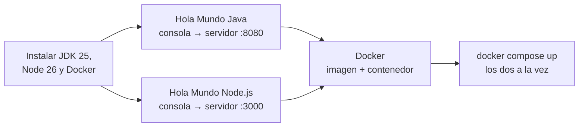
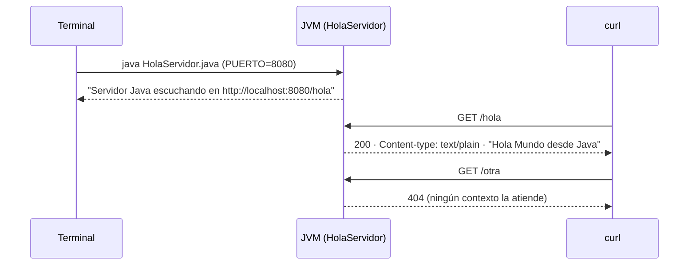
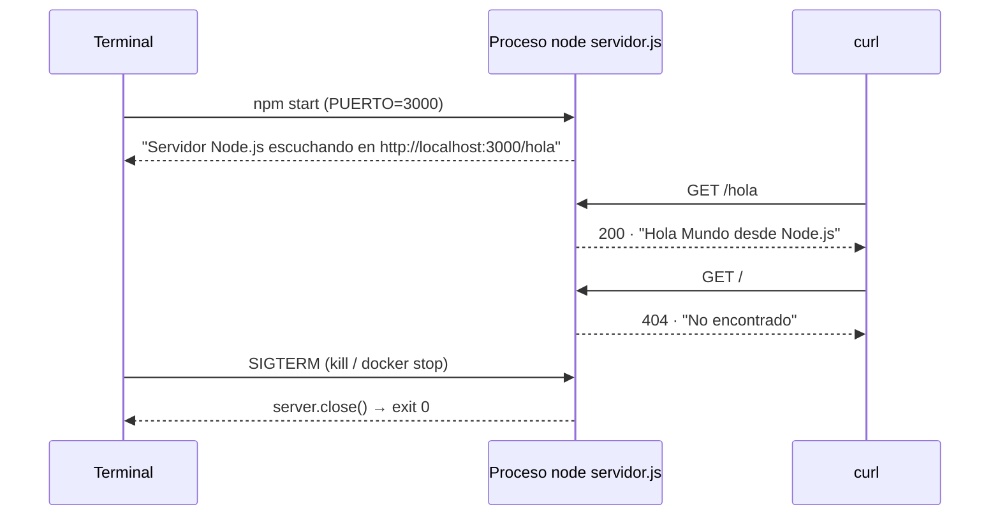
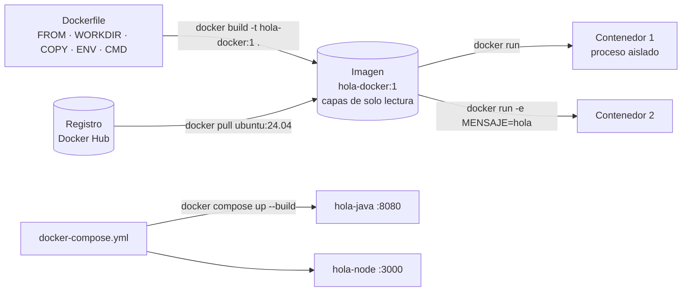

# Módulo 0.5 · Primer «Hola Mundo» en ambos stacks + Docker básico

**Fase 0 · Fundamentos absolutos** (semana 4 de 4). **Duración:** 10 h (3 temas: 3 h + 3 h + 4 h). **Dificultad:** 2
de 5. **Dependencias:** Módulos 0.1 a 0.4 (servidor, API, Java y Node lado a lado, terminal, HTTP, variables de
entorno). **Herramientas:** **JDK 25 LTS (25.0.5)**, **Node.js 26.13.1 LTS**, **Docker Engine 29.10.0** con
**Docker Compose v5.6.1** o posterior (en macOS y Windows, Docker Desktop los trae)..

Este módulo cierra la Fase 0: instalas las herramientas, escribes el «Hola Mundo» clásico en Java y en Node.js,
los conviertes en pequeños servidores HTTP y los empaquetas en **contenedores Docker**, la forma en que se
entregan y ejecutan todos los microservicios del curso. Al terminar tendrás dos servicios corriendo a la vez con
un solo comando.



**Texto alternativo:** cinco cajas. Instalar JDK 25, Node 26 y Docker se bifurca en Hola Mundo Java (consola y
luego servidor en el puerto 8080) y Hola Mundo Node.js (consola y servidor en el puerto 3000). Ambos llegan a
Docker (imagen y contenedor) y terminan en docker compose up, que arranca los dos a la vez.

---


### Primer «Hola Mundo» en Java

<details open>
<summary><strong>Capa 1 — Lectura</strong></summary>

#### ► DE QUÉ TRATA
Instalar y comprobar el JDK 25, ejecutar un «Hola Mundo» en su forma clásica y en su forma compacta de JDK 25, y convertirlo en un servidor HTTP que responde en /hola; lo compruebas cuando java HolaServidorTest.java muestra 2 ✔ y curl localhost:8080/hola responde Hola Mundo desde…

#### ► LA IDEA EN UNA FRASE
**Instalar y comprobar el JDK 25, ejecutar un «Hola Mundo» en su forma clásica y en su forma compacta de JDK 25, y convertirlo en un servidor HTTP que responde en /hola; lo compruebas cuando java HolaServidorTest.java muestra 2 ✔ y curl localhost:8080/hola responde Hola Mundo desde Java.**

#### ► POR QUÉ EXISTE ESTO
Para programar en Java necesitas el JDK (*Java Development Kit*): incluye el compilador y la máquina virtual. Usaremos el JDK 25, la versión con soporte de largo plazo (LTS) más reciente.

#### ► LA ANALOGÍA
Piensa en primer «hola mundo» en java como una herramienta de taller: útil cuando conoces su propósito y sus límites.
**Dónde se rompe la analogía:** en software, los efectos dependen del contexto, la escala y los trade-offs.

#### ► CÓMO FUNCIONA


1. **macOS, Windows y Linux, instalador gráfico:** descarga *Eclipse Temurin 25 (LTS)* desde
2. **macOS o Linux con SDKMAN** (cambia de versión fácilmente): instala SDKMAN desde `https://sdkman.io`, luego
3. **Linux Ubuntu/Debian:** `sudo apt install openjdk-25-jdk`.

#### ► LO QUE PUEDE SALIR MAL
| Síntoma | Causa probable | Arreglo |
|---|---|---|
| Primer «Hola Mundo» en Java se aplica pero el resultado no mejora | Se usó sin medir el problema real | Mide antes y compara contra la alternativa simple |
| Aparece complejidad inesperada | Se adoptó la técnica sin comprender sus trade-offs | Vuelve a la sección de trade-offs y reduce el alcance |
| Falla en un caso límite | Se asumió un contexto que no se cumple | Prueba el caso límite y documenta cuándo NO usarlo |

#### ► TRADE-OFFS
| Opción | Cuándo usarla | Cuándo NO usarla |
|---|---|---|
| Usar Primer «Hola Mundo» en Java | Cuando el problema coincide con su propósito y el beneficio es observable | Cuando agrega complejidad sin resolver un problema real |
| Alternativa más simple | Cuando el contexto es pequeño, estable o fácil de razonar | Cuando ya demostró no escalar o no cumplir el requisito |
| Postergar la decisión | Cuando falta evidencia del problema | Cuando el costo de esperar es mayor que el costo de probar |

#### ► CUÁNDO NO USAR ESTO
«En mi máquina funciona»: depender de la versión de Java que haya instalada en cada computador.

#### ► DE VUELTA A LA ANALOGÍA
Volviendo a la analogía: primer «hola mundo» en java funciona como el modelo inicial, pero recuerda dónde se rompe: en producción importan la evidencia, la escala y el costo de equivocarte.

#### ► LO QUE DEBES RECORDAR
- **macOS, Windows y Linux, instalador gráfico:** descarga *Eclipse Temurin 25 (LTS)* desde
- **macOS o Linux con SDKMAN** (cambia de versión fácilmente): instala SDKMAN desde `https://sdkman.io`, luego
- **Linux Ubuntu/Debian:** `sudo apt install openjdk-25-jdk`.

#### ► PREGUNTAS PARA PENSAR
1. ¿Qué problema concreto resuelve primer «hola mundo» en java en tu contexto?
2. ¿Cómo sabrías que primer «hola mundo» en java no está funcionando bien?
3. ¿Qué alternativa más simple considerarías antes de usar primer «hola mundo» en java?

</details>

<details>
<summary><strong>Capa 2 — Construcción</strong></summary>

#### Código y verificación


```java
// Módulo 0.5 · Primer «Hola Mundo» en Java (forma clásica, la que verás en todo proyecto Spring Boot).
// Requisitos: JDK 25 LTS. Sin dependencias.
// Ejecuta (desde la carpeta java/):  java HolaMundo.java
public class HolaMundo {                       // 1. una clase con el MISMO nombre que el archivo
    public static void main(String[] args) {   // 2. main: la puerta de entrada del programa
        System.out.println("Hola Mundo desde Java " + Runtime.version().feature()); // 3. imprime y salta de línea
    }
}
```

```java
// Módulo 0.5 · «Hola Mundo» compacto: desde JDK 25 un archivo puede tener solo un método main (JEP 512).
// Requisitos: JDK 25 LTS (en JDK 21-24 esto no compila). Sin dependencias.
// Ejecuta (desde la carpeta java/):  java HolaCompacto.java
void main() {
    IO.println("Hola Mundo compacto desde Java " + Runtime.version().feature());
}
```

```java
// Módulo 0.5 · «Hola Mundo» como servidor HTTP en Java, solo con el JDK (sin Spring todavía).
// Requisitos: JDK 25 LTS. Usa com.sun.net.httpserver, incluido en el JDK desde Java 6. Sin dependencias.
// Ejecuta (desde la carpeta java/):  java HolaServidor.java     y prueba:  curl http://localhost:8080/hola

import com.sun.net.httpserver.HttpServer;
import java.io.IOException;
import java.io.OutputStream;
import java.net.InetSocketAddress;
import java.nio.charset.StandardCharsets;

public class HolaServidor {

    // Crea el servidor en el puerto indicado (0 = uno libre, útil en los tests) y lo arranca.
    public static HttpServer iniciar(int puerto) throws IOException {
        HttpServer servidor = HttpServer.create(new InetSocketAddress(puerto), 0);
        servidor.createContext("/hola", intercambio -> {
            byte[] cuerpo = "Hola Mundo desde Java\n".getBytes(StandardCharsets.UTF_8);
            intercambio.getResponseHeaders().add("Content-Type", "text/plain; charset=utf-8");
            intercambio.sendResponseHeaders(200, cuerpo.length);
            try (OutputStream salida = intercambio.getResponseBody()) {
                salida.write(cuerpo);
            }
        });
        servidor.start();
        return servidor;
    }

    public static void main(String[] args) throws IOException {
        // El puerto llega por variable de entorno (Módulo 0.4); 8080 si no existe.
        int puerto = Integer.parseInt(System.getenv().getOrDefault("PUERTO", "8080"));
        iniciar(puerto);
        System.out.println("Servidor Java escuchando en http://localhost:" + puerto + "/hola");
    }
}
```

```bash
   java -version
   java HolaMundo.java
   java HolaCompacto.java
   ```

```bash
   java HolaServidor.java
   ```

</details>

### Primer «Hola Mundo» en Node.js

<details open>
<summary><strong>Capa 1 — Lectura</strong></summary>

#### ► DE QUÉ TRATA
Instalar y comprobar Node.js 26 LTS, ejecutar un «Hola Mundo» de consola y otro como servidor HTTP en /hola, arrancarlo con un script de npm y apagarlo de forma ordenada con SIGTERM; lo compruebas cuando node --test pasa 1 de 1 y curl localhost:3000/hola responde Hola Mundo desde…

#### ► LA IDEA EN UNA FRASE
**Instalar y comprobar Node.js 26 LTS, ejecutar un «Hola Mundo» de consola y otro como servidor HTTP en /hola, arrancarlo con un script de npm y apagarlo de forma ordenada con SIGTERM; lo compruebas cuando node --test pasa 1 de 1 y curl localhost:3000/hola responde Hola Mundo desde Node.js.**

#### ► POR QUÉ EXISTE ESTO
Node.js ejecuta JavaScript en tu computador (fuera del navegador). Usaremos Node.js 26, la versión LTS (soporte de largo plazo) más reciente.

#### ► LA ANALOGÍA
Piensa en primer «hola mundo» en node.js como una herramienta de taller: útil cuando conoces su propósito y sus límites.
**Dónde se rompe la analogía:** en software, los efectos dependen del contexto, la escala y los trade-offs.

#### ► CÓMO FUNCIONA


1. **Instalador oficial:** descarga la versión «LTS» desde `https://nodejs.org` y sigue el asistente.
2. **macOS o Linux con nvm** (cambia de versión fácilmente): instala nvm desde
3. **Windows con nvm-windows o el instalador `.msi`** de nodejs.org.

#### ► LO QUE PUEDE SALIR MAL
| Síntoma | Causa probable | Arreglo |
|---|---|---|
| Primer «Hola Mundo» en Node.js se aplica pero el resultado no mejora | Se usó sin medir el problema real | Mide antes y compara contra la alternativa simple |
| Aparece complejidad inesperada | Se adoptó la técnica sin comprender sus trade-offs | Vuelve a la sección de trade-offs y reduce el alcance |
| Falla en un caso límite | Se asumió un contexto que no se cumple | Prueba el caso límite y documenta cuándo NO usarlo |

#### ► TRADE-OFFS
| Opción | Cuándo usarla | Cuándo NO usarla |
|---|---|---|
| Usar Primer «Hola Mundo» en Node.js | Cuando el problema coincide con su propósito y el beneficio es observable | Cuando agrega complejidad sin resolver un problema real |
| Alternativa más simple | Cuando el contexto es pequeño, estable o fácil de razonar | Cuando ya demostró no escalar o no cumplir el requisito |
| Postergar la decisión | Cuando falta evidencia del problema | Cuando el costo de esperar es mayor que el costo de probar |

#### ► CUÁNDO NO USAR ESTO
Ignorar las señales o salir a la fuerza:

#### ► DE VUELTA A LA ANALOGÍA
Volviendo a la analogía: primer «hola mundo» en node.js funciona como el modelo inicial, pero recuerda dónde se rompe: en producción importan la evidencia, la escala y el costo de equivocarte.

#### ► LO QUE DEBES RECORDAR
- **Instalador oficial:** descarga la versión «LTS» desde `https://nodejs.org` y sigue el asistente.
- **macOS o Linux con nvm** (cambia de versión fácilmente): instala nvm desde
- **Windows con nvm-windows o el instalador `.msi`** de nodejs.org.

#### ► PREGUNTAS PARA PENSAR
1. ¿Qué problema concreto resuelve primer «hola mundo» en node.js en tu contexto?
2. ¿Cómo sabrías que primer «hola mundo» en node.js no está funcionando bien?
3. ¿Qué alternativa más simple considerarías antes de usar primer «hola mundo» en node.js?

</details>

<details>
<summary><strong>Capa 2 — Construcción</strong></summary>

#### Código y verificación


```json
{
  "name": "hola-node",
  "version": "1.0.0",
  "private": true,
  "description": "Módulo 0.5: Hola Mundo en Node.js. Sin dependencias externas.",
  "type": "module",
  "engines": {
    "node": ">=26.13.1"
  },
  "scripts": {
    "start": "node servidor.js",
    "test": "node --test"
  }
}
```

```javascript
// Módulo 0.5 · Primer «Hola Mundo» en Node.js: una sola línea basta.
// Requisitos: Node.js 26.13.1 LTS. Sin dependencias.
// Ejecuta (desde la carpeta node/):  node hola.js
console.log(`Hola Mundo desde Node.js ${process.versions.node.split('.')[0]}`);
```

```javascript
// Módulo 0.5 · «Hola Mundo» como servidor HTTP en Node.js, solo con 'node:http' (sin Express todavía).
// Requisitos: Node.js 26.13.1 LTS. Sin dependencias.
// Ejecuta (desde la carpeta node/):  node servidor.js     y prueba:  curl http://localhost:3000/hola

import http from 'node:http';

export function crearServidor() {
  return http.createServer((req, res) => {
    if (req.method === 'GET' && req.url === '/hola') {
      res.writeHead(200, { 'Content-Type': 'text/plain; charset=utf-8' });
      return res.end('Hola Mundo desde Node.js\n');
    }
    res.writeHead(404, { 'Content-Type': 'text/plain; charset=utf-8' });
    res.end('No encontrado\n');
  });
}

if (import.meta.main) {
  // El puerto llega por variable de entorno (Módulo 0.4); 3000 si no existe.
  const puerto = Number(process.env.PUERTO ?? 3000);
  const servidor = crearServidor().listen(puerto, () =>
    console.log(`Servidor Node.js escuchando en http://localhost:${puerto}/hola`));
  // Docker detiene el contenedor enviando SIGTERM: cerramos ordenadamente.
  process.on('SIGTERM', () => servidor.close(() => process.exit(0)));
}
```

```bash
   node -v
   node hola.js
   ```

```bash
   curl -i http://localhost:3000/hola
   curl -s http://localhost:3000/
   ```

</details>

### Docker básico

<details open>
<summary><strong>Capa 1 — Lectura</strong></summary>

#### ► DE QUÉ TRATA
Construir una imagen con un Dockerfile, ejecutar contenedores (en primer plano, en segundo plano, con variables de entorno), inspeccionarlos con docker ps y docker logs, y arrancar los dos «Hola Mundo» juntos con Docker Compose; lo compruebas cuando los comandos de verificación i…

#### ► LA IDEA EN UNA FRASE
**Construir una imagen con un Dockerfile, ejecutar contenedores (en primer plano, en segundo plano, con variables de entorno), inspeccionarlos con docker ps y docker logs, y arrancar los dos «Hola Mundo» juntos con Docker Compose; lo compruebas cuando los comandos de verificación indicados muestra las tres comprobaciones de Docker en ✔ (y, con --compose, las dos de Compose).**

#### ► POR QUÉ EXISTE ESTO
Docker empaqueta un programa junto con todo lo que necesita (sistema base, Java o Node, archivos) en una imagen. Al ejecutar una imagen obtienes un contenedor: un proceso aislado que cree tener su propio sistema, sus propias carpetas y su propia red. Así el programa funciona igual en tu laptop, en la de tu compañero y en el servidor: se acabó el «en mi máquina funciona».

#### ► LA ANALOGÍA
Piensa en docker básico como una herramienta de taller: útil cuando conoces su propósito y sus límites.
**Dónde se rompe la analogía:** en software, los efectos dependen del contexto, la escala y los trade-offs.

#### ► CÓMO FUNCIONA


1. **Dockerfile:** la receta para construir una imagen.
2. **Imagen:** el molde sellado que resulta (`nombre:etiqueta`, por ejemplo `hola-docker:1`).
3. **Contenedor:** una ejecución de una imagen.
4. **Registro:** el almacén de imágenes (Docker Hub), de donde se descargan `ubuntu:24.04` o `node:26-alpine`.
5. **Docker Compose:** un archivo YAML que arranca varios contenedores juntos.

#### ► LO QUE PUEDE SALIR MAL
| Síntoma | Causa probable | Arreglo |
|---|---|---|
| Docker básico se aplica pero el resultado no mejora | Se usó sin medir el problema real | Mide antes y compara contra la alternativa simple |
| Aparece complejidad inesperada | Se adoptó la técnica sin comprender sus trade-offs | Vuelve a la sección de trade-offs y reduce el alcance |
| Falla en un caso límite | Se asumió un contexto que no se cumple | Prueba el caso límite y documenta cuándo NO usarlo |

#### ► TRADE-OFFS
| Opción | Cuándo usarla | Cuándo NO usarla |
|---|---|---|
| Usar Docker básico | Cuando el problema coincide con su propósito y el beneficio es observable | Cuando agrega complejidad sin resolver un problema real |
| Alternativa más simple | Cuando el contexto es pequeño, estable o fácil de razonar | Cuando ya demostró no escalar o no cumplir el requisito |
| Postergar la decisión | Cuando falta evidencia del problema | Cuando el costo de esperar es mayor que el costo de probar |

#### ► CUÁNDO NO USAR ESTO
Usar el contenedor como una máquina virtual «mascota»:

#### ► DE VUELTA A LA ANALOGÍA
Volviendo a la analogía: docker básico funciona como el modelo inicial, pero recuerda dónde se rompe: en producción importan la evidencia, la escala y el costo de equivocarte.

#### ► LO QUE DEBES RECORDAR
- **Dockerfile:** la receta para construir una imagen.
- **Imagen:** el molde sellado que resulta (`nombre:etiqueta`, por ejemplo `hola-docker:1`).
- **Contenedor:** una ejecución de una imagen.
- **Registro:** el almacén de imágenes (Docker Hub), de donde se descargan `ubuntu:24.04` o `node:26-alpine`.

#### ► PREGUNTAS PARA PENSAR
1. ¿Qué problema concreto resuelve docker básico en tu contexto?
2. ¿Cómo sabrías que docker básico no está funcionando bien?
3. ¿Qué alternativa más simple considerarías antes de usar docker básico?

</details>

<details>
<summary><strong>Capa 2 — Construcción</strong></summary>

#### Código y verificación


```dockerfile
# Módulo 0.5 · Docker básico: la receta (Dockerfile) más pequeña posible.
# Imagen base: ubuntu:24.04 (Ubuntu 24.04 LTS). Construye con:  docker build -t hola-docker:1 .
FROM ubuntu:24.04
WORKDIR /app
COPY hola.sh .
ENV MENSAJE="valor por defecto de la imagen"
CMD ["./hola.sh"]
```

```bash
#!/bin/sh
# Módulo 0.5 · Script que corre DENTRO del contenedor: muestra que está aislado del computador anfitrión.
echo "Hola Mundo desde Docker"
echo "Sistema dentro del contenedor: $(. /etc/os-release && echo "$PRETTY_NAME")"
echo "Usuario: $(whoami) · Directorio: $(pwd)"
echo "Mensaje recibido por variable de entorno: ${MENSAJE:-(ninguno)}"
```

```dockerfile
# Módulo 0.5 · Imagen Docker del «Hola Mundo» Java.
# Imagen base oficial: eclipse-temurin:25-jdk (JDK 25 LTS de Eclipse Adoptium).
FROM eclipse-temurin:25-jdk
WORKDIR /app
COPY HolaServidor.java .
RUN javac HolaServidor.java
ENV PUERTO=8080
EXPOSE 8080
CMD ["java", "HolaServidor"]
```

```dockerfile
# Módulo 0.5 · Imagen Docker del «Hola Mundo» Node.js.
# Imagen base oficial: node:26-alpine (Node.js 26 LTS sobre Alpine Linux, pequeña).
FROM node:26-alpine
WORKDIR /app
COPY package.json servidor.js ./
ENV PUERTO=3000
EXPOSE 3000
USER node
CMD ["node", "servidor.js"]
```

```yaml
# Módulo 0.5 · Los dos «Hola Mundo» (Java y Node.js) arrancados juntos con Docker Compose.
# Requisitos: Docker Engine 29.10.0 con Docker Compose v5.6.1 o posterior (o Docker Desktop reciente).
# Uso: docker compose up --build -d   ·   curl localhost:8080/hola   ·   curl localhost:3000/hola   ·   docker compose down
services:
  hola-java:
    build: ./java
    ports:
      - "8080:8080"   # puerto_del_computador:puerto_del_contenedor
    environment:
      PUERTO: "8080"
  hola-node:
    build: ./node
    ports:
      - "3000:3000"
    environment:
      PUERTO: "3000"
```

</details>
