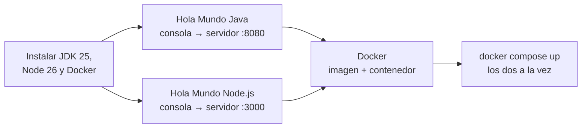
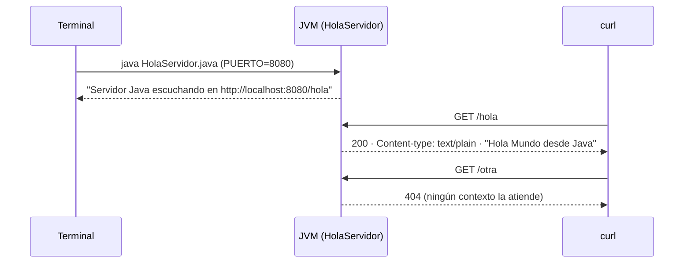
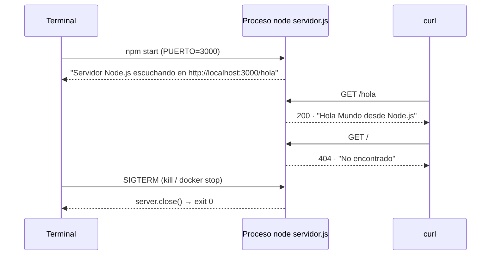
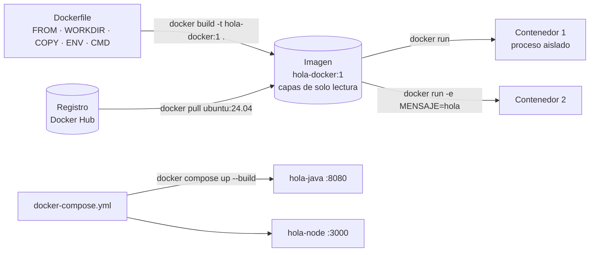

# Módulo 0.5 · Primer «Hola Mundo» en ambos stacks + Docker básico

**Fase 0 · Fundamentos absolutos** (semana 4 de 4). **Duración:** 10 h (3 temas: 3 h + 3 h + 4 h). **Dificultad:** 2
de 5. **Dependencias:** Módulos 0.1 a 0.4 (servidor, API, Java y Node lado a lado, terminal, HTTP, variables de
entorno). **Herramientas:** **JDK 25 LTS (25.0.5)**, **Node.js 26.13.1 LTS**, **Docker Engine 29.10.0** con
**Docker Compose v5.6.1** o posterior (en macOS y Windows, Docker Desktop los trae). **Laboratorio:**
`modulo-4`.

Este módulo cierra la Fase 0: instalas las herramientas, escribes el «Hola Mundo» clásico en Java y en Node.js,
los conviertes en pequeños servidores HTTP y los empaquetas en **contenedores Docker**, la forma en que se
entregan y ejecutan todos los microservicios del curso. Al terminar tendrás dos servicios corriendo a la vez con
un solo comando.



**Texto alternativo:** cinco cajas. Instalar JDK 25, Node 26 y Docker se bifurca en Hola Mundo Java (consola y
luego servidor en el puerto 8080) y Hola Mundo Node.js (consola y servidor en el puerto 3000). Ambos llegan a
Docker (imagen y contenedor) y terminan en docker compose up, que arranca los dos a la vez.

---

### Primer «Hola Mundo» en Java

#### 1. UBICACIÓN

Módulo 0.5, Lección 1 de 3 · Fase 0 · `web/public/content/microservices/modulo-4.md` · Laboratorio
`java`.

#### 2. PRERREQUISITOS

- Módulo 0.3: clase, `main`, compilar y ejecutar con `java Archivo.java`.
- Módulo 0.4: terminal, HTTP con `curl`, variables de entorno.
- Permisos para instalar programas en tu computador.

#### 3. OBJETIVO DE APRENDIZAJE

**Instalar** y **comprobar** el JDK 25, **ejecutar** un «Hola Mundo» en su forma clásica y en su forma compacta
de JDK 25, y **convertirlo** en un servidor HTTP que responde en `/hola`; lo compruebas cuando
`java HolaServidorTest.java` muestra 2 `✔` y `curl localhost:8080/hola` responde `Hola Mundo desde Java`.

#### 4. ANALOGÍA VISUAL

Dibuja una **caja de herramientas** recién abierta con la etiqueta «JDK 25». Dentro, tres compartimentos: un
**traductor** con un diccionario (`javac`, el compilador), un **motor** con una placa «JVM» (`java`, que ejecuta)
y una **biblioteca** de estantes llenos de piezas listas para usar (la librería estándar: listas, fechas, red,
¡incluso un pequeño servidor HTTP!). Al lado, una **tarjeta de presentación** que dice «Hola Mundo desde Java 25»:
es lo primero que fabricas con la caja para comprobar que todas las herramientas funcionan. En una segunda
escena, la misma tarjeta está colgada en una **ventanilla con el número 8080**: ya no es un papel que entregas
una vez, sino un mostrador que responde a quien pregunte por `/hola`.

#### 5. DIAGRAMA TÉCNICO



**Texto alternativo:** diagrama de secuencia. La terminal ejecuta java HolaServidor.java y la JVM responde con el
mensaje «Servidor Java escuchando en http://localhost:8080/hola». Luego curl pide GET /hola y recibe 200 con el
texto «Hola Mundo desde Java»; al pedir GET /otra recibe 404 porque ningún contexto atiende esa ruta.

#### 6. EXPLICACIÓN NIVEL 0

Para programar en Java necesitas el **JDK** (*Java Development Kit*): incluye el compilador y la máquina virtual.
Usaremos el **JDK 25**, la versión con soporte de largo plazo (LTS) más reciente.

**Instalación** (elige una opción):

- **macOS, Windows y Linux, instalador gráfico:** descarga *Eclipse Temurin 25 (LTS)* desde
  `https://adoptium.net`, elige tu sistema y sigue el asistente.
- **macOS o Linux con SDKMAN** (cambia de versión fácilmente): instala SDKMAN desde `https://sdkman.io`, luego
  `sdk list java`, y elige la línea `25.0.x-tem` con `sdk install java <identificador>`.
- **Linux Ubuntu/Debian:** `sudo apt install openjdk-25-jdk`.

Comprueba con `java -version`: la primera línea debe contener `25.0`.

El primer programa de cualquier lenguaje es el **«Hola Mundo»**: imprimir un saludo. Si aparece, todo está bien
instalado. Después lo convertimos en un **servidor**, como en el Módulo 0.1, pero en Java.

#### 7. EXPLICACIÓN INTERMEDIA

- **Forma clásica:** `public class HolaMundo { public static void main(String[] args) { ... } }`. Es la que verás
  en cada proyecto Spring Boot (Fase 1). `Runtime.version().feature()` devuelve el número de versión (25).
- **Forma compacta (JDK 25, JEP 512):** un archivo con solo `void main() { IO.println(...); }`. La clase se crea
  implícitamente y `IO` es una clase nueva de `java.lang` para leer y escribir en consola. Es ideal para aprender y
  para guiones; en JDK 21 a 24 solo existía como función en vista previa (*preview*).
- **Servidor sin dependencias:** `com.sun.net.httpserver.HttpServer` viene en el JDK. `createContext("/hola",
  manejador)` registra una ruta; el manejador escribe cabeceras con `sendResponseHeaders(200, bytes)` y el cuerpo
  en `getResponseBody()`. Las rutas no registradas responden 404 automáticamente.
- **`iniciar(0)`**: con puerto 0 el sistema operativo elige uno libre; el test lo lee con
  `getAddress().getPort()` y usa `java.net.http.HttpClient` (también incluido en el JDK) para el GET.
- El puerto llega por la variable de entorno `PUERTO` (Módulo 0.4) con `getOrDefault("PUERTO", "8080")`.

#### 8. EXPLICACIÓN MAESTRA

- **JDK puro frente a Spring Boot.** `HttpServer` sirve para utilidades y para entender qué hace un framework;
  no trae inyección de dependencias, validación, serialización JSON, métricas ni seguridad. Spring Boot 4.1 (Fase
  1) da todo eso por convención, a cambio de arranque más lento y más memoria. Alternativas ligeras en la JVM:
  Javalin, Helidon SE, Micronaut o Quarkus (arranque rápido y compilación nativa).
- **Distribuciones del JDK.** Temurin (Eclipse Adoptium), Oracle OpenJDK, Amazon Corretto, Azul Zulu, Microsoft
  Build of OpenJDK: el mismo OpenJDK con distintas políticas de soporte y parches. Para el curso basta Temurin; la
  Fase 1 usa Azul Zulu para CRaC y GraalVM para Native Image (ver la checklist de versiones).
- **LTS frente a la última versión.** JDK 27 es la versión GA más nueva, pero no es LTS y parte del ecosistema
  (GraalVM, CRaC) aún no la soporta; en producción se elige una LTS (21 o 25) y se actualizan parches
  trimestrales.
- **Cuándo NO** usar la forma compacta: en código de producción con paquetes, varias clases y frameworks; ahí la
  clase explícita con `package` es obligatoria en la práctica. Y **cuándo NO** usar `HttpServer` del JDK: para un
  servicio de negocio expuesto a internet (sin TLS configurado, sin límites, sin observabilidad).

#### 9. CÓDIGO EJECUTABLE

Versión: **JDK 25 LTS (25.0.5)**. Sin dependencias ni `pom.xml`: todo viene en el JDK (en la Fase 1 crearás el
`pom.xml` de Spring Boot). `HolaMundo.java`:

```java
// Módulo 0.5 · Primer «Hola Mundo» en Java (forma clásica, la que verás en todo proyecto Spring Boot).
// Requisitos: JDK 25 LTS. Sin dependencias.
// Ejecuta (desde la carpeta java/):  java HolaMundo.java
public class HolaMundo {                       // 1. una clase con el MISMO nombre que el archivo
    public static void main(String[] args) {   // 2. main: la puerta de entrada del programa
        System.out.println("Hola Mundo desde Java " + Runtime.version().feature()); // 3. imprime y salta de línea
    }
}
```

`HolaCompacto.java`:

```java
// Módulo 0.5 · «Hola Mundo» compacto: desde JDK 25 un archivo puede tener solo un método main (JEP 512).
// Requisitos: JDK 25 LTS (en JDK 21-24 esto no compila). Sin dependencias.
// Ejecuta (desde la carpeta java/):  java HolaCompacto.java
void main() {
    IO.println("Hola Mundo compacto desde Java " + Runtime.version().feature());
}
```

`HolaServidor.java`:

```java
// Módulo 0.5 · «Hola Mundo» como servidor HTTP en Java, solo con el JDK (sin Spring todavía).
// Requisitos: JDK 25 LTS. Usa com.sun.net.httpserver, incluido en el JDK desde Java 6. Sin dependencias.
// Ejecuta (desde la carpeta java/):  java HolaServidor.java     y prueba:  curl http://localhost:8080/hola

import com.sun.net.httpserver.HttpServer;
import java.io.IOException;
import java.io.OutputStream;
import java.net.InetSocketAddress;
import java.nio.charset.StandardCharsets;

public class HolaServidor {

    // Crea el servidor en el puerto indicado (0 = uno libre, útil en los tests) y lo arranca.
    public static HttpServer iniciar(int puerto) throws IOException {
        HttpServer servidor = HttpServer.create(new InetSocketAddress(puerto), 0);
        servidor.createContext("/hola", intercambio -> {
            byte[] cuerpo = "Hola Mundo desde Java\n".getBytes(StandardCharsets.UTF_8);
            intercambio.getResponseHeaders().add("Content-Type", "text/plain; charset=utf-8");
            intercambio.sendResponseHeaders(200, cuerpo.length);
            try (OutputStream salida = intercambio.getResponseBody()) {
                salida.write(cuerpo);
            }
        });
        servidor.start();
        return servidor;
    }

    public static void main(String[] args) throws IOException {
        // El puerto llega por variable de entorno (Módulo 0.4); 8080 si no existe.
        int puerto = Integer.parseInt(System.getenv().getOrDefault("PUERTO", "8080"));
        iniciar(puerto);
        System.out.println("Servidor Java escuchando en http://localhost:" + puerto + "/hola");
    }
}
```

#### 10. MINI-LABORATORIO

1. Comprueba la instalación y ejecuta las dos formas del «Hola Mundo»:
   ```bash
   java -version
   java HolaMundo.java
   java HolaCompacto.java
   ```
2. **Terminal 1:** arranca el servidor. **Terminal 2:** pruébalo.
   ```bash
   java HolaServidor.java
   ```
   ```bash
   curl -i http://localhost:8080/hola
   curl -s -o /dev/null -w '%{http_code}\n' http://localhost:8080/otra
   ```
3. Detén el servidor con `Ctrl+C` y arráncalo en otro puerto con una variable de entorno:
   `PUERTO=8085 java HolaServidor.java`.

**Output esperado** (paso 1; la primera línea de `java -version` debe contener `25.0`):

```text
Hola Mundo desde Java 25
Hola Mundo compacto desde Java 25
```

Paso 2, terminal 1: `Servidor Java escuchando en http://localhost:8080/hola`. Terminal 2 (la fecha cambia):

```text
HTTP/1.1 200 OK
Date: Fri, 20 Nov 2026 02:11:43 GMT
Content-type: text/plain; charset=utf-8
Content-length: 22

Hola Mundo desde Java
404
```

Paso 3: `Servidor Java escuchando en http://localhost:8085/hola`.

**Captura comentada:** el servidor de Java escribe las cabeceras como `Content-type` y `Content-length` (con
minúscula tras el guion); en HTTP las cabeceras no distinguen mayúsculas, así que es correcto. `Content-length:
22` son los bytes de «Hola Mundo desde Java» más el salto de línea. La primera ejecución tarda un par de segundos
porque `java Archivo.java` compila en memoria antes de arrancar.

#### 11. VERIFICACIÓN

```bash
java HolaServidorTest.java
```

(desde `modulo-4/java`). Salida real:

```text
✔ GET /hola responde 200
✔ el cuerpo es «Hola Mundo desde Java»
Java: todos los tests pasaron
```

El test arranca el servidor en un puerto libre, hace el GET con `HttpClient` y termina con código 1 si algo falla
(`echo $?` para verlo). **Pregunta de comprobación:** ¿por qué `HolaCompacto.java` no compila en JDK 21 y
`HolaMundo.java` sí? *(Las clases implícitas y la instancia `void main()` son definitivas desde JDK 25; en JDK 21
eran una vista previa desactivada por defecto.)*

#### 12. ERROR COMÚN

**Síntoma:** compilas con un JDK y ejecutas con otro más viejo (pasa cuando tienes varios instalados y el `PATH`
apunta a otro). **Cómo se ve:**

```text
Error: LinkageError occurred while loading main class HolaMundo
	java.lang.UnsupportedClassVersionError: HolaMundo has been compiled by a more recent version of the Java Runtime (class file version 69.0), this version of the Java Runtime only recognizes class file versions up to 65.0
```

**Diagnóstico:** el número de versión de clase es la versión del JDK + 44: 69 = JDK 25 y 65 = JDK 21. Mira qué
binarios usas con `java -version`, `javac -version` y `which java` (en Windows, `where java`). **Arreglo:** usa el
mismo JDK para compilar y ejecutar (ajusta `JAVA_HOME` y el `PATH`, o `sdk use java 25.0.x-tem` con SDKMAN). Con
`HolaCompacto.java` en JDK 21 el síntoma es otro: `error: unnamed classes are a preview feature and are disabled
by default.`

#### 13. PREGUNTA DE ENTREVISTA

«¿Qué diferencia hay entre el JDK y el JRE, y qué necesitas en una imagen de producción?»

**Respuesta modelo:** el JDK incluye herramientas de desarrollo (compilador `javac`, `jar`, `jlink`, depuradores)
además de la JVM; el JRE es solo lo necesario para ejecutar. Para compilar se necesita el JDK; para ejecutar en
producción basta un runtime. Desde JDK 11 ya no se distribuye un JRE oficial separado, pero los proveedores
publican imágenes `-jre` y puedes crear un runtime mínimo con `jlink` que incluya solo los módulos que usa tu
aplicación. En una imagen de producción se compila en una etapa con el JDK y se ejecuta en otra con un runtime
reducido (*multi-stage*, Módulo 12): menos tamaño y menos superficie de ataque.

#### 14. ANTI-PATRÓN RELACIONADO

**«En mi máquina funciona»: depender de la versión de Java que haya instalada en cada computador.**

```text
✖ Laptop de Ana:  java 25 · compila con IO.println
✖ Servidor de CI: java 21 · "unnamed classes are a preview feature…"
✖ Producción:     java 17 · UnsupportedClassVersionError
```

Se ve como el mismo código que pasa en una máquina y falla en otra, con mensajes de versión distintos. Fija la
versión: en la Fase 1 con `<java.version>25</java.version>` en el `pom.xml` (y la *toolchain* de Maven o Gradle), y
en todas partes con una **imagen Docker** que trae el JDK exacto (tercera ficha de este módulo).

---

### Primer «Hola Mundo» en Node.js

#### 1. UBICACIÓN

Módulo 0.5, Lección 2 de 3 · Fase 0.

#### 2. PRERREQUISITOS

- Módulo 0.1: servidor con `node:http`; Módulo 0.3: Node.js frente a Java.
- Módulo 0.4: `package.json`, `npm install`, variables de entorno, señales y códigos de salida.

#### 3. OBJETIVO DE APRENDIZAJE

**Instalar** y **comprobar** Node.js 26 LTS, **ejecutar** un «Hola Mundo» de consola y otro como servidor
HTTP en `/hola`, **arrancarlo** con un script de `npm` y **apagarlo** de forma ordenada con `SIGTERM`; lo
compruebas cuando `node --test` pasa 1 de 1 y `curl localhost:3000/hola` responde `Hola Mundo desde Node.js`.

#### 4. ANALOGÍA VISUAL

Dibuja un **puesto de comida rápida** con un solo cocinero ágil (el hilo de Node) y una **campana** sobre el
mostrador (el event loop) que suena cada vez que llega un cliente. Pegado en el mostrador, un **papel con el menú
del día** (`package.json`): nombre del puesto, versión, y una sección «scripts» con dos botones dibujados:
**start** («abrir el puesto») y **test** («probar la receta»). En la ventanilla, un cartel con el número **3000**.
Cuando llega el inspector con un silbato (la señal `SIGTERM` que envía Docker al apagar), el cocinero no tira la
olla al suelo: termina de servir al cliente que está atendiendo, baja la persiana y se va (apagado ordenado).

#### 5. DIAGRAMA TÉCNICO



**Texto alternativo:** diagrama de secuencia. La terminal ejecuta npm start y el proceso node responde que
escucha en el puerto 3000. curl pide GET /hola y recibe 200 con el saludo; pide GET / y recibe 404. Al final la
terminal envía SIGTERM y el proceso cierra el servidor y termina con código 0.

#### 6. EXPLICACIÓN NIVEL 0

**Node.js** ejecuta JavaScript en tu computador (fuera del navegador). Usaremos **Node.js 26**, la versión LTS
(soporte de largo plazo) más reciente.

**Instalación** (elige una opción):

- **Instalador oficial:** descarga la versión «LTS» desde `https://nodejs.org` y sigue el asistente.
- **macOS o Linux con nvm** (cambia de versión fácilmente): instala nvm desde
  `https://github.com/nvm-sh/nvm`, luego `nvm install 26` y `nvm use 26`.
- **Windows con nvm-windows o el instalador `.msi`** de nodejs.org.

Comprueba con `node -v` (debe empezar por `v26`) y `npm -v` (npm viene con Node).

El «Hola Mundo» en Node es **una sola línea**: `console.log('Hola Mundo')`. Después, como en Java, lo convertimos
en un servidor.

#### 7. EXPLICACIÓN INTERMEDIA

- `process.versions.node` da la versión exacta (`26.13.1`); `.split('.')[0]` toma el número mayor.
- **`package.json`** describe el proyecto: `"type": "module"` activa `import/export`, `"engines"` documenta la
  versión de Node requerida y `"scripts"` define atajos: `npm start` ejecuta `node servidor.js` y `npm test`
  ejecuta `node --test`.
- **Servidor:** `http.createServer` + `listen(puerto)`. El manejador compara método y ruta; todo lo demás
  responde 404.
- **Apagado ordenado:** `process.on('SIGTERM', ...)` captura la señal que envían `kill`, Docker y Kubernetes;
  `servidor.close()` deja de aceptar conexiones nuevas, espera a que terminen las abiertas y, en su *callback*,
  `process.exit(0)`. Sin manejador, Node termina de golpe; y si corre como proceso 1 (PID 1) dentro de un
  contenedor, ignoraría la señal y Docker tendría que matarlo tras 10 segundos (lo ves en el tema siguiente).
- `import.meta.main` evita que el servidor arranque cuando el test importa `crearServidor`.

#### 8. EXPLICACIÓN MAESTRA

- **`node:http` frente a Express/NestJS/Fastify.** Sin dependencias y con control total, pero sin enrutador,
  *middlewares* ni validación. Express (minimalista, el más usado), Fastify (más rápido, con esquemas JSON) y
  NestJS (estructura opinada con módulos e inyección de dependencias, parecido a Spring) se ven en el Módulo 14.
  Para un servicio de negocio, un framework; para un *healthcheck* o un *sidecar* mínimo, `node:http` basta.
- **Gestores de versiones y paquetes.** nvm/fnm/Volta para versiones de Node; npm (incluido), pnpm (más rápido,
  ahorra disco) o Yarn para paquetes. Elige uno por repositorio y versiona su archivo de bloqueo
  (`package-lock.json`).
- **LTS frente a «Current».** Las versiones pares de Node pasan a LTS en octubre y tienen unos 30 meses de soporte;
  las impares viven 6 meses. En producción, siempre LTS. (Node 27 está hoy en *alpha*; Node 20 ya no recibe
  parches.)
- **Cuándo NO** usar `process.exit()` en medio de una petición: corta conexiones y pierde logs pendientes de
  escribir. Ciérralo todo de forma ordenada y deja que el proceso termine solo, o sal solo cuando `close()`
  termine.

#### 9. CÓDIGO EJECUTABLE

Versión: **Node.js 26.13.1 LTS**. Sin dependencias. `package.json`:

```json
{
  "name": "hola-node",
  "version": "1.0.0",
  "private": true,
  "description": "Módulo 0.5: Hola Mundo en Node.js. Sin dependencias externas.",
  "type": "module",
  "engines": {
    "node": ">=26.13.1"
  },
  "scripts": {
    "start": "node servidor.js",
    "test": "node --test"
  }
}
```

`hola.js`:

```javascript
// Módulo 0.5 · Primer «Hola Mundo» en Node.js: una sola línea basta.
// Requisitos: Node.js 26.13.1 LTS. Sin dependencias.
// Ejecuta (desde la carpeta node/):  node hola.js
console.log(`Hola Mundo desde Node.js ${process.versions.node.split('.')[0]}`);
```

`servidor.js`:

```javascript
// Módulo 0.5 · «Hola Mundo» como servidor HTTP en Node.js, solo con 'node:http' (sin Express todavía).
// Requisitos: Node.js 26.13.1 LTS. Sin dependencias.
// Ejecuta (desde la carpeta node/):  node servidor.js     y prueba:  curl http://localhost:3000/hola

import http from 'node:http';

export function crearServidor() {
  return http.createServer((req, res) => {
    if (req.method === 'GET' && req.url === '/hola') {
      res.writeHead(200, { 'Content-Type': 'text/plain; charset=utf-8' });
      return res.end('Hola Mundo desde Node.js\n');
    }
    res.writeHead(404, { 'Content-Type': 'text/plain; charset=utf-8' });
    res.end('No encontrado\n');
  });
}

if (import.meta.main) {
  // El puerto llega por variable de entorno (Módulo 0.4); 3000 si no existe.
  const puerto = Number(process.env.PUERTO ?? 3000);
  const servidor = crearServidor().listen(puerto, () =>
    console.log(`Servidor Node.js escuchando en http://localhost:${puerto}/hola`));
  // Docker detiene el contenedor enviando SIGTERM: cerramos ordenadamente.
  process.on('SIGTERM', () => servidor.close(() => process.exit(0)));
}
```

#### 10. MINI-LABORATORIO

1. Comprueba la instalación y ejecuta el «Hola Mundo» de consola:
   ```bash
   node -v
   node hola.js
   ```
2. **Terminal 1:** `npm start`. **Terminal 2:**
   ```bash
   curl -i http://localhost:3000/hola
   curl -s http://localhost:3000/
   ```
3. **Terminal 2:** envía la señal de apagado que usa Docker y comprueba que el proceso terminó:
   ```bash
   pkill -TERM -f "node servidor.js"
   pgrep -f "node servidor.js" || echo "proceso terminado"
   ```

**Output esperado** (paso 1): `Hola Mundo desde Node.js 26`. Paso 2, terminal 1: `Servidor Node.js escuchando
en http://localhost:3000/hola`; terminal 2 (la fecha cambia):

```text
HTTP/1.1 200 OK
Content-Type: text/plain; charset=utf-8
Date: Fri, 20 Nov 2026 02:11:44 GMT
Connection: keep-alive
Keep-Alive: timeout=5
Transfer-Encoding: chunked

Hola Mundo desde Node.js
No encontrado
```

Paso 3: `proceso terminado`, y en la terminal 1 vuelve el *prompt* sin mensajes de error.

**Captura comentada:** compara las cabeceras con las del servidor Java: Node usa `Transfer-Encoding: chunked` y
`Keep-Alive`, Java envía `Content-length`. Ambos son HTTP/1.1 válido. En el paso 3, la terminal 1 se cierra
limpia: el manejador de `SIGTERM` cerró el servidor y salió con código 0.

#### 11. VERIFICACIÓN

```bash
npm test
```

(desde `modulo-4/node`; ejecuta `node --test`). Salida real con `--test-reporter=spec`:

```text
✔ GET /hola responde 200 con el saludo (27.114063ms)
ℹ tests 1
ℹ pass 1
ℹ fail 0
```

Para el módulo completo (Java, Node y Docker básico): los comandos de verificación indicados en tu carpeta de trabajo. **Pregunta de
comprobación:** ¿qué pasaría en el paso 3 si quitaras la línea `process.on('SIGTERM', ...)`? *(Node terminaría
igual, pero de golpe, sin cerrar conexiones abiertas; dentro de un contenedor como PID 1 ignoraría la señal y
Docker lo mataría a los 10 segundos.)*

#### 12. ERROR COMÚN

**Síntoma:** ejecutas `npm start` o `npm test` y npm se queja de que no encuentra el proyecto. **Cómo se ve:**

```text
npm error code ENOENT
npm error syscall open
npm error path /tmp/package.json
npm error errno -2
npm error enoent Could not read package.json: Error: ENOENT: no such file or directory, open '/tmp/package.json'
```

**Diagnóstico:** la línea `path` dice dónde buscó: npm lee el `package.json` de la **carpeta actual**, y no estás
en `modulo-4/node`. **Arreglo:** `cd node` y repite (o `npm --prefix
node start`).

#### 13. PREGUNTA DE ENTREVISTA

«¿Qué es un *graceful shutdown* y por qué es imprescindible para un microservicio en Kubernetes?»

**Respuesta modelo:** es apagar el proceso ordenadamente al recibir `SIGTERM`: dejar de aceptar conexiones
nuevas, terminar las peticiones en curso, cerrar conexiones a bases de datos y colas, vaciar logs y salir con
código 0 antes del plazo de gracia (30 s por defecto en Kubernetes; 10 s en `docker stop`). En Kubernetes cada
despliegue o escalado elimina pods; sin apagado ordenado, las peticiones en vuelo se cortan con errores 502/503 y
los mensajes en proceso pueden quedar a medias. Se complementa con una *readiness probe* que deja de recibir
tráfico antes del cierre (Módulo 12).

#### 14. ANTI-PATRÓN RELACIONADO

**Ignorar las señales o salir a la fuerza:**

```javascript
// ✖ Anti-patrón: corta todo lo que esté en curso, incluidas escrituras a la base de datos
process.on('SIGTERM', () => process.exit(1));
// ✖ Peor aún: tragarse la señal; el orquestador esperará y luego matará con SIGKILL
process.on('SIGTERM', () => {});
```

Se ve como despliegues que, durante unos segundos, devuelven errores 502 en el monitoreo, o contenedores que
siempre tardan exactamente 10 s (o 30 s) en detenerse y terminan con código 137. Cierra el servidor con
`server.close()` y sal cuando termine.

---

### Docker básico

#### 1. UBICACIÓN

Módulo 0.5, Lección 3 de 3 · Fase 0
`Dockerfile`, `Dockerfile` y
`docker-compose.yml`.

#### 2. PRERREQUISITOS

- Los dos temas anteriores (servidores Java en 8080 y Node en 3000).
- Módulo 0.4: terminal, variables de entorno, YAML.
- **Docker instalado:** en macOS y Windows, *Docker Desktop* desde `https://www.docker.com/products/docker-desktop/`
  (en Windows activa WSL 2); en Linux, *Docker Engine* con el paquete de Compose. Comprueba con
  `docker --version` y `docker compose version`.

#### 3. OBJETIVO DE APRENDIZAJE

**Construir** una imagen con un `Dockerfile`, **ejecutar** contenedores (en primer plano, en segundo plano, con
variables de entorno), **inspeccionarlos** con `docker ps` y `docker logs`, y **arrancar** los dos «Hola Mundo»
juntos con Docker Compose; lo compruebas cuando los comandos de verificación indicados muestra las tres comprobaciones de Docker en `✔`
(y, con `--compose`, las dos de Compose).

#### 4. ANALOGÍA VISUAL

Dibuja un **puerto marítimo**. En el muelle, **contenedores metálicos** de colores, todos del mismo tamaño
estándar: no importa si llevan café, autos o ropa, la grúa los mueve igual. A la izquierda, una **oficina de
planos** donde cuelga una **receta** en una pizarra (el `Dockerfile`): «1. Parte de un contenedor con Ubuntu
24.04. 2. Crea la carpeta /app. 3. Copia hola.sh. 4. Al abrirlo, ejecuta ./hola.sh». Con esa receta, una
**fábrica** produce un **molde sellado** (la imagen, `hola-docker:1`); del molde salen tantos contenedores como
quieras, idénticos. Cada contenedor tiene una **ventanilla con número** hacia afuera (`8080:8080`: el número del
muelle y el de la ventanilla interna). Arriba, un **capataz con un portapapeles** (Docker Compose) lee una lista
(`docker-compose.yml`) y abre dos contenedores a la vez: «hola-java» y «hola-node».

#### 5. DIAGRAMA TÉCNICO



**Texto alternativo:** un Dockerfile, con sus instrucciones FROM, WORKDIR, COPY, ENV y CMD, se construye con
docker build en una imagen hola-docker:1 formada por capas de solo lectura; la imagen base se descarga de un
registro como Docker Hub. De la imagen salen contenedores con docker run, uno de ellos con una variable de
entorno distinta. Aparte, un docker-compose.yml arranca con docker compose up dos servicios: hola-java en el
puerto 8080 y hola-node en el 3000.

#### 6. EXPLICACIÓN NIVEL 0

**Docker** empaqueta un programa **junto con todo lo que necesita** (sistema base, Java o Node, archivos) en una
**imagen**. Al ejecutar una imagen obtienes un **contenedor**: un proceso aislado que cree tener su propio
sistema, sus propias carpetas y su propia red. Así el programa funciona igual en tu laptop, en la de tu compañero
y en el servidor: se acabó el «en mi máquina funciona».

Cinco palabras:

- **Dockerfile:** la receta para construir una imagen.
- **Imagen:** el molde sellado que resulta (`nombre:etiqueta`, por ejemplo `hola-docker:1`).
- **Contenedor:** una ejecución de una imagen.
- **Registro:** el almacén de imágenes (Docker Hub), de donde se descargan `ubuntu:24.04` o `node:26-alpine`.
- **Docker Compose:** un archivo YAML que arranca varios contenedores juntos.

Un contenedor **no es una máquina virtual**: no trae su propio núcleo de sistema operativo, comparte el del
anfitrión, por eso arranca en milisegundos.

#### 7. EXPLICACIÓN INTERMEDIA

- **Instrucciones del Dockerfile:** `FROM` (imagen base), `WORKDIR` (carpeta de trabajo, la crea si no existe),
  `COPY` (copia archivos del *contexto* de construcción, la carpeta que pasas a `docker build`), `RUN` (ejecuta un
  comando **al construir**, como `javac`), `ENV` (variable de entorno por defecto), `EXPOSE` (documenta el
  puerto), `USER` (usuario no root) y `CMD` (comando por defecto **al ejecutar**).
- Cada instrucción crea una **capa**; Docker reutiliza las capas que no cambiaron (*caché*), por eso la segunda
  construcción tarda décimas de segundo (`CACHED` en la salida).
- `docker run --rm imagen` ejecuta y borra el contenedor al terminar; `-d` lo deja en segundo plano; `--name`
  le da nombre; `-e CLAVE=valor` define variables; `-p 8080:8080` publica un puerto (anfitrión:contenedor).
- `docker ps` lista contenedores en ejecución (`-a`, también los detenidos); `docker logs` muestra su salida;
  `docker stop` envía `SIGTERM` y, si no termina en 10 s, `SIGKILL` (código 137); `docker rm` lo borra.
- En el Dockerfile de Node, `USER node` ejecuta el proceso sin privilegios (la imagen oficial trae ese usuario).
  En el de Java, `RUN javac` compila dentro de la imagen y `CMD ["java", "HolaServidor"]` arranca la clase.
- **Compose:** `build: ./java` construye desde esa carpeta; `ports` publica; `environment` define variables.
  `docker compose up --build -d --wait` construye, arranca en segundo plano y espera a que estén en marcha;
  `docker compose down` los detiene y borra.

#### 8. EXPLICACIÓN MAESTRA

- **Contenedor frente a máquina virtual frente a proceso nativo.** La VM aísla con un núcleo propio (más
  seguridad y compatibilidad, más memoria y arranque de segundos o minutos); el contenedor aísla con mecanismos
  del núcleo compartido (*namespaces* y *cgroups*: ligero, menos aislamiento); el proceso nativo no aísla nada.
  En macOS y Windows, Docker Desktop corre los contenedores dentro de una VM Linux ligera.
- **Imagen base.** `ubuntu:24.04` (completa, cómoda para aprender, ~40 MB comprimida), `node:26-alpine` (pequeña,
  pero usa musl en vez de glibc: algunas librerías nativas fallan), imágenes `-slim`, y *distroless* (sin shell
  ni gestor de paquetes: mínima superficie de ataque, más difícil de depurar; Módulo 12). Elige la más pequeña
  que funcione y fija la versión: nunca `latest`.
- **Una etapa frente a multi-stage.** El Dockerfile de Java de este módulo usa el JDK completo también para
  ejecutar (sencillo, pero pesado); en el Módulo 12 compilarás en una etapa con el JDK y copiarás solo el
  resultado a una imagen de runtime.
- **Alternativas a Docker:** Podman (sin demonio, compatible con la mayoría de comandos), containerd + nerdctl,
  Buildpacks (construir imágenes sin Dockerfile; Spring Boot los trae con `spring-boot:build-image`).
- **Cuándo NO** contenerizar: un guion que se ejecuta una vez en tu máquina, o una herramienta de escritorio con
  interfaz gráfica. El contenedor añade una capa que hay que construir, versionar y escanear; se justifica cuando
  algo se despliega, se comparte o debe ser reproducible.

#### 9. CÓDIGO EJECUTABLE

Versiones: **Docker Engine 29.10.0** con **Docker Compose v5.6.1** o posterior; imágenes base **ubuntu:24.04**,
**eclipse-temurin:25-jdk** (JDK 25 LTS) y **node:26-alpine** (Node.js 26 LTS). No hay dependencias de npm ni de
Maven. `Dockerfile`:

```dockerfile
# Módulo 0.5 · Docker básico: la receta (Dockerfile) más pequeña posible.
# Imagen base: ubuntu:24.04 (Ubuntu 24.04 LTS). Construye con:  docker build -t hola-docker:1 .
FROM ubuntu:24.04
WORKDIR /app
COPY hola.sh .
ENV MENSAJE="valor por defecto de la imagen"
CMD ["./hola.sh"]
```

`hola.sh` (con permiso de ejecución, `chmod +x`):

```bash
#!/bin/sh
# Módulo 0.5 · Script que corre DENTRO del contenedor: muestra que está aislado del computador anfitrión.
echo "Hola Mundo desde Docker"
echo "Sistema dentro del contenedor: $(. /etc/os-release && echo "$PRETTY_NAME")"
echo "Usuario: $(whoami) · Directorio: $(pwd)"
echo "Mensaje recibido por variable de entorno: ${MENSAJE:-(ninguno)}"
```

`Dockerfile`:

```dockerfile
# Módulo 0.5 · Imagen Docker del «Hola Mundo» Java.
# Imagen base oficial: eclipse-temurin:25-jdk (JDK 25 LTS de Eclipse Adoptium).
FROM eclipse-temurin:25-jdk
WORKDIR /app
COPY HolaServidor.java .
RUN javac HolaServidor.java
ENV PUERTO=8080
EXPOSE 8080
CMD ["java", "HolaServidor"]
```

`Dockerfile`:

```dockerfile
# Módulo 0.5 · Imagen Docker del «Hola Mundo» Node.js.
# Imagen base oficial: node:26-alpine (Node.js 26 LTS sobre Alpine Linux, pequeña).
FROM node:26-alpine
WORKDIR /app
COPY package.json servidor.js ./
ENV PUERTO=3000
EXPOSE 3000
USER node
CMD ["node", "servidor.js"]
```

`docker-compose.yml`:

```yaml
# Módulo 0.5 · Los dos «Hola Mundo» (Java y Node.js) arrancados juntos con Docker Compose.
# Requisitos: Docker Engine 29.10.0 con Docker Compose v5.6.1 o posterior (o Docker Desktop reciente).
# Uso: docker compose up --build -d   ·   curl localhost:8080/hola   ·   curl localhost:3000/hola   ·   docker compose down
services:
  hola-java:
    build: ./java
    ports:
      - "8080:8080"   # puerto_del_computador:puerto_del_contenedor
    environment:
      PUERTO: "8080"
  hola-node:
    build: ./node
    ports:
      - "3000:3000"
    environment:
      PUERTO: "3000"
```

#### 10. MINI-LABORATORIO

1. Construye la imagen y ejecuta el contenedor (desde `docker-basico`):
   ```bash
   docker build -t hola-docker:1 .
   docker run --rm hola-docker:1
   docker run --rm -e MENSAJE="hola desde -e" hola-docker:1
   docker images hola-docker
   ```
2. Un contenedor de larga vida: arráncalo en segundo plano, míralo, lee sus logs y detenlo:
   ```bash
   docker run -d --name contador ubuntu:24.04 sh -c 'i=1; while true; do echo "latido $i"; i=$((i+1)); sleep 1; done'
   sleep 3
   docker ps --format 'table {{.Names}}\t{{.Image}}\t{{.Status}}' --filter name=contador
   docker logs contador
   docker stop -t 1 contador
   docker ps -a --filter name=contador --format '{{.Names}} {{.Status}}'
   docker rm contador
   ```
3. Los dos «Hola Mundo» juntos en tu carpeta de trabajo (descarga `eclipse-temurin:25-jdk` y
   `node:26-alpine` la primera vez):
   ```bash
   docker compose up --build -d --wait
   curl http://localhost:8080/hola
   curl http://localhost:3000/hola
   docker compose ps
   docker compose down
   ```

**Output esperado** (paso 1; la línea de Ubuntu puede incluir el número de parche, por ejemplo `24.04.3`):

```text
Hola Mundo desde Docker
Sistema dentro del contenedor: Ubuntu 24.04 LTS
Usuario: root · Directorio: /app
Mensaje recibido por variable de entorno: valor por defecto de la imagen
…
Mensaje recibido por variable de entorno: hola desde -e
IMAGE           ID             DISK USAGE   CONTENT SIZE   EXTRA
hola-docker:1   a32699b4e936        148MB         39.8MB
```

(El ID cambia en tu máquina.) Paso 2:

```text
NAMES      IMAGE          STATUS
contador   ubuntu:24.04   Up 3 seconds
latido 1
latido 2
latido 3
latido 4
contador
contador Exited (137) Less than a second ago
contador
```

Paso 3: `Hola Mundo desde Java` y `Hola Mundo desde Node.js`; `docker compose ps` lista `hola-java` y `hola-node`
con estado `Up`.

**Captura comentada:** en el paso 1, dentro del contenedor el sistema es Ubuntu aunque tu computador sea macOS o
Windows, el usuario es `root` y la carpeta es `/app` (la del `WORKDIR`): el contenedor está aislado. En el paso 2
fíjate en `Exited (137)`: el `sh` del contador no maneja `SIGTERM`, así que `docker stop` esperó 1 segundo
(`-t 1`) y lo mató con `SIGKILL` (128 + 9 = 137). Es el comportamiento que evitaste en Node con el manejador de
`SIGTERM`.

#### 11. VERIFICACIÓN

```bash
  # Java, Node.js y Docker básico
los comandos de verificación indicados  # además construye y prueba docker-compose.yml
```

Salida real de los comandos de verificación indicados:

```text
== Java (openjdk version "25.0.5.0.3" 2026-10-24)
✔ GET /hola responde 200
✔ el cuerpo es «Hola Mundo desde Java»
Java: todos los tests pasaron
== Node.js (v22.23.5)
✔ GET /hola responde 200 con el saludo (27.114063ms)
…
== Docker básico (Docker version 29.10.0, build fdd4b8e)
✔ el contenedor saluda
✔ dentro hay Ubuntu 24.04
✔ -e cambia la variable de entorno
RESULTADO: OK · Módulo 0.5 (Hola Mundo en Java y Node.js + Docker básico) verificado
```

(Esta salida se obtuvo con Node 22 en el entorno de verificación; con Node 26 cambia solo la versión.) Con
`--compose`, además: `✔ hola-java responde` y `✔ hola-node responde`. **Pregunta de comprobación:** si cambias
`hola.sh` y vuelves a ejecutar `docker run --rm hola-docker:1` sin reconstruir, ¿ves el cambio? *(No: el
contenedor sale de la imagen ya construida; hay que repetir `docker build`.)*

#### 12. ERROR COMÚN

**Síntoma:** la imagen se construye sin errores, pero el contenedor no arranca. **Cómo se ve:**

```text
docker: Error response from daemon: failed to create task for container: failed to create shim task: OCI runtime create failed: runc create failed: unable to start container process: error during container init: exec: "./hola.sh": permission denied

Run 'docker run --help' for more information
```

con código de salida `126`. **Diagnóstico:** `COPY` conserva los permisos del archivo; si `hola.sh` no tenía
permiso de ejecución en tu computador, tampoco lo tiene en la imagen. Compruébalo con `ls -l hola.sh` (falta la
`x`). **Arreglo:** `chmod +x hola.sh` y reconstruye, o en el Dockerfile usa `COPY --chmod=755 hola.sh .`. Otro
error frecuente: `Cannot connect to the Docker daemon at unix:///var/run/docker.sock. Is the docker daemon
running?` significa que Docker Desktop (o el servicio `docker`) no está encendido.

#### 13. PREGUNTA DE ENTREVISTA

«¿Qué diferencia hay entre una imagen y un contenedor, y por qué no debes guardar datos importantes dentro de un
contenedor?»

**Respuesta modelo:** una imagen es una plantilla inmutable, compuesta de capas de solo lectura, identificada por
nombre, etiqueta y *digest*. Un contenedor es una instancia en ejecución de esa imagen, con una capa de escritura
propia encima. Esa capa se pierde cuando el contenedor se elimina, y cada réplica tiene la suya; por eso los
contenedores se tratan como desechables (*cattle, not pets*) y los datos persistentes van en **volúmenes** o en
servicios externos (bases de datos gestionadas). Así puedes reemplazar, escalar o mover contenedores sin perder
información.

#### 14. ANTI-PATRÓN RELACIONADO

**Usar el contenedor como una máquina virtual «mascota»:**

```bash
# ✖ Anti-patrón: entrar al contenedor y arreglarlo a mano en caliente
docker exec -it pedidos bash
apt-get install -y vim && vim /app/config.yml    # cambio que nadie más conoce
# ... y además: FROM ubuntu:latest, ejecutar todo como root, contraseñas en ENV del Dockerfile
```

Se ve como contenedores con nombres de mascotas que llevan meses encendidos, imágenes `latest` que cambian sin
avisar y un Dockerfile que ya no reproduce lo que corre en producción. Al primer reinicio, los cambios manuales
desaparecen. Todo cambio va al Dockerfile o a la configuración versionada, se reconstruye la imagen con una
etiqueta fija y se reemplaza el contenedor.
