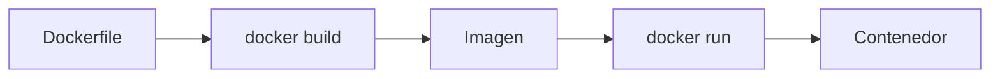

# Módulo 0.5 · Primer Hola Mundo en Java y Node.js + Docker básico

Este módulo cierra los fundamentos: compilar/ejecutar Java, ejecutar Node.js, y empaquetar procesos con Docker. El objetivo es dominar el ciclo “código → proceso → contenedor”, porque todo microservicio se despliega como proceso.

**Entorno de referencia verificado (2026-05-22):** JDK 27.0.1.0.2, Node.js v24.18.0, Docker 29.9.3. Java/Node ejecutados localmente. Docker requiere daemon activo; cuando no se ejecuta, se marca nota honesta.

## Aprende construyendo

### Tema 1: Primer Hola Mundo en Java · Básico · 180 min

Caso guía: compilar y ejecutar un programa Java, entender `main` y levantar un HTTP mínimo con el JDK.

#### Compilación y ejecución

**Definición formal.** `javac` compila `.java` a bytecode `.class`; `java` inicia la JVM y ejecuta la clase con `main`. Java 11+ también permite `java Archivo.java` para casos simples.

**Para qué sirve.** Entender el ciclo de build/run y diagnosticar errores de compilación vs runtime.

**Ejemplo mínimo enfocado (ejecutable).**

```bash
mkdir -p ms4-java
cd ms4-java
```

Crea el archivo `HolaMundo.java`:

```java
public class HolaMundo {
  public static void main(String[] args) {
    System.out.println("Hola Mundo desde Java " + Runtime.version().feature());
  }
}
```

```bash
javac HolaMundo.java
java HolaMundo
```

**Error común.** Nombre de clase pública distinto al archivo. Corrección: alinear nombre.

**Verificación (JDK 27, 2026-05-22).** `Hola Mundo desde Java 27`.

#### Punto de entrada `main`

**Definición formal.** La JVM inicia aplicaciones por `public static void main(String[] args)`.

**Ejemplo mínimo enfocado (ejecutable).**

```bash
mkdir -p ms4-args
cd ms4-args
```

Crea el archivo `Args.java`:

```java
public class Args {
  public static void main(String[] args) {
    System.out.println(args.length);
  }
}
```

```bash
javac Args.java
java Args a b c
```

**Error común.** Firma incorrecta. Corrección: firma exacta.

**Verificación (2026-05-22).** `3`.

#### HTTP mínimo con JDK

**Definición formal.** `com.sun.net.httpserver.HttpServer` expone HTTP básico incluido en el JDK.

**Ejemplo mínimo enfocado (ejecutable).**

```bash
mkdir -p ms4-jhttp
cd ms4-jhttp
```

Crea el archivo `HolaServidor.java`:

```java
import com.sun.net.httpserver.HttpServer;
import java.io.OutputStream;
import java.net.InetSocketAddress;

public class HolaServidor {
  public static void main(String[] args) throws Exception {
    HttpServer s = HttpServer.create(new InetSocketAddress(127, 0, 0, 1, 0), 0);
    s.createContext("/hola", ex -> {
      byte[] b = "Hola Java".getBytes();
      ex.sendResponseHeaders(200, b.length);
      try (OutputStream os = ex.getResponseBody()) { os.write(b); }
    });
    s.start();
    System.out.println(s.getAddress().getPort() > 0);
    s.stop(0);
  }
}
```

```bash
javac HolaServidor.java
java HolaServidor
```

**Error común.** No cerrar body/exchange. Corrección: try-with-resources.

**Verificación (JDK 27, 2026-05-22).** `true`.

### Tema 2: Primer Hola Mundo en Node.js · Básico · 180 min

Caso guía: ejecutar script, usar npm scripts y crear HTTP mínimo.

#### Ejecución Node y ESM

**Definición formal.** Node.js ejecuta JS sobre V8. `.mjs` o `"type":"module"` habilita ESM.

**Ejemplo mínimo enfocado (ejecutable).**

```bash
mkdir -p ms4-node
cd ms4-node
```

Crea el archivo `hola.mjs`:

```js
console.log(`Hola Mundo desde Node.js ${process.versions.node.split('.')[0]}`);
```

```bash
node hola.mjs
```

**Error común.** Mezclar ESM/CommonJS sin configurar. Corrección: elegir un sistema.

**Verificación (Node 24.18.0, 2026-05-22).** `Hola Mundo desde Node.js 24`.

#### `package.json` y scripts

**Definición formal.** `package.json` declara metadata, tipo de módulo, scripts y dependencias.

**Ejemplo mínimo enfocado (ejecutable).**

```bash
mkdir -p ms4-pkg
cd ms4-pkg
```

Crea el archivo `package.json`:

```json
{
  "name": "hola-node",
  "private": true,
  "type": "module",
  "scripts": { "start": "node hola.mjs" }
}
```

Crea el archivo `hola.mjs`:

```js
console.log('start-ok');
```

```bash
npm run -s start
```

**Error común.** Depender de binarios globales. Corrección: declarar dependencias.

**Verificación (2026-05-22).** `start-ok`.

#### HTTP mínimo en Node

**Definición formal.** `node:http` crea servidores HTTP sin frameworks.

**Ejemplo mínimo enfocado (ejecutable).**

```bash
mkdir -p ms4-nhttp
cd ms4-nhttp
```

Crea el archivo `server.mjs`:

```js
import http from 'node:http';
const s = http.createServer((req, res) => {
  if (req.url === '/hola') { res.writeHead(200, {'Content-Type':'text/plain'}); return res.end('Hola Node'); }
  res.writeHead(404); res.end('No');
});
s.listen(0, '127.0.0.1', async () => {
  const b = `http://127.0.0.1:${s.address().port}`;
  console.log((await fetch(b + '/hola')).status);
  s.close();
});
```

```bash
node server.mjs
```

**Error común.** No manejar shutdown. Corrección: escuchar SIGTERM y cerrar server.

**Verificación (Node 24.18.0, 2026-05-22).** `200`.

### Tema 3: Docker básico · Intermedio · 240 min

Caso guía: empaquetar un proceso Node en contenedor.

#### Imagen, contenedor y Dockerfile

**Definición formal.** Imagen: paquete inmutable por capas. Contenedor: instancia en ejecución. Dockerfile: receta de build.



**Ejemplo mínimo (Dockerfile).**

```dockerfile
FROM node:24-alpine
WORKDIR /app
COPY app.mjs .
CMD ["node", "app.mjs"]
```

Crea el archivo `app.mjs`:

```js
console.log('hola-docker');
```

```bash
docker build -t ms4-hola:1 .
docker run --rm ms4-hola:1
```

**Error común.** Copiar todo el repo sin `.dockerignore`. Corrección: ignorar `node_modules`, `.git`, artefactos.

**Nota de verificación.** Docker 29.9.3 instalado; ejecución requiere daemon activo. Salida esperada: `hola-docker`.

#### Puertos, variables y logs

**Definición formal.** `-p` publica puertos, `-e` inyecta env vars, logs van a stdout/stderr.

**Ejemplo mínimo.**

```bash
docker run --rm -e SALUDO=hey node:24-alpine node -e "console.log(process.env.SALUDO)"
```

**Nota de verificación.** Requiere Docker daemon. Salida esperada: `hey`.

#### Docker Compose

**Definición formal.** Compose declara servicios/redes/volúmenes en YAML para orquestar un stack local.

**Ejemplo mínimo (`compose.yml`).**

```yaml
services:
  app:
    image: node:24-alpine
    command: ["node", "-e", "console.log('compose-ok')"]
```

```bash
docker compose -f compose.yml up --abort-on-container-exit
```

**Error común.** Usar Compose local como si fuera producción Kubernetes. Corrección: Compose para dev/integration; orquestador apropiado en prod.

**Nota de verificación.** Requiere Docker daemon. Salida esperada incluye `compose-ok`.

## Cierre

Ya tienes el ciclo base: compilar/ejecutar Java, ejecutar Node, y empaquetar con Docker. Desde aquí, los microservicios son variaciones de este proceso con contratos, datos y operación.

## Checklist

- Compilo y ejecuto Java con `javac/java`.
- Ejecuto Node ESM y scripts npm.
- Entiendo imagen, contenedor, Dockerfile y Compose.
- Inyecto config por env y logueo a stdout/stderr.
