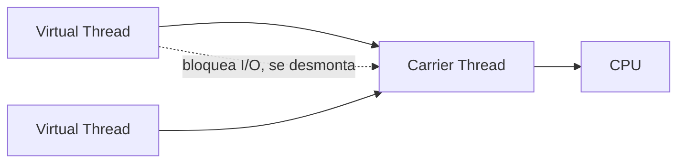

# Módulo 1.1 · Java moderno y Spring Boot

Este módulo prepara la base Java/Spring para microservicios: características modernas de Java, virtual threads, contenedor Spring, auto-configuración, multi-módulo, configuración externalizada y opciones de runtime como CRaC/GraalVM. El foco es entender qué problema resuelve cada pieza y qué costo introduce.

**Entorno de referencia verificado (2026-05-22):** JDK 27.0.1.0.2, Maven 3.10.0, Gradle 9.8.2. Ejemplos Java puros ejecutados localmente. Features Spring Boot se describen con notas de versión cuando aplican.

## Aprende construyendo

### Tema 1: Java 21: Streams, Lambdas, Optional, Records, Pattern Matching · Intermedio · 360 min

Caso guía: normalizar pedidos entrantes, filtrar inválidos y modelar respuestas inmutables.

#### Lambdas y Streams

**Definición formal.** Una lambda es una función anónima que implementa una interfaz funcional. Un Stream es un pipeline declarativo de operaciones sobre datos, lazy en intermedias y ejecutado en terminal.

**Ejemplo mínimo enfocado (ejecutable).**

```bash
mkdir -p ms5-stream
cd ms5-stream
```

Crea el archivo `DemoStream.java`:

```java
import java.util.*; import java.util.stream.*;
public class DemoStream {
  public static void main(String[] args) {
    var r = List.of(1,2,3,4).stream().filter(x -> x % 2 == 0).map(x -> x * 10).toList();
    System.out.println(r);
  }
}
```

```bash
javac DemoStream.java
java DemoStream
```

**Error común.** Usar streams para todo y ocultar lógica simple. Corrección: legibilidad primero.

**Verificación (JDK 27, 2026-05-22).** `[20, 40]`.

#### Optional

**Definición formal.** Contenedor que expresa ausencia/presencia sin `null`.

**Ejemplo mínimo enfocado (ejecutable).**

```bash
mkdir -p ms5-opt
cd ms5-opt
```

Crea el archivo `DemoOpt.java`:

```java
import java.util.*;
public class DemoOpt {
  static Optional<String> find(boolean ok){ return ok ? Optional.of("A") : Optional.empty(); }
  public static void main(String[] args){ System.out.println(find(true).orElse("X")); System.out.println(find(false).orElse("X")); }
}
```

```bash
javac DemoOpt.java
java DemoOpt
```

**Error común.** `Optional.get()` sin verificar. Corrección: `orElse/orElseThrow/map`.

**Verificación (2026-05-22).** `A`, `X`.

#### Records y pattern matching

**Definición formal.** Record: clase inmutable de datos con constructor/accesores/equals/hashCode/toString. Pattern matching permite desestructurar/condicionar por forma.

**Ejemplo mínimo enfocado (ejecutable).**

```bash
mkdir -p ms5-rec
cd ms5-rec
```

Crea el archivo `DemoRec.java`:

```java
record User(String name, int age) {}
public class DemoRec {
  static String label(Object o) {
    return switch (o) {
      case User(String n, int a) when a >= 18 -> n + ":adult";
      case User(String n, int _) -> n + ":minor";
      default -> "other";
    };
  }
  public static void main(String[] args){ System.out.println(label(new User("Ana",20))); }
}
```

```bash
javac DemoRec.java
java DemoRec
```

**Error común.** Usar record como entidad JPA mutable. Corrección: records para DTOs/value objects inmutables.

**Verificación (JDK 27, 2026-05-22).** `Ana:adult`.

### Tema 2: Virtual Threads (Project Loom) · Avanzado · 240 min

Caso guía: muchas requests I/O bloqueantes concurrentes.

#### Virtual threads

**Definición formal.** Hilos ligeros administrados por la JVM que permiten estilo bloqueante con alta concurrencia en I/O. No hacen magia con CPU-bound.



**Ejemplo mínimo enfocado (ejecutable).**

```bash
mkdir -p ms5-vt
cd ms5-vt
```

Crea el archivo `DemoVT.java`:

```java
public class DemoVT {
  public static void main(String[] args) throws Exception {
    try (var ex = java.util.concurrent.Executors.newVirtualThreadPerTaskExecutor()) {
      var f = ex.submit(() -> "ok-vt");
      System.out.println(f.get());
    }
  }
}
```

```bash
javac DemoVT.java
java DemoVT
```

**Error común.** Usar virtual threads con `synchronized` contencioso y bloqueo largo (pinning en escenarios específicos) o para CPU-bound. Corrección: medir; usar pools adecuados para CPU-bound.

**Verificación (JDK 27, 2026-05-22).** `ok-vt`.

### Tema 3: Spring IoC, DI, Bean Lifecycle, ApplicationContext · Intermedio · 360 min

Caso guía: servicio depende de repositorio; Spring crea y conecta.

#### IoC/DI

**Definición formal.** El contenedor crea beans y los inyecta. DI por constructor es la forma preferida.

**Ejemplo mínimo.** Ver track Spring Boot M0; aquí el contrato: depende de interfaz, inyecta por constructor.

**Error común.** Field injection. Corrección: constructor.

### Tema 4: Auto-configuración condicional, @Conditional, starters · Intermedio · 240 min

Caso guía: habilitar bean solo si existe propiedad/clase.

#### `@Conditional` y autoconfig

**Definición formal.** Boot configura beans según condiciones de classpath, propiedades, beans existentes, entorno.

**Ejemplo mínimo (concepto).**

```java
@ConditionalOnProperty(name="feature.x.enabled", havingValue="true")
@Bean FeatureX featureX(){ return new FeatureX(); }
```

**Error común.** “Magia” no entendida. Corrección: `--debug`/actuator conditions para ver qué se activó.

### Tema 5: Multi-module Spring Boot projects · Intermedio · 180 min

Caso guía: separar `api`, `application`, `domain`, `infra`.

#### Multi-módulo

**Definición formal.** Proyecto con varios módulos Maven/Gradle con dependencias explícitas y build coordinado.

**Error común.** Ciclos entre módulos. Corrección: grafo acíclico, dependencias hacia dominio.

### Tema 6: Perfiles y configuración externalizada · Intermedio · 180 min

Caso guía: `dev` usa H2, `prod` Postgres.

#### Profiles y config externa

**Definición formal.** Profiles activan configuración por entorno; config externalizada sale de env vars/archivos/sistema de config.

**Error común.** Secretos en `application-prod.yml` commiteado. Corrección: secret manager/env.

### Tema 7: CRaC (Coordinated Restore at Checkpoint) · Avanzado · 180 min

Caso guía: reducir arranque restaurando snapshot.

#### CRaC

**Definición formal.** API para coordinar checkpoint/restore de la JVM, permitiendo arranques rápidos al restaurar estado.

**Nota de verificación.** Requiere JDK/runtime con soporte CRaC y configuración cuidadosa de recursos. No ejecutable de forma genérica en este entorno sin setup específico; documentar concepto y riesgos (archivos abiertos, sockets, estado stale).

### Tema 8: GraalVM Native Image · Avanzado · 240 min

Caso guía: binario nativo con arranque rápido y menor memoria.

#### Native Image

**Definición formal.** Compilación AOT que produce ejecutable nativo a partir de app Java, con restricciones sobre reflexión dinámica y recursos.

**Trade-off.** Arranque/memoria mejores; build más lento; necesita reachability metadata para reflexión.

**Nota de verificación.** Requiere GraalVM/toolchain nativa. No se ejecuta aquí; indicar comando típico `./mvnw -Pnative native:compile`.

## Cierre

Java moderno y Spring Boot dan productividad; virtual threads, CRaC y Native Image dan opciones de runtime. Elige por perfil de carga y complejidad operativa.

## Checklist

- Uso records/Optional/streams con criterio.
- Entiendo virtual threads para I/O, no CPU-bound.
- Entiendo IoC/DI/autoconfig.
- Separo módulos y config por entorno.
- Evalúo CRaC/Native con pruebas reales.
