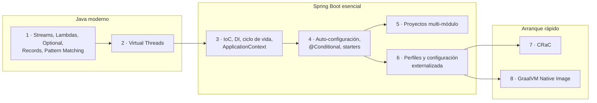
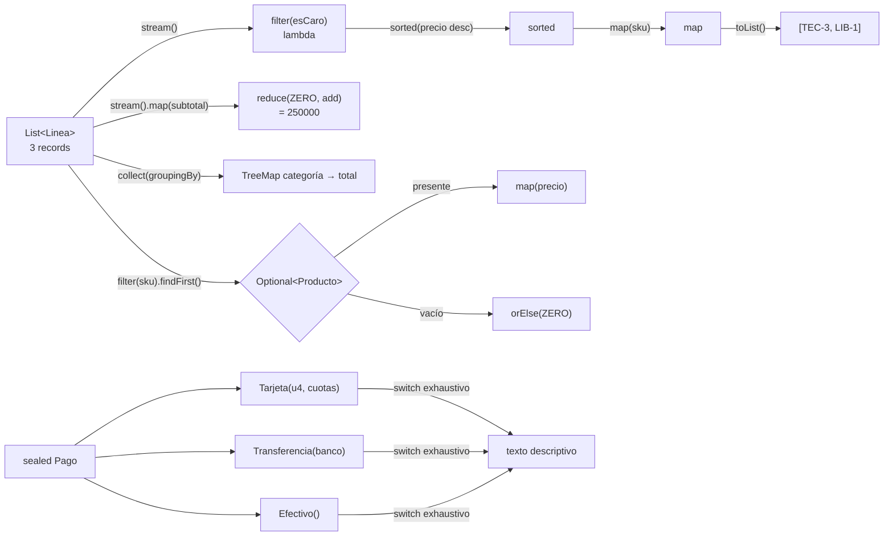
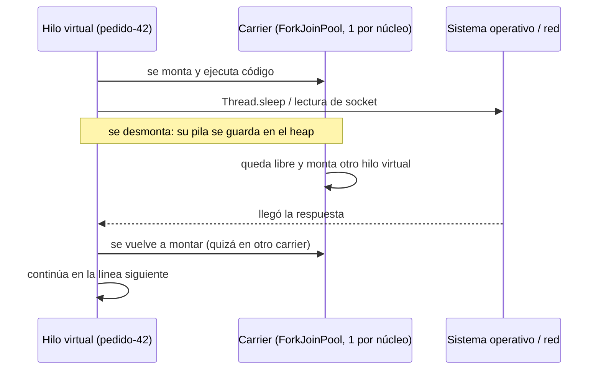
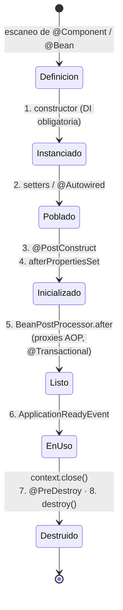
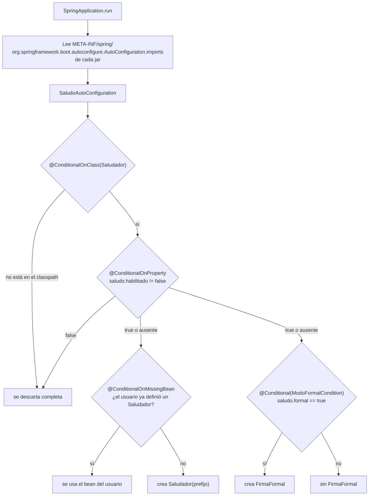
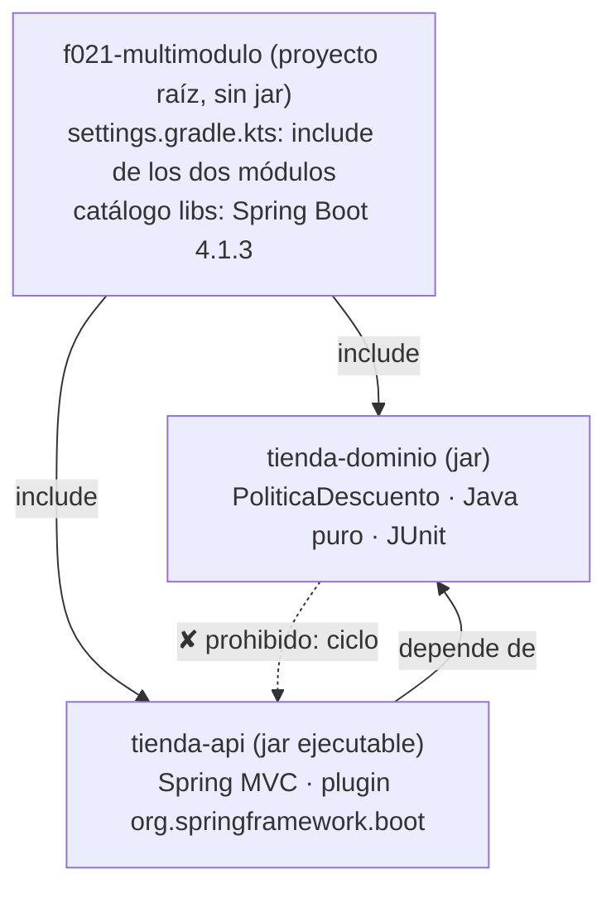
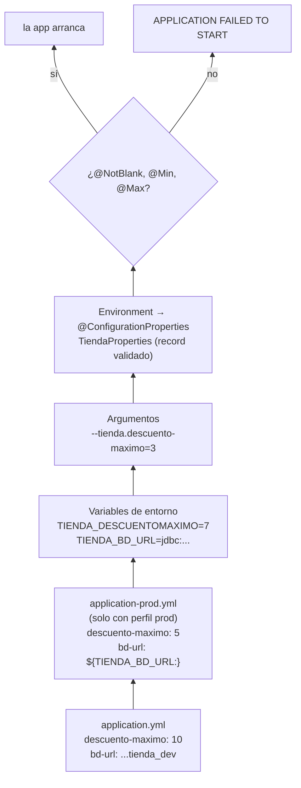
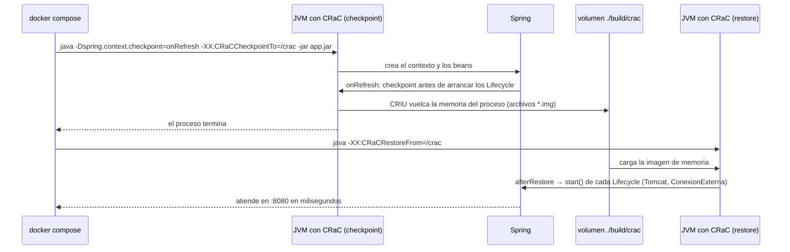
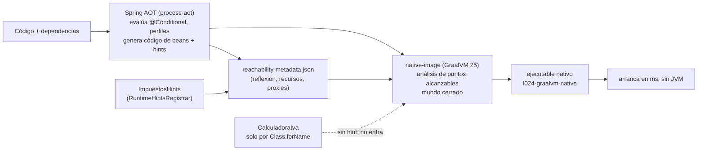

# Módulo 1 · Java moderno y Spring Boot esencial

**Fase 1 · Spring Boot de cero a experto** (semanas 1 y 2 de 12). **Duración:** 16 h (8 temas de 1,5–2,5 h).
**Dificultad:** 2 de 5 en los temas 1–6 y 4 de 5 en CRaC y GraalVM. **Dependencias:** Fase 0 completa (Módulos
0.1–0.5: terminal, Git, HTTP, JSON, YAML, variables de entorno, primer «Hola Mundo» en Java y Docker básico).
**Herramientas:**JDK 25 LTS (25.0.5)**, **Spring Boot 4.1.3** (Spring Framework 7.0.11, JUnit Jupiter 6), Gradle
9.9.2 (Kotlin DSL) mediante el wrapper `./gradlew` y Docker con Compose v5 para CRaC y Native Image. 
tests).

Antes de construir microservicios necesitas dominar las dos herramientas con las que se escriben en esta fase: el
lenguaje Java moderno (records, streams, pattern matching, hilos virtuales) y el contenedor de Spring, que crea y
conecta tus objetos, decide qué configuración aplicar y, al final, puede arrancar tu servicio en milisegundos.



**Texto alternativo:** mapa del módulo en tres bloques de izquierda a derecha. «Java moderno» contiene el tema 1
(Streams, Lambdas, Optional, Records, Pattern Matching) que lleva al tema 2 (Virtual Threads). El tema 2 conduce al
bloque «Spring Boot esencial»: tema 3 (IoC, DI, ciclo de vida, ApplicationContext) lleva al tema 4
(auto-configuración), del que salen el tema 5 (multi-módulo) y el tema 6 (perfiles). Del tema 6 salen dos flechas al
bloque «Arranque rápido»: tema 7 (CRaC) y tema 8 (GraalVM Native Image).

---


### Java 21: Streams, Lambdas, Optional, Records, Pattern Matching

<details open>
<summary><strong>Capa 1 — Lectura</strong></summary>

#### ► DE QUÉ TRATA
Aplicar records, sealed interfaces, pattern matching, lambdas, streams y Optional para calcular totales, agrupar y buscar en un pedido, de modo que los 6 tests de JavaModernoTest pasen y puedas explicar por qué el compilador rechaza un switch al que le falta un caso.

#### ► LA IDEA EN UNA FRASE
**Aplicar records, sealed interfaces, pattern matching, lambdas, streams y Optional para calcular totales, agrupar y buscar en un pedido, de modo que los 6 tests de JavaModernoTest pasen y puedas explicar por qué el compilador rechaza un switch al que le falta un caso.**

#### ► POR QUÉ EXISTE ESTO
Un programa trabaja con datos (un producto, un pedido) y con acciones sobre esos datos (sumar, buscar, ordenar). Java moderno te da cinco herramientas para escribir eso con menos código y menos errores:

#### ► LA ANALOGÍA
Piensa en java 21: streams, lambdas, optional, records, pattern matching como una herramienta de taller: útil cuando conoces su propósito y sus límites.
**Dónde se rompe la analogía:** en software, los efectos dependen del contexto, la escala y los trade-offs.

#### ► CÓMO FUNCIONA


1. **Record**: una ficha de datos que no cambia. Escribes `record Producto(String sku, String categoria, BigDecimal
2. **Lambda**: una función pequeña sin nombre que puedes pasar como dato. `l -> l.producto().sku()` significa «dame
3. **Stream**: una cinta transportadora sobre una lista. Encadenas pasos (`filter`, `map`, `sorted`) y al final
4. **Optional**: una caja que puede venir vacía. En vez de devolver `null` (que provoca el famoso
5. **Pattern matching**: un `switch` que pregunta «¿de qué forma es este objeto?» y, si es una tarjeta, te entrega

#### ► LO QUE PUEDE SALIR MAL
| Síntoma | Causa probable | Arreglo |
|---|---|---|
| Java 21: Streams, Lambdas, Optional, Records, Pattern Matching se aplica pero el resultado no mejora | Se usó sin medir el problema real | Mide antes y compara contra la alternativa simple |
| Aparece complejidad inesperada | Se adoptó la técnica sin comprender sus trade-offs | Vuelve a la sección de trade-offs y reduce el alcance |
| Falla en un caso límite | Se asumió un contexto que no se cumple | Prueba el caso límite y documenta cuándo NO usarlo |

#### ► TRADE-OFFS
| Opción | Cuándo usarla | Cuándo NO usarla |
|---|---|---|
| Usar Java 21: Streams, Lambdas, Optional, Records, Pattern Matching | Cuando el problema coincide con su propósito y el beneficio es observable | Cuando agrega complejidad sin resolver un problema real |
| Alternativa más simple | Cuando el contexto es pequeño, estable o fácil de razonar | Cuando ya demostró no escalar o no cumplir el requisito |
| Postergar la decisión | Cuando falta evidencia del problema | Cuando el costo de esperar es mayor que el costo de probar |

#### ► CUÁNDO NO USAR ESTO
Optional como campo y get() sin comprobar. Se ve así:

#### ► DE VUELTA A LA ANALOGÍA
Volviendo a la analogía: java 21: streams, lambdas, optional, records, pattern matching funciona como el modelo inicial, pero recuerda dónde se rompe: en producción importan la evidencia, la escala y el costo de equivocarte.

#### ► LO QUE DEBES RECORDAR
- **Record**: una ficha de datos que no cambia. Escribes `record Producto(String sku, String categoria, BigDecimal
- **Lambda**: una función pequeña sin nombre que puedes pasar como dato. `l -> l.producto().sku()` significa «dame
- **Stream**: una cinta transportadora sobre una lista. Encadenas pasos (`filter`, `map`, `sorted`) y al final
- **Optional**: una caja que puede venir vacía. En vez de devolver `null` (que provoca el famoso

#### ► PREGUNTAS PARA PENSAR
1. ¿Qué problema concreto resuelve java 21: streams, lambdas, optional, records, pattern matching en tu contexto?
2. ¿Cómo sabrías que java 21: streams, lambdas, optional, records, pattern matching no está funcionando bien?
3. ¿Qué alternativa más simple considerarías antes de usar java 21: streams, lambdas, optional, records, pattern matching?

</details>

<details>
<summary><strong>Capa 2 — Construcción</strong></summary>

#### Código de referencia / ejecutable
**Versiones:** JDK 25 LTS (25.0.5) · Gradle 9.9.2 · el BOM de Spring Boot 4.1.3 como plataforma, solo para fijar la
versión de JUnit Jupiter 6.0.3. El código no depende de Spring y corre tal cual con
`java src/main/java/academia/java/JavaModerno.java` (lanzador de un solo archivo, desde Java 11).

> **Build con Gradle (y su equivalencia en Maven).** Este laboratorio se construye con **Gradle 9.9.2** y Kotlin DSL
> mediante el wrapper `./gradlew` (no instalas Gradle). `gradle/wrapper/gradle-wrapper.properties` fija también el
> `distributionSha256Sum` del zip oficial (`971fcd71…c76b`), así que si alguien te sustituye la URL por una
> distribución manipulada el wrapper se niega a arrancar en vez de ejecutarla: `Downloading … gradle-9.9.2-bin.zip`
> seguido de `Confirm that the 'distributionSha256Sum' property … is correct`. Es el mismo principio que aplicarás a
> las imágenes base en el Módulo 12 (`modulo-16`): **no se ejecuta nada de lo que no se pueda verificar**.
> `settings.gradle.kts` lista los subproyectos (en Maven,
> `<modules>` del POM agregador), cada carpeta tiene su `build.gradle.kts` (su `pom.xml`) y
> `gradle/libs.versions.toml` es el **catálogo de versiones** (las `<properties>` y el `dependencyManagement`): por eso
> las dependencias se escriben `libs.…`. Equivalencias: `./mvnw test` → `./gradlew test` ·
> `./mvnw package -DskipTests` → `./gradlew bootJar` · `./mvnw spring-boot:run` → `./gradlew bootRun` ·
> `-Dtest=Clase` → `--tests Clase` · `target/` → `build/` (el jar queda en `build/libs/`). Gradle escribe una línea
> `PASSED` por test y termina con `BUILD SUCCESSFUL` (Maven: `Tests run: N` y `BUILD SUCCESS`).
> `f021-multimodulo` es un build completo que este incluye con `includeBuild` (lo verás en la lección 5).

`modulo-5/settings.gradle.kts`:

```kotlin
// Módulo 1 (modulo-5) · Build multi-proyecto: "./gradlew test" ejecuta los tests de todas las fichas.
// Cada carpeta fNNN-* es un subproyecto con su propio build.gradle.kts; las versiones viven en
// gradle/libs.versions.toml (catálogo "libs"). Equivale al POM agregador con <modules> de Maven.
pluginManagement {
    repositories {
        gradlePluginPortal()
        mavenCentral()
    }
}
// Sin esto, un alumno sin JDK 25 instalado ve el build morir en la configuración, antes de cualquier test.
plugins {
    id("org.gradle.toolchains.foojay-resolver-convention") version "1.0.0"
}

dependencyResolutionManagement {
    repositories {
        mavenCentral()
    }
}

rootProject.name = "modulo-5-laboratorios"

include(
    "f017-java-moderno",
    "f018-virtual-threads",
    "f019-ioc-di",
    "f020-autoconfiguracion",
    "f022-perfiles",
    "f023-crac",
    "f024-graalvm-native",
)

// F021 enseña el multi-proyecto: es un build completo (con su settings.gradle.kts) que se incluye
// como build compuesto. Se puede abrir y construir solo: cd f021-multimodulo && ../gradlew build
includeBuild("f021-multimodulo")
```

`modulo-5/gradle/libs.versions.toml`:

```toml
# Módulo 1 (modulo-5) · Java moderno y Spring Boot esencial
# Catálogo de versiones del laboratorio: una sola fuente para plugins y librerías.
# Las librerías SIN versión las fija el BOM de Spring Boot (spring-boot-dependencies) o el BOM que importe el proyecto.

[versions]
# Native Build Tools que admite Spring Boot 4.1.3 (docs.spring.io/spring-boot/4.1/system-requirements.html)
graalvm-native = "1.1.18"
spring-boot = "4.1.3"

[libraries]
junit-jupiter = { module = "org.junit.jupiter:junit-jupiter" }
spring-boot-dependencies = { module = "org.springframework.boot:spring-boot-dependencies", version.ref = "spring-boot" }
junit-platform-launcher = { module = "org.junit.platform:junit-platform-launcher" }
spring-boot-starter = { module = "org.springframework.boot:spring-boot-starter" }
spring-boot-starter-test = { module = "org.springframework.boot:spring-boot-starter-test" }
spring-boot-starter-webmvc = { module = "org.springframework.boot:spring-boot-starter-webmvc" }
spring-boot-starter-webmvc-test = { module = "org.springframework.boot:spring-boot-starter-webmvc-test" }
spring-boot-starter-validation = { module = "org.springframework.boot:spring-boot-starter-validation" }
crac = { module = "org.crac:crac" }

[plugins]
spring-boot = { id = "org.springframework.boot", version.ref = "spring-boot" }
spring-dependency-management = { id = "io.spring.dependency-management", version = "1.1.7" }
graalvm-buildtools = { id = "org.graalvm.buildtools.native", version.ref = "graalvm-native" }
```

`modulo-5/f017-java-moderno/build.gradle.kts`:

```kotlin
// F017 · Java moderno: Streams, Lambdas, Optional, Records, Pattern Matching.
// No aplica el plugin de Spring Boot: solo importa su BOM como plataforma para usar la versión
// probada de JUnit; el código no depende de Spring.
plugins {
    java
}

group = "academia.microservicios"
version = "1.0.0"

java {
    toolchain {
        languageVersion = JavaLanguageVersion.of(25)
    }
}

dependencies {
    // BOM de Spring Boot como plataforma de Gradle: fija las versiones sin aplicar el plugin de Boot
    testImplementation(platform(libs.spring.boot.dependencies))
    testImplementation(libs.junit.jupiter)   // JUnit Jupiter 6.0.3, versión gestionada por Spring Boot 4.1.3
    // Gradle 9 exige declarar el lanzador de JUnit Platform (ya no lo añade por su cuenta)
    testRuntimeOnly(libs.junit.platform.launcher)
}

tasks.withType<JavaCompile> {
    options.encoding = "UTF-8"
}

tasks.withType<Test> {
    useJUnitPlatform()
    testLogging {
        events("passed", "skipped", "failed")   // una línea por test en la consola
        // el mensaje completo de cada fallo (valor esperado y obtenido), no solo el tipo de excepción
        exceptionFormat = org.gradle.api.tasks.testing.logging.TestExceptionFormat.FULL
    }
}
```

`modulo-5/f017-java-moderno/src/main/java/academia/java/JavaModerno.java`:

```java
package academia.java;

import java.math.BigDecimal;
import java.util.Comparator;
import java.util.List;
import java.util.Map;
import java.util.Objects;
import java.util.Optional;
import java.util.TreeMap;
import java.util.function.Predicate;
import java.util.stream.Collectors;

/**
 * F017 · Java moderno en un solo archivo: records, sealed + pattern matching,
 * lambdas, streams y Optional. Se ejecuta tal cual con:
 *   java src/main/java/academia/java/JavaModerno.java
 */
public class JavaModerno {

    // 1. RECORD: una "ficha" de datos inmutable. Java genera constructor,
    //    accesores sku(), categoria(), precio(), equals, hashCode y toString.
    public record Producto(String sku, String categoria, BigDecimal precio) {
        // Constructor compacto: valida antes de asignar los campos.
        public Producto {
            Objects.requireNonNull(sku, "sku");
            if (precio.signum() < 0) {
                throw new IllegalArgumentException("precio negativo: " + precio);
            }
        }
    }

    public record Linea(Producto producto, int cantidad) {
        public BigDecimal subtotal() {
            return producto.precio().multiply(BigDecimal.valueOf(cantidad));
        }
    }

    // 2. SEALED + RECORDS: el compilador conoce TODAS las formas de pago,
    //    así que el switch de describir() no necesita "default".
    public sealed interface Pago permits Tarjeta, Transferencia, Efectivo { }
    public record Tarjeta(String ultimos4, int cuotas) implements Pago { }
    public record Transferencia(String banco) implements Pago { }
    public record Efectivo() implements Pago { }

    // 3. PATTERN MATCHING: desarma el record dentro del case (record patterns),
    //    añade condiciones con "when" e ignora componentes con "_".
    public static String describir(Pago pago) {
        return switch (pago) {
            case Tarjeta(var ultimos4, var cuotas) when cuotas > 1 ->
                "Tarjeta *" + ultimos4 + " a " + cuotas + " cuotas";
            case Tarjeta(var ultimos4, _) -> "Tarjeta *" + ultimos4 + " de contado";
            case Transferencia(var banco) -> "Transferencia desde " + banco;
            case Efectivo() -> "Efectivo contra entrega";
        };
    }

    // 4. STREAMS + LAMBDAS: tubería declarativa filtrar -> transformar -> reducir.
    public static BigDecimal total(List<Linea> lineas) {
        return lineas.stream()
            .map(Linea::subtotal)                      // referencia a método
            .reduce(BigDecimal.ZERO, BigDecimal::add); // suma con valor inicial
    }

    public static Map<String, BigDecimal> totalPorCategoria(List<Linea> lineas) {
        return lineas.stream().collect(Collectors.groupingBy(
            l -> l.producto().categoria(),             // lambda: clave del grupo
            TreeMap::new,                              // mapa ordenado por clave
            Collectors.reducing(BigDecimal.ZERO, Linea::subtotal, BigDecimal::add)));
    }

    public static List<String> skusCaros(List<Linea> lineas, BigDecimal umbral) {
        Predicate<Linea> esCaro = l -> l.producto().precio().compareTo(umbral) > 0;
        return lineas.stream()
            .filter(esCaro)
            .sorted(Comparator.comparing((Linea l) -> l.producto().precio()).reversed())
            .map(l -> l.producto().sku())
            .toList();                                  // lista inmodificable
    }

    // 5. OPTIONAL: "puede no haber resultado" queda escrito en el tipo.
    public static Optional<Producto> buscar(List<Linea> lineas, String sku) {
        return lineas.stream()
            .map(Linea::producto)
            .filter(p -> p.sku().equals(sku))
            .findFirst();
    }

    public static List<Linea> pedidoDeEjemplo() {
        var libro = new Producto("LIB-1", "libros", new BigDecimal("45000"));
        var cuaderno = new Producto("PAP-7", "papeleria", new BigDecimal("8000"));
        var audifonos = new Producto("TEC-3", "tecnologia", new BigDecimal("120000"));
        return List.of(new Linea(libro, 2), new Linea(cuaderno, 5), new Linea(audifonos, 1));
    }

    public static void main(String[] args) {
        var lineas = pedidoDeEjemplo();
        System.out.println("Total: " + total(lineas));
        System.out.println("Por categoría: " + totalPorCategoria(lineas));
        System.out.println("Caros (> 40000): " + skusCaros(lineas, new BigDecimal("40000")));
        System.out.println("Buscar TEC-3: " + buscar(lineas, "TEC-3").map(Producto::precio).orElse(BigDecimal.ZERO));
        System.out.println("Buscar XXX-0: " + buscar(lineas, "XXX-0").map(Producto::precio).orElse(BigDecimal.ZERO));
        for (Pago pago : List.of(new Tarjeta("4242", 3), new Tarjeta("1111", 1),
                                 new Transferencia("Banco Andino"), new Efectivo())) {
            System.out.println(describir(pago));
        }
    }
}
```

#### Verificación
El test que debes ejecutar:

`modulo-5/f017-java-moderno/src/test/java/academia/java/JavaModernoTest.java`:

```java
package academia.java;

import static org.junit.jupiter.api.Assertions.assertEquals;
import static org.junit.jupiter.api.Assertions.assertThrows;
import static org.junit.jupiter.api.Assertions.assertTrue;

import academia.java.JavaModerno.Efectivo;
import academia.java.JavaModerno.Linea;
import academia.java.JavaModerno.Producto;
import academia.java.JavaModerno.Tarjeta;
import java.math.BigDecimal;
import java.util.List;
import java.util.Map;
import org.junit.jupiter.api.Test;

class JavaModernoTest {

    private final List<Linea> lineas = JavaModerno.pedidoDeEjemplo();

    @Test
    void sumaElPedidoConStreams() {
        assertEquals(new BigDecimal("250000"), JavaModerno.total(lineas));
    }

    @Test
    void agrupaPorCategoriaEnOrdenAlfabetico() {
        Map<String, BigDecimal> porCategoria = JavaModerno.totalPorCategoria(lineas);
        assertEquals(List.of("libros", "papeleria", "tecnologia"), List.copyOf(porCategoria.keySet()));
        assertEquals(new BigDecimal("90000"), porCategoria.get("libros"));
    }

    @Test
    void ordenaLosCarosDeMayorAMenor() {
        assertEquals(List.of("TEC-3", "LIB-1"), JavaModerno.skusCaros(lineas, new BigDecimal("40000")));
    }

    @Test
    void optionalVacioCuandoNoExisteElSku() {
        assertTrue(JavaModerno.buscar(lineas, "XXX-0").isEmpty());
        assertEquals("tecnologia", JavaModerno.buscar(lineas, "TEC-3").orElseThrow().categoria());
    }

    @Test
    void patternMatchingDistingueCuotas() {
        assertEquals("Tarjeta *4242 a 3 cuotas", JavaModerno.describir(new Tarjeta("4242", 3)));
        assertEquals("Tarjeta *1111 de contado", JavaModerno.describir(new Tarjeta("1111", 1)));
        assertEquals("Efectivo contra entrega", JavaModerno.describir(new Efectivo()));
    }

    @Test
    void elRecordRechazaPreciosNegativos() {
        var error = assertThrows(IllegalArgumentException.class,
            () -> new Producto("MAL-1", "x", new BigDecimal("-1")));
        assertEquals("precio negativo: -1", error.getMessage());
    }
}
```

```bash
../gradlew test
```

**Output esperado:** 6 líneas `PASSED` (una por test) y `BUILD SUCCESSFUL` *(salida de Gradle verificada en el Mac del dueño el 2026-11-21 con Gradle 9.9.2, Java 25.0.5.1 autoaprovisto y Docker Compose v5.7.1)*.

**Pregunta de comprobación:** ¿por qué `skusCaros` no modifica la lista `lineas` aunque la ordene?

<details>
<summary>Respuesta</summary>

Porque un stream no altera su fuente: `sorted` ordena los elementos que pasan por la cinta y `toList()` crea una
lista **nueva** (e inmodificable). La lista original sigue en el orden en que se creó.
</details>

</details>

### Virtual Threads (Project Loom)

<details open>
<summary><strong>Capa 1 — Lectura</strong></summary>

#### ► DE QUÉ TRATA
Comparar un pool fijo de hilos de plataforma con un hilo virtual por tarea midiendo 1 000 esperas de 200 ms, y justificar con los números (≈ 4 s frente a ≈ 0,2 s) cuándo conviene cada uno y por qué hay que limitar la concurrencia hacia recursos escasos con un Semaphore.

#### ► LA IDEA EN UNA FRASE
**Comparar un pool fijo de hilos de plataforma con un hilo virtual por tarea midiendo 1 000 esperas de 200 ms, y justificar con los números (≈ 4 s frente a ≈ 0,2 s) cuándo conviene cada uno y por qué hay que limitar la concurrencia hacia recursos escasos con un Semaphore.**

#### ► POR QUÉ EXISTE ESTO
Un hilo es una fila de instrucciones que el computador ejecuta. Un servidor usa muchos hilos para atender a muchas personas a la vez. Los hilos clásicos («de plataforma») son caros: cada uno reserva memoria y el sistema operativo solo aguanta unos miles. Lo grave es que, mientras esperan una base de datos, no hacen nada pero siguen ocupados.

#### ► LA ANALOGÍA
Piensa en virtual threads (project loom) como una herramienta de taller: útil cuando conoces su propósito y sus límites.
**Dónde se rompe la analogía:** en software, los efectos dependen del contexto, la escala y los trade-offs.

#### ► CÓMO FUNCIONA


1. Un hilo es una fila de instrucciones que el computador ejecuta.
2. Un servidor usa muchos hilos para atender a muchas personas a la vez.
3. Los hilos clásicos («de plataforma») son caros: cada uno reserva memoria y el sistema operativo solo aguanta unos miles.
4. Lo grave es que, mientras esperan una base de datos, no hacen nada pero siguen ocupados.

#### ► LO QUE PUEDE SALIR MAL
| Síntoma | Causa probable | Arreglo |
|---|---|---|
| Virtual Threads (Project Loom) se aplica pero el resultado no mejora | Se usó sin medir el problema real | Mide antes y compara contra la alternativa simple |
| Aparece complejidad inesperada | Se adoptó la técnica sin comprender sus trade-offs | Vuelve a la sección de trade-offs y reduce el alcance |
| Falla en un caso límite | Se asumió un contexto que no se cumple | Prueba el caso límite y documenta cuándo NO usarlo |

#### ► TRADE-OFFS
| Opción | Cuándo usarla | Cuándo NO usarla |
|---|---|---|
| Usar Virtual Threads (Project Loom) | Cuando el problema coincide con su propósito y el beneficio es observable | Cuando agrega complejidad sin resolver un problema real |
| Alternativa más simple | Cuando el contexto es pequeño, estable o fácil de razonar | Cuando ya demostró no escalar o no cumplir el requisito |
| Postergar la decisión | Cuando falta evidencia del problema | Cuando el costo de esperar es mayor que el costo de probar |

#### ► CUÁNDO NO USAR ESTO
Pool de hilos virtuales y ThreadLocal como caché:

#### ► DE VUELTA A LA ANALOGÍA
Volviendo a la analogía: virtual threads (project loom) funciona como el modelo inicial, pero recuerda dónde se rompe: en producción importan la evidencia, la escala y el costo de equivocarte.

#### ► LO QUE DEBES RECORDAR
- Un hilo es una fila de instrucciones que el computador ejecuta.
- Un servidor usa muchos hilos para atender a muchas personas a la vez.
- Los hilos clásicos («de plataforma») son caros: cada uno reserva memoria y el sistema operativo solo aguanta unos miles.
- Lo grave es que, mientras esperan una base de datos, no hacen nada pero siguen ocupados.

#### ► PREGUNTAS PARA PENSAR
1. ¿Qué problema concreto resuelve virtual threads (project loom) en tu contexto?
2. ¿Cómo sabrías que virtual threads (project loom) no está funcionando bien?
3. ¿Qué alternativa más simple considerarías antes de usar virtual threads (project loom)?

</details>

<details>
<summary><strong>Capa 2 — Construcción</strong></summary>

#### Código de referencia / ejecutable
**Versiones:** JDK 25 LTS (25.0.5) · sin dependencias en ejecución · JUnit Jupiter 6.0.3 para el test (versión fijada
por el BOM de Spring Boot 4.1.3). Corre tal cual con `java src/main/java/academia/hilos/HilosVirtuales.java`.

`modulo-5/f018-virtual-threads/build.gradle.kts`:

```kotlin
// F018 · Virtual Threads (Project Loom).
// No aplica el plugin de Spring Boot: solo importa su BOM como plataforma para usar la versión
// probada de JUnit; el código no depende de Spring.
plugins {
    java
}

group = "academia.microservicios"
version = "1.0.0"

java {
    toolchain {
        languageVersion = JavaLanguageVersion.of(25)
    }
}

dependencies {
    // BOM de Spring Boot como plataforma de Gradle: fija las versiones sin aplicar el plugin de Boot
    testImplementation(platform(libs.spring.boot.dependencies))
    testImplementation(libs.junit.jupiter)   // JUnit Jupiter 6.0.3, versión gestionada por Spring Boot 4.1.3
    // Gradle 9 exige declarar el lanzador de JUnit Platform (ya no lo añade por su cuenta)
    testRuntimeOnly(libs.junit.platform.launcher)
}

tasks.withType<JavaCompile> {
    options.encoding = "UTF-8"
}

tasks.withType<Test> {
    useJUnitPlatform()
    testLogging {
        events("passed", "skipped", "failed")   // una línea por test en la consola
        // el mensaje completo de cada fallo (valor esperado y obtenido), no solo el tipo de excepción
        exceptionFormat = org.gradle.api.tasks.testing.logging.TestExceptionFormat.FULL
    }
}
```

`modulo-5/f018-virtual-threads/src/main/java/academia/hilos/HilosVirtuales.java`:

```java
package academia.hilos;

import java.time.Duration;
import java.util.concurrent.ExecutorService;
import java.util.concurrent.Executors;
import java.util.concurrent.Semaphore;
import java.util.concurrent.atomic.AtomicInteger;
import java.util.stream.IntStream;

/**
 * F018 · Virtual Threads (Project Loom). Compara un pool fijo de hilos de plataforma
 * con un hilo virtual por tarea cuando las tareas pasan casi todo el tiempo esperando E/S.
 * Ejecuta: java src/main/java/academia/hilos/HilosVirtuales.java
 */
public class HilosVirtuales {

    /** Simula una llamada remota (BD, HTTP) que tarda 'espera' sin usar CPU. */
    static int llamadaRemota(int id, Duration espera) throws InterruptedException {
        Thread.sleep(espera);           // el hilo virtual se "desmonta" aquí y libera su carrier
        return id;
    }

    /** Lanza 'tareas' llamadas en el executor y devuelve cuánto tardaron todas. */
    static Duration medir(ExecutorService executor, int tareas, Duration espera) {
        long inicio = System.nanoTime();
        try (executor) {                // close() espera a que terminen todas las tareas
            IntStream.range(0, tareas).forEach(i ->
                executor.submit(() -> llamadaRemota(i, espera)));
        }
        return Duration.ofNanos(System.nanoTime() - inicio);
    }

    /**
     * Con hilos virtuales la concurrencia ya no la limita el pool:
     * si el recurso de abajo es escaso (p. ej. 10 conexiones de BD), límitalo tú.
     */
    static int maximoSimultaneo(int tareas, int permisos) {
        var semaforo = new Semaphore(permisos);
        var dentro = new AtomicInteger();
        var maximo = new AtomicInteger();
        try (var executor = Executors.newVirtualThreadPerTaskExecutor()) {
            for (int i = 0; i < tareas; i++) {
                executor.submit(() -> {
                    semaforo.acquire();
                    try {
                        maximo.accumulateAndGet(dentro.incrementAndGet(), Math::max);
                        Thread.sleep(Duration.ofMillis(20));
                    } finally {
                        dentro.decrementAndGet();
                        semaforo.release();
                    }
                    return null;
                });
            }
        }
        return maximo.get();
    }

    public static void main(String[] args) throws Exception {
        int tareas = 1_000;
        var espera = Duration.ofMillis(200);

        Duration plataforma = medir(Executors.newFixedThreadPool(50), tareas, espera);
        System.out.printf("Plataforma (pool de 50): %d tareas en %d ms%n", tareas, plataforma.toMillis());

        Duration virtuales = medir(Executors.newVirtualThreadPerTaskExecutor(), tareas, espera);
        System.out.printf("Virtuales (1 por tarea): %d tareas en %d ms%n", tareas, virtuales.toMillis());

        Thread hilo = Thread.ofVirtual().name("pedido-42").start(() ->
            System.out.println("¿Virtual? " + Thread.currentThread().isVirtual()
                + " · nombre=" + Thread.currentThread().getName()));
        hilo.join();

        System.out.println("Máximo simultáneo con Semaphore(10): " + maximoSimultaneo(500, 10));
    }
}
```

#### Verificación
`modulo-5/f018-virtual-threads/src/test/java/academia/hilos/HilosVirtualesTest.java`:

```java
package academia.hilos;

import static org.junit.jupiter.api.Assertions.assertEquals;
import static org.junit.jupiter.api.Assertions.assertTrue;

import java.time.Duration;
import java.util.concurrent.Executors;
import java.util.concurrent.atomic.AtomicBoolean;
import org.junit.jupiter.api.Test;

class HilosVirtualesTest {

    @Test
    void diezMilEsperasDe100msTerminanEnMenosDeDosSegundos() {
        Duration t = HilosVirtuales.medir(Executors.newVirtualThreadPerTaskExecutor(),
            10_000, Duration.ofMillis(100));
        assertTrue(t.toMillis() < 2_000, "tardó " + t.toMillis() + " ms");
    }

    @Test
    void elPoolFijoSeLimitaPorSuTamanio() {
        // 100 tareas de 100 ms en 10 hilos = 10 tandas => al menos 1000 ms
        Duration t = HilosVirtuales.medir(Executors.newFixedThreadPool(10), 100, Duration.ofMillis(100));
        assertTrue(t.toMillis() >= 1_000, "tardó " + t.toMillis() + " ms");
    }

    @Test
    void elHiloEsVirtual() throws InterruptedException {
        var virtual = new AtomicBoolean();
        Thread.ofVirtual().start(() -> virtual.set(Thread.currentThread().isVirtual())).join();
        assertTrue(virtual.get());
    }

    @Test
    void elSemaforoLimitaLaConcurrencia() {
        assertEquals(10, HilosVirtuales.maximoSimultaneo(300, 10));
    }
}
```

```bash
../gradlew test
```

**Output esperado:** 4 líneas `PASSED` (una por test) y `BUILD SUCCESSFUL` *(salida de Gradle verificada en el Mac del dueño el 2026-11-21 con Gradle 9.9.2, Java 25.0.5.1 autoaprovisto y Docker Compose v5.7.1)*.

**Pregunta de comprobación:** si tu servicio usa hilos virtuales y su pool de conexiones a PostgreSQL tiene 10
conexiones, ¿cuántas consultas simultáneas llegan como máximo a la base de datos?

<details>
<summary>Respuesta</summary>

10. Los hilos virtuales permiten miles de peticiones en curso, pero cada consulta necesita una conexión del pool;
las demás esperan (y pueden agotar el *timeout* del pool). La concurrencia efectiva la fija el recurso más escaso.
</details>

</details>

### Spring IoC, DI, Bean Lifecycle, ApplicationContext

<details open>
<summary><strong>Capa 1 — Lectura</strong></summary>

#### ► DE QUÉ TRATA
Explicar quién crea, conecta y destruye los objetos de una aplicación Spring y ordenar las 8 fases del ciclo de vida de un bean (constructor → setter → @PostConstruct → afterPropertiesSet → BeanPostProcessor → ApplicationReadyEvent → @PreDestroy → destroy), comprobándolo con un t…

#### ► LA IDEA EN UNA FRASE
**Explicar quién crea, conecta y destruye los objetos de una aplicación Spring y ordenar las 8 fases del ciclo de vida de un bean (constructor → setter → @PostConstruct → afterPropertiesSet → BeanPostProcessor → ApplicationReadyEvent → @PreDestroy → destroy), comprobándolo con un test que verifica ese orden exacto.**

#### ► POR QUÉ EXISTE ESTO
En un programa sencillo, cada objeto crea con new los objetos que necesita. Si ServicioPedidos hace new NotificadorCorreo(), queda «soldado» al correo: para cambiar a SMS o para probarlo sin enviar correos tienes que editar su código.

#### ► LA ANALOGÍA
Un **teatro**. Los actores (tus objetos) no se contratan entre ellos ni se compran el vestuario: el **director de
escena** (el `ApplicationContext`) tiene el guion con el reparto (las anotaciones `@Component`, `@Service`, `@Bean`).
Antes de la función, el director contrata a cada actor (constructor), le entrega su utilería (inyección), lo manda
al ensayo de vestuario (`@PostConstruct`) y lo pasa por el **maquillador** (el `BeanPostProcessor`, que puede
ponerle una máscara: un *proxy*). Se abre el telón (`ApplicationReadyEvent`). Al final, el director da las gracias y
cada actor recoge sus cosas (`@PreDestroy`). En el dibujo, el director está en el centro con una carpeta; los
actores solo señalan lo que **necesitan** («un notificador») y el director les pone en la mano el que tenga en el
reparto. Eso es **inversión de control**: el actor no controla de dónde sale su compañero.

**Dónde se rompe la analogía:** el modelo simplifica la realidad; en producción influyen escala, fallos, costo y contexto.

#### ► CÓMO FUNCIONA


1. En un programa sencillo, cada objeto crea con new los objetos que necesita.
2. Si ServicioPedidos hace new NotificadorCorreo(), queda «soldado» al correo: para cambiar a SMS o para probarlo sin enviar correos tienes que editar su código.

#### ► LO QUE PUEDE SALIR MAL
| Síntoma | Causa probable | Arreglo |
|---|---|---|
| Spring IoC, DI, Bean Lifecycle, ApplicationContext se aplica pero el resultado no mejora | Se usó sin medir el problema real | Mide antes y compara contra la alternativa simple |
| Aparece complejidad inesperada | Se adoptó la técnica sin comprender sus trade-offs | Vuelve a la sección de trade-offs y reduce el alcance |
| Falla en un caso límite | Se asumió un contexto que no se cumple | Prueba el caso límite y documenta cuándo NO usarlo |

#### ► TRADE-OFFS
| Opción | Cuándo usarla | Cuándo NO usarla |
|---|---|---|
| Usar Spring IoC, DI, Bean Lifecycle, ApplicationContext | Cuando el problema coincide con su propósito y el beneficio es observable | Cuando agrega complejidad sin resolver un problema real |
| Alternativa más simple | Cuando el contexto es pequeño, estable o fácil de razonar | Cuando ya demostró no escalar o no cumplir el requisito |
| Postergar la decisión | Cuando falta evidencia del problema | Cuando el costo de esperar es mayor que el costo de probar |

#### ► CUÁNDO NO USAR ESTO
Service Locator: pedirle beans al contexto desde dentro del código de negocio.

#### ► DE VUELTA A LA ANALOGÍA
Volviendo a la analogía: spring ioc, di, bean lifecycle, applicationcontext funciona como el modelo inicial, pero recuerda dónde se rompe: en producción importan la evidencia, la escala y el costo de equivocarte.

#### ► LO QUE DEBES RECORDAR
- En un programa sencillo, cada objeto crea con new los objetos que necesita.
- Si ServicioPedidos hace new NotificadorCorreo(), queda «soldado» al correo: para cambiar a SMS o para probarlo sin enviar correos tienes que editar su código.

#### ► PREGUNTAS PARA PENSAR
1. ¿Qué problema concreto resuelve spring ioc, di, bean lifecycle, applicationcontext en tu contexto?
2. ¿Cómo sabrías que spring ioc, di, bean lifecycle, applicationcontext no está funcionando bien?
3. ¿Qué alternativa más simple considerarías antes de usar spring ioc, di, bean lifecycle, applicationcontext?

</details>

<details>
<summary><strong>Capa 2 — Construcción</strong></summary>

#### Objetivo observable
**Explicar** quién crea, conecta y destruye los objetos de una aplicación Spring y **ordenar** las 8 fases del ciclo
de vida de un bean (constructor → setter → `@PostConstruct` → `afterPropertiesSet` → `BeanPostProcessor` →
`ApplicationReadyEvent` → `@PreDestroy` → `destroy`), comprobándolo con un test que verifica ese orden exacto.

#### Construcción guiada
1. Compila y ejecuta:

```bash
../gradlew -q bootJar
java -jar build/libs/f019-ioc-di-1.0.0.jar
```

   **Output esperado:**

```text
1. constructor: recibe NotificadorCorreo
2. setter: recibe Clock
3. @PostConstruct
4. afterPropertiesSet
5. BeanPostProcessor: servicioPedidos listo para usarse
6. ApplicationReadyEvent: la app atiende
Correo enviado: pedido P-1 confirmado (zona America/Bogota)
¿Mismo objeto? true
Beans propios: [auditorDeBeans, notificadorCorreo, reloj, servicioPedidos]
7. @PreDestroy
8. destroy
```

   **Captura comentada:** las líneas 1–6 ocurren **dentro** de `SpringApplication.run`, antes de que tu `main` pida
   el bean; `¿Mismo objeto? true` demuestra el ámbito singleton; el nombre de cada bean es el de la clase con la
   primera letra en minúscula (o el del método `@Bean`); 7 y 8 aparecen al cerrarse el `try`.

2. **Fallo deliberado:** crea `src/main/java/academia/ioc/NotificadorSms.java`:

```java
package academia.ioc;

import org.springframework.stereotype.Component;

@Component
public class NotificadorSms implements Notificador {
    @Override
    public String enviar(String mensaje) { return "SMS enviado: " + mensaje; }
}
```

   Repite el paso 1. La app no arranca (ver error común). Añade `@Primary` (de
   `org.springframework.context.annotation.Primary`) sobre `NotificadorCorreo`, repite y confirma que vuelve a
   funcionar. Borra `NotificadorSms.java` al terminar.

#### Código de referencia / ejecutable
**Versiones:** JDK 25 LTS · Spring Boot 4.1.3 (Spring Framework 7.0.11) · `spring-boot-starter` (sin servidor web) ·
`spring-boot-starter-test` (JUnit Jupiter 6, AssertJ). `application.properties` apaga el banner y deja el log en
`warn` para que solo veas tus líneas.

`modulo-5/f019-ioc-di/build.gradle.kts`:

```kotlin
// F019 · Spring IoC, DI, Bean Lifecycle, ApplicationContext
plugins {
    java
    alias(libs.plugins.spring.boot)
    alias(libs.plugins.spring.dependency.management)
}

group = "academia.microservicios"
version = "1.0.0"

java {
    toolchain {
        languageVersion = JavaLanguageVersion.of(25)
    }
}

dependencies {
    // Núcleo de Spring Boot: contenedor IoC, logging y configuración. Sin servidor web.
    implementation(libs.spring.boot.starter)
    testImplementation(libs.spring.boot.starter.test)
    // Gradle 9 exige declarar el lanzador de JUnit Platform (ya no lo añade por su cuenta)
    testRuntimeOnly(libs.junit.platform.launcher)
}

tasks.withType<Test> {
    useJUnitPlatform()
    testLogging {
        events("passed", "skipped", "failed")   // una línea por test en la consola
        // el mensaje completo de cada fallo (valor esperado y obtenido), no solo el tipo de excepción
        exceptionFormat = org.gradle.api.tasks.testing.logging.TestExceptionFormat.FULL
    }
}
```

`modulo-5/f019-ioc-di/src/main/resources/application.properties`:

```properties
spring.main.banner-mode=off
logging.level.root=warn
```

`modulo-5/f019-ioc-di/src/main/java/academia/ioc/Ciclo.java`:

```java
package academia.ioc;

import java.util.List;
import java.util.concurrent.CopyOnWriteArrayList;

/** Bitácora del ciclo de vida: imprime cada paso y lo guarda para que el test lo compruebe. */
public final class Ciclo {
    private static final List<String> EVENTOS = new CopyOnWriteArrayList<>();

    private Ciclo() { }

    public static void registrar(String evento) {
        EVENTOS.add(evento);
        System.out.println(evento);
    }

    public static List<String> eventos() { return List.copyOf(EVENTOS); }

    public static void limpiar() { EVENTOS.clear(); }
}
```

`modulo-5/f019-ioc-di/src/main/java/academia/ioc/Notificador.java`:

```java
package academia.ioc;

/** El servicio depende de esta abstracción, no de una clase concreta. */
public interface Notificador {
    String enviar(String mensaje);
}
```

`modulo-5/f019-ioc-di/src/main/java/academia/ioc/NotificadorCorreo.java`:

```java
package academia.ioc;

import org.springframework.stereotype.Component;

@Component // Spring lo descubre al escanear el paquete y crea UNA instancia (singleton)
public class NotificadorCorreo implements Notificador {
    @Override
    public String enviar(String mensaje) {
        return "Correo enviado: " + mensaje;
    }
}
```

`modulo-5/f019-ioc-di/src/main/java/academia/ioc/ServicioPedidos.java`:

```java
package academia.ioc;

import jakarta.annotation.PostConstruct;
import jakarta.annotation.PreDestroy;
import java.time.Clock;
import org.springframework.beans.factory.DisposableBean;
import org.springframework.beans.factory.InitializingBean;
import org.springframework.beans.factory.annotation.Autowired;
import org.springframework.boot.context.event.ApplicationReadyEvent;
import org.springframework.context.event.EventListener;
import org.springframework.stereotype.Service;

@Service
public class ServicioPedidos implements InitializingBean, DisposableBean {

    private final Notificador notificador;
    private Clock reloj;

    // DI por constructor: la dependencia obligatoria llega al crear el objeto.
    public ServicioPedidos(Notificador notificador) {
        this.notificador = notificador;
        Ciclo.registrar("1. constructor: recibe " + notificador.getClass().getSimpleName());
    }

    // DI por setter: dependencia que se inyecta después del constructor.
    @Autowired
    void setReloj(Clock reloj) {
        this.reloj = reloj;
        Ciclo.registrar("2. setter: recibe Clock");
    }

    @PostConstruct
    void alIniciar() { Ciclo.registrar("3. @PostConstruct"); }

    @Override
    public void afterPropertiesSet() { Ciclo.registrar("4. afterPropertiesSet"); }

    @EventListener(ApplicationReadyEvent.class)
    void cuandoLaAppEstaLista() { Ciclo.registrar("6. ApplicationReadyEvent: la app atiende"); }

    @PreDestroy
    void alCerrar() { Ciclo.registrar("7. @PreDestroy"); }

    @Override
    public void destroy() { Ciclo.registrar("8. destroy"); }

    public String confirmar(String pedido) {
        return notificador.enviar("pedido " + pedido + " confirmado (zona " + reloj.getZone() + ")");
    }
}
```

`modulo-5/f019-ioc-di/src/main/java/academia/ioc/AuditorDeBeans.java`:

```java
package academia.ioc;

import org.springframework.beans.factory.config.BeanPostProcessor;
import org.springframework.stereotype.Component;

/** Un BeanPostProcessor ve pasar cada bean ya inicializado: aquí Spring crea los proxies (AOP, @Transactional). */
@Component
public class AuditorDeBeans implements BeanPostProcessor {
    @Override
    public Object postProcessAfterInitialization(Object bean, String nombre) {
        if (bean instanceof ServicioPedidos) {
            Ciclo.registrar("5. BeanPostProcessor: " + nombre + " listo para usarse");
        }
        return bean;
    }
}
```

`modulo-5/f019-ioc-di/src/main/java/academia/ioc/IocApp.java`:

```java
package academia.ioc;

import java.time.Clock;
import java.time.ZoneId;
import java.util.Arrays;
import org.springframework.boot.SpringApplication;
import org.springframework.boot.autoconfigure.SpringBootApplication;
import org.springframework.context.ConfigurableApplicationContext;
import org.springframework.context.annotation.Bean;

@SpringBootApplication
public class IocApp {

    // @Bean: registras en el contenedor un objeto que no es tuyo (Clock es del JDK).
    @Bean
    Clock reloj() {
        return Clock.system(ZoneId.of("America/Bogota"));
    }

    public static void main(String[] args) {
        // El ApplicationContext ES el contenedor IoC: crea, conecta y destruye los beans.
        try (ConfigurableApplicationContext contexto = SpringApplication.run(IocApp.class, args)) {
            ServicioPedidos servicio = contexto.getBean(ServicioPedidos.class);
            System.out.println(servicio.confirmar("P-1"));
            System.out.println("¿Mismo objeto? " + (servicio == contexto.getBean(ServicioPedidos.class)));
            System.out.println("Beans propios: " + Arrays.stream(contexto.getBeanDefinitionNames())
                .filter(n -> n.matches("servicioPedidos|notificadorCorreo|auditorDeBeans|reloj"))
                .sorted().toList());
        } // al salir del try el contexto se cierra y llama a @PreDestroy y destroy()
    }
}
```

#### Verificación
`modulo-5/f019-ioc-di/src/test/java/academia/ioc/CicloDeVidaTest.java`:

```java
package academia.ioc;

import static org.assertj.core.api.Assertions.assertThat;

import org.junit.jupiter.api.Test;
import org.springframework.boot.builder.SpringApplicationBuilder;
import org.springframework.context.ConfigurableApplicationContext;

class CicloDeVidaTest {

    @Test
    void elContenedorRespetaElOrdenDelCicloDeVida() {
        Ciclo.limpiar();
        try (ConfigurableApplicationContext contexto = new SpringApplicationBuilder(IocApp.class).run()) {
            ServicioPedidos servicio = contexto.getBean(ServicioPedidos.class);
            assertThat(servicio.confirmar("P-1"))
                .isEqualTo("Correo enviado: pedido P-1 confirmado (zona America/Bogota)");
            // Singleton: el contenedor devuelve siempre la misma instancia.
            assertThat(contexto.getBean(ServicioPedidos.class)).isSameAs(servicio);
            // DI por interfaz: quien pide Notificador recibe la implementación registrada.
            assertThat(contexto.getBean(Notificador.class)).isInstanceOf(NotificadorCorreo.class);
        }
        assertThat(Ciclo.eventos()).containsExactly(
            "1. constructor: recibe NotificadorCorreo",
            "2. setter: recibe Clock",
            "3. @PostConstruct",
            "4. afterPropertiesSet",
            "5. BeanPostProcessor: servicioPedidos listo para usarse",
            "6. ApplicationReadyEvent: la app atiende",
            "7. @PreDestroy",
            "8. destroy");
    }
}
```

```bash
../gradlew test
```

**Output esperado:** 1 línea `PASSED` y `BUILD SUCCESSFUL` *(salida de Gradle verificada en el Mac del dueño el 2026-11-21 con Gradle 9.9.2, Java 25.0.5.1 autoaprovisto y Docker Compose v5.7.1)*.

**Pregunta de comprobación:** si quitas `@Component` de `NotificadorCorreo`, ¿qué fase deja de ocurrir primero y por
qué?

<details>
<summary>Respuesta</summary>

La fase 1: para construir `ServicioPedidos` Spring necesita un `Notificador` y ya no hay ninguno registrado, así que
el contexto falla al arrancar con «required a bean of type 'academia.ioc.Notificador' that could not be found».
</details>

</details>

### Auto-configuración condicional, @Conditional, starters

<details open>
<summary><strong>Capa 1 — Lectura</strong></summary>

#### ► DE QUÉ TRATA
Construir una auto-configuración propia con @AutoConfiguration, @ConditionalOnClass, @ConditionalOnProperty, @ConditionalOnMissingBean y una Condition escrita a mano, registrarla en el archivo AutoConfiguration.imports y demostrar con 6 tests de ApplicationContextRunner en qué ca…

#### ► LA IDEA EN UNA FRASE
**Construir una auto-configuración propia con @AutoConfiguration, @ConditionalOnClass, @ConditionalOnProperty, @ConditionalOnMissingBean y una Condition escrita a mano, registrarla en el archivo AutoConfiguration.imports y demostrar con 6 tests de ApplicationContextRunner en qué casos aplica y en cuáles se aparta.**

#### ► POR QUÉ EXISTE ESTO
Cuando agregas spring-boot-starter-webmvc a tu proyecto y ejecutas, aparece un servidor web en el puerto 8080 sin que escribas una línea de configuración. No es magia: Spring Boot trae cientos de clases de auto-configuración, y cada una tiene condiciones: «si existe la clase de Tomcat y nadie configuró otro servidor, crea un Tomcat». Si la condición no se cumple, esa configuración se salta.

#### ► LA ANALOGÍA
Piensa en auto-configuración condicional, @conditional, starters como una herramienta de taller: útil cuando conoces su propósito y sus límites.
**Dónde se rompe la analogía:** en software, los efectos dependen del contexto, la escala y los trade-offs.

#### ► CÓMO FUNCIONA


1. Cuando agregas spring-boot-starter-webmvc a tu proyecto y ejecutas, aparece un servidor web en el puerto 8080 sin que escribas una línea de configuración.
2. No es magia: Spring Boot trae cientos de clases de auto-configuración, y cada una tiene condiciones: «si existe la clase de Tomcat y nadie configuró otro servidor, crea un Tomcat».
3. Si la condición no se cumple, esa configuración se salta.

#### ► LO QUE PUEDE SALIR MAL
| Síntoma | Causa probable | Arreglo |
|---|---|---|
| Auto-configuración condicional, @Conditional, starters se aplica pero el resultado no mejora | Se usó sin medir el problema real | Mide antes y compara contra la alternativa simple |
| Aparece complejidad inesperada | Se adoptó la técnica sin comprender sus trade-offs | Vuelve a la sección de trade-offs y reduce el alcance |
| Falla en un caso límite | Se asumió un contexto que no se cumple | Prueba el caso límite y documenta cuándo NO usarlo |

#### ► TRADE-OFFS
| Opción | Cuándo usarla | Cuándo NO usarla |
|---|---|---|
| Usar Auto-configuración condicional, @Conditional, starters | Cuando el problema coincide con su propósito y el beneficio es observable | Cuando agrega complejidad sin resolver un problema real |
| Alternativa más simple | Cuando el contexto es pequeño, estable o fácil de razonar | Cuando ya demostró no escalar o no cumplir el requisito |
| Postergar la decisión | Cuando falta evidencia del problema | Cuando el costo de esperar es mayor que el costo de probar |

#### ► CUÁNDO NO USAR ESTO
Auto-configuración que no cede ni se apaga:

#### ► DE VUELTA A LA ANALOGÍA
Volviendo a la analogía: auto-configuración condicional, @conditional, starters funciona como el modelo inicial, pero recuerda dónde se rompe: en producción importan la evidencia, la escala y el costo de equivocarte.

#### ► LO QUE DEBES RECORDAR
- Cuando agregas spring-boot-starter-webmvc a tu proyecto y ejecutas, aparece un servidor web en el puerto 8080 sin que escribas una línea de configuración.
- No es magia: Spring Boot trae cientos de clases de auto-configuración, y cada una tiene condiciones: «si existe la clase de Tomcat y nadie configuró otro servidor, crea un Tomcat».
- Si la condición no se cumple, esa configuración se salta.

#### ► PREGUNTAS PARA PENSAR
1. ¿Qué problema concreto resuelve auto-configuración condicional, @conditional, starters en tu contexto?
2. ¿Cómo sabrías que auto-configuración condicional, @conditional, starters no está funcionando bien?
3. ¿Qué alternativa más simple considerarías antes de usar auto-configuración condicional, @conditional, starters?

</details>

<details>
<summary><strong>Capa 2 — Construcción</strong></summary>

#### Objetivo observable
**Construir** una auto-configuración propia con `@AutoConfiguration`, `@ConditionalOnClass`, `@ConditionalOnProperty`,
`@ConditionalOnMissingBean` y una `Condition` escrita a mano, registrarla en el archivo `AutoConfiguration.imports`
y **demostrar** con 6 tests de `ApplicationContextRunner` en qué casos aplica y en cuáles se aparta.

#### Construcción guiada
1. Compila y ejecuta sin configurar nada:

```bash
../gradlew -q bootJar
java -jar build/libs/f020-autoconfiguracion-1.0.0.jar
```

   **Output esperado:**

```text
Hola, Ana!
¿Hay FirmaFormal? false
```

2. Cambia la configuración desde la línea de comandos, sin recompilar:

```bash
java -jar build/libs/f020-autoconfiguracion-1.0.0.jar --saludo.prefijo=Buenas --saludo.formal=true
```

   **Output esperado:**

```text
Buenas, Ana!
¿Hay FirmaFormal? true
```

3. Mira el informe de condiciones y busca tu clase:

```bash
java -jar build/libs/f020-autoconfiguracion-1.0.0.jar --debug --logging.level.root=info | grep -A3 "SaludoAutoConfiguration"
```

   **Output esperado (fragmento):** en *Positive matches* aparece `SaludoAutoConfiguration matched:` con una línea
   `@ConditionalOnClass found required class 'academia.saludo.autoconfigure.Saludador'` y otra de
   `@ConditionalOnProperty`; `SaludoAutoConfiguration#saludador matched:` con `@ConditionalOnMissingBean... did not
   find any beans`; y en *Negative matches* aparece `SaludoAutoConfiguration#firmaFormal`.

   **Captura comentada:** el informe es la «lista de chequeo del hotel» impresa: cada fila dice qué condición se
   evaluó, el resultado y la clase `Condition` que la evaluó.

4. **Fallo deliberado:** apaga la auto-configuración:

```bash
java -jar build/libs/f020-autoconfiguracion-1.0.0.jar --saludo.habilitado=false
```

   **Output esperado:** termina con
   `org.springframework.beans.factory.NoSuchBeanDefinitionException: No qualifying bean of type 'academia.saludo.autoconfigure.Saludador' available`:
   la condición dejó fuera el bean y el `main` lo pedía.

#### Código de referencia / ejecutable
**Versiones:** JDK 25 LTS · Spring Boot 4.1.3 · `spring-boot-starter` · test con `ApplicationContextRunner`
(`spring-boot-starter-test`). Estructura: el paquete `academia.saludo.autoconfigure` hace de «librería + starter» y
`academia.app` es la aplicación que lo consume.

`modulo-5/f020-autoconfiguracion/build.gradle.kts`:

```kotlin
// F020 · Auto-configuración condicional, @Conditional, starters
plugins {
    java
    alias(libs.plugins.spring.boot)
    alias(libs.plugins.spring.dependency.management)
}

group = "academia.microservicios"
version = "1.0.0"

java {
    toolchain {
        languageVersion = JavaLanguageVersion.of(25)
    }
}

dependencies {
    // Núcleo de Spring Boot: contenedor IoC, logging y configuración. Sin servidor web.
    implementation(libs.spring.boot.starter)
    testImplementation(libs.spring.boot.starter.test)
    // Gradle 9 exige declarar el lanzador de JUnit Platform (ya no lo añade por su cuenta)
    testRuntimeOnly(libs.junit.platform.launcher)
}

tasks.withType<Test> {
    useJUnitPlatform()
    testLogging {
        events("passed", "skipped", "failed")   // una línea por test en la consola
        // el mensaje completo de cada fallo (valor esperado y obtenido), no solo el tipo de excepción
        exceptionFormat = org.gradle.api.tasks.testing.logging.TestExceptionFormat.FULL
    }
}
```

`modulo-5/f020-autoconfiguracion/src/main/java/academia/saludo/autoconfigure/Saludador.java`:

```java
package academia.saludo.autoconfigure;

/** La "librería" que el starter ofrece. No sabe nada de Spring. */
public class Saludador {
    private final String prefijo;

    public Saludador(String prefijo) { this.prefijo = prefijo; }

    public String saludar(String nombre) { return prefijo + ", " + nombre + "!"; }
}
```

`modulo-5/f020-autoconfiguracion/src/main/java/academia/saludo/autoconfigure/FirmaFormal.java`:

```java
package academia.saludo.autoconfigure;

public record FirmaFormal(String texto) { }
```

`modulo-5/f020-autoconfiguracion/src/main/java/academia/saludo/autoconfigure/SaludoProperties.java`:

```java
package academia.saludo.autoconfigure;

import org.springframework.boot.context.properties.ConfigurationProperties;
import org.springframework.boot.context.properties.bind.DefaultValue;

/** Propiedades saludo.* que el usuario del starter puede cambiar en application.properties. */
@ConfigurationProperties("saludo")
public record SaludoProperties(
        @DefaultValue("true") boolean habilitado,
        @DefaultValue("Hola") String prefijo,
        @DefaultValue("false") boolean formal) { }
```

`modulo-5/f020-autoconfiguracion/src/main/java/academia/saludo/autoconfigure/ModoFormalCondition.java`:

```java
package academia.saludo.autoconfigure;

import org.springframework.context.annotation.Condition;
import org.springframework.context.annotation.ConditionContext;
import org.springframework.core.type.AnnotatedTypeMetadata;

/**
 * @Conditional "a mano": Spring llama a matches() ANTES de registrar el bean.
 * Las anotaciones @ConditionalOnXxx de Spring Boot son condiciones como esta, ya escritas.
 */
public class ModoFormalCondition implements Condition {
    @Override
    public boolean matches(ConditionContext contexto, AnnotatedTypeMetadata metadatos) {
        return contexto.getEnvironment().getProperty("saludo.formal", Boolean.class, false);
    }
}
```

`modulo-5/f020-autoconfiguracion/src/main/java/academia/saludo/autoconfigure/SaludoAutoConfiguration.java`:

```java
package academia.saludo.autoconfigure;

import org.springframework.boot.autoconfigure.AutoConfiguration;
import org.springframework.boot.autoconfigure.condition.ConditionalOnClass;
import org.springframework.boot.autoconfigure.condition.ConditionalOnMissingBean;
import org.springframework.boot.autoconfigure.condition.ConditionalOnProperty;
import org.springframework.boot.context.properties.EnableConfigurationProperties;
import org.springframework.context.annotation.Bean;
import org.springframework.context.annotation.Conditional;

/**
 * Auto-configuración: Spring Boot la carga porque aparece en
 * META-INF/spring/org.springframework.boot.autoconfigure.AutoConfiguration.imports
 * y SOLO aplica sus beans si se cumplen las condiciones.
 */
@AutoConfiguration
@ConditionalOnClass(Saludador.class)                       // la clase está en el classpath
@ConditionalOnProperty(prefix = "saludo", name = "habilitado",
        havingValue = "true", matchIfMissing = true)       // no la apagaron por propiedad
@EnableConfigurationProperties(SaludoProperties.class)
public class SaludoAutoConfiguration {

    @Bean
    @ConditionalOnMissingBean                              // si el usuario define el suyo, gana el suyo
    Saludador saludador(SaludoProperties propiedades) {
        return new Saludador(propiedades.prefijo());
    }

    @Bean
    @Conditional(ModoFormalCondition.class)                // condición propia
    FirmaFormal firmaFormal() {
        return new FirmaFormal("Atentamente, el equipo de la tienda");
    }
}
```

`modulo-5/f020-autoconfiguracion/src/main/resources/META-INF/spring/org.springframework.boot.autoconfigure.AutoConfiguration.imports`:

```text
academia.saludo.autoconfigure.SaludoAutoConfiguration
```

`modulo-5/f020-autoconfiguracion/src/main/resources/application.properties`:

```properties
spring.main.banner-mode=off
logging.level.root=warn
```

`modulo-5/f020-autoconfiguracion/src/main/java/academia/app/SaludoApp.java`:

```java
package academia.app;

import academia.saludo.autoconfigure.FirmaFormal;
import academia.saludo.autoconfigure.Saludador;
import org.springframework.boot.SpringApplication;
import org.springframework.boot.autoconfigure.SpringBootApplication;
import org.springframework.context.ConfigurableApplicationContext;

/** La app NO declara ningún Saludador: lo recibe de la auto-configuración. */
@SpringBootApplication
public class SaludoApp {
    public static void main(String[] args) {
        try (ConfigurableApplicationContext contexto = SpringApplication.run(SaludoApp.class, args)) {
            System.out.println(contexto.getBean(Saludador.class).saludar("Ana"));
            System.out.println("¿Hay FirmaFormal? " + !contexto.getBeansOfType(FirmaFormal.class).isEmpty());
        }
    }
}
```

#### Verificación
`modulo-5/f020-autoconfiguracion/src/test/java/academia/saludo/SaludoAutoConfigurationTest.java`:

```java
package academia.saludo;

import static org.assertj.core.api.Assertions.assertThat;

import academia.app.SaludoApp;
import academia.saludo.autoconfigure.FirmaFormal;
import academia.saludo.autoconfigure.SaludoAutoConfiguration;
import academia.saludo.autoconfigure.Saludador;
import org.junit.jupiter.api.Test;
import org.springframework.boot.autoconfigure.AutoConfigurations;
import org.springframework.boot.builder.SpringApplicationBuilder;
import org.springframework.boot.test.context.runner.ApplicationContextRunner;
import org.springframework.context.ConfigurableApplicationContext;
import org.springframework.context.annotation.Bean;
import org.springframework.context.annotation.Configuration;

class SaludoAutoConfigurationTest {

    // Contexto mínimo que solo carga nuestra auto-configuración.
    private final ApplicationContextRunner runner = new ApplicationContextRunner()
        .withConfiguration(AutoConfigurations.of(SaludoAutoConfiguration.class));

    @Test
    void sinConfigurarNadaCreaElSaludadorPorDefecto() {
        runner.run(ctx -> {
            assertThat(ctx).hasSingleBean(Saludador.class);
            assertThat(ctx.getBean(Saludador.class).saludar("Ana")).isEqualTo("Hola, Ana!");
            assertThat(ctx).doesNotHaveBean(FirmaFormal.class);
        });
    }

    @Test
    void laPropiedadCambiaElPrefijo() {
        runner.withPropertyValues("saludo.prefijo=Buenas")
            .run(ctx -> assertThat(ctx.getBean(Saludador.class).saludar("Ana")).isEqualTo("Buenas, Ana!"));
    }

    @Test
    void sePuedeApagarConUnaPropiedad() {
        runner.withPropertyValues("saludo.habilitado=false")
            .run(ctx -> assertThat(ctx).doesNotHaveBean(Saludador.class));
    }

    @Test
    void elBeanDelUsuarioGanaPorConditionalOnMissingBean() {
        runner.withUserConfiguration(MiSaludo.class)
            .run(ctx -> {
                assertThat(ctx).hasSingleBean(Saludador.class);
                assertThat(ctx.getBean(Saludador.class).saludar("Ana")).isEqualTo("Quiubo, Ana!");
            });
    }

    @Test
    void laCondicionPropiaActivaLaFirmaFormal() {
        runner.withPropertyValues("saludo.formal=true")
            .run(ctx -> assertThat(ctx).hasSingleBean(FirmaFormal.class));
    }

    @Test
    void laAppLaRecibePorElArchivoImports() {
        try (ConfigurableApplicationContext ctx = new SpringApplicationBuilder(SaludoApp.class).run()) {
            assertThat(ctx.getBean(Saludador.class).saludar("Ana")).isEqualTo("Hola, Ana!");
        }
    }

    @Configuration(proxyBeanMethods = false)
    static class MiSaludo {
        @Bean
        Saludador miSaludador() { return new Saludador("Quiubo"); }
    }
}
```

```bash
../gradlew test
```

**Output esperado:** 6 líneas `PASSED` (una por test) y `BUILD SUCCESSFUL` *(salida de Gradle verificada en el Mac del dueño el 2026-11-21 con Gradle 9.9.2, Java 25.0.5.1 autoaprovisto y Docker Compose v5.7.1)*.

**Pregunta de comprobación:** si borras el archivo `AutoConfiguration.imports`, ¿qué tests fallan y cuáles siguen
pasando?

<details>
<summary>Respuesta</summary>

Solo falla `laAppLaRecibePorElArchivoImports`: la app ya no descubre la auto-configuración. Los otros cinco siguen
pasando porque `ApplicationContextRunner` la carga explícitamente con `AutoConfigurations.of(...)`.
</details>

</details>

### Multi-module Spring Boot projects

<details open>
<summary><strong>Capa 1 — Lectura</strong></summary>

#### ► DE QUÉ TRATA
Organizar un build de Gradle en un proyecto raíz y dos subproyectos, que aquí llamamos módulos (tienda-dominio sin Spring y tienda-api con Spring Boot), construir solo la parte que necesitas con :tienda-api:test o buildDependents y diagnosticar una dependencia cíclica entre módul…

#### ► LA IDEA EN UNA FRASE
**Organizar un build de Gradle en un proyecto raíz y dos subproyectos, que aquí llamamos módulos (tienda-dominio sin Spring y tienda-api con Spring Boot), construir solo la parte que necesitas con :tienda-api:test o buildDependents y diagnosticar una dependencia cíclica entre módulos a partir del mensaje real de Gradle.**

#### ► POR QUÉ EXISTE ESTO
Al principio todo cabe en un proyecto. Cuando crece, conviene separarlo en piezas que se compilan juntas pero tienen límites claros: una pieza con las reglas del negocio (cuánto descuento aplica) y otra con la parte web (recibir peticiones HTTP). Gradle llama a cada pieza subproyecto (en Maven, módulo; aquí usamos las dos palabras), y al conjunto, build multi-proyecto (multi-módulo). Con un solo comando (./gradlew te…

#### ► LA ANALOGÍA
Piensa en multi-module spring boot projects como una herramienta de taller: útil cuando conoces su propósito y sus límites.
**Dónde se rompe la analogía:** en software, los efectos dependen del contexto, la escala y los trade-offs.

#### ► CÓMO FUNCIONA


1. Al principio todo cabe en un proyecto.
2. Cuando crece, conviene separarlo en piezas que se compilan juntas pero tienen límites claros: una pieza con las reglas del negocio (cuánto descuento aplica) y otra con la parte web (recibir peticiones HTTP).
3. Gradle llama a cada pieza subproyecto (en Maven, módulo; aquí usamos las dos palabras), y al conjunto, build multi-proyecto (multi-módulo).
4. Con un solo comando (./gradlew test) se compila todo en el orden correcto.

#### ► LO QUE PUEDE SALIR MAL
| Síntoma | Causa probable | Arreglo |
|---|---|---|
| Multi-module Spring Boot projects se aplica pero el resultado no mejora | Se usó sin medir el problema real | Mide antes y compara contra la alternativa simple |
| Aparece complejidad inesperada | Se adoptó la técnica sin comprender sus trade-offs | Vuelve a la sección de trade-offs y reduce el alcance |
| Falla en un caso límite | Se asumió un contexto que no se cumple | Prueba el caso límite y documenta cuándo NO usarlo |

#### ► TRADE-OFFS
| Opción | Cuándo usarla | Cuándo NO usarla |
|---|---|---|
| Usar Multi-module Spring Boot projects | Cuando el problema coincide con su propósito y el beneficio es observable | Cuando agrega complejidad sin resolver un problema real |
| Alternativa más simple | Cuando el contexto es pequeño, estable o fácil de razonar | Cuando ya demostró no escalar o no cumplir el requisito |
| Postergar la decisión | Cuando falta evidencia del problema | Cuando el costo de esperar es mayor que el costo de probar |

#### ► CUÁNDO NO USAR ESTO
El módulo common que todos usan:

#### ► DE VUELTA A LA ANALOGÍA
Volviendo a la analogía: multi-module spring boot projects funciona como el modelo inicial, pero recuerda dónde se rompe: en producción importan la evidencia, la escala y el costo de equivocarte.

#### ► LO QUE DEBES RECORDAR
- Al principio todo cabe en un proyecto.
- Cuando crece, conviene separarlo en piezas que se compilan juntas pero tienen límites claros: una pieza con las reglas del negocio (cuánto descuento aplica) y otra con la parte web (recibir peticiones HTTP).
- Gradle llama a cada pieza subproyecto (en Maven, módulo; aquí usamos las dos palabras), y al conjunto, build multi-proyecto (multi-módulo).
- Con un solo comando (./gradlew test) se compila todo en el orden correcto.

#### ► PREGUNTAS PARA PENSAR
1. ¿Qué problema concreto resuelve multi-module spring boot projects en tu contexto?
2. ¿Cómo sabrías que multi-module spring boot projects no está funcionando bien?
3. ¿Qué alternativa más simple considerarías antes de usar multi-module spring boot projects?

</details>

<details>
<summary><strong>Capa 2 — Construcción</strong></summary>

#### Construcción guiada
1. Construye todo y observa el orden de las tareas:

```bash
../gradlew build --console=plain
```

   **Output esperado (fragmento):**

```text
> Task :tienda-dominio:compileJava
> Task :tienda-dominio:classes
> Task :tienda-dominio:jar
> Task :tienda-api:compileJava
...
> Task :tienda-api:bootJar
...
> Task :tienda-dominio:test

PoliticaDescuentoTest > aplicaElTramoCorrecto(String, String) > [1] 50000, 0 PASSED

PoliticaDescuentoTest > aplicaElTramoCorrecto(String, String) > [2] 100000, 5000 PASSED

PoliticaDescuentoTest > aplicaElTramoCorrecto(String, String) > [3] 250000, 25000 PASSED
...
BUILD SUCCESSFUL in 12s
```

   Los segundos varían. **Captura comentada:** `:tienda-dominio:jar` aparece antes que `:tienda-api:compileJava`,
   porque la API depende del dominio; la raíz no ejecuta ninguna tarea propia. Las líneas del dominio se copiaron de
   una ejecución real con Gradle 8.14.3 y JUnit 5.10; las de `tienda-api` y el total con Gradle 9.9.2 están
   pendientes de verificación en el Mac.

2. Arranca la API y consúltala (en otra terminal):

```bash
java -jar tienda-api/build/libs/tienda-api-1.0.0.jar
curl -s "localhost:8080/descuentos?total=250000" | jq .descuento
```

   **Output esperado:** `25000`. Detén la app con `Ctrl+C`.

3. Construye solo la API y lo que necesita:

```bash
../gradlew -q :tienda-api:test
```

   Termina sin errores y ejecuta el test de la API. Antes compila y empaqueta el dominio (lo necesita en el
   classpath), pero **no** ejecuta sus 3 tests: Gradle solo corre lo que la tarea pedida necesita. Para ejecutar los 4
   usa `../gradlew test`.

4. Compara los dos jars: `ls -l tienda-dominio/build/libs/*.jar tienda-api/build/libs/*.jar`. El de la API pesa megas (lleva
   Spring y Tomcat dentro); el del dominio, kilobytes. Junto al de la API verás `tienda-api-1.0.0-plain.jar`: el jar
   normal, sin dependencias, que Gradle conserva con el clasificador `plain`. Medido el 2026-11-21 con Gradle 9.9.2 y
   el plugin de Spring Boot (`./gradlew:f021-multimodulo:tienda-api:build`): `tienda-dominio-1.0.0.jar` 1.693 bytes ·
   `tienda-api-1.0.0-plain.jar` 2.171 bytes · `tienda-api-1.0.0.jar` **19.992.406 bytes** (≈19 MB). Ese factor de
   ~11.800× entre el jar gordo y el del dominio es justo lo que hace que un módulo de dominio se pueda reutilizar sin
   arrastrar un servidor web.

5. **Fallo deliberado:** en `tienda-dominio/build.gradle.kts`, dentro de `dependencies { }`, añade
   `implementation(project(":tienda-api"))` y ejecuta `../gradlew build`. Lee el error (paso 12) y elimina la
   dependencia.

#### Código de referencia / ejecutable
**Versiones:** JDK 25 LTS · Gradle 9.9.2 (wrapper) · Spring Boot 4.1.3 · JUnit Jupiter 6.0.3 · el dominio no usa Spring.

`modulo-5/f021-multimodulo/settings.gradle.kts`:

```kotlin
// F021 · Multi-module Spring Boot projects: settings.gradle.kts declara QUÉ proyectos forman el build.
// Es el equivalente del POM padre con <modules> de Maven.
pluginManagement {
    repositories {
        gradlePluginPortal()
        mavenCentral()
    }
}
// Sin esto, un alumno sin JDK 25 instalado ve el build morir en la configuración, antes de cualquier test.
plugins {
    id("org.gradle.toolchains.foojay-resolver-convention") version "1.0.0"
}

dependencyResolutionManagement {
    repositories {
        mavenCentral()
    }
    versionCatalogs {
        // Reutiliza el catálogo del laboratorio (modulo-5/gradle/libs.versions.toml): versiones en un solo sitio
        create("libs") {
            from(files("../gradle/libs.versions.toml"))
        }
    }
}

rootProject.name = "f021-multimodulo"

// Orden indiferente: Gradle calcula el grafo de tareas a partir de las dependencias entre proyectos
include("tienda-dominio", "tienda-api")
```

`modulo-5/f021-multimodulo/build.gradle.kts`:

```kotlin
// F021 · Proyecto raíz del multi-proyecto: no produce ningún jar, solo agrupa.
// Declara los plugins una vez; cada subproyecto aplica los que necesita.
plugins {
    alias(libs.plugins.spring.boot) apply false
    alias(libs.plugins.spring.dependency.management) apply false
}

// Lo común a todos los subproyectos se declara una sola vez (como <groupId> y <version> del POM padre)
subprojects {
    group = "academia.microservicios"
    version = "1.0.0"
}
```

`modulo-5/f021-multimodulo/tienda-dominio/build.gradle.kts`:

```kotlin
// Módulo de dominio: Java puro, sin Spring. Es una librería (jar normal).
plugins {
    java
}

java {
    toolchain {
        languageVersion = JavaLanguageVersion.of(25)
    }
}

dependencies {
    // BOM de Spring Boot como plataforma de Gradle: fija las versiones sin aplicar el plugin de Boot
    testImplementation(platform(libs.spring.boot.dependencies))
    testImplementation(libs.junit.jupiter)
    // Gradle 9 exige declarar el lanzador de JUnit Platform (ya no lo añade por su cuenta)
    testRuntimeOnly(libs.junit.platform.launcher)
}

tasks.withType<JavaCompile> {
    options.encoding = "UTF-8"
}

tasks.withType<Test> {
    useJUnitPlatform()
    testLogging {
        events("passed", "skipped", "failed")   // una línea por test en la consola
        // el mensaje completo de cada fallo (valor esperado y obtenido), no solo el tipo de excepción
        exceptionFormat = org.gradle.api.tasks.testing.logging.TestExceptionFormat.FULL
    }
}
```

`modulo-5/f021-multimodulo/tienda-dominio/src/main/java/academia/tienda/dominio/PoliticaDescuento.java`:

```java
package academia.tienda.dominio;

import java.math.BigDecimal;
import java.math.RoundingMode;

/** Regla de negocio pura: 10 % de descuento desde 200 000, 5 % desde 100 000. */
public final class PoliticaDescuento {

    private static final BigDecimal CIEN_MIL = new BigDecimal("100000");
    private static final BigDecimal DOSCIENTOS_MIL = new BigDecimal("200000");

    public BigDecimal descuento(BigDecimal total) {
        if (total.signum() < 0) {
            throw new IllegalArgumentException("total negativo: " + total);
        }
        BigDecimal tasa = total.compareTo(DOSCIENTOS_MIL) >= 0 ? new BigDecimal("0.10")
            : total.compareTo(CIEN_MIL) >= 0 ? new BigDecimal("0.05")
            : BigDecimal.ZERO;
        return total.multiply(tasa).setScale(0, RoundingMode.HALF_UP);
    }
}
```

`modulo-5/f021-multimodulo/tienda-api/build.gradle.kts`:

```kotlin
// Módulo ejecutable: la app Spring Boot. Depende del dominio, nunca al revés.
plugins {
    java
    // SOLO el proyecto ejecutable aplica el plugin que crea el jar ejecutable (bootJar)
    alias(libs.plugins.spring.boot)
    alias(libs.plugins.spring.dependency.management)
}

java {
    toolchain {
        languageVersion = JavaLanguageVersion.of(25)
    }
}

dependencies {
    implementation(project(":tienda-dominio"))   // dependencia entre proyectos: sin versión, siempre el código actual
    implementation(libs.spring.boot.starter.webmvc)
    testImplementation(libs.spring.boot.starter.webmvc.test)
    // Gradle 9 exige declarar el lanzador de JUnit Platform (ya no lo añade por su cuenta)
    testRuntimeOnly(libs.junit.platform.launcher)
}

tasks.withType<Test> {
    useJUnitPlatform()
    testLogging {
        events("passed", "skipped", "failed")   // una línea por test en la consola
        // el mensaje completo de cada fallo (valor esperado y obtenido), no solo el tipo de excepción
        exceptionFormat = org.gradle.api.tasks.testing.logging.TestExceptionFormat.FULL
    }
}
```

`modulo-5/f021-multimodulo/tienda-api/src/main/java/academia/tienda/api/TiendaApiApp.java`:

```java
package academia.tienda.api;

import academia.tienda.dominio.PoliticaDescuento;
import org.springframework.boot.SpringApplication;
import org.springframework.boot.autoconfigure.SpringBootApplication;
import org.springframework.context.annotation.Bean;

@SpringBootApplication
public class TiendaApiApp {

    // El dominio no tiene anotaciones de Spring: la app lo registra como bean.
    @Bean
    PoliticaDescuento politicaDescuento() {
        return new PoliticaDescuento();
    }

    public static void main(String[] args) {
        SpringApplication.run(TiendaApiApp.class, args);
    }
}
```

`modulo-5/f021-multimodulo/tienda-api/src/main/java/academia/tienda/api/DescuentoController.java`:

```java
package academia.tienda.api;

import academia.tienda.dominio.PoliticaDescuento;
import java.math.BigDecimal;
import java.util.Map;
import org.springframework.web.bind.annotation.GetMapping;
import org.springframework.web.bind.annotation.RequestParam;
import org.springframework.web.bind.annotation.RestController;

@RestController
class DescuentoController {
    private final PoliticaDescuento politica;

    DescuentoController(PoliticaDescuento politica) { this.politica = politica; }

    @GetMapping("/descuentos")
    Map<String, BigDecimal> calcular(@RequestParam BigDecimal total) {
        return Map.of("total", total, "descuento", politica.descuento(total));
    }
}
```

#### Verificación
`modulo-5/f021-multimodulo/tienda-dominio/src/test/java/academia/tienda/dominio/PoliticaDescuentoTest.java`:

```java
package academia.tienda.dominio;

import static org.junit.jupiter.api.Assertions.assertEquals;

import java.math.BigDecimal;
import org.junit.jupiter.params.ParameterizedTest;
import org.junit.jupiter.params.provider.CsvSource;

class PoliticaDescuentoTest {

    @ParameterizedTest
    @CsvSource({"50000,0", "100000,5000", "250000,25000"})
    void aplicaElTramoCorrecto(String total, String esperado) {
        assertEquals(new BigDecimal(esperado), new PoliticaDescuento().descuento(new BigDecimal(total)));
    }
}
```

`modulo-5/f021-multimodulo/tienda-api/src/test/java/academia/tienda/api/DescuentoControllerTest.java`:

```java
package academia.tienda.api;

import static org.springframework.test.web.servlet.request.MockMvcRequestBuilders.get;
import static org.springframework.test.web.servlet.result.MockMvcResultMatchers.jsonPath;
import static org.springframework.test.web.servlet.result.MockMvcResultMatchers.status;

import org.junit.jupiter.api.Test;
import org.springframework.beans.factory.annotation.Autowired;
import org.springframework.boot.test.context.SpringBootTest;
import org.springframework.boot.webmvc.test.autoconfigure.AutoConfigureMockMvc;
import org.springframework.test.web.servlet.MockMvc;

@SpringBootTest
@AutoConfigureMockMvc
class DescuentoControllerTest {

    @Autowired
    MockMvc mvc;

    @Test
    void laApiUsaLaReglaDelModuloDominio() throws Exception {
        mvc.perform(get("/descuentos").param("total", "250000"))
            .andExpect(status().isOk())
            .andExpect(jsonPath("$.descuento").value(25000));
    }
}
```

```bash
../gradlew test
```

**Output esperado:** 3 líneas `PASSED` (una por test) en `tienda-dominio`, 1 línea `PASSED` en `tienda-api` y
`BUILD SUCCESSFUL` al final *(salida de Gradle verificada en el Mac del dueño el 2026-11-21 con Gradle 9.9.2, Java 25.0.5.1 autoaprovisto y Docker Compose v5.7.1)*.

**Pregunta de comprobación:** ¿qué comando usarías para recompilar y probar todo lo que se ve afectado por un cambio en
`PoliticaDescuento`?

<details>
<summary>Respuesta</summary>

`../gradlew:tienda-dominio:buildDependents`: construye y prueba el dominio y todos los módulos que dependen de él (aquí, la
API). En Maven era `-pl tienda-dominio -amd test`.
</details>

</details>

### Perfiles y configuración externalizada

<details open>
<summary><strong>Capa 1 — Lectura</strong></summary>

#### ► DE QUÉ TRATA
Configurar un mismo jar para desarrollo y producción con perfiles (application-prod.yml), variables de entorno y argumentos de línea de comandos, predecir qué valor gana según el orden de precedencia de Spring Boot y hacer fallar el arranque cuando falta un secreto obligatorio, c…

#### ► LA IDEA EN UNA FRASE
**Configurar un mismo jar para desarrollo y producción con perfiles (application-prod.yml), variables de entorno y argumentos de línea de comandos, predecir qué valor gana según el orden de precedencia de Spring Boot y hacer fallar el arranque cuando falta un secreto obligatorio, comprobándolo con 5 tests.**

#### ► POR QUÉ EXISTE ESTO
Tu programa necesita datos que cambian según dónde corre: la dirección de la base de datos en tu portátil no es la de producción, y la contraseña de producción no puede estar escrita en el código. La regla de oro: el mismo programa, distinta configuración. Spring Boot lee la configuración de varios lugares (archivos, variables de entorno, argumentos) y los combina. Un perfil es un nombre (dev, prod) que activa un arc…

#### ► LA ANALOGÍA
Piensa en perfiles y configuración externalizada como una herramienta de taller: útil cuando conoces su propósito y sus límites.
**Dónde se rompe la analogía:** en software, los efectos dependen del contexto, la escala y los trade-offs.

#### ► CÓMO FUNCIONA


1. Tu programa necesita datos que cambian según dónde corre: la dirección de la base de datos en tu portátil no es la de producción, y la contraseña de producción no puede estar escrita en el código.
2. La regla de oro: el mismo programa, distinta configuración.
3. Spring Boot lee la configuración de varios lugares (archivos, variables de entorno, argumentos) y los combina.
4. Un perfil es un nombre (dev, prod) que activa un archivo extra con los valores de ese entorno.

#### ► LO QUE PUEDE SALIR MAL
| Síntoma | Causa probable | Arreglo |
|---|---|---|
| Perfiles y configuración externalizada se aplica pero el resultado no mejora | Se usó sin medir el problema real | Mide antes y compara contra la alternativa simple |
| Aparece complejidad inesperada | Se adoptó la técnica sin comprender sus trade-offs | Vuelve a la sección de trade-offs y reduce el alcance |
| Falla en un caso límite | Se asumió un contexto que no se cumple | Prueba el caso límite y documenta cuándo NO usarlo |

#### ► TRADE-OFFS
| Opción | Cuándo usarla | Cuándo NO usarla |
|---|---|---|
| Usar Perfiles y configuración externalizada | Cuando el problema coincide con su propósito y el beneficio es observable | Cuando agrega complejidad sin resolver un problema real |
| Alternativa más simple | Cuando el contexto es pequeño, estable o fácil de razonar | Cuando ya demostró no escalar o no cumplir el requisito |
| Postergar la decisión | Cuando falta evidencia del problema | Cuando el costo de esperar es mayor que el costo de probar |

#### ► CUÁNDO NO USAR ESTO
Secretos y lógica en perfiles:

#### ► DE VUELTA A LA ANALOGÍA
Volviendo a la analogía: perfiles y configuración externalizada funciona como el modelo inicial, pero recuerda dónde se rompe: en producción importan la evidencia, la escala y el costo de equivocarte.

#### ► LO QUE DEBES RECORDAR
- Tu programa necesita datos que cambian según dónde corre: la dirección de la base de datos en tu portátil no es la de producción, y la contraseña de producción no puede estar escrita en el código.
- La regla de oro: el mismo programa, distinta configuración.
- Spring Boot lee la configuración de varios lugares (archivos, variables de entorno, argumentos) y los combina.
- Un perfil es un nombre (dev, prod) que activa un archivo extra con los valores de ese entorno.

#### ► PREGUNTAS PARA PENSAR
1. ¿Qué problema concreto resuelve perfiles y configuración externalizada en tu contexto?
2. ¿Cómo sabrías que perfiles y configuración externalizada no está funcionando bien?
3. ¿Qué alternativa más simple considerarías antes de usar perfiles y configuración externalizada?

</details>

<details>
<summary><strong>Capa 2 — Construcción</strong></summary>

#### Código de referencia / ejecutable
**Versiones:** JDK 25 LTS · Spring Boot 4.1.3 · `spring-boot-starter` + `spring-boot-starter-validation`
(Hibernate Validator 9.1).

`modulo-5/f022-perfiles/build.gradle.kts`:

```kotlin
// F022 · Perfiles y configuración externalizada
plugins {
    java
    alias(libs.plugins.spring.boot)
    alias(libs.plugins.spring.dependency.management)
}

group = "academia.microservicios"
version = "1.0.0"

java {
    toolchain {
        languageVersion = JavaLanguageVersion.of(25)
    }
}

dependencies {
    // Núcleo de Spring Boot + Bean Validation para validar la configuración al arrancar
    implementation(libs.spring.boot.starter)
    implementation(libs.spring.boot.starter.validation)
    testImplementation(libs.spring.boot.starter.test)
    // Gradle 9 exige declarar el lanzador de JUnit Platform (ya no lo añade por su cuenta)
    testRuntimeOnly(libs.junit.platform.launcher)
}

tasks.withType<Test> {
    useJUnitPlatform()
    testLogging {
        events("passed", "skipped", "failed")   // una línea por test en la consola
        // el mensaje completo de cada fallo (valor esperado y obtenido), no solo el tipo de excepción
        exceptionFormat = org.gradle.api.tasks.testing.logging.TestExceptionFormat.FULL
    }
}
```

`modulo-5/f022-perfiles/src/main/resources/application.yml`:

```yaml
# Valores comunes a todos los entornos (perfil "default").
spring:
  main:
    banner-mode: off
logging:
  level:
    root: warn
tienda:
  moneda: COP
  descuento-maximo: 10
  bd-url: jdbc:postgresql://localhost:5432/tienda_dev
```

`modulo-5/f022-perfiles/src/main/resources/application-prod.yml`:

```yaml
# Solo se carga con el perfil "prod": sobrescribe lo que cambia en producción.
tienda:
  descuento-maximo: 5
  # El secreto NO va en el repositorio: llega por variable de entorno.
  # ":" = si falta, queda vacío y @NotBlank detiene el arranque.
  bd-url: ${TIENDA_BD_URL:}
```

`modulo-5/f022-perfiles/src/main/java/academia/perfiles/TiendaProperties.java`:

```java
package academia.perfiles;

import jakarta.validation.constraints.Max;
import jakarta.validation.constraints.Min;
import jakarta.validation.constraints.NotBlank;
import org.springframework.boot.context.properties.ConfigurationProperties;
import org.springframework.validation.annotation.Validated;

/** Configuración tipada: tienda.descuento-maximo -> descuentoMaximo (relaxed binding). */
@Validated
@ConfigurationProperties("tienda")
public record TiendaProperties(
        @NotBlank String moneda,
        @Min(0) @Max(50) int descuentoMaximo,
        @NotBlank String bdUrl) { }
```

`modulo-5/f022-perfiles/src/main/java/academia/perfiles/PerfilesApp.java`:

```java
package academia.perfiles;

import java.util.Arrays;
import org.springframework.boot.ApplicationRunner;
import org.springframework.boot.SpringApplication;
import org.springframework.boot.autoconfigure.SpringBootApplication;
import org.springframework.boot.context.properties.ConfigurationPropertiesScan;
import org.springframework.context.annotation.Bean;
import org.springframework.core.env.Environment;

@SpringBootApplication
@ConfigurationPropertiesScan
public class PerfilesApp {

    @Bean
    ApplicationRunner mostrarConfiguracion(TiendaProperties tienda, Environment entorno) {
        return args -> System.out.printf("Perfiles=%s · moneda=%s · descuento-maximo=%d · bd-url=%s%n",
            Arrays.toString(entorno.getActiveProfiles()), tienda.moneda(),
            tienda.descuentoMaximo(), tienda.bdUrl());
    }

    public static void main(String[] args) {
        SpringApplication.run(PerfilesApp.class, args);
    }
}
```

#### Verificación
`modulo-5/f022-perfiles/src/test/java/academia/perfiles/PerfilesTest.java`:

```java
package academia.perfiles;

import static org.assertj.core.api.Assertions.assertThat;
import static org.assertj.core.api.Assertions.assertThatThrownBy;
import static org.junit.jupiter.api.Assumptions.assumeTrue;

import org.junit.jupiter.api.Test;
import org.springframework.boot.builder.SpringApplicationBuilder;
import org.springframework.boot.context.properties.bind.validation.BindValidationException;
import org.springframework.context.ConfigurableApplicationContext;

class PerfilesTest {

    private TiendaProperties arrancar(String... argumentos) {
        try (ConfigurableApplicationContext ctx = new SpringApplicationBuilder(PerfilesApp.class).run(argumentos)) {
            return ctx.getBean(TiendaProperties.class);
        }
    }

    @Test
    void sinPerfilUsaLosValoresComunes() {
        TiendaProperties t = arrancar();
        assertThat(t.descuentoMaximo()).isEqualTo(10);
        assertThat(t.bdUrl()).isEqualTo("jdbc:postgresql://localhost:5432/tienda_dev");
    }

    @Test
    void elPerfilProdSobrescribeYLaUrlLlegaDeFuera() {
        TiendaProperties t = arrancar("--spring.profiles.active=prod",
            "--tienda.bd-url=jdbc:postgresql://bd-prod:5432/tienda");
        assertThat(t.descuentoMaximo()).isEqualTo(5);
        assertThat(t.moneda()).isEqualTo("COP");          // heredado de application.yml
        assertThat(t.bdUrl()).isEqualTo("jdbc:postgresql://bd-prod:5432/tienda");
    }

    @Test
    void laLineaDeComandosGanaAlArchivo() {
        assertThat(arrancar("--tienda.descuento-maximo=7").descuentoMaximo()).isEqualTo(7);
    }

    @Test
    void prodSinUrlNoArranca() {
        // Si exportaste TIENDA_BD_URL en tu terminal, el caso no aplica y el test se omite.
        assumeTrue(System.getenv("TIENDA_BD_URL") == null, "TIENDA_BD_URL está definida");
        assertThatThrownBy(() -> arrancar("--spring.profiles.active=prod"))
            .hasRootCauseInstanceOf(BindValidationException.class);
    }

    @Test
    void unValorFueraDeRangoNoArranca() {
        assertThatThrownBy(() -> arrancar("--tienda.descuento-maximo=80"))
            .hasRootCauseInstanceOf(BindValidationException.class);
    }
}
```

```bash
../gradlew test
```

**Output esperado:** 5 líneas `PASSED` (una por test) y `BUILD SUCCESSFUL` *(salida de Gradle verificada en el Mac del dueño el 2026-11-21 con Gradle 9.9.2, Java 25.0.5.1 autoaprovisto y Docker Compose v5.7.1)* (si tienes `TIENDA_BD_URL`
exportada en la terminal verás `Skipped: 1`: ejecuta `unset TIENDA_BD_URL`).

**Pregunta de comprobación:** en Kubernetes defines `TIENDA_DESCUENTOMAXIMO=8` en el `Deployment` y el contenedor
arranca con `--tienda.descuento-maximo=6`. ¿Qué valor ve la app?

<details>
<summary>Respuesta</summary>

6: los argumentos de línea de comandos tienen más precedencia que las variables de entorno.
</details>

</details>

### CRaC (Coordinated Restore at Checkpoint)

<details open>
<summary><strong>Capa 1 — Lectura</strong></summary>

#### ► DE QUÉ TRATA
Crear un checkpoint de una aplicación Spring Boot ya inicializada, restaurarla en un contenedor Linux y medir la diferencia entre el arranque normal y el restaurado; implementar un SmartLifecycle que cierra y reabre un recurso alrededor del checkpoint y comprobarlo con un test.

#### ► LA IDEA EN UNA FRASE
**Crear un checkpoint de una aplicación Spring Boot ya inicializada, restaurarla en un contenedor Linux y medir la diferencia entre el arranque normal y el restaurado; implementar un SmartLifecycle que cierra y reabre un recurso alrededor del checkpoint y comprobarlo con un test.**

#### ► POR QUÉ EXISTE ESTO
Un servicio Java tarda unos segundos en arrancar: carga miles de clases y prepara objetos. En la nube los servicios se apagan y prenden todo el tiempo (para ahorrar o para atender picos), y esos segundos se notan. CRaC permite «congelar» el programa ya arrancado y guardarlo en archivos; después lo «descongelas» y sigue como si nada en una fracción del tiempo. El checkpoint real solo funciona en Linux (Azul ofrece en…

#### ► LA ANALOGÍA
Piensa en crac (coordinated restore at checkpoint) como una herramienta de taller: útil cuando conoces su propósito y sus límites.
**Dónde se rompe la analogía:** en software, los efectos dependen del contexto, la escala y los trade-offs.

#### ► CÓMO FUNCIONA


1. Un servicio Java tarda unos segundos en arrancar: carga miles de clases y prepara objetos.
2. En la nube los servicios se apagan y prenden todo el tiempo (para ahorrar o para atender picos), y esos segundos se notan.
3. CRaC permite «congelar» el programa ya arrancado y guardarlo en archivos; después lo «descongelas» y sigue como si nada en una fracción del tiempo.
4. El checkpoint real solo funciona en Linux (Azul ofrece en macOS y Windows una simulación que sirve para desarrollar, no para medir), por e…

#### ► LO QUE PUEDE SALIR MAL
| Síntoma | Causa probable | Arreglo |
|---|---|---|
| CRaC (Coordinated Restore at Checkpoint) se aplica pero el resultado no mejora | Se usó sin medir el problema real | Mide antes y compara contra la alternativa simple |
| Aparece complejidad inesperada | Se adoptó la técnica sin comprender sus trade-offs | Vuelve a la sección de trade-offs y reduce el alcance |
| Falla en un caso límite | Se asumió un contexto que no se cumple | Prueba el caso límite y documenta cuándo NO usarlo |

#### ► TRADE-OFFS
| Opción | Cuándo usarla | Cuándo NO usarla |
|---|---|---|
| Usar CRaC (Coordinated Restore at Checkpoint) | Cuando el problema coincide con su propósito y el beneficio es observable | Cuando agrega complejidad sin resolver un problema real |
| Alternativa más simple | Cuando el contexto es pequeño, estable o fácil de razonar | Cuando ya demostró no escalar o no cumplir el requisito |
| Postergar la decisión | Cuando falta evidencia del problema | Cuando el costo de esperar es mayor que el costo de probar |

#### ► CUÁNDO NO USAR ESTO
Checkpoint con secretos dentro, publicado en la imagen:

#### ► DE VUELTA A LA ANALOGÍA
Volviendo a la analogía: crac (coordinated restore at checkpoint) funciona como el modelo inicial, pero recuerda dónde se rompe: en producción importan la evidencia, la escala y el costo de equivocarte.

#### ► LO QUE DEBES RECORDAR
- Un servicio Java tarda unos segundos en arrancar: carga miles de clases y prepara objetos.
- En la nube los servicios se apagan y prenden todo el tiempo (para ahorrar o para atender picos), y esos segundos se notan.
- CRaC permite «congelar» el programa ya arrancado y guardarlo en archivos; después lo «descongelas» y sigue como si nada en una fracción del tiempo.
- El checkpoint real solo funciona en Linux (Azul ofrece en macOS y Windows una simulación que sirve para desarrollar, no para medir), por e…

#### ► PREGUNTAS PARA PENSAR
1. ¿Qué problema concreto resuelve crac (coordinated restore at checkpoint) en tu contexto?
2. ¿Cómo sabrías que crac (coordinated restore at checkpoint) no está funcionando bien?
3. ¿Qué alternativa más simple considerarías antes de usar crac (coordinated restore at checkpoint)?

</details>

<details>
<summary><strong>Capa 2 — Construcción</strong></summary>

#### Código de referencia / ejecutable
**Versiones:** JDK 25 (Azul Zulu 25 con CRaC, imagen `azul/zulu-openjdk:25-jdk-crac`) · Spring Boot 4.1.3 ·
`org.crac:crac` 1.5.0 (gestionado por Boot) · Docker Compose v5.

`modulo-5/f023-crac/build.gradle.kts`:

```kotlin
// F023 · CRaC (Coordinated Restore at Checkpoint)
// 25: la imagen azul/zulu-openjdk:25-jdk-crac trae un JDK 25 con CRaC
plugins {
    java
    alias(libs.plugins.spring.boot)
    alias(libs.plugins.spring.dependency.management)
}

group = "academia.microservicios"
version = "1.0.0"

java {
    toolchain {
        languageVersion = JavaLanguageVersion.of(25)
    }
}

dependencies {
    implementation(libs.spring.boot.starter.webmvc)
    // API org.crac 1.5.0 (gestionada por Boot). En un JDK sin CRaC no hace nada.
    implementation(libs.crac)
    testImplementation(libs.spring.boot.starter.webmvc.test)
    // Gradle 9 exige declarar el lanzador de JUnit Platform (ya no lo añade por su cuenta)
    testRuntimeOnly(libs.junit.platform.launcher)
}

tasks.withType<Test> {
    useJUnitPlatform()
    testLogging {
        events("passed", "skipped", "failed")   // una línea por test en la consola
        // el mensaje completo de cada fallo (valor esperado y obtenido), no solo el tipo de excepción
        exceptionFormat = org.gradle.api.tasks.testing.logging.TestExceptionFormat.FULL
    }
}
```

`modulo-5/f023-crac/src/main/java/academia/crac/CracApp.java`:

```java
package academia.crac;

import org.springframework.boot.SpringApplication;
import org.springframework.boot.autoconfigure.SpringBootApplication;

@SpringBootApplication
public class CracApp {
    public static void main(String[] args) {
        SpringApplication.run(CracApp.class, args);
    }
}
```

`modulo-5/f023-crac/src/main/java/academia/crac/ConexionExterna.java`:

```java
package academia.crac;

import java.util.concurrent.atomic.AtomicInteger;
import org.springframework.context.SmartLifecycle;
import org.springframework.stereotype.Component;

/**
 * Representa un recurso que NO puede viajar dentro de un checkpoint
 * (socket, archivo abierto, conexión a BD). Spring llama a stop() antes del
 * checkpoint y a start() después del restore.
 */
@Component
public class ConexionExterna implements SmartLifecycle {

    private final AtomicInteger aperturas = new AtomicInteger();
    private volatile boolean abierta;

    @Override
    public void start() {
        abierta = true;
        System.out.println("Conexión abierta (apertura #" + aperturas.incrementAndGet() + ")");
    }

    @Override
    public void stop() {
        abierta = false;
        System.out.println("Conexión cerrada antes del checkpoint");
    }

    @Override
    public boolean isRunning() { return abierta; }

    public int aperturas() { return aperturas.get(); }
}
```

`modulo-5/f023-crac/src/main/java/academia/crac/HolaController.java`:

```java
package academia.crac;

import java.lang.management.ManagementFactory;
import java.util.Map;
import org.springframework.web.bind.annotation.GetMapping;
import org.springframework.web.bind.annotation.RestController;

@RestController
class HolaController {
    private final ConexionExterna conexion;

    HolaController(ConexionExterna conexion) { this.conexion = conexion; }

    @GetMapping("/hola")
    Map<String, Object> hola() {
        return Map.of("mensaje", "hola desde CRaC",
            "conexionAbierta", conexion.isRunning(),
            "aperturas", conexion.aperturas(),
            "jvm", ManagementFactory.getRuntimeMXBean().getVmVendor());
    }
}
```

`modulo-5/f023-crac/Dockerfile`:

```dockerfile
# JDK 25 de Azul con CRaC (solo Linux; en macOS se usa a través de Docker)
FROM azul/zulu-openjdk:25-jdk-crac
WORKDIR /app
COPY build/libs/f023-crac-1.0.0.jar /app/app.jar
EXPOSE 8080
```

Fragmento de `docker-compose.yml` que usa este tema:

```yaml
services:
  crac-checkpoint:
    profiles: ["crac"]
    build: ./f023-crac
    image: academia/f023-crac:1.0.0
    command: ["java", "-Dspring.context.checkpoint=onRefresh", "-XX:CRaCCheckpointTo=/crac", "-jar", "/app/app.jar"]
    cap_add: ["CHECKPOINT_RESTORE", "SYS_PTRACE"]
    volumes: ["./f023-crac/build/crac:/crac"]
  crac-restore:
    profiles: ["crac"]
    image: academia/f023-crac:1.0.0
    command: ["java", "-XX:CRaCRestoreFrom=/crac"]
    cap_add: ["CHECKPOINT_RESTORE", "SYS_PTRACE"]
    volumes: ["./f023-crac/build/crac:/crac"]
    ports: ["8080:8080"]
```

#### Verificación
Este test corre en cualquier JDK y sistema (simula lo que Spring hace alrededor del checkpoint):

`modulo-5/f023-crac/src/test/java/academia/crac/CicloCheckpointTest.java`:

```java
package academia.crac;

import static org.assertj.core.api.Assertions.assertThat;

import org.junit.jupiter.api.Test;
import org.springframework.boot.builder.SpringApplicationBuilder;
import org.springframework.boot.WebApplicationType;
import org.springframework.context.ConfigurableApplicationContext;

/**
 * En cualquier JDK (también macOS) simula lo que Spring hace alrededor de un checkpoint:
 * stop() de todos los Lifecycle, checkpoint, y start() al restaurar.
 */
class CicloCheckpointTest {

    @Test
    void elRecursoSeCierraAntesYSeReabreDespues() {
        try (ConfigurableApplicationContext ctx = new SpringApplicationBuilder(CracApp.class)
                .web(WebApplicationType.NONE).run()) {
            ConexionExterna conexion = ctx.getBean(ConexionExterna.class);
            assertThat(conexion.isRunning()).isTrue();
            assertThat(conexion.aperturas()).isEqualTo(1);

            ctx.stop();   // lo que Spring hace justo antes del checkpoint
            assertThat(conexion.isRunning()).isFalse();

            ctx.start();  // lo que Spring hace justo después del restore
            assertThat(conexion.isRunning()).isTrue();
            assertThat(conexion.aperturas()).isEqualTo(2);
        }
    }
}
```

```bash
cd f023-crac && ../gradlew test
```

**Output esperado:** 1 línea `PASSED` y `BUILD SUCCESSFUL` *(salida de Gradle verificada el 2026-11-21; la demo con `--docker` de este paso sigue pendiente en el Mac, ver `verificacion/microservicios/pendiente.md`)*. Verificación completa en
Docker: ejecuta los tests/comandos indicados en tu entorno y confirma que pasan.

**Pregunta de comprobación:** ¿por qué en el modo automático (`onRefresh`) la respuesta dice `"aperturas": 1` y no 2?

<details>
<summary>Respuesta</summary>

Porque el checkpoint se crea antes de que Spring arranque los `Lifecycle`: `start()` nunca se llamó antes de guardar.
Tras el restore, Spring llama a `start()` por primera vez. En el modo bajo demanda (`jcmd... JDK.checkpoint`) la
conexión ya estaba abierta: Spring llama a `stop()`, guarda y luego `start()`, y verías 2.
</details>

</details>

### GraalVM Native Image

<details open>
<summary><strong>Capa 1 — Lectura</strong></summary>

#### ► DE QUÉ TRATA
Compilar una aplicación Spring Boot a ejecutable nativo con GraalVM 25, comparar su arranque y memoria con la JVM y declarar con RuntimeHintsRegistrar la reflexión que el análisis estático no puede ver, verificándolo con un test que inspecciona las pistas registradas.

#### ► LA IDEA EN UNA FRASE
**Compilar una aplicación Spring Boot a ejecutable nativo con GraalVM 25, comparar su arranque y memoria con la JVM y declarar con RuntimeHintsRegistrar la reflexión que el análisis estático no puede ver, verificándolo con un test que inspecciona las pistas registradas.**

#### ► POR QUÉ EXISTE ESTO
Normalmente un programa Java necesita la JVM instalada para correr, y la JVM tarda un poco en arrancar. GraalVM Native Image traduce tu programa, con solo las partes del JDK que usa, a un ejecutable como los de C: un archivo que arranca casi instantáneamente y gasta menos memoria. El precio: la traducción tarda minutos y debe saber de antemano todo lo que tu programa va a usar.

#### ► LA ANALOGÍA
**Empacar para un viaje a una isla sin tiendas.** En la JVM viajas a una ciudad: si te falta algo, lo compras al
llegar (carga clases cuando las necesita). Native Image es la isla: todo lo que no esté en la **maleta** al salir, no
existe allá. Un ayudante (el análisis estático) recorre tu lista de actividades y empaca lo que ve escrito
(«bucear → careta»). Pero si una actividad dice «lo que diga el guía ese día» (reflexión: el nombre de la clase llega
en una propiedad), el ayudante no sabe qué empacar. La **nota pegada en la maleta** («incluye la careta aunque no la
veas en la lista») es el `RuntimeHintsRegistrar`. En el dibujo, una maleta compacta (el binario de ~decenas de MB que
arranca en milisegundos) junto a un camión de mudanzas (la JVM con todo el JDK).

**Dónde se rompe la analogía:** el modelo simplifica la realidad; en producción influyen escala, fallos, costo y contexto.

#### ► CÓMO FUNCIONA


1. Normalmente un programa Java necesita la JVM instalada para correr, y la JVM tarda un poco en arrancar.
2. GraalVM Native Image traduce tu programa, con solo las partes del JDK que usa, a un ejecutable como los de C: un archivo que arranca casi instantáneamente y gasta menos memoria.
3. El precio: la traducción tarda minutos y debe saber de antemano todo lo que tu programa va a usar.

#### ► LO QUE PUEDE SALIR MAL
| Síntoma | Causa probable | Arreglo |
|---|---|---|
| GraalVM Native Image se aplica pero el resultado no mejora | Se usó sin medir el problema real | Mide antes y compara contra la alternativa simple |
| Aparece complejidad inesperada | Se adoptó la técnica sin comprender sus trade-offs | Vuelve a la sección de trade-offs y reduce el alcance |
| Falla en un caso límite | Se asumió un contexto que no se cumple | Prueba el caso límite y documenta cuándo NO usarlo |

#### ► TRADE-OFFS
| Opción | Cuándo usarla | Cuándo NO usarla |
|---|---|---|
| Usar GraalVM Native Image | Cuando el problema coincide con su propósito y el beneficio es observable | Cuando agrega complejidad sin resolver un problema real |
| Alternativa más simple | Cuando el contexto es pequeño, estable o fácil de razonar | Cuando ya demostró no escalar o no cumplir el requisito |
| Postergar la decisión | Cuando falta evidencia del problema | Cuando el costo de esperar es mayor que el costo de probar |

#### ► CUÁNDO NO USAR ESTO
«Native para todo» sin medir:

#### ► DE VUELTA A LA ANALOGÍA
Volviendo a la analogía: graalvm native image funciona como el modelo inicial, pero recuerda dónde se rompe: en producción importan la evidencia, la escala y el costo de equivocarte.

#### ► LO QUE DEBES RECORDAR
- Normalmente un programa Java necesita la JVM instalada para correr, y la JVM tarda un poco en arrancar.
- GraalVM Native Image traduce tu programa, con solo las partes del JDK que usa, a un ejecutable como los de C: un archivo que arranca casi instantáneamente y gasta menos memoria.
- El precio: la traducción tarda minutos y debe saber de antemano todo lo que tu programa va a usar.

#### ► PREGUNTAS PARA PENSAR
1. ¿Qué problema concreto resuelve graalvm native image en tu contexto?
2. ¿Cómo sabrías que graalvm native image no está funcionando bien?
3. ¿Qué alternativa más simple considerarías antes de usar graalvm native image?

</details>

<details>
<summary><strong>Capa 2 — Construcción</strong></summary>

#### Objetivo observable
**Compilar** una aplicación Spring Boot a ejecutable nativo con GraalVM 25, **comparar** su arranque y memoria con la
JVM y **declarar** con `RuntimeHintsRegistrar` la reflexión que el análisis estático no puede ver, verificándolo con un
test que inspecciona las pistas registradas.

#### Código de referencia / ejecutable
**Versiones:** JDK 25 · GraalVM Community 25 (imagen `ghcr.io/graalvm/native-image-community:25`) · Spring Boot 4.1.3
(soporta GraalVM 25; Native Build Tools 1.1.18 fijadas en el catálogo de versiones) · Docker Compose v5.

`modulo-5/f024-graalvm-native/build.gradle.kts`:

```kotlin
// F024 · GraalVM Native Image
// 25: Spring Boot 4.1.3 soporta GraalVM Community 25 para Native Image
plugins {
    java
    alias(libs.plugins.spring.boot)
    alias(libs.plugins.spring.dependency.management)
    // Native Build Tools: al aplicarlo, el plugin de Boot activa el procesado AOT y añade nativeCompile
    alias(libs.plugins.graalvm.buildtools)
}

group = "academia.microservicios"
version = "1.0.0"

java {
    toolchain {
        languageVersion = JavaLanguageVersion.of(25)
    }
}

dependencies {
    implementation(libs.spring.boot.starter.webmvc)
    testImplementation(libs.spring.boot.starter.webmvc.test)
    // Gradle 9 exige declarar el lanzador de JUnit Platform (ya no lo añade por su cuenta)
    testRuntimeOnly(libs.junit.platform.launcher)
}

tasks.withType<Test> {
    useJUnitPlatform()
    testLogging {
        events("passed", "skipped", "failed")   // una línea por test en la consola
        // el mensaje completo de cada fallo (valor esperado y obtenido), no solo el tipo de excepción
        exceptionFormat = org.gradle.api.tasks.testing.logging.TestExceptionFormat.FULL
    }
}
```

`modulo-5/f024-graalvm-native/src/main/resources/application.properties`:

```properties
spring.main.banner-mode=off
# Nombre de la clase que se carga por reflexión (por defecto: IVA de Colombia)
impuestos.calculadora=academia.nativo.CalculadoraIva
```

`modulo-5/f024-graalvm-native/src/main/java/academia/nativo/Calculadora.java`:

```java
package academia.nativo;

import java.math.BigDecimal;

public interface Calculadora {
    BigDecimal impuesto(BigDecimal base);
}
```

`modulo-5/f024-graalvm-native/src/main/java/academia/nativo/CalculadoraIva.java`:

```java
package academia.nativo;

import java.math.BigDecimal;
import java.math.RoundingMode;

/** Nadie hace "new CalculadoraIva()": se crea por reflexión a partir de una propiedad. */
public class CalculadoraIva implements Calculadora {
    public CalculadoraIva() { }

    @Override
    public BigDecimal impuesto(BigDecimal base) {
        return base.multiply(new BigDecimal("0.19")).setScale(0, RoundingMode.HALF_UP);
    }
}
```

`modulo-5/f024-graalvm-native/src/main/java/academia/nativo/ImpuestosHints.java`:

```java
package academia.nativo;

import org.springframework.aot.hint.MemberCategory;
import org.springframework.aot.hint.RuntimeHints;
import org.springframework.aot.hint.RuntimeHintsRegistrar;

/**
 * Native Image analiza el código en compilación ("mundo cerrado"): lo que solo se
 * usa por reflexión desaparece del binario. Este registrar le avisa que lo conserve.
 */
public class ImpuestosHints implements RuntimeHintsRegistrar {
    @Override
    public void registerHints(RuntimeHints hints, ClassLoader classLoader) {
        hints.reflection().registerType(CalculadoraIva.class, MemberCategory.INVOKE_PUBLIC_CONSTRUCTORS);
    }
}
```

`modulo-5/f024-graalvm-native/src/main/java/academia/nativo/NativoApp.java`:

```java
package academia.nativo;

import java.math.BigDecimal;
import java.util.Map;
import org.springframework.beans.factory.annotation.Value;
import org.springframework.boot.SpringApplication;
import org.springframework.boot.autoconfigure.SpringBootApplication;
import org.springframework.context.annotation.ImportRuntimeHints;
import org.springframework.web.bind.annotation.GetMapping;
import org.springframework.web.bind.annotation.RequestParam;
import org.springframework.web.bind.annotation.RestController;

@SpringBootApplication
@ImportRuntimeHints(ImpuestosHints.class)   // quita esta línea para ver fallar el binario nativo
@RestController
public class NativoApp {

    private final Calculadora calculadora;

    NativoApp(@Value("${impuestos.calculadora}") String clase) throws ReflectiveOperationException {
        // Reflexión: la clase concreta se decide en tiempo de ejecución.
        this.calculadora = (Calculadora) Class.forName(clase).getDeclaredConstructor().newInstance();
    }

    @GetMapping("/impuesto")
    Map<String, Object> impuesto(@RequestParam BigDecimal base) {
        return Map.of("base", base, "impuesto", calculadora.impuesto(base),
            "calculadora", calculadora.getClass().getSimpleName());
    }

    public static void main(String[] args) {
        SpringApplication.run(NativoApp.class, args);
    }
}
```

#### Verificación
`modulo-5/f024-graalvm-native/src/test/java/academia/nativo/NativoTest.java`:

```java
package academia.nativo;

import static org.assertj.core.api.Assertions.assertThat;
import static org.springframework.test.web.servlet.request.MockMvcRequestBuilders.get;
import static org.springframework.test.web.servlet.result.MockMvcResultMatchers.jsonPath;

import org.junit.jupiter.api.Test;
import org.springframework.aot.hint.MemberCategory;
import org.springframework.aot.hint.RuntimeHints;
import org.springframework.aot.hint.TypeHint;
import org.springframework.beans.factory.annotation.Autowired;
import org.springframework.boot.test.context.SpringBootTest;
import org.springframework.boot.webmvc.test.autoconfigure.AutoConfigureMockMvc;
import org.springframework.test.web.servlet.MockMvc;

@SpringBootTest
@AutoConfigureMockMvc
class NativoTest {

    @Autowired
    MockMvc mvc;

    @Test
    void enLaJvmElEndpointFunciona() throws Exception {
        mvc.perform(get("/impuesto").param("base", "100000"))
            .andExpect(jsonPath("$.impuesto").value(19000))
            .andExpect(jsonPath("$.calculadora").value("CalculadoraIva"));
    }

    @Test
    void elRegistrarDeclaraLaReflexionQueNecesitaElBinario() {
        RuntimeHints hints = new RuntimeHints();
        new ImpuestosHints().registerHints(hints, getClass().getClassLoader());
        TypeHint pista = hints.reflection().getTypeHint(CalculadoraIva.class);
        assertThat(pista).isNotNull();
        assertThat(pista.getMemberCategories()).contains(MemberCategory.INVOKE_PUBLIC_CONSTRUCTORS);
    }
}
```

```bash
cd f024-graalvm-native && ../gradlew test
```

**Output esperado:** 2 líneas `PASSED` (una por test) y `BUILD SUCCESSFUL` *(salida de Gradle verificada el 2026-11-21; la demo con `--docker` de este paso sigue pendiente en el Mac, ver `verificacion/microservicios/pendiente.md`)*. Verificación completa con el
binario: los comandos de verificación indicados en tu carpeta de trabajo.

**Pregunta de comprobación:** ¿por qué el primer test pasa aunque borres `ImpuestosHints`, y qué test añadiste para que
eso no te engañe?

<details>
<summary>Respuesta</summary>

En la JVM la reflexión funciona siempre, así que el endpoint responde con o sin pista. El segundo test
(`elRegistrarDeclaraLaReflexionQueNecesitaElBinario`) comprueba que el registrar declara `INVOKE_PUBLIC_CONSTRUCTORS`
para `CalculadoraIva`: falla en segundos, sin esperar minutos a un build nativo.
</details>

</details>
