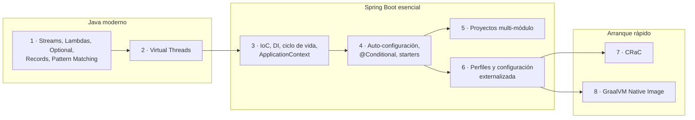
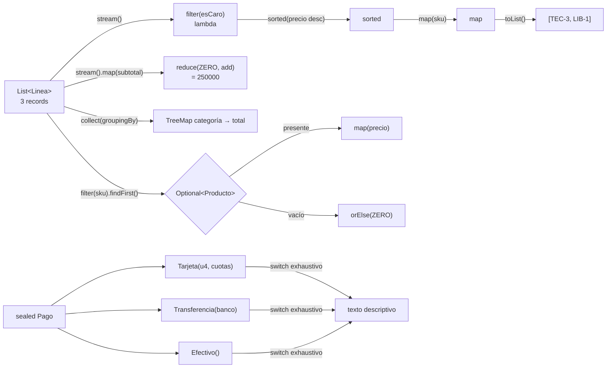
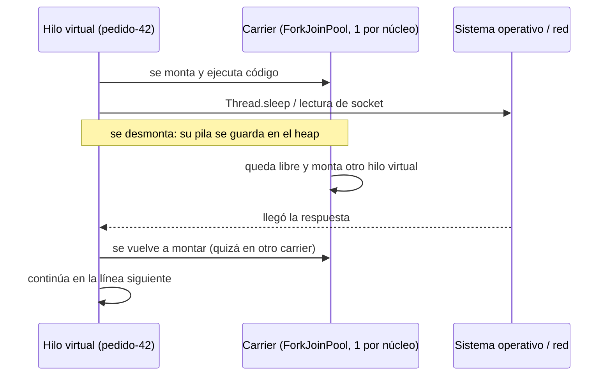
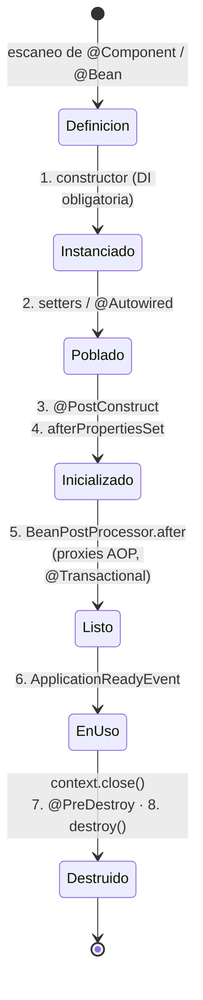
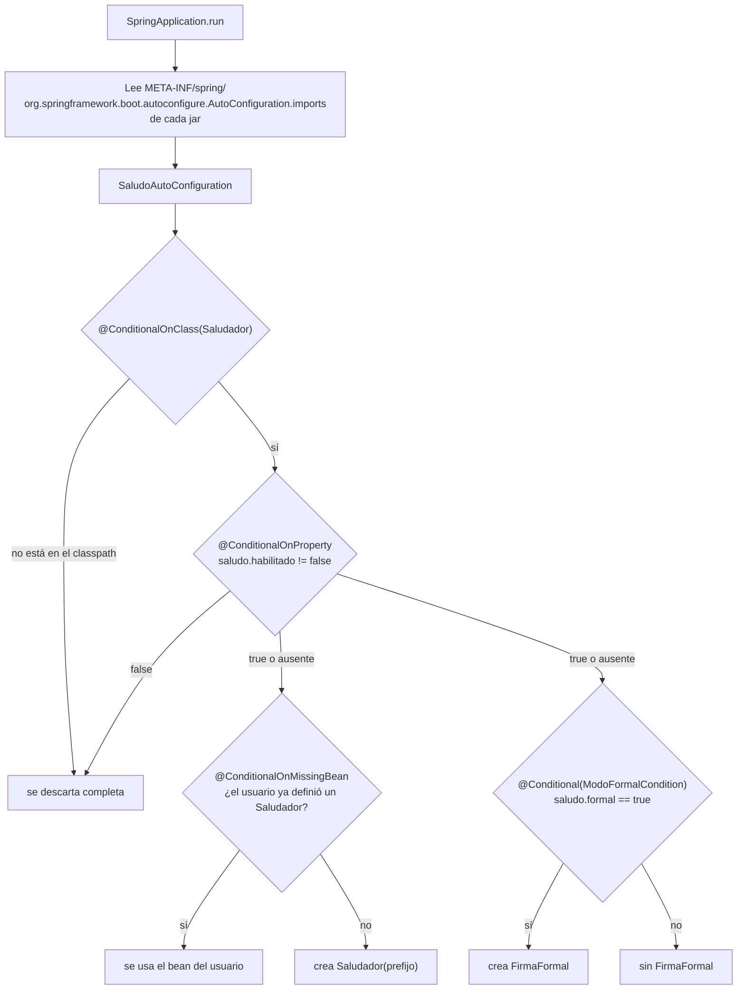
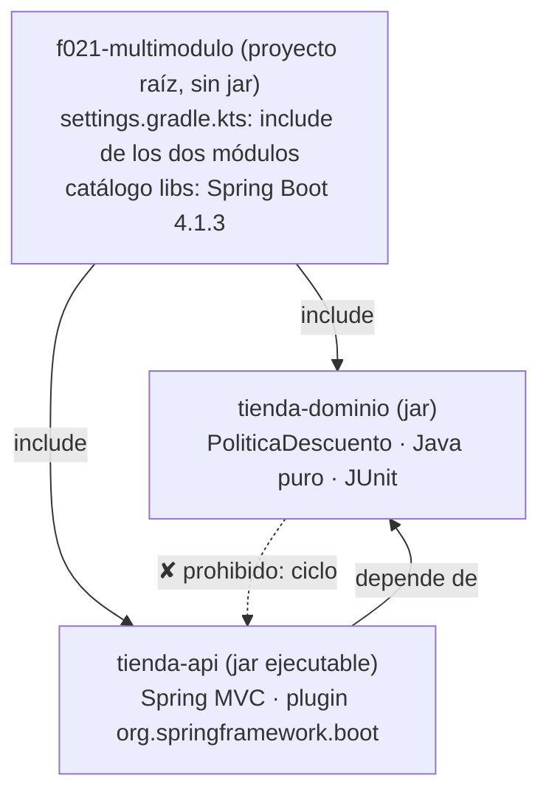
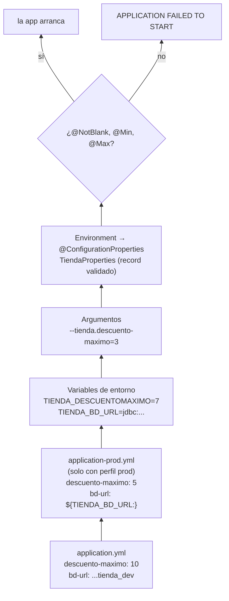
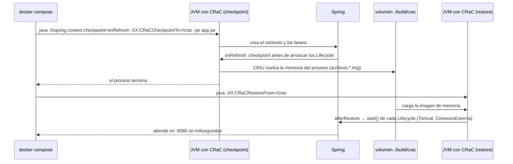
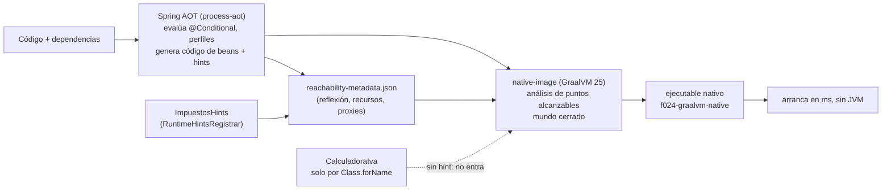

# Módulo 1 · Java moderno y Spring Boot esencial

**Fase 1 · Spring Boot de cero a experto** (semanas 1 y 2 de 12). **Duración:** 16 h (8 temas de 1,5–2,5 h).
**Dificultad:** 2 de 5 en los temas 1–6 y 4 de 5 en CRaC y GraalVM. **Dependencias:** Fase 0 completa (Módulos
0.1–0.5: terminal, Git, HTTP, JSON, YAML, variables de entorno, primer «Hola Mundo» en Java y Docker básico).
**Herramientas:** **JDK 25 LTS (25.0.5)**, **Spring Boot 4.1.3** (Spring Framework 7.0.11, JUnit Jupiter 6), Gradle
9.9.2 (Kotlin DSL) mediante el wrapper `./gradlew` y Docker con Compose v5 para CRaC y Native Image. **Laboratorio:**
`examples/microservicios/modulo-5/` (un subproyecto Gradle por tema; `./verificar.sh` ejecuta todos los
tests).

Antes de construir microservicios necesitas dominar las dos herramientas con las que se escriben en esta fase: el
lenguaje Java moderno (records, streams, pattern matching, hilos virtuales) y el contenedor de Spring, que crea y
conecta tus objetos, decide qué configuración aplicar y, al final, puede arrancar tu servicio en milisegundos.



**Texto alternativo:** mapa del módulo en tres bloques de izquierda a derecha. «Java moderno» contiene el tema 1
(Streams, Lambdas, Optional, Records, Pattern Matching) que lleva al tema 2 (Virtual Threads). El tema 2 conduce al
bloque «Spring Boot esencial»: tema 3 (IoC, DI, ciclo de vida, ApplicationContext) lleva al tema 4
(auto-configuración), del que salen el tema 5 (multi-módulo) y el tema 6 (perfiles). Del tema 6 salen dos flechas al
bloque «Arranque rápido»: tema 7 (CRaC) y tema 8 (GraalVM Native Image).

**Cómo usar el laboratorio.** Clona el repositorio, entra en `examples/microservicios/modulo-5` y ejecuta
`java -version` (debe decir `25`). Cada tema tiene su carpeta (`f017-java-moderno`, `f018-virtual-threads`…); dentro
de ella usa `../gradlew` (el wrapper del módulo descarga Gradle 9.9.2 la primera vez). La primera compilación de Spring
descarga dependencias de Maven Central y tarda unos minutos; las siguientes, segundos.

---
### Java 21: Streams, Lambdas, Optional, Records, Pattern Matching

#### 1. UBICACIÓN

Módulo 1, Lección 1 de 8 · Fase 1 · 2,5 h · Laboratorio `examples/microservicios/modulo-5/f017-java-moderno/`.
El título conserva «Java 21» del temario: son las funciones que Java 21 (LTS) dejó estables. Aquí las usas con
**JDK 25 LTS**, que las mantiene y añade el patrón `_` (Java 22) que también verás.

#### 2. PRERREQUISITOS

- Módulo 0.3: variables, tipos, `if`, `for`, métodos y clases en Java.
- Módulo 0.5: compilar y ejecutar un archivo con `java Archivo.java`.
- Saber qué es una lista (`List`) y un mapa (`Map`) aunque no los hayas usado mucho.

#### 3. OBJETIVO DE APRENDIZAJE

**Aplicar** records, sealed interfaces, pattern matching, lambdas, streams y `Optional` para calcular totales,
agrupar y buscar en un pedido, de modo que los 6 tests de `JavaModernoTest` pasen y puedas **explicar** por qué el
compilador rechaza un `switch` al que le falta un caso.

#### 4. ANALOGÍA VISUAL

Una **cinta transportadora de una planta empacadora de café**. A la izquierda llegan bolsas (los elementos de una
lista). Encima de la cinta hay estaciones con un letrero: «**filtrar**: solo bolsas de más de 40 000», «**mapear**:
quita la bolsa y deja solo la etiqueta», «**ordenar**», y al final una caja que «**recolecta**» lo que llega. Cada
bolsa es un **record**: una caja sellada y transparente con su etiqueta impresa (SKU, categoría, precio) que nadie
puede reescribir. Al lado de la cinta, un **clasificador de monedas** con ranuras de formas distintas (tarjeta,
transferencia, efectivo) representa el *pattern matching*: cada objeto cae por la ranura de su forma, y si fabricas
una moneda nueva sin ranura, la máquina no arranca (el compilador te avisa). Por último, una **caja con ventanita**
que puede estar vacía o tener un producto dentro es `Optional`: antes de abrirla, miras por la ventana.

#### 5. DIAGRAMA TÉCNICO



**Texto alternativo:** a la izquierda, una lista de tres líneas de pedido. De ella salen cuatro tuberías. La
primera pasa por «filter» (lambda esCaro), «sorted» por precio descendente, «map» a SKU y «toList», y produce
[TEC-3, LIB-1]. La segunda mapea cada línea a su subtotal y reduce sumando desde cero hasta 250000. La tercera
agrupa en un TreeMap de categoría a total. La cuarta filtra por SKU y termina en un rombo «Optional»: si está
presente, se mapea al precio; si está vacío, se usa orElse(ZERO). Abajo, una interfaz sellada Pago con tres records
(Tarjeta, Transferencia, Efectivo) que confluyen en un switch exhaustivo que produce un texto.

#### 6. EXPLICACIÓN NIVEL 0

Un programa trabaja con **datos** (un producto, un pedido) y con **acciones** sobre esos datos (sumar, buscar,
ordenar). Java moderno te da cinco herramientas para escribir eso con menos código y menos errores:

- **Record**: una ficha de datos que no cambia. Escribes `record Producto(String sku, String categoria, BigDecimal
  precio)` y Java crea por ti el constructor, los métodos para leer cada dato y la comparación entre fichas.
- **Lambda**: una función pequeña sin nombre que puedes pasar como dato. `l -> l.producto().sku()` significa «dame
  una línea y te devuelvo su SKU».
- **Stream**: una cinta transportadora sobre una lista. Encadenas pasos (`filter`, `map`, `sorted`) y al final
  recolectas el resultado (`toList`, `reduce`, `collect`). La lista original no cambia.
- **Optional**: una caja que puede venir vacía. En vez de devolver `null` (que provoca el famoso
  `NullPointerException`), devuelves `Optional` y quien lo recibe decide qué hacer si está vacía.
- **Pattern matching**: un `switch` que pregunta «¿de qué forma es este objeto?» y, si es una tarjeta, te entrega
  directamente sus partes (`ultimos4`, `cuotas`).

#### 7. EXPLICACIÓN INTERMEDIA

**Records.** Son clases `final` con campos `private final`. El *constructor compacto* (`public Producto { ... }`)
valida antes de asignar: así es imposible crear un `Producto` con precio negativo. `equals` compara por valor, por eso
`assertEquals(new Producto(...), otro)` funciona sin escribir nada.

**Lambdas y referencias a métodos.** Una lambda implementa una *interfaz funcional* (una interfaz con un solo
método abstracto): `Predicate<Linea>` (`test`), `Function<A,B>` (`apply`), `Comparator<T>` (`compare`).
`Linea::subtotal` es una referencia a método equivalente a `l -> l.subtotal()`.

**Streams.** Tienen operaciones *intermedias* perezosas (`filter`, `map`, `sorted`) que no hacen nada hasta que
aparece una operación *terminal* (`toList`, `reduce`, `collect`, `findFirst`). Un stream se consume una sola vez.
`Collectors.groupingBy(clave, TreeMap::new, Collectors.reducing(...))` agrupa y reduce en un paso; el `TreeMap`
ordena las claves. Para dinero se usa `BigDecimal`, nunca `double`.

**Optional.** `findFirst()` devuelve `Optional<T>`. Se encadena con `map`, `filter`, `orElse`, `orElseGet` y
`orElseThrow()`. No se usa como campo de una clase ni como parámetro: es un tipo de **retorno**.

**Sealed + pattern matching.** `sealed interface Pago permits Tarjeta, Transferencia, Efectivo` cierra la jerarquía.
En `switch (pago)` cada `case Tarjeta(var u4, var cuotas)` es un *record pattern* que desarma el objeto; `when` añade
una condición (*guard*); `_` ignora un componente (estable desde Java 22). Como el compilador conoce todos los
subtipos, el `switch` es **exhaustivo** sin `default`: si mañana añades `Pse`, el código que no lo trate deja de
compilar, que es justo lo que quieres.

#### 8. EXPLICACIÓN MAESTRA

| Decisión | Opción A | Opción B | Trade-off |
|---|---|---|---|
| Modelar datos | `record` | clase con Lombok `@Value` | Record es del lenguaje y no necesita *annotation processor*; Lombok permite herencia y *builders*, pero añade una dependencia que toca el compilador. |
| Recorrer colecciones | Stream | bucle `for` | El stream expresa intención y se paraleliza con `parallelStream()`; el `for` es más rápido de depurar, permite `break` y gana en bucles muy calientes o con estado mutable. |
| Ausencia de valor | `Optional` | `null` + anotaciones `@Nullable` (JSpecify) | `Optional` obliga al llamador; JSpecify no crea objetos y sirve en campos y parámetros, pero depende de que el IDE o NullAway lo verifiquen. |
| Variantes de un tipo | `sealed` + `switch` | polimorfismo (método abstracto `describir()` en cada clase) | El polimorfismo es mejor cuando las variantes cambian poco y las operaciones mucho al revés; con `sealed` añadir **operaciones** es barato y el compilador vigila las **variantes**. |

**Cuándo NO usarlo.** No uses `parallelStream()` en un servidor web por defecto: comparte el `ForkJoinPool` común con
todo el proceso y con pocas filas es más lento. No conviertas en stream un algoritmo con varios estados mutables
(es más legible un `for`). No uses records para entidades JPA (F028): Hibernate necesita constructor sin argumentos y
campos mutables. No devuelvas `Optional<List<T>>`: una lista vacía ya expresa «no hay».

#### 9. CÓDIGO EJECUTABLE

**Versiones:** JDK 25 LTS (25.0.5) · Gradle 9.9.2 · el BOM de Spring Boot 4.1.3 como plataforma, solo para fijar la
versión de JUnit Jupiter 6.0.3. El código no depende de Spring y corre tal cual con
`java src/main/java/academia/java/JavaModerno.java` (lanzador de un solo archivo, desde Java 11).

> **Build con Gradle (y su equivalencia en Maven).** Este laboratorio se construye con **Gradle 9.9.2** y Kotlin DSL
> mediante el wrapper `./gradlew` (no instalas Gradle). `settings.gradle.kts` lista los subproyectos (en Maven,
> `<modules>` del POM agregador), cada carpeta tiene su `build.gradle.kts` (su `pom.xml`) y
> `gradle/libs.versions.toml` es el **catálogo de versiones** (las `<properties>` y el `dependencyManagement`): por eso
> las dependencias se escriben `libs.…`. Equivalencias: `./mvnw test` → `./gradlew test` ·
> `./mvnw package -DskipTests` → `./gradlew bootJar` · `./mvnw spring-boot:run` → `./gradlew bootRun` ·
> `-Dtest=Clase` → `--tests Clase` · `target/` → `build/` (el jar queda en `build/libs/`). Gradle escribe una línea
> `PASSED` por test y termina con `BUILD SUCCESSFUL` (Maven: `Tests run: N` y `BUILD SUCCESS`).
> `f021-multimodulo` es un build completo que este incluye con `includeBuild` (lo verás en la lección 5).

`modulo-5/settings.gradle.kts`:

```kotlin
// Módulo 1 (modulo-5) · Build multi-proyecto: "./gradlew test" ejecuta los tests de todas las fichas.
// Cada carpeta fNNN-* es un subproyecto con su propio build.gradle.kts; las versiones viven en
// gradle/libs.versions.toml (catálogo "libs"). Equivale al POM agregador con <modules> de Maven.
pluginManagement {
    repositories {
        gradlePluginPortal()
        mavenCentral()
    }
}

dependencyResolutionManagement {
    repositories {
        mavenCentral()
    }
}

rootProject.name = "modulo-5-laboratorios"

include(
    "f017-java-moderno",
    "f018-virtual-threads",
    "f019-ioc-di",
    "f020-autoconfiguracion",
    "f022-perfiles",
    "f023-crac",
    "f024-graalvm-native",
)

// F021 enseña el multi-proyecto: es un build completo (con su settings.gradle.kts) que se incluye
// como build compuesto. Se puede abrir y construir solo: cd f021-multimodulo && ../gradlew build
includeBuild("f021-multimodulo")
```

`modulo-5/gradle/libs.versions.toml`:

```toml
# Módulo 1 (modulo-5) · Java moderno y Spring Boot esencial
# Catálogo de versiones del laboratorio: una sola fuente para plugins y librerías.
# Las librerías SIN versión las fija el BOM de Spring Boot (spring-boot-dependencies) o el BOM que importe el proyecto.

[versions]
# Native Build Tools que admite Spring Boot 4.1.3 (docs.spring.io/spring-boot/4.1/system-requirements.html)
graalvm-native = "1.1.18"
spring-boot = "4.1.3"

[libraries]
junit-jupiter = { module = "org.junit.jupiter:junit-jupiter" }
spring-boot-dependencies = { module = "org.springframework.boot:spring-boot-dependencies", version.ref = "spring-boot" }
junit-platform-launcher = { module = "org.junit.platform:junit-platform-launcher" }
spring-boot-starter = { module = "org.springframework.boot:spring-boot-starter" }
spring-boot-starter-test = { module = "org.springframework.boot:spring-boot-starter-test" }
spring-boot-starter-webmvc = { module = "org.springframework.boot:spring-boot-starter-webmvc" }
spring-boot-starter-webmvc-test = { module = "org.springframework.boot:spring-boot-starter-webmvc-test" }
spring-boot-starter-validation = { module = "org.springframework.boot:spring-boot-starter-validation" }
crac = { module = "org.crac:crac" }

[plugins]
spring-boot = { id = "org.springframework.boot", version.ref = "spring-boot" }
spring-dependency-management = { id = "io.spring.dependency-management", version = "1.1.7" }
graalvm-buildtools = { id = "org.graalvm.buildtools.native", version.ref = "graalvm-native" }
```

`modulo-5/f017-java-moderno/build.gradle.kts`:

```kotlin
// F017 · Java moderno: Streams, Lambdas, Optional, Records, Pattern Matching.
// No aplica el plugin de Spring Boot: solo importa su BOM como plataforma para usar la versión
// probada de JUnit; el código no depende de Spring.
plugins {
    java
}

group = "academia.microservicios"
version = "1.0.0"

java {
    toolchain {
        languageVersion = JavaLanguageVersion.of(25)
    }
}

dependencies {
    // BOM de Spring Boot como plataforma de Gradle: fija las versiones sin aplicar el plugin de Boot
    testImplementation(platform(libs.spring.boot.dependencies))
    testImplementation(libs.junit.jupiter)   // JUnit Jupiter 6.0.3, versión gestionada por Spring Boot 4.1.3
    // Gradle 9 exige declarar el lanzador de JUnit Platform (ya no lo añade por su cuenta)
    testRuntimeOnly(libs.junit.platform.launcher)
}

tasks.withType<JavaCompile> {
    options.encoding = "UTF-8"
}

tasks.withType<Test> {
    useJUnitPlatform()
    testLogging {
        events("passed", "skipped", "failed")   // una línea por test en la consola
        // el mensaje completo de cada fallo (valor esperado y obtenido), no solo el tipo de excepción
        exceptionFormat = org.gradle.api.tasks.testing.logging.TestExceptionFormat.FULL
    }
}
```

`modulo-5/f017-java-moderno/src/main/java/academia/java/JavaModerno.java`:

```java
package academia.java;

import java.math.BigDecimal;
import java.util.Comparator;
import java.util.List;
import java.util.Map;
import java.util.Objects;
import java.util.Optional;
import java.util.TreeMap;
import java.util.function.Predicate;
import java.util.stream.Collectors;

/**
 * F017 · Java moderno en un solo archivo: records, sealed + pattern matching,
 * lambdas, streams y Optional. Se ejecuta tal cual con:
 *   java src/main/java/academia/java/JavaModerno.java
 */
public class JavaModerno {

    // 1. RECORD: una "ficha" de datos inmutable. Java genera constructor,
    //    accesores sku(), categoria(), precio(), equals, hashCode y toString.
    public record Producto(String sku, String categoria, BigDecimal precio) {
        // Constructor compacto: valida antes de asignar los campos.
        public Producto {
            Objects.requireNonNull(sku, "sku");
            if (precio.signum() < 0) {
                throw new IllegalArgumentException("precio negativo: " + precio);
            }
        }
    }

    public record Linea(Producto producto, int cantidad) {
        public BigDecimal subtotal() {
            return producto.precio().multiply(BigDecimal.valueOf(cantidad));
        }
    }

    // 2. SEALED + RECORDS: el compilador conoce TODAS las formas de pago,
    //    así que el switch de describir() no necesita "default".
    public sealed interface Pago permits Tarjeta, Transferencia, Efectivo { }
    public record Tarjeta(String ultimos4, int cuotas) implements Pago { }
    public record Transferencia(String banco) implements Pago { }
    public record Efectivo() implements Pago { }

    // 3. PATTERN MATCHING: desarma el record dentro del case (record patterns),
    //    añade condiciones con "when" e ignora componentes con "_".
    public static String describir(Pago pago) {
        return switch (pago) {
            case Tarjeta(var ultimos4, var cuotas) when cuotas > 1 ->
                "Tarjeta *" + ultimos4 + " a " + cuotas + " cuotas";
            case Tarjeta(var ultimos4, _) -> "Tarjeta *" + ultimos4 + " de contado";
            case Transferencia(var banco) -> "Transferencia desde " + banco;
            case Efectivo() -> "Efectivo contra entrega";
        };
    }

    // 4. STREAMS + LAMBDAS: tubería declarativa filtrar -> transformar -> reducir.
    public static BigDecimal total(List<Linea> lineas) {
        return lineas.stream()
            .map(Linea::subtotal)                      // referencia a método
            .reduce(BigDecimal.ZERO, BigDecimal::add); // suma con valor inicial
    }

    public static Map<String, BigDecimal> totalPorCategoria(List<Linea> lineas) {
        return lineas.stream().collect(Collectors.groupingBy(
            l -> l.producto().categoria(),             // lambda: clave del grupo
            TreeMap::new,                              // mapa ordenado por clave
            Collectors.reducing(BigDecimal.ZERO, Linea::subtotal, BigDecimal::add)));
    }

    public static List<String> skusCaros(List<Linea> lineas, BigDecimal umbral) {
        Predicate<Linea> esCaro = l -> l.producto().precio().compareTo(umbral) > 0;
        return lineas.stream()
            .filter(esCaro)
            .sorted(Comparator.comparing((Linea l) -> l.producto().precio()).reversed())
            .map(l -> l.producto().sku())
            .toList();                                  // lista inmodificable
    }

    // 5. OPTIONAL: "puede no haber resultado" queda escrito en el tipo.
    public static Optional<Producto> buscar(List<Linea> lineas, String sku) {
        return lineas.stream()
            .map(Linea::producto)
            .filter(p -> p.sku().equals(sku))
            .findFirst();
    }

    public static List<Linea> pedidoDeEjemplo() {
        var libro = new Producto("LIB-1", "libros", new BigDecimal("45000"));
        var cuaderno = new Producto("PAP-7", "papeleria", new BigDecimal("8000"));
        var audifonos = new Producto("TEC-3", "tecnologia", new BigDecimal("120000"));
        return List.of(new Linea(libro, 2), new Linea(cuaderno, 5), new Linea(audifonos, 1));
    }

    public static void main(String[] args) {
        var lineas = pedidoDeEjemplo();
        System.out.println("Total: " + total(lineas));
        System.out.println("Por categoría: " + totalPorCategoria(lineas));
        System.out.println("Caros (> 40000): " + skusCaros(lineas, new BigDecimal("40000")));
        System.out.println("Buscar TEC-3: " + buscar(lineas, "TEC-3").map(Producto::precio).orElse(BigDecimal.ZERO));
        System.out.println("Buscar XXX-0: " + buscar(lineas, "XXX-0").map(Producto::precio).orElse(BigDecimal.ZERO));
        for (Pago pago : List.of(new Tarjeta("4242", 3), new Tarjeta("1111", 1),
                                 new Transferencia("Banco Andino"), new Efectivo())) {
            System.out.println(describir(pago));
        }
    }
}
```

#### 10. MINI-LABORATORIO

1. Entra en la carpeta del tema:

```bash
cd examples/microservicios/modulo-5/f017-java-moderno
java -version
```

2. Ejecuta el archivo directamente con el lanzador de código fuente (no hace falta Gradle):

```bash
java src/main/java/academia/java/JavaModerno.java
```

   **Output esperado** (salida real con JDK 25.0.5):

```text
Total: 250000
Por categoría: {libros=90000, papeleria=40000, tecnologia=120000}
Caros (> 40000): [TEC-3, LIB-1]
Buscar TEC-3: 120000
Buscar XXX-0: 0
Tarjeta *4242 a 3 cuotas
Tarjeta *1111 de contado
Transferencia desde Banco Andino
Efectivo contra entrega
```

   **Captura comentada:** la segunda línea sale ordenada alfabéticamente porque `groupingBy` recibe `TreeMap::new`;
   la tercera pone `TEC-3` antes que `LIB-1` por el `reversed()`; `Buscar XXX-0: 0` es el `orElse` de un `Optional`
   vacío; las dos tarjetas toman caminos distintos del `switch` gracias a `when cuotas > 1`.

3. **Fallo deliberado:** borra la línea `case Efectivo() -> "Efectivo contra entrega";` y vuelve a ejecutar el paso 2.

   **Output esperado:** el programa no llega a correr; el compilador responde con
   `error: the switch expression does not cover all possible input values` y señala el `switch`. Restaura la línea.

4. Cambia `TreeMap::new` por `java.util.HashMap::new`, ejecuta y observa que el orden de las categorías ya no está
   garantizado. Restaura `TreeMap::new`.

#### 11. VERIFICACIÓN

El test que debes ejecutar:

`modulo-5/f017-java-moderno/src/test/java/academia/java/JavaModernoTest.java`:

```java
package academia.java;

import static org.junit.jupiter.api.Assertions.assertEquals;
import static org.junit.jupiter.api.Assertions.assertThrows;
import static org.junit.jupiter.api.Assertions.assertTrue;

import academia.java.JavaModerno.Efectivo;
import academia.java.JavaModerno.Linea;
import academia.java.JavaModerno.Producto;
import academia.java.JavaModerno.Tarjeta;
import java.math.BigDecimal;
import java.util.List;
import java.util.Map;
import org.junit.jupiter.api.Test;

class JavaModernoTest {

    private final List<Linea> lineas = JavaModerno.pedidoDeEjemplo();

    @Test
    void sumaElPedidoConStreams() {
        assertEquals(new BigDecimal("250000"), JavaModerno.total(lineas));
    }

    @Test
    void agrupaPorCategoriaEnOrdenAlfabetico() {
        Map<String, BigDecimal> porCategoria = JavaModerno.totalPorCategoria(lineas);
        assertEquals(List.of("libros", "papeleria", "tecnologia"), List.copyOf(porCategoria.keySet()));
        assertEquals(new BigDecimal("90000"), porCategoria.get("libros"));
    }

    @Test
    void ordenaLosCarosDeMayorAMenor() {
        assertEquals(List.of("TEC-3", "LIB-1"), JavaModerno.skusCaros(lineas, new BigDecimal("40000")));
    }

    @Test
    void optionalVacioCuandoNoExisteElSku() {
        assertTrue(JavaModerno.buscar(lineas, "XXX-0").isEmpty());
        assertEquals("tecnologia", JavaModerno.buscar(lineas, "TEC-3").orElseThrow().categoria());
    }

    @Test
    void patternMatchingDistingueCuotas() {
        assertEquals("Tarjeta *4242 a 3 cuotas", JavaModerno.describir(new Tarjeta("4242", 3)));
        assertEquals("Tarjeta *1111 de contado", JavaModerno.describir(new Tarjeta("1111", 1)));
        assertEquals("Efectivo contra entrega", JavaModerno.describir(new Efectivo()));
    }

    @Test
    void elRecordRechazaPreciosNegativos() {
        var error = assertThrows(IllegalArgumentException.class,
            () -> new Producto("MAL-1", "x", new BigDecimal("-1")));
        assertEquals("precio negativo: -1", error.getMessage());
    }
}
```

```bash
../gradlew test
```

**Output esperado:** 6 líneas `PASSED` (una por test) y `BUILD SUCCESSFUL` *(salida de Gradle pendiente de verificación en el Mac)*.

**Pregunta de comprobación:** ¿por qué `skusCaros` no modifica la lista `lineas` aunque la ordene?

<details>
<summary>Respuesta</summary>

Porque un stream no altera su fuente: `sorted` ordena los elementos que pasan por la cinta y `toList()` crea una
lista **nueva** (e inmodificable). La lista original sigue en el orden en que se creó.
</details>

#### 12. ERROR COMÚN

**Síntoma:** al convertir una lista en mapa con `Collectors.toMap`, el programa explota en producción con datos
reales aunque en tus pruebas funcionaba.

**Cómo se ve** (salida real con JDK 25.0.5):

```text
Exception in thread "main" java.lang.IllegalStateException: Duplicate key LIB-1 (attempted merging values Producto[sku=LIB-1, precio=45000] and Producto[sku=LIB-1, precio=47000])
	at java.base/java.util.stream.Collectors.duplicateKeyException(Collectors.java:135)
```

**Diagnóstico:** `toMap(clave, valor)` asume claves únicas; dos productos con el mismo SKU (por ejemplo, dos precios
de proveedores) chocan. El mensaje te dice la clave (`LIB-1`) y los dos valores en conflicto. Un error primo es
`IllegalStateException: stream has already been operated upon or closed`, que aparece al reutilizar un stream ya
consumido.

**Arreglo:** decide qué hacer con el duplicado con el tercer argumento:
`Collectors.toMap(Producto::sku, p -> p, (a, b) -> a.precio().compareTo(b.precio()) <= 0 ? a : b)` (se queda con el
más barato), o usa `groupingBy` si necesitas todos.

#### 13. PREGUNTA DE ENTREVISTA

«¿Qué ventaja tiene una `sealed interface` con records frente a una jerarquía abierta con `instanceof` y un `else`
final?»

**Respuesta modelo:** con la jerarquía sellada el compilador conoce todas las variantes, así que un `switch` sobre
ella es exhaustivo sin `default`. Si se agrega una variante nueva, cada `switch` que no la trate deja de compilar y el
equipo encuentra todos los lugares a actualizar antes de desplegar. Con `instanceof` y un `else`, la variante nueva cae
en silencio en la rama por defecto y el error aparece en producción. Los records además dan igualdad por valor y
desestructuración (`case Tarjeta(var u4, var cuotas)`), lo que convierte el tipo en un *algebraic data type*. El
coste es que la jerarquía no se puede extender desde otro módulo sin tocar el `permits`.

#### 14. ANTI-PATRÓN RELACIONADO

**`Optional` como campo y `get()` sin comprobar.** Se ve así:

```java
class Cliente {
    Optional<String> telefono;                // Optional como campo: no es serializable y suele ser null
}
String tel = cliente.telefono.get();          // NoSuchElementException si está vacío: el null de siempre
```

Evítalo: el campo es `String telefono` (que puede ser `null`), el **getter** devuelve
`Optional.ofNullable(telefono)` y quien lo usa llama a `orElse`, `orElseThrow` o `ifPresent`. Su primo en streams es
el *stream con efectos*: `lista.stream().forEach(x -> otraLista.add(x))`; usa `toList()` o `collect`.

---
### Virtual Threads (Project Loom)

#### 1. UBICACIÓN

Módulo 1, Lección 2 de 8 · Fase 1 · 2 h · Laboratorio `examples/microservicios/modulo-5/f018-virtual-threads/`.

#### 2. PRERREQUISITOS

- Lección 1 de este módulo: lambdas y streams (`IntStream.range`).
- Módulo 0.3: qué es un hilo y por qué un servidor atiende a varios clientes a la vez.
- Saber que una llamada a una base de datos o a otra API **espera** la respuesta (E/S).

#### 3. OBJETIVO DE APRENDIZAJE

**Comparar** un pool fijo de hilos de plataforma con un hilo virtual por tarea midiendo 1 000 esperas de 200 ms, y
**justificar** con los números (≈ 4 s frente a ≈ 0,2 s) cuándo conviene cada uno y por qué hay que limitar la
concurrencia hacia recursos escasos con un `Semaphore`.

#### 4. ANALOGÍA VISUAL

Un **restaurante con 50 meseros** (hilos de plataforma). Cada mesero toma un pedido y se queda **parado junto a la
cocina** hasta que sale el plato: con 1 000 mesas, 950 esperan sin que nadie las atienda. Ahora imagina el mismo
restaurante con **libretas de pedido** (hilos virtuales): cada mesa tiene su libreta, y los pocos meseros reales
(*carriers*, uno por núcleo) solo la cargan mientras escriben. Cuando el pedido está en la cocina, cuelgan la libreta
en un **gancho** y atienden otra mesa; cuando suena la campana, cualquier mesero libre descuelga la libreta y sigue
donde iba. En el dibujo se ven 1 000 libretas colgadas en ganchos, 2 meseros moviéndose y una **puerta de cocina
con un torniquete de 10 pasos** (el `Semaphore`): aunque haya mil libretas, solo 10 pedidos entran a la vez.

#### 5. DIAGRAMA TÉCNICO



**Texto alternativo:** diagrama de secuencia con tres participantes: el hilo virtual «pedido-42», el hilo carrier
del ForkJoinPool (uno por núcleo) y el sistema operativo. El hilo virtual se monta en el carrier y ejecuta código;
cuando llama a sleep o lee un socket, se desmonta y su pila se guarda en el heap, y el carrier queda libre para
montar otro hilo virtual. Cuando llega la respuesta, el hilo virtual se vuelve a montar, quizá en otro carrier, y
continúa en la línea siguiente.

#### 6. EXPLICACIÓN NIVEL 0

Un **hilo** es una fila de instrucciones que el computador ejecuta. Un servidor usa muchos hilos para atender a
muchas personas a la vez. Los hilos clásicos («de plataforma») son caros: cada uno reserva memoria y el sistema
operativo solo aguanta unos miles. Lo grave es que, mientras esperan una base de datos, **no hacen nada pero siguen
ocupados**.

Los **hilos virtuales** son hilos livianos que crea Java, no el sistema operativo. Puedes tener cientos de miles. Cuando
uno espera, Java lo «guarda en un cajón» y usa el hilo real para otra tarea. Tu código no cambia: sigue siendo código
normal, línea tras línea, sin `callbacks`.

#### 7. EXPLICACIÓN INTERMEDIA

- **Creación:** `Thread.ofVirtual().name("pedido-42").start(tarea)` o, lo habitual,
  `Executors.newVirtualThreadPerTaskExecutor()`, que crea **un hilo virtual nuevo por tarea** (no hay pool que
  dimensionar). `ExecutorService` es `AutoCloseable` desde Java 19: `try (executor) { ... }` espera a que todas las
  tareas terminen.
- **Carriers:** los hilos virtuales se ejecutan sobre un `ForkJoinPool` con tantos hilos como núcleos
  (`jdk.virtualThreadScheduler.parallelism`). Al bloquearse en E/S, `sleep`, `BlockingQueue` o `ReentrantLock`, el
  hilo virtual se **desmonta**.
- **Pinning:** si el hilo no puede desmontarse queda «clavado» a su carrier. Desde **JDK 24 (JEP 491)** `synchronized`
  ya no clava; todavía clavan las llamadas nativas (JNI) y la inicialización de clases. Se observa con el evento JFR
  `jdk.VirtualThreadPinned`.
- **Medición del laboratorio:** con un pool de 50 hilos, 1 000 tareas de 200 ms van en 20 tandas: el mínimo teórico es
  20 × 200 ms = 4 000 ms. Con hilos virtuales las 1 000 esperas ocurren a la vez: ≈ 200 ms más el costo de crearlas.
- **En Spring Boot:** `spring.threads.virtual.enabled=true` hace que Tomcat atienda cada petición en un hilo virtual
  y que `@Async` y `@Scheduled` también los usen.

#### 8. EXPLICACIÓN MAESTRA

| Modelo | Bueno para | Coste |
|---|---|---|
| Pool fijo de hilos de plataforma | CPU intensiva (cálculo, compresión): tantos hilos como núcleos | Cada hilo ≈ 1 MB de pila reservada; con E/S, el pool es el cuello de botella. |
| Hilos virtuales | Muchas esperas de E/S: APIs que llaman a BD y a otros servicios | No aceleran la CPU; trasladan el cuello de botella al recurso de abajo (pool de conexiones, API externa). |
| Programación reactiva (WebFlux, Reactor) | *Streaming*, *backpressure* explícita, miles de conexiones largas | Código asíncrono más difícil de leer, depurar y perfilar; todo el stack debe ser no bloqueante. |

**Lo que cambia de verdad:** el límite de concurrencia deja de ser «cuántos hilos tengo» y pasa a ser «cuánto aguanta
lo que hay detrás». Con 10 000 peticiones simultáneas y un HikariCP de 10 conexiones, 9 990 hilos virtuales esperan
conexión y empiezan los *timeouts*. Por eso el laboratorio limita con `Semaphore(10)`: el semáforo es el nuevo
«tamaño de pool», pero explícito y por recurso.

**Cuándo NO usarlos:** trabajo de CPU pura (no ganas nada y pierdes predictibilidad), código que guarda objetos
grandes en `ThreadLocal` (con un hilo por tarea se multiplican; prefiere `ScopedValue`, final en JDK 25), y librerías
que hacen mucho JNI. **Nunca** metas hilos virtuales en un pool (`newFixedThreadPool(100, Thread.ofVirtual().factory())`):
son baratos para crear y desechar; un pool reintroduce el límite que querías quitar.

#### 9. CÓDIGO EJECUTABLE

**Versiones:** JDK 25 LTS (25.0.5) · sin dependencias en ejecución · JUnit Jupiter 6.0.3 para el test (versión fijada
por el BOM de Spring Boot 4.1.3). Corre tal cual con `java src/main/java/academia/hilos/HilosVirtuales.java`.

`modulo-5/f018-virtual-threads/build.gradle.kts`:

```kotlin
// F018 · Virtual Threads (Project Loom).
// No aplica el plugin de Spring Boot: solo importa su BOM como plataforma para usar la versión
// probada de JUnit; el código no depende de Spring.
plugins {
    java
}

group = "academia.microservicios"
version = "1.0.0"

java {
    toolchain {
        languageVersion = JavaLanguageVersion.of(25)
    }
}

dependencies {
    // BOM de Spring Boot como plataforma de Gradle: fija las versiones sin aplicar el plugin de Boot
    testImplementation(platform(libs.spring.boot.dependencies))
    testImplementation(libs.junit.jupiter)   // JUnit Jupiter 6.0.3, versión gestionada por Spring Boot 4.1.3
    // Gradle 9 exige declarar el lanzador de JUnit Platform (ya no lo añade por su cuenta)
    testRuntimeOnly(libs.junit.platform.launcher)
}

tasks.withType<JavaCompile> {
    options.encoding = "UTF-8"
}

tasks.withType<Test> {
    useJUnitPlatform()
    testLogging {
        events("passed", "skipped", "failed")   // una línea por test en la consola
        // el mensaje completo de cada fallo (valor esperado y obtenido), no solo el tipo de excepción
        exceptionFormat = org.gradle.api.tasks.testing.logging.TestExceptionFormat.FULL
    }
}
```

`modulo-5/f018-virtual-threads/src/main/java/academia/hilos/HilosVirtuales.java`:

```java
package academia.hilos;

import java.time.Duration;
import java.util.concurrent.ExecutorService;
import java.util.concurrent.Executors;
import java.util.concurrent.Semaphore;
import java.util.concurrent.atomic.AtomicInteger;
import java.util.stream.IntStream;

/**
 * F018 · Virtual Threads (Project Loom). Compara un pool fijo de hilos de plataforma
 * con un hilo virtual por tarea cuando las tareas pasan casi todo el tiempo esperando E/S.
 * Ejecuta: java src/main/java/academia/hilos/HilosVirtuales.java
 */
public class HilosVirtuales {

    /** Simula una llamada remota (BD, HTTP) que tarda 'espera' sin usar CPU. */
    static int llamadaRemota(int id, Duration espera) throws InterruptedException {
        Thread.sleep(espera);           // el hilo virtual se "desmonta" aquí y libera su carrier
        return id;
    }

    /** Lanza 'tareas' llamadas en el executor y devuelve cuánto tardaron todas. */
    static Duration medir(ExecutorService executor, int tareas, Duration espera) {
        long inicio = System.nanoTime();
        try (executor) {                // close() espera a que terminen todas las tareas
            IntStream.range(0, tareas).forEach(i ->
                executor.submit(() -> llamadaRemota(i, espera)));
        }
        return Duration.ofNanos(System.nanoTime() - inicio);
    }

    /**
     * Con hilos virtuales la concurrencia ya no la limita el pool:
     * si el recurso de abajo es escaso (p. ej. 10 conexiones de BD), límitalo tú.
     */
    static int maximoSimultaneo(int tareas, int permisos) {
        var semaforo = new Semaphore(permisos);
        var dentro = new AtomicInteger();
        var maximo = new AtomicInteger();
        try (var executor = Executors.newVirtualThreadPerTaskExecutor()) {
            for (int i = 0; i < tareas; i++) {
                executor.submit(() -> {
                    semaforo.acquire();
                    try {
                        maximo.accumulateAndGet(dentro.incrementAndGet(), Math::max);
                        Thread.sleep(Duration.ofMillis(20));
                    } finally {
                        dentro.decrementAndGet();
                        semaforo.release();
                    }
                    return null;
                });
            }
        }
        return maximo.get();
    }

    public static void main(String[] args) throws Exception {
        int tareas = 1_000;
        var espera = Duration.ofMillis(200);

        Duration plataforma = medir(Executors.newFixedThreadPool(50), tareas, espera);
        System.out.printf("Plataforma (pool de 50): %d tareas en %d ms%n", tareas, plataforma.toMillis());

        Duration virtuales = medir(Executors.newVirtualThreadPerTaskExecutor(), tareas, espera);
        System.out.printf("Virtuales (1 por tarea): %d tareas en %d ms%n", tareas, virtuales.toMillis());

        Thread hilo = Thread.ofVirtual().name("pedido-42").start(() ->
            System.out.println("¿Virtual? " + Thread.currentThread().isVirtual()
                + " · nombre=" + Thread.currentThread().getName()));
        hilo.join();

        System.out.println("Máximo simultáneo con Semaphore(10): " + maximoSimultaneo(500, 10));
    }
}
```

#### 10. MINI-LABORATORIO

1. Entra en la carpeta y ejecuta la comparación:

```bash
cd examples/microservicios/modulo-5/f018-virtual-threads
java src/main/java/academia/hilos/HilosVirtuales.java
```

   **Output esperado** (salida real con JDK 25.0.5 en 2 núcleos; los milisegundos varían en tu equipo, pero la
   primera cifra nunca baja de 4 000 y la segunda queda muy por debajo):

```text
Plataforma (pool de 50): 1000 tareas en 4104 ms
Virtuales (1 por tarea): 1000 tareas en 224 ms
¿Virtual? true · nombre=pedido-42
Máximo simultáneo con Semaphore(10): 10
```

   **Captura comentada:** 4104 ms ≈ 20 tandas × 200 ms; 224 ms ≈ una sola espera de 200 ms más la creación de 1 000
   hilos; la última línea prueba que, aunque había 500 hilos virtuales, nunca entraron más de 10 a la «cocina».

2. Cambia `Executors.newFixedThreadPool(50)` por `Executors.newFixedThreadPool(200)` y ejecuta: la primera cifra baja
   a ≈ 1 000 ms (5 tandas). Ese es el «ajuste del tamaño del pool» que los hilos virtuales vuelven innecesario.

3. **Fallo deliberado:** en el laboratorio de error común (paso 12) verás qué pasa si creas 10 000 hilos de
   plataforma en un sistema con límite de procesos.

#### 11. VERIFICACIÓN

`modulo-5/f018-virtual-threads/src/test/java/academia/hilos/HilosVirtualesTest.java`:

```java
package academia.hilos;

import static org.junit.jupiter.api.Assertions.assertEquals;
import static org.junit.jupiter.api.Assertions.assertTrue;

import java.time.Duration;
import java.util.concurrent.Executors;
import java.util.concurrent.atomic.AtomicBoolean;
import org.junit.jupiter.api.Test;

class HilosVirtualesTest {

    @Test
    void diezMilEsperasDe100msTerminanEnMenosDeDosSegundos() {
        Duration t = HilosVirtuales.medir(Executors.newVirtualThreadPerTaskExecutor(),
            10_000, Duration.ofMillis(100));
        assertTrue(t.toMillis() < 2_000, "tardó " + t.toMillis() + " ms");
    }

    @Test
    void elPoolFijoSeLimitaPorSuTamanio() {
        // 100 tareas de 100 ms en 10 hilos = 10 tandas => al menos 1000 ms
        Duration t = HilosVirtuales.medir(Executors.newFixedThreadPool(10), 100, Duration.ofMillis(100));
        assertTrue(t.toMillis() >= 1_000, "tardó " + t.toMillis() + " ms");
    }

    @Test
    void elHiloEsVirtual() throws InterruptedException {
        var virtual = new AtomicBoolean();
        Thread.ofVirtual().start(() -> virtual.set(Thread.currentThread().isVirtual())).join();
        assertTrue(virtual.get());
    }

    @Test
    void elSemaforoLimitaLaConcurrencia() {
        assertEquals(10, HilosVirtuales.maximoSimultaneo(300, 10));
    }
}
```

```bash
../gradlew test
```

**Output esperado:** 4 líneas `PASSED` (una por test) y `BUILD SUCCESSFUL` *(salida de Gradle pendiente de verificación en el Mac)*.

**Pregunta de comprobación:** si tu servicio usa hilos virtuales y su pool de conexiones a PostgreSQL tiene 10
conexiones, ¿cuántas consultas simultáneas llegan como máximo a la base de datos?

<details>
<summary>Respuesta</summary>

10. Los hilos virtuales permiten miles de peticiones en curso, pero cada consulta necesita una conexión del pool;
las demás esperan (y pueden agotar el *timeout* del pool). La concurrencia efectiva la fija el recurso más escaso.
</details>

#### 12. ERROR COMÚN

**Síntoma:** «para no esperar», alguien cambia el pool por un hilo **de plataforma** por tarea y el servicio se cae
con picos de tráfico.

**Cómo se ve** (salida real con JDK 25.0.5 y límite de 2 000 procesos por usuario, `ulimit -u 2000`):

```text
[0.872s][warning][os,thread] Failed to start thread "Unknown thread" - pthread_create failed (EAGAIN) for attributes: stacksize: 1024k, guardsize: 0k, detached.
[0.872s][warning][os,thread] Failed to start the native thread for java.lang.Thread "Thread-1981"
Exception in thread "main" java.lang.OutOfMemoryError: unable to create native thread: possibly out of memory or process/resource limits reached
	at java.base/java.lang.Thread.start0(Native Method)
```

**Diagnóstico:** el código usaba `Executors.newThreadPerTaskExecutor(Thread.ofPlatform().factory())` con 10 000
tareas de 2 s. Cada hilo de plataforma es un hilo del sistema operativo con pila de 1 MB; al llegar al límite,
`pthread_create` falla (`EAGAIN`). Que diga `OutOfMemoryError` confunde: no falta *heap*, faltan hilos del sistema.

**Arreglo:** cambia `Thread.ofPlatform()` por `Thread.ofVirtual()` (o usa `newVirtualThreadPerTaskExecutor()`). Con el
mismo límite, el programa termina normalmente: los 10 000 hilos virtuales viven en el heap y comparten 2 carriers.

#### 13. PREGUNTA DE ENTREVISTA

«Migramos a hilos virtuales y ahora la API devuelve errores de *timeout* al pedir conexión a la base de datos. ¿Por
qué, si antes no pasaba?»

**Respuesta modelo:** antes, el pool de 200 hilos de Tomcat limitaba de forma implícita cuántas peticiones llegaban a
la vez al pool de conexiones. Con hilos virtuales ese límite desapareció: miles de peticiones compiten por las 10
conexiones de HikariCP y las que esperan más que `connectionTimeout` fallan. La solución no es volver al pool, sino
poner un límite explícito y medido por recurso: un `Semaphore` o un *bulkhead* (Resilience4j, Módulo 8) alrededor de
la BD, dimensionar el pool de conexiones según lo que aguanta PostgreSQL y aplicar *backpressure* (rechazar con 503)
cuando la cola crece.

#### 14. ANTI-PATRÓN RELACIONADO

**Pool de hilos virtuales** y **`ThreadLocal` como caché**:

```java
// Mal: limita la concurrencia con el tamaño del pool y reutiliza hilos que deberían desecharse
ExecutorService pool = Executors.newFixedThreadPool(100, Thread.ofVirtual().factory());

// Mal: con un hilo por tarea, cada petición crea su propio formateador (y nunca se reutiliza)
static final ThreadLocal<SimpleDateFormat> FORMATO = ThreadLocal.withInitial(() -> new SimpleDateFormat("yyyy-MM-dd"));
```

Hazlo así: `Executors.newVirtualThreadPerTaskExecutor()` + `Semaphore` donde haya un recurso escaso, y objetos
inmutables compartidos (`DateTimeFormatter.ISO_LOCAL_DATE`) en lugar de cachés por hilo.

---
### Spring IoC, DI, Bean Lifecycle, ApplicationContext

#### 1. UBICACIÓN

Módulo 1, Lección 3 de 8 · Fase 1 · 2 h · Laboratorio `examples/microservicios/modulo-5/f019-ioc-di/`.

#### 2. PRERREQUISITOS

- Lección 1: interfaces, records y lambdas.
- Módulo 0.3: clases, constructores y `new`.
- Módulo 0.5: ejecutar Java desde la terminal (`java -jar`). Lección 1 de este módulo: el wrapper (`./gradlew build`).

#### 3. OBJETIVO DE APRENDIZAJE

**Explicar** quién crea, conecta y destruye los objetos de una aplicación Spring y **ordenar** las 8 fases del ciclo
de vida de un bean (constructor → setter → `@PostConstruct` → `afterPropertiesSet` → `BeanPostProcessor` →
`ApplicationReadyEvent` → `@PreDestroy` → `destroy`), comprobándolo con un test que verifica ese orden exacto.

#### 4. ANALOGÍA VISUAL

Un **teatro**. Los actores (tus objetos) no se contratan entre ellos ni se compran el vestuario: el **director de
escena** (el `ApplicationContext`) tiene el guion con el reparto (las anotaciones `@Component`, `@Service`, `@Bean`).
Antes de la función, el director contrata a cada actor (constructor), le entrega su utilería (inyección), lo manda
al ensayo de vestuario (`@PostConstruct`) y lo pasa por el **maquillador** (el `BeanPostProcessor`, que puede
ponerle una máscara: un *proxy*). Se abre el telón (`ApplicationReadyEvent`). Al final, el director da las gracias y
cada actor recoge sus cosas (`@PreDestroy`). En el dibujo, el director está en el centro con una carpeta; los
actores solo señalan lo que **necesitan** («un notificador») y el director les pone en la mano el que tenga en el
reparto. Eso es **inversión de control**: el actor no controla de dónde sale su compañero.

#### 5. DIAGRAMA TÉCNICO



**Texto alternativo:** diagrama de estados del ciclo de vida de un bean. Empieza en «Definición», cuando Spring
escanea @Component o @Bean. Pasa a «Instanciado» con el constructor (fase 1, inyección obligatoria), a «Poblado» con
setters o @Autowired (fase 2), a «Inicializado» con @PostConstruct y afterPropertiesSet (fases 3 y 4), a «Listo»
tras el BeanPostProcessor que puede envolverlo en un proxy (fase 5), a «En uso» con ApplicationReadyEvent (fase 6) y
a «Destruido» al cerrar el contexto, con @PreDestroy y destroy (fases 7 y 8).

#### 6. EXPLICACIÓN NIVEL 0

En un programa sencillo, cada objeto crea con `new` los objetos que necesita. Si `ServicioPedidos` hace
`new NotificadorCorreo()`, queda «soldado» al correo: para cambiar a SMS o para probarlo sin enviar correos tienes que
editar su código.

Spring le da la vuelta: tu clase solo **pide** lo que necesita en el constructor (`ServicioPedidos(Notificador n)`) y
Spring se lo **entrega**. A eso se le llama **inyección de dependencias (DI)**. Como ahora es Spring quien controla la
creación, se habla de **inversión de control (IoC)**. Los objetos que Spring administra se llaman **beans** y el
lugar donde viven es el **ApplicationContext** (el «contenedor»).

#### 7. EXPLICACIÓN INTERMEDIA

- **Registro de beans:** `@SpringBootApplication` incluye `@ComponentScan`: busca `@Component`, `@Service`,
  `@Repository`, `@Controller` en su paquete y subpaquetes. Para objetos que no son tuyos (como `java.time.Clock`)
  escribes un método `@Bean` en una clase de configuración.
- **Tipos de inyección:** por **constructor** (recomendada: dependencias obligatorias, campos `final`, fácil de probar
  con `new`), por **setter** (opcionales o cambiables) y por **campo** (`@Autowired` sobre el atributo: evítala, oculta
  dependencias y obliga a usar reflexión en los tests).
- **Resolución:** Spring busca por **tipo**. Si hay un solo `Notificador`, lo usa. Si hay dos, falla (ver error común)
  salvo que marques uno con `@Primary` o pidas uno con `@Qualifier("nombre")`.
- **Ámbitos:** `singleton` (por defecto, una instancia por contexto), `prototype` (una nueva cada vez que se pide),
  y en web `request` y `session`.
- **Ciclo de vida:** el orden del laboratorio es el oficial de Spring: inicialización = `@PostConstruct`, luego
  `InitializingBean.afterPropertiesSet()`, luego un `init-method`; destrucción = `@PreDestroy`, luego
  `DisposableBean.destroy()`. Los `BeanPostProcessor` reciben cada bean antes y después de inicializarse: ahí Spring
  envuelve tus beans en *proxies* para `@Transactional`, `@Async` o `@Cacheable`.
- **ApplicationContext:** además de fábrica de beans, publica eventos (`ApplicationReadyEvent`), resuelve
  propiedades (`Environment`) y mensajes. `SpringApplication.run` devuelve un `ConfigurableApplicationContext` que se
  cierra con `close()`.

#### 8. EXPLICACIÓN MAESTRA

| Alternativa | Cómo resuelve dependencias | Cuándo elegirla |
|---|---|---|
| Spring IoC (reflexión + AOT) | En el arranque, escaneando anotaciones; con AOT (F024) parte se precalcula | Ecosistema enorme (datos, seguridad, mensajería); el estándar de esta fase. |
| DI en compilación (Dagger, Micronaut, Quarkus ArC) | Genera el código de conexión al compilar | Arranque y memoria mínimos, sin reflexión; menos dinámico (sin `@Conditional` en ejecución). |
| DI manual (constructores + una clase `main` que conecta) | `new` explícito en un solo lugar | Librerías, CLIs y servicios minúsculos: cero magia, cero dependencias. |

**Trade-offs que importan en microservicios:** el contenedor cuesta tiempo de arranque (cientos de ms a segundos);
F023 y F024 atacan eso. Los *proxies* solo interceptan llamadas **desde fuera** del bean: un método que llama a otro
método `@Transactional` de la misma clase no pasa por el proxy (auto-invocación). Los beans `singleton` son
compartidos entre hilos: no guardes estado de una petición en sus campos.

**Cuándo NO usar el contenedor:** en el dominio puro (F021 lo deja sin anotaciones de Spring) y en utilidades
estáticas sin dependencias. Un `@Component` para cada clase no es diseño: es acoplarte al framework sin necesidad.

#### 9. CÓDIGO EJECUTABLE

**Versiones:** JDK 25 LTS · Spring Boot 4.1.3 (Spring Framework 7.0.11) · `spring-boot-starter` (sin servidor web) ·
`spring-boot-starter-test` (JUnit Jupiter 6, AssertJ). `application.properties` apaga el banner y deja el log en
`warn` para que solo veas tus líneas.

`modulo-5/f019-ioc-di/build.gradle.kts`:

```kotlin
// F019 · Spring IoC, DI, Bean Lifecycle, ApplicationContext
plugins {
    java
    alias(libs.plugins.spring.boot)
    alias(libs.plugins.spring.dependency.management)
}

group = "academia.microservicios"
version = "1.0.0"

java {
    toolchain {
        languageVersion = JavaLanguageVersion.of(25)
    }
}

dependencies {
    // Núcleo de Spring Boot: contenedor IoC, logging y configuración. Sin servidor web.
    implementation(libs.spring.boot.starter)
    testImplementation(libs.spring.boot.starter.test)
    // Gradle 9 exige declarar el lanzador de JUnit Platform (ya no lo añade por su cuenta)
    testRuntimeOnly(libs.junit.platform.launcher)
}

tasks.withType<Test> {
    useJUnitPlatform()
    testLogging {
        events("passed", "skipped", "failed")   // una línea por test en la consola
        // el mensaje completo de cada fallo (valor esperado y obtenido), no solo el tipo de excepción
        exceptionFormat = org.gradle.api.tasks.testing.logging.TestExceptionFormat.FULL
    }
}
```

`modulo-5/f019-ioc-di/src/main/resources/application.properties`:

```properties
spring.main.banner-mode=off
logging.level.root=warn
```

`modulo-5/f019-ioc-di/src/main/java/academia/ioc/Ciclo.java`:

```java
package academia.ioc;

import java.util.List;
import java.util.concurrent.CopyOnWriteArrayList;

/** Bitácora del ciclo de vida: imprime cada paso y lo guarda para que el test lo compruebe. */
public final class Ciclo {
    private static final List<String> EVENTOS = new CopyOnWriteArrayList<>();

    private Ciclo() { }

    public static void registrar(String evento) {
        EVENTOS.add(evento);
        System.out.println(evento);
    }

    public static List<String> eventos() { return List.copyOf(EVENTOS); }

    public static void limpiar() { EVENTOS.clear(); }
}
```

`modulo-5/f019-ioc-di/src/main/java/academia/ioc/Notificador.java`:

```java
package academia.ioc;

/** El servicio depende de esta abstracción, no de una clase concreta. */
public interface Notificador {
    String enviar(String mensaje);
}
```

`modulo-5/f019-ioc-di/src/main/java/academia/ioc/NotificadorCorreo.java`:

```java
package academia.ioc;

import org.springframework.stereotype.Component;

@Component // Spring lo descubre al escanear el paquete y crea UNA instancia (singleton)
public class NotificadorCorreo implements Notificador {
    @Override
    public String enviar(String mensaje) {
        return "Correo enviado: " + mensaje;
    }
}
```

`modulo-5/f019-ioc-di/src/main/java/academia/ioc/ServicioPedidos.java`:

```java
package academia.ioc;

import jakarta.annotation.PostConstruct;
import jakarta.annotation.PreDestroy;
import java.time.Clock;
import org.springframework.beans.factory.DisposableBean;
import org.springframework.beans.factory.InitializingBean;
import org.springframework.beans.factory.annotation.Autowired;
import org.springframework.boot.context.event.ApplicationReadyEvent;
import org.springframework.context.event.EventListener;
import org.springframework.stereotype.Service;

@Service
public class ServicioPedidos implements InitializingBean, DisposableBean {

    private final Notificador notificador;
    private Clock reloj;

    // DI por constructor: la dependencia obligatoria llega al crear el objeto.
    public ServicioPedidos(Notificador notificador) {
        this.notificador = notificador;
        Ciclo.registrar("1. constructor: recibe " + notificador.getClass().getSimpleName());
    }

    // DI por setter: dependencia que se inyecta después del constructor.
    @Autowired
    void setReloj(Clock reloj) {
        this.reloj = reloj;
        Ciclo.registrar("2. setter: recibe Clock");
    }

    @PostConstruct
    void alIniciar() { Ciclo.registrar("3. @PostConstruct"); }

    @Override
    public void afterPropertiesSet() { Ciclo.registrar("4. afterPropertiesSet"); }

    @EventListener(ApplicationReadyEvent.class)
    void cuandoLaAppEstaLista() { Ciclo.registrar("6. ApplicationReadyEvent: la app atiende"); }

    @PreDestroy
    void alCerrar() { Ciclo.registrar("7. @PreDestroy"); }

    @Override
    public void destroy() { Ciclo.registrar("8. destroy"); }

    public String confirmar(String pedido) {
        return notificador.enviar("pedido " + pedido + " confirmado (zona " + reloj.getZone() + ")");
    }
}
```

`modulo-5/f019-ioc-di/src/main/java/academia/ioc/AuditorDeBeans.java`:

```java
package academia.ioc;

import org.springframework.beans.factory.config.BeanPostProcessor;
import org.springframework.stereotype.Component;

/** Un BeanPostProcessor ve pasar cada bean ya inicializado: aquí Spring crea los proxies (AOP, @Transactional). */
@Component
public class AuditorDeBeans implements BeanPostProcessor {
    @Override
    public Object postProcessAfterInitialization(Object bean, String nombre) {
        if (bean instanceof ServicioPedidos) {
            Ciclo.registrar("5. BeanPostProcessor: " + nombre + " listo para usarse");
        }
        return bean;
    }
}
```

`modulo-5/f019-ioc-di/src/main/java/academia/ioc/IocApp.java`:

```java
package academia.ioc;

import java.time.Clock;
import java.time.ZoneId;
import java.util.Arrays;
import org.springframework.boot.SpringApplication;
import org.springframework.boot.autoconfigure.SpringBootApplication;
import org.springframework.context.ConfigurableApplicationContext;
import org.springframework.context.annotation.Bean;

@SpringBootApplication
public class IocApp {

    // @Bean: registras en el contenedor un objeto que no es tuyo (Clock es del JDK).
    @Bean
    Clock reloj() {
        return Clock.system(ZoneId.of("America/Bogota"));
    }

    public static void main(String[] args) {
        // El ApplicationContext ES el contenedor IoC: crea, conecta y destruye los beans.
        try (ConfigurableApplicationContext contexto = SpringApplication.run(IocApp.class, args)) {
            ServicioPedidos servicio = contexto.getBean(ServicioPedidos.class);
            System.out.println(servicio.confirmar("P-1"));
            System.out.println("¿Mismo objeto? " + (servicio == contexto.getBean(ServicioPedidos.class)));
            System.out.println("Beans propios: " + Arrays.stream(contexto.getBeanDefinitionNames())
                .filter(n -> n.matches("servicioPedidos|notificadorCorreo|auditorDeBeans|reloj"))
                .sorted().toList());
        } // al salir del try el contexto se cierra y llama a @PreDestroy y destroy()
    }
}
```

#### 10. MINI-LABORATORIO

1. Compila y ejecuta:

```bash
cd examples/microservicios/modulo-5/f019-ioc-di
../gradlew -q bootJar
java -jar build/libs/f019-ioc-di-1.0.0.jar
```

   **Output esperado:**

```text
1. constructor: recibe NotificadorCorreo
2. setter: recibe Clock
3. @PostConstruct
4. afterPropertiesSet
5. BeanPostProcessor: servicioPedidos listo para usarse
6. ApplicationReadyEvent: la app atiende
Correo enviado: pedido P-1 confirmado (zona America/Bogota)
¿Mismo objeto? true
Beans propios: [auditorDeBeans, notificadorCorreo, reloj, servicioPedidos]
7. @PreDestroy
8. destroy
```

   **Captura comentada:** las líneas 1–6 ocurren **dentro** de `SpringApplication.run`, antes de que tu `main` pida
   el bean; `¿Mismo objeto? true` demuestra el ámbito singleton; el nombre de cada bean es el de la clase con la
   primera letra en minúscula (o el del método `@Bean`); 7 y 8 aparecen al cerrarse el `try`.

2. **Fallo deliberado:** crea `src/main/java/academia/ioc/NotificadorSms.java`:

```java
package academia.ioc;

import org.springframework.stereotype.Component;

@Component
public class NotificadorSms implements Notificador {
    @Override
    public String enviar(String mensaje) { return "SMS enviado: " + mensaje; }
}
```

   Repite el paso 1. La app no arranca (ver error común). Añade `@Primary` (de
   `org.springframework.context.annotation.Primary`) sobre `NotificadorCorreo`, repite y confirma que vuelve a
   funcionar. Borra `NotificadorSms.java` al terminar.

#### 11. VERIFICACIÓN

`modulo-5/f019-ioc-di/src/test/java/academia/ioc/CicloDeVidaTest.java`:

```java
package academia.ioc;

import static org.assertj.core.api.Assertions.assertThat;

import org.junit.jupiter.api.Test;
import org.springframework.boot.builder.SpringApplicationBuilder;
import org.springframework.context.ConfigurableApplicationContext;

class CicloDeVidaTest {

    @Test
    void elContenedorRespetaElOrdenDelCicloDeVida() {
        Ciclo.limpiar();
        try (ConfigurableApplicationContext contexto = new SpringApplicationBuilder(IocApp.class).run()) {
            ServicioPedidos servicio = contexto.getBean(ServicioPedidos.class);
            assertThat(servicio.confirmar("P-1"))
                .isEqualTo("Correo enviado: pedido P-1 confirmado (zona America/Bogota)");
            // Singleton: el contenedor devuelve siempre la misma instancia.
            assertThat(contexto.getBean(ServicioPedidos.class)).isSameAs(servicio);
            // DI por interfaz: quien pide Notificador recibe la implementación registrada.
            assertThat(contexto.getBean(Notificador.class)).isInstanceOf(NotificadorCorreo.class);
        }
        assertThat(Ciclo.eventos()).containsExactly(
            "1. constructor: recibe NotificadorCorreo",
            "2. setter: recibe Clock",
            "3. @PostConstruct",
            "4. afterPropertiesSet",
            "5. BeanPostProcessor: servicioPedidos listo para usarse",
            "6. ApplicationReadyEvent: la app atiende",
            "7. @PreDestroy",
            "8. destroy");
    }
}
```

```bash
../gradlew test
```

**Output esperado:** 1 línea `PASSED` y `BUILD SUCCESSFUL` *(salida de Gradle pendiente de verificación en el Mac)*.

**Pregunta de comprobación:** si quitas `@Component` de `NotificadorCorreo`, ¿qué fase deja de ocurrir primero y por
qué?

<details>
<summary>Respuesta</summary>

La fase 1: para construir `ServicioPedidos` Spring necesita un `Notificador` y ya no hay ninguno registrado, así que
el contexto falla al arrancar con «required a bean of type 'academia.ioc.Notificador' that could not be found».
</details>

#### 12. ERROR COMÚN

**Síntoma:** después de añadir una segunda implementación de una interfaz, la aplicación deja de arrancar.

**Cómo se ve:**

```text
***************************
APPLICATION FAILED TO START
***************************

Description:

Parameter 0 of constructor in academia.ioc.ServicioPedidos required a single bean, but 2 were found:
	- notificadorCorreo: defined in file [.../academia/ioc/NotificadorCorreo.class]
	- notificadorSms: defined in file [.../academia/ioc/NotificadorSms.class]

Action:

Consider marking one of the beans as @Primary, updating the consumer to accept multiple beans, or using @Qualifier to identify the bean that should be consumed
```

**Diagnóstico:** Spring inyecta por tipo y encontró dos candidatos para `Notificador`. El reporte dice qué parámetro
(«Parameter 0 of constructor»), de qué clase y la lista de candidatos con su archivo.

**Arreglo (elige uno):** `@Primary` en la implementación por defecto; `@Qualifier("notificadorSms")` en el parámetro
del constructor para elegir explícitamente; o pedir `List<Notificador>` si de verdad quieres usar todos.

#### 13. PREGUNTA DE ENTREVISTA

«¿Por qué se recomienda la inyección por constructor sobre la inyección por campo con `@Autowired`?»

**Respuesta modelo:** con constructor las dependencias son explícitas y obligatorias: el objeto no puede existir a
medias, los campos pueden ser `final` (inmutables y seguros entre hilos) y en un test unitario lo creas con `new
ServicioPedidos(notificadorFalso)` sin levantar Spring ni usar reflexión. Además, un constructor con siete parámetros
es una alarma visible de que la clase tiene demasiadas responsabilidades. La inyección por campo oculta todo eso, y
las dependencias circulares solo aparecen en ejecución. Desde Spring 4.3, si la clase tiene un único constructor, ni
siquiera hace falta `@Autowired`.

#### 14. ANTI-PATRÓN RELACIONADO

**Service Locator**: pedirle beans al contexto desde dentro del código de negocio.

```java
@Service
class ServicioPedidos {
    @Autowired ApplicationContext contexto;                      // dependencia oculta del contenedor
    String confirmar(String id) {
        Notificador n = contexto.getBean(Notificador.class);    // ¿qué necesita esta clase? hay que leerla entera
        return n.enviar(id);
    }
}
```

Las dependencias no se ven en el constructor, el test necesita un contexto completo y el error de «bean no
encontrado» aparece en mitad de una petición en vez de al arrancar. Usa `getBean` solo en el borde (el `main`, como en
`IocApp`), nunca en el dominio.

---
### Auto-configuración condicional, @Conditional, starters

#### 1. UBICACIÓN

Módulo 1, Lección 4 de 8 · Fase 1 · 2 h · Laboratorio `examples/microservicios/modulo-5/f020-autoconfiguracion/`.

#### 2. PRERREQUISITOS

- Lección 3: beans, `@Bean`, `@Configuration`, inyección por constructor y `@Primary`.
- Saber leer un archivo `application.properties` (Módulo 0.4: configuración clave=valor).

#### 3. OBJETIVO DE APRENDIZAJE

**Construir** una auto-configuración propia con `@AutoConfiguration`, `@ConditionalOnClass`, `@ConditionalOnProperty`,
`@ConditionalOnMissingBean` y una `Condition` escrita a mano, registrarla en el archivo `AutoConfiguration.imports`
y **demostrar** con 6 tests de `ApplicationContextRunner` en qué casos aplica y en cuáles se aparta.

#### 4. ANALOGÍA VISUAL

Un **hotel que prepara la habitación según tu reserva**. Antes de que llegues, el ama de llaves recorre una
**lista de chequeo con casillas condicionales**: «si el huésped trae bebé → poner cuna», «si pidió no fumador → quitar
cenicero», «si el huésped **trajo su propia almohada**, no poner la del hotel». Tú no pediste nada explícitamente: el
hotel dedujo lo necesario mirando tu reserva (el *classpath* y las propiedades). Un **starter** es el **paquete
«familia con bebé»** de la agencia: con una sola casilla trae cuna, silla alta y pañales. En el dibujo, la lista de
chequeo tiene una columna «¿se cumple?» con ✔ y ✘, y al lado la habitación resultante.

#### 5. DIAGRAMA TÉCNICO



**Texto alternativo:** diagrama de flujo de arriba abajo. SpringApplication.run lee el archivo
AutoConfiguration.imports de cada jar y encuentra SaludoAutoConfiguration. Primer rombo: si la clase Saludador no
está en el classpath, la configuración se descarta. Segundo rombo: si saludo.habilitado vale false, se descarta; si
vale true o no existe, continúa. De ahí salen dos rombos: «¿el usuario ya definió un Saludador?» (si sí, se usa el
del usuario; si no, se crea uno con el prefijo configurado) y «¿saludo.formal es true?» (si sí, se crea FirmaFormal;
si no, no).

#### 6. EXPLICACIÓN NIVEL 0

Cuando agregas `spring-boot-starter-webmvc` a tu proyecto y ejecutas, aparece un servidor web en el puerto 8080 sin
que escribas una línea de configuración. No es magia: Spring Boot trae cientos de clases de **auto-configuración**,
y cada una tiene **condiciones**: «si existe la clase de Tomcat y nadie configuró otro servidor, crea un Tomcat». Si
la condición no se cumple, esa configuración se salta.

Un **starter** es una dependencia «paquete» que no trae código propio: trae las librerías correctas y, con ellas, las
condiciones que activan la auto-configuración. En este tema construyes tu propia auto-configuración para entender
cómo lo hace Boot por dentro.

#### 7. EXPLICACIÓN INTERMEDIA

- **Registro:** desde Spring Boot 2.7 (y único mecanismo desde 3.0), una auto-configuración se declara en
  `META-INF/spring/org.springframework.boot.autoconfigure.AutoConfiguration.imports`, un nombre de clase por línea.
  Se marca con `@AutoConfiguration` (que incluye `@Configuration(proxyBeanMethods = false)` y permite `before`/`after`
  para ordenar respecto a otras).
- **No se escanea:** las auto-configuraciones viven en un paquete fuera del de la app; `@SpringBootApplication`
  incluso las excluye del escaneo. Entran solo por el archivo `.imports` y **después** de tus beans, por eso
  `@ConditionalOnMissingBean` puede ver lo que tú definiste.
- **Condiciones más usadas:** `@ConditionalOnClass` / `OnMissingClass` (classpath), `@ConditionalOnBean` /
  `OnMissingBean` (contexto), `@ConditionalOnProperty` (y `@ConditionalOnBooleanProperty` desde Boot 3.5),
  `@ConditionalOnWebApplication`, `@ConditionalOnResource`. Todas son implementaciones de la interfaz `Condition` de
  Spring Framework, igual que `ModoFormalCondition`.
- **Propiedades tipadas:** `@EnableConfigurationProperties(SaludoProperties.class)` enlaza `saludo.*` a un record con
  valores por defecto (`@DefaultValue`).
- **Diagnóstico:** `--debug` imprime el *Conditions Evaluation Report* (qué coincidió y qué no, y por qué); con
  Actuator, el endpoint `/actuator/conditions` da lo mismo en JSON.
- **Starter propio:** dos artefactos por convención: `saludo-spring-boot-autoconfigure` (este código) y
  `saludo-spring-boot-starter` (un `pom.xml` sin código que depende del anterior y de la librería). El prefijo
  `spring-boot-starter-*` está reservado para los oficiales.

#### 8. EXPLICACIÓN MAESTRA

| Forma de compartir configuración entre servicios | Ventaja | Inconveniente |
|---|---|---|
| Auto-configuración + starter interno | Cada servicio la recibe con solo añadir la dependencia; se apaga o se reemplaza por propiedades o beans propios | Es «magia» para quien no conoce el mecanismo; hay que versionarla y probar las condiciones. |
| `@Import(MiConfig.class)` explícito | Visible en el código de cada app; nada sucede sin que lo pidas | Cada servicio debe recordarlo; no puede «retirarse» sola si falta una clase. |
| Copiar la clase de configuración en cada servicio | Cero acoplamiento | Deriva: diez copias, diez versiones distintas de la misma regla. |

**Trade-offs:** las condiciones se evalúan en el arranque (con AOT, F024, se evalúan al compilar y quedan fijas: una
propiedad que cambia una condición en ejecución deja de tener efecto en un binario nativo). Una auto-configuración
**siempre** debe ceder ante el usuario (`@ConditionalOnMissingBean`) y nunca debe hacer `@ComponentScan`.

**Cuándo NO crearla:** si solo un servicio la usa (un `@Configuration` normal basta) o si la «configuración común» en
realidad es lógica de negocio compartida: eso es una librería, y compartir dominio entre microservicios suele ser
acoplamiento (Módulo 5).

#### 9. CÓDIGO EJECUTABLE

**Versiones:** JDK 25 LTS · Spring Boot 4.1.3 · `spring-boot-starter` · test con `ApplicationContextRunner`
(`spring-boot-starter-test`). Estructura: el paquete `academia.saludo.autoconfigure` hace de «librería + starter» y
`academia.app` es la aplicación que lo consume.

`modulo-5/f020-autoconfiguracion/build.gradle.kts`:

```kotlin
// F020 · Auto-configuración condicional, @Conditional, starters
plugins {
    java
    alias(libs.plugins.spring.boot)
    alias(libs.plugins.spring.dependency.management)
}

group = "academia.microservicios"
version = "1.0.0"

java {
    toolchain {
        languageVersion = JavaLanguageVersion.of(25)
    }
}

dependencies {
    // Núcleo de Spring Boot: contenedor IoC, logging y configuración. Sin servidor web.
    implementation(libs.spring.boot.starter)
    testImplementation(libs.spring.boot.starter.test)
    // Gradle 9 exige declarar el lanzador de JUnit Platform (ya no lo añade por su cuenta)
    testRuntimeOnly(libs.junit.platform.launcher)
}

tasks.withType<Test> {
    useJUnitPlatform()
    testLogging {
        events("passed", "skipped", "failed")   // una línea por test en la consola
        // el mensaje completo de cada fallo (valor esperado y obtenido), no solo el tipo de excepción
        exceptionFormat = org.gradle.api.tasks.testing.logging.TestExceptionFormat.FULL
    }
}
```

`modulo-5/f020-autoconfiguracion/src/main/java/academia/saludo/autoconfigure/Saludador.java`:

```java
package academia.saludo.autoconfigure;

/** La "librería" que el starter ofrece. No sabe nada de Spring. */
public class Saludador {
    private final String prefijo;

    public Saludador(String prefijo) { this.prefijo = prefijo; }

    public String saludar(String nombre) { return prefijo + ", " + nombre + "!"; }
}
```

`modulo-5/f020-autoconfiguracion/src/main/java/academia/saludo/autoconfigure/FirmaFormal.java`:

```java
package academia.saludo.autoconfigure;

public record FirmaFormal(String texto) { }
```

`modulo-5/f020-autoconfiguracion/src/main/java/academia/saludo/autoconfigure/SaludoProperties.java`:

```java
package academia.saludo.autoconfigure;

import org.springframework.boot.context.properties.ConfigurationProperties;
import org.springframework.boot.context.properties.bind.DefaultValue;

/** Propiedades saludo.* que el usuario del starter puede cambiar en application.properties. */
@ConfigurationProperties("saludo")
public record SaludoProperties(
        @DefaultValue("true") boolean habilitado,
        @DefaultValue("Hola") String prefijo,
        @DefaultValue("false") boolean formal) { }
```

`modulo-5/f020-autoconfiguracion/src/main/java/academia/saludo/autoconfigure/ModoFormalCondition.java`:

```java
package academia.saludo.autoconfigure;

import org.springframework.context.annotation.Condition;
import org.springframework.context.annotation.ConditionContext;
import org.springframework.core.type.AnnotatedTypeMetadata;

/**
 * @Conditional "a mano": Spring llama a matches() ANTES de registrar el bean.
 * Las anotaciones @ConditionalOnXxx de Spring Boot son condiciones como esta, ya escritas.
 */
public class ModoFormalCondition implements Condition {
    @Override
    public boolean matches(ConditionContext contexto, AnnotatedTypeMetadata metadatos) {
        return contexto.getEnvironment().getProperty("saludo.formal", Boolean.class, false);
    }
}
```

`modulo-5/f020-autoconfiguracion/src/main/java/academia/saludo/autoconfigure/SaludoAutoConfiguration.java`:

```java
package academia.saludo.autoconfigure;

import org.springframework.boot.autoconfigure.AutoConfiguration;
import org.springframework.boot.autoconfigure.condition.ConditionalOnClass;
import org.springframework.boot.autoconfigure.condition.ConditionalOnMissingBean;
import org.springframework.boot.autoconfigure.condition.ConditionalOnProperty;
import org.springframework.boot.context.properties.EnableConfigurationProperties;
import org.springframework.context.annotation.Bean;
import org.springframework.context.annotation.Conditional;

/**
 * Auto-configuración: Spring Boot la carga porque aparece en
 * META-INF/spring/org.springframework.boot.autoconfigure.AutoConfiguration.imports
 * y SOLO aplica sus beans si se cumplen las condiciones.
 */
@AutoConfiguration
@ConditionalOnClass(Saludador.class)                       // la clase está en el classpath
@ConditionalOnProperty(prefix = "saludo", name = "habilitado",
        havingValue = "true", matchIfMissing = true)       // no la apagaron por propiedad
@EnableConfigurationProperties(SaludoProperties.class)
public class SaludoAutoConfiguration {

    @Bean
    @ConditionalOnMissingBean                              // si el usuario define el suyo, gana el suyo
    Saludador saludador(SaludoProperties propiedades) {
        return new Saludador(propiedades.prefijo());
    }

    @Bean
    @Conditional(ModoFormalCondition.class)                // condición propia
    FirmaFormal firmaFormal() {
        return new FirmaFormal("Atentamente, el equipo de la tienda");
    }
}
```

`modulo-5/f020-autoconfiguracion/src/main/resources/META-INF/spring/org.springframework.boot.autoconfigure.AutoConfiguration.imports`:

```text
academia.saludo.autoconfigure.SaludoAutoConfiguration
```

`modulo-5/f020-autoconfiguracion/src/main/resources/application.properties`:

```properties
spring.main.banner-mode=off
logging.level.root=warn
```

`modulo-5/f020-autoconfiguracion/src/main/java/academia/app/SaludoApp.java`:

```java
package academia.app;

import academia.saludo.autoconfigure.FirmaFormal;
import academia.saludo.autoconfigure.Saludador;
import org.springframework.boot.SpringApplication;
import org.springframework.boot.autoconfigure.SpringBootApplication;
import org.springframework.context.ConfigurableApplicationContext;

/** La app NO declara ningún Saludador: lo recibe de la auto-configuración. */
@SpringBootApplication
public class SaludoApp {
    public static void main(String[] args) {
        try (ConfigurableApplicationContext contexto = SpringApplication.run(SaludoApp.class, args)) {
            System.out.println(contexto.getBean(Saludador.class).saludar("Ana"));
            System.out.println("¿Hay FirmaFormal? " + !contexto.getBeansOfType(FirmaFormal.class).isEmpty());
        }
    }
}
```

#### 10. MINI-LABORATORIO

1. Compila y ejecuta sin configurar nada:

```bash
cd examples/microservicios/modulo-5/f020-autoconfiguracion
../gradlew -q bootJar
java -jar build/libs/f020-autoconfiguracion-1.0.0.jar
```

   **Output esperado:**

```text
Hola, Ana!
¿Hay FirmaFormal? false
```

2. Cambia la configuración desde la línea de comandos, sin recompilar:

```bash
java -jar build/libs/f020-autoconfiguracion-1.0.0.jar --saludo.prefijo=Buenas --saludo.formal=true
```

   **Output esperado:**

```text
Buenas, Ana!
¿Hay FirmaFormal? true
```

3. Mira el informe de condiciones y busca tu clase:

```bash
java -jar build/libs/f020-autoconfiguracion-1.0.0.jar --debug --logging.level.root=info | grep -A3 "SaludoAutoConfiguration"
```

   **Output esperado (fragmento):** en *Positive matches* aparece `SaludoAutoConfiguration matched:` con una línea
   `@ConditionalOnClass found required class 'academia.saludo.autoconfigure.Saludador'` y otra de
   `@ConditionalOnProperty`; `SaludoAutoConfiguration#saludador matched:` con `@ConditionalOnMissingBean ... did not
   find any beans`; y en *Negative matches* aparece `SaludoAutoConfiguration#firmaFormal`.

   **Captura comentada:** el informe es la «lista de chequeo del hotel» impresa: cada fila dice qué condición se
   evaluó, el resultado y la clase `Condition` que la evaluó.

4. **Fallo deliberado:** apaga la auto-configuración:

```bash
java -jar build/libs/f020-autoconfiguracion-1.0.0.jar --saludo.habilitado=false
```

   **Output esperado:** termina con
   `org.springframework.beans.factory.NoSuchBeanDefinitionException: No qualifying bean of type 'academia.saludo.autoconfigure.Saludador' available`:
   la condición dejó fuera el bean y el `main` lo pedía.

#### 11. VERIFICACIÓN

`modulo-5/f020-autoconfiguracion/src/test/java/academia/saludo/SaludoAutoConfigurationTest.java`:

```java
package academia.saludo;

import static org.assertj.core.api.Assertions.assertThat;

import academia.app.SaludoApp;
import academia.saludo.autoconfigure.FirmaFormal;
import academia.saludo.autoconfigure.SaludoAutoConfiguration;
import academia.saludo.autoconfigure.Saludador;
import org.junit.jupiter.api.Test;
import org.springframework.boot.autoconfigure.AutoConfigurations;
import org.springframework.boot.builder.SpringApplicationBuilder;
import org.springframework.boot.test.context.runner.ApplicationContextRunner;
import org.springframework.context.ConfigurableApplicationContext;
import org.springframework.context.annotation.Bean;
import org.springframework.context.annotation.Configuration;

class SaludoAutoConfigurationTest {

    // Contexto mínimo que solo carga nuestra auto-configuración.
    private final ApplicationContextRunner runner = new ApplicationContextRunner()
        .withConfiguration(AutoConfigurations.of(SaludoAutoConfiguration.class));

    @Test
    void sinConfigurarNadaCreaElSaludadorPorDefecto() {
        runner.run(ctx -> {
            assertThat(ctx).hasSingleBean(Saludador.class);
            assertThat(ctx.getBean(Saludador.class).saludar("Ana")).isEqualTo("Hola, Ana!");
            assertThat(ctx).doesNotHaveBean(FirmaFormal.class);
        });
    }

    @Test
    void laPropiedadCambiaElPrefijo() {
        runner.withPropertyValues("saludo.prefijo=Buenas")
            .run(ctx -> assertThat(ctx.getBean(Saludador.class).saludar("Ana")).isEqualTo("Buenas, Ana!"));
    }

    @Test
    void sePuedeApagarConUnaPropiedad() {
        runner.withPropertyValues("saludo.habilitado=false")
            .run(ctx -> assertThat(ctx).doesNotHaveBean(Saludador.class));
    }

    @Test
    void elBeanDelUsuarioGanaPorConditionalOnMissingBean() {
        runner.withUserConfiguration(MiSaludo.class)
            .run(ctx -> {
                assertThat(ctx).hasSingleBean(Saludador.class);
                assertThat(ctx.getBean(Saludador.class).saludar("Ana")).isEqualTo("Quiubo, Ana!");
            });
    }

    @Test
    void laCondicionPropiaActivaLaFirmaFormal() {
        runner.withPropertyValues("saludo.formal=true")
            .run(ctx -> assertThat(ctx).hasSingleBean(FirmaFormal.class));
    }

    @Test
    void laAppLaRecibePorElArchivoImports() {
        try (ConfigurableApplicationContext ctx = new SpringApplicationBuilder(SaludoApp.class).run()) {
            assertThat(ctx.getBean(Saludador.class).saludar("Ana")).isEqualTo("Hola, Ana!");
        }
    }

    @Configuration(proxyBeanMethods = false)
    static class MiSaludo {
        @Bean
        Saludador miSaludador() { return new Saludador("Quiubo"); }
    }
}
```

```bash
../gradlew test
```

**Output esperado:** 6 líneas `PASSED` (una por test) y `BUILD SUCCESSFUL` *(salida de Gradle pendiente de verificación en el Mac)*.

**Pregunta de comprobación:** si borras el archivo `AutoConfiguration.imports`, ¿qué tests fallan y cuáles siguen
pasando?

<details>
<summary>Respuesta</summary>

Solo falla `laAppLaRecibePorElArchivoImports`: la app ya no descubre la auto-configuración. Los otros cinco siguen
pasando porque `ApplicationContextRunner` la carga explícitamente con `AutoConfigurations.of(...)`.
</details>

#### 12. ERROR COMÚN

**Síntoma:** escribiste una clase `@AutoConfiguration` en tu librería, la añadiste como dependencia y en la app
«no pasa nada»: el bean no existe.

**Cómo se ve:** `NoSuchBeanDefinitionException: No qualifying bean of type '...' available` al pedir el bean, y en el
informe de `--debug` tu clase **no aparece** ni en *Positive* ni en *Negative matches*.

**Diagnóstico:** si la clase no figura en el informe, Spring Boot nunca la leyó: el archivo de registro falta, tiene
otra ruta o el nombre de clase está mal escrito. Errores típicos: usar el antiguo `META-INF/spring.factories` (ya no
se lee para auto-configuraciones desde Boot 3.0), escribir `AutoConfiguration.import` sin la `s`, o ponerlo en
`src/main/java` en vez de `src/main/resources`. Si en cambio aparece en *Negative matches*, sí se leyó y la razón
está escrita al lado.

**Arreglo:** crea exactamente
`src/main/resources/META-INF/spring/org.springframework.boot.autoconfigure.AutoConfiguration.imports` con el nombre
completo de la clase y compruébalo dentro del jar con
`jar tf build/libs/f020-autoconfiguracion-1.0.0.jar | grep imports`.

#### 13. PREGUNTA DE ENTREVISTA

«Si defino mi propio bean `DataSource`, ¿por qué Spring Boot no crea el suyo y cómo garantiza ese orden?»

**Respuesta modelo:** la auto-configuración del `DataSource` está anotada con `@ConditionalOnMissingBean(DataSource.class)`.
Spring Boot procesa primero las definiciones de la aplicación (escaneo y `@Bean` del usuario) y deja las
auto-configuraciones para el final mediante un `DeferredImportSelector`; así, cuando se evalúa la condición, el bean del
usuario ya está registrado y la auto-configuración se retira. Entre auto-configuraciones el orden se fija con
`@AutoConfiguration(before = ..., after = ...)`. Se puede comprobar con `--debug` o `/actuator/conditions`.

#### 14. ANTI-PATRÓN RELACIONADO

**Auto-configuración que no cede ni se apaga:**

```java
@AutoConfiguration
@ComponentScan("com.empresa.comun")          // escanea paquetes ajenos: mete beans que nadie pidió
public class ComunAutoConfiguration {
    @Bean
    RestClient restClient() { ... }          // sin @ConditionalOnMissingBean: choca con el del usuario
}
```

Consecuencias: «required a single bean, but 2 were found» en cada servicio que ya tenía su `RestClient`, y beans
fantasma imposibles de desactivar. Regla: cada `@Bean` de una auto-configuración lleva una condición, nunca hay
`@ComponentScan`, y existe una propiedad `xxx.enabled` para apagarla.

---
### Multi-module Spring Boot projects

#### 1. UBICACIÓN

Módulo 1, Lección 5 de 8 · Fase 1 · 1,5 h · Laboratorio `examples/microservicios/modulo-5/f021-multimodulo/`.

#### 2. PRERREQUISITOS

- Lecciones 3 y 4: beans, `@Bean` y cómo Boot arma la aplicación.
- Lección 1: `build.gradle.kts`, catálogo de versiones, coordenadas `groupId:artifactId:version` y `./gradlew build`.

#### 3. OBJETIVO DE APRENDIZAJE

**Organizar** un build de Gradle en un proyecto raíz y dos subproyectos, que aquí llamamos módulos (`tienda-dominio`
sin Spring y `tienda-api` con Spring Boot), **construir** solo la parte que necesitas con `:tienda-api:test` o
`buildDependents` y **diagnosticar** una dependencia cíclica entre módulos a partir del mensaje real de Gradle.

#### 4. ANALOGÍA VISUAL

Un **edificio de apartamentos con una sola escritura**. El proyecto raíz (`settings.gradle.kts` y el catálogo de versiones) es el **reglamento de copropiedad**: dice qué
apartamentos existen y fija las reglas comunes (versiones de librerías y plugins) para todos. Cada módulo es un **apartamento** con su puerta:
`tienda-dominio` es el apartamento del primer piso, donde vive el «cerebro» del negocio, sin cables de Spring;
`tienda-api` está encima y tiene la **escalera que baja** al primer piso (su dependencia). La escalera solo baja: si
alguien construye otra que suba desde el primer piso al segundo, se forma un **círculo** y el inspector (Gradle) no
aprueba la obra. En el dibujo, una flecha gruesa baja de `tienda-api` a `tienda-dominio` y una flecha tachada en rojo
intenta subir.

#### 5. DIAGRAMA TÉCNICO



**Texto alternativo:** arriba, el proyecto raíz f021-multimodulo, que no produce jar: su settings.gradle.kts incluye
los dos módulos y el catálogo libs fija Spring Boot 4.1.3. De la raíz salen dos flechas «include» hacia tienda-dominio (jar con la
clase PoliticaDescuento, Java puro con JUnit) y tienda-api (jar ejecutable con Spring MVC y el plugin de Spring Boot).
Una flecha sólida va de tienda-api a tienda-dominio con la etiqueta «depende de»; una flecha punteada de vuelta, de
tienda-dominio a tienda-api, está marcada como prohibida porque formaría un ciclo.

#### 6. EXPLICACIÓN NIVEL 0

Al principio todo cabe en un proyecto. Cuando crece, conviene **separarlo en piezas** que se compilan juntas pero
tienen límites claros: una pieza con las reglas del negocio (cuánto descuento aplica) y otra con la parte web (recibir
peticiones HTTP). Gradle llama a cada pieza **subproyecto** (en Maven, **módulo**; aquí usamos las dos palabras), y al conjunto,
**build multi-proyecto** (multi-módulo). Con
un solo comando (`./gradlew test`) se compila todo en el orden correcto.

#### 7. EXPLICACIÓN INTERMEDIA

- **Proyecto raíz:** no produce jar. Reparte en dos archivos los dos papeles que en Maven cumple el POM padre:
  `settings.gradle.kts` es el **agregador** (`include(...)`: qué se construye junto; en Maven, `<modules>`) y el
  `build.gradle.kts` de la raíz declara lo **común** (plugins con `apply false`, `group` y `version` en `subprojects`;
  en Maven, lo que los hijos heredan con `<parent>`). Las versiones de Spring, JUnit y plugins salen del catálogo `libs`.
- **Dependencia entre proyectos:** `implementation(project(":tienda-dominio"))` no lleva versión: siempre es el código
  que tienes delante (en Maven, la versión del módulo hermano se fijaba en `dependencyManagement`).
- **Grafo de tareas:** Gradle ordena el trabajo por las dependencias, no por el orden del `include`: verás
  `:tienda-dominio:jar` antes que `:tienda-api:compileJava` aunque los listes al revés (en Maven, el *reactor*).
- **Construcción parcial:** `:tienda-api:test` ejecuta esa tarea y **solo lo que necesita** (compila y empaqueta el
  dominio, pero no corre sus tests; en Maven, `-pl tienda-api -am`). `:tienda-dominio:buildDependents` hace lo
  contrario: «cambié el dominio, construye y prueba todo lo que depende de él» (en Maven, `-amd`).
- **Solo el ejecutable aplica el plugin `org.springframework.boot`.** Su tarea `bootJar` empaqueta las clases en
  `BOOT-INF/classes`; el dominio es una librería y produce un jar normal con la tarea `jar`. Si publicas una librería
  como jar ejecutable, quien la consume no encuentra sus clases.

#### 8. EXPLICACIÓN MAESTRA

| Estructura | Cuándo | Precio |
|---|---|---|
| Un módulo | Servicios pequeños, un equipo | Los límites internos solo existen por convención de paquetes. |
| Multi-proyecto de Gradle (este tema; en Maven, multi-módulo) | Separar dominio de infraestructura (arquitectura hexagonal), compartir un módulo de contratos | Más archivos de build que mantener; tentación de crear un módulo `common` que todos usan. |
| Spring Modulith (Módulo 5) | Un monolito modular con límites verificados por tests | Los límites son lógicos (paquetes), no de compilación. |
| Repositorios separados | Servicios con ciclos de despliegue independientes | Versionado y publicación de artefactos; cambios coordinados lentos. |

**Lo que el compilador te regala:** con módulos, `tienda-dominio` **no puede** importar Spring ni nada de `tienda-api`
porque no lo tiene en su classpath. Es un *fitness function* gratis: la regla «el dominio no depende de la web» deja
de ser una opinión.

**Cuándo NO:** no dividas por capas técnicas en microservicios ya pequeños (`-controller`, `-service`, `-repository`
como módulos separados) ni crees un módulo `utils` compartido por varios microservicios: es el inicio del monolito
distribuido (Módulo 30).

#### 9. CÓDIGO EJECUTABLE

**Versiones:** JDK 25 LTS · Gradle 9.9.2 (wrapper) · Spring Boot 4.1.3 · JUnit Jupiter 6.0.3 · el dominio no usa Spring.

`modulo-5/f021-multimodulo/settings.gradle.kts`:

```kotlin
// F021 · Multi-module Spring Boot projects: settings.gradle.kts declara QUÉ proyectos forman el build.
// Es el equivalente del POM padre con <modules> de Maven.
pluginManagement {
    repositories {
        gradlePluginPortal()
        mavenCentral()
    }
}

dependencyResolutionManagement {
    repositories {
        mavenCentral()
    }
    versionCatalogs {
        // Reutiliza el catálogo del laboratorio (modulo-5/gradle/libs.versions.toml): versiones en un solo sitio
        create("libs") {
            from(files("../gradle/libs.versions.toml"))
        }
    }
}

rootProject.name = "f021-multimodulo"

// Orden indiferente: Gradle calcula el grafo de tareas a partir de las dependencias entre proyectos
include("tienda-dominio", "tienda-api")
```

`modulo-5/f021-multimodulo/build.gradle.kts`:

```kotlin
// F021 · Proyecto raíz del multi-proyecto: no produce ningún jar, solo agrupa.
// Declara los plugins una vez; cada subproyecto aplica los que necesita.
plugins {
    alias(libs.plugins.spring.boot) apply false
    alias(libs.plugins.spring.dependency.management) apply false
}

// Lo común a todos los subproyectos se declara una sola vez (como <groupId> y <version> del POM padre)
subprojects {
    group = "academia.microservicios"
    version = "1.0.0"
}
```

`modulo-5/f021-multimodulo/tienda-dominio/build.gradle.kts`:

```kotlin
// Módulo de dominio: Java puro, sin Spring. Es una librería (jar normal).
plugins {
    java
}

java {
    toolchain {
        languageVersion = JavaLanguageVersion.of(25)
    }
}

dependencies {
    // BOM de Spring Boot como plataforma de Gradle: fija las versiones sin aplicar el plugin de Boot
    testImplementation(platform(libs.spring.boot.dependencies))
    testImplementation(libs.junit.jupiter)
    // Gradle 9 exige declarar el lanzador de JUnit Platform (ya no lo añade por su cuenta)
    testRuntimeOnly(libs.junit.platform.launcher)
}

tasks.withType<JavaCompile> {
    options.encoding = "UTF-8"
}

tasks.withType<Test> {
    useJUnitPlatform()
    testLogging {
        events("passed", "skipped", "failed")   // una línea por test en la consola
        // el mensaje completo de cada fallo (valor esperado y obtenido), no solo el tipo de excepción
        exceptionFormat = org.gradle.api.tasks.testing.logging.TestExceptionFormat.FULL
    }
}
```

`modulo-5/f021-multimodulo/tienda-dominio/src/main/java/academia/tienda/dominio/PoliticaDescuento.java`:

```java
package academia.tienda.dominio;

import java.math.BigDecimal;
import java.math.RoundingMode;

/** Regla de negocio pura: 10 % de descuento desde 200 000, 5 % desde 100 000. */
public final class PoliticaDescuento {

    private static final BigDecimal CIEN_MIL = new BigDecimal("100000");
    private static final BigDecimal DOSCIENTOS_MIL = new BigDecimal("200000");

    public BigDecimal descuento(BigDecimal total) {
        if (total.signum() < 0) {
            throw new IllegalArgumentException("total negativo: " + total);
        }
        BigDecimal tasa = total.compareTo(DOSCIENTOS_MIL) >= 0 ? new BigDecimal("0.10")
            : total.compareTo(CIEN_MIL) >= 0 ? new BigDecimal("0.05")
            : BigDecimal.ZERO;
        return total.multiply(tasa).setScale(0, RoundingMode.HALF_UP);
    }
}
```

`modulo-5/f021-multimodulo/tienda-api/build.gradle.kts`:

```kotlin
// Módulo ejecutable: la app Spring Boot. Depende del dominio, nunca al revés.
plugins {
    java
    // SOLO el proyecto ejecutable aplica el plugin que crea el jar ejecutable (bootJar)
    alias(libs.plugins.spring.boot)
    alias(libs.plugins.spring.dependency.management)
}

java {
    toolchain {
        languageVersion = JavaLanguageVersion.of(25)
    }
}

dependencies {
    implementation(project(":tienda-dominio"))   // dependencia entre proyectos: sin versión, siempre el código actual
    implementation(libs.spring.boot.starter.webmvc)
    testImplementation(libs.spring.boot.starter.webmvc.test)
    // Gradle 9 exige declarar el lanzador de JUnit Platform (ya no lo añade por su cuenta)
    testRuntimeOnly(libs.junit.platform.launcher)
}

tasks.withType<Test> {
    useJUnitPlatform()
    testLogging {
        events("passed", "skipped", "failed")   // una línea por test en la consola
        // el mensaje completo de cada fallo (valor esperado y obtenido), no solo el tipo de excepción
        exceptionFormat = org.gradle.api.tasks.testing.logging.TestExceptionFormat.FULL
    }
}
```

`modulo-5/f021-multimodulo/tienda-api/src/main/java/academia/tienda/api/TiendaApiApp.java`:

```java
package academia.tienda.api;

import academia.tienda.dominio.PoliticaDescuento;
import org.springframework.boot.SpringApplication;
import org.springframework.boot.autoconfigure.SpringBootApplication;
import org.springframework.context.annotation.Bean;

@SpringBootApplication
public class TiendaApiApp {

    // El dominio no tiene anotaciones de Spring: la app lo registra como bean.
    @Bean
    PoliticaDescuento politicaDescuento() {
        return new PoliticaDescuento();
    }

    public static void main(String[] args) {
        SpringApplication.run(TiendaApiApp.class, args);
    }
}
```

`modulo-5/f021-multimodulo/tienda-api/src/main/java/academia/tienda/api/DescuentoController.java`:

```java
package academia.tienda.api;

import academia.tienda.dominio.PoliticaDescuento;
import java.math.BigDecimal;
import java.util.Map;
import org.springframework.web.bind.annotation.GetMapping;
import org.springframework.web.bind.annotation.RequestParam;
import org.springframework.web.bind.annotation.RestController;

@RestController
class DescuentoController {
    private final PoliticaDescuento politica;

    DescuentoController(PoliticaDescuento politica) { this.politica = politica; }

    @GetMapping("/descuentos")
    Map<String, BigDecimal> calcular(@RequestParam BigDecimal total) {
        return Map.of("total", total, "descuento", politica.descuento(total));
    }
}
```

#### 10. MINI-LABORATORIO

1. Construye todo y observa el orden de las tareas:

```bash
cd examples/microservicios/modulo-5/f021-multimodulo
../gradlew build --console=plain
```

   **Output esperado (fragmento):**

```text
> Task :tienda-dominio:compileJava
> Task :tienda-dominio:classes
> Task :tienda-dominio:jar
> Task :tienda-api:compileJava
...
> Task :tienda-api:bootJar
...
> Task :tienda-dominio:test

PoliticaDescuentoTest > aplicaElTramoCorrecto(String, String) > [1] 50000, 0 PASSED

PoliticaDescuentoTest > aplicaElTramoCorrecto(String, String) > [2] 100000, 5000 PASSED

PoliticaDescuentoTest > aplicaElTramoCorrecto(String, String) > [3] 250000, 25000 PASSED
...
BUILD SUCCESSFUL in 12s
```

   Los segundos varían. **Captura comentada:** `:tienda-dominio:jar` aparece antes que `:tienda-api:compileJava`,
   porque la API depende del dominio; la raíz no ejecuta ninguna tarea propia. Las líneas del dominio se copiaron de
   una ejecución real con Gradle 8.14.3 y JUnit 5.10; las de `tienda-api` y el total con Gradle 9.9.2 están
   pendientes de verificación en el Mac.

2. Arranca la API y consúltala (en otra terminal):

```bash
java -jar tienda-api/build/libs/tienda-api-1.0.0.jar
curl -s "localhost:8080/descuentos?total=250000" | jq .descuento
```

   **Output esperado:** `25000`. Detén la app con `Ctrl+C`.

3. Construye solo la API y lo que necesita:

```bash
../gradlew -q :tienda-api:test
```

   Termina sin errores y ejecuta el test de la API. Antes compila y empaqueta el dominio (lo necesita en el
   classpath), pero **no** ejecuta sus 3 tests: Gradle solo corre lo que la tarea pedida necesita. Para ejecutar los 4
   usa `../gradlew test`.

4. Compara los dos jars: `ls -l tienda-dominio/build/libs/*.jar tienda-api/build/libs/*.jar`. El de la API pesa megas (lleva
   Spring y Tomcat dentro); el del dominio, kilobytes. Junto al de la API verás `tienda-api-1.0.0-plain.jar`: el jar
   normal, sin dependencias, que Gradle conserva con el clasificador `plain`.

5. **Fallo deliberado:** en `tienda-dominio/build.gradle.kts`, dentro de `dependencies { }`, añade
   `implementation(project(":tienda-api"))` y ejecuta `../gradlew build`. Lee el error (paso 12) y elimina la
   dependencia.

#### 11. VERIFICACIÓN

`modulo-5/f021-multimodulo/tienda-dominio/src/test/java/academia/tienda/dominio/PoliticaDescuentoTest.java`:

```java
package academia.tienda.dominio;

import static org.junit.jupiter.api.Assertions.assertEquals;

import java.math.BigDecimal;
import org.junit.jupiter.params.ParameterizedTest;
import org.junit.jupiter.params.provider.CsvSource;

class PoliticaDescuentoTest {

    @ParameterizedTest
    @CsvSource({"50000,0", "100000,5000", "250000,25000"})
    void aplicaElTramoCorrecto(String total, String esperado) {
        assertEquals(new BigDecimal(esperado), new PoliticaDescuento().descuento(new BigDecimal(total)));
    }
}
```

`modulo-5/f021-multimodulo/tienda-api/src/test/java/academia/tienda/api/DescuentoControllerTest.java`:

```java
package academia.tienda.api;

import static org.springframework.test.web.servlet.request.MockMvcRequestBuilders.get;
import static org.springframework.test.web.servlet.result.MockMvcResultMatchers.jsonPath;
import static org.springframework.test.web.servlet.result.MockMvcResultMatchers.status;

import org.junit.jupiter.api.Test;
import org.springframework.beans.factory.annotation.Autowired;
import org.springframework.boot.test.context.SpringBootTest;
import org.springframework.boot.webmvc.test.autoconfigure.AutoConfigureMockMvc;
import org.springframework.test.web.servlet.MockMvc;

@SpringBootTest
@AutoConfigureMockMvc
class DescuentoControllerTest {

    @Autowired
    MockMvc mvc;

    @Test
    void laApiUsaLaReglaDelModuloDominio() throws Exception {
        mvc.perform(get("/descuentos").param("total", "250000"))
            .andExpect(status().isOk())
            .andExpect(jsonPath("$.descuento").value(25000));
    }
}
```

```bash
../gradlew test
```

**Output esperado:** 3 líneas `PASSED` (una por test) en `tienda-dominio`, 1 línea `PASSED` en `tienda-api` y
`BUILD SUCCESSFUL` al final *(salida de Gradle pendiente de verificación en el Mac)*.

**Pregunta de comprobación:** ¿qué comando usarías para recompilar y probar todo lo que se ve afectado por un cambio en
`PoliticaDescuento`?

<details>
<summary>Respuesta</summary>

`../gradlew :tienda-dominio:buildDependents`: construye y prueba el dominio y todos los módulos que dependen de él (aquí, la
API). En Maven era `-pl tienda-dominio -amd test`.
</details>

#### 12. ERROR COMÚN

**Síntoma:** alguien necesita «solo un detalle» de la API dentro del dominio, agrega la dependencia y nada compila.

**Cómo se ve** (salida real de Gradle 8.14.3 con los dos módulos reducidos a Java puro; con Gradle 9.9.2 y el plugin
de Spring Boot, pendiente de verificación en el Mac):

```text
FAILURE: Build failed with an exception.

* What went wrong:
Circular dependency between the following tasks:
:tienda-api:classes
\--- :tienda-api:compileJava
     \--- :tienda-dominio:jar
          +--- :tienda-dominio:classes
          |    \--- :tienda-dominio:compileJava
          |         \--- :tienda-api:jar
          |              +--- :tienda-api:classes (*)
          |              \--- :tienda-api:compileJava (*)
          \--- :tienda-dominio:compileJava (*)

(*) - details omitted (listed previously)
```

**Diagnóstico:** el árbol dibuja el ciclo: para compilar la API hace falta el jar del dominio, y para compilar el
dominio hace falta el jar de la API. Gradle no puede decidir qué tarea ejecutar primero. (Maven lo dice con
«The projects in the reactor contain a cyclic reference».)

**Arreglo:** el dominio no conoce la API. Si el dominio necesita algo de fuera, define una **interfaz** en el dominio
(un «puerto») y que la API la implemente; la flecha de dependencia sigue bajando.

#### 13. PREGUNTA DE ENTREVISTA

«En un proyecto multi-módulo, ¿dónde aplicas el plugin de Spring Boot y por qué?»

**Respuesta modelo:** solo en el módulo que produce la aplicación ejecutable. La tarea `bootJar` (en Maven, el goal
`repackage` de `spring-boot-maven-plugin`) crea un *fat jar* con las clases en `BOOT-INF/classes` y las dependencias en
`BOOT-INF/lib`. Si un módulo de librería se publica así, quien lo consume desde un repositorio no encuentra sus
clases y falla con «package ... does not exist». Las versiones de plugins y dependencias se centralizan (en Gradle, el
catálogo de versiones y `apply false` en la raíz; en Maven, `pluginManagement`/`dependencyManagement` del padre), pero
el plugin se **aplica** solo donde corresponde.

#### 14. ANTI-PATRÓN RELACIONADO

**El módulo `common` que todos usan:**

```text
tienda-common   (DTOs, utilidades, excepciones, entidades JPA, clientes HTTP...)
   ▲     ▲      ▲
pedidos  pagos  inventario     ← tres microservicios atados al mismo jar
```

Cada cambio en `common` obliga a recompilar y redesplegar todos los servicios a la vez: es un monolito distribuido con
pasos extra. Comparte solo **contratos** estables y versionados (por ejemplo, un esquema OpenAPI o Avro) y deja que
cada servicio tenga su propio dominio.

---
### Perfiles y configuración externalizada

#### 1. UBICACIÓN

Módulo 1, Lección 6 de 8 · Fase 1 · 2 h · Laboratorio `examples/microservicios/modulo-5/f022-perfiles/`.

#### 2. PRERREQUISITOS

- Módulo 0.4: YAML y variables de entorno (`export NOMBRE=valor`).
- Lección 4: `@ConfigurationProperties` y propiedades `saludo.*`.

#### 3. OBJETIVO DE APRENDIZAJE

**Configurar** un mismo jar para desarrollo y producción con perfiles (`application-prod.yml`), variables de entorno y
argumentos de línea de comandos, **predecir** qué valor gana según el orden de precedencia de Spring Boot y
**hacer fallar el arranque** cuando falta un secreto obligatorio, comprobándolo con 5 tests.

#### 4. ANALOGÍA VISUAL

Una **cafetera con cápsulas y un dial**. La máquina (tu jar) es siempre la misma. La **base del agua** es
`application.yml`: lo que sirve para todos. La **cápsula** que insertas es el perfil (`dev`, `prod`): cambia el sabor
sin cambiar la máquina. Encima, el **dial** de intensidad es la variable de entorno, y el **botón manual** que
aprietas en el momento es el argumento `--tienda.descuento-maximo=7`. En el dibujo, cuatro capas apiladas como
transparencias: abajo `application.yml`, encima `application-prod.yml`, encima las variables de entorno y arriba la
línea de comandos; mirando desde arriba, ves el valor de la capa más alta que tenga algo escrito en ese lugar.

#### 5. DIAGRAMA TÉCNICO



**Texto alternativo:** pila de cuatro capas de abajo arriba: application.yml (descuento-maximo 10 y URL de
desarrollo), application-prod.yml (solo con perfil prod: descuento-maximo 5 y bd-url tomada de TIENDA_BD_URL),
variables de entorno (TIENDA_DESCUENTOMAXIMO=7 y TIENDA_BD_URL) y argumentos de línea de comandos
(--tienda.descuento-maximo=3). La capa superior gana. Todo desemboca en el Environment, que se enlaza al record
TiendaProperties; si la validación pasa, la app arranca; si no, muestra APPLICATION FAILED TO START.

#### 6. EXPLICACIÓN NIVEL 0

Tu programa necesita datos que **cambian según dónde corre**: la dirección de la base de datos en tu portátil no es la
de producción, y la contraseña de producción no puede estar escrita en el código. La regla de oro: **el mismo
programa, distinta configuración**. Spring Boot lee la configuración de varios lugares (archivos, variables de
entorno, argumentos) y los combina. Un **perfil** es un nombre (`dev`, `prod`) que activa un archivo extra con los
valores de ese entorno.

#### 7. EXPLICACIÓN INTERMEDIA

- **Archivos:** `application.yml` siempre; `application-{perfil}.yml` solo si el perfil está activo, y sus valores
  ganan a los del archivo base. Se activa con `--spring.profiles.active=prod`, con la variable
  `SPRING_PROFILES_ACTIVE=prod` o en tests con `@ActiveProfiles`.
- **Precedencia (de menor a mayor, resumida):** valores por defecto → `application.yml` → `application-{perfil}.yml`
  → archivos fuera del jar (`./config/application.yml`) → variables de entorno → propiedades del sistema
  (`-Dclave=valor`) → argumentos `--clave=valor`. Los tests (`@SpringBootTest(properties = ...)`) están por encima.
- **Relaxed binding:** `tienda.descuento-maximo` en YAML, `descuentoMaximo` en Java y `TIENDA_DESCUENTOMAXIMO` en una
  variable de entorno son la misma propiedad (puntos → `_`, sin guiones, mayúsculas).
- **Placeholders:** `${TIENDA_BD_URL:}` lee otra propiedad o variable; lo que va después de `:` es el valor por
  defecto (aquí, vacío).
- **Validación:** `@Validated` + Bean Validation sobre un record `@ConfigurationProperties` hace que la app **no
  arranque** con configuración inválida. Fallar al arrancar es mejor que fallar con el primer cliente.
- **Un solo archivo con varios documentos:** en YAML puedes separar con `---` y
  `spring.config.activate.on-profile: prod`; es lo mismo que el archivo separado.

#### 8. EXPLICACIÓN MAESTRA

| Fuente de configuración | Fortaleza | Debilidad |
|---|---|---|
| Archivos por perfil dentro del jar | Revisados en Git junto al código | Cambiar un valor exige nuevo build; nunca para secretos. |
| Variables de entorno (12-Factor, Módulo 5) | Estándar en Docker y Kubernetes (`ConfigMap`, `Secret`) | Planas, sin tipos; cuesta ver el total de valores efectivos. |
| Config Server (Módulo 7) | Centraliza y versiona la configuración de muchos servicios, recarga en caliente | Otro servicio crítico que operar. |
| Gestor de secretos (Vault, Módulo 9) | Rotación, auditoría y *leases* | Integración y operación más complejas. |

**Trade-offs de los perfiles:** pocos y por **entorno** (`dev`, `test`, `prod`), no por **funcionalidad**
(`con-cache`, `sin-pagos`): para eso están las propiedades booleanas y la auto-configuración condicional (F020). Una
explosión de perfiles combinados hace imposible saber qué corre en producción. Con imágenes nativas (F024) los perfiles
que cambian beans deben fijarse al compilar.

**Cuándo NO:** no uses un perfil para cambiar el **comportamiento de negocio** (descuentos por campaña): eso es dato,
va en la base de datos o en un *feature flag*.

#### 9. CÓDIGO EJECUTABLE

**Versiones:** JDK 25 LTS · Spring Boot 4.1.3 · `spring-boot-starter` + `spring-boot-starter-validation`
(Hibernate Validator 9.1).

`modulo-5/f022-perfiles/build.gradle.kts`:

```kotlin
// F022 · Perfiles y configuración externalizada
plugins {
    java
    alias(libs.plugins.spring.boot)
    alias(libs.plugins.spring.dependency.management)
}

group = "academia.microservicios"
version = "1.0.0"

java {
    toolchain {
        languageVersion = JavaLanguageVersion.of(25)
    }
}

dependencies {
    // Núcleo de Spring Boot + Bean Validation para validar la configuración al arrancar
    implementation(libs.spring.boot.starter)
    implementation(libs.spring.boot.starter.validation)
    testImplementation(libs.spring.boot.starter.test)
    // Gradle 9 exige declarar el lanzador de JUnit Platform (ya no lo añade por su cuenta)
    testRuntimeOnly(libs.junit.platform.launcher)
}

tasks.withType<Test> {
    useJUnitPlatform()
    testLogging {
        events("passed", "skipped", "failed")   // una línea por test en la consola
        // el mensaje completo de cada fallo (valor esperado y obtenido), no solo el tipo de excepción
        exceptionFormat = org.gradle.api.tasks.testing.logging.TestExceptionFormat.FULL
    }
}
```

`modulo-5/f022-perfiles/src/main/resources/application.yml`:

```yaml
# Valores comunes a todos los entornos (perfil "default").
spring:
  main:
    banner-mode: off
logging:
  level:
    root: warn
tienda:
  moneda: COP
  descuento-maximo: 10
  bd-url: jdbc:postgresql://localhost:5432/tienda_dev
```

`modulo-5/f022-perfiles/src/main/resources/application-prod.yml`:

```yaml
# Solo se carga con el perfil "prod": sobrescribe lo que cambia en producción.
tienda:
  descuento-maximo: 5
  # El secreto NO va en el repositorio: llega por variable de entorno.
  # ":" = si falta, queda vacío y @NotBlank detiene el arranque.
  bd-url: ${TIENDA_BD_URL:}
```

`modulo-5/f022-perfiles/src/main/java/academia/perfiles/TiendaProperties.java`:

```java
package academia.perfiles;

import jakarta.validation.constraints.Max;
import jakarta.validation.constraints.Min;
import jakarta.validation.constraints.NotBlank;
import org.springframework.boot.context.properties.ConfigurationProperties;
import org.springframework.validation.annotation.Validated;

/** Configuración tipada: tienda.descuento-maximo -> descuentoMaximo (relaxed binding). */
@Validated
@ConfigurationProperties("tienda")
public record TiendaProperties(
        @NotBlank String moneda,
        @Min(0) @Max(50) int descuentoMaximo,
        @NotBlank String bdUrl) { }
```

`modulo-5/f022-perfiles/src/main/java/academia/perfiles/PerfilesApp.java`:

```java
package academia.perfiles;

import java.util.Arrays;
import org.springframework.boot.ApplicationRunner;
import org.springframework.boot.SpringApplication;
import org.springframework.boot.autoconfigure.SpringBootApplication;
import org.springframework.boot.context.properties.ConfigurationPropertiesScan;
import org.springframework.context.annotation.Bean;
import org.springframework.core.env.Environment;

@SpringBootApplication
@ConfigurationPropertiesScan
public class PerfilesApp {

    @Bean
    ApplicationRunner mostrarConfiguracion(TiendaProperties tienda, Environment entorno) {
        return args -> System.out.printf("Perfiles=%s · moneda=%s · descuento-maximo=%d · bd-url=%s%n",
            Arrays.toString(entorno.getActiveProfiles()), tienda.moneda(),
            tienda.descuentoMaximo(), tienda.bdUrl());
    }

    public static void main(String[] args) {
        SpringApplication.run(PerfilesApp.class, args);
    }
}
```

#### 10. MINI-LABORATORIO

1. Compila y arranca sin perfil:

```bash
cd examples/microservicios/modulo-5/f022-perfiles
../gradlew -q bootJar
java -jar build/libs/f022-perfiles-1.0.0.jar
```

   **Output esperado:**

```text
Perfiles=[] · moneda=COP · descuento-maximo=10 · bd-url=jdbc:postgresql://localhost:5432/tienda_dev
```

2. Producción con el secreto en una variable de entorno:

```bash
TIENDA_BD_URL=jdbc:postgresql://bd-prod:5432/tienda java -jar build/libs/f022-perfiles-1.0.0.jar --spring.profiles.active=prod
```

   **Output esperado:**

```text
Perfiles=[prod] · moneda=COP · descuento-maximo=5 · bd-url=jdbc:postgresql://bd-prod:5432/tienda
```

3. Precedencia: la variable de entorno gana al archivo y el argumento gana a la variable:

```bash
TIENDA_DESCUENTOMAXIMO=7 java -jar build/libs/f022-perfiles-1.0.0.jar
TIENDA_DESCUENTOMAXIMO=7 java -jar build/libs/f022-perfiles-1.0.0.jar --tienda.descuento-maximo=3
```

   **Output esperado:** la primera línea termina en `descuento-maximo=7 · bd-url=...tienda_dev` y la segunda en
   `descuento-maximo=3 · bd-url=...tienda_dev`.

4. **Fallo deliberado:** arranca `prod` **sin** la variable:

```bash
java -jar build/libs/f022-perfiles-1.0.0.jar --spring.profiles.active=prod
```

   **Output esperado:** `APPLICATION FAILED TO START` con «Binding to target academia.perfiles.TiendaProperties
   failed» y la propiedad `bd-url` vacía (detalle en el paso 12). **Captura comentada:** el proceso termina con
   código distinto de 0 antes de abrir ninguna conexión: así se ve un *fail-fast* bien hecho.

#### 11. VERIFICACIÓN

`modulo-5/f022-perfiles/src/test/java/academia/perfiles/PerfilesTest.java`:

```java
package academia.perfiles;

import static org.assertj.core.api.Assertions.assertThat;
import static org.assertj.core.api.Assertions.assertThatThrownBy;
import static org.junit.jupiter.api.Assumptions.assumeTrue;

import org.junit.jupiter.api.Test;
import org.springframework.boot.builder.SpringApplicationBuilder;
import org.springframework.boot.context.properties.bind.validation.BindValidationException;
import org.springframework.context.ConfigurableApplicationContext;

class PerfilesTest {

    private TiendaProperties arrancar(String... argumentos) {
        try (ConfigurableApplicationContext ctx = new SpringApplicationBuilder(PerfilesApp.class).run(argumentos)) {
            return ctx.getBean(TiendaProperties.class);
        }
    }

    @Test
    void sinPerfilUsaLosValoresComunes() {
        TiendaProperties t = arrancar();
        assertThat(t.descuentoMaximo()).isEqualTo(10);
        assertThat(t.bdUrl()).isEqualTo("jdbc:postgresql://localhost:5432/tienda_dev");
    }

    @Test
    void elPerfilProdSobrescribeYLaUrlLlegaDeFuera() {
        TiendaProperties t = arrancar("--spring.profiles.active=prod",
            "--tienda.bd-url=jdbc:postgresql://bd-prod:5432/tienda");
        assertThat(t.descuentoMaximo()).isEqualTo(5);
        assertThat(t.moneda()).isEqualTo("COP");          // heredado de application.yml
        assertThat(t.bdUrl()).isEqualTo("jdbc:postgresql://bd-prod:5432/tienda");
    }

    @Test
    void laLineaDeComandosGanaAlArchivo() {
        assertThat(arrancar("--tienda.descuento-maximo=7").descuentoMaximo()).isEqualTo(7);
    }

    @Test
    void prodSinUrlNoArranca() {
        // Si exportaste TIENDA_BD_URL en tu terminal, el caso no aplica y el test se omite.
        assumeTrue(System.getenv("TIENDA_BD_URL") == null, "TIENDA_BD_URL está definida");
        assertThatThrownBy(() -> arrancar("--spring.profiles.active=prod"))
            .hasRootCauseInstanceOf(BindValidationException.class);
    }

    @Test
    void unValorFueraDeRangoNoArranca() {
        assertThatThrownBy(() -> arrancar("--tienda.descuento-maximo=80"))
            .hasRootCauseInstanceOf(BindValidationException.class);
    }
}
```

```bash
../gradlew test
```

**Output esperado:** 5 líneas `PASSED` (una por test) y `BUILD SUCCESSFUL` *(salida de Gradle pendiente de verificación en el Mac)* (si tienes `TIENDA_BD_URL`
exportada en la terminal verás `Skipped: 1`: ejecuta `unset TIENDA_BD_URL`).

**Pregunta de comprobación:** en Kubernetes defines `TIENDA_DESCUENTOMAXIMO=8` en el `Deployment` y el contenedor
arranca con `--tienda.descuento-maximo=6`. ¿Qué valor ve la app?

<details>
<summary>Respuesta</summary>

6: los argumentos de línea de comandos tienen más precedencia que las variables de entorno.
</details>

#### 12. ERROR COMÚN

**Síntoma:** en producción la app no arranca, o peor, arranca conectada a la base de desarrollo.

**Cómo se ve** (cuando falta el secreto y la validación está activa):

```text
***************************
APPLICATION FAILED TO START
***************************

Description:

Binding to target academia.perfiles.TiendaProperties failed:

    Property: tienda.bd-url
    Value: ""
    Origin: class path resource [application-prod.yml] - 6:11
    Reason: must not be blank
```

(Con el sistema en español, Hibernate Validator escribe `Reason: no debe estar vacío`.)

**Diagnóstico:** el perfil `prod` está activo (por eso se usa `application-prod.yml`), pero `TIENDA_BD_URL` no llegó
al proceso: se exportó en otra terminal, se escribió con otro nombre o el `Secret` de Kubernetes no está montado.
`Origin` dice exactamente qué archivo y línea aportó el valor vacío. El caso peor —arrancar contra la base de
desarrollo— ocurre cuando el valor de desarrollo está en `application.yml` y el perfil **no** se activó; por eso
`prod` sobrescribe `bd-url` con un valor que obliga a venir de fuera.

**Arreglo:** exporta la variable en el mismo entorno del proceso (`env | grep TIENDA` para comprobarlo) y conserva la
validación. Para ver de dónde sale cada valor, Actuator expone `/actuator/env` (protégelo: muestra configuración).

#### 13. PREGUNTA DE ENTREVISTA

«¿Cómo manejas la configuración de un microservicio en varios entornos sin reconstruir la imagen?»

**Respuesta modelo:** construyo un único artefacto inmutable y le inyecto la configuración en el despliegue (factor
III de 12-Factor). Los valores no sensibles por entorno van en variables de entorno o en un `ConfigMap`; los secretos,
en un gestor de secretos o `Secret` montado, nunca en el repositorio. En el código los enlazo a records
`@ConfigurationProperties` validados para fallar al arrancar si algo falta. Uso perfiles solo para diferencias
estructurales de entorno, y conozco la precedencia (argumentos > propiedades del sistema > variables de entorno >
archivos) para depurar qué valor gana.

#### 14. ANTI-PATRÓN RELACIONADO

**Secretos y lógica en perfiles:**

```yaml
# application-prod.yml  ← en Git, visible para todo el que tenga acceso al repositorio
spring:
  datasource:
    password: Sup3rS3creta!
```

```java
if (Arrays.asList(entorno.getActiveProfiles()).contains("prod")) { cobrarDeVerdad(); } else { simularCobro(); }
```

La contraseña queda para siempre en el historial de Git, y el `if` por perfil hace que el código que pruebas no sea el
que corre en producción. Usa `${VARIABLE}` para secretos y beans distintos por condición (`@ConditionalOnProperty`)
para comportamientos distintos.

---
### CRaC (Coordinated Restore at Checkpoint)

#### 1. UBICACIÓN

Módulo 1, Lección 7 de 8 · Fase 1 · 2 h · Laboratorio `examples/microservicios/modulo-5/f023-crac/` y servicios
`crac-checkpoint` / `crac-restore` de `examples/microservicios/modulo-5/docker-compose.yml`.

#### 2. PRERREQUISITOS

- Lección 3: ciclo de vida de los beans y `ApplicationContext`.
- Lección 6: arrancar el jar con propiedades `-D` y `--`.
- Módulo 0.5: `docker compose build/run/up` y volúmenes.

#### 3. OBJETIVO DE APRENDIZAJE

**Crear** un checkpoint de una aplicación Spring Boot ya inicializada, **restaurarla** en un contenedor Linux y
**medir** la diferencia entre el arranque normal y el restaurado; **implementar** un `SmartLifecycle` que cierra y
reabre un recurso alrededor del checkpoint y comprobarlo con un test.

#### 4. ANALOGÍA VISUAL

Un **videojuego con «guardar partida»**. La primera vez tienes que pasar la pantalla de carga, el tutorial y elegir
personaje (el arranque: cargar clases, crear beans, calentar la JVM). En el punto justo, **guardas la partida** (el
checkpoint): se escribe en disco una foto exacta de la memoria. Mañana, en vez de empezar de cero, **cargas la
partida** (restore) y apareces donde estabas en un instante. Pero hay cosas que no se pueden guardar en la foto: la
**llamada telefónica** que tenías abierta con un amigo (un socket, una conexión a la BD). Antes de guardar cuelgas
(`stop()`), y al cargar vuelves a marcar (`start()`). En el dibujo, una barra de carga larga tachada, un disquete con
la etiqueta «checkpoint» y un teléfono que se cuelga antes del disquete y se vuelve a descolgar después.

#### 5. DIAGRAMA TÉCNICO



**Texto alternativo:** diagrama de secuencia con cinco participantes. Docker Compose lanza una JVM con CRaC con la
propiedad spring.context.checkpoint=onRefresh y la carpeta de checkpoint. Spring crea el contexto y los beans; en la
fase onRefresh, antes de arrancar los componentes con ciclo de vida, pide el checkpoint. CRIU vuelca la memoria del
proceso en archivos .img del volumen y el proceso termina. Luego Docker Compose lanza otra JVM con CRaCRestoreFrom,
que carga la imagen; Spring ejecuta start() en cada Lifecycle (Tomcat y ConexionExterna) y la app atiende en el
puerto 8080 en milisegundos.

#### 6. EXPLICACIÓN NIVEL 0

Un servicio Java tarda unos segundos en arrancar: carga miles de clases y prepara objetos. En la nube los servicios se
apagan y prenden todo el tiempo (para ahorrar o para atender picos), y esos segundos se notan. **CRaC** permite
«congelar» el programa ya arrancado y guardarlo en archivos; después lo «descongelas» y sigue como si nada en una
fracción del tiempo. El checkpoint real solo funciona en Linux (Azul ofrece en macOS y Windows una simulación
que sirve para desarrollar, no para medir), por eso aquí lo haces dentro de Docker.

#### 7. EXPLICACIÓN INTERMEDIA

- **Requisitos:** una JVM con CRaC (aquí `azul/zulu-openjdk:25-jdk-crac`; también la ofrece BellSoft Liberica), Linux
  y la librería `org.crac:crac` (Boot 4.1.3 gestiona la 1.5.0; Spring exige 1.4.0 o superior). En una JVM sin CRaC la
  librería no hace nada, así que el mismo jar corre en cualquier JDK.
- **Por debajo:** CRaC usa **CRIU** (*Checkpoint/Restore In Userspace*) para volcar la memoria del proceso. Por eso el
  contenedor necesita las capacidades `CHECKPOINT_RESTORE` y `SYS_PTRACE`.
- **Dos modos en Spring:**
  - **Automático al arrancar:** `-Dspring.context.checkpoint=onRefresh` crea el checkpoint en `LifecycleProcessor.onRefresh`,
    antes de arrancar Tomcat y los demás `Lifecycle`. Es reproducible (sirve en un *pipeline*) pero la JVM no está
    «caliente» (el JIT no ha optimizado nada).
  - **Bajo demanda:** arrancas normal, calientas con tráfico y ejecutas `jcmd app.jar JDK.checkpoint`. Spring llama a
    `stop()` de cada `Lifecycle`, se hace el checkpoint y tras el restore llama a `start()`. Restauras ya caliente.
- **Recursos abiertos:** sockets, archivos y conexiones no pueden ir dentro de la imagen. Spring Boot gestiona los
  suyos (Tomcat, pools de hilos, y Hikari se suspende); los tuyos los cierras y reabres con `SmartLifecycle`, como
  `ConexionExterna`.
- **Prueba sin Linux:** `-Dspring.context.exit=onRefresh` hace que la app salga en esa misma fase sin CRaC: sirve
  para comprobar que el arranque llega hasta ahí.

#### 8. EXPLICACIÓN MAESTRA

| Técnica de arranque rápido | Arranque | Rendimiento pico | Restricciones |
|---|---|---|---|
| JVM normal | Segundos | Máximo tras calentar (JIT) | Ninguna |
| CRaC (este tema) | Decenas de ms | Inmediato si el checkpoint fue «caliente» | Checkpoint real solo en Linux, JVM con CRaC, imagen ligada a CPU y SO parecidos; los archivos contienen la memoria (¡secretos!) |
| AOT cache del proyecto Leyden (JEP 483, JDK 24+) | Del orden de 40 % menos (JEP 483 reporta 42 % en Spring PetClinic) | Igual que la JVM | Estándar del JDK, sin restricciones de SO; mejora menor |
| GraalVM Native Image (F024) | Decenas de ms | Algo menor sin PGO | Mundo cerrado: reflexión y *proxies* deben declararse; compilación lenta |

**Seguridad:** el checkpoint es un volcado de memoria: contiene contraseñas, claves y *tokens* que la app tuviera
cargados. Trátalo como un secreto (no lo subas a un registro público) y, si puedes, carga los secretos **después** del
restore. **Coherencia:** al restaurar, el reloj, el *hostname* y los números aleatorios ya generados vienen del pasado;
con `@Scheduled(fixedRate = ...)` se ejecutan de golpe todas las ejecuciones «perdidas» (usa `fixedDelay` o cron).

**Cuándo NO:** si el servicio corre siempre encendido (arranca una vez por semana) la complejidad no compensa; en
macOS/Windows sin contenedores; o si tu organización no puede proteger los archivos del checkpoint.

#### 9. CÓDIGO EJECUTABLE

**Versiones:** JDK 25 (Azul Zulu 25 con CRaC, imagen `azul/zulu-openjdk:25-jdk-crac`) · Spring Boot 4.1.3 ·
`org.crac:crac` 1.5.0 (gestionado por Boot) · Docker Compose v5.

`modulo-5/f023-crac/build.gradle.kts`:

```kotlin
// F023 · CRaC (Coordinated Restore at Checkpoint)
// 25: la imagen azul/zulu-openjdk:25-jdk-crac trae un JDK 25 con CRaC
plugins {
    java
    alias(libs.plugins.spring.boot)
    alias(libs.plugins.spring.dependency.management)
}

group = "academia.microservicios"
version = "1.0.0"

java {
    toolchain {
        languageVersion = JavaLanguageVersion.of(25)
    }
}

dependencies {
    implementation(libs.spring.boot.starter.webmvc)
    // API org.crac 1.5.0 (gestionada por Boot). En un JDK sin CRaC no hace nada.
    implementation(libs.crac)
    testImplementation(libs.spring.boot.starter.webmvc.test)
    // Gradle 9 exige declarar el lanzador de JUnit Platform (ya no lo añade por su cuenta)
    testRuntimeOnly(libs.junit.platform.launcher)
}

tasks.withType<Test> {
    useJUnitPlatform()
    testLogging {
        events("passed", "skipped", "failed")   // una línea por test en la consola
        // el mensaje completo de cada fallo (valor esperado y obtenido), no solo el tipo de excepción
        exceptionFormat = org.gradle.api.tasks.testing.logging.TestExceptionFormat.FULL
    }
}
```

`modulo-5/f023-crac/src/main/java/academia/crac/CracApp.java`:

```java
package academia.crac;

import org.springframework.boot.SpringApplication;
import org.springframework.boot.autoconfigure.SpringBootApplication;

@SpringBootApplication
public class CracApp {
    public static void main(String[] args) {
        SpringApplication.run(CracApp.class, args);
    }
}
```

`modulo-5/f023-crac/src/main/java/academia/crac/ConexionExterna.java`:

```java
package academia.crac;

import java.util.concurrent.atomic.AtomicInteger;
import org.springframework.context.SmartLifecycle;
import org.springframework.stereotype.Component;

/**
 * Representa un recurso que NO puede viajar dentro de un checkpoint
 * (socket, archivo abierto, conexión a BD). Spring llama a stop() antes del
 * checkpoint y a start() después del restore.
 */
@Component
public class ConexionExterna implements SmartLifecycle {

    private final AtomicInteger aperturas = new AtomicInteger();
    private volatile boolean abierta;

    @Override
    public void start() {
        abierta = true;
        System.out.println("Conexión abierta (apertura #" + aperturas.incrementAndGet() + ")");
    }

    @Override
    public void stop() {
        abierta = false;
        System.out.println("Conexión cerrada antes del checkpoint");
    }

    @Override
    public boolean isRunning() { return abierta; }

    public int aperturas() { return aperturas.get(); }
}
```

`modulo-5/f023-crac/src/main/java/academia/crac/HolaController.java`:

```java
package academia.crac;

import java.lang.management.ManagementFactory;
import java.util.Map;
import org.springframework.web.bind.annotation.GetMapping;
import org.springframework.web.bind.annotation.RestController;

@RestController
class HolaController {
    private final ConexionExterna conexion;

    HolaController(ConexionExterna conexion) { this.conexion = conexion; }

    @GetMapping("/hola")
    Map<String, Object> hola() {
        return Map.of("mensaje", "hola desde CRaC",
            "conexionAbierta", conexion.isRunning(),
            "aperturas", conexion.aperturas(),
            "jvm", ManagementFactory.getRuntimeMXBean().getVmVendor());
    }
}
```

`modulo-5/f023-crac/Dockerfile`:

```dockerfile
# JDK 25 de Azul con CRaC (solo Linux; en macOS se usa a través de Docker)
FROM azul/zulu-openjdk:25-jdk-crac
WORKDIR /app
COPY build/libs/f023-crac-1.0.0.jar /app/app.jar
EXPOSE 8080
```

Fragmento de `examples/microservicios/modulo-5/docker-compose.yml` que usa este tema:

```yaml
services:
  crac-checkpoint:
    profiles: ["crac"]
    build: ./f023-crac
    image: academia/f023-crac:1.0.0
    command: ["java", "-Dspring.context.checkpoint=onRefresh", "-XX:CRaCCheckpointTo=/crac", "-jar", "/app/app.jar"]
    cap_add: ["CHECKPOINT_RESTORE", "SYS_PTRACE"]
    volumes: ["./f023-crac/build/crac:/crac"]
  crac-restore:
    profiles: ["crac"]
    image: academia/f023-crac:1.0.0
    command: ["java", "-XX:CRaCRestoreFrom=/crac"]
    cap_add: ["CHECKPOINT_RESTORE", "SYS_PTRACE"]
    volumes: ["./f023-crac/build/crac:/crac"]
    ports: ["8080:8080"]
```

#### 10. MINI-LABORATORIO

1. Mide el arranque normal en tu JDK (cualquier sistema):

```bash
cd examples/microservicios/modulo-5
./gradlew -q :f023-crac:bootJar
java -jar f023-crac/build/libs/f023-crac-1.0.0.jar
```

   **Output esperado:** una línea `Conexión abierta (apertura #1)` y otra
   `Started CracApp in X seconds (process running for Y)` con X del orden de 1–2 s. Anota X y detén con `Ctrl+C`.

2. Crea el checkpoint en Docker:

```bash
docker compose --profile crac build crac-checkpoint
docker compose --profile crac run --rm crac-checkpoint
ls f023-crac/build/crac | head
```

   **Output esperado:** el contenedor arranca Spring, **no** imprime `Conexión abierta` (el checkpoint ocurre antes de
   arrancar los `Lifecycle`) y termina; `ls` muestra archivos de imagen de CRIU (`*.img`) en `f023-crac/build/crac`.

3. Restaura y consulta:

```bash
docker compose --profile crac up -d crac-restore
docker compose --profile crac logs crac-restore | tail -3
curl -s localhost:8080/hola | jq .
docker compose --profile crac down
```

   **Output esperado:** en los logs, `Conexión abierta (apertura #1)` y una línea `Restored CracApp in 0.0… seconds`;
   la respuesta tiene `"mensaje": "hola desde CRaC"`, `"conexionAbierta": true`, `"aperturas": 1` y `"jvm"` con el
   proveedor Azul. **Captura comentada:** compara los segundos de `Restored` con los de `Started` del paso 1: suele
   ser una diferencia de uno o dos órdenes de magnitud.

4. **Fallo deliberado:** fuera de Docker, en tu JDK normal, ejecuta
   `java -XX:CRaCCheckpointTo=/tmp/cr -jar f023-crac/build/libs/f023-crac-1.0.0.jar` y lee el error (paso 12).

#### 11. VERIFICACIÓN

Este test corre en cualquier JDK y sistema (simula lo que Spring hace alrededor del checkpoint):

`modulo-5/f023-crac/src/test/java/academia/crac/CicloCheckpointTest.java`:

```java
package academia.crac;

import static org.assertj.core.api.Assertions.assertThat;

import org.junit.jupiter.api.Test;
import org.springframework.boot.builder.SpringApplicationBuilder;
import org.springframework.boot.WebApplicationType;
import org.springframework.context.ConfigurableApplicationContext;

/**
 * En cualquier JDK (también macOS) simula lo que Spring hace alrededor de un checkpoint:
 * stop() de todos los Lifecycle, checkpoint, y start() al restaurar.
 */
class CicloCheckpointTest {

    @Test
    void elRecursoSeCierraAntesYSeReabreDespues() {
        try (ConfigurableApplicationContext ctx = new SpringApplicationBuilder(CracApp.class)
                .web(WebApplicationType.NONE).run()) {
            ConexionExterna conexion = ctx.getBean(ConexionExterna.class);
            assertThat(conexion.isRunning()).isTrue();
            assertThat(conexion.aperturas()).isEqualTo(1);

            ctx.stop();   // lo que Spring hace justo antes del checkpoint
            assertThat(conexion.isRunning()).isFalse();

            ctx.start();  // lo que Spring hace justo después del restore
            assertThat(conexion.isRunning()).isTrue();
            assertThat(conexion.aperturas()).isEqualTo(2);
        }
    }
}
```

```bash
cd f023-crac && ../gradlew test
```

**Output esperado:** 1 línea `PASSED` y `BUILD SUCCESSFUL` *(salida de Gradle pendiente de verificación en el Mac)*. Verificación completa en
Docker: `./verificar.sh --docker` desde `modulo-5` debe terminar con `RESULTADO: OK`.

**Pregunta de comprobación:** ¿por qué en el modo automático (`onRefresh`) la respuesta dice `"aperturas": 1` y no 2?

<details>
<summary>Respuesta</summary>

Porque el checkpoint se crea antes de que Spring arranque los `Lifecycle`: `start()` nunca se llamó antes de guardar.
Tras el restore, Spring llama a `start()` por primera vez. En el modo bajo demanda (`jcmd ... JDK.checkpoint`) la
conexión ya estaba abierta: Spring llama a `stop()`, guarda y luego `start()`, y verías 2.
</details>

#### 12. ERROR COMÚN

**Síntoma:** intentas crear el checkpoint directamente en macOS, Windows o con un JDK normal.

**Cómo se ve** (salida real con OpenJDK 25.0.5 sin CRaC):

```text
Unrecognized VM option 'CRaCCheckpointTo=/tmp/cr'
Error: Could not create the Java Virtual Machine.
Error: A fatal exception has occurred. Program will exit.
```

**Diagnóstico:** la opción `-XX:CRaCCheckpointTo` solo existe en JVM con CRaC (Azul Zulu CRaC, Liberica CRaC), y el
checkpoint real exige Linux (en macOS y Windows, Zulu CRaC solo lo simula). Comprueba tu JVM con `java -version`: debe decir `Zulu` y la imagen debe tener `crac` en su etiqueta. Dentro
de Docker, si ves errores de CRIU con «Operation not permitted», faltan las capacidades `CHECKPOINT_RESTORE` y
`SYS_PTRACE`.

**Arreglo:** usa el servicio `crac-checkpoint` del `docker-compose.yml` (imagen con CRaC y capacidades declaradas). En tu
JDK local, para comprobar al menos que el arranque llega a la fase correcta, usa
`java -Dspring.context.exit=onRefresh -jar f023-crac/build/libs/f023-crac-1.0.0.jar`.

#### 13. PREGUNTA DE ENTREVISTA

«¿Qué diferencias hay entre CRaC y GraalVM Native Image para reducir el arranque de un servicio Spring Boot?»

**Respuesta modelo:** CRaC conserva la JVM completa (JIT, GC, reflexión dinámica) y guarda una imagen de memoria de la
aplicación ya inicializada; restaura en milisegundos y, si el checkpoint se hizo en caliente, con rendimiento pico
inmediato, sin cambiar el código salvo cerrar/reabrir recursos. Exige Linux, una JVM con CRaC, privilegios de CRIU y
proteger la imagen porque contiene memoria. Native Image compila a un ejecutable nativo con análisis de mundo cerrado:
arranca en milisegundos y usa menos memoria, pero la reflexión, los recursos y los *proxies* deben declararse, la
compilación es lenta y el rendimiento pico puede ser menor sin PGO. Elijo CRaC si necesito el rendimiento del JIT y
la flexibilidad de la JVM; Native Image para funciones serverless o CLIs con memoria muy limitada.

#### 14. ANTI-PATRÓN RELACIONADO

**Checkpoint con secretos dentro, publicado en la imagen:**

```dockerfile
FROM azul/zulu-openjdk:25-jdk-crac
ENV SPRING_DATASOURCE_PASSWORD=Sup3rS3creta!      # el valor queda en la memoria volcada
COPY build/crac /crac                             # la imagen del registro contiene el checkpoint
CMD ["java", "-XX:CRaCRestoreFrom=/crac"]
```

Cualquiera con acceso al registro puede leer la memoria volcada. Mantén los checkpoints en almacenamiento privado y
carga credenciales después del restore (por ejemplo, desde Vault en el `start()` de un `SmartLifecycle`).

---
### GraalVM Native Image

#### 1. UBICACIÓN

Módulo 1, Lección 8 de 8 · Fase 1 · 2,5 h · Laboratorio `examples/microservicios/modulo-5/f024-graalvm-native/` y
servicios `native-build` / `native-run` de `examples/microservicios/modulo-5/docker-compose.yml`.

#### 2. PRERREQUISITOS

- Lecciones 3, 4 y 6: beans, condiciones y perfiles (se evalúan al compilar en nativo).
- Lección 7: por qué importa el tiempo de arranque.
- Saber qué es la reflexión: crear un objeto a partir del **nombre** de su clase (`Class.forName`).

#### 3. OBJETIVO DE APRENDIZAJE

**Compilar** una aplicación Spring Boot a ejecutable nativo con GraalVM 25, **comparar** su arranque y memoria con la
JVM y **declarar** con `RuntimeHintsRegistrar` la reflexión que el análisis estático no puede ver, verificándolo con un
test que inspecciona las pistas registradas.

#### 4. ANALOGÍA VISUAL

**Empacar para un viaje a una isla sin tiendas.** En la JVM viajas a una ciudad: si te falta algo, lo compras al
llegar (carga clases cuando las necesita). Native Image es la isla: todo lo que no esté en la **maleta** al salir, no
existe allá. Un ayudante (el análisis estático) recorre tu lista de actividades y empaca lo que ve escrito
(«bucear → careta»). Pero si una actividad dice «lo que diga el guía ese día» (reflexión: el nombre de la clase llega
en una propiedad), el ayudante no sabe qué empacar. La **nota pegada en la maleta** («incluye la careta aunque no la
veas en la lista») es el `RuntimeHintsRegistrar`. En el dibujo, una maleta compacta (el binario de ~decenas de MB que
arranca en milisegundos) junto a un camión de mudanzas (la JVM con todo el JDK).

#### 5. DIAGRAMA TÉCNICO



**Texto alternativo:** flujo de izquierda a derecha. El código y sus dependencias pasan por Spring AOT, que evalúa
condiciones y perfiles, genera el código de los beans y los hints. Los hints, junto con los que declara
ImpuestosHints, forman la metadata de alcanzabilidad (reflexión, recursos y proxies). native-image de GraalVM 25 hace
el análisis de mundo cerrado con el código generado y la metadata, y produce el ejecutable nativo que arranca en
milisegundos sin JVM. Una flecha punteada indica que CalculadoraIva, usada solo por Class.forName, no entra al binario
si no hay hint.

#### 6. EXPLICACIÓN NIVEL 0

Normalmente un programa Java necesita la JVM instalada para correr, y la JVM tarda un poco en arrancar. **GraalVM
Native Image** traduce tu programa, con solo las partes del JDK que usa, a un **ejecutable** como los de C: un archivo
que arranca casi instantáneamente y gasta menos memoria. El precio: la traducción tarda minutos y debe saber **de
antemano** todo lo que tu programa va a usar.

#### 7. EXPLICACIÓN INTERMEDIA

- **Mundo cerrado:** `native-image` parte del `main` y sigue todas las llamadas posibles; lo que no alcanza, no lo
  incluye. La reflexión, los recursos del classpath, los *proxies* dinámicos y la serialización deben declararse en
  metadata (`META-INF/native-image/.../reachability-metadata.json`).
- **Spring AOT:** con el plugin `org.graalvm.buildtools.native` aplicado, el plugin de Spring Boot ejecuta la tarea
  `processAot` (en Maven, el goal `process-aot` del perfil `native`): arranca el contexto **en tiempo de
  compilación**, evalúa las condiciones, genera código Java que crea los beans sin reflexión y escribe la metadata de
  todo lo que Spring sabe que necesita. Por eso un `@ConditionalOnProperty` queda **fijo** al compilar.
- **Tus pistas:** `RuntimeHintsRegistrar` + `@ImportRuntimeHints` para lo que Spring no puede deducir (aquí, una clase
  cuyo nombre llega en `impuestos.calculadora`). Otras anotaciones: `@RegisterReflectionForBinding` para DTOs que
  serializas a mano.
- **Herramientas:** el plugin `org.graalvm.buildtools.native` (Native Build Tools) añade la tarea `nativeCompile`; el
  binario queda en `build/native/nativeCompile/`. En Maven es el perfil `native` del `spring-boot-starter-parent`
  (`./mvnw -Pnative native:compile`). `./gradlew nativeCompile` necesita GraalVM 25 con `native-image` y un compilador de C; en Docker usas
  `ghcr.io/graalvm/native-image-community:25`. Alternativa sin GraalVM local: `./gradlew bootBuildImage`
  (buildpacks de Paketo).
- **Probar AOT en la JVM:** `java -Dspring.aot.enabled=true -jar ...` usa el código generado sin compilar a nativo:
  detecta temprano problemas de condiciones fijas.

#### 8. EXPLICACIÓN MAESTRA

| Criterio | JVM (JIT) | Native Image | CRaC (F023) |
|---|---|---|---|
| Arranque | Segundos | Decenas de ms | Decenas de ms |
| Memoria en reposo | Mayor (JIT, metadatos de clases) | Mucho menor | Igual que la JVM |
| Rendimiento pico | El mejor tras calentar | Algo menor; PGO (Oracle GraalVM) lo acerca | El de la JVM |
| Tiempo de build | Segundos | Minutos y varios GB de RAM | Segundos + paso de checkpoint |
| Reflexión dinámica, agentes Java | Libre | Declarada; muchos agentes (APM) no funcionan | Libre |
| Depuración y perfiles | JFR, JMX, heap dumps completos | Limitados | JFR completo |

**Cuándo SÍ:** funciones *serverless* y *scale-to-zero* donde el arranque frío se cobra, CLIs, sidecars con poca
memoria, muchas réplicas pequeñas en Kubernetes. **Cuándo NO:** servicios de larga vida con mucho tráfico (la JVM
caliente rinde más), librerías con reflexión no declarada, equipos sin tiempo para mantener *hints* o pipelines que no
pueden pagar minutos de compilación por cambio. Una compilación nativa por arquitectura: un binario de Linux ARM64 no
corre en macOS ni en Linux x86_64.

#### 9. CÓDIGO EJECUTABLE

**Versiones:** JDK 25 · GraalVM Community 25 (imagen `ghcr.io/graalvm/native-image-community:25`) · Spring Boot 4.1.3
(soporta GraalVM 25; Native Build Tools 1.1.18 fijadas en el catálogo de versiones) · Docker Compose v5.

`modulo-5/f024-graalvm-native/build.gradle.kts`:

```kotlin
// F024 · GraalVM Native Image
// 25: Spring Boot 4.1.3 soporta GraalVM Community 25 para Native Image
plugins {
    java
    alias(libs.plugins.spring.boot)
    alias(libs.plugins.spring.dependency.management)
    // Native Build Tools: al aplicarlo, el plugin de Boot activa el procesado AOT y añade nativeCompile
    alias(libs.plugins.graalvm.buildtools)
}

group = "academia.microservicios"
version = "1.0.0"

java {
    toolchain {
        languageVersion = JavaLanguageVersion.of(25)
    }
}

dependencies {
    implementation(libs.spring.boot.starter.webmvc)
    testImplementation(libs.spring.boot.starter.webmvc.test)
    // Gradle 9 exige declarar el lanzador de JUnit Platform (ya no lo añade por su cuenta)
    testRuntimeOnly(libs.junit.platform.launcher)
}

tasks.withType<Test> {
    useJUnitPlatform()
    testLogging {
        events("passed", "skipped", "failed")   // una línea por test en la consola
        // el mensaje completo de cada fallo (valor esperado y obtenido), no solo el tipo de excepción
        exceptionFormat = org.gradle.api.tasks.testing.logging.TestExceptionFormat.FULL
    }
}
```

`modulo-5/f024-graalvm-native/src/main/resources/application.properties`:

```properties
spring.main.banner-mode=off
# Nombre de la clase que se carga por reflexión (por defecto: IVA de Colombia)
impuestos.calculadora=academia.nativo.CalculadoraIva
```

`modulo-5/f024-graalvm-native/src/main/java/academia/nativo/Calculadora.java`:

```java
package academia.nativo;

import java.math.BigDecimal;

public interface Calculadora {
    BigDecimal impuesto(BigDecimal base);
}
```

`modulo-5/f024-graalvm-native/src/main/java/academia/nativo/CalculadoraIva.java`:

```java
package academia.nativo;

import java.math.BigDecimal;
import java.math.RoundingMode;

/** Nadie hace "new CalculadoraIva()": se crea por reflexión a partir de una propiedad. */
public class CalculadoraIva implements Calculadora {
    public CalculadoraIva() { }

    @Override
    public BigDecimal impuesto(BigDecimal base) {
        return base.multiply(new BigDecimal("0.19")).setScale(0, RoundingMode.HALF_UP);
    }
}
```

`modulo-5/f024-graalvm-native/src/main/java/academia/nativo/ImpuestosHints.java`:

```java
package academia.nativo;

import org.springframework.aot.hint.MemberCategory;
import org.springframework.aot.hint.RuntimeHints;
import org.springframework.aot.hint.RuntimeHintsRegistrar;

/**
 * Native Image analiza el código en compilación ("mundo cerrado"): lo que solo se
 * usa por reflexión desaparece del binario. Este registrar le avisa que lo conserve.
 */
public class ImpuestosHints implements RuntimeHintsRegistrar {
    @Override
    public void registerHints(RuntimeHints hints, ClassLoader classLoader) {
        hints.reflection().registerType(CalculadoraIva.class, MemberCategory.INVOKE_PUBLIC_CONSTRUCTORS);
    }
}
```

`modulo-5/f024-graalvm-native/src/main/java/academia/nativo/NativoApp.java`:

```java
package academia.nativo;

import java.math.BigDecimal;
import java.util.Map;
import org.springframework.beans.factory.annotation.Value;
import org.springframework.boot.SpringApplication;
import org.springframework.boot.autoconfigure.SpringBootApplication;
import org.springframework.context.annotation.ImportRuntimeHints;
import org.springframework.web.bind.annotation.GetMapping;
import org.springframework.web.bind.annotation.RequestParam;
import org.springframework.web.bind.annotation.RestController;

@SpringBootApplication
@ImportRuntimeHints(ImpuestosHints.class)   // quita esta línea para ver fallar el binario nativo
@RestController
public class NativoApp {

    private final Calculadora calculadora;

    NativoApp(@Value("${impuestos.calculadora}") String clase) throws ReflectiveOperationException {
        // Reflexión: la clase concreta se decide en tiempo de ejecución.
        this.calculadora = (Calculadora) Class.forName(clase).getDeclaredConstructor().newInstance();
    }

    @GetMapping("/impuesto")
    Map<String, Object> impuesto(@RequestParam BigDecimal base) {
        return Map.of("base", base, "impuesto", calculadora.impuesto(base),
            "calculadora", calculadora.getClass().getSimpleName());
    }

    public static void main(String[] args) {
        SpringApplication.run(NativoApp.class, args);
    }
}
```

#### 10. MINI-LABORATORIO

1. Línea base en la JVM:

```bash
cd examples/microservicios/modulo-5
./gradlew -q :f024-graalvm-native:bootJar
java -jar f024-graalvm-native/build/libs/f024-graalvm-native-1.0.0.jar
```

   **Output esperado:** `Started NativoApp in X seconds`. En otra terminal,
   `curl -s "localhost:8080/impuesto?base=100000" | jq .impuesto` responde `19000`. Anota X y detén con `Ctrl+C`.

2. Compila el binario nativo dentro del contenedor de GraalVM (tarda varios minutos; Docker Desktop necesita al menos
   8 GB de memoria asignada):

```bash
docker compose --profile native run --rm native-build
file f024-graalvm-native/build/native/nativeCompile/f024-graalvm-native
```

   **Output esperado:** el build termina con `BUILD SUCCESSFUL` (pendiente de verificación en el Mac) tras las etapas numeradas de GraalVM (`[1/8] Initializing`
   … `[8/8] Creating image`) y `file` describe un ejecutable ELF de Linux (ARM64 en Mac con Apple Silicon).

3. Ejecuta el binario y compara:

```bash
docker compose --profile native up -d native-run
docker compose --profile native logs native-run | grep Started
curl -s "localhost:8081/impuesto?base=100000" | jq .
docker compose --profile native down
```

   **Output esperado:** `Started NativoApp in 0.0… seconds` y la respuesta con `"impuesto": 19000` y
   `"calculadora": "CalculadoraIva"`. **Captura comentada:** compara los segundos con los del paso 1; además, el
   proceso no tiene JVM: `docker compose --profile native top native-run` muestra el ejecutable, no `java`.

4. **Fallo deliberado:** comenta la línea `@ImportRuntimeHints(ImpuestosHints.class)` en `NativoApp`, repite los pasos 2
   y 3 y observa que el binario no arranca (paso 12). Los tests en la JVM siguen en verde: la JVM no necesita la pista.
   Restaura la línea.

#### 11. VERIFICACIÓN

`modulo-5/f024-graalvm-native/src/test/java/academia/nativo/NativoTest.java`:

```java
package academia.nativo;

import static org.assertj.core.api.Assertions.assertThat;
import static org.springframework.test.web.servlet.request.MockMvcRequestBuilders.get;
import static org.springframework.test.web.servlet.result.MockMvcResultMatchers.jsonPath;

import org.junit.jupiter.api.Test;
import org.springframework.aot.hint.MemberCategory;
import org.springframework.aot.hint.RuntimeHints;
import org.springframework.aot.hint.TypeHint;
import org.springframework.beans.factory.annotation.Autowired;
import org.springframework.boot.test.context.SpringBootTest;
import org.springframework.boot.webmvc.test.autoconfigure.AutoConfigureMockMvc;
import org.springframework.test.web.servlet.MockMvc;

@SpringBootTest
@AutoConfigureMockMvc
class NativoTest {

    @Autowired
    MockMvc mvc;

    @Test
    void enLaJvmElEndpointFunciona() throws Exception {
        mvc.perform(get("/impuesto").param("base", "100000"))
            .andExpect(jsonPath("$.impuesto").value(19000))
            .andExpect(jsonPath("$.calculadora").value("CalculadoraIva"));
    }

    @Test
    void elRegistrarDeclaraLaReflexionQueNecesitaElBinario() {
        RuntimeHints hints = new RuntimeHints();
        new ImpuestosHints().registerHints(hints, getClass().getClassLoader());
        TypeHint pista = hints.reflection().getTypeHint(CalculadoraIva.class);
        assertThat(pista).isNotNull();
        assertThat(pista.getMemberCategories()).contains(MemberCategory.INVOKE_PUBLIC_CONSTRUCTORS);
    }
}
```

```bash
cd f024-graalvm-native && ../gradlew test
```

**Output esperado:** 2 líneas `PASSED` (una por test) y `BUILD SUCCESSFUL` *(salida de Gradle pendiente de verificación en el Mac)*. Verificación completa con el
binario: `./verificar.sh --docker` desde `modulo-5`.

**Pregunta de comprobación:** ¿por qué el primer test pasa aunque borres `ImpuestosHints`, y qué test añadiste para que
eso no te engañe?

<details>
<summary>Respuesta</summary>

En la JVM la reflexión funciona siempre, así que el endpoint responde con o sin pista. El segundo test
(`elRegistrarDeclaraLaReflexionQueNecesitaElBinario`) comprueba que el registrar declara `INVOKE_PUBLIC_CONSTRUCTORS`
para `CalculadoraIva`: falla en segundos, sin esperar minutos a un build nativo.
</details>

#### 12. ERROR COMÚN

**Síntoma:** todo pasa en la JVM y en los tests, pero el ejecutable nativo falla al arrancar o en la primera petición.

**Cómo se ve:** el log del binario termina con una excepción de reflexión sobre la clase que solo se usaba por nombre,
por ejemplo `java.lang.ClassNotFoundException: academia.nativo.CalculadoraIva`, envuelta en un
`BeanCreationException` de `nativoApp`.

**Diagnóstico:** la clase nunca entró en el binario porque nada la referenciaba de forma estática. Para encontrar todo
lo que falta de una vez, ejecuta la app en la JVM con el agente de trazado de GraalVM
(`java -agentlib:native-image-agent=config-output-dir=agente -jar ...`), recorre los flujos y revisa la metadata que
genera.

**Arreglo:** declara la pista (`hints.reflection().registerType(...)`) en un `RuntimeHintsRegistrar` importado con
`@ImportRuntimeHints`, y cubre con un test que el registrar la contiene. Mejor aún: evita la reflexión si puedes (un
`Map<String, Calculadora>` de beans elegido por propiedad funciona en ambos mundos).

#### 13. PREGUNTA DE ENTREVISTA

«Tu servicio Spring Boot nativo ignora un cambio de `@ConditionalOnProperty` que hiciste con una variable de entorno en
producción. ¿Por qué?»

**Respuesta modelo:** con Native Image, Spring AOT evalúa las condiciones y los perfiles **al compilar** y genera el
código de registro de beans ya resuelto; el binario no reevalúa `@Conditional` al arrancar. Las propiedades simples
siguen leyéndose en ejecución (por eso un `@Value` cambia), pero qué beans existen quedó fijo. Soluciones: compilar con
los valores del entorno de destino, mover la decisión a ejecución (un bean que consulta la propiedad en cada uso) o
generar binarios por variante. Lo detecto antes de producción ejecutando en la JVM con `-Dspring.aot.enabled=true`.

#### 14. ANTI-PATRÓN RELACIONADO

**«Native para todo» sin medir:**

```text
pipeline: cada commit → native:compile (12 min, 10 GB RAM) → imagen → desplegar
servicio: corre 24/7 con 3 réplicas, arranca una vez por semana
```

Pagas minutos de build y la carga de mantener *hints* para ganar un arranque que casi nunca ocurre, y pierdes
rendimiento pico y herramientas de diagnóstico. Decide con números: tiempo de arranque, memoria en reposo,
*throughput* a carga real y frecuencia de arranques; aplica nativo donde el arranque frío cuesta dinero.

---
