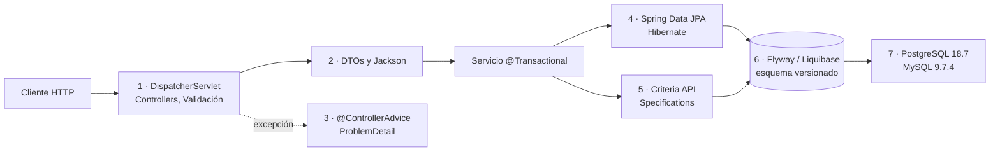
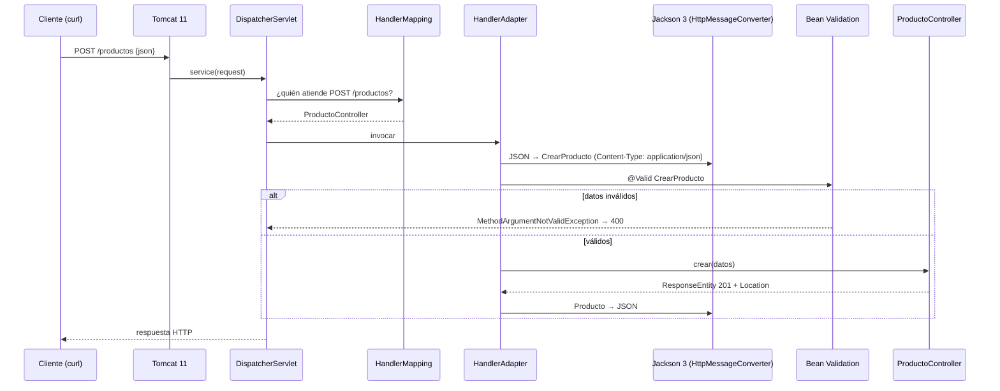
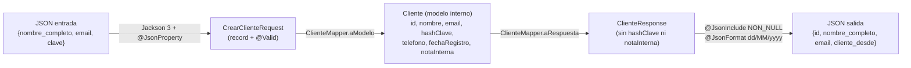
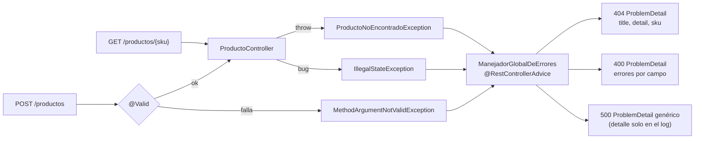
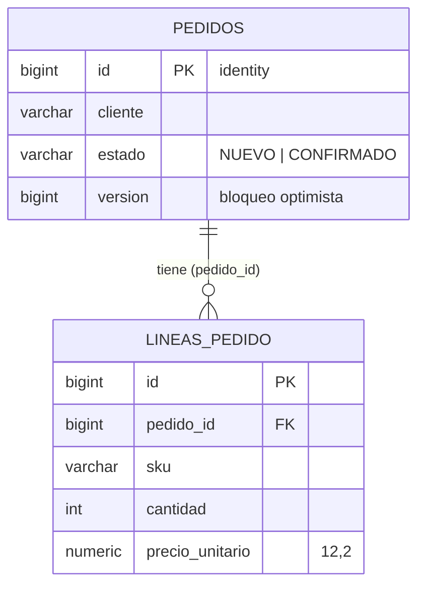
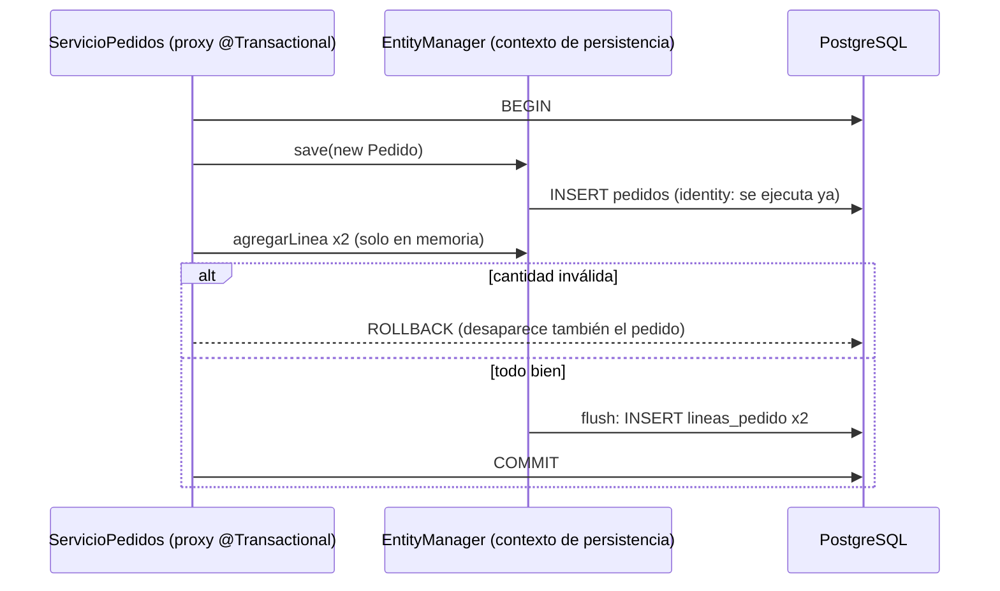
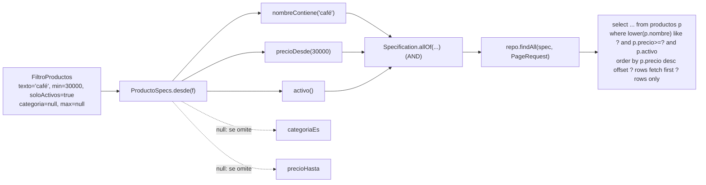
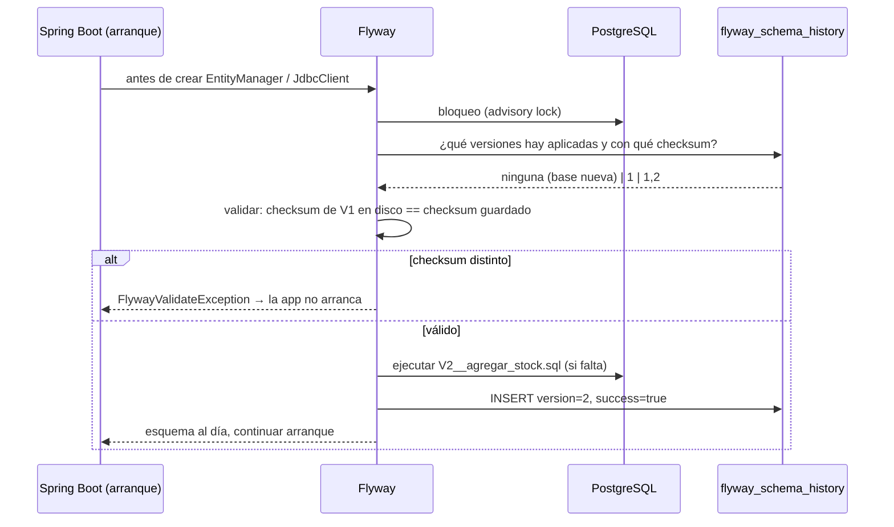
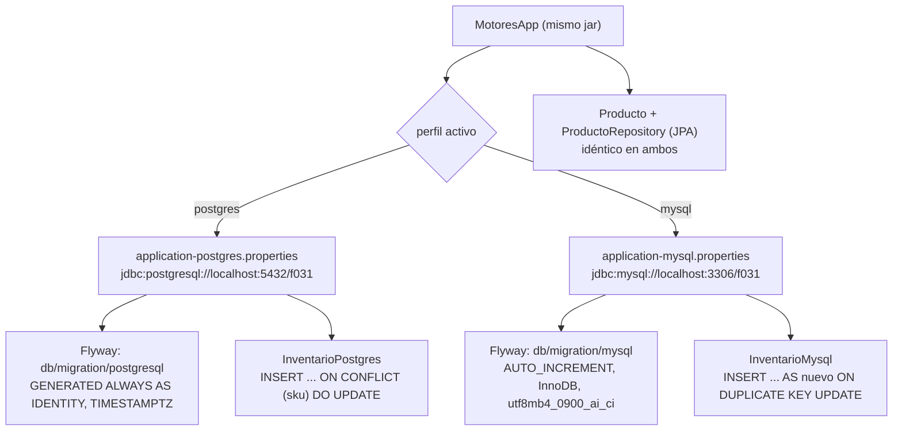

# Módulo 2 · APIs REST y persistencia

**Fase 1 · Spring Boot de cero a experto** (semanas 3 y 4 de 12). **Duración:** 15 h (7 temas de 1,5–3 h).
**Dificultad:** 2 de 5 en Spring MVC y DTOs, 3 de 5 en JPA, consultas dinámicas y migraciones. **Dependencias:**
Módulo 1 completo (records, DI, perfiles) y Módulo 0.4 (HTTP, JSON, `curl`). **Herramientas:**JDK 25 LTS
(25.0.5)**, **Spring Boot 4.1.3** (Spring Framework 7.0.11, Jackson 3, Hibernate ORM 7.4, Spring Data JPA 4.1), Flyway 12.4,
Liquibase 5.0, **PostgreSQL 18.7** y **MySQL 9.7.4 LTS** con Docker Compose, `curl` y `jq` (incluido en macOS 15 o
superior; en Linux, `sudo apt install jq`). **Laboratorio:** `modulo-6` (un subproyecto Gradle
por tema; `./verificar.sh` levanta las bases, ejecuta todos los tests y las apaga).

Aquí tu servicio aprende a hablar HTTP y a recordar: recibe peticiones, valida, responde con contratos estables,
traduce errores a un formato estándar y guarda datos en una base relacional cuyo esquema evoluciona con migraciones
versionadas.



**Texto alternativo:** recorrido de una petición de izquierda a derecha. El cliente HTTP llega al DispatcherServlet
con controladores y validación (tema 1), que convierte el cuerpo en DTOs con Jackson (tema 2); si algo falla, una
flecha punteada lleva al @ControllerAdvice que responde con ProblemDetail (tema 3). Los DTOs pasan a un servicio
transaccional que usa Spring Data JPA con Hibernate (tema 4) y consultas dinámicas con Criteria API y Specifications
(tema 5). Ambos llegan a una base de datos cuyo esquema se versiona con Flyway o Liquibase (tema 6), que puede ser
PostgreSQL 18.7 o MySQL 9.7.4 (tema 7).

---
### Spring MVC: DispatcherServlet, Controllers, Validación

#### 1. UBICACIÓN

Módulo 2, Lección 1 de 7 · Fase 1 · 2,5 h.

#### 2. PRERREQUISITOS

- Módulo 0.4: métodos HTTP (`GET`, `POST`), códigos de estado (200, 201, 400, 404, 415), JSON y `curl`.
- Módulo 1, lecciones 1 y 3: records e inyección por constructor.

#### 3. OBJETIVO DE APRENDIZAJE

**Implementar** un controlador REST con `GET` y `POST` que valida la entrada con Bean Validation y responde `201` con
cabecera `Location`, `400`, `404` y `415` según el caso, y **trazar** el recorrido de una petición desde el
`DispatcherServlet` hasta el método del controlador, comprobándolo con 4 tests de `MockMvc`.

#### 4. ANALOGÍA VISUAL

La **recepción de un hospital**. Todos los pacientes entran por **una sola puerta** con una recepcionista (el
`DispatcherServlet`). Ella mira el motivo de consulta (método + ruta, `POST /productos`) y consulta el **directorio
de consultorios** (los `HandlerMapping`) para saber a qué médico enviarte (el método del controlador). Antes de
pasar, una **enfermera de triaje** revisa que traigas los papeles completos (la validación `@Valid`): si falta algo, te
devuelve con una nota (400) sin molestar al médico. Si pides un consultorio que no existe, te dicen «no está» (404);
si traes los papeles en un idioma que nadie entiende, «no lo podemos leer» (415). En el dibujo: una puerta única, un
mostrador con un directorio, una enfermera con una lista de chequeo y varios consultorios con letreros
`GET /productos/{id}` y `POST /productos`.

#### 5. DIAGRAMA TÉCNICO



**Texto alternativo:** diagrama de secuencia. El cliente envía POST /productos con JSON a Tomcat 11, que lo pasa al
DispatcherServlet. Este pregunta al HandlerMapping quién atiende la ruta y recibe ProductoController#crear. El
HandlerAdapter usa Jackson 3 para convertir el JSON en el record CrearProducto y Bean Validation para validarlo. Si los
datos son inválidos se lanza MethodArgumentNotValidException y se responde 400. Si son válidos se invoca el
controlador, que devuelve 201 con cabecera Location, y Jackson convierte el Producto a JSON para responder al cliente.

#### 6. EXPLICACIÓN NIVEL 0

Una **API REST** es un programa que responde a peticiones HTTP con datos (normalmente JSON). Con Spring MVC escribes
una clase **controlador** y marcas sus métodos con la ruta que atienden: `@GetMapping("/productos/{id}")` significa
«cuando alguien pida `GET /productos/7`, ejecuta este método con `id = 7`». Spring se encarga de leer el JSON que llega,
convertirlo en un objeto Java, **validarlo** con las reglas que escribiste (`@NotBlank`: no puede estar vacío;
`@Positive`: mayor que cero) y convertir tu respuesta otra vez en JSON.

#### 7. EXPLICACIÓN INTERMEDIA

- **DispatcherServlet** es el *front controller*: un único servlet registrado en Tomcat que delega. Sus piezas:
  `HandlerMapping` (ruta → método), `HandlerAdapter` (invoca el método resolviendo argumentos),
  `HttpMessageConverter` (JSON ↔ objeto; con Jackson 3 en Boot 4) y `HandlerExceptionResolver` (excepción → respuesta).
- **Anotaciones:** `@RestController` = `@Controller` + `@ResponseBody` (lo que devuelves es el cuerpo, no una vista).
  `@RequestMapping("/productos")` en la clase fija el prefijo. Argumentos: `@PathVariable` (parte de la ruta),
  `@RequestParam` (`?total=...`), `@RequestBody` (cuerpo JSON), `@RequestHeader`.
- **Respuestas:** devolver un objeto da `200`; `ResponseEntity.created(uri).body(x)` da `201` con `Location`;
  `ResponseStatusException(HttpStatus.NOT_FOUND,...)` da `404`.
- **Validación:** con `spring-boot-starter-validation` (Hibernate Validator 9.1), `@Valid` sobre un `@RequestBody`
  valida antes de llamar al método; si falla, lanza `MethodArgumentNotValidException` y Spring responde `400`. Para
  `@PathVariable`/`@RequestParam` con restricciones (`@Min`), Spring 6.1+ aplica validación de método automáticamente
  y lanza `HandlerMethodValidationException`.
- **Content negotiation:** sin `Content-Type: application/json`, Spring no sabe leer el cuerpo y responde `415`.
- **Pruebas:** `@WebMvcTest(ProductoController.class)` levanta solo la capa web (sin Tomcat real) y `MockMvc` envía
  peticiones simuladas que recorren el `DispatcherServlet` de verdad.

#### 8. EXPLICACIÓN MAESTRA

| Estilo | Fortalezas | Debilidades |
|---|---|---|
| Spring MVC (Servlet, bloqueante) + hilos virtuales | Modelo simple, depuración lineal, ecosistema JDBC/JPA | Cada petición ocupa un hilo mientras espera (mitigado con hilos virtuales, Módulo 1). |
| Spring WebFlux (reactivo) | Streaming, *backpressure*, conexiones largas con pocos hilos | Todo debe ser no bloqueante; curva de aprendizaje y trazas difíciles. |
| Endpoints funcionales (`RouterFunction`) | Rutas como código, fáciles de componer y probar sin anotaciones | Menos conocido por el equipo; más verboso para APIs grandes. |

**Decisiones de diseño REST:** recursos en plural (`/productos`), `POST` crea y devuelve `201` + `Location`, `PUT`
reemplaza y es idempotente, `PATCH` modifica parcialmente, `DELETE` responde `204`. Valida en el borde (DTO) las
reglas de **forma** (obligatorio, rango) y en el dominio las reglas de **negocio** (stock disponible). El
`@WebMvcTest` es rápido porque no levanta la base de datos: por eso el servicio se importa o se simula con
`@MockitoBean`.

**Cuándo NO:** si tu servicio solo emite eventos o consume colas, no necesita la capa web (usa
`spring-boot-starter` a secas). Para comunicación interna de alto volumen entre servicios, gRPC (Módulo 6) puede
convenir más que JSON sobre HTTP.

#### 9. CÓDIGO EJECUTABLE

**Versiones:** JDK 25 LTS · Spring Boot 4.1.3 · `spring-boot-starter-webmvc` (Spring MVC 7, Tomcat 11.0.27, Jackson 3)
· `spring-boot-starter-validation` (Hibernate Validator 9.1.6) · `spring-boot-starter-webmvc-test`.

> **Build con Gradle (y su equivalencia en Maven).** Este laboratorio se construye con **Gradle 9.9.2** y Kotlin DSL
> mediante el wrapper `./gradlew` (no instalas Gradle). `settings.gradle.kts` lista los subproyectos (en Maven,
> `<modules>` del POM agregador), cada carpeta tiene su `build.gradle.kts` (su `pom.xml`) y
> `gradle/libs.versions.toml` es el **catálogo de versiones** (las `<properties>` y el `dependencyManagement`): por eso
> las dependencias se escriben `libs.…`. Equivalencias: `./mvnw test` → `./gradlew test` ·
> `./mvnw package -DskipTests` → `./gradlew bootJar` · `./mvnw spring-boot:run` → `./gradlew bootRun` ·
> `-Dtest=Clase` → `--tests Clase` · `target/` → `build/` (el jar queda en `build/libs/`). Gradle escribe una línea
> `PASSED` por test y termina con `BUILD SUCCESSFUL` (Maven: `Tests run: N` y `BUILD SUCCESS`).

`modulo-6/settings.gradle.kts`:

```kotlin
// Módulo 2 (modulo-6) · Build multi-proyecto: "./gradlew test" ejecuta los tests de todas las fichas.
// Las fichas F028–F031 necesitan "docker compose up -d --wait" antes de los tests.
// Cada carpeta tiene su propio build.gradle.kts; las versiones viven en gradle/libs.versions.toml
// (catálogo "libs"). Equivale al POM agregador con <modules> de Maven.
pluginManagement {
    repositories {
        gradlePluginPortal()
        mavenCentral()
    }
}
// Sin esto, un alumno sin JDK 25 instalado ve el build morir en la configuración, antes de cualquier test.
plugins {
    id("org.gradle.toolchains.foojay-resolver-convention") version "1.0.0"
}

dependencyResolutionManagement {
    repositories {
        mavenCentral()
    }
}

rootProject.name = "modulo-6-laboratorios"

include(
    "f025-spring-mvc",
    "f026-dtos-jackson",
    "f027-controller-advice",
    "f028-jpa",
    "f029-criteria-specifications",
    "f030-flyway",
    "f030-liquibase",
    "f031-postgresql-mysql",
)
```

`modulo-6/gradle/libs.versions.toml`:

```toml
# Módulo 2 (modulo-6)
# Catálogo de versiones del laboratorio: una sola fuente para plugins y librerías.
# Las librerías SIN versión las fija el BOM de Spring Boot (spring-boot-dependencies) o el BOM que importe el proyecto.

[versions]
spring-boot = "4.1.3"

[libraries]
spring-boot-starter-webmvc = { module = "org.springframework.boot:spring-boot-starter-webmvc" }
spring-boot-starter-validation = { module = "org.springframework.boot:spring-boot-starter-validation" }
spring-boot-starter-webmvc-test = { module = "org.springframework.boot:spring-boot-starter-webmvc-test" }
junit-platform-launcher = { module = "org.junit.platform:junit-platform-launcher" }
spring-boot-starter-data-jpa = { module = "org.springframework.boot:spring-boot-starter-data-jpa" }
postgresql = { module = "org.postgresql:postgresql" }
spring-boot-starter-test = { module = "org.springframework.boot:spring-boot-starter-test" }
spring-boot-starter-jdbc = { module = "org.springframework.boot:spring-boot-starter-jdbc" }
spring-boot-starter-flyway = { module = "org.springframework.boot:spring-boot-starter-flyway" }
flyway-database-postgresql = { module = "org.flywaydb:flyway-database-postgresql" }
spring-boot-starter-liquibase = { module = "org.springframework.boot:spring-boot-starter-liquibase" }
flyway-mysql = { module = "org.flywaydb:flyway-mysql" }
mysql-connector-j = { module = "com.mysql:mysql-connector-j" }

[plugins]
spring-boot = { id = "org.springframework.boot", version.ref = "spring-boot" }
spring-dependency-management = { id = "io.spring.dependency-management", version = "1.1.7" }
```

`modulo-6/f025-spring-mvc/build.gradle.kts`:

```kotlin
// F025 · Spring MVC: DispatcherServlet, Controllers, Validación
plugins {
    java
    alias(libs.plugins.spring.boot)
    alias(libs.plugins.spring.dependency.management)
}

group = "academia.microservicios"
version = "1.0.0"

java {
    toolchain {
        languageVersion = JavaLanguageVersion.of(25)
    }
}

dependencies {
    // Spring MVC + Tomcat 11 + Jackson 3
    implementation(libs.spring.boot.starter.webmvc)
    // Bean Validation (Hibernate Validator 9)
    implementation(libs.spring.boot.starter.validation)
    // MockMvc, JUnit 6, AssertJ
    testImplementation(libs.spring.boot.starter.webmvc.test)
    // Gradle 9 exige declarar el lanzador de JUnit Platform (ya no lo añade por su cuenta)
    testRuntimeOnly(libs.junit.platform.launcher)
}

tasks.withType<Test> {
    useJUnitPlatform()
    testLogging {
        events("passed", "skipped", "failed")   // una línea por test en la consola
        // el mensaje completo de cada fallo (valor esperado y obtenido), no solo el tipo de excepción
        exceptionFormat = org.gradle.api.tasks.testing.logging.TestExceptionFormat.FULL
    }
}
```

`modulo-6/f025-spring-mvc/src/main/java/academia/mvc/MvcApp.java`:

```java
package academia.mvc;

import org.springframework.boot.SpringApplication;
import org.springframework.boot.autoconfigure.SpringBootApplication;

@SpringBootApplication
public class MvcApp {
    public static void main(String[] args) {
        SpringApplication.run(MvcApp.class, args);
    }
}
```

`modulo-6/f025-spring-mvc/src/main/java/academia/mvc/CrearProducto.java`:

```java
package academia.mvc;

import jakarta.validation.constraints.NotBlank;
import jakarta.validation.constraints.Positive;
import jakarta.validation.constraints.Size;
import java.math.BigDecimal;

/** Cuerpo de POST /productos. Las anotaciones son las reglas que @Valid comprueba. */
public record CrearProducto(
        @NotBlank @Size(max = 80) String nombre,
        @Positive BigDecimal precio) { }
```

`modulo-6/f025-spring-mvc/src/main/java/academia/mvc/Producto.java`:

```java
package academia.mvc;

import java.math.BigDecimal;

public record Producto(long id, String nombre, BigDecimal precio) { }
```

`modulo-6/f025-spring-mvc/src/main/java/academia/mvc/Catalogo.java`:

```java
package academia.mvc;

import java.util.List;
import java.util.Map;
import java.util.Optional;
import java.util.concurrent.ConcurrentHashMap;
import java.util.concurrent.atomic.AtomicLong;
import org.springframework.stereotype.Service;

/** Almacén en memoria (la persistencia real llega en F028). Seguro para varios hilos. */
@Service
public class Catalogo {
    private final Map<Long, Producto> productos = new ConcurrentHashMap<>();
    private final AtomicLong secuencia = new AtomicLong();

    public Producto crear(CrearProducto datos) {
        long id = secuencia.incrementAndGet();
        Producto nuevo = new Producto(id, datos.nombre(), datos.precio());
        productos.put(id, nuevo);
        return nuevo;
    }

    public Optional<Producto> buscar(long id) { return Optional.ofNullable(productos.get(id)); }

    public List<Producto> todos() { return List.copyOf(productos.values()); }
}
```

`modulo-6/f025-spring-mvc/src/main/java/academia/mvc/ProductoController.java`:

```java
package academia.mvc;

import jakarta.validation.Valid;
import java.net.URI;
import java.util.List;
import org.springframework.http.HttpStatus;
import org.springframework.http.ResponseEntity;
import org.springframework.web.bind.annotation.GetMapping;
import org.springframework.web.bind.annotation.PathVariable;
import org.springframework.web.bind.annotation.PostMapping;
import org.springframework.web.bind.annotation.RequestBody;
import org.springframework.web.bind.annotation.RequestMapping;
import org.springframework.web.bind.annotation.RestController;
import org.springframework.web.server.ResponseStatusException;

/**
 * El DispatcherServlet recibe TODAS las peticiones y, según método + ruta,
 * elige uno de estos métodos (handler). Jackson convierte JSON <-> records.
 */
@RestController
@RequestMapping("/productos")
class ProductoController {

    private final Catalogo catalogo;

    ProductoController(Catalogo catalogo) { this.catalogo = catalogo; }

    @PostMapping
    ResponseEntity<Producto> crear(@Valid @RequestBody CrearProducto datos) {
        Producto creado = catalogo.crear(datos);
        return ResponseEntity.created(URI.create("/productos/" + creado.id())).body(creado);
    }

    @GetMapping("/{id}")
    Producto buscar(@PathVariable long id) {
        return catalogo.buscar(id)
            .orElseThrow(() -> new ResponseStatusException(HttpStatus.NOT_FOUND, "No existe el producto " + id));
    }

    @GetMapping
    List<Producto> listar() { return catalogo.todos(); }
}
```

#### 10. MINI-LABORATORIO

1. Arranca la API:

```bash
../gradlew -q bootRun
```

   Espera la línea `Tomcat started on port 8080 (http)` y abre otra terminal.

2. Crea un producto y lee el código y la cabecera `Location`:

```bash
curl -s -o /dev/null -w "%{http_code} %header{location}\n" -X POST localhost:8080/productos \
  -H "Content-Type: application/json" -d '{"nombre":"Café de Huila","precio":32000}'
curl -s localhost:8080/productos/1 | jq -cS .
```

   **Output esperado:**

```text
201 /productos/1
{"id":1,"nombre":"Café de Huila","precio":32000}
```

3. Prueba los errores:

```bash
curl -s -o /dev/null -w "%{http_code}\n" -X POST localhost:8080/productos \
  -H "Content-Type: application/json" -d '{"nombre":"","precio":-5}'
curl -s -o /dev/null -w "%{http_code}\n" localhost:8080/productos/999
curl -s -o /dev/null -w "%{http_code}\n" -X POST localhost:8080/productos -d 'nombre=Cafe'
```

   **Output esperado:**

```text
400
404
415
```

   **Captura comentada:** en la terminal de la app, el `400` y el `415` dejan una línea `WARN` de
   `DefaultHandlerExceptionResolver` que nombra la excepción resuelta (`MethodArgumentNotValidException` con los
   campos inválidos y `HttpMediaTypeNotSupportedException`). Ninguno llegó a ejecutar `Catalogo.crear`.

4. **Fallo deliberado:** quita `@Valid` del parámetro de `crear`, reinicia y repite el primer `curl` del paso 3: ahora
   responde `201` y guarda un producto sin nombre y con precio negativo. Restaura `@Valid`.

#### 11. VERIFICACIÓN

`modulo-6/f025-spring-mvc/src/test/java/academia/mvc/ProductoControllerTest.java`:

```java
package academia.mvc;

import static org.springframework.test.web.servlet.request.MockMvcRequestBuilders.get;
import static org.springframework.test.web.servlet.request.MockMvcRequestBuilders.post;
import static org.springframework.test.web.servlet.result.MockMvcResultMatchers.header;
import static org.springframework.test.web.servlet.result.MockMvcResultMatchers.jsonPath;
import static org.springframework.test.web.servlet.result.MockMvcResultMatchers.status;

import org.junit.jupiter.api.Test;
import org.springframework.beans.factory.annotation.Autowired;
import org.springframework.boot.webmvc.test.autoconfigure.WebMvcTest;
import org.springframework.context.annotation.Import;
import org.springframework.http.MediaType;
import org.springframework.test.web.servlet.MockMvc;

/** @WebMvcTest levanta solo la capa web: DispatcherServlet, el controlador y Jackson. */
@WebMvcTest(ProductoController.class)
@Import(Catalogo.class)
class ProductoControllerTest {

    @Autowired
    MockMvc mvc;

    @Test
    void creaUnProductoValidoYDevuelve201ConLocation() throws Exception {
        mvc.perform(post("/productos").contentType(MediaType.APPLICATION_JSON)
                .content("{\"nombre\":\"Café de Huila\",\"precio\":32000}"))
            .andExpect(status().isCreated())
            .andExpect(header().string("Location", "/productos/1"))
            .andExpect(jsonPath("$.nombre").value("Café de Huila"));
    }

    @Test
    void rechazaDatosInvalidosCon400SinLlegarAlCatalogo() throws Exception {
        mvc.perform(post("/productos").contentType(MediaType.APPLICATION_JSON)
                .content("{\"nombre\":\"\",\"precio\":-5}"))
            .andExpect(status().isBadRequest());
    }

    @Test
    void unIdInexistenteDa404() throws Exception {
        mvc.perform(get("/productos/999")).andExpect(status().isNotFound());
    }

    @Test
    void sinContentTypeJsonDa415() throws Exception {
        mvc.perform(post("/productos").content("nombre=Cafe"))
            .andExpect(status().isUnsupportedMediaType());
    }
}
```

```bash
../gradlew test
```

**Output esperado:** 4 líneas `PASSED` (una por test) y `BUILD SUCCESSFUL` *(salida de Gradle verificada en el Mac del dueño el 2026-11-21 con Gradle 9.9.2, Java 25.0.5.1 autoaprovisto y Docker Compose v5.7.1)*.

**Pregunta de comprobación:** ¿qué componente decide que `GET /productos/999` lo atiende `buscar` y qué componente
convierte la `ResponseStatusException` en un `404`?

<details>
<summary>Respuesta</summary>

Un `HandlerMapping` (`RequestMappingHandlerMapping`, que leyó las anotaciones `@GetMapping`) elige el método; un
`HandlerExceptionResolver` (`ResponseStatusExceptionResolver`) traduce la excepción en el código de estado. Ambos los
coordina el `DispatcherServlet`.
</details>

#### 12. ERROR COMÚN

**Síntoma:** el cliente (un formulario o un `curl` sin cabeceras) recibe `415 Unsupported Media Type` y el
controlador nunca se ejecuta.

**Cómo se ve:** en el log de la app:

```text
WARN ... o.s.w.s.m.s.DefaultHandlerExceptionResolver : Resolved [org.springframework.web.HttpMediaTypeNotSupportedException: Content-Type 'application/x-www-form-urlencoded;charset=UTF-8' is not supported]
```

**Diagnóstico:** `curl -d` sin `-H` envía `application/x-www-form-urlencoded`. `@RequestBody` solo sabe leer los tipos
para los que hay un `HttpMessageConverter` (JSON aquí). El mensaje te dice qué `Content-Type` llegó.

**Arreglo:** el cliente debe enviar `Content-Type: application/json`. Si de verdad quieres aceptar formularios, usa
`@ModelAttribute` o declara `consumes = MediaType.APPLICATION_FORM_URLENCODED_VALUE` en otro método.

#### 13. PREGUNTA DE ENTREVISTA

«¿Qué hace el `DispatcherServlet` y por qué `@WebMvcTest` es más rápido que `@SpringBootTest`?»

**Respuesta modelo:** el `DispatcherServlet` es el *front controller* de Spring MVC: recibe todas las peticiones del
contenedor de servlets, usa los `HandlerMapping` para elegir el método del controlador, los `HandlerAdapter` para
invocarlo resolviendo argumentos (incluida la conversión con los `HttpMessageConverter` y la validación), y los
`HandlerExceptionResolver` para traducir excepciones en respuestas. `@WebMvcTest` crea un contexto con solo esa
infraestructura y los controladores indicados, sin servidor real ni base de datos, y `MockMvc` invoca el
`DispatcherServlet` en memoria; `@SpringBootTest` carga la aplicación completa. Uso `@WebMvcTest` para contrato HTTP
y validación, y `@SpringBootTest` para unos pocos flujos de extremo a extremo.

#### 14. ANTI-PATRÓN RELACIONADO

**Controlador gordo** que valida a mano, accede a la base y arma respuestas de error:

```java
@PostMapping("/productos")
ResponseEntity<?> crear(@RequestBody Map<String, Object> cuerpo) {
    if (cuerpo.get("nombre") == null || cuerpo.get("nombre").toString().isBlank()) {
        return ResponseEntity.badRequest().body("nombre requerido");          // formato de error inventado
    }
    jdbcTemplate.update("INSERT INTO productos ...", cuerpo.get("nombre"));   // SQL en el controlador
    return ResponseEntity.ok("creado");                                       // 200 en vez de 201
}
```

`Map` sin tipos, reglas duplicadas en cada endpoint, códigos HTTP incorrectos y lógica imposible de probar sin HTTP.
El controlador traduce HTTP ↔ dominio: DTO validado con `@Valid`, una llamada a un servicio y el código correcto.

---
### DTOs, @JsonProperty, Jackson

#### 1. UBICACIÓN

Módulo 2, Lección 2 de 7 · Fase 1 · 2 h.

#### 2. PRERREQUISITOS

- Lección 1 de este módulo: `@RestController`, `@RequestBody`, `@Valid`.
- Módulo 0.4: estructura de un JSON (objetos, campos, `null`).
- Módulo 1, lección 1: records.

#### 3. OBJETIVO DE APRENDIZAJE

**Diseñar** DTOs de entrada y salida separados del modelo interno, **controlar** con anotaciones de Jackson el nombre
(`@JsonProperty`), la presencia (`@JsonInclude`) y el formato (`@JsonFormat`) de cada campo, y **demostrar** con 3 tests
que la API nunca expone la clave ni los datos internos del cliente.

#### 4. ANALOGÍA VISUAL

La **ventanilla de un banco con formularios**. Dentro del banco hay un **expediente completo** del cliente (el modelo
interno: hash de la clave, notas del asesor). Por la ventanilla nunca pasa el expediente: el cliente llena un
**formulario de solicitud** (DTO de entrada) con casillas fijas, y recibe un **comprobante impreso** (DTO de salida)
que muestra solo lo que debe ver. Jackson es el **traductor** que convierte el formulario en papel (JSON) en datos
dentro del sistema y al revés; las anotaciones son las **instrucciones al traductor**: «la casilla `nombre_completo`
del papel corresponde al dato `nombreCompleto`», «si el teléfono está vacío, no imprimas la línea», «la fecha va como
día/mes/año». En el dibujo, el expediente grueso se queda detrás del vidrio y por la ranura solo pasan dos hojas
delgadas.

#### 5. DIAGRAMA TÉCNICO



**Texto alternativo:** flujo de izquierda a derecha. Un JSON de entrada con nombre_completo, email y clave se
convierte con Jackson 3 y @JsonProperty en el record CrearClienteRequest, que se valida. ClienteMapper lo transforma en
el modelo interno Cliente, que tiene id, nombre, email, hash de la clave, teléfono, fecha de registro y nota interna.
Otro método del mapper produce ClienteResponse, sin hash ni nota interna, que Jackson escribe como JSON de salida
omitiendo nulos y formateando la fecha como dd/MM/yyyy.

#### 6. EXPLICACIÓN NIVEL 0

Un **DTO** (*Data Transfer Object*) es un objeto cuyo único trabajo es **llevar datos de un lado a otro** (entre tu
API y quien la llama). Se separa del modelo interno por dos razones: **seguridad** (el modelo tiene datos que nunca
deben salir, como el hash de una contraseña) y **estabilidad** (puedes cambiar tu base de datos sin romper a los
clientes de tu API). **Jackson** es la librería que convierte objetos Java en JSON y JSON en objetos Java; con
anotaciones le dices cómo hacerlo.

#### 7. EXPLICACIÓN INTERMEDIA

- **Jackson 3 en Spring Boot 4:** el motor está en `tools.jackson.*` (`JsonMapper`, `JacksonException` ya no es
  *checked*); las **anotaciones** siguen en `com.fasterxml.jackson.annotation` porque se comparten con Jackson 2. Boot
  crea un bean `JsonMapper` configurable con `spring.jackson.*` o un `JsonMapperBuilderCustomizer`.
- **Records:** Jackson los serializa por sus componentes y los deserializa por su constructor canónico; las anotaciones
  se ponen en el componente (`@JsonProperty("nombre_completo") String nombreCompleto`).
- **Anotaciones clave:** `@JsonProperty` (nombre en el JSON), `@JsonInclude(NON_NULL)` (omite nulos),
  `@JsonFormat(pattern =...)` (fechas y números), `@JsonIgnore` (excluye un campo), `@JsonIgnoreProperties` y
  `@JsonAlias` (acepta nombres alternativos al leer). Para todo el servicio, `spring.jackson.property-naming-strategy=SNAKE_CASE`
  cambia la convención sin anotar campo por campo.
- **Valores por defecto de Jackson 3 que debes conocer:** las fechas `java.time` se escriben como texto ISO-8601 (no
  números), un `null` en un campo primitivo (`int`) hace fallar la lectura, y las propiedades desconocidas se ignoran
  (en el test, `nombreCompleto` en camelCase se ignora y por eso `@NotBlank` responde 400).
- **Mapper:** una clase con métodos estáticos (o MapStruct, que genera el código al compilar) concentra la traducción
  modelo ↔ DTO en un solo lugar.

#### 8. EXPLICACIÓN MAESTRA

| Estrategia | A favor | En contra |
|---|---|---|
| DTOs explícitos + mapper manual (este tema) | Contrato visible, sin magia, versionable (`ClienteResponseV2`) | Código repetitivo de mapeo. |
| MapStruct | Mapeo generado al compilar, rápido y verificado por el compilador | Otra dependencia y *annotation processor*; los mapeos complejos se vuelven anotaciones crípticas. |
| Exponer la entidad JPA directamente | Cero código extra | Filtra campos internos, *lazy loading* durante la serialización, ciclos infinitos en relaciones bidireccionales y el esquema de la BD se vuelve tu contrato público. |
| `@JsonView` sobre un único modelo | Un solo tipo con varias «vistas» | Fácil equivocarse de vista; el modelo se llena de anotaciones de presentación. |

**Contrato primero:** en microservicios el DTO **es** el contrato con otros equipos. Cambiar un nombre de campo es un
*breaking change*: añade campos nuevos como opcionales, nunca renombres ni cambies tipos sin versionar (Módulo 3,
contract testing con Pact). Si generas los DTOs desde un OpenAPI, el contrato manda y el código lo sigue.

**Cuándo NO separar:** en un prototipo interno o un CRUD administrativo sin consumidores externos, un único record que
sirve de entrada y salida puede bastar; nunca expongas entidades JPA ni siquiera ahí.

#### 9. CÓDIGO EJECUTABLE

**Versiones:** JDK 25 LTS · Spring Boot 4.1.3 · Jackson 3.1 (`tools.jackson.core:jackson-databind` 3.1.8, anotaciones
`com.fasterxml.jackson.annotation` 2.21) · Hibernate Validator 9.1.6.

`modulo-6/f026-dtos-jackson/build.gradle.kts`:

```kotlin
// F026 · DTOs, @JsonProperty, Jackson
plugins {
    java
    alias(libs.plugins.spring.boot)
    alias(libs.plugins.spring.dependency.management)
}

group = "academia.microservicios"
version = "1.0.0"

java {
    toolchain {
        languageVersion = JavaLanguageVersion.of(25)
    }
}

dependencies {
    // Spring MVC + Tomcat 11 + Jackson 3
    implementation(libs.spring.boot.starter.webmvc)
    // Bean Validation (Hibernate Validator 9)
    implementation(libs.spring.boot.starter.validation)
    // MockMvc, JUnit 6, AssertJ
    testImplementation(libs.spring.boot.starter.webmvc.test)
    // Gradle 9 exige declarar el lanzador de JUnit Platform (ya no lo añade por su cuenta)
    testRuntimeOnly(libs.junit.platform.launcher)
}

tasks.withType<Test> {
    useJUnitPlatform()
    testLogging {
        events("passed", "skipped", "failed")   // una línea por test en la consola
        // el mensaje completo de cada fallo (valor esperado y obtenido), no solo el tipo de excepción
        exceptionFormat = org.gradle.api.tasks.testing.logging.TestExceptionFormat.FULL
    }
}
```

`modulo-6/f026-dtos-jackson/src/main/java/academia/dto/Cliente.java`:

```java
package academia.dto;

import java.time.LocalDate;

/**
 * Modelo INTERNO (en F028 será una entidad JPA). Tiene datos que jamás deben
 * salir por la API: el hash de la clave y una nota interna.
 */
public class Cliente {
    private final long id;
    private final String nombreCompleto;
    private final String email;
    private final String hashClave;
    private final String telefono;
    private final LocalDate fechaRegistro;
    private final String notaInterna;

    public Cliente(long id, String nombreCompleto, String email, String hashClave,
                   String telefono, LocalDate fechaRegistro, String notaInterna) {
        this.id = id;
        this.nombreCompleto = nombreCompleto;
        this.email = email;
        this.hashClave = hashClave;
        this.telefono = telefono;
        this.fechaRegistro = fechaRegistro;
        this.notaInterna = notaInterna;
    }

    public long getId() { return id; }
    public String getNombreCompleto() { return nombreCompleto; }
    public String getEmail() { return email; }
    public String getHashClave() { return hashClave; }
    public String getTelefono() { return telefono; }
    public LocalDate getFechaRegistro() { return fechaRegistro; }
    public String getNotaInterna() { return notaInterna; }
}
```

`modulo-6/f026-dtos-jackson/src/main/java/academia/dto/CrearClienteRequest.java`:

```java
package academia.dto;

import com.fasterxml.jackson.annotation.JsonProperty;
import jakarta.validation.constraints.Email;
import jakarta.validation.constraints.NotBlank;
import jakarta.validation.constraints.Size;

/** DTO de ENTRADA: solo lo que el cliente HTTP puede enviar. El JSON usa snake_case. */
public record CrearClienteRequest(
        @JsonProperty("nombre_completo") @NotBlank String nombreCompleto,
        @Email @NotBlank String email,
        @Size(min = 8) String clave,
        String telefono) { }
```

`modulo-6/f026-dtos-jackson/src/main/java/academia/dto/ClienteResponse.java`:

```java
package academia.dto;

import com.fasterxml.jackson.annotation.JsonFormat;
import com.fasterxml.jackson.annotation.JsonInclude;
import com.fasterxml.jackson.annotation.JsonProperty;
import java.time.LocalDate;

/** DTO de SALIDA: el contrato público. No tiene hashClave ni notaInterna. */
@JsonInclude(JsonInclude.Include.NON_NULL)          // los campos null no se escriben
public record ClienteResponse(
        long id,
        @JsonProperty("nombre_completo") String nombreCompleto,
        String email,
        String telefono,
        @JsonProperty("cliente_desde") @JsonFormat(pattern = "dd/MM/yyyy") LocalDate fechaRegistro) { }
```

`modulo-6/f026-dtos-jackson/src/main/java/academia/dto/ClienteMapper.java`:

```java
package academia.dto;

import java.time.LocalDate;

/** Traduce entre el modelo interno y los DTO. Un solo lugar para decidir qué sale. */
public final class ClienteMapper {
    private ClienteMapper() { }

    public static Cliente aModelo(long id, CrearClienteRequest req, String hashClave, LocalDate hoy) {
        return new Cliente(id, req.nombreCompleto(), req.email(), hashClave, req.telefono(), hoy, "nuevo");
    }

    public static ClienteResponse aRespuesta(Cliente c) {
        return new ClienteResponse(c.getId(), c.getNombreCompleto(), c.getEmail(), c.getTelefono(), c.getFechaRegistro());
    }
}
```

`modulo-6/f026-dtos-jackson/src/main/java/academia/dto/ClienteController.java`:

```java
package academia.dto;

import jakarta.validation.Valid;
import java.time.LocalDate;
import java.util.HexFormat;
import java.util.concurrent.atomic.AtomicLong;
import org.springframework.http.HttpStatus;
import org.springframework.web.bind.annotation.PostMapping;
import org.springframework.web.bind.annotation.RequestBody;
import org.springframework.web.bind.annotation.ResponseStatus;
import org.springframework.web.bind.annotation.RestController;

@RestController
class ClienteController {
    private final AtomicLong secuencia = new AtomicLong();

    @PostMapping("/clientes")
    @ResponseStatus(HttpStatus.CREATED)
    ClienteResponse crear(@Valid @RequestBody CrearClienteRequest req) {
        // Solo para el ejemplo: en el Módulo 9 se usa un PasswordEncoder real.
        String hash = HexFormat.of().formatHex(req.clave().getBytes()).substring(0, 8);
        Cliente cliente = ClienteMapper.aModelo(secuencia.incrementAndGet(), req, hash, LocalDate.of(2026, 11, 19));
        return ClienteMapper.aRespuesta(cliente);
    }
}
```

`modulo-6/f026-dtos-jackson/src/main/java/academia/dto/DtoApp.java`:

```java
package academia.dto;

import org.springframework.boot.SpringApplication;
import org.springframework.boot.autoconfigure.SpringBootApplication;

@SpringBootApplication
public class DtoApp {
    public static void main(String[] args) {
        SpringApplication.run(DtoApp.class, args);
    }
}
```

#### 10. MINI-LABORATORIO

1. Arranca la API:

```bash
../gradlew -q bootRun
```

2. En otra terminal, crea un cliente con JSON en *snake_case*:

```bash
curl -s -X POST localhost:8080/clientes -H "Content-Type: application/json" \
  -d '{"nombre_completo":"Ana Pérez","email":"ana@correo.co","clave":"secreta123"}' | jq -cS .
```

   **Output esperado:**

```text
{"cliente_desde":"19/11/2026","email":"ana@correo.co","id":1,"nombre_completo":"Ana Pérez"}
```

   **Captura comentada:** `jq -S` ordena las claves para que la salida sea comparable. No aparecen `clave`,
   `hashClave` ni `notaInterna` (no existen en el DTO de salida) ni `telefono` (era `null` y `@JsonInclude(NON_NULL)` lo
   omite); la fecha usa el patrón de `@JsonFormat`.

3. Ahora con teléfono:

```bash
curl -s -X POST localhost:8080/clientes -H "Content-Type: application/json" \
  -d '{"nombre_completo":"Beto Ruiz","email":"beto@correo.co","clave":"secreta123","telefono":"3001234567"}' | jq -r .telefono
```

   **Output esperado:** `3001234567`.

4. **Fallo deliberado:** envía el nombre en *camelCase*:

```bash
curl -s -o /dev/null -w "%{http_code}\n" -X POST localhost:8080/clientes -H "Content-Type: application/json" \
  -d '{"nombreCompleto":"Ana","email":"ana@correo.co","clave":"secreta123"}'
```

   **Output esperado:** `400`. Jackson ignoró `nombreCompleto` (no coincide con `nombre_completo`), el campo quedó
   `null` y `@NotBlank` lo rechazó.

#### 11. VERIFICACIÓN

`modulo-6/f026-dtos-jackson/src/test/java/academia/dto/ClienteJsonTest.java`:

```java
package academia.dto;

import static org.assertj.core.api.Assertions.assertThat;
import static org.springframework.test.web.servlet.request.MockMvcRequestBuilders.post;
import static org.springframework.test.web.servlet.result.MockMvcResultMatchers.jsonPath;
import static org.springframework.test.web.servlet.result.MockMvcResultMatchers.status;

import java.time.LocalDate;
import org.junit.jupiter.api.Test;
import org.springframework.beans.factory.annotation.Autowired;
import org.springframework.boot.test.context.SpringBootTest;
import org.springframework.boot.webmvc.test.autoconfigure.AutoConfigureMockMvc;
import org.springframework.http.MediaType;
import org.springframework.test.web.servlet.MockMvc;
import tools.jackson.databind.json.JsonMapper;

@SpringBootTest
@AutoConfigureMockMvc
class ClienteJsonTest {

    @Autowired
    MockMvc mvc;

    @Autowired
    JsonMapper mapper;   // el mismo JsonMapper (Jackson 3) que usa Spring MVC

    @Test
    void elDtoDeSalidaRenombraYOmiteNulos() {
        var dto = new ClienteResponse(1, "Ana Pérez", "ana@correo.co", null, LocalDate.of(2026, 11, 19));
        String json = mapper.writeValueAsString(dto);
        assertThat(json).contains("\"nombre_completo\":\"Ana Pérez\"")
            .contains("\"cliente_desde\":\"19/11/2026\"")
            .doesNotContain("telefono");
    }

    @Test
    void laApiNuncaDevuelveLaClaveNiDatosInternos() throws Exception {
        mvc.perform(post("/clientes").contentType(MediaType.APPLICATION_JSON)
                .content("""
                    {"nombre_completo":"Ana Pérez","email":"ana@correo.co","clave":"secreta123"}
                    """))
            .andExpect(status().isCreated())
            .andExpect(jsonPath("$.nombre_completo").value("Ana Pérez"))
            .andExpect(jsonPath("$.clave").doesNotExist())
            .andExpect(jsonPath("$.hashClave").doesNotExist())
            .andExpect(jsonPath("$.notaInterna").doesNotExist());
    }

    @Test
    void sinJsonPropertyElCampoNoSeLlenaYLaValidacionLoRechaza() throws Exception {
        // "nombreCompleto" (camelCase) no coincide con "nombre_completo": llega null y @NotBlank falla.
        mvc.perform(post("/clientes").contentType(MediaType.APPLICATION_JSON)
                .content("{\"nombreCompleto\":\"Ana\",\"email\":\"ana@correo.co\",\"clave\":\"secreta123\"}"))
            .andExpect(status().isBadRequest());
    }
}
```

```bash
../gradlew test
```

**Output esperado:** 3 líneas `PASSED` (una por test) y `BUILD SUCCESSFUL` *(salida de Gradle verificada en el Mac del dueño el 2026-11-21 con Gradle 9.9.2, Java 25.0.5.1 autoaprovisto y Docker Compose v5.7.1)*.

**Pregunta de comprobación:** si mañana el equipo añade `saldo` al modelo `Cliente`, ¿aparece en la respuesta de
`POST /clientes`? ¿Por qué?

<details>
<summary>Respuesta</summary>

No. La respuesta se construye con `ClienteResponse`, que no tiene `saldo`; para exponerlo hay que cambiar a propósito
el DTO y el mapper. Esa es la protección que da separar modelo y contrato.
</details>

#### 12. ERROR COMÚN

**Síntoma:** copias un ejemplo de internet con `ObjectMapper` en un proyecto Spring Boot 4 y no compila.

**Cómo se ve** (salida real de `javac` 25 cuando Jackson 2 no está en el classpath, como ocurre en un proyecto Boot 4; Gradle la muestra tal cual, bajo `> Task:compileJava FAILED`):

```text
academia/dto/Viejo.java:3: error: package com.fasterxml.jackson.databind does not exist
import com.fasterxml.jackson.databind.ObjectMapper;
                                     ^
```

**Diagnóstico:** ese paquete es de Jackson 2. Spring Boot 4 usa Jackson 3, cuyo paquete es `tools.jackson.databind`;
solo las anotaciones (`com.fasterxml.jackson.annotation`) conservan el nombre antiguo.

**Arreglo:** cambia el import a `tools.jackson.databind.json.JsonMapper` (o `tools.jackson.databind.ObjectMapper`) e
inyecta el bean que configura Boot en vez de crear uno con `new`. Si migras un proyecto grande,
`spring.jackson.use-jackson2-defaults=true` alinea temporalmente los valores por defecto con los de Jackson 2.

#### 13. PREGUNTA DE ENTREVISTA

«¿Por qué no devolverías una entidad JPA directamente desde un controlador REST?»

**Respuesta modelo:** porque mezcla tres responsabilidades. Seguridad: la entidad tiene campos que no deben salir
(hashes, notas, *flags* internos) y basta añadir uno para filtrarlo sin darte cuenta. Estabilidad: el esquema de la
base pasa a ser el contrato público, y un cambio de columna rompe a los consumidores. Técnica: Jackson recorre
relaciones *lazy* fuera de la transacción (`LazyInitializationException` o consultas N+1 ocultas) y las relaciones
bidireccionales generan recursión infinita. Uso DTOs de entrada y salida, un mapper explícito o MapStruct, y versiono
los DTOs cuando el contrato cambia de forma incompatible.

#### 14. ANTI-PATRÓN RELACIONADO

**El mismo objeto para todo** (*entity leaking* y *mass assignment*):

```java
@PostMapping("/clientes")
Cliente crear(@RequestBody Cliente cliente) {      // el cliente HTTP puede enviar "notaInterna", "rol":"ADMIN"...
    return repositorio.save(cliente);              // ...y se guardan tal cual, y la respuesta devuelve el hash
}
```

Un atacante envía campos que no debería poder tocar y la respuesta filtra los que no debería ver. DTO de entrada solo
con lo editable, DTO de salida solo con lo visible.

---
### Manejo global de excepciones (@ControllerAdvice)

#### 1. UBICACIÓN

Módulo 2, Lección 3 de 7 · Fase 1 · 1,5 h.

#### 2. PRERREQUISITOS

- Lecciones 1 y 2: controladores, `@Valid`, DTOs y códigos HTTP.
- Módulo 0.3: excepciones en Java (`throw`, `RuntimeException`).

#### 3. OBJETIVO DE APRENDIZAJE

**Centralizar** el manejo de errores de todos los controladores en un `@RestControllerAdvice` que responde con
`ProblemDetail` (RFC 9457, `application/problem+json`) para «no encontrado», «datos inválidos» y «error inesperado», y
**verificar** con 3 tests que el formato es uniforme y que un error interno no filtra detalles al cliente.

#### 4. ANALOGÍA VISUAL

El **centro de atención de reclamos de un aeropuerto**. Si se pierde tu maleta, el piloto, la azafata o el agente de
puerta no improvisan cada uno una respuesta distinta: todos te mandan a **un único mostrador de reclamos** que tiene
**formularios estándar** por tipo de problema («equipaje no encontrado», «documentos incompletos», «falla técnica»). El
formulario siempre tiene las mismas casillas (tipo, título, código, detalle) y, en las fallas técnicas, el empleado
**anota los detalles internos en su bitácora** pero a ti solo te entrega un número de caso. En el dibujo, flechas desde
varias puertas de embarque convergen en un mostrador con tres bandejas de formularios.

#### 5. DIAGRAMA TÉCNICO



**Texto alternativo:** dos peticiones entran: GET /productos/{sku} va directo al controlador y POST /productos pasa
por la validación. De ahí nacen tres excepciones: ProductoNoEncontradoException lanzada por el controlador,
MethodArgumentNotValidException si la validación falla e IllegalStateException por un error de programación. Las tres
convergen en ManejadorGlobalDeErrores, que produce un ProblemDetail 404 con título, detalle y sku, un 400 con los
errores por campo o un 500 genérico cuyo detalle solo queda en el log.

#### 6. EXPLICACIÓN NIVEL 0

Cuando algo sale mal en una API, quien la llama necesita saber **qué** pasó con un formato que pueda leer un programa.
Si cada método arma su propio mensaje de error, el cliente recibe veinte formatos distintos. Con `@ControllerAdvice`
escribes **una sola clase** que atrapa los errores de todos los controladores y los convierte en una respuesta
uniforme. El formato estándar se llama **Problem Details** y Spring lo trae listo: `ProblemDetail`.

#### 7. EXPLICACIÓN INTERMEDIA

- **`@RestControllerAdvice`** = `@ControllerAdvice` + `@ResponseBody`. Cada método `@ExceptionHandler(Tipo.class)`
  atiende ese tipo de excepción y sus subclases; Spring elige el handler cuyo tipo es **más cercano** a la excepción
  lanzada, por eso el de `Exception.class` solo atrapa lo que nadie más atendió. Se puede restringir el alcance con
  `@RestControllerAdvice(basePackages =...)`.
- **`ProblemDetail`** (RFC 9457, que reemplaza a la 7807): campos estándar `type` (URI que identifica el tipo de
  problema), `title`, `status`, `detail`, `instance` (la ruta, que Spring rellena si la dejas vacía) y propiedades
  extra con `setProperty`. El *content type* es `application/problem+json`.
- **Excepciones de negocio** sin dependencias HTTP (`ProductoNoEncontradoException`): el dominio no sabe de códigos de
  estado; el *advice* traduce.
- **Alternativas de Spring:** extender `ResponseEntityExceptionHandler` para personalizar las excepciones propias de
  Spring MVC; `spring.mvc.problemdetails.enabled=true` para que Boot responda con `ProblemDetail` a esas excepciones
  sin escribir nada; `ErrorResponseException` para lanzar un problema ya armado.
- **Logs:** el 500 registra la excepción completa con `log.error` y responde un texto genérico.

#### 8. EXPLICACIÓN MAESTRA

| Estrategia de errores | Cuándo | Riesgo |
|---|---|---|
| `@RestControllerAdvice` + `ProblemDetail` (este tema) | APIs HTTP: formato estándar e interoperable | Mapear demasiadas excepciones a 500 por pereza. |
| `ResponseStatusException` en el controlador | Casos puntuales y simples | El controlador decide códigos HTTP; difícil uniformar el cuerpo. |
| Tipo resultado (`sealed interface Resultado` con `Ok`/`Error`) | Errores esperados de negocio sin excepciones | Más verboso; hay que propagarlo hasta el controlador. |

**Diseño para microservicios:** el `type` es parte del contrato (los clientes deciden por él, no por el texto de
`detail`); agrega un identificador de correlación (*trace id*, Módulo 10) al problema para que soporte encuentre el log.
Los 4xx son culpa del cliente y no deben disparar alertas; los 5xx sí. Nunca devuelvas la traza (`stack trace`) ni
mensajes de excepciones de infraestructura: revelan versiones, consultas y, como en el laboratorio, credenciales.

**Cuándo NO:** no uses excepciones para el flujo normal (por ejemplo, «el carrito está vacío» si es un estado válido):
devuelve un resultado. Y no atrapes `Exception` en cada servicio para «loguear y relanzar»: duplica logs.

#### 9. CÓDIGO EJECUTABLE

**Versiones:** JDK 25 LTS · Spring Boot 4.1.3 (Spring Framework 7: `ProblemDetail`, RFC 9457) ·
`spring-boot-starter-webmvc` + `spring-boot-starter-validation`.

`modulo-6/f027-controller-advice/build.gradle.kts`:

```kotlin
// F027 · Manejo global de excepciones (@ControllerAdvice)
plugins {
    java
    alias(libs.plugins.spring.boot)
    alias(libs.plugins.spring.dependency.management)
}

group = "academia.microservicios"
version = "1.0.0"

java {
    toolchain {
        languageVersion = JavaLanguageVersion.of(25)
    }
}

dependencies {
    // Spring MVC + Tomcat 11 + Jackson 3
    implementation(libs.spring.boot.starter.webmvc)
    // Bean Validation (Hibernate Validator 9)
    implementation(libs.spring.boot.starter.validation)
    // MockMvc, JUnit 6, AssertJ
    testImplementation(libs.spring.boot.starter.webmvc.test)
    // Gradle 9 exige declarar el lanzador de JUnit Platform (ya no lo añade por su cuenta)
    testRuntimeOnly(libs.junit.platform.launcher)
}

tasks.withType<Test> {
    useJUnitPlatform()
    testLogging {
        events("passed", "skipped", "failed")   // una línea por test en la consola
        // el mensaje completo de cada fallo (valor esperado y obtenido), no solo el tipo de excepción
        exceptionFormat = org.gradle.api.tasks.testing.logging.TestExceptionFormat.FULL
    }
}
```

`modulo-6/f027-controller-advice/src/main/java/academia/errores/ProductoNoEncontradoException.java`:

```java
package academia.errores;

/** Excepción de NEGOCIO: no sabe nada de HTTP. El ControllerAdvice la traduce. */
public class ProductoNoEncontradoException extends RuntimeException {
    private final String sku;

    public ProductoNoEncontradoException(String sku) {
        super("No existe el producto con SKU " + sku);
        this.sku = sku;
    }

    public String sku() { return sku; }
}
```

`modulo-6/f027-controller-advice/src/main/java/academia/errores/ProductoController.java`:

```java
package academia.errores;

import jakarta.validation.Valid;
import jakarta.validation.constraints.NotBlank;
import jakarta.validation.constraints.Positive;
import java.math.BigDecimal;
import java.util.Map;
import org.springframework.web.bind.annotation.GetMapping;
import org.springframework.web.bind.annotation.PathVariable;
import org.springframework.web.bind.annotation.PostMapping;
import org.springframework.web.bind.annotation.RequestBody;
import org.springframework.web.bind.annotation.RestController;

@RestController
class ProductoController {

    record CrearProducto(@NotBlank String sku, @Positive BigDecimal precio) { }

    private final Map<String, BigDecimal> precios = Map.of("CAF-1", new BigDecimal("32000"));

    // Los controladores quedan limpios: lanzan y se olvidan; nada de try/catch aquí.
    @GetMapping("/productos/{sku}")
    Map<String, Object> buscar(@PathVariable String sku) {
        BigDecimal precio = precios.get(sku);
        if (precio == null) {
            throw new ProductoNoEncontradoException(sku);
        }
        return Map.of("sku", sku, "precio", precio);
    }

    @PostMapping("/productos")
    Map<String, Object> crear(@Valid @RequestBody CrearProducto datos) {
        return Map.of("sku", datos.sku(), "precio", datos.precio());
    }

    @GetMapping("/productos/{sku}/fallo")
    Map<String, Object> fallar(@PathVariable String sku) {
        throw new IllegalStateException("password=postgres; host=10.0.0.12");  // detalle interno
    }
}
```

`modulo-6/f027-controller-advice/src/main/java/academia/errores/ManejadorGlobalDeErrores.java`:

```java
package academia.errores;

import java.net.URI;
import java.util.Map;
import java.util.TreeMap;
import org.slf4j.Logger;
import org.slf4j.LoggerFactory;
import org.springframework.http.HttpStatus;
import org.springframework.http.ProblemDetail;
import org.springframework.web.bind.MethodArgumentNotValidException;
import org.springframework.web.bind.annotation.ExceptionHandler;
import org.springframework.web.bind.annotation.RestControllerAdvice;

/**
 * @RestControllerAdvice = @ControllerAdvice + @ResponseBody: atrapa las excepciones
 * de TODOS los controladores y las convierte en respuestas RFC 9457 (application/problem+json).
 */
@RestControllerAdvice
class ManejadorGlobalDeErrores {

    private static final Logger log = LoggerFactory.getLogger(ManejadorGlobalDeErrores.class);

    @ExceptionHandler(ProductoNoEncontradoException.class)
    ProblemDetail noEncontrado(ProductoNoEncontradoException ex) {
        ProblemDetail problema = ProblemDetail.forStatusAndDetail(HttpStatus.NOT_FOUND, ex.getMessage());
        problema.setTitle("Producto no encontrado");
        problema.setType(URI.create("https://tienda.example/errores/producto-no-encontrado"));
        problema.setProperty("sku", ex.sku());
        return problema;
    }

    @ExceptionHandler(MethodArgumentNotValidException.class)
    ProblemDetail datosInvalidos(MethodArgumentNotValidException ex) {
        Map<String, String> errores = new TreeMap<>();
        ex.getBindingResult().getFieldErrors()
            .forEach(e -> errores.put(e.getField(), e.getDefaultMessage()));
        ProblemDetail problema = ProblemDetail.forStatusAndDetail(HttpStatus.BAD_REQUEST,
            "La petición tiene " + errores.size() + " campo(s) inválido(s)");
        problema.setTitle("Datos inválidos");
        problema.setProperty("errores", errores);
        return problema;
    }

    @ExceptionHandler(Exception.class)
    ProblemDetail inesperado(Exception ex) {
        log.error("Error no controlado", ex);               // el detalle va al log, no al cliente
        ProblemDetail problema = ProblemDetail.forStatusAndDetail(HttpStatus.INTERNAL_SERVER_ERROR,
            "Ocurrió un error interno. Si persiste, comparte este código con soporte.");
        problema.setTitle("Error interno");
        return problema;
    }
}
```

`modulo-6/f027-controller-advice/src/main/java/academia/errores/ErroresApp.java`:

```java
package academia.errores;

import org.springframework.boot.SpringApplication;
import org.springframework.boot.autoconfigure.SpringBootApplication;

@SpringBootApplication
public class ErroresApp {
    public static void main(String[] args) {
        SpringApplication.run(ErroresApp.class, args);
    }
}
```

#### 10. MINI-LABORATORIO

1. Arranca la API:

```bash
../gradlew -q bootRun
```

2. Pide un producto que no existe y mira cabeceras y cuerpo:

```bash
curl -s -D - -o /tmp/problema.json localhost:8080/productos/XYZ-9 | grep -i -E "^HTTP|^content-type"
jq -S . /tmp/problema.json
```

   **Output esperado:**

```text
HTTP/1.1 404
Content-Type: application/problem+json
{
  "detail": "No existe el producto con SKU XYZ-9",
  "instance": "/productos/XYZ-9",
  "sku": "XYZ-9",
  "status": 404,
  "title": "Producto no encontrado",
  "type": "https://tienda.example/errores/producto-no-encontrado"
}
```

3. Datos inválidos:

```bash
curl -s -X POST localhost:8080/productos -H "Content-Type: application/json" \
  -d '{"sku":"","precio":0}' | jq -S '{status, title, campos: (.errores | keys)}'
```

   **Output esperado:**

```json
{
  "campos": [
    "precio",
    "sku"
  ],
  "status": 400,
  "title": "Datos inválidos"
}
```

4. Error inesperado:

```bash
curl -s localhost:8080/productos/CAF-1/fallo | jq -r .detail
```

   **Output esperado:** `Ocurrió un error interno. Si persiste, comparte este código con soporte.` **Captura
   comentada:** en la terminal de la app aparece `ERROR... Error no controlado` con la traza y el mensaje
   `password=postgres; host=10.0.0.12`; el cliente no ve nada de eso.

5. **Fallo deliberado:** borra el método `inesperado` del *advice*, reinicia y repite el paso 4 sin `jq`: Spring
   responde con su error por defecto (500, sin el formato de tus problemas). Restaura el método.

#### 11. VERIFICACIÓN

`modulo-6/f027-controller-advice/src/test/java/academia/errores/ManejadorGlobalTest.java`:

```java
package academia.errores;

import static org.hamcrest.Matchers.containsString;
import static org.hamcrest.Matchers.not;
import static org.springframework.test.web.servlet.request.MockMvcRequestBuilders.get;
import static org.springframework.test.web.servlet.request.MockMvcRequestBuilders.post;
import static org.springframework.test.web.servlet.result.MockMvcResultMatchers.content;
import static org.springframework.test.web.servlet.result.MockMvcResultMatchers.jsonPath;
import static org.springframework.test.web.servlet.result.MockMvcResultMatchers.status;

import org.junit.jupiter.api.Test;
import org.springframework.beans.factory.annotation.Autowired;
import org.springframework.boot.webmvc.test.autoconfigure.WebMvcTest;
import org.springframework.http.MediaType;
import org.springframework.test.web.servlet.MockMvc;

@WebMvcTest(ProductoController.class)   // incluye automáticamente los @ControllerAdvice
class ManejadorGlobalTest {

    @Autowired
    MockMvc mvc;

    @Test
    void productoInexistenteDevuelveProblemDetail404() throws Exception {
        mvc.perform(get("/productos/XYZ-9"))
            .andExpect(status().isNotFound())
            .andExpect(content().contentType(MediaType.APPLICATION_PROBLEM_JSON))
            .andExpect(jsonPath("$.title").value("Producto no encontrado"))
            .andExpect(jsonPath("$.status").value(404))
            .andExpect(jsonPath("$.sku").value("XYZ-9"));
    }

    @Test
    void validacionDevuelveLosCamposInvalidos() throws Exception {
        mvc.perform(post("/productos").contentType(MediaType.APPLICATION_JSON)
                .content("{\"sku\":\"\",\"precio\":0}"))
            .andExpect(status().isBadRequest())
            .andExpect(jsonPath("$.title").value("Datos inválidos"))
            .andExpect(jsonPath("$.errores.sku").exists())
            .andExpect(jsonPath("$.errores.precio").exists());
    }

    @Test
    void unErrorInesperadoNoFiltraDetallesInternos() throws Exception {
        mvc.perform(get("/productos/CAF-1/fallo"))
            .andExpect(status().isInternalServerError())
            .andExpect(content().string(not(containsString("password"))));
    }
}
```

```bash
../gradlew test
```

**Output esperado:** 3 líneas `PASSED` (una por test) y `BUILD SUCCESSFUL` *(salida de Gradle verificada en el Mac del dueño el 2026-11-21 con Gradle 9.9.2, Java 25.0.5.1 autoaprovisto y Docker Compose v5.7.1)*.

**Pregunta de comprobación:** si `ProductoNoEncontradoException` heredara de `IllegalStateException`, ¿qué handler la
atendería y por qué?

<details>
<summary>Respuesta</summary>

`noEncontrado`, porque Spring elige el `@ExceptionHandler` cuyo tipo declarado es el más cercano en la jerarquía de la
excepción lanzada; `ProductoNoEncontradoException` está más cerca que `Exception`.
</details>

#### 12. ERROR COMÚN

**Síntoma:** al hacer que tu *advice* extienda `ResponseEntityExceptionHandler` para «heredar» el manejo de Spring, la
aplicación deja de arrancar.

**Cómo se ve:** el arranque falla con una causa del estilo
`IllegalStateException: Ambiguous @ExceptionHandler method mapped for [class org.springframework.web.bind.MethodArgumentNotValidException]`
seguida de los dos métodos en conflicto (el tuyo y `ResponseEntityExceptionHandler.handleException`).

**Diagnóstico:** `ResponseEntityExceptionHandler` ya declara un `@ExceptionHandler` para
`MethodArgumentNotValidException` y otras excepciones de Spring MVC; tu `@ExceptionHandler` para la misma clase crea dos
candidatos con la misma distancia y Spring se niega a adivinar.

**Arreglo:** si extiendes `ResponseEntityExceptionHandler`, **sobrescribe** su método protegido
`handleMethodArgumentNotValid(...)` en lugar de declarar otro `@ExceptionHandler`; si no lo extiendes (como en el
laboratorio), declara tus propios handlers.

#### 13. PREGUNTA DE ENTREVISTA

«¿Cómo diseñarías las respuestas de error de una API pública consumida por otros equipos?»

**Respuesta modelo:** con un formato estándar, Problem Details (RFC 9457), en `application/problem+json`, generado en un
único punto (`@RestControllerAdvice`). Cada error tiene un `type` estable y documentado que los clientes usan para
decidir, un `title` legible, el `status` coherente con la cabecera HTTP, un `detail` sin información interna y
extensiones como los errores por campo o un `traceId` para correlacionar con los logs. Las excepciones de negocio no
conocen HTTP; el *advice* las traduce. Distingo 4xx (cliente, sin alerta) de 5xx (servidor, con alerta y log completo),
y pruebo el contrato de error igual que el de éxito.

#### 14. ANTI-PATRÓN RELACIONADO

**Tragarse la excepción o devolver la traza:**

```java
@GetMapping("/productos/{sku}")
Object buscar(@PathVariable String sku) {
    try {
        return servicio.buscar(sku);
    } catch (Exception e) {
        return Map.of("error", e.toString(), "traza", Arrays.toString(e.getStackTrace()));   // 200 OK con un error dentro
    }
}
```

El cliente recibe `200` con un error dentro (los monitores no lo ven), y la traza revela clases internas, versiones y a
veces credenciales. Deja que la excepción suba hasta el *advice*.

---
### Spring Data JPA, Hibernate, entidades, relaciones, transacciones

#### 1. UBICACIÓN

Módulo 2, Lección 4 de 7 · Fase 1 · 3 h PostgreSQL 18.7
del `docker-compose.yml` del módulo (base `f028`).

#### 2. PRERREQUISITOS

- Lecciones 1–3 de este módulo.
- SQL básico: `CREATE TABLE`, `INSERT`, `SELECT... JOIN`, clave primaria y foránea (se repasan en la lección 7).
- Docker Compose (Módulo 0.5): `docker compose up -d --wait`.

#### 3. OBJETIVO DE APRENDIZAJE

**Mapear** un agregado `Pedido` 1→N `LineaPedido` con JPA, **persistirlo** con Spring Data JPA en PostgreSQL y
**demostrar** con 4 tests el *rollback* de una transacción, el *dirty checking* y la `LazyInitializationException` fuera
de la transacción, explicando cuándo Hibernate ejecuta cada SQL.

#### 4. ANALOGÍA VISUAL

Un **carrito de supermercado y la caja registradora**. Mientras compras, vas metiendo y sacando productos del carrito
(el *contexto de persistencia*: los objetos que Hibernate vigila). Nada se cobra hasta llegar a la **caja** (el
*commit*): ahí se registran todos los cambios juntos. Si en la caja descubren un producto sin código, **se anula toda
la compra** (rollback), no solo ese producto. El cajero tiene **memoria fotográfica**: si cambiaste la cantidad de un
producto en el carrito, lo nota sin que se lo digas (*dirty checking*). Y el **ticket** que te llevas a casa (la
entidad fuera de la transacción) no te deja volver al pasillo a buscar algo que no echaste al carrito (*lazy loading*
sin sesión). En el dibujo: un carrito con un pedido y dos líneas atadas con una cuerda (la relación), una caja con un
botón verde «commit» y uno rojo «rollback».

#### 5. DIAGRAMA TÉCNICO





**Texto alternativo:** primer diagrama, entidad-relación: la tabla pedidos (id identity, cliente, estado NUEVO o
CONFIRMADO y version para bloqueo optimista) tiene cero o muchas filas en lineas_pedido (id, pedido_id como clave
foránea, sku, cantidad y precio_unitario numérico 12,2). Segundo diagrama, secuencia: el proxy transaccional de
ServicioPedidos abre la transacción, guarda el pedido y Hibernate ejecuta el INSERT de inmediato por usar identity;
agrega dos líneas en memoria; si una cantidad es inválida se hace ROLLBACK y desaparece también el pedido; si todo va
bien, en el flush se insertan las líneas y se hace COMMIT.

#### 6. EXPLICACIÓN NIVEL 0

Las bases de datos relacionales guardan **tablas** (filas y columnas); Java trabaja con **objetos**. **JPA** es el
estándar que dice cómo «traducir» una clase en una tabla con anotaciones (`@Entity`, `@Id`, `@Column`), y
**Hibernate** es el programa que hace esa traducción y escribe el SQL por ti. **Spring Data JPA** va un paso más allá:
escribes una interfaz (`PedidoRepository`) y Spring genera los métodos `save`, `findById`, `deleteAll` y hasta
consultas a partir del nombre del método (`findByClienteOrderByIdAsc`). Una **transacción** agrupa varios cambios para
que se guarden **todos o ninguno**.

#### 7. EXPLICACIÓN INTERMEDIA

- **Entidad:** clase con `@Entity`, `@Id`, constructor sin argumentos (puede ser `protected`) y campos mapeados. Los
  records no sirven como entidades (son inmutables y `final`).
- **Identificador:** `GenerationType.IDENTITY` usa la columna identity de PostgreSQL; obliga a Hibernate a ejecutar el
  `INSERT` en el `save` para conocer el id (y desactiva los *batch inserts*). `SEQUENCE` permite *batching*.
- **Relaciones:** `@ManyToOne` (el lado con la FK, **dueño** de la relación) y `@OneToMany(mappedBy = "pedido")` (lado
  inverso). `cascade = ALL` propaga `persist`/`remove` del pedido a sus líneas y `orphanRemoval = true` borra una línea
  quitada de la lista. Por defecto `@OneToMany` es `LAZY` y `@ManyToOne` es `EAGER`: pon `LAZY` explícito en
  `@ManyToOne`.
- **Contexto de persistencia:** dentro de una transacción, cada entidad cargada es vigilada; al hacer *flush* (antes del
  commit o de una consulta) Hibernate compara y emite los `UPDATE` necesarios (*dirty checking*): por eso `confirmar`
  no llama a `save`.
- **Transacciones con Spring:** `@Transactional` en métodos públicos de un bean crea un *proxy* que abre y cierra la
  transacción; hace rollback ante `RuntimeException` (no ante excepciones *checked*, salvo `rollbackFor`).
  `readOnly = true` evita el *dirty checking* y documenta la intención.
- **Carga perezosa:** fuera de la transacción la sesión está cerrada; tocar una colección `LAZY` no inicializada lanza
  `LazyInitializationException`. Solución explícita: traer lo necesario en la consulta (`@EntityGraph`, `JOIN FETCH`)
  o devolver DTOs. `spring.jpa.open-in-view=false` evita esconder el problema manteniendo la sesión abierta durante toda
  la petición web.
- **`@Version`:** bloqueo optimista: si dos transacciones modifican el mismo pedido, la segunda falla con
  `ObjectOptimisticLockingFailureException` en vez de pisar los datos.

#### 8. EXPLICACIÓN MAESTRA

| Acceso a datos | Ventajas | Desventajas |
|---|---|---|
| Spring Data JPA + Hibernate (este tema) | Productividad, agregados con cascada, caché de primer nivel, *dirty checking*, portabilidad entre motores | SQL implícito: N+1, *flush* inesperados, `LazyInitializationException`; curva para dominarlo. |
| `JdbcClient` / Spring Data JDBC | SQL explícito y predecible, sin sesión ni *proxies* | Más código para relaciones y mapeo; sin *dirty checking*. |
| jOOQ | SQL tipado y generado desde el esquema, consultas complejas seguras | Licencia comercial para algunos motores; generación de código en el build. |

**Problemas que verás en producción:**N+1** (listar 100 pedidos y acceder a sus líneas dispara 1 + 100 consultas;
se detecta activando el log de SQL o `hibernate.generate_statistics` y se resuelve con `@EntityGraph`, `JOIN FETCH` o
`@BatchSize`); transacciones largas que retienen conexiones (con hilos virtuales, el pool de conexiones es el límite);
y auto-invocación (`this.crear()` dentro del mismo bean no pasa por el proxy y no abre transacción).

**Cuándo NO usar JPA:** cargas masivas y reportes (usa SQL/JDBC o *batch*), esquemas que no controlas con SQL muy
específico del motor, o servicios de lectura que solo proyectan datos (Spring Data JDBC o consultas a DTOs son más
simples). En microservicios, cada servicio tiene su base (Módulo 5): JPA no debe cruzar fronteras de servicio.

#### 9. CÓDIGO EJECUTABLE

**Versiones:** JDK 25 LTS · Spring Boot 4.1.3 · `spring-boot-starter-data-jpa` (Hibernate ORM 7.4.15, Spring Data JPA
4.1.3, HikariCP 7.0.2) · driver `org.postgresql:postgresql` 42.7.14 · PostgreSQL 18.7 en Docker.

`modulo-6/f028-jpa/build.gradle.kts`:

```kotlin
// F028 · Spring Data JPA, Hibernate, entidades, relaciones, transacciones
plugins {
    java
    alias(libs.plugins.spring.boot)
    alias(libs.plugins.spring.dependency.management)
}

group = "academia.microservicios"
version = "1.0.0"

java {
    toolchain {
        languageVersion = JavaLanguageVersion.of(25)
    }
}

dependencies {
    // Spring Data JPA + Hibernate 7
    implementation(libs.spring.boot.starter.data.jpa)
    // Driver JDBC de PostgreSQL 42.7.x
    runtimeOnly(libs.postgresql)
    testImplementation(libs.spring.boot.starter.test)
    // Gradle 9 exige declarar el lanzador de JUnit Platform (ya no lo añade por su cuenta)
    testRuntimeOnly(libs.junit.platform.launcher)
}

tasks.withType<Test> {
    useJUnitPlatform()
    testLogging {
        events("passed", "skipped", "failed")   // una línea por test en la consola
        // el mensaje completo de cada fallo (valor esperado y obtenido), no solo el tipo de excepción
        exceptionFormat = org.gradle.api.tasks.testing.logging.TestExceptionFormat.FULL
    }
}
```

`modulo-6/f028-jpa/src/main/resources/application.properties`:

```properties
spring.main.banner-mode=off
# PostgreSQL 18.7 del docker-compose.yml del módulo (base f028)
spring.datasource.url=jdbc:postgresql://localhost:5432/f028
spring.datasource.username=tienda
spring.datasource.password=tienda
# Solo para aprender: Hibernate crea las tablas al arrancar y las borra al cerrar.
# En proyectos reales el esquema lo manda Flyway/Liquibase (F030) y aquí va "validate".
spring.jpa.hibernate.ddl-auto=create-drop
# Sin "open session in view": la sesión vive solo dentro de @Transactional.
spring.jpa.open-in-view=false
# Muestra el SQL que genera Hibernate
logging.level.org.hibernate.SQL=debug
```

`modulo-6/f028-jpa/src/main/java/academia/jpa/EstadoPedido.java`:

```java
package academia.jpa;

public enum EstadoPedido { NUEVO, CONFIRMADO }
```

`modulo-6/f028-jpa/src/main/java/academia/jpa/Pedido.java`:

```java
package academia.jpa;

import jakarta.persistence.CascadeType;
import jakarta.persistence.Column;
import jakarta.persistence.Entity;
import jakarta.persistence.EnumType;
import jakarta.persistence.Enumerated;
import jakarta.persistence.GeneratedValue;
import jakarta.persistence.GenerationType;
import jakarta.persistence.Id;
import jakarta.persistence.OneToMany;
import jakarta.persistence.Table;
import jakarta.persistence.Version;
import java.math.BigDecimal;
import java.util.ArrayList;
import java.util.List;

/** Entidad raíz: un pedido con sus líneas (relación 1 a N bidireccional). */
@Entity
@Table(name = "pedidos")
public class Pedido {

    @Id
    @GeneratedValue(strategy = GenerationType.IDENTITY)   // la BD asigna el id (columna identity)
    private Long id;

    @Column(nullable = false, length = 80)
    private String cliente;

    @Enumerated(EnumType.STRING)                           // guarda "NUEVO", no 0
    @Column(nullable = false, length = 20)
    private EstadoPedido estado = EstadoPedido.NUEVO;

    // mappedBy: el dueño de la relación es LineaPedido.pedido (tiene la FK).
    // cascade ALL + orphanRemoval: las líneas viven y mueren con su pedido.
    @OneToMany(mappedBy = "pedido", cascade = CascadeType.ALL, orphanRemoval = true)
    private List<LineaPedido> lineas = new ArrayList<>();

    @Version                                               // bloqueo optimista
    private long version;

    protected Pedido() { }                                 // JPA necesita un constructor sin argumentos

    public Pedido(String cliente) { this.cliente = cliente; }

    public void agregarLinea(String sku, int cantidad, BigDecimal precioUnitario) {
        if (cantidad <= 0) {
            throw new IllegalArgumentException("cantidad inválida para " + sku + ": " + cantidad);
        }
        lineas.add(new LineaPedido(this, sku, cantidad, precioUnitario));
    }

    public void confirmar() { this.estado = EstadoPedido.CONFIRMADO; }

    public BigDecimal total() {
        return lineas.stream().map(LineaPedido::subtotal).reduce(BigDecimal.ZERO, BigDecimal::add);
    }

    public Long getId() { return id; }
    public String getCliente() { return cliente; }
    public EstadoPedido getEstado() { return estado; }
    public List<LineaPedido> getLineas() { return lineas; }
}
```

`modulo-6/f028-jpa/src/main/java/academia/jpa/LineaPedido.java`:

```java
package academia.jpa;

import jakarta.persistence.Column;
import jakarta.persistence.Entity;
import jakarta.persistence.FetchType;
import jakarta.persistence.GeneratedValue;
import jakarta.persistence.GenerationType;
import jakarta.persistence.Id;
import jakarta.persistence.JoinColumn;
import jakarta.persistence.ManyToOne;
import jakarta.persistence.Table;
import java.math.BigDecimal;

@Entity
@Table(name = "lineas_pedido")
public class LineaPedido {

    @Id
    @GeneratedValue(strategy = GenerationType.IDENTITY)
    private Long id;

    @ManyToOne(fetch = FetchType.LAZY, optional = false)   // N líneas -> 1 pedido; carga perezosa
    @JoinColumn(name = "pedido_id")                        // columna FK en lineas_pedido
    private Pedido pedido;

    @Column(nullable = false, length = 20)
    private String sku;

    private int cantidad;

    @Column(name = "precio_unitario", nullable = false, precision = 12, scale = 2)
    private BigDecimal precioUnitario;

    protected LineaPedido() { }

    LineaPedido(Pedido pedido, String sku, int cantidad, BigDecimal precioUnitario) {
        this.pedido = pedido;
        this.sku = sku;
        this.cantidad = cantidad;
        this.precioUnitario = precioUnitario;
    }

    public BigDecimal subtotal() { return precioUnitario.multiply(BigDecimal.valueOf(cantidad)); }

    public String getSku() { return sku; }
    public int getCantidad() { return cantidad; }
}
```

`modulo-6/f028-jpa/src/main/java/academia/jpa/PedidoRepository.java`:

```java
package academia.jpa;

import java.util.List;
import java.util.Optional;
import org.springframework.data.jpa.repository.EntityGraph;
import org.springframework.data.jpa.repository.JpaRepository;

/** Spring Data genera la implementación en el arranque: no escribes SQL para el CRUD. */
public interface PedidoRepository extends JpaRepository<Pedido, Long> {

    List<Pedido> findByClienteOrderByIdAsc(String cliente);   // consulta derivada del nombre

    @EntityGraph(attributePaths = "lineas")                    // trae las líneas en el mismo SELECT (join)
    Optional<Pedido> findConLineasById(Long id);
}
```

`modulo-6/f028-jpa/src/main/java/academia/jpa/LineaDto.java`:

```java
package academia.jpa;

import java.math.BigDecimal;

public record LineaDto(String sku, int cantidad, BigDecimal precio) { }
```

`modulo-6/f028-jpa/src/main/java/academia/jpa/ServicioPedidos.java`:

```java
package academia.jpa;

import java.math.BigDecimal;
import java.util.List;
import org.springframework.stereotype.Service;
import org.springframework.transaction.annotation.Transactional;

@Service
public class ServicioPedidos {

    private final PedidoRepository pedidos;

    public ServicioPedidos(PedidoRepository pedidos) { this.pedidos = pedidos; }

    /** Todo o nada: si una línea es inválida, también se deshace el INSERT del pedido. */
    @Transactional
    public Long crear(String cliente, List<LineaDto> lineas) {
        Pedido pedido = pedidos.save(new Pedido(cliente));      // INSERT inmediato (id identity)
        lineas.forEach(l -> pedido.agregarLinea(l.sku(), l.cantidad(), l.precio()));
        return pedido.getId();                                   // al salir: INSERT de líneas y COMMIT
    }

    /** Dirty checking: no hay save(); Hibernate detecta el cambio y hace UPDATE al confirmar. */
    @Transactional
    public void confirmar(Long id) {
        pedidos.findById(id).orElseThrow().confirmar();
    }

    @Transactional(readOnly = true)
    public BigDecimal total(Long id) {
        return pedidos.findConLineasById(id).orElseThrow().total();
    }
}
```

`modulo-6/f028-jpa/src/main/java/academia/jpa/JpaApp.java`:

```java
package academia.jpa;

import java.math.BigDecimal;
import java.util.List;
import org.springframework.boot.ApplicationRunner;
import org.springframework.boot.SpringApplication;
import org.springframework.boot.autoconfigure.SpringBootApplication;
import org.springframework.context.annotation.Bean;

@SpringBootApplication
public class JpaApp {

    @Bean
    ApplicationRunner demo(ServicioPedidos servicio, PedidoRepository pedidos) {
        return args -> {
            Long id = servicio.crear("ana", List.of(
                new LineaDto("CAF-1", 2, new BigDecimal("32000")),
                new LineaDto("TAZ-3", 1, new BigDecimal("58000"))));
            servicio.confirmar(id);
            Pedido p = pedidos.findConLineasById(id).orElseThrow();
            System.out.printf("Pedido %d · cliente=%s · estado=%s · líneas=%d · total=%s%n",
                p.getId(), p.getCliente(), p.getEstado(), p.getLineas().size(), servicio.total(id));
        };
    }

    public static void main(String[] args) {
        SpringApplication.run(JpaApp.class, args).close();
    }
}
```

`docker-compose.yml` del módulo (lo comparten las lecciones 4–7):

`modulo-6/docker-compose.yml`:

```yaml
# Módulo 2 (modulo-6) · APIs REST y persistencia
# Arranca:   docker compose up -d --wait     (espera a que ambos healthchecks estén "healthy")
# Detén:     docker compose down              (los datos se pierden: no hay volúmenes)
services:
  postgres:
    image: postgres:18.7
    environment:
      POSTGRES_USER: tienda
      POSTGRES_PASSWORD: tienda
      POSTGRES_DB: tienda
    ports: ["5432:5432"]
    volumes:
      - ./initdb/postgres.sql:/docker-entrypoint-initdb.d/01-bases.sql:ro
    healthcheck:
      test: ["CMD-SHELL", "pg_isready -h 127.0.0.1 -U tienda -d f031"]
      interval: 2s
      timeout: 3s
      retries: 30
  mysql:
    image: mysql:9.7.4
    environment:
      MYSQL_ROOT_PASSWORD: root
      MYSQL_DATABASE: f031
      MYSQL_USER: tienda
      MYSQL_PASSWORD: tienda
    ports: ["3306:3306"]
    volumes:
      - ./initdb/mysql.sql:/docker-entrypoint-initdb.d/01-practica.sql:ro
    healthcheck:
      test: ["CMD-SHELL", "mysqladmin ping -h 127.0.0.1 -utienda -ptienda --silent"]
      interval: 2s
      timeout: 3s
      retries: 60
```

`modulo-6/initdb/postgres.sql`:

```sql
-- Una base por ficha para que los laboratorios no se pisen las tablas.
CREATE DATABASE f028 OWNER tienda;
CREATE DATABASE f029 OWNER tienda;
CREATE DATABASE f030_flyway OWNER tienda;
CREATE DATABASE f030_liquibase OWNER tienda;
CREATE DATABASE f031 OWNER tienda;
```

#### 10. MINI-LABORATORIO

1. Levanta las bases (una vez para todo el módulo):

```bash
docker compose up -d --wait
docker compose ps --format "{{.Service}} {{.Status}}"
```

   **Output esperado:** dos líneas, `mysql Up... (healthy)` y `postgres Up... (healthy)`.

2. Ejecuta la demostración y mira el SQL que genera Hibernate:

```bash
cd f028-jpa
../gradlew -q bootRun | grep -E "insert|update|select|Pedido 1"
```

   **Output esperado:** primero las sentencias `create table` (por `ddl-auto=create-drop`), luego un `insert into
   pedidos`, dos `insert into lineas_pedido`, un `update pedidos` (el `confirmar` sin `save`) que también incrementa
   `version`, un `select` con `join` sobre `lineas_pedido` (el `@EntityGraph`) y al final:

```text
Pedido 1 · cliente=ana · estado=CONFIRMADO · líneas=2 · total=122000.00
```

   **Captura comentada:** el total tiene dos decimales porque viene de la columna `numeric(12,2)`; el `update` aparece
   aunque el código nunca llamó a `save`: es el *dirty checking*.

3. Observa las tablas desde PostgreSQL mientras corre un test (o crea las tuyas con la app arrancada):

```bash
docker compose exec postgres psql -U tienda -d f028 -c '\d lineas_pedido'
```

   Verás la FK `pedido_id` que referencia `pedidos(id)`.

4. **Fallo deliberado:** en `PedidoRepository`, quita `@EntityGraph(attributePaths = "lineas")`, ejecuta de nuevo el paso
   2: la app falla con `LazyInitializationException` al imprimir `p.getLineas().size()` (paso 12). Restaura la anotación.

#### 11. VERIFICACIÓN

`modulo-6/f028-jpa/src/test/java/academia/jpa/PedidoJpaTest.java`:

```java
package academia.jpa;

import static org.assertj.core.api.Assertions.assertThat;
import static org.assertj.core.api.Assertions.assertThatThrownBy;

import java.math.BigDecimal;
import java.util.List;
import org.hibernate.LazyInitializationException;
import org.junit.jupiter.api.BeforeEach;
import org.junit.jupiter.api.Test;
import org.springframework.beans.factory.annotation.Autowired;
import org.springframework.boot.test.context.SpringBootTest;

/** Requiere el PostgreSQL del módulo: docker compose up -d --wait (desde modulo-6). */
@SpringBootTest(properties = "spring.main.web-application-type=none")
class PedidoJpaTest {

    @Autowired ServicioPedidos servicio;
    @Autowired PedidoRepository pedidos;

    private final List<LineaDto> lineas = List.of(
        new LineaDto("CAF-1", 2, new BigDecimal("32000")),
        new LineaDto("TAZ-3", 1, new BigDecimal("58000")));

    @BeforeEach
    void limpiar() { pedidos.deleteAll(); }

    @Test
    void guardaElPedidoConSusLineasEnCascada() {
        Long id = servicio.crear("ana", lineas);
        assertThat(servicio.total(id)).isEqualByComparingTo("122000");
        assertThat(pedidos.findConLineasById(id).orElseThrow().getLineas()).hasSize(2);
    }

    @Test
    void unaLineaInvalidaDeshaceTodaLaTransaccion() {
        assertThatThrownBy(() -> servicio.crear("beto", List.of(
                new LineaDto("CAF-1", 1, new BigDecimal("32000")),
                new LineaDto("TAZ-3", 0, new BigDecimal("58000")))))
            .isInstanceOf(IllegalArgumentException.class);
        assertThat(pedidos.findByClienteOrderByIdAsc("beto")).isEmpty();   // ni el pedido quedó
    }

    @Test
    void dirtyCheckingGuardaElCambioSinLlamarASave() {
        Long id = servicio.crear("ana", lineas);
        servicio.confirmar(id);
        assertThat(pedidos.findById(id).orElseThrow().getEstado()).isEqualTo(EstadoPedido.CONFIRMADO);
    }

    @Test
    void fueraDeLaTransaccionLaColeccionPerezosaNoSePuedeLeer() {
        Long id = servicio.crear("ana", lineas);
        Pedido sinLineas = pedidos.findById(id).orElseThrow();   // la sesión se cerró al volver
        assertThatThrownBy(() -> sinLineas.getLineas().size())
            .isInstanceOf(LazyInitializationException.class);
    }
}
```

```bash
../gradlew test
```

**Output esperado:** 4 líneas `PASSED` (una por test) y `BUILD SUCCESSFUL` *(salida de Gradle verificada en el Mac del dueño el 2026-11-21 con Gradle 9.9.2, Java 25.0.5.1 autoaprovisto y Docker Compose v5.7.1)* (con PostgreSQL arriba; sin
él, los tests fallan con `Connection to localhost:5432 refused`).

**Pregunta de comprobación:** en `unaLineaInvalidaDeshaceTodaLaTransaccion`, el `INSERT` del pedido ya se había
ejecutado antes de la excepción. ¿Por qué no quedó en la base?

<details>
<summary>Respuesta</summary>

Porque se ejecutó dentro de la transacción abierta por el proxy de `@Transactional`. Al salir con una
`RuntimeException` (`IllegalArgumentException`), Spring hace `ROLLBACK` y PostgreSQL descarta todo lo hecho en esa
transacción, incluido el `INSERT` ya enviado.
</details>

#### 12. ERROR COMÚN

**Síntoma:** un endpoint o un test lee una entidad y al acceder a su colección explota, aunque «los datos están en la
base».

**Cómo se ve:**

```text
org.hibernate.LazyInitializationException: Cannot lazily initialize collection of role 'academia.jpa.Pedido.lineas' with key '1' (no session)
```

**Diagnóstico:** `findById` cargó el `Pedido` en una transacción que ya terminó; `lineas` es `LAZY` y quedó como un
*proxy* sin inicializar. El mensaje nombra la colección (`Pedido.lineas`) y el motivo (`no session`). Activa
`logging.level.org.hibernate.SQL=debug` y verás que no hubo `select` de líneas.

**Arreglo:** carga lo que vas a usar en la misma consulta (`@EntityGraph` o `JOIN FETCH`) o haz el trabajo dentro de un
método `@Transactional(readOnly = true)` que devuelva un DTO. No lo «arregles» con `FetchType.EAGER` (carga de más en
todas partes) ni con `open-in-view=true` (esconde consultas N+1 en la capa web).

#### 13. PREGUNTA DE ENTREVISTA

«¿Qué es el problema N+1 en JPA, cómo lo detectas y cómo lo resuelves?»

**Respuesta modelo:** ocurre cuando una consulta trae N entidades y luego, al recorrerlas, cada acceso a una relación
perezosa dispara una consulta adicional: 1 + N viajes a la base. Se detecta mirando el SQL generado (log de
`org.hibernate.SQL`, estadísticas de Hibernate o un test que cuenta sentencias) o en las trazas de la base. Se resuelve
trayendo la relación en la consulta original con `JOIN FETCH` o `@EntityGraph`, con `@BatchSize`/`default_batch_fetch_size`
para cargar por lotes, o proyectando directamente a un DTO con solo los campos necesarios. Cuidado al combinar
`JOIN FETCH` de colecciones con paginación: Hibernate pagina en memoria y lo advierte en el log.

#### 14. ANTI-PATRÓN RELACIONADO

**`@Transactional` en el controlador + `EAGER` en todo:**

```java
@RestController
@Transactional                                       // la transacción dura toda la petición HTTP, incluida la serialización
class PedidoController {
    @GetMapping("/pedidos") List<Pedido> todos() { return repo.findAll(); }   // entidades al JSON
}

@OneToMany(mappedBy = "pedido", fetch = FetchType.EAGER)   // cada pedido arrastra sus líneas, siempre
```

Conexiones retenidas mientras se escribe la respuesta, consultas imprevisibles y entidades expuestas como contrato. Las
transacciones viven en la capa de servicio, cortas, y lo que sale por HTTP son DTOs.

---
### Criteria API y Specifications

#### 1. UBICACIÓN

Módulo 2, Lección 5 de 7 · Fase 1 · 2 h
PostgreSQL 18.7 (base `f029`).

#### 2. PRERREQUISITOS

- Lección 4: entidades, repositorios Spring Data y transacciones.
- Módulo 1, lección 1: lambdas (cada `Specification` es una lambda).
- SQL: `WHERE` con `AND`, `LIKE`, `GROUP BY`, `AVG`, `COUNT`.

#### 3. OBJETIVO DE APRENDIZAJE

**Construir** una búsqueda con filtros opcionales combinando `Specification`s reutilizables y un reporte agregado con
Criteria API (`construct`, `avg`, `count`, `groupBy`), y **verificar** con 4 tests que cada combinación de filtros
produce exactamente las filas esperadas.

#### 4. ANALOGÍA VISUAL

Un **buscador de vuelos con casillas de filtro**: «solo directos», «precio máximo», «aerolínea». Cada casilla es una
**ficha de Lego** con un pedazo de condición. Si el usuario no marca una casilla, esa ficha no se coloca; si marca tres,
se encajan tres fichas con el conector «Y». Debajo, una **máquina de escribir SQL** (Hibernate) lee las fichas
encajadas y escribe el `WHERE` final. La Criteria API es el **juego de piezas sueltas** con el que se fabrican las
fichas: tablas, columnas, comparaciones, agregados. En el dibujo, cinco fichas de colores (texto, categoría, precio
mínimo, precio máximo, activos) y una plataforma donde solo están encajadas las tres que el usuario eligió.

#### 5. DIAGRAMA TÉCNICO



**Texto alternativo:** un objeto FiltroProductos con texto «café», precio mínimo 30000 y solo activos, y con categoría
y precio máximo nulos, entra a ProductoSpecs.desde. De ahí salen tres especificaciones activas (nombre contiene, precio
desde y activo) y dos punteadas que se omiten por venir nulas (categoría y precio hasta). Las tres activas se combinan
con allOf, es decir AND, y se pasan a findAll con paginación, que genera un SELECT con WHERE de tres condiciones,
ORDER BY precio descendente y paginación.

#### 6. EXPLICACIÓN NIVEL 0

Muchas pantallas tienen **búsquedas con filtros opcionales**: puedes buscar por nombre, por precio, por las dos cosas o
por ninguna. Escribir una consulta para cada combinación es imposible (5 filtros = 32 combinaciones). La solución es
construir la consulta **por piezas** en tiempo de ejecución: si el usuario llenó el filtro de precio, añades la pieza
«precio ≥ X»; si no, no. La **Criteria API** es la forma estándar de JPA de armar consultas con código Java (en vez
de texto SQL), y las **Specifications** de Spring Data son piezas reutilizables hechas con ella.

#### 7. EXPLICACIÓN INTERMEDIA

- **Criteria API (JPA):** `CriteriaBuilder cb = em.getCriteriaBuilder()` fabrica expresiones y predicados;
  `CriteriaQuery<T>` es la consulta; `Root<Producto>` es el `FROM`. `cb.construct(PromedioCategoria.class,...)`
  proyecta directo a un record (sin cargar entidades). Los tipos genéricos importan: `root.<BigDecimal>get("precio")`
  le dice al compilador que es comparable con un `BigDecimal`.
- **`Specification<T>`** (Spring Data JPA) es una interfaz funcional `(root, query, cb) -> Predicate`. El repositorio
  que extiende `JpaSpecificationExecutor<T>` gana `findAll(spec)`, `findAll(spec, Pageable)`, `findAll(spec, Sort)`,
  `count(spec)`, `exists(spec)`.
- **Combinar:** `spec1.and(spec2)`, `or`, `Specification.not(...)`, `Specification.allOf(lista)` y `anyOf(lista)`.
  Con una lista vacía, `allOf` no agrega `WHERE`.
- **Paginación:** `PageRequest.of(pagina, tamaño, Sort.by("precio").descending())` produce `ORDER BY` y
  `OFFSET/FETCH`; el `Page` resultante incluye el total (una consulta `count` adicional).
- **Metamodelo tipado:** con el procesador `hibernate-processor` (antes `jpamodelgen`) se generan clases `Producto_`
  y escribes `root.get(Producto_.precio)`: un error de nombre se convierte en error de compilación. En el laboratorio
  se usan cadenas para no añadir otro procesador; el error común muestra el precio de esa decisión.

#### 8. EXPLICACIÓN MAESTRA

| Forma de consulta dinámica | Ventajas | Inconvenientes |
|---|---|---|
| Specifications (este tema) | Piezas reutilizables y combinables, paginación integrada, portable | Verbosa; con cadenas, errores en ejecución; difícil para *joins* complejos y proyecciones. |
| Query by Example (`Example.of(sonda)`) | Mínimo código para igualdad y `like` simple | No soporta rangos (`precio >= x`) ni `OR` entre campos. |
| Querydsl / jOOQ | Consultas tipadas y legibles, SQL complejo | Generación de código y dependencia adicional; Querydsl con mantenimiento irregular. |
| JPQL/SQL en `@Query` | Claro para consultas fijas | No sirve para combinaciones dinámicas sin concatenar texto. |

**Rendimiento y seguridad:** `like '%texto%'` no usa índices B-tree (en PostgreSQL considera `pg_trgm` o búsqueda de
texto completo); `lower(nombre)` necesita un índice de expresión. Los valores van como parámetros (`?`), así que no hay
inyección SQL aunque el texto venga del usuario; la inyección aparece cuando se concatenan cadenas en JPQL o SQL. Las
`count` de la paginación cuestan: con tablas grandes usa `Slice` (sin total) o paginación por cursor (*keyset*).

**Cuándo NO:** si la pantalla tiene dos filtros fijos, un par de métodos derivados (`findByCategoriaAndActivoTrue`)
son más legibles. Para reportes pesados, SQL nativo o una vista materializada.

#### 9. CÓDIGO EJECUTABLE

**Versiones:** JDK 25 LTS · Spring Boot 4.1.3 · Spring Data JPA 4.1.3 · Hibernate ORM 7.4.15 · Jakarta Persistence
3.2 · PostgreSQL 18.7 (Docker Compose del módulo).

`modulo-6/f029-criteria-specifications/build.gradle.kts`:

```kotlin
// F029 · Criteria API y Specifications
plugins {
    java
    alias(libs.plugins.spring.boot)
    alias(libs.plugins.spring.dependency.management)
}

group = "academia.microservicios"
version = "1.0.0"

java {
    toolchain {
        languageVersion = JavaLanguageVersion.of(25)
    }
}

dependencies {
    // Spring Data JPA + Hibernate 7
    implementation(libs.spring.boot.starter.data.jpa)
    // Driver JDBC de PostgreSQL 42.7.x
    runtimeOnly(libs.postgresql)
    testImplementation(libs.spring.boot.starter.test)
    // Gradle 9 exige declarar el lanzador de JUnit Platform (ya no lo añade por su cuenta)
    testRuntimeOnly(libs.junit.platform.launcher)
}

tasks.withType<Test> {
    useJUnitPlatform()
    testLogging {
        events("passed", "skipped", "failed")   // una línea por test en la consola
        // el mensaje completo de cada fallo (valor esperado y obtenido), no solo el tipo de excepción
        exceptionFormat = org.gradle.api.tasks.testing.logging.TestExceptionFormat.FULL
    }
}
```

`modulo-6/f029-criteria-specifications/src/main/resources/application.properties`:

```properties
spring.main.banner-mode=off
spring.datasource.url=jdbc:postgresql://localhost:5432/f029
spring.datasource.username=tienda
spring.datasource.password=tienda
spring.jpa.hibernate.ddl-auto=create-drop
spring.jpa.open-in-view=false
logging.level.org.hibernate.SQL=debug
```

`modulo-6/f029-criteria-specifications/src/main/java/academia/consultas/Producto.java`:

```java
package academia.consultas;

import jakarta.persistence.Column;
import jakarta.persistence.Entity;
import jakarta.persistence.GeneratedValue;
import jakarta.persistence.GenerationType;
import jakarta.persistence.Id;
import jakarta.persistence.Table;
import java.math.BigDecimal;

@Entity
@Table(name = "productos")
public class Producto {
    @Id
    @GeneratedValue(strategy = GenerationType.IDENTITY)
    private Long id;
    @Column(nullable = false, length = 80)
    private String nombre;
    @Column(nullable = false, length = 30)
    private String categoria;
    @Column(nullable = false, precision = 12, scale = 2)
    private BigDecimal precio;
    private boolean activo;

    protected Producto() { }

    public Producto(String nombre, String categoria, BigDecimal precio, boolean activo) {
        this.nombre = nombre;
        this.categoria = categoria;
        this.precio = precio;
        this.activo = activo;
    }

    public Long getId() { return id; }
    public String getNombre() { return nombre; }
    public String getCategoria() { return categoria; }
    public BigDecimal getPrecio() { return precio; }
    public boolean isActivo() { return activo; }
}
```

`modulo-6/f029-criteria-specifications/src/main/java/academia/consultas/FiltroProductos.java`:

```java
package academia.consultas;

import java.math.BigDecimal;

/** Lo que llega de la pantalla de búsqueda: cualquier campo puede venir vacío (null). */
public record FiltroProductos(String texto, String categoria, BigDecimal precioMin,
                              BigDecimal precioMax, Boolean soloActivos) { }
```

`modulo-6/f029-criteria-specifications/src/main/java/academia/consultas/ProductoSpecs.java`:

```java
package academia.consultas;

import java.math.BigDecimal;
import java.util.ArrayList;
import java.util.List;
import org.springframework.data.jpa.domain.Specification;

/**
 * Cada método es UNA condición reutilizable (un pedazo de WHERE) escrita con Criteria API.
 * Specification.allOf(...) las une con AND solo si el filtro trae ese dato.
 */
public final class ProductoSpecs {
    private ProductoSpecs() { }

    static Specification<Producto> nombreContiene(String texto) {
        return (root, query, cb) -> cb.like(cb.lower(root.<String>get("nombre")), "%" + texto.toLowerCase() + "%");
    }

    static Specification<Producto> categoriaEs(String categoria) {
        return (root, query, cb) -> cb.equal(root.get("categoria"), categoria);
    }

    static Specification<Producto> precioDesde(BigDecimal minimo) {
        return (root, query, cb) -> cb.greaterThanOrEqualTo(root.<BigDecimal>get("precio"), minimo);
    }

    static Specification<Producto> precioHasta(BigDecimal maximo) {
        return (root, query, cb) -> cb.lessThanOrEqualTo(root.<BigDecimal>get("precio"), maximo);
    }

    static Specification<Producto> activo() {
        return (root, query, cb) -> cb.isTrue(root.<Boolean>get("activo"));
    }

    public static Specification<Producto> desde(FiltroProductos f) {
        List<Specification<Producto>> condiciones = new ArrayList<>();
        if (f.texto() != null && !f.texto().isBlank()) condiciones.add(nombreContiene(f.texto()));
        if (f.categoria() != null) condiciones.add(categoriaEs(f.categoria()));
        if (f.precioMin() != null) condiciones.add(precioDesde(f.precioMin()));
        if (f.precioMax() != null) condiciones.add(precioHasta(f.precioMax()));
        if (Boolean.TRUE.equals(f.soloActivos())) condiciones.add(activo());
        return Specification.allOf(condiciones);   // lista vacía = sin WHERE
    }
}
```

`modulo-6/f029-criteria-specifications/src/main/java/academia/consultas/ProductoRepository.java`:

```java
package academia.consultas;

import org.springframework.data.jpa.repository.JpaRepository;
import org.springframework.data.jpa.repository.JpaSpecificationExecutor;

/** JpaSpecificationExecutor añade findAll(Specification, Pageable), count(Specification)... */
public interface ProductoRepository extends JpaRepository<Producto, Long>, JpaSpecificationExecutor<Producto> { }
```

`modulo-6/f029-criteria-specifications/src/main/java/academia/consultas/PromedioCategoria.java`:

```java
package academia.consultas;

public record PromedioCategoria(String categoria, Double promedio, Long cantidad) { }
```

`modulo-6/f029-criteria-specifications/src/main/java/academia/consultas/ReporteCriteria.java`:

```java
package academia.consultas;

import jakarta.persistence.EntityManager;
import jakarta.persistence.criteria.CriteriaBuilder;
import jakarta.persistence.criteria.CriteriaQuery;
import jakarta.persistence.criteria.Root;
import java.math.BigDecimal;
import java.util.List;
import org.springframework.stereotype.Repository;
import org.springframework.transaction.annotation.Transactional;

/** Criteria API "pura" (sin Spring Data): SELECT categoria, AVG(precio), COUNT(*) ... GROUP BY. */
@Repository
public class ReporteCriteria {
    private final EntityManager em;

    public ReporteCriteria(EntityManager em) { this.em = em; }

    @Transactional(readOnly = true)
    public List<PromedioCategoria> promedioPorCategoria() {
        CriteriaBuilder cb = em.getCriteriaBuilder();
        CriteriaQuery<PromedioCategoria> q = cb.createQuery(PromedioCategoria.class);
        Root<Producto> p = q.from(Producto.class);
        q.select(cb.construct(PromedioCategoria.class,
                p.get("categoria"), cb.avg(p.<BigDecimal>get("precio")), cb.count(p)))
         .where(cb.isTrue(p.<Boolean>get("activo")))
         .groupBy(p.get("categoria"))
         .orderBy(cb.asc(p.get("categoria")));
        return em.createQuery(q).getResultList();
    }
}
```

`modulo-6/f029-criteria-specifications/src/main/java/academia/consultas/ConsultasApp.java`:

```java
package academia.consultas;

import java.math.BigDecimal;
import java.util.List;
import org.springframework.boot.ApplicationRunner;
import org.springframework.boot.SpringApplication;
import org.springframework.boot.autoconfigure.SpringBootApplication;
import org.springframework.context.annotation.Bean;
import org.springframework.data.domain.PageRequest;
import org.springframework.data.domain.Sort;

@SpringBootApplication
public class ConsultasApp {

    static List<Producto> catalogo() {
        return List.of(
            new Producto("Café de Huila 500 g", "cafe", new BigDecimal("32000"), true),
            new Producto("Café descafeinado", "cafe", new BigDecimal("28000"), false),
            new Producto("Café de Nariño 1 kg", "cafe", new BigDecimal("61000"), true),
            new Producto("Taza de cerámica", "menaje", new BigDecimal("18000"), true),
            new Producto("Prensa francesa", "menaje", new BigDecimal("95000"), true));
    }

    @Bean
    ApplicationRunner demo(ProductoRepository repo, ReporteCriteria reporte) {
        return args -> {
            repo.saveAll(catalogo());
            var filtro = new FiltroProductos("café", null, new BigDecimal("30000"), null, true);
            var pagina = repo.findAll(ProductoSpecs.desde(filtro),
                PageRequest.of(0, 10, Sort.by("precio").descending()));
            pagina.forEach(p -> System.out.println("Encontrado: " + p.getNombre() + " · " + p.getPrecio()));
            reporte.promedioPorCategoria().forEach(r -> System.out.println("Reporte: " + r));
        };
    }

    public static void main(String[] args) {
        SpringApplication.run(ConsultasApp.class, args).close();
    }
}
```

#### 10. MINI-LABORATORIO

1. Con las bases arriba (`docker compose up -d --wait` en `modulo-6`), ejecuta la demostración:

```bash
../gradlew -q bootRun | grep -E "^Encontrado|^Reporte|where"
```

   **Output esperado:** la consulta generada contiene `where lower(p1_0.nombre) like ?... and p1_0.precio>=? and
   p1_0.activo` (los alias los pone Hibernate) y luego:

```text
Encontrado: Café de Nariño 1 kg · 61000.00
Encontrado: Café de Huila 500 g · 32000.00
Reporte: PromedioCategoria[categoria=cafe, promedio=46500.0, cantidad=2]
Reporte: PromedioCategoria[categoria=menaje, promedio=56500.0, cantidad=2]
```

   **Captura comentada:** «Café descafeinado» no aparece (inactivo y bajo el mínimo); la búsqueda «café» encontró
   «Café» porque ambos lados pasan por `lower`; en el reporte, el café inactivo no cuenta (`where activo`).

2. Comprueba en la base la consulta que hizo el reporte:

```bash
docker compose -f ../docker-compose.yml exec postgres psql -U tienda -d f029 -c \
  "SELECT categoria, avg(precio), count(*) FROM productos WHERE activo GROUP BY categoria ORDER BY categoria"
```

   Si la app ya terminó (`create-drop` borró la tabla), ejecuta antes los tests en otra terminal o arranca la app sin
   `| grep` y consulta mientras corre.

3. **Fallo deliberado:** en `precioDesde` cambia `"precio"` por `"preco"` y ejecuta `../gradlew test`. Compila sin
   problemas pero los tests que usan ese filtro fallan al construir la consulta (paso 12). Restaura `"precio"`.

#### 11. VERIFICACIÓN

`modulo-6/f029-criteria-specifications/src/test/java/academia/consultas/ConsultasTest.java`:

```java
package academia.consultas;

import static org.assertj.core.api.Assertions.assertThat;

import java.math.BigDecimal;
import org.junit.jupiter.api.BeforeEach;
import org.junit.jupiter.api.Test;
import org.springframework.beans.factory.annotation.Autowired;
import org.springframework.boot.test.context.SpringBootTest;
import org.springframework.data.domain.Sort;

/** Requiere el PostgreSQL del módulo (docker compose up -d --wait). */
@SpringBootTest(properties = {"spring.main.web-application-type=none"},
                classes = {ConsultasApp.class})
class ConsultasTest {

    @Autowired ProductoRepository repo;
    @Autowired ReporteCriteria reporte;

    @BeforeEach
    void datos() {
        repo.deleteAll();
        repo.saveAll(ConsultasApp.catalogo());
    }

    @Test
    void sinFiltrosDevuelveTodo() {
        var filtro = new FiltroProductos(null, null, null, null, null);
        assertThat(repo.count(ProductoSpecs.desde(filtro))).isEqualTo(5);
    }

    @Test
    void combinaTextoPrecioYActivos() {
        var filtro = new FiltroProductos("CAFÉ", null, new BigDecimal("30000"), null, true);
        assertThat(repo.findAll(ProductoSpecs.desde(filtro), Sort.by("precio")))
            .extracting(Producto::getNombre)
            .containsExactly("Café de Huila 500 g", "Café de Nariño 1 kg");
    }

    @Test
    void filtraPorCategoriaYRango() {
        var filtro = new FiltroProductos(null, "menaje", null, new BigDecimal("50000"), null);
        assertThat(repo.findAll(ProductoSpecs.desde(filtro)))
            .extracting(Producto::getNombre).containsExactly("Taza de cerámica");
    }

    @Test
    void criteriaAgrupaYPromedia() {
        assertThat(reporte.promedioPorCategoria()).containsExactly(
            new PromedioCategoria("cafe", 46500.0, 2L),
            new PromedioCategoria("menaje", 56500.0, 2L));
    }
}
```

```bash
../gradlew test
```

**Output esperado:** 4 líneas `PASSED` (una por test) y `BUILD SUCCESSFUL` *(salida de Gradle verificada en el Mac del dueño el 2026-11-21 con Gradle 9.9.2, Java 25.0.5.1 autoaprovisto y Docker Compose v5.7.1)*.

**Pregunta de comprobación:** ¿cuántas consultas SQL genera `repo.findAll(spec, PageRequest.of(0, 10))` y por qué?

<details>
<summary>Respuesta</summary>

Normalmente dos: la que trae la página (`... offset ? fetch first ? rows only`) y un `select count(...)` con el mismo
`WHERE` para calcular el total de elementos y de páginas que expone `Page`. Si no necesitas el total, pide un `Slice`.
</details>

#### 12. ERROR COMÚN

**Síntoma:** el código compila, pero la búsqueda falla en ejecución en cuanto el usuario usa un filtro concreto.

**Cómo se ve:** la causa raíz es una excepción de Hibernate del estilo
`org.hibernate.query.sqm.PathElementException: Could not resolve attribute 'preco' of 'academia.consultas.Producto'`,
envuelta por Spring en una `InvalidDataAccessApiUsageException`.

**Diagnóstico:** el nombre del atributo en `root.get("...")` es el del **campo Java**, no el de la columna, y el
compilador no puede comprobar cadenas. El mensaje dice el atributo que no existe y la entidad.

**Arreglo:** corrige el nombre y evita la clase de error generando el metamodelo: añade
`annotationProcessor("org.hibernate.orm:hibernate-processor")` a las dependencias de `build.gradle.kts` (en Maven,
`annotationProcessorPaths` del `maven-compiler-plugin`) y usa
`root.get(Producto_.precio)`. Cubre cada `Specification` con al menos un test que la ejecute.

#### 13. PREGUNTA DE ENTREVISTA

«Necesitas una búsqueda de productos con ocho filtros opcionales y paginación. ¿Cómo la implementas en Spring Data JPA
y qué cuidarías en rendimiento?»

**Respuesta modelo:** defino un DTO de filtro, una `Specification` pequeña por criterio y un método que añade solo las
de los filtros presentes y las combina con `allOf`; el repositorio extiende `JpaSpecificationExecutor` y llamo a
`findAll(spec, pageable)`. Uso el metamodelo generado para que los nombres se comprueben al compilar. En rendimiento:
índices que coincidan con los filtros más usados (incluidos índices de expresión para `lower()` o trigramas para
`like '%x%'`), evitar el `count` con `Slice` o paginación por cursor en tablas grandes, proyectar a DTOs si no necesito
entidades y vigilar *joins* que dupliquen filas (`query.distinct(true)`). Todos los valores van parametrizados.

#### 14. ANTI-PATRÓN RELACIONADO

**Concatenar la consulta con texto del usuario:**

```java
String jpql = "select p from Producto p where 1=1";
if (texto != null) jpql += " and p.nombre like '%" + texto + "%'";      // texto = "x' or '1'='1"
if (min != null)   jpql += " and p.precio >= " + min;
return em.createQuery(jpql, Producto.class).getResultList();
```

Inyección (JPQL/SQL *injection*), consultas imposibles de cachear en el plan y combinaciones sin probar. Las
`Specification`s parametrizan cada valor y se prueban por separado.

---
### Flyway/Liquibase

#### 1. UBICACIÓN

Módulo 2, Lección 6 de 7 · Fase 1 · 2 h · Laboratorios `f030-flyway` y
`f030-liquibase` + PostgreSQL 18.7 (bases `f030_flyway` y `f030_liquibase`).

#### 2. PRERREQUISITOS

- Lección 4: entidades y `ddl-auto` (y por qué `create-drop` no sirve fuera del laboratorio).
- SQL DDL: `CREATE TABLE`, `ALTER TABLE... ADD COLUMN`, restricciones `NOT NULL`, `UNIQUE`, `CHECK`.
- Módulo 0.4: Git (las migraciones se versionan como código).

#### 3. OBJETIVO DE APRENDIZAJE

**Versionar** el esquema de una base con migraciones de Flyway (SQL) y con un *changelog* de Liquibase (YAML), aplicarlas
automáticamente al arrancar Spring Boot, **leer** las tablas de historial (`flyway_schema_history` y
`databasechangelog`) y **diagnosticar** el error de *checksum* que aparece al editar una migración ya aplicada.

#### 4. ANALOGÍA VISUAL

El **libro de obra de una casa**. Cada reforma se anota en una página nueva y numerada: «1. Construir la cocina», «2.
Agregar una despensa». Nadie arranca páginas ni reescribe una reforma ya hecha; si algo quedó mal, se anota una
reforma nueva («3. Ampliar la despensa»). Cuando llega un maestro de obra nuevo (un entorno nuevo: tu portátil, el
servidor de pruebas, producción), lee el libro, mira hasta qué página está hecha **esa** casa y ejecuta solo las
páginas que faltan. Flyway escribe el libro en **SQL**; Liquibase en **formularios** (YAML/XML) que sabe traducir a
cada motor y, si se lo enseñas, **deshacer**. En el dibujo: un cuaderno con páginas numeradas, un sello «aplicada» en
las primeras, y la página 1 con un candado.

#### 5. DIAGRAMA TÉCNICO



**Texto alternativo:** diagrama de secuencia. Al arrancar, Spring Boot invoca a Flyway antes de crear los
componentes de acceso a datos. Flyway toma un bloqueo en PostgreSQL y consulta en flyway_schema_history qué versiones
están aplicadas y sus checksums. Valida que el checksum de cada archivo en disco coincida con el guardado. Si alguno
difiere, lanza FlywayValidateException y la aplicación no arranca. Si todo es válido, ejecuta las migraciones que
faltan, como V2, registra cada una con éxito en el historial y deja continuar el arranque.

#### 6. EXPLICACIÓN NIVEL 0

El código vive en Git y todos tienen la misma versión. ¿Y la **estructura de la base de datos** (sus tablas y
columnas)? Si cada persona la cambia a mano, cada entorno termina distinto. Una **migración** es un archivo con un
cambio de estructura, numerado. Una herramienta (Flyway o Liquibase) lleva la cuenta, en una tabla especial, de qué
migraciones ya se ejecutaron en **esa** base, y al arrancar la app ejecuta las que faltan, en orden. Así la base de tu
portátil, la de pruebas y la de producción quedan iguales.

#### 7. EXPLICACIÓN INTERMEDIA

**Flyway**

- Archivos `V<versión>__<descripción>.sql` en `src/main/resources/db/migration` (doble guion bajo). También `R__...sql`
  (repetibles, se reejecutan si cambian; útiles para vistas) y `U<versión>__` (*undo*, solo en ediciones comerciales).
- Con Spring Boot 4: `spring-boot-starter-flyway` + el módulo del motor (`flyway-database-postgresql`, `flyway-mysql`).
  Boot ejecuta `migrate` al arrancar, antes de JPA. Propiedades: `spring.flyway.locations`, `baseline-on-migrate` (para
  adoptar una base existente), `clean-disabled` (activado por defecto: nunca borres producción).
- `flyway_schema_history` guarda versión, descripción, *checksum* (CRC32 del archivo), quién, cuándo, cuánto tardó y
  si tuvo éxito.

**Liquibase**

- Un *changelog* (YAML, XML, JSON o SQL con formato) con `changeSet`s identificados por `id` + `author` + ruta del
  archivo. Los cambios se describen con tipos (`createTable`, `addColumn`) que Liquibase traduce a cada motor.
- Rollback: muchos cambios saben revertirse solos (`addColumn` → `dropColumn`); otros (`insert`, SQL libre) necesitan
  un bloque `rollback`. Además ofrece `contexts`/`labels` y `preconditions`.
- Con Spring Boot 4: `spring-boot-starter-liquibase`; historial en `databasechangelog` y bloqueo en
  `databasechangeloglock`.

**Reglas comunes:** una migración aplicada no se edita (el *checksum* lo detecta); los cambios destructivos se hacen en
varios pasos compatibles (*expand and contract*: añadir columna nueva → copiar datos → desplegar código que usa la
nueva → borrar la vieja en otra versión); y con `ddl-auto=validate` Hibernate comprueba al arrancar que las entidades
coinciden con el esquema migrado.

#### 8. EXPLICACIÓN MAESTRA

| Criterio | Flyway | Liquibase | `ddl-auto=update` de Hibernate |
|---|---|---|---|
| Formato | SQL nativo (lo que ves es lo que corre) | Cambios abstractos (YAML/XML) o SQL formateado | Ninguno: Hibernate deduce |
| Multi-motor | Un SQL por motor (`{vendor}` en la ruta, ver lección 7) | Un *changelog* para varios motores | Sí, pero sin control |
| Rollback | *Undo* solo comercial; en la práctica, migración correctiva hacia adelante | Integrado (`rollback`, `rollbackCount`) | No |
| Curva | Mínima | Mayor (tipos de cambio, contextos, precondiciones) | Nula, y peligrosa |
| Licencia (2026) | Community Apache 2.0 + ediciones comerciales | Desde Liquibase 5.0 la edición Community pasó a la *Functional Source License* ([anuncio oficial](https://www.liquibase.com/blog/liquibase-community-for-the-future-fsl)) | — |

**Microservicios:** cada servicio es dueño de su esquema y de sus migraciones (database-per-service, Módulo 5). Con
varias réplicas arrancando a la vez, el bloqueo de Flyway/Liquibase evita migraciones simultáneas, pero una migración
larga (índice sobre una tabla enorme) bloquea el despliegue: sepárala en un *job* previo (por ejemplo, un `Job` de
Kubernetes o `spring.flyway.enabled=false` en las réplicas y una ejecución dedicada). En PostgreSQL usa
`CREATE INDEX CONCURRENTLY` en una migración no transaccional.

**Cuándo NO usar `ddl-auto` distinto de `validate`/`none`:** fuera del laboratorio, nunca: `update` no borra ni
renombra, no migra datos y produce esquemas distintos en cada entorno.

#### 9. CÓDIGO EJECUTABLE

**Versiones:** JDK 25 LTS · Spring Boot 4.1.3 · Flyway 12.4.0 (`spring-boot-starter-flyway` +
`flyway-database-postgresql`) · Liquibase 5.0.4 (`spring-boot-starter-liquibase`) · driver PostgreSQL 42.7.14 ·
PostgreSQL 18.7. Las dos sentencias SQL de Flyway se ejecutaron tal cual en PostgreSQL 16 de este entorno
(`CHECK (precio > 0)` rechazó un precio 0 con `violates check constraint "productos_precio_check"`).

**Flyway:**

`modulo-6/f030-flyway/build.gradle.kts`:

```kotlin
// F030 · Flyway (migraciones versionadas en SQL)
plugins {
    java
    alias(libs.plugins.spring.boot)
    alias(libs.plugins.spring.dependency.management)
}

group = "academia.microservicios"
version = "1.0.0"

java {
    toolchain {
        languageVersion = JavaLanguageVersion.of(25)
    }
}

dependencies {
    // DataSource (HikariCP) + JdbcClient
    implementation(libs.spring.boot.starter.jdbc)
    // Flyway 12 gestionado por Boot
    implementation(libs.spring.boot.starter.flyway)
    // Soporte de Flyway para PostgreSQL
    implementation(libs.flyway.database.postgresql)
    // Driver JDBC de PostgreSQL 42.7.x
    runtimeOnly(libs.postgresql)
    testImplementation(libs.spring.boot.starter.test)
    // Gradle 9 exige declarar el lanzador de JUnit Platform (ya no lo añade por su cuenta)
    testRuntimeOnly(libs.junit.platform.launcher)
}

tasks.withType<Test> {
    useJUnitPlatform()
    testLogging {
        events("passed", "skipped", "failed")   // una línea por test en la consola
        // el mensaje completo de cada fallo (valor esperado y obtenido), no solo el tipo de excepción
        exceptionFormat = org.gradle.api.tasks.testing.logging.TestExceptionFormat.FULL
    }
}
```

`modulo-6/f030-flyway/src/main/resources/application.properties`:

```properties
spring.main.banner-mode=off
spring.datasource.url=jdbc:postgresql://localhost:5432/f030_flyway
spring.datasource.username=tienda
spring.datasource.password=tienda
# Flyway corre ANTES que el resto de la app y aplica db/migration/V*.sql en orden.
spring.flyway.locations=classpath:db/migration
logging.level.org.flywaydb=info
```

`modulo-6/f030-flyway/src/main/resources/db/migration/V1__crear_productos.sql`:

```sql
-- V1: esquema inicial. Una vez aplicada en cualquier entorno, NUNCA se edita.
CREATE TABLE productos (
    id      BIGINT GENERATED ALWAYS AS IDENTITY PRIMARY KEY,
    sku     VARCHAR(20)    NOT NULL UNIQUE,
    nombre  VARCHAR(80)    NOT NULL,
    precio  NUMERIC(12, 2) NOT NULL CHECK (precio > 0)
);

INSERT INTO productos (sku, nombre, precio) VALUES
    ('CAF-1', 'Café de Huila 500 g', 32000),
    ('TAZ-3', 'Taza de cerámica', 18000);
```

`modulo-6/f030-flyway/src/main/resources/db/migration/V2__agregar_stock.sql`:

```sql
-- V2: cambio compatible hacia atrás (columna nueva con valor por defecto).
ALTER TABLE productos ADD COLUMN stock INTEGER NOT NULL DEFAULT 0;
UPDATE productos SET stock = 10 WHERE sku = 'CAF-1';
```

`modulo-6/f030-flyway/src/main/java/academia/flyway/FlywayApp.java`:

```java
package academia.flyway;

import org.springframework.boot.ApplicationRunner;
import org.springframework.boot.SpringApplication;
import org.springframework.boot.autoconfigure.SpringBootApplication;
import org.springframework.context.annotation.Bean;
import org.springframework.jdbc.core.simple.JdbcClient;

@SpringBootApplication
public class FlywayApp {

    @Bean
    ApplicationRunner historial(JdbcClient jdbc) {
        return args -> {
            jdbc.sql("SELECT version, description, success FROM flyway_schema_history ORDER BY installed_rank")
                .query((rs, n) -> "Migración " + rs.getString(1) + " · " + rs.getString(2) + " · ok=" + rs.getBoolean(3))
                .list().forEach(System.out::println);
            jdbc.sql("SELECT sku, stock FROM productos ORDER BY sku")
                .query((rs, n) -> "Producto " + rs.getString(1) + " · stock=" + rs.getInt(2))
                .list().forEach(System.out::println);
        };
    }

    public static void main(String[] args) {
        SpringApplication.run(FlywayApp.class, args).close();
    }
}
```

**Liquibase:**

`modulo-6/f030-liquibase/build.gradle.kts`:

```kotlin
// F030 · Liquibase (changelog con rollback)
plugins {
    java
    alias(libs.plugins.spring.boot)
    alias(libs.plugins.spring.dependency.management)
}

group = "academia.microservicios"
version = "1.0.0"

java {
    toolchain {
        languageVersion = JavaLanguageVersion.of(25)
    }
}

dependencies {
    // DataSource (HikariCP) + JdbcClient
    implementation(libs.spring.boot.starter.jdbc)
    // Liquibase 5 gestionado por Boot
    implementation(libs.spring.boot.starter.liquibase)
    // Driver JDBC de PostgreSQL 42.7.x
    runtimeOnly(libs.postgresql)
    testImplementation(libs.spring.boot.starter.test)
    // Gradle 9 exige declarar el lanzador de JUnit Platform (ya no lo añade por su cuenta)
    testRuntimeOnly(libs.junit.platform.launcher)
}

tasks.withType<Test> {
    useJUnitPlatform()
    testLogging {
        events("passed", "skipped", "failed")   // una línea por test en la consola
        // el mensaje completo de cada fallo (valor esperado y obtenido), no solo el tipo de excepción
        exceptionFormat = org.gradle.api.tasks.testing.logging.TestExceptionFormat.FULL
    }
}
```

`modulo-6/f030-liquibase/src/main/resources/application.properties`:

```properties
spring.main.banner-mode=off
spring.datasource.url=jdbc:postgresql://localhost:5432/f030_liquibase
spring.datasource.username=tienda
spring.datasource.password=tienda
# Liquibase lee este archivo maestro y aplica los changeSets que falten.
spring.liquibase.change-log=classpath:db/changelog/db.changelog-master.yaml
```

`modulo-6/f030-liquibase/src/main/resources/db/changelog/db.changelog-master.yaml`:

```yaml
# Cada changeSet se identifica por id + author + archivo y se aplica UNA sola vez.
databaseChangeLog:
  - changeSet:
      id: 1-crear-productos
      author: academia
      changes:
        - createTable:
            tableName: productos
            columns:
              - column:
                  name: id
                  type: BIGINT
                  autoIncrement: true
                  constraints:
                    primaryKey: true
              - column:
                  name: sku
                  type: VARCHAR(20)
                  constraints:
                    nullable: false
                    unique: true
              - column:
                  name: nombre
                  type: VARCHAR(80)
                  constraints:
                    nullable: false
              - column:
                  name: precio
                  type: NUMERIC(12, 2)
                  constraints:
                    nullable: false
        - insert:
            tableName: productos
            columns:
              - column: { name: sku, value: CAF-1 }
              - column: { name: nombre, value: "Café de Huila 500 g" }
              - column: { name: precio, valueNumeric: 32000 }
      # createTable e insert no se pueden revertir solos: se dice cómo.
      rollback:
        - dropTable:
            tableName: productos
  - changeSet:
      id: 2-agregar-stock
      author: academia
      changes:
        - addColumn:
            tableName: productos
            columns:
              - column:
                  name: stock
                  type: INTEGER
                  defaultValueNumeric: 0
                  constraints:
                    nullable: false
      # addColumn sí sabe revertirse (dropColumn); no hace falta bloque rollback.
```

`modulo-6/f030-liquibase/src/main/java/academia/liquibase/LiquibaseApp.java`:

```java
package academia.liquibase;

import org.springframework.boot.ApplicationRunner;
import org.springframework.boot.SpringApplication;
import org.springframework.boot.autoconfigure.SpringBootApplication;
import org.springframework.context.annotation.Bean;
import org.springframework.jdbc.core.simple.JdbcClient;

@SpringBootApplication
public class LiquibaseApp {

    @Bean
    ApplicationRunner historial(JdbcClient jdbc) {
        return args -> jdbc.sql("SELECT id, exectype FROM databasechangelog ORDER BY orderexecuted")
            .query((rs, n) -> "ChangeSet " + rs.getString(1) + " · " + rs.getString(2))
            .list().forEach(System.out::println);
    }

    public static void main(String[] args) {
        SpringApplication.run(LiquibaseApp.class, args).close();
    }
}
```

#### 10. MINI-LABORATORIO

1. Con las bases arriba (`docker compose up -d --wait` en `modulo-6`), aplica las migraciones de Flyway:

```bash
../gradlew -q bootRun | grep -E "^Migración|^Producto|Successfully applied|Schema"
```

   **Output esperado:** el log de Flyway informa que migró el esquema `"public"` a la versión `2` (dos migraciones
   aplicadas) y luego:

```text
Migración 1 · crear productos · ok=true
Migración 2 · agregar stock · ok=true
Producto CAF-1 · stock=10
Producto TAZ-3 · stock=0
```

2. Ejecuta otra vez el mismo comando. **Output esperado:** las mismas cuatro líneas, y Flyway indica que el esquema ya
   está al día (no aplica nada). **Captura comentada:** la idempotencia es el punto: arrancar 100 veces no cambia nada.

3. Mira el historial directamente:

```bash
docker compose -f ../docker-compose.yml exec postgres psql -U tienda -d f030_flyway -c \
  "SELECT installed_rank, version, description, checksum, success FROM flyway_schema_history"
```

   Verás dos filas con su *checksum* numérico.

4. Repite con Liquibase:

```bash
cd ../f030-liquibase
../gradlew -q bootRun | grep "^ChangeSet"
```

   **Output esperado:**

```text
ChangeSet 1-crear-productos · EXECUTED
ChangeSet 2-agregar-stock · EXECUTED
```

5. **Fallo deliberado:** vuelve a `f030-flyway`, edita `V1__crear_productos.sql` cambiando `'Taza de cerámica'` por
   `'Taza grande'` y ejecuta `../gradlew -q bootRun`. La app no arranca (paso 12). Deshaz el cambio con
   `git checkout -- src/main/resources/db/migration/V1__crear_productos.sql` y comprueba que vuelve a arrancar.

#### 11. VERIFICACIÓN

`modulo-6/f030-flyway/src/test/java/academia/flyway/MigracionesFlywayTest.java`:

```java
package academia.flyway;

import static org.assertj.core.api.Assertions.assertThat;

import java.util.List;
import org.flywaydb.core.Flyway;
import org.junit.jupiter.api.Test;
import org.springframework.beans.factory.annotation.Autowired;
import org.springframework.boot.test.context.SpringBootTest;
import org.springframework.jdbc.core.simple.JdbcClient;

/** Requiere el PostgreSQL del módulo (docker compose up -d --wait). */
@SpringBootTest(properties = "spring.main.web-application-type=none")
class MigracionesFlywayTest {

    @Autowired JdbcClient jdbc;
    @Autowired Flyway flyway;

    @Test
    void lasDosMigracionesQuedaronAplicadasEnOrden() {
        List<String> versiones = jdbc.sql(
                "SELECT version FROM flyway_schema_history WHERE success ORDER BY installed_rank")
            .query(String.class).list();
        assertThat(versiones).containsExactly("1", "2");
    }

    @Test
    void elEsquemaTieneLaColumnaDeV2ConSuValor() {
        Integer stock = jdbc.sql("SELECT stock FROM productos WHERE sku = 'CAF-1'").query(Integer.class).single();
        assertThat(stock).isEqualTo(10);
    }

    @Test
    void validateNoEncuentraDiferencias() {
        // Compara checksums de los archivos con los guardados en flyway_schema_history.
        assertThat(flyway.validateWithResult().validationSuccessful).isTrue();
    }
}
```

`modulo-6/f030-liquibase/src/test/java/academia/liquibase/ChangelogTest.java`:

```java
package academia.liquibase;

import static org.assertj.core.api.Assertions.assertThat;

import java.util.List;
import org.junit.jupiter.api.Test;
import org.springframework.beans.factory.annotation.Autowired;
import org.springframework.boot.test.context.SpringBootTest;
import org.springframework.jdbc.core.simple.JdbcClient;

/** Requiere el PostgreSQL del módulo (docker compose up -d --wait). */
@SpringBootTest(properties = "spring.main.web-application-type=none")
class ChangelogTest {

    @Autowired JdbcClient jdbc;

    @Test
    void losDosChangeSetsEstanRegistrados() {
        List<String> ids = jdbc.sql("SELECT id FROM databasechangelog ORDER BY orderexecuted")
            .query(String.class).list();
        assertThat(ids).containsExactly("1-crear-productos", "2-agregar-stock");
    }

    @Test
    void laColumnaStockExisteConSuValorPorDefecto() {
        Integer stock = jdbc.sql("SELECT stock FROM productos WHERE sku = 'CAF-1'").query(Integer.class).single();
        assertThat(stock).isZero();
    }
}
```

```bash
cd ../f030-liquibase && ../gradlew test
```

**Output esperado:** 3 líneas `PASSED` (una por test) en Flyway, 2 líneas `PASSED` en Liquibase, y
`BUILD SUCCESSFUL` *(salida de Gradle verificada en el Mac del dueño el 2026-11-21 con Gradle 9.9.2, Java 25.0.5.1 autoaprovisto y Docker Compose v5.7.1)* en ambos.

**Pregunta de comprobación:** en producción descubres que `V2` puso `stock = 10` al producto equivocado. ¿Editas `V2`?

<details>
<summary>Respuesta</summary>

No. `V2` ya está aplicada en algún entorno y editarla rompe la validación de *checksum* allí. Creas `V3__corregir_stock.sql`
con el `UPDATE` correcto; el historial queda como registro honesto de lo que pasó.
</details>

#### 12. ERROR COMÚN

**Síntoma:** después de un `git pull`, tu app (o la de producción) no arranca y el error menciona *checksum*.

**Cómo se ve:**

```text
Validate failed: Migrations have failed validation
Migration checksum mismatch for migration version 1
-> Applied to database : 1418473915
-> Resolved locally    : -620388473
Either revert the changes to the migration, or run repair to update the schema history.
```

(Los números son los CRC32 de tu archivo y cambian en cada caso.)

**Diagnóstico:** alguien editó una migración que ya se había aplicado en esa base. Flyway compara el *checksum* del
archivo con el guardado en `flyway_schema_history` y se niega a seguir porque ya no puede garantizar que el esquema sea
el que dicen los archivos. En Liquibase el equivalente es `ValidationFailedException` con «checksum changed» para el
`changeSet`.

**Arreglo:** revierte el archivo y crea una migración nueva con la corrección. `flyway repair` (que reescribe el
*checksum* guardado) solo se justifica si el cambio fue cosmético (un comentario) y en todos los entornos.

#### 13. PREGUNTA DE ENTREVISTA

«¿Cómo renombras una columna usada por un servicio con varias réplicas sin tiempo de inactividad?»

**Respuesta modelo:** con *expand and contract* en varias migraciones y despliegues. Primero añado la columna nueva
(compatible: el código viejo la ignora) y, si hace falta, un *trigger* o escritura doble para mantenerlas sincronizadas;
copio los datos existentes. Despliego código que lee de la nueva y escribe en ambas. Cuando todas las réplicas usan la
nueva, despliego código que ya no toca la vieja. Por último, en otra migración, borro la columna vieja. Cada paso es
compatible con la versión anterior del código, así que un *rollback* de la aplicación no rompe nada. Las migraciones
son solo hacia adelante y se prueban contra una copia realista de los datos.

#### 14. ANTI-PATRÓN RELACIONADO

**Cambios a mano en producción y `ddl-auto=update`:**

```properties
# application-prod.properties
spring.jpa.hibernate.ddl-auto=update     # "así no tengo que escribir migraciones"
```

```text
DBA a las 23:00:  ALTER TABLE productos ADD COLUMN descuento numeric;   -- no queda en ningún archivo
```

Cada entorno termina con un esquema distinto, nadie sabe cómo reconstruir producción y el siguiente despliegue falla
de forma impredecible. Todo cambio de esquema pasa por una migración versionada y revisada.

---
### PostgreSQL y MySQL

#### 1. UBICACIÓN

Módulo 2, Lección 7 de 7 · Fase 1 · 2 h
PostgreSQL 18.7 y MySQL 9.7.4 del `docker-compose.yml` del módulo (base `f031` en ambos).

#### 2. PRERREQUISITOS

- Lecciones 4 y 6: JPA, `ddl-auto=validate` y migraciones de Flyway.
- Módulo 1, lección 6: perfiles (`--spring.profiles.active`).

#### 3. OBJETIVO DE APRENDIZAJE

**Ejecutar** la misma aplicación Spring Boot contra PostgreSQL y MySQL cambiando solo el perfil, **escribir** las
diferencias inevitables (DDL, *upsert*, *collation*) en migraciones y beans específicos de cada motor, y **demostrar**
con una batería de tests común (3 tests × 2 motores) qué se comporta igual y qué no.

#### 4. ANALOGÍA VISUAL

**Dos cajas fuertes de marcas distintas** en la misma oficina. Las dos guardan documentos y las dos tienen cerradura,
pero la **llave** (el driver JDBC), el **panel de botones** (el dialecto SQL) y ciertas reglas cambian: una distingue
mayúsculas en la clave y la otra no (*collation*); una tiene un botón «guardar o sumar si ya existe» rotulado
`ON CONFLICT` y la otra `ON DUPLICATE KEY`. JPA es el **empleado que sabe usar ambas** para las tareas comunes; para
los botones especiales hay una **hoja de instrucciones por marca** (una migración y un bean por motor). En el dibujo,
dos cajas fuertes lado a lado, una azul con un elefante (PostgreSQL) y otra naranja con un delfín (MySQL), y entre ellas
un empleado con dos llaveros.

#### 5. DIAGRAMA TÉCNICO



**Texto alternativo:** la misma aplicación MotoresApp se bifurca según el perfil activo. Con «postgres» usa la URL
JDBC de PostgreSQL en el puerto 5432, las migraciones de la carpeta postgresql (identity estándar y TIMESTAMPTZ) y el
bean InventarioPostgres con INSERT ON CONFLICT. Con «mysql» usa la URL de MySQL en el puerto 3306, las migraciones de
la carpeta mysql (AUTO_INCREMENT, InnoDB y collation utf8mb4_0900_ai_ci) y el bean InventarioMysql con INSERT AS nuevo
ON DUPLICATE KEY UPDATE. La entidad Producto y su repositorio JPA son idénticos para ambos.

#### 6. EXPLICACIÓN NIVEL 0

**PostgreSQL** y **MySQL** son las dos bases de datos relacionales de código abierto más usadas. Las dos guardan tablas,
entienden SQL y funcionan con Spring Boot. Pero cada una tiene su «dialecto»: algunas instrucciones se escriben distinto
y algunas comparaciones de texto dan resultados distintos. En este tema conectas la misma aplicación a las dos y ves,
con pruebas, dónde son iguales y dónde no.

#### 7. EXPLICACIÓN INTERMEDIA

- **Conexión:** cambia la URL JDBC y el driver (`org.postgresql:postgresql`, `com.mysql:mysql-connector-j`); Spring Boot
  detecta el motor por la URL y Hibernate elige el dialecto solo (no hace falta `spring.jpa.database-platform`).
- **Flyway por motor:** `spring.flyway.locations=classpath:db/migration/{vendor}` resuelve `{vendor}` a `postgresql` o
  `mysql`: un SQL por motor con la misma versión.
- **Claves autogeneradas:** PostgreSQL usa `GENERATED ALWAYS AS IDENTITY` (estándar SQL; impide insertar ids a mano sin
  `OVERRIDING SYSTEM VALUE`) o secuencias; MySQL usa `AUTO_INCREMENT`. Con `GenerationType.IDENTITY` la entidad sirve
  para ambos.
- **Upsert:** PostgreSQL `INSERT... ON CONFLICT (sku) DO UPDATE SET stock = productos.stock + EXCLUDED.stock`; MySQL
  `INSERT... VALUES (...) AS nuevo ON DUPLICATE KEY UPDATE stock = productos.stock + nuevo.stock` (la forma
  `VALUES(stock)` está obsoleta desde 8.0.20). Ambos son atómicos.
- **Texto y *collation*:** en MySQL 8+/9 la *collation* por defecto `utf8mb4_0900_ai_ci` ignora mayúsculas (*ci*) y
  tildes (*ai*): `'CAFE DE HUILA' = 'Café de Huila'` es verdadero. En PostgreSQL la comparación por defecto es exacta
  (falso); para ignorar mayúsculas se usa `lower()`, `ILIKE`, la extensión `citext` o una *collation* ICU no
  determinista.
- **Tipos:** `TIMESTAMPTZ` (PostgreSQL guarda un instante en UTC) frente a `TIMESTAMP(6)`/`DATETIME(6)` en MySQL;
  `JSONB` frente a `JSON`; `BOOLEAN` real frente a `TINYINT(1)`.
- **Charset:** en MySQL usa siempre `utf8mb4` (el `utf8` antiguo es un alias de `utf8mb3`, sin emojis).

#### 8. EXPLICACIÓN MAESTRA

| Criterio | PostgreSQL 18 | MySQL 9.7 LTS |
|---|---|---|
| Fortalezas | SQL rico (CTE, *window functions*, `JSONB` indexable, extensiones como PostGIS y `pg_trgm`), DDL transaccional, MVCC robusto | Muy extendido en hosting y *managed services*, replicación sencilla, buen rendimiento en lecturas simples |
| DDL dentro de transacción | Sí: una migración que falla se revierte entera | No: cada `CREATE/ALTER` hace *commit* implícito; una migración a medias deja el esquema a medias |
| Comparación de texto por defecto | Exacta | Sin mayúsculas ni tildes (`utf8mb4_0900_ai_ci`) |
| Upsert | `ON CONFLICT` (y `MERGE` estándar) | `ON DUPLICATE KEY UPDATE` |
| Ciclo de versiones | Una mayor por año, 5 años de soporte | Versiones LTS (8.4, 9.7) e *innovation* cada trimestre |

**Elegir:** para un servicio nuevo sin restricciones, PostgreSQL suele ser la opción por defecto por su SQL y su DDL
transaccional (las migraciones fallidas no dejan basura). MySQL es razonable si la organización ya lo opera, si el
proveedor lo ofrece mejor o si el equipo lo domina. En microservicios cada servicio elige su motor
(database-per-service), pero cada motor nuevo es operación nueva (copias, monitoreo, parches): no mezcles por moda.

**Cuándo NO hacer la app «portable a los dos»:** casi nunca hace falta. Soportar dos motores duplica migraciones y
pruebas; hazlo solo si de verdad vendes el producto para instalarse en ambos. Este laboratorio lo hace para que veas
las diferencias, no como recomendación.

#### 9. CÓDIGO EJECUTABLE

**Versiones:** JDK 25 LTS · Spring Boot 4.1.3 · Hibernate ORM 7.4.15 · Flyway 12.4.0 (`flyway-database-postgresql` y
`flyway-mysql`) · drivers PostgreSQL 42.7.14 y MySQL Connector/J 26.10.0 · PostgreSQL 18.7 y MySQL 9.7.4 en Docker. El SQL
de ambas migraciones y de ambos *upserts* se ejecutó tal cual en PostgreSQL 16 y MySQL 8.0.46 de este entorno con el
mismo resultado (stock 15, y la comparación de texto 0 en PostgreSQL y 1 en MySQL).

`modulo-6/f031-postgresql-mysql/build.gradle.kts`:

```kotlin
// F031 · PostgreSQL y MySQL: la misma app en los dos motores
plugins {
    java
    alias(libs.plugins.spring.boot)
    alias(libs.plugins.spring.dependency.management)
}

group = "academia.microservicios"
version = "1.0.0"

java {
    toolchain {
        languageVersion = JavaLanguageVersion.of(25)
    }
}

dependencies {
    // Spring Data JPA + Hibernate 7
    implementation(libs.spring.boot.starter.data.jpa)
    // Flyway 12 gestionado por Boot
    implementation(libs.spring.boot.starter.flyway)
    // Soporte de Flyway para PostgreSQL
    implementation(libs.flyway.database.postgresql)
    // Soporte de Flyway para MySQL
    implementation(libs.flyway.mysql)
    // Driver JDBC de PostgreSQL 42.7.x
    runtimeOnly(libs.postgresql)
    // Driver JDBC de MySQL (Connector/J 26.10.x)
    runtimeOnly(libs.mysql.connector.j)
    testImplementation(libs.spring.boot.starter.test)
    // Gradle 9 exige declarar el lanzador de JUnit Platform (ya no lo añade por su cuenta)
    testRuntimeOnly(libs.junit.platform.launcher)
}

tasks.withType<Test> {
    useJUnitPlatform()
    testLogging {
        events("passed", "skipped", "failed")   // una línea por test en la consola
        // el mensaje completo de cada fallo (valor esperado y obtenido), no solo el tipo de excepción
        exceptionFormat = org.gradle.api.tasks.testing.logging.TestExceptionFormat.FULL
    }
}
```

`modulo-6/f031-postgresql-mysql/src/main/resources/application.properties`:

```properties
spring.main.banner-mode=off
# Sin perfil no hay base de datos: arranca con --spring.profiles.active=postgres o =mysql
spring.profiles.default=postgres
# {vendor} se reemplaza por "postgresql" o "mysql" según el driver: un SQL por motor.
spring.flyway.locations=classpath:db/migration/{vendor}
# El esquema lo manda Flyway; Hibernate solo comprueba que la entidad coincide.
spring.jpa.hibernate.ddl-auto=validate
spring.jpa.open-in-view=false
```

`modulo-6/f031-postgresql-mysql/src/main/resources/application-postgres.properties`:

```properties
spring.datasource.url=jdbc:postgresql://localhost:5432/f031
spring.datasource.username=tienda
spring.datasource.password=tienda
```

`modulo-6/f031-postgresql-mysql/src/main/resources/application-mysql.properties`:

```properties
spring.datasource.url=jdbc:mysql://localhost:3306/f031
spring.datasource.username=tienda
spring.datasource.password=tienda
```

`modulo-6/f031-postgresql-mysql/src/main/resources/db/migration/postgresql/V1__crear_productos.sql`:

```sql
-- PostgreSQL 18: identity estándar SQL, TIMESTAMPTZ y collation sensible a mayúsculas y tildes.
CREATE TABLE productos (
    id          BIGINT GENERATED ALWAYS AS IDENTITY PRIMARY KEY,
    sku         VARCHAR(20) NOT NULL UNIQUE,
    nombre      VARCHAR(80) NOT NULL,
    stock       INTEGER     NOT NULL DEFAULT 0,
    actualizado TIMESTAMPTZ NOT NULL DEFAULT now()
);
```

`modulo-6/f031-postgresql-mysql/src/main/resources/db/migration/mysql/V1__crear_productos.sql`:

```sql
-- MySQL 9.7: AUTO_INCREMENT, InnoDB y utf8mb4_0900_ai_ci (ignora mayúsculas y tildes al comparar).
CREATE TABLE productos (
    id          BIGINT       NOT NULL AUTO_INCREMENT PRIMARY KEY,
    sku         VARCHAR(20)  NOT NULL UNIQUE,
    nombre      VARCHAR(80)  NOT NULL,
    stock       INT          NOT NULL DEFAULT 0,
    actualizado TIMESTAMP(6) NOT NULL DEFAULT CURRENT_TIMESTAMP(6)
) ENGINE = InnoDB DEFAULT CHARSET = utf8mb4 COLLATE = utf8mb4_0900_ai_ci;
```

`modulo-6/f031-postgresql-mysql/src/main/java/academia/motores/Producto.java`:

```java
package academia.motores;

import jakarta.persistence.Column;
import jakarta.persistence.Entity;
import jakarta.persistence.GeneratedValue;
import jakarta.persistence.GenerationType;
import jakarta.persistence.Id;
import jakarta.persistence.Table;

/** La MISMA entidad sirve para los dos motores: JPA abstrae las diferencias de dialecto. */
@Entity
@Table(name = "productos")
public class Producto {
    @Id
    @GeneratedValue(strategy = GenerationType.IDENTITY)   // identity en PG, AUTO_INCREMENT en MySQL
    private Long id;
    @Column(nullable = false, length = 20, unique = true)
    private String sku;
    @Column(nullable = false, length = 80)
    private String nombre;
    @Column(nullable = false)
    private int stock;

    protected Producto() { }

    public Producto(String sku, String nombre, int stock) {
        this.sku = sku;
        this.nombre = nombre;
        this.stock = stock;
    }

    public Long getId() { return id; }
    public String getSku() { return sku; }
    public String getNombre() { return nombre; }
    public int getStock() { return stock; }
}
```

`modulo-6/f031-postgresql-mysql/src/main/java/academia/motores/ProductoRepository.java`:

```java
package academia.motores;

import java.util.Optional;
import org.springframework.data.jpa.repository.JpaRepository;

public interface ProductoRepository extends JpaRepository<Producto, Long> {
    Optional<Producto> findBySku(String sku);
    long countByNombre(String nombre);
}
```

`modulo-6/f031-postgresql-mysql/src/main/java/academia/motores/Inventario.java`:

```java
package academia.motores;

/** "Suma stock; si el SKU no existe, créalo" en UNA sentencia atómica (upsert). */
public interface Inventario {
    void sumarStock(String sku, String nombre, int cantidad);
}
```

`modulo-6/f031-postgresql-mysql/src/main/java/academia/motores/InventarioPostgres.java`:

```java
package academia.motores;

import org.springframework.context.annotation.Profile;
import org.springframework.jdbc.core.simple.JdbcClient;
import org.springframework.stereotype.Component;

@Component
@Profile("postgres")
class InventarioPostgres implements Inventario {
    private final JdbcClient jdbc;

    InventarioPostgres(JdbcClient jdbc) { this.jdbc = jdbc; }

    @Override
    public void sumarStock(String sku, String nombre, int cantidad) {
        jdbc.sql("""
                INSERT INTO productos (sku, nombre, stock) VALUES (:sku, :nombre, :cantidad)
                ON CONFLICT (sku) DO UPDATE
                SET stock = productos.stock + EXCLUDED.stock, actualizado = now()
                """)
            .param("sku", sku).param("nombre", nombre).param("cantidad", cantidad)
            .update();
    }
}
```

`modulo-6/f031-postgresql-mysql/src/main/java/academia/motores/InventarioMysql.java`:

```java
package academia.motores;

import org.springframework.context.annotation.Profile;
import org.springframework.jdbc.core.simple.JdbcClient;
import org.springframework.stereotype.Component;

@Component
@Profile("mysql")
class InventarioMysql implements Inventario {
    private final JdbcClient jdbc;

    InventarioMysql(JdbcClient jdbc) { this.jdbc = jdbc; }

    @Override
    public void sumarStock(String sku, String nombre, int cantidad) {
        // "AS nuevo" reemplaza a VALUES(stock), obsoleto desde MySQL 8.0.20.
        jdbc.sql("""
                INSERT INTO productos (sku, nombre, stock) VALUES (:sku, :nombre, :cantidad) AS nuevo
                ON DUPLICATE KEY UPDATE
                stock = productos.stock + nuevo.stock, actualizado = CURRENT_TIMESTAMP(6)
                """)
            .param("sku", sku).param("nombre", nombre).param("cantidad", cantidad)
            .update();
    }
}
```

`modulo-6/f031-postgresql-mysql/src/main/java/academia/motores/MotoresApp.java`:

```java
package academia.motores;

import org.springframework.boot.ApplicationRunner;
import org.springframework.boot.SpringApplication;
import org.springframework.boot.autoconfigure.SpringBootApplication;
import org.springframework.context.annotation.Bean;
import org.springframework.jdbc.core.simple.JdbcClient;

@SpringBootApplication
public class MotoresApp {

    @Bean
    ApplicationRunner demo(Inventario inventario, ProductoRepository repo, JdbcClient jdbc) {
        return args -> {
            repo.deleteAll();
            inventario.sumarStock("CAF-1", "Café de Huila", 10);
            inventario.sumarStock("CAF-1", "Café de Huila", 5);
            String version = jdbc.sql("SELECT version()").query(String.class).single();
            System.out.println("Motor: " + version.split(" on ")[0]);
            System.out.println("Stock CAF-1: " + repo.findBySku("CAF-1").orElseThrow().getStock());
            System.out.println("¿'CAFE DE HUILA' = 'Café de Huila'? " + (repo.countByNombre("CAFE DE HUILA") == 1));
        };
    }

    public static void main(String[] args) {
        SpringApplication.run(MotoresApp.class, args).close();
    }
}
```

#### 10. MINI-LABORATORIO

1. Con las bases arriba (`docker compose up -d --wait` en `modulo-6`), ejecuta la app con cada perfil:

```bash
../gradlew -q bootJar
java -jar build/libs/f031-postgresql-mysql-1.0.0.jar --spring.profiles.active=postgres | grep -E "^Motor|^Stock|^¿"
java -jar build/libs/f031-postgresql-mysql-1.0.0.jar --spring.profiles.active=mysql | grep -E "^Motor|^Stock|^¿"
```

   **Output esperado** (la primera línea de cada bloque depende de la imagen exacta):

```text
Motor: PostgreSQL 18.7 (Debian 18.7-...)
Stock CAF-1: 15
¿'CAFE DE HUILA' = 'Café de Huila'? false
Motor: 9.7.4
Stock CAF-1: 15
¿'CAFE DE HUILA' = 'Café de Huila'? true
```

   **Captura comentada:** el *upsert* suma 10 + 5 en los dos motores con SQL distinto; la misma consulta JPA
   (`countByNombre`) da resultados opuestos por la *collation*.

2. Prueba el SQL a mano en cada motor:

```bash
docker compose -f ../docker-compose.yml exec postgres psql -U tienda -d f031 -c \
  "SELECT 'CAFE DE HUILA' = 'Café de Huila' AS iguales, lower('CAFÉ') = lower('café') AS con_lower"
docker compose -f ../docker-compose.yml exec mysql mysql -utienda -ptienda --default-character-set=utf8mb4 practica -e \
  "SELECT 'CAFE DE HUILA' = 'Café de Huila' AS iguales, @@collation_connection"
```

   **Output esperado:** PostgreSQL responde `iguales = f` y `con_lower = t`; MySQL responde `iguales = 1` y
   `utf8mb4_0900_ai_ci` (además de un aviso por usar la contraseña en la línea de comandos).

3. **Fallo deliberado:** en `InventarioMysql`, reemplaza el SQL por el de `InventarioPostgres` y ejecuta
   `../gradlew test --tests MysqlTest`. Falla `elUpsertCreaYLuegoSuma` con un error de sintaxis de MySQL (paso 12). Restaura
   el SQL.

#### 11. VERIFICACIÓN

`modulo-6/f031-postgresql-mysql/src/test/java/academia/motores/ContratoMotorTest.java`:

```java
package academia.motores;

import static org.assertj.core.api.Assertions.assertThat;

import org.junit.jupiter.api.BeforeEach;
import org.junit.jupiter.api.Test;
import org.springframework.beans.factory.annotation.Autowired;
import org.springframework.boot.test.context.SpringBootTest;

/** Las mismas pruebas para los dos motores. Requiere docker compose up -d --wait. */
@SpringBootTest(properties = "spring.main.web-application-type=none")
abstract class ContratoMotorTest {

    @Autowired Inventario inventario;
    @Autowired ProductoRepository repo;

    @BeforeEach
    void limpiar() { repo.deleteAll(); }

    @Test
    void elUpsertCreaYLuegoSuma() {
        inventario.sumarStock("CAF-1", "Café de Huila", 10);
        inventario.sumarStock("CAF-1", "Café de Huila", 5);
        assertThat(repo.findBySku("CAF-1").orElseThrow().getStock()).isEqualTo(15);
        assertThat(repo.count()).isEqualTo(1);
    }

    @Test
    void jpaGuardaYGeneraElIdEnAmbos() {
        Producto p = repo.save(new Producto("TAZ-3", "Taza", 4));
        assertThat(p.getId()).isPositive();
    }

    /** Diferencia real entre motores: comparar texto con otras mayúsculas y sin tilde. */
    abstract boolean comparaSinMayusculasNiTildes();

    @Test
    void laCollationDecideSiCafeEsIgualACAFE() {
        repo.save(new Producto("CAF-1", "Café de Huila", 1));
        assertThat(repo.countByNombre("CAFE DE HUILA") == 1).isEqualTo(comparaSinMayusculasNiTildes());
    }
}
```

`modulo-6/f031-postgresql-mysql/src/test/java/academia/motores/PostgresTest.java`:

```java
package academia.motores;

import org.springframework.test.context.ActiveProfiles;

@ActiveProfiles("postgres")
class PostgresTest extends ContratoMotorTest {
    @Override
    boolean comparaSinMayusculasNiTildes() { return false; }   // collation determinista
}
```

`modulo-6/f031-postgresql-mysql/src/test/java/academia/motores/MysqlTest.java`:

```java
package academia.motores;

import org.springframework.test.context.ActiveProfiles;

@ActiveProfiles("mysql")
class MysqlTest extends ContratoMotorTest {
    @Override
    boolean comparaSinMayusculasNiTildes() { return true; }    // utf8mb4_0900_ai_ci
}
```

```bash
../gradlew test
```

**Output esperado:** 3 líneas `PASSED` (una por test) para `PostgresTest` y otro igual para
`MysqlTest`; en total 6 líneas `PASSED` (una por test) y `BUILD SUCCESSFUL` *(salida de Gradle verificada en el Mac del dueño el 2026-11-21 con Gradle 9.9.2, Java 25.0.5.1 autoaprovisto y Docker Compose v5.7.1)*.

**Pregunta de comprobación:** un usuario registra el correo `Ana@Correo.co` y luego intenta registrarse con
`ana@correo.co`. Con una restricción `UNIQUE` en la columna, ¿qué pasa en cada motor?

<details>
<summary>Respuesta</summary>

En MySQL con `utf8mb4_0900_ai_ci` el segundo `INSERT` falla por clave duplicada (las considera iguales). En
PostgreSQL entra sin error (son distintas) y tendrás dos cuentas «iguales»: necesitas un índice único sobre
`lower(email)` o el tipo `citext`.
</details>

#### 12. ERROR COMÚN

**Síntoma:** una consulta nativa que funciona en un motor falla en el otro (típico al copiar SQL de un tutorial o al
cambiar de motor).

**Cómo se ve** (salida real con MySQL 8.0.46 y PostgreSQL 16; con las versiones del laboratorio el código de error
es el mismo y el texto puede variar en detalles):

```text
ERROR 1064 (42000) at line 1: You have an error in your SQL syntax; check the manual that corresponds to your MySQL server version for the right syntax to use near 'CONFLICT (sku) DO UPDATE SET stock = productos.stock + EXCLUDED.stock' at line 1
```

```text
ERROR:  syntax error at or near "AS"
LINE 1: ...bre, stock) VALUES ('CAF-1', 'Café de Huila', 10) AS nuevo O...
                                                             ^
```

Desde la app, Spring envuelve estos errores en `BadSqlGrammarException` con el SQL y el mensaje del motor dentro.

**Diagnóstico:** `ON CONFLICT` es de PostgreSQL; `AS alias... ON DUPLICATE KEY` es de MySQL. El texto `near '...'`
(MySQL) o el `^` (PostgreSQL) señalan la primera palabra que el motor no entendió. Un error primo, silencioso: textos
con tildes guardados como `Café` porque el cliente de MySQL usó `latin1`; se evita con `utf8mb4` en la base y en la
conexión.

**Arreglo:** aísla el SQL específico de cada motor detrás de una interfaz (`Inventario`) con un bean por perfil, o usa
operaciones portables de JPA; prueba cada consulta nativa contra el motor real (Docker Compose aquí, Testcontainers en
el Módulo 3).

#### 13. PREGUNTA DE ENTREVISTA

«¿Por qué PostgreSQL es más seguro que MySQL para ejecutar migraciones de esquema?»

**Respuesta modelo:** porque PostgreSQL soporta DDL transaccional: un `CREATE TABLE` o `ALTER TABLE` dentro de una
transacción se revierte junto con lo demás si algo falla, así que una migración de Flyway que se interrumpe deja el
esquema como estaba. En MySQL cada sentencia DDL hace *commit* implícito: si la tercera sentencia de una migración
falla, las dos primeras ya quedaron aplicadas, Flyway marca la migración como fallida y hay que limpiar a mano. Por eso
en MySQL conviene una sentencia DDL por migración. Además señalo diferencias que afectan a la lógica: *collation* por
defecto que ignora mayúsculas y tildes en MySQL, y la sintaxis de *upsert*.

#### 14. ANTI-PATRÓN RELACIONADO

**Probar con H2 y desplegar sobre PostgreSQL o MySQL:**

```properties
# src/test/resources/application.properties
spring.datasource.url=jdbc:h2:mem:test;MODE=PostgreSQL     # "es casi igual"
```

Las pruebas pasan con un motor que no es el de producción: el `ON CONFLICT`, la *collation*, los tipos `JSONB`/`TIMESTAMPTZ`
y los bloqueos se comportan distinto y los errores aparecen después del despliegue. Prueba contra el mismo motor y la
misma versión mayor que producción (Docker Compose o Testcontainers).

---
