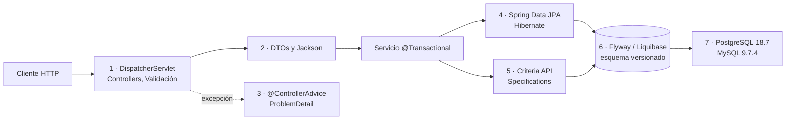
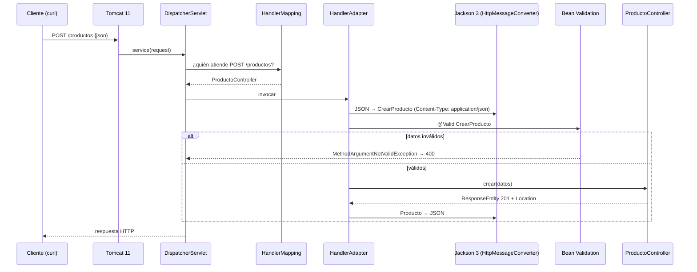
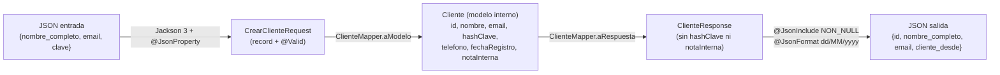
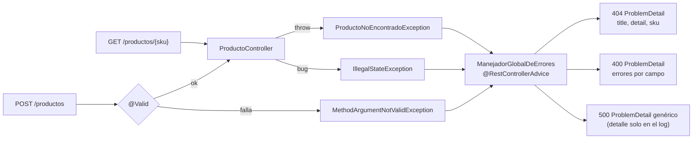
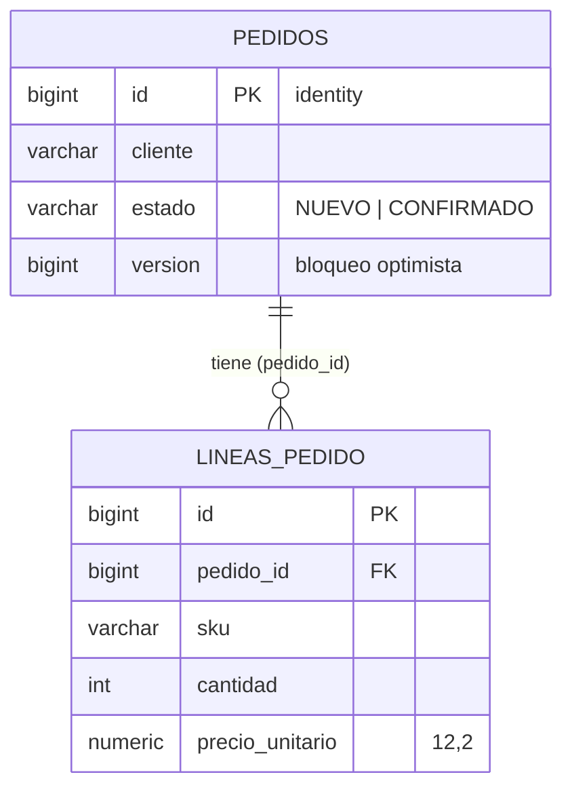
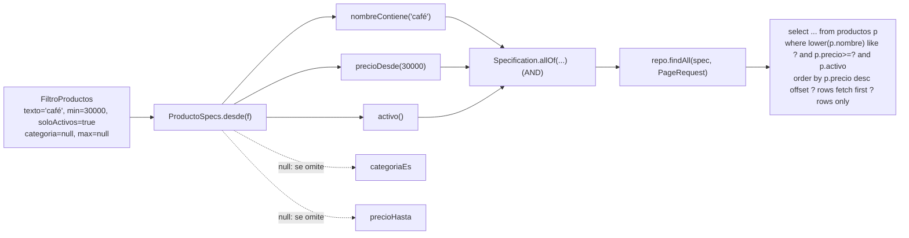
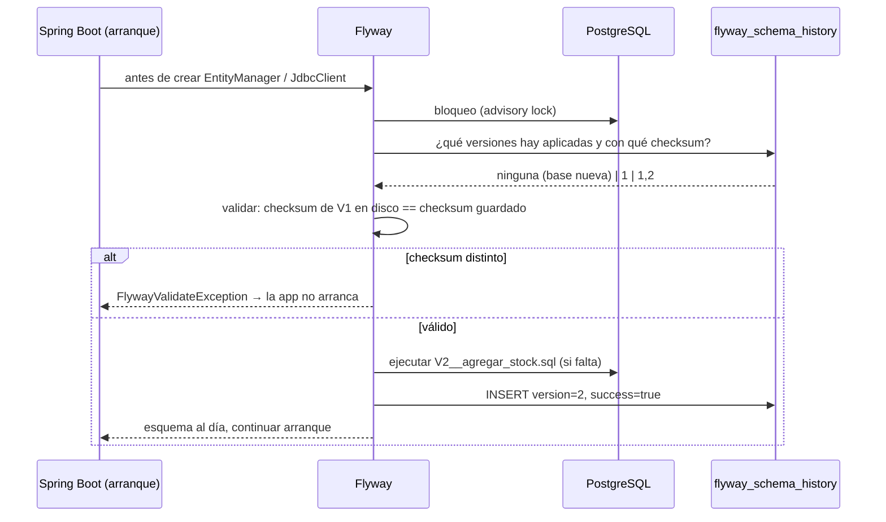
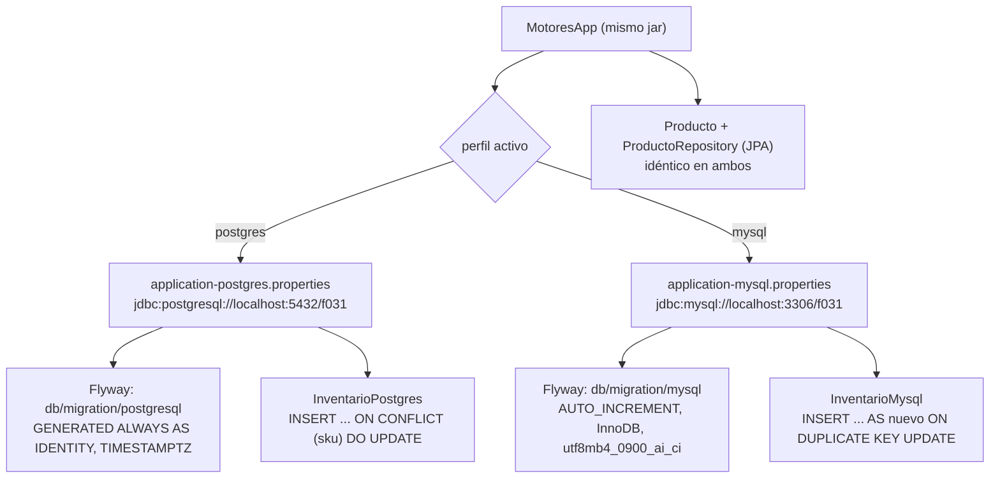

# Módulo 2 · APIs REST y persistencia

**Fase 1 · Spring Boot de cero a experto** (semanas 3 y 4 de 12). **Duración:** 15 h (7 temas de 1,5–3 h).
**Dificultad:** 2 de 5 en Spring MVC y DTOs, 3 de 5 en JPA, consultas dinámicas y migraciones. **Dependencias:**
Módulo 1 completo (records, DI, perfiles) y Módulo 0.4 (HTTP, JSON, `curl`). **Herramientas:**JDK 25 LTS
(25.0.5)**, **Spring Boot 4.1.3** (Spring Framework 7.0.11, Jackson 3, Hibernate ORM 7.4, Spring Data JPA 4.1), Flyway 12.4,
Liquibase 5.0, **PostgreSQL 18.7** y **MySQL 9.7.4 LTS** con Docker Compose, `curl` y `jq` (incluido en macOS 15 o
superior; en Linux, `sudo apt install jq`)..

Aquí tu servicio aprende a hablar HTTP y a recordar: recibe peticiones, valida, responde con contratos estables,
traduce errores a un formato estándar y guarda datos en una base relacional cuyo esquema evoluciona con migraciones
versionadas.



**Texto alternativo:** recorrido de una petición de izquierda a derecha. El cliente HTTP llega al DispatcherServlet
con controladores y validación (tema 1), que convierte el cuerpo en DTOs con Jackson (tema 2); si algo falla, una
flecha punteada lleva al @ControllerAdvice que responde con ProblemDetail (tema 3). Los DTOs pasan a un servicio
transaccional que usa Spring Data JPA con Hibernate (tema 4) y consultas dinámicas con Criteria API y Specifications
(tema 5). Ambos llegan a una base de datos cuyo esquema se versiona con Flyway o Liquibase (tema 6), que puede ser
PostgreSQL 18.7 o MySQL 9.7.4 (tema 7).

---


### Spring MVC: DispatcherServlet, Controllers, Validación

<details open>
<summary><strong>Capa 1 — Lectura</strong></summary>

#### ► DE QUÉ TRATA
Implementar un controlador REST con GET y POST que valida la entrada con Bean Validation y responde 201 con cabecera Location, 400, 404 y 415 según el caso, y trazar el recorrido de una petición desde el DispatcherServlet hasta el método del controlador, comprobándolo con 4 tests…

#### ► LA IDEA EN UNA FRASE
**Implementar un controlador REST con GET y POST que valida la entrada con Bean Validation y responde 201 con cabecera Location, 400, 404 y 415 según el caso, y trazar el recorrido de una petición desde el DispatcherServlet hasta el método del controlador, comprobándolo con 4 tests de MockMvc.**

#### ► POR QUÉ EXISTE ESTO
Una API REST es un programa que responde a peticiones HTTP con datos (normalmente JSON). Con Spring MVC escribes una clase controlador y marcas sus métodos con la ruta que atienden: @GetMapping("/productos/{id}") significa «cuando alguien pida GET /productos/7, ejecuta este método con id = 7». Spring se encarga de leer el JSON que llega, convertirlo en un objeto Java, validarlo con las reglas que escribiste (@NotBlan…

#### ► LA ANALOGÍA
Piensa en spring mvc: dispatcherservlet, controllers, validación como una herramienta de taller: útil cuando conoces su propósito y sus límites.
**Dónde se rompe la analogía:** en software, los efectos dependen del contexto, la escala y los trade-offs.

#### ► CÓMO FUNCIONA


1. Una API REST es un programa que responde a peticiones HTTP con datos (normalmente JSON).
2. Con Spring MVC escribes una clase controlador y marcas sus métodos con la ruta que atienden: @GetMapping("/productos/{id}") significa «cuando alguien pida GET /productos/7, ejecuta este método con id = 7».
3. Spring se encarga de leer el JSON que llega, convertirlo en un objeto Java, validarlo con las reglas que escribiste (@NotBlank: no puede estar vacío; @Positive: mayor que cero) y convertir tu respuesta otr…

#### ► LO QUE PUEDE SALIR MAL
| Síntoma | Causa probable | Arreglo |
|---|---|---|
| Spring MVC: DispatcherServlet, Controllers, Validación se aplica pero el resultado no mejora | Se usó sin medir el problema real | Mide antes y compara contra la alternativa simple |
| Aparece complejidad inesperada | Se adoptó la técnica sin comprender sus trade-offs | Vuelve a la sección de trade-offs y reduce el alcance |
| Falla en un caso límite | Se asumió un contexto que no se cumple | Prueba el caso límite y documenta cuándo NO usarlo |

#### ► TRADE-OFFS
| Opción | Cuándo usarla | Cuándo NO usarla |
|---|---|---|
| Usar Spring MVC: DispatcherServlet, Controllers, Validación | Cuando el problema coincide con su propósito y el beneficio es observable | Cuando agrega complejidad sin resolver un problema real |
| Alternativa más simple | Cuando el contexto es pequeño, estable o fácil de razonar | Cuando ya demostró no escalar o no cumplir el requisito |
| Postergar la decisión | Cuando falta evidencia del problema | Cuando el costo de esperar es mayor que el costo de probar |

#### ► CUÁNDO NO USAR ESTO
Controlador gordo que valida a mano, accede a la base y arma respuestas de error:

#### ► DE VUELTA A LA ANALOGÍA
Volviendo a la analogía: spring mvc: dispatcherservlet, controllers, validación funciona como el modelo inicial, pero recuerda dónde se rompe: en producción importan la evidencia, la escala y el costo de equivocarte.

#### ► LO QUE DEBES RECORDAR
- Una API REST es un programa que responde a peticiones HTTP con datos (normalmente JSON).
- Con Spring MVC escribes una clase controlador y marcas sus métodos con la ruta que atienden: @GetMapping("/productos/{id}") significa «cuando alguien pida GET /productos/7, ejecuta este método con id = 7».
- Spring se encarga de leer el JSON que llega, convertirlo en un objeto Java, validarlo con las reglas que escribiste (@NotBlank: no puede estar vacío; @Positive: mayor que cero) y convertir tu respuesta otr…

#### ► PREGUNTAS PARA PENSAR
1. ¿Qué problema concreto resuelve spring mvc: dispatcherservlet, controllers, validación en tu contexto?
2. ¿Cómo sabrías que spring mvc: dispatcherservlet, controllers, validación no está funcionando bien?
3. ¿Qué alternativa más simple considerarías antes de usar spring mvc: dispatcherservlet, controllers, validación?

</details>

<details>
<summary><strong>Capa 2 — Construcción</strong></summary>

#### Construcción guiada
1. Arranca la API:

```bash
../gradlew -q bootRun
```

   Espera la línea `Tomcat started on port 8080 (http)` y abre otra terminal.

2. Crea un producto y lee el código y la cabecera `Location`:

```bash
curl -s -o /dev/null -w "%{http_code} %header{location}\n" -X POST localhost:8080/productos \
  -H "Content-Type: application/json" -d '{"nombre":"Café de Huila","precio":32000}'
curl -s localhost:8080/productos/1 | jq -cS .
```

   **Output esperado:**

```text
201 /productos/1
{"id":1,"nombre":"Café de Huila","precio":32000}
```

3. Prueba los errores:

```bash
curl -s -o /dev/null -w "%{http_code}\n" -X POST localhost:8080/productos \
  -H "Content-Type: application/json" -d '{"nombre":"","precio":-5}'
curl -s -o /dev/null -w "%{http_code}\n" localhost:8080/productos/999
curl -s -o /dev/null -w "%{http_code}\n" -X POST localhost:8080/productos -d 'nombre=Cafe'
```

   **Output esperado:**

```text
400
404
415
```

   **Captura comentada:** en la terminal de la app, el `400` y el `415` dejan una línea `WARN` de
   `DefaultHandlerExceptionResolver` que nombra la excepción resuelta (`MethodArgumentNotValidException` con los
   campos inválidos y `HttpMediaTypeNotSupportedException`). Ninguno llegó a ejecutar `Catalogo.crear`.

4. **Fallo deliberado:** quita `@Valid` del parámetro de `crear`, reinicia y repite el primer `curl` del paso 3: ahora
   responde `201` y guarda un producto sin nombre y con precio negativo. Restaura `@Valid`.

#### Código de referencia / ejecutable
**Versiones:** JDK 25 LTS · Spring Boot 4.1.3 · `spring-boot-starter-webmvc` (Spring MVC 7, Tomcat 11.0.27, Jackson 3)
· `spring-boot-starter-validation` (Hibernate Validator 9.1.6) · `spring-boot-starter-webmvc-test`.

> **Build con Gradle (y su equivalencia en Maven).** Este laboratorio se construye con **Gradle 9.9.2** y Kotlin DSL
> mediante el wrapper `./gradlew` (no instalas Gradle). `settings.gradle.kts` lista los subproyectos (en Maven,
> `<modules>` del POM agregador), cada carpeta tiene su `build.gradle.kts` (su `pom.xml`) y
> `gradle/libs.versions.toml` es el **catálogo de versiones** (las `<properties>` y el `dependencyManagement`): por eso
> las dependencias se escriben `libs.…`. Equivalencias: `./mvnw test` → `./gradlew test` ·
> `./mvnw package -DskipTests` → `./gradlew bootJar` · `./mvnw spring-boot:run` → `./gradlew bootRun` ·
> `-Dtest=Clase` → `--tests Clase` · `target/` → `build/` (el jar queda en `build/libs/`). Gradle escribe una línea
> `PASSED` por test y termina con `BUILD SUCCESSFUL` (Maven: `Tests run: N` y `BUILD SUCCESS`).

`modulo-6/settings.gradle.kts`:

```kotlin
// Módulo 2 (modulo-6) · Build multi-proyecto: "./gradlew test" ejecuta los tests de todas las fichas.
// Las fichas F028–F031 necesitan "docker compose up -d --wait" antes de los tests.
// Cada carpeta tiene su propio build.gradle.kts; las versiones viven en gradle/libs.versions.toml
// (catálogo "libs"). Equivale al POM agregador con <modules> de Maven.
pluginManagement {
    repositories {
        gradlePluginPortal()
        mavenCentral()
    }
}
// Sin esto, un alumno sin JDK 25 instalado ve el build morir en la configuración, antes de cualquier test.
plugins {
    id("org.gradle.toolchains.foojay-resolver-convention") version "1.0.0"
}

dependencyResolutionManagement {
    repositories {
        mavenCentral()
    }
}

rootProject.name = "modulo-6-laboratorios"

include(
    "f025-spring-mvc",
    "f026-dtos-jackson",
    "f027-controller-advice",
    "f028-jpa",
    "f029-criteria-specifications",
    "f030-flyway",
    "f030-liquibase",
    "f031-postgresql-mysql",
)
```

`modulo-6/gradle/libs.versions.toml`:

```toml
# Módulo 2 (modulo-6)
# Catálogo de versiones del laboratorio: una sola fuente para plugins y librerías.
# Las librerías SIN versión las fija el BOM de Spring Boot (spring-boot-dependencies) o el BOM que importe el proyecto.

[versions]
spring-boot = "4.1.3"

[libraries]
spring-boot-starter-webmvc = { module = "org.springframework.boot:spring-boot-starter-webmvc" }
spring-boot-starter-validation = { module = "org.springframework.boot:spring-boot-starter-validation" }
spring-boot-starter-webmvc-test = { module = "org.springframework.boot:spring-boot-starter-webmvc-test" }
junit-platform-launcher = { module = "org.junit.platform:junit-platform-launcher" }
spring-boot-starter-data-jpa = { module = "org.springframework.boot:spring-boot-starter-data-jpa" }
postgresql = { module = "org.postgresql:postgresql" }
spring-boot-starter-test = { module = "org.springframework.boot:spring-boot-starter-test" }
spring-boot-starter-jdbc = { module = "org.springframework.boot:spring-boot-starter-jdbc" }
spring-boot-starter-flyway = { module = "org.springframework.boot:spring-boot-starter-flyway" }
flyway-database-postgresql = { module = "org.flywaydb:flyway-database-postgresql" }
spring-boot-starter-liquibase = { module = "org.springframework.boot:spring-boot-starter-liquibase" }
flyway-mysql = { module = "org.flywaydb:flyway-mysql" }
mysql-connector-j = { module = "com.mysql:mysql-connector-j" }

[plugins]
spring-boot = { id = "org.springframework.boot", version.ref = "spring-boot" }
spring-dependency-management = { id = "io.spring.dependency-management", version = "1.1.7" }
```

`modulo-6/f025-spring-mvc/build.gradle.kts`:

```kotlin
// F025 · Spring MVC: DispatcherServlet, Controllers, Validación
plugins {
    java
    alias(libs.plugins.spring.boot)
    alias(libs.plugins.spring.dependency.management)
}

group = "academia.microservicios"
version = "1.0.0"

java {
    toolchain {
        languageVersion = JavaLanguageVersion.of(25)
    }
}

dependencies {
    // Spring MVC + Tomcat 11 + Jackson 3
    implementation(libs.spring.boot.starter.webmvc)
    // Bean Validation (Hibernate Validator 9)
    implementation(libs.spring.boot.starter.validation)
    // MockMvc, JUnit 6, AssertJ
    testImplementation(libs.spring.boot.starter.webmvc.test)
    // Gradle 9 exige declarar el lanzador de JUnit Platform (ya no lo añade por su cuenta)
    testRuntimeOnly(libs.junit.platform.launcher)
}

tasks.withType<Test> {
    useJUnitPlatform()
    testLogging {
        events("passed", "skipped", "failed")   // una línea por test en la consola
        // el mensaje completo de cada fallo (valor esperado y obtenido), no solo el tipo de excepción
        exceptionFormat = org.gradle.api.tasks.testing.logging.TestExceptionFormat.FULL
    }
}
```

`modulo-6/f025-spring-mvc/src/main/java/academia/mvc/MvcApp.java`:

```java
package academia.mvc;

import org.springframework.boot.SpringApplication;
import org.springframework.boot.autoconfigure.SpringBootApplication;

@SpringBootApplication
public class MvcApp {
    public static void main(String[] args) {
        SpringApplication.run(MvcApp.class, args);
    }
}
```

`modulo-6/f025-spring-mvc/src/main/java/academia/mvc/CrearProducto.java`:

```java
package academia.mvc;

import jakarta.validation.constraints.NotBlank;
import jakarta.validation.constraints.Positive;
import jakarta.validation.constraints.Size;
import java.math.BigDecimal;

/** Cuerpo de POST /productos. Las anotaciones son las reglas que @Valid comprueba. */
public record CrearProducto(
        @NotBlank @Size(max = 80) String nombre,
        @Positive BigDecimal precio) { }
```

`modulo-6/f025-spring-mvc/src/main/java/academia/mvc/Producto.java`:

```java
package academia.mvc;

import java.math.BigDecimal;

public record Producto(long id, String nombre, BigDecimal precio) { }
```

`modulo-6/f025-spring-mvc/src/main/java/academia/mvc/Catalogo.java`:

```java
package academia.mvc;

import java.util.List;
import java.util.Map;
import java.util.Optional;
import java.util.concurrent.ConcurrentHashMap;
import java.util.concurrent.atomic.AtomicLong;
import org.springframework.stereotype.Service;

/** Almacén en memoria (la persistencia real llega en F028). Seguro para varios hilos. */
@Service
public class Catalogo {
    private final Map<Long, Producto> productos = new ConcurrentHashMap<>();
    private final AtomicLong secuencia = new AtomicLong();

    public Producto crear(CrearProducto datos) {
        long id = secuencia.incrementAndGet();
        Producto nuevo = new Producto(id, datos.nombre(), datos.precio());
        productos.put(id, nuevo);
        return nuevo;
    }

    public Optional<Producto> buscar(long id) { return Optional.ofNullable(productos.get(id)); }

    public List<Producto> todos() { return List.copyOf(productos.values()); }
}
```

`modulo-6/f025-spring-mvc/src/main/java/academia/mvc/ProductoController.java`:

```java
package academia.mvc;

import jakarta.validation.Valid;
import java.net.URI;
import java.util.List;
import org.springframework.http.HttpStatus;
import org.springframework.http.ResponseEntity;
import org.springframework.web.bind.annotation.GetMapping;
import org.springframework.web.bind.annotation.PathVariable;
import org.springframework.web.bind.annotation.PostMapping;
import org.springframework.web.bind.annotation.RequestBody;
import org.springframework.web.bind.annotation.RequestMapping;
import org.springframework.web.bind.annotation.RestController;
import org.springframework.web.server.ResponseStatusException;

/**
 * El DispatcherServlet recibe TODAS las peticiones y, según método + ruta,
 * elige uno de estos métodos (handler). Jackson convierte JSON <-> records.
 */
@RestController
@RequestMapping("/productos")
class ProductoController {

    private final Catalogo catalogo;

    ProductoController(Catalogo catalogo) { this.catalogo = catalogo; }

    @PostMapping
    ResponseEntity<Producto> crear(@Valid @RequestBody CrearProducto datos) {
        Producto creado = catalogo.crear(datos);
        return ResponseEntity.created(URI.create("/productos/" + creado.id())).body(creado);
    }

    @GetMapping("/{id}")
    Producto buscar(@PathVariable long id) {
        return catalogo.buscar(id)
            .orElseThrow(() -> new ResponseStatusException(HttpStatus.NOT_FOUND, "No existe el producto " + id));
    }

    @GetMapping
    List<Producto> listar() { return catalogo.todos(); }
}
```

#### Verificación
`modulo-6/f025-spring-mvc/src/test/java/academia/mvc/ProductoControllerTest.java`:

```java
package academia.mvc;

import static org.springframework.test.web.servlet.request.MockMvcRequestBuilders.get;
import static org.springframework.test.web.servlet.request.MockMvcRequestBuilders.post;
import static org.springframework.test.web.servlet.result.MockMvcResultMatchers.header;
import static org.springframework.test.web.servlet.result.MockMvcResultMatchers.jsonPath;
import static org.springframework.test.web.servlet.result.MockMvcResultMatchers.status;

import org.junit.jupiter.api.Test;
import org.springframework.beans.factory.annotation.Autowired;
import org.springframework.boot.webmvc.test.autoconfigure.WebMvcTest;
import org.springframework.context.annotation.Import;
import org.springframework.http.MediaType;
import org.springframework.test.web.servlet.MockMvc;

/** @WebMvcTest levanta solo la capa web: DispatcherServlet, el controlador y Jackson. */
@WebMvcTest(ProductoController.class)
@Import(Catalogo.class)
class ProductoControllerTest {

    @Autowired
    MockMvc mvc;

    @Test
    void creaUnProductoValidoYDevuelve201ConLocation() throws Exception {
        mvc.perform(post("/productos").contentType(MediaType.APPLICATION_JSON)
                .content("{\"nombre\":\"Café de Huila\",\"precio\":32000}"))
            .andExpect(status().isCreated())
            .andExpect(header().string("Location", "/productos/1"))
            .andExpect(jsonPath("$.nombre").value("Café de Huila"));
    }

    @Test
    void rechazaDatosInvalidosCon400SinLlegarAlCatalogo() throws Exception {
        mvc.perform(post("/productos").contentType(MediaType.APPLICATION_JSON)
                .content("{\"nombre\":\"\",\"precio\":-5}"))
            .andExpect(status().isBadRequest());
    }

    @Test
    void unIdInexistenteDa404() throws Exception {
        mvc.perform(get("/productos/999")).andExpect(status().isNotFound());
    }

    @Test
    void sinContentTypeJsonDa415() throws Exception {
        mvc.perform(post("/productos").content("nombre=Cafe"))
            .andExpect(status().isUnsupportedMediaType());
    }
}
```

```bash
../gradlew test
```

**Output esperado:** 4 líneas `PASSED` (una por test) y `BUILD SUCCESSFUL` *(salida de Gradle verificada en el Mac del dueño el 2026-11-21 con Gradle 9.9.2, Java 25.0.5.1 autoaprovisto y Docker Compose v5.7.1)*.

**Pregunta de comprobación:** ¿qué componente decide que `GET /productos/999` lo atiende `buscar` y qué componente
convierte la `ResponseStatusException` en un `404`?

<details>
<summary>Respuesta</summary>

Un `HandlerMapping` (`RequestMappingHandlerMapping`, que leyó las anotaciones `@GetMapping`) elige el método; un
`HandlerExceptionResolver` (`ResponseStatusExceptionResolver`) traduce la excepción en el código de estado. Ambos los
coordina el `DispatcherServlet`.
</details>

</details>

### DTOs, @JsonProperty, Jackson

<details open>
<summary><strong>Capa 1 — Lectura</strong></summary>

#### ► DE QUÉ TRATA
Diseñar DTOs de entrada y salida separados del modelo interno, controlar con anotaciones de Jackson el nombre (@JsonProperty), la presencia (@JsonInclude) y el formato (@JsonFormat) de cada campo, y demostrar con 3 tests que la API nunca expone la clave ni los datos internos del…

#### ► LA IDEA EN UNA FRASE
**Diseñar DTOs de entrada y salida separados del modelo interno, controlar con anotaciones de Jackson el nombre (@JsonProperty), la presencia (@JsonInclude) y el formato (@JsonFormat) de cada campo, y demostrar con 3 tests que la API nunca expone la clave ni los datos internos del cliente.**

#### ► POR QUÉ EXISTE ESTO
Un DTO (*Data Transfer Object*) es un objeto cuyo único trabajo es llevar datos de un lado a otro (entre tu API y quien la llama). Se separa del modelo interno por dos razones: seguridad (el modelo tiene datos que nunca deben salir, como el hash de una contraseña) y estabilidad (puedes cambiar tu base de datos sin romper a los clientes de tu API). Jackson es la librería que convierte objetos Java en JSON y JSON en ob…

#### ► LA ANALOGÍA
Piensa en dtos, @jsonproperty, jackson como una herramienta de taller: útil cuando conoces su propósito y sus límites.
**Dónde se rompe la analogía:** en software, los efectos dependen del contexto, la escala y los trade-offs.

#### ► CÓMO FUNCIONA


1. Un DTO (*Data Transfer Object*) es un objeto cuyo único trabajo es llevar datos de un lado a otro (entre tu API y quien la llama).
2. Se separa del modelo interno por dos razones: seguridad (el modelo tiene datos que nunca deben salir, como el hash de una contraseña) y estabilidad (puedes cambiar tu base de datos sin romper a los clientes de tu API).
3. Jackson es la librería que convierte objetos Java en JSON y JSON en objetos Java; con anotaciones le dices cómo hacerlo.

#### ► LO QUE PUEDE SALIR MAL
| Síntoma | Causa probable | Arreglo |
|---|---|---|
| DTOs, @JsonProperty, Jackson se aplica pero el resultado no mejora | Se usó sin medir el problema real | Mide antes y compara contra la alternativa simple |
| Aparece complejidad inesperada | Se adoptó la técnica sin comprender sus trade-offs | Vuelve a la sección de trade-offs y reduce el alcance |
| Falla en un caso límite | Se asumió un contexto que no se cumple | Prueba el caso límite y documenta cuándo NO usarlo |

#### ► TRADE-OFFS
| Opción | Cuándo usarla | Cuándo NO usarla |
|---|---|---|
| Usar DTOs, @JsonProperty, Jackson | Cuando el problema coincide con su propósito y el beneficio es observable | Cuando agrega complejidad sin resolver un problema real |
| Alternativa más simple | Cuando el contexto es pequeño, estable o fácil de razonar | Cuando ya demostró no escalar o no cumplir el requisito |
| Postergar la decisión | Cuando falta evidencia del problema | Cuando el costo de esperar es mayor que el costo de probar |

#### ► CUÁNDO NO USAR ESTO
El mismo objeto para todo (*entity leaking* y *mass assignment*):

#### ► DE VUELTA A LA ANALOGÍA
Volviendo a la analogía: dtos, @jsonproperty, jackson funciona como el modelo inicial, pero recuerda dónde se rompe: en producción importan la evidencia, la escala y el costo de equivocarte.

#### ► LO QUE DEBES RECORDAR
- Un DTO (*Data Transfer Object*) es un objeto cuyo único trabajo es llevar datos de un lado a otro (entre tu API y quien la llama).
- Se separa del modelo interno por dos razones: seguridad (el modelo tiene datos que nunca deben salir, como el hash de una contraseña) y estabilidad (puedes cambiar tu base de datos sin romper a los clientes de tu API).
- Jackson es la librería que convierte objetos Java en JSON y JSON en objetos Java; con anotaciones le dices cómo hacerlo.

#### ► PREGUNTAS PARA PENSAR
1. ¿Qué problema concreto resuelve dtos, @jsonproperty, jackson en tu contexto?
2. ¿Cómo sabrías que dtos, @jsonproperty, jackson no está funcionando bien?
3. ¿Qué alternativa más simple considerarías antes de usar dtos, @jsonproperty, jackson?

</details>

<details>
<summary><strong>Capa 2 — Construcción</strong></summary>

#### Código de referencia / ejecutable
**Versiones:** JDK 25 LTS · Spring Boot 4.1.3 · Jackson 3.1 (`tools.jackson.core:jackson-databind` 3.1.8, anotaciones
`com.fasterxml.jackson.annotation` 2.21) · Hibernate Validator 9.1.6.

`modulo-6/f026-dtos-jackson/build.gradle.kts`:

```kotlin
// F026 · DTOs, @JsonProperty, Jackson
plugins {
    java
    alias(libs.plugins.spring.boot)
    alias(libs.plugins.spring.dependency.management)
}

group = "academia.microservicios"
version = "1.0.0"

java {
    toolchain {
        languageVersion = JavaLanguageVersion.of(25)
    }
}

dependencies {
    // Spring MVC + Tomcat 11 + Jackson 3
    implementation(libs.spring.boot.starter.webmvc)
    // Bean Validation (Hibernate Validator 9)
    implementation(libs.spring.boot.starter.validation)
    // MockMvc, JUnit 6, AssertJ
    testImplementation(libs.spring.boot.starter.webmvc.test)
    // Gradle 9 exige declarar el lanzador de JUnit Platform (ya no lo añade por su cuenta)
    testRuntimeOnly(libs.junit.platform.launcher)
}

tasks.withType<Test> {
    useJUnitPlatform()
    testLogging {
        events("passed", "skipped", "failed")   // una línea por test en la consola
        // el mensaje completo de cada fallo (valor esperado y obtenido), no solo el tipo de excepción
        exceptionFormat = org.gradle.api.tasks.testing.logging.TestExceptionFormat.FULL
    }
}
```

`modulo-6/f026-dtos-jackson/src/main/java/academia/dto/Cliente.java`:

```java
package academia.dto;

import java.time.LocalDate;

/**
 * Modelo INTERNO (en F028 será una entidad JPA). Tiene datos que jamás deben
 * salir por la API: el hash de la clave y una nota interna.
 */
public class Cliente {
    private final long id;
    private final String nombreCompleto;
    private final String email;
    private final String hashClave;
    private final String telefono;
    private final LocalDate fechaRegistro;
    private final String notaInterna;

    public Cliente(long id, String nombreCompleto, String email, String hashClave,
                   String telefono, LocalDate fechaRegistro, String notaInterna) {
        this.id = id;
        this.nombreCompleto = nombreCompleto;
        this.email = email;
        this.hashClave = hashClave;
        this.telefono = telefono;
        this.fechaRegistro = fechaRegistro;
        this.notaInterna = notaInterna;
    }

    public long getId() { return id; }
    public String getNombreCompleto() { return nombreCompleto; }
    public String getEmail() { return email; }
    public String getHashClave() { return hashClave; }
    public String getTelefono() { return telefono; }
    public LocalDate getFechaRegistro() { return fechaRegistro; }
    public String getNotaInterna() { return notaInterna; }
}
```

`modulo-6/f026-dtos-jackson/src/main/java/academia/dto/CrearClienteRequest.java`:

```java
package academia.dto;

import com.fasterxml.jackson.annotation.JsonProperty;
import jakarta.validation.constraints.Email;
import jakarta.validation.constraints.NotBlank;
import jakarta.validation.constraints.Size;

/** DTO de ENTRADA: solo lo que el cliente HTTP puede enviar. El JSON usa snake_case. */
public record CrearClienteRequest(
        @JsonProperty("nombre_completo") @NotBlank String nombreCompleto,
        @Email @NotBlank String email,
        @Size(min = 8) String clave,
        String telefono) { }
```

`modulo-6/f026-dtos-jackson/src/main/java/academia/dto/ClienteResponse.java`:

```java
package academia.dto;

import com.fasterxml.jackson.annotation.JsonFormat;
import com.fasterxml.jackson.annotation.JsonInclude;
import com.fasterxml.jackson.annotation.JsonProperty;
import java.time.LocalDate;

/** DTO de SALIDA: el contrato público. No tiene hashClave ni notaInterna. */
@JsonInclude(JsonInclude.Include.NON_NULL)          // los campos null no se escriben
public record ClienteResponse(
        long id,
        @JsonProperty("nombre_completo") String nombreCompleto,
        String email,
        String telefono,
        @JsonProperty("cliente_desde") @JsonFormat(pattern = "dd/MM/yyyy") LocalDate fechaRegistro) { }
```

`modulo-6/f026-dtos-jackson/src/main/java/academia/dto/ClienteMapper.java`:

```java
package academia.dto;

import java.time.LocalDate;

/** Traduce entre el modelo interno y los DTO. Un solo lugar para decidir qué sale. */
public final class ClienteMapper {
    private ClienteMapper() { }

    public static Cliente aModelo(long id, CrearClienteRequest req, String hashClave, LocalDate hoy) {
        return new Cliente(id, req.nombreCompleto(), req.email(), hashClave, req.telefono(), hoy, "nuevo");
    }

    public static ClienteResponse aRespuesta(Cliente c) {
        return new ClienteResponse(c.getId(), c.getNombreCompleto(), c.getEmail(), c.getTelefono(), c.getFechaRegistro());
    }
}
```

`modulo-6/f026-dtos-jackson/src/main/java/academia/dto/ClienteController.java`:

```java
package academia.dto;

import jakarta.validation.Valid;
import java.time.LocalDate;
import java.util.HexFormat;
import java.util.concurrent.atomic.AtomicLong;
import org.springframework.http.HttpStatus;
import org.springframework.web.bind.annotation.PostMapping;
import org.springframework.web.bind.annotation.RequestBody;
import org.springframework.web.bind.annotation.ResponseStatus;
import org.springframework.web.bind.annotation.RestController;

@RestController
class ClienteController {
    private final AtomicLong secuencia = new AtomicLong();

    @PostMapping("/clientes")
    @ResponseStatus(HttpStatus.CREATED)
    ClienteResponse crear(@Valid @RequestBody CrearClienteRequest req) {
        // Solo para el ejemplo: en el Módulo 9 se usa un PasswordEncoder real.
        String hash = HexFormat.of().formatHex(req.clave().getBytes()).substring(0, 8);
        Cliente cliente = ClienteMapper.aModelo(secuencia.incrementAndGet(), req, hash, LocalDate.of(2026, 11, 19));
        return ClienteMapper.aRespuesta(cliente);
    }
}
```

`modulo-6/f026-dtos-jackson/src/main/java/academia/dto/DtoApp.java`:

```java
package academia.dto;

import org.springframework.boot.SpringApplication;
import org.springframework.boot.autoconfigure.SpringBootApplication;

@SpringBootApplication
public class DtoApp {
    public static void main(String[] args) {
        SpringApplication.run(DtoApp.class, args);
    }
}
```

#### Verificación
`modulo-6/f026-dtos-jackson/src/test/java/academia/dto/ClienteJsonTest.java`:

```java
package academia.dto;

import static org.assertj.core.api.Assertions.assertThat;
import static org.springframework.test.web.servlet.request.MockMvcRequestBuilders.post;
import static org.springframework.test.web.servlet.result.MockMvcResultMatchers.jsonPath;
import static org.springframework.test.web.servlet.result.MockMvcResultMatchers.status;

import java.time.LocalDate;
import org.junit.jupiter.api.Test;
import org.springframework.beans.factory.annotation.Autowired;
import org.springframework.boot.test.context.SpringBootTest;
import org.springframework.boot.webmvc.test.autoconfigure.AutoConfigureMockMvc;
import org.springframework.http.MediaType;
import org.springframework.test.web.servlet.MockMvc;
import tools.jackson.databind.json.JsonMapper;

@SpringBootTest
@AutoConfigureMockMvc
class ClienteJsonTest {

    @Autowired
    MockMvc mvc;

    @Autowired
    JsonMapper mapper;   // el mismo JsonMapper (Jackson 3) que usa Spring MVC

    @Test
    void elDtoDeSalidaRenombraYOmiteNulos() {
        var dto = new ClienteResponse(1, "Ana Pérez", "ana@correo.co", null, LocalDate.of(2026, 11, 19));
        String json = mapper.writeValueAsString(dto);
        assertThat(json).contains("\"nombre_completo\":\"Ana Pérez\"")
            .contains("\"cliente_desde\":\"19/11/2026\"")
            .doesNotContain("telefono");
    }

    @Test
    void laApiNuncaDevuelveLaClaveNiDatosInternos() throws Exception {
        mvc.perform(post("/clientes").contentType(MediaType.APPLICATION_JSON)
                .content("""
                    {"nombre_completo":"Ana Pérez","email":"ana@correo.co","clave":"secreta123"}
                    """))
            .andExpect(status().isCreated())
            .andExpect(jsonPath("$.nombre_completo").value("Ana Pérez"))
            .andExpect(jsonPath("$.clave").doesNotExist())
            .andExpect(jsonPath("$.hashClave").doesNotExist())
            .andExpect(jsonPath("$.notaInterna").doesNotExist());
    }

    @Test
    void sinJsonPropertyElCampoNoSeLlenaYLaValidacionLoRechaza() throws Exception {
        // "nombreCompleto" (camelCase) no coincide con "nombre_completo": llega null y @NotBlank falla.
        mvc.perform(post("/clientes").contentType(MediaType.APPLICATION_JSON)
                .content("{\"nombreCompleto\":\"Ana\",\"email\":\"ana@correo.co\",\"clave\":\"secreta123\"}"))
            .andExpect(status().isBadRequest());
    }
}
```

```bash
../gradlew test
```

**Output esperado:** 3 líneas `PASSED` (una por test) y `BUILD SUCCESSFUL` *(salida de Gradle verificada en el Mac del dueño el 2026-11-21 con Gradle 9.9.2, Java 25.0.5.1 autoaprovisto y Docker Compose v5.7.1)*.

**Pregunta de comprobación:** si mañana el equipo añade `saldo` al modelo `Cliente`, ¿aparece en la respuesta de
`POST /clientes`? ¿Por qué?

<details>
<summary>Respuesta</summary>

No. La respuesta se construye con `ClienteResponse`, que no tiene `saldo`; para exponerlo hay que cambiar a propósito
el DTO y el mapper. Esa es la protección que da separar modelo y contrato.
</details>

</details>

### Manejo global de excepciones (@ControllerAdvice)

<details open>
<summary><strong>Capa 1 — Lectura</strong></summary>

#### ► DE QUÉ TRATA
Centralizar el manejo de errores de todos los controladores en un @RestControllerAdvice que responde con ProblemDetail (RFC 9457, application/problem+json) para «no encontrado», «datos inválidos» y «error inesperado», y verificar con 3 tests que el formato es uniforme y que un er…

#### ► LA IDEA EN UNA FRASE
**Centralizar el manejo de errores de todos los controladores en un @RestControllerAdvice que responde con ProblemDetail (RFC 9457, application/problem+json) para «no encontrado», «datos inválidos» y «error inesperado», y verificar con 3 tests que el formato es uniforme y que un error interno no filtra detalles al cliente.**

#### ► POR QUÉ EXISTE ESTO
Cuando algo sale mal en una API, quien la llama necesita saber qué pasó con un formato que pueda leer un programa. Si cada método arma su propio mensaje de error, el cliente recibe veinte formatos distintos. Con @ControllerAdvice escribes una sola clase que atrapa los errores de todos los controladores y los convierte en una respuesta uniforme. El formato estándar se llama Problem Details y Spring lo trae listo: Prob…

#### ► LA ANALOGÍA
Piensa en manejo global de excepciones (@controlleradvice) como una herramienta de taller: útil cuando conoces su propósito y sus límites.
**Dónde se rompe la analogía:** en software, los efectos dependen del contexto, la escala y los trade-offs.

#### ► CÓMO FUNCIONA


1. Cuando algo sale mal en una API, quien la llama necesita saber qué pasó con un formato que pueda leer un programa.
2. Si cada método arma su propio mensaje de error, el cliente recibe veinte formatos distintos.
3. Con @ControllerAdvice escribes una sola clase que atrapa los errores de todos los controladores y los convierte en una respuesta uniforme.
4. El formato estándar se llama Problem Details y Spring lo trae listo: ProblemDetail.

#### ► LO QUE PUEDE SALIR MAL
| Síntoma | Causa probable | Arreglo |
|---|---|---|
| Manejo global de excepciones (@ControllerAdvice) se aplica pero el resultado no mejora | Se usó sin medir el problema real | Mide antes y compara contra la alternativa simple |
| Aparece complejidad inesperada | Se adoptó la técnica sin comprender sus trade-offs | Vuelve a la sección de trade-offs y reduce el alcance |
| Falla en un caso límite | Se asumió un contexto que no se cumple | Prueba el caso límite y documenta cuándo NO usarlo |

#### ► TRADE-OFFS
| Opción | Cuándo usarla | Cuándo NO usarla |
|---|---|---|
| Usar Manejo global de excepciones (@ControllerAdvice) | Cuando el problema coincide con su propósito y el beneficio es observable | Cuando agrega complejidad sin resolver un problema real |
| Alternativa más simple | Cuando el contexto es pequeño, estable o fácil de razonar | Cuando ya demostró no escalar o no cumplir el requisito |
| Postergar la decisión | Cuando falta evidencia del problema | Cuando el costo de esperar es mayor que el costo de probar |

#### ► CUÁNDO NO USAR ESTO
Tragarse la excepción o devolver la traza:

#### ► DE VUELTA A LA ANALOGÍA
Volviendo a la analogía: manejo global de excepciones (@controlleradvice) funciona como el modelo inicial, pero recuerda dónde se rompe: en producción importan la evidencia, la escala y el costo de equivocarte.

#### ► LO QUE DEBES RECORDAR
- Cuando algo sale mal en una API, quien la llama necesita saber qué pasó con un formato que pueda leer un programa.
- Si cada método arma su propio mensaje de error, el cliente recibe veinte formatos distintos.
- Con @ControllerAdvice escribes una sola clase que atrapa los errores de todos los controladores y los convierte en una respuesta uniforme.
- El formato estándar se llama Problem Details y Spring lo trae listo: ProblemDetail.

#### ► PREGUNTAS PARA PENSAR
1. ¿Qué problema concreto resuelve manejo global de excepciones (@controlleradvice) en tu contexto?
2. ¿Cómo sabrías que manejo global de excepciones (@controlleradvice) no está funcionando bien?
3. ¿Qué alternativa más simple considerarías antes de usar manejo global de excepciones (@controlleradvice)?

</details>

<details>
<summary><strong>Capa 2 — Construcción</strong></summary>

#### Objetivo observable
**Centralizar** el manejo de errores de todos los controladores en un `@RestControllerAdvice` que responde con
`ProblemDetail` (RFC 9457, `application/problem+json`) para «no encontrado», «datos inválidos» y «error inesperado», y
**verificar** con 3 tests que el formato es uniforme y que un error interno no filtra detalles al cliente.

#### Código de referencia / ejecutable
**Versiones:** JDK 25 LTS · Spring Boot 4.1.3 (Spring Framework 7: `ProblemDetail`, RFC 9457) ·
`spring-boot-starter-webmvc` + `spring-boot-starter-validation`.

`modulo-6/f027-controller-advice/build.gradle.kts`:

```kotlin
// F027 · Manejo global de excepciones (@ControllerAdvice)
plugins {
    java
    alias(libs.plugins.spring.boot)
    alias(libs.plugins.spring.dependency.management)
}

group = "academia.microservicios"
version = "1.0.0"

java {
    toolchain {
        languageVersion = JavaLanguageVersion.of(25)
    }
}

dependencies {
    // Spring MVC + Tomcat 11 + Jackson 3
    implementation(libs.spring.boot.starter.webmvc)
    // Bean Validation (Hibernate Validator 9)
    implementation(libs.spring.boot.starter.validation)
    // MockMvc, JUnit 6, AssertJ
    testImplementation(libs.spring.boot.starter.webmvc.test)
    // Gradle 9 exige declarar el lanzador de JUnit Platform (ya no lo añade por su cuenta)
    testRuntimeOnly(libs.junit.platform.launcher)
}

tasks.withType<Test> {
    useJUnitPlatform()
    testLogging {
        events("passed", "skipped", "failed")   // una línea por test en la consola
        // el mensaje completo de cada fallo (valor esperado y obtenido), no solo el tipo de excepción
        exceptionFormat = org.gradle.api.tasks.testing.logging.TestExceptionFormat.FULL
    }
}
```

`modulo-6/f027-controller-advice/src/main/java/academia/errores/ProductoNoEncontradoException.java`:

```java
package academia.errores;

/** Excepción de NEGOCIO: no sabe nada de HTTP. El ControllerAdvice la traduce. */
public class ProductoNoEncontradoException extends RuntimeException {
    private final String sku;

    public ProductoNoEncontradoException(String sku) {
        super("No existe el producto con SKU " + sku);
        this.sku = sku;
    }

    public String sku() { return sku; }
}
```

`modulo-6/f027-controller-advice/src/main/java/academia/errores/ProductoController.java`:

```java
package academia.errores;

import jakarta.validation.Valid;
import jakarta.validation.constraints.NotBlank;
import jakarta.validation.constraints.Positive;
import java.math.BigDecimal;
import java.util.Map;
import org.springframework.web.bind.annotation.GetMapping;
import org.springframework.web.bind.annotation.PathVariable;
import org.springframework.web.bind.annotation.PostMapping;
import org.springframework.web.bind.annotation.RequestBody;
import org.springframework.web.bind.annotation.RestController;

@RestController
class ProductoController {

    record CrearProducto(@NotBlank String sku, @Positive BigDecimal precio) { }

    private final Map<String, BigDecimal> precios = Map.of("CAF-1", new BigDecimal("32000"));

    // Los controladores quedan limpios: lanzan y se olvidan; nada de try/catch aquí.
    @GetMapping("/productos/{sku}")
    Map<String, Object> buscar(@PathVariable String sku) {
        BigDecimal precio = precios.get(sku);
        if (precio == null) {
            throw new ProductoNoEncontradoException(sku);
        }
        return Map.of("sku", sku, "precio", precio);
    }

    @PostMapping("/productos")
    Map<String, Object> crear(@Valid @RequestBody CrearProducto datos) {
        return Map.of("sku", datos.sku(), "precio", datos.precio());
    }

    @GetMapping("/productos/{sku}/fallo")
    Map<String, Object> fallar(@PathVariable String sku) {
        throw new IllegalStateException("password=postgres; host=10.0.0.12");  // detalle interno
    }
}
```

`modulo-6/f027-controller-advice/src/main/java/academia/errores/ManejadorGlobalDeErrores.java`:

```java
package academia.errores;

import java.net.URI;
import java.util.Map;
import java.util.TreeMap;
import org.slf4j.Logger;
import org.slf4j.LoggerFactory;
import org.springframework.http.HttpStatus;
import org.springframework.http.ProblemDetail;
import org.springframework.web.bind.MethodArgumentNotValidException;
import org.springframework.web.bind.annotation.ExceptionHandler;
import org.springframework.web.bind.annotation.RestControllerAdvice;

/**
 * @RestControllerAdvice = @ControllerAdvice + @ResponseBody: atrapa las excepciones
 * de TODOS los controladores y las convierte en respuestas RFC 9457 (application/problem+json).
 */
@RestControllerAdvice
class ManejadorGlobalDeErrores {

    private static final Logger log = LoggerFactory.getLogger(ManejadorGlobalDeErrores.class);

    @ExceptionHandler(ProductoNoEncontradoException.class)
    ProblemDetail noEncontrado(ProductoNoEncontradoException ex) {
        ProblemDetail problema = ProblemDetail.forStatusAndDetail(HttpStatus.NOT_FOUND, ex.getMessage());
        problema.setTitle("Producto no encontrado");
        problema.setType(URI.create("https://tienda.example/errores/producto-no-encontrado"));
        problema.setProperty("sku", ex.sku());
        return problema;
    }

    @ExceptionHandler(MethodArgumentNotValidException.class)
    ProblemDetail datosInvalidos(MethodArgumentNotValidException ex) {
        Map<String, String> errores = new TreeMap<>();
        ex.getBindingResult().getFieldErrors()
            .forEach(e -> errores.put(e.getField(), e.getDefaultMessage()));
        ProblemDetail problema = ProblemDetail.forStatusAndDetail(HttpStatus.BAD_REQUEST,
            "La petición tiene " + errores.size() + " campo(s) inválido(s)");
        problema.setTitle("Datos inválidos");
        problema.setProperty("errores", errores);
        return problema;
    }

    @ExceptionHandler(Exception.class)
    ProblemDetail inesperado(Exception ex) {
        log.error("Error no controlado", ex);               // el detalle va al log, no al cliente
        ProblemDetail problema = ProblemDetail.forStatusAndDetail(HttpStatus.INTERNAL_SERVER_ERROR,
            "Ocurrió un error interno. Si persiste, comparte este código con soporte.");
        problema.setTitle("Error interno");
        return problema;
    }
}
```

`modulo-6/f027-controller-advice/src/main/java/academia/errores/ErroresApp.java`:

```java
package academia.errores;

import org.springframework.boot.SpringApplication;
import org.springframework.boot.autoconfigure.SpringBootApplication;

@SpringBootApplication
public class ErroresApp {
    public static void main(String[] args) {
        SpringApplication.run(ErroresApp.class, args);
    }
}
```

#### Verificación
`modulo-6/f027-controller-advice/src/test/java/academia/errores/ManejadorGlobalTest.java`:

```java
package academia.errores;

import static org.hamcrest.Matchers.containsString;
import static org.hamcrest.Matchers.not;
import static org.springframework.test.web.servlet.request.MockMvcRequestBuilders.get;
import static org.springframework.test.web.servlet.request.MockMvcRequestBuilders.post;
import static org.springframework.test.web.servlet.result.MockMvcResultMatchers.content;
import static org.springframework.test.web.servlet.result.MockMvcResultMatchers.jsonPath;
import static org.springframework.test.web.servlet.result.MockMvcResultMatchers.status;

import org.junit.jupiter.api.Test;
import org.springframework.beans.factory.annotation.Autowired;
import org.springframework.boot.webmvc.test.autoconfigure.WebMvcTest;
import org.springframework.http.MediaType;
import org.springframework.test.web.servlet.MockMvc;

@WebMvcTest(ProductoController.class)   // incluye automáticamente los @ControllerAdvice
class ManejadorGlobalTest {

    @Autowired
    MockMvc mvc;

    @Test
    void productoInexistenteDevuelveProblemDetail404() throws Exception {
        mvc.perform(get("/productos/XYZ-9"))
            .andExpect(status().isNotFound())
            .andExpect(content().contentType(MediaType.APPLICATION_PROBLEM_JSON))
            .andExpect(jsonPath("$.title").value("Producto no encontrado"))
            .andExpect(jsonPath("$.status").value(404))
            .andExpect(jsonPath("$.sku").value("XYZ-9"));
    }

    @Test
    void validacionDevuelveLosCamposInvalidos() throws Exception {
        mvc.perform(post("/productos").contentType(MediaType.APPLICATION_JSON)
                .content("{\"sku\":\"\",\"precio\":0}"))
            .andExpect(status().isBadRequest())
            .andExpect(jsonPath("$.title").value("Datos inválidos"))
            .andExpect(jsonPath("$.errores.sku").exists())
            .andExpect(jsonPath("$.errores.precio").exists());
    }

    @Test
    void unErrorInesperadoNoFiltraDetallesInternos() throws Exception {
        mvc.perform(get("/productos/CAF-1/fallo"))
            .andExpect(status().isInternalServerError())
            .andExpect(content().string(not(containsString("password"))));
    }
}
```

```bash
../gradlew test
```

**Output esperado:** 3 líneas `PASSED` (una por test) y `BUILD SUCCESSFUL` *(salida de Gradle verificada en el Mac del dueño el 2026-11-21 con Gradle 9.9.2, Java 25.0.5.1 autoaprovisto y Docker Compose v5.7.1)*.

**Pregunta de comprobación:** si `ProductoNoEncontradoException` heredara de `IllegalStateException`, ¿qué handler la
atendería y por qué?

<details>
<summary>Respuesta</summary>

`noEncontrado`, porque Spring elige el `@ExceptionHandler` cuyo tipo declarado es el más cercano en la jerarquía de la
excepción lanzada; `ProductoNoEncontradoException` está más cerca que `Exception`.
</details>

</details>

### Spring Data JPA, Hibernate, entidades, relaciones, transacciones

<details open>
<summary><strong>Capa 1 — Lectura</strong></summary>

#### ► DE QUÉ TRATA
Mapear un agregado Pedido 1→N LineaPedido con JPA, persistirlo con Spring Data JPA en PostgreSQL y demostrar con 4 tests el *rollback* de una transacción, el *dirty checking* y la LazyInitializationException fuera de la transacción, explicando cuándo Hibernate ejecuta cada SQL.

#### ► LA IDEA EN UNA FRASE
**Mapear un agregado Pedido 1→N LineaPedido con JPA, persistirlo con Spring Data JPA en PostgreSQL y demostrar con 4 tests el *rollback* de una transacción, el *dirty checking* y la LazyInitializationException fuera de la transacción, explicando cuándo Hibernate ejecuta cada SQL.**

#### ► POR QUÉ EXISTE ESTO
Las bases de datos relacionales guardan tablas (filas y columnas); Java trabaja con objetos. JPA es el estándar que dice cómo «traducir» una clase en una tabla con anotaciones (@Entity, @Id, @Column), y Hibernate es el programa que hace esa traducción y escribe el SQL por ti. Spring Data JPA va un paso más allá: escribes una interfaz (PedidoRepository) y Spring genera los métodos save, findById, deleteAll y hasta con…

#### ► LA ANALOGÍA
Piensa en spring data jpa, hibernate, entidades, relaciones, transacciones como una herramienta de taller: útil cuando conoces su propósito y sus límites.
**Dónde se rompe la analogía:** en software, los efectos dependen del contexto, la escala y los trade-offs.

#### ► CÓMO FUNCIONA


1. Las bases de datos relacionales guardan tablas (filas y columnas); Java trabaja con objetos.
2. JPA es el estándar que dice cómo «traducir» una clase en una tabla con anotaciones (@Entity, @Id, @Column), y Hibernate es el programa que hace esa traducción y escribe el SQL por ti.
3. Spring Data JPA va un paso más allá: escribes una interfaz (PedidoRepository) y Spring genera los métodos save, findById, deleteAll y hasta consultas a partir del nombre del método (findByClienteOrderByIdAsc).

#### ► LO QUE PUEDE SALIR MAL
| Síntoma | Causa probable | Arreglo |
|---|---|---|
| Spring Data JPA, Hibernate, entidades, relaciones, transacciones se aplica pero el resultado no mejora | Se usó sin medir el problema real | Mide antes y compara contra la alternativa simple |
| Aparece complejidad inesperada | Se adoptó la técnica sin comprender sus trade-offs | Vuelve a la sección de trade-offs y reduce el alcance |
| Falla en un caso límite | Se asumió un contexto que no se cumple | Prueba el caso límite y documenta cuándo NO usarlo |

#### ► TRADE-OFFS
| Opción | Cuándo usarla | Cuándo NO usarla |
|---|---|---|
| Usar Spring Data JPA, Hibernate, entidades, relaciones, transacciones | Cuando el problema coincide con su propósito y el beneficio es observable | Cuando agrega complejidad sin resolver un problema real |
| Alternativa más simple | Cuando el contexto es pequeño, estable o fácil de razonar | Cuando ya demostró no escalar o no cumplir el requisito |
| Postergar la decisión | Cuando falta evidencia del problema | Cuando el costo de esperar es mayor que el costo de probar |

#### ► CUÁNDO NO USAR ESTO
@Transactional en el controlador + EAGER en todo:

#### ► DE VUELTA A LA ANALOGÍA
Volviendo a la analogía: spring data jpa, hibernate, entidades, relaciones, transacciones funciona como el modelo inicial, pero recuerda dónde se rompe: en producción importan la evidencia, la escala y el costo de equivocarte.

#### ► LO QUE DEBES RECORDAR
- Las bases de datos relacionales guardan tablas (filas y columnas); Java trabaja con objetos.
- JPA es el estándar que dice cómo «traducir» una clase en una tabla con anotaciones (@Entity, @Id, @Column), y Hibernate es el programa que hace esa traducción y escribe el SQL por ti.
- Spring Data JPA va un paso más allá: escribes una interfaz (PedidoRepository) y Spring genera los métodos save, findById, deleteAll y hasta consultas a partir del nombre del método (findByClienteOrderByIdAsc).

#### ► PREGUNTAS PARA PENSAR
1. ¿Qué problema concreto resuelve spring data jpa, hibernate, entidades, relaciones, transacciones en tu contexto?
2. ¿Cómo sabrías que spring data jpa, hibernate, entidades, relaciones, transacciones no está funcionando bien?
3. ¿Qué alternativa más simple considerarías antes de usar spring data jpa, hibernate, entidades, relaciones, transacciones?

</details>

<details>
<summary><strong>Capa 2 — Construcción</strong></summary>

#### Objetivo observable
**Mapear** un agregado `Pedido` 1→N `LineaPedido` con JPA, **persistirlo** con Spring Data JPA en PostgreSQL y
**demostrar** con 4 tests el *rollback* de una transacción, el *dirty checking* y la `LazyInitializationException` fuera
de la transacción, explicando cuándo Hibernate ejecuta cada SQL.

#### Construcción guiada
1. Levanta las bases (una vez para todo el módulo):

```bash
docker compose up -d --wait
docker compose ps --format "{{.Service}} {{.Status}}"
```

   **Output esperado:** dos líneas, `mysql Up... (healthy)` y `postgres Up... (healthy)`.

2. Ejecuta la demostración y mira el SQL que genera Hibernate:

```bash
cd f028-jpa
../gradlew -q bootRun | grep -E "insert|update|select|Pedido 1"
```

   **Output esperado:** primero las sentencias `create table` (por `ddl-auto=create-drop`), luego un `insert into
   pedidos`, dos `insert into lineas_pedido`, un `update pedidos` (el `confirmar` sin `save`) que también incrementa
   `version`, un `select` con `join` sobre `lineas_pedido` (el `@EntityGraph`) y al final:

```text
Pedido 1 · cliente=ana · estado=CONFIRMADO · líneas=2 · total=122000.00
```

   **Captura comentada:** el total tiene dos decimales porque viene de la columna `numeric(12,2)`; el `update` aparece
   aunque el código nunca llamó a `save`: es el *dirty checking*.

3. Observa las tablas desde PostgreSQL mientras corre un test (o crea las tuyas con la app arrancada):

```bash
docker compose exec postgres psql -U tienda -d f028 -c '\d lineas_pedido'
```

   Verás la FK `pedido_id` que referencia `pedidos(id)`.

4. **Fallo deliberado:** en `PedidoRepository`, quita `@EntityGraph(attributePaths = "lineas")`, ejecuta de nuevo el paso
   2: la app falla con `LazyInitializationException` al imprimir `p.getLineas().size()` (paso 12). Restaura la anotación.

#### Código de referencia / ejecutable
**Versiones:** JDK 25 LTS · Spring Boot 4.1.3 · `spring-boot-starter-data-jpa` (Hibernate ORM 7.4.15, Spring Data JPA
4.1.3, HikariCP 7.0.2) · driver `org.postgresql:postgresql` 42.7.14 · PostgreSQL 18.7 en Docker.

`modulo-6/f028-jpa/build.gradle.kts`:

```kotlin
// F028 · Spring Data JPA, Hibernate, entidades, relaciones, transacciones
plugins {
    java
    alias(libs.plugins.spring.boot)
    alias(libs.plugins.spring.dependency.management)
}

group = "academia.microservicios"
version = "1.0.0"

java {
    toolchain {
        languageVersion = JavaLanguageVersion.of(25)
    }
}

dependencies {
    // Spring Data JPA + Hibernate 7
    implementation(libs.spring.boot.starter.data.jpa)
    // Driver JDBC de PostgreSQL 42.7.x
    runtimeOnly(libs.postgresql)
    testImplementation(libs.spring.boot.starter.test)
    // Gradle 9 exige declarar el lanzador de JUnit Platform (ya no lo añade por su cuenta)
    testRuntimeOnly(libs.junit.platform.launcher)
}

tasks.withType<Test> {
    useJUnitPlatform()
    testLogging {
        events("passed", "skipped", "failed")   // una línea por test en la consola
        // el mensaje completo de cada fallo (valor esperado y obtenido), no solo el tipo de excepción
        exceptionFormat = org.gradle.api.tasks.testing.logging.TestExceptionFormat.FULL
    }
}
```

`modulo-6/f028-jpa/src/main/resources/application.properties`:

```properties
spring.main.banner-mode=off
# PostgreSQL 18.7 del docker-compose.yml del módulo (base f028)
spring.datasource.url=jdbc:postgresql://localhost:5432/f028
spring.datasource.username=tienda
spring.datasource.password=tienda
# Solo para aprender: Hibernate crea las tablas al arrancar y las borra al cerrar.
# En proyectos reales el esquema lo manda Flyway/Liquibase (F030) y aquí va "validate".
spring.jpa.hibernate.ddl-auto=create-drop
# Sin "open session in view": la sesión vive solo dentro de @Transactional.
spring.jpa.open-in-view=false
# Muestra el SQL que genera Hibernate
logging.level.org.hibernate.SQL=debug
```

`modulo-6/f028-jpa/src/main/java/academia/jpa/EstadoPedido.java`:

```java
package academia.jpa;

public enum EstadoPedido { NUEVO, CONFIRMADO }
```

`modulo-6/f028-jpa/src/main/java/academia/jpa/Pedido.java`:

```java
package academia.jpa;

import jakarta.persistence.CascadeType;
import jakarta.persistence.Column;
import jakarta.persistence.Entity;
import jakarta.persistence.EnumType;
import jakarta.persistence.Enumerated;
import jakarta.persistence.GeneratedValue;
import jakarta.persistence.GenerationType;
import jakarta.persistence.Id;
import jakarta.persistence.OneToMany;
import jakarta.persistence.Table;
import jakarta.persistence.Version;
import java.math.BigDecimal;
import java.util.ArrayList;
import java.util.List;

/** Entidad raíz: un pedido con sus líneas (relación 1 a N bidireccional). */
@Entity
@Table(name = "pedidos")
public class Pedido {

    @Id
    @GeneratedValue(strategy = GenerationType.IDENTITY)   // la BD asigna el id (columna identity)
    private Long id;

    @Column(nullable = false, length = 80)
    private String cliente;

    @Enumerated(EnumType.STRING)                           // guarda "NUEVO", no 0
    @Column(nullable = false, length = 20)
    private EstadoPedido estado = EstadoPedido.NUEVO;

    // mappedBy: el dueño de la relación es LineaPedido.pedido (tiene la FK).
    // cascade ALL + orphanRemoval: las líneas viven y mueren con su pedido.
    @OneToMany(mappedBy = "pedido", cascade = CascadeType.ALL, orphanRemoval = true)
    private List<LineaPedido> lineas = new ArrayList<>();

    @Version                                               // bloqueo optimista
    private long version;

    protected Pedido() { }                                 // JPA necesita un constructor sin argumentos

    public Pedido(String cliente) { this.cliente = cliente; }

    public void agregarLinea(String sku, int cantidad, BigDecimal precioUnitario) {
        if (cantidad <= 0) {
            throw new IllegalArgumentException("cantidad inválida para " + sku + ": " + cantidad);
        }
        lineas.add(new LineaPedido(this, sku, cantidad, precioUnitario));
    }

    public void confirmar() { this.estado = EstadoPedido.CONFIRMADO; }

    public BigDecimal total() {
        return lineas.stream().map(LineaPedido::subtotal).reduce(BigDecimal.ZERO, BigDecimal::add);
    }

    public Long getId() { return id; }
    public String getCliente() { return cliente; }
    public EstadoPedido getEstado() { return estado; }
    public List<LineaPedido> getLineas() { return lineas; }
}
```

`modulo-6/f028-jpa/src/main/java/academia/jpa/LineaPedido.java`:

```java
package academia.jpa;

import jakarta.persistence.Column;
import jakarta.persistence.Entity;
import jakarta.persistence.FetchType;
import jakarta.persistence.GeneratedValue;
import jakarta.persistence.GenerationType;
import jakarta.persistence.Id;
import jakarta.persistence.JoinColumn;
import jakarta.persistence.ManyToOne;
import jakarta.persistence.Table;
import java.math.BigDecimal;

@Entity
@Table(name = "lineas_pedido")
public class LineaPedido {

    @Id
    @GeneratedValue(strategy = GenerationType.IDENTITY)
    private Long id;

    @ManyToOne(fetch = FetchType.LAZY, optional = false)   // N líneas -> 1 pedido; carga perezosa
    @JoinColumn(name = "pedido_id")                        // columna FK en lineas_pedido
    private Pedido pedido;

    @Column(nullable = false, length = 20)
    private String sku;

    private int cantidad;

    @Column(name = "precio_unitario", nullable = false, precision = 12, scale = 2)
    private BigDecimal precioUnitario;

    protected LineaPedido() { }

    LineaPedido(Pedido pedido, String sku, int cantidad, BigDecimal precioUnitario) {
        this.pedido = pedido;
        this.sku = sku;
        this.cantidad = cantidad;
        this.precioUnitario = precioUnitario;
    }

    public BigDecimal subtotal() { return precioUnitario.multiply(BigDecimal.valueOf(cantidad)); }

    public String getSku() { return sku; }
    public int getCantidad() { return cantidad; }
}
```

`modulo-6/f028-jpa/src/main/java/academia/jpa/PedidoRepository.java`:

```java
package academia.jpa;

import java.util.List;
import java.util.Optional;
import org.springframework.data.jpa.repository.EntityGraph;
import org.springframework.data.jpa.repository.JpaRepository;

/** Spring Data genera la implementación en el arranque: no escribes SQL para el CRUD. */
public interface PedidoRepository extends JpaRepository<Pedido, Long> {

    List<Pedido> findByClienteOrderByIdAsc(String cliente);   // consulta derivada del nombre

    @EntityGraph(attributePaths = "lineas")                    // trae las líneas en el mismo SELECT (join)
    Optional<Pedido> findConLineasById(Long id);
}
```

`modulo-6/f028-jpa/src/main/java/academia/jpa/LineaDto.java`:

```java
package academia.jpa;

import java.math.BigDecimal;

public record LineaDto(String sku, int cantidad, BigDecimal precio) { }
```

`modulo-6/f028-jpa/src/main/java/academia/jpa/ServicioPedidos.java`:

```java
package academia.jpa;

import java.math.BigDecimal;
import java.util.List;
import org.springframework.stereotype.Service;
import org.springframework.transaction.annotation.Transactional;

@Service
public class ServicioPedidos {

    private final PedidoRepository pedidos;

    public ServicioPedidos(PedidoRepository pedidos) { this.pedidos = pedidos; }

    /** Todo o nada: si una línea es inválida, también se deshace el INSERT del pedido. */
    @Transactional
    public Long crear(String cliente, List<LineaDto> lineas) {
        Pedido pedido = pedidos.save(new Pedido(cliente));      // INSERT inmediato (id identity)
        lineas.forEach(l -> pedido.agregarLinea(l.sku(), l.cantidad(), l.precio()));
        return pedido.getId();                                   // al salir: INSERT de líneas y COMMIT
    }

    /** Dirty checking: no hay save(); Hibernate detecta el cambio y hace UPDATE al confirmar. */
    @Transactional
    public void confirmar(Long id) {
        pedidos.findById(id).orElseThrow().confirmar();
    }

    @Transactional(readOnly = true)
    public BigDecimal total(Long id) {
        return pedidos.findConLineasById(id).orElseThrow().total();
    }
}
```

`modulo-6/f028-jpa/src/main/java/academia/jpa/JpaApp.java`:

```java
package academia.jpa;

import java.math.BigDecimal;
import java.util.List;
import org.springframework.boot.ApplicationRunner;
import org.springframework.boot.SpringApplication;
import org.springframework.boot.autoconfigure.SpringBootApplication;
import org.springframework.context.annotation.Bean;

@SpringBootApplication
public class JpaApp {

    @Bean
    ApplicationRunner demo(ServicioPedidos servicio, PedidoRepository pedidos) {
        return args -> {
            Long id = servicio.crear("ana", List.of(
                new LineaDto("CAF-1", 2, new BigDecimal("32000")),
                new LineaDto("TAZ-3", 1, new BigDecimal("58000"))));
            servicio.confirmar(id);
            Pedido p = pedidos.findConLineasById(id).orElseThrow();
            System.out.printf("Pedido %d · cliente=%s · estado=%s · líneas=%d · total=%s%n",
                p.getId(), p.getCliente(), p.getEstado(), p.getLineas().size(), servicio.total(id));
        };
    }

    public static void main(String[] args) {
        SpringApplication.run(JpaApp.class, args).close();
    }
}
```

`docker-compose.yml` del módulo (lo comparten las lecciones 4–7):

`modulo-6/docker-compose.yml`:

```yaml
# Módulo 2 (modulo-6) · APIs REST y persistencia
# Arranca:   docker compose up -d --wait     (espera a que ambos healthchecks estén "healthy")
# Detén:     docker compose down              (los datos se pierden: no hay volúmenes)
services:
  postgres:
    image: postgres:18.7
    environment:
      POSTGRES_USER: tienda
      POSTGRES_PASSWORD: tienda
      POSTGRES_DB: tienda
    ports: ["5432:5432"]
    volumes:
      - ./initdb/postgres.sql:/docker-entrypoint-initdb.d/01-bases.sql:ro
    healthcheck:
      test: ["CMD-SHELL", "pg_isready -h 127.0.0.1 -U tienda -d f031"]
      interval: 2s
      timeout: 3s
      retries: 30
  mysql:
    image: mysql:9.7.4
    environment:
      MYSQL_ROOT_PASSWORD: root
      MYSQL_DATABASE: f031
      MYSQL_USER: tienda
      MYSQL_PASSWORD: tienda
    ports: ["3306:3306"]
    volumes:
      - ./initdb/mysql.sql:/docker-entrypoint-initdb.d/01-practica.sql:ro
    healthcheck:
      test: ["CMD-SHELL", "mysqladmin ping -h 127.0.0.1 -utienda -ptienda --silent"]
      interval: 2s
      timeout: 3s
      retries: 60
```

`modulo-6/initdb/postgres.sql`:

```sql
-- Una base por ficha para que los laboratorios no se pisen las tablas.
CREATE DATABASE f028 OWNER tienda;
CREATE DATABASE f029 OWNER tienda;
CREATE DATABASE f030_flyway OWNER tienda;
CREATE DATABASE f030_liquibase OWNER tienda;
CREATE DATABASE f031 OWNER tienda;
```

#### Verificación
`modulo-6/f028-jpa/src/test/java/academia/jpa/PedidoJpaTest.java`:

```java
package academia.jpa;

import static org.assertj.core.api.Assertions.assertThat;
import static org.assertj.core.api.Assertions.assertThatThrownBy;

import java.math.BigDecimal;
import java.util.List;
import org.hibernate.LazyInitializationException;
import org.junit.jupiter.api.BeforeEach;
import org.junit.jupiter.api.Test;
import org.springframework.beans.factory.annotation.Autowired;
import org.springframework.boot.test.context.SpringBootTest;

/** Requiere el PostgreSQL del módulo: docker compose up -d --wait (desde modulo-6). */
@SpringBootTest(properties = "spring.main.web-application-type=none")
class PedidoJpaTest {

    @Autowired ServicioPedidos servicio;
    @Autowired PedidoRepository pedidos;

    private final List<LineaDto> lineas = List.of(
        new LineaDto("CAF-1", 2, new BigDecimal("32000")),
        new LineaDto("TAZ-3", 1, new BigDecimal("58000")));

    @BeforeEach
    void limpiar() { pedidos.deleteAll(); }

    @Test
    void guardaElPedidoConSusLineasEnCascada() {
        Long id = servicio.crear("ana", lineas);
        assertThat(servicio.total(id)).isEqualByComparingTo("122000");
        assertThat(pedidos.findConLineasById(id).orElseThrow().getLineas()).hasSize(2);
    }

    @Test
    void unaLineaInvalidaDeshaceTodaLaTransaccion() {
        assertThatThrownBy(() -> servicio.crear("beto", List.of(
                new LineaDto("CAF-1", 1, new BigDecimal("32000")),
                new LineaDto("TAZ-3", 0, new BigDecimal("58000")))))
            .isInstanceOf(IllegalArgumentException.class);
        assertThat(pedidos.findByClienteOrderByIdAsc("beto")).isEmpty();   // ni el pedido quedó
    }

    @Test
    void dirtyCheckingGuardaElCambioSinLlamarASave() {
        Long id = servicio.crear("ana", lineas);
        servicio.confirmar(id);
        assertThat(pedidos.findById(id).orElseThrow().getEstado()).isEqualTo(EstadoPedido.CONFIRMADO);
    }

    @Test
    void fueraDeLaTransaccionLaColeccionPerezosaNoSePuedeLeer() {
        Long id = servicio.crear("ana", lineas);
        Pedido sinLineas = pedidos.findById(id).orElseThrow();   // la sesión se cerró al volver
        assertThatThrownBy(() -> sinLineas.getLineas().size())
            .isInstanceOf(LazyInitializationException.class);
    }
}
```

```bash
../gradlew test
```

**Output esperado:** 4 líneas `PASSED` (una por test) y `BUILD SUCCESSFUL` *(salida de Gradle verificada en el Mac del dueño el 2026-11-21 con Gradle 9.9.2, Java 25.0.5.1 autoaprovisto y Docker Compose v5.7.1)* (con PostgreSQL arriba; sin
él, los tests fallan con `Connection to localhost:5432 refused`).

**Pregunta de comprobación:** en `unaLineaInvalidaDeshaceTodaLaTransaccion`, el `INSERT` del pedido ya se había
ejecutado antes de la excepción. ¿Por qué no quedó en la base?

<details>
<summary>Respuesta</summary>

Porque se ejecutó dentro de la transacción abierta por el proxy de `@Transactional`. Al salir con una
`RuntimeException` (`IllegalArgumentException`), Spring hace `ROLLBACK` y PostgreSQL descarta todo lo hecho en esa
transacción, incluido el `INSERT` ya enviado.
</details>

</details>

### Criteria API y Specifications

<details open>
<summary><strong>Capa 1 — Lectura</strong></summary>

#### ► DE QUÉ TRATA
Construir una búsqueda con filtros opcionales combinando Specifications reutilizables y un reporte agregado con Criteria API (construct, avg, count, groupBy), y verificar con 4 tests que cada combinación de filtros produce exactamente las filas esperadas.

#### ► LA IDEA EN UNA FRASE
**Construir una búsqueda con filtros opcionales combinando Specifications reutilizables y un reporte agregado con Criteria API (construct, avg, count, groupBy), y verificar con 4 tests que cada combinación de filtros produce exactamente las filas esperadas.**

#### ► POR QUÉ EXISTE ESTO
Muchas pantallas tienen búsquedas con filtros opcionales: puedes buscar por nombre, por precio, por las dos cosas o por ninguna. Escribir una consulta para cada combinación es imposible (5 filtros = 32 combinaciones). La solución es construir la consulta por piezas en tiempo de ejecución: si el usuario llenó el filtro de precio, añades la pieza «precio ≥ X»; si no, no. La Criteria API es la forma estándar de JPA de a…

#### ► LA ANALOGÍA
Piensa en criteria api y specifications como una herramienta de taller: útil cuando conoces su propósito y sus límites.
**Dónde se rompe la analogía:** en software, los efectos dependen del contexto, la escala y los trade-offs.

#### ► CÓMO FUNCIONA


1. Muchas pantallas tienen búsquedas con filtros opcionales: puedes buscar por nombre, por precio, por las dos cosas o por ninguna.
2. Escribir una consulta para cada combinación es imposible (5 filtros = 32 combinaciones).
3. La solución es construir la consulta por piezas en tiempo de ejecución: si el usuario llenó el filtro de precio, añades la pieza «precio ≥ X»; si no, no.
4. La Criteria API es la forma estándar de JPA de armar consultas con código Java (en vez de texto SQL), y las Specifications de Sp…

#### ► LO QUE PUEDE SALIR MAL
| Síntoma | Causa probable | Arreglo |
|---|---|---|
| Criteria API y Specifications se aplica pero el resultado no mejora | Se usó sin medir el problema real | Mide antes y compara contra la alternativa simple |
| Aparece complejidad inesperada | Se adoptó la técnica sin comprender sus trade-offs | Vuelve a la sección de trade-offs y reduce el alcance |
| Falla en un caso límite | Se asumió un contexto que no se cumple | Prueba el caso límite y documenta cuándo NO usarlo |

#### ► TRADE-OFFS
| Opción | Cuándo usarla | Cuándo NO usarla |
|---|---|---|
| Usar Criteria API y Specifications | Cuando el problema coincide con su propósito y el beneficio es observable | Cuando agrega complejidad sin resolver un problema real |
| Alternativa más simple | Cuando el contexto es pequeño, estable o fácil de razonar | Cuando ya demostró no escalar o no cumplir el requisito |
| Postergar la decisión | Cuando falta evidencia del problema | Cuando el costo de esperar es mayor que el costo de probar |

#### ► CUÁNDO NO USAR ESTO
Concatenar la consulta con texto del usuario:

#### ► DE VUELTA A LA ANALOGÍA
Volviendo a la analogía: criteria api y specifications funciona como el modelo inicial, pero recuerda dónde se rompe: en producción importan la evidencia, la escala y el costo de equivocarte.

#### ► LO QUE DEBES RECORDAR
- Muchas pantallas tienen búsquedas con filtros opcionales: puedes buscar por nombre, por precio, por las dos cosas o por ninguna.
- Escribir una consulta para cada combinación es imposible (5 filtros = 32 combinaciones).
- La solución es construir la consulta por piezas en tiempo de ejecución: si el usuario llenó el filtro de precio, añades la pieza «precio ≥ X»; si no, no.
- La Criteria API es la forma estándar de JPA de armar consultas con código Java (en vez de texto SQL), y las Specifications de Sp…

#### ► PREGUNTAS PARA PENSAR
1. ¿Qué problema concreto resuelve criteria api y specifications en tu contexto?
2. ¿Cómo sabrías que criteria api y specifications no está funcionando bien?
3. ¿Qué alternativa más simple considerarías antes de usar criteria api y specifications?

</details>

<details>
<summary><strong>Capa 2 — Construcción</strong></summary>

#### Código de referencia / ejecutable
**Versiones:** JDK 25 LTS · Spring Boot 4.1.3 · Spring Data JPA 4.1.3 · Hibernate ORM 7.4.15 · Jakarta Persistence
3.2 · PostgreSQL 18.7 (Docker Compose del módulo).

`modulo-6/f029-criteria-specifications/build.gradle.kts`:

```kotlin
// F029 · Criteria API y Specifications
plugins {
    java
    alias(libs.plugins.spring.boot)
    alias(libs.plugins.spring.dependency.management)
}

group = "academia.microservicios"
version = "1.0.0"

java {
    toolchain {
        languageVersion = JavaLanguageVersion.of(25)
    }
}

dependencies {
    // Spring Data JPA + Hibernate 7
    implementation(libs.spring.boot.starter.data.jpa)
    // Driver JDBC de PostgreSQL 42.7.x
    runtimeOnly(libs.postgresql)
    testImplementation(libs.spring.boot.starter.test)
    // Gradle 9 exige declarar el lanzador de JUnit Platform (ya no lo añade por su cuenta)
    testRuntimeOnly(libs.junit.platform.launcher)
}

tasks.withType<Test> {
    useJUnitPlatform()
    testLogging {
        events("passed", "skipped", "failed")   // una línea por test en la consola
        // el mensaje completo de cada fallo (valor esperado y obtenido), no solo el tipo de excepción
        exceptionFormat = org.gradle.api.tasks.testing.logging.TestExceptionFormat.FULL
    }
}
```

`modulo-6/f029-criteria-specifications/src/main/resources/application.properties`:

```properties
spring.main.banner-mode=off
spring.datasource.url=jdbc:postgresql://localhost:5432/f029
spring.datasource.username=tienda
spring.datasource.password=tienda
spring.jpa.hibernate.ddl-auto=create-drop
spring.jpa.open-in-view=false
logging.level.org.hibernate.SQL=debug
```

`modulo-6/f029-criteria-specifications/src/main/java/academia/consultas/Producto.java`:

```java
package academia.consultas;

import jakarta.persistence.Column;
import jakarta.persistence.Entity;
import jakarta.persistence.GeneratedValue;
import jakarta.persistence.GenerationType;
import jakarta.persistence.Id;
import jakarta.persistence.Table;
import java.math.BigDecimal;

@Entity
@Table(name = "productos")
public class Producto {
    @Id
    @GeneratedValue(strategy = GenerationType.IDENTITY)
    private Long id;
    @Column(nullable = false, length = 80)
    private String nombre;
    @Column(nullable = false, length = 30)
    private String categoria;
    @Column(nullable = false, precision = 12, scale = 2)
    private BigDecimal precio;
    private boolean activo;

    protected Producto() { }

    public Producto(String nombre, String categoria, BigDecimal precio, boolean activo) {
        this.nombre = nombre;
        this.categoria = categoria;
        this.precio = precio;
        this.activo = activo;
    }

    public Long getId() { return id; }
    public String getNombre() { return nombre; }
    public String getCategoria() { return categoria; }
    public BigDecimal getPrecio() { return precio; }
    public boolean isActivo() { return activo; }
}
```

`modulo-6/f029-criteria-specifications/src/main/java/academia/consultas/FiltroProductos.java`:

```java
package academia.consultas;

import java.math.BigDecimal;

/** Lo que llega de la pantalla de búsqueda: cualquier campo puede venir vacío (null). */
public record FiltroProductos(String texto, String categoria, BigDecimal precioMin,
                              BigDecimal precioMax, Boolean soloActivos) { }
```

`modulo-6/f029-criteria-specifications/src/main/java/academia/consultas/ProductoSpecs.java`:

```java
package academia.consultas;

import java.math.BigDecimal;
import java.util.ArrayList;
import java.util.List;
import org.springframework.data.jpa.domain.Specification;

/**
 * Cada método es UNA condición reutilizable (un pedazo de WHERE) escrita con Criteria API.
 * Specification.allOf(...) las une con AND solo si el filtro trae ese dato.
 */
public final class ProductoSpecs {
    private ProductoSpecs() { }

    static Specification<Producto> nombreContiene(String texto) {
        return (root, query, cb) -> cb.like(cb.lower(root.<String>get("nombre")), "%" + texto.toLowerCase() + "%");
    }

    static Specification<Producto> categoriaEs(String categoria) {
        return (root, query, cb) -> cb.equal(root.get("categoria"), categoria);
    }

    static Specification<Producto> precioDesde(BigDecimal minimo) {
        return (root, query, cb) -> cb.greaterThanOrEqualTo(root.<BigDecimal>get("precio"), minimo);
    }

    static Specification<Producto> precioHasta(BigDecimal maximo) {
        return (root, query, cb) -> cb.lessThanOrEqualTo(root.<BigDecimal>get("precio"), maximo);
    }

    static Specification<Producto> activo() {
        return (root, query, cb) -> cb.isTrue(root.<Boolean>get("activo"));
    }

    public static Specification<Producto> desde(FiltroProductos f) {
        List<Specification<Producto>> condiciones = new ArrayList<>();
        if (f.texto() != null && !f.texto().isBlank()) condiciones.add(nombreContiene(f.texto()));
        if (f.categoria() != null) condiciones.add(categoriaEs(f.categoria()));
        if (f.precioMin() != null) condiciones.add(precioDesde(f.precioMin()));
        if (f.precioMax() != null) condiciones.add(precioHasta(f.precioMax()));
        if (Boolean.TRUE.equals(f.soloActivos())) condiciones.add(activo());
        return Specification.allOf(condiciones);   // lista vacía = sin WHERE
    }
}
```

`modulo-6/f029-criteria-specifications/src/main/java/academia/consultas/ProductoRepository.java`:

```java
package academia.consultas;

import org.springframework.data.jpa.repository.JpaRepository;
import org.springframework.data.jpa.repository.JpaSpecificationExecutor;

/** JpaSpecificationExecutor añade findAll(Specification, Pageable), count(Specification)... */
public interface ProductoRepository extends JpaRepository<Producto, Long>, JpaSpecificationExecutor<Producto> { }
```

`modulo-6/f029-criteria-specifications/src/main/java/academia/consultas/PromedioCategoria.java`:

```java
package academia.consultas;

public record PromedioCategoria(String categoria, Double promedio, Long cantidad) { }
```

`modulo-6/f029-criteria-specifications/src/main/java/academia/consultas/ReporteCriteria.java`:

```java
package academia.consultas;

import jakarta.persistence.EntityManager;
import jakarta.persistence.criteria.CriteriaBuilder;
import jakarta.persistence.criteria.CriteriaQuery;
import jakarta.persistence.criteria.Root;
import java.math.BigDecimal;
import java.util.List;
import org.springframework.stereotype.Repository;
import org.springframework.transaction.annotation.Transactional;

/** Criteria API "pura" (sin Spring Data): SELECT categoria, AVG(precio), COUNT(*) ... GROUP BY. */
@Repository
public class ReporteCriteria {
    private final EntityManager em;

    public ReporteCriteria(EntityManager em) { this.em = em; }

    @Transactional(readOnly = true)
    public List<PromedioCategoria> promedioPorCategoria() {
        CriteriaBuilder cb = em.getCriteriaBuilder();
        CriteriaQuery<PromedioCategoria> q = cb.createQuery(PromedioCategoria.class);
        Root<Producto> p = q.from(Producto.class);
        q.select(cb.construct(PromedioCategoria.class,
                p.get("categoria"), cb.avg(p.<BigDecimal>get("precio")), cb.count(p)))
         .where(cb.isTrue(p.<Boolean>get("activo")))
         .groupBy(p.get("categoria"))
         .orderBy(cb.asc(p.get("categoria")));
        return em.createQuery(q).getResultList();
    }
}
```

`modulo-6/f029-criteria-specifications/src/main/java/academia/consultas/ConsultasApp.java`:

```java
package academia.consultas;

import java.math.BigDecimal;
import java.util.List;
import org.springframework.boot.ApplicationRunner;
import org.springframework.boot.SpringApplication;
import org.springframework.boot.autoconfigure.SpringBootApplication;
import org.springframework.context.annotation.Bean;
import org.springframework.data.domain.PageRequest;
import org.springframework.data.domain.Sort;

@SpringBootApplication
public class ConsultasApp {

    static List<Producto> catalogo() {
        return List.of(
            new Producto("Café de Huila 500 g", "cafe", new BigDecimal("32000"), true),
            new Producto("Café descafeinado", "cafe", new BigDecimal("28000"), false),
            new Producto("Café de Nariño 1 kg", "cafe", new BigDecimal("61000"), true),
            new Producto("Taza de cerámica", "menaje", new BigDecimal("18000"), true),
            new Producto("Prensa francesa", "menaje", new BigDecimal("95000"), true));
    }

    @Bean
    ApplicationRunner demo(ProductoRepository repo, ReporteCriteria reporte) {
        return args -> {
            repo.saveAll(catalogo());
            var filtro = new FiltroProductos("café", null, new BigDecimal("30000"), null, true);
            var pagina = repo.findAll(ProductoSpecs.desde(filtro),
                PageRequest.of(0, 10, Sort.by("precio").descending()));
            pagina.forEach(p -> System.out.println("Encontrado: " + p.getNombre() + " · " + p.getPrecio()));
            reporte.promedioPorCategoria().forEach(r -> System.out.println("Reporte: " + r));
        };
    }

    public static void main(String[] args) {
        SpringApplication.run(ConsultasApp.class, args).close();
    }
}
```

#### Verificación
`modulo-6/f029-criteria-specifications/src/test/java/academia/consultas/ConsultasTest.java`:

```java
package academia.consultas;

import static org.assertj.core.api.Assertions.assertThat;

import java.math.BigDecimal;
import org.junit.jupiter.api.BeforeEach;
import org.junit.jupiter.api.Test;
import org.springframework.beans.factory.annotation.Autowired;
import org.springframework.boot.test.context.SpringBootTest;
import org.springframework.data.domain.Sort;

/** Requiere el PostgreSQL del módulo (docker compose up -d --wait). */
@SpringBootTest(properties = {"spring.main.web-application-type=none"},
                classes = {ConsultasApp.class})
class ConsultasTest {

    @Autowired ProductoRepository repo;
    @Autowired ReporteCriteria reporte;

    @BeforeEach
    void datos() {
        repo.deleteAll();
        repo.saveAll(ConsultasApp.catalogo());
    }

    @Test
    void sinFiltrosDevuelveTodo() {
        var filtro = new FiltroProductos(null, null, null, null, null);
        assertThat(repo.count(ProductoSpecs.desde(filtro))).isEqualTo(5);
    }

    @Test
    void combinaTextoPrecioYActivos() {
        var filtro = new FiltroProductos("CAFÉ", null, new BigDecimal("30000"), null, true);
        assertThat(repo.findAll(ProductoSpecs.desde(filtro), Sort.by("precio")))
            .extracting(Producto::getNombre)
            .containsExactly("Café de Huila 500 g", "Café de Nariño 1 kg");
    }

    @Test
    void filtraPorCategoriaYRango() {
        var filtro = new FiltroProductos(null, "menaje", null, new BigDecimal("50000"), null);
        assertThat(repo.findAll(ProductoSpecs.desde(filtro)))
            .extracting(Producto::getNombre).containsExactly("Taza de cerámica");
    }

    @Test
    void criteriaAgrupaYPromedia() {
        assertThat(reporte.promedioPorCategoria()).containsExactly(
            new PromedioCategoria("cafe", 46500.0, 2L),
            new PromedioCategoria("menaje", 56500.0, 2L));
    }
}
```

```bash
../gradlew test
```

**Output esperado:** 4 líneas `PASSED` (una por test) y `BUILD SUCCESSFUL` *(salida de Gradle verificada en el Mac del dueño el 2026-11-21 con Gradle 9.9.2, Java 25.0.5.1 autoaprovisto y Docker Compose v5.7.1)*.

**Pregunta de comprobación:** ¿cuántas consultas SQL genera `repo.findAll(spec, PageRequest.of(0, 10))` y por qué?

<details>
<summary>Respuesta</summary>

Normalmente dos: la que trae la página (`... offset ? fetch first ? rows only`) y un `select count(...)` con el mismo
`WHERE` para calcular el total de elementos y de páginas que expone `Page`. Si no necesitas el total, pide un `Slice`.
</details>

</details>

### Flyway/Liquibase

<details open>
<summary><strong>Capa 1 — Lectura</strong></summary>

#### ► DE QUÉ TRATA
Versionar el esquema de una base con migraciones de Flyway (SQL) y con un *changelog* de Liquibase (YAML), aplicarlas automáticamente al arrancar Spring Boot, leer las tablas de historial (flyway_schema_history y databasechangelog) y diagnosticar el error de *checksum* que aparec…

#### ► LA IDEA EN UNA FRASE
**Versionar el esquema de una base con migraciones de Flyway (SQL) y con un *changelog* de Liquibase (YAML), aplicarlas automáticamente al arrancar Spring Boot, leer las tablas de historial (flyway_schema_history y databasechangelog) y diagnosticar el error de *checksum* que aparece al editar una migración ya aplicada.**

#### ► POR QUÉ EXISTE ESTO
El código vive en Git y todos tienen la misma versión. ¿Y la estructura de la base de datos (sus tablas y columnas)? Si cada persona la cambia a mano, cada entorno termina distinto. Una migración es un archivo con un cambio de estructura, numerado. Una herramienta (Flyway o Liquibase) lleva la cuenta, en una tabla especial, de qué migraciones ya se ejecutaron en esa base, y al arrancar la app ejecuta las que faltan,…

#### ► LA ANALOGÍA
Piensa en flyway/liquibase como una herramienta de taller: útil cuando conoces su propósito y sus límites.
**Dónde se rompe la analogía:** en software, los efectos dependen del contexto, la escala y los trade-offs.

#### ► CÓMO FUNCIONA


1. El código vive en Git y todos tienen la misma versión.
2. ¿Y la estructura de la base de datos (sus tablas y columnas)?
3. Si cada persona la cambia a mano, cada entorno termina distinto.
4. Una migración es un archivo con un cambio de estructura, numerado.
5. Una herramienta (Flyway o Liquibase) lleva la cuenta, en una tabla especial, de qué migraciones ya se ejecutaron en esa base, y al arrancar la app ejecuta las que faltan, en orden.

#### ► LO QUE PUEDE SALIR MAL
| Síntoma | Causa probable | Arreglo |
|---|---|---|
| Flyway/Liquibase se aplica pero el resultado no mejora | Se usó sin medir el problema real | Mide antes y compara contra la alternativa simple |
| Aparece complejidad inesperada | Se adoptó la técnica sin comprender sus trade-offs | Vuelve a la sección de trade-offs y reduce el alcance |
| Falla en un caso límite | Se asumió un contexto que no se cumple | Prueba el caso límite y documenta cuándo NO usarlo |

#### ► TRADE-OFFS
| Opción | Cuándo usarla | Cuándo NO usarla |
|---|---|---|
| Usar Flyway/Liquibase | Cuando el problema coincide con su propósito y el beneficio es observable | Cuando agrega complejidad sin resolver un problema real |
| Alternativa más simple | Cuando el contexto es pequeño, estable o fácil de razonar | Cuando ya demostró no escalar o no cumplir el requisito |
| Postergar la decisión | Cuando falta evidencia del problema | Cuando el costo de esperar es mayor que el costo de probar |

#### ► CUÁNDO NO USAR ESTO
Cambios a mano en producción y ddl-auto=update:

#### ► DE VUELTA A LA ANALOGÍA
Volviendo a la analogía: flyway/liquibase funciona como el modelo inicial, pero recuerda dónde se rompe: en producción importan la evidencia, la escala y el costo de equivocarte.

#### ► LO QUE DEBES RECORDAR
- El código vive en Git y todos tienen la misma versión.
- ¿Y la estructura de la base de datos (sus tablas y columnas)?
- Si cada persona la cambia a mano, cada entorno termina distinto.
- Una migración es un archivo con un cambio de estructura, numerado.

#### ► PREGUNTAS PARA PENSAR
1. ¿Qué problema concreto resuelve flyway/liquibase en tu contexto?
2. ¿Cómo sabrías que flyway/liquibase no está funcionando bien?
3. ¿Qué alternativa más simple considerarías antes de usar flyway/liquibase?

</details>

<details>
<summary><strong>Capa 2 — Construcción</strong></summary>

#### Código de referencia / ejecutable
**Versiones:** JDK 25 LTS · Spring Boot 4.1.3 · Flyway 12.4.0 (`spring-boot-starter-flyway` +
`flyway-database-postgresql`) · Liquibase 5.0.4 (`spring-boot-starter-liquibase`) · driver PostgreSQL 42.7.14 ·
PostgreSQL 18.7. Las dos sentencias SQL de Flyway se ejecutaron tal cual en PostgreSQL 16 de este entorno
(`CHECK (precio > 0)` rechazó un precio 0 con `violates check constraint "productos_precio_check"`).

**Flyway:**

`modulo-6/f030-flyway/build.gradle.kts`:

```kotlin
// F030 · Flyway (migraciones versionadas en SQL)
plugins {
    java
    alias(libs.plugins.spring.boot)
    alias(libs.plugins.spring.dependency.management)
}

group = "academia.microservicios"
version = "1.0.0"

java {
    toolchain {
        languageVersion = JavaLanguageVersion.of(25)
    }
}

dependencies {
    // DataSource (HikariCP) + JdbcClient
    implementation(libs.spring.boot.starter.jdbc)
    // Flyway 12 gestionado por Boot
    implementation(libs.spring.boot.starter.flyway)
    // Soporte de Flyway para PostgreSQL
    implementation(libs.flyway.database.postgresql)
    // Driver JDBC de PostgreSQL 42.7.x
    runtimeOnly(libs.postgresql)
    testImplementation(libs.spring.boot.starter.test)
    // Gradle 9 exige declarar el lanzador de JUnit Platform (ya no lo añade por su cuenta)
    testRuntimeOnly(libs.junit.platform.launcher)
}

tasks.withType<Test> {
    useJUnitPlatform()
    testLogging {
        events("passed", "skipped", "failed")   // una línea por test en la consola
        // el mensaje completo de cada fallo (valor esperado y obtenido), no solo el tipo de excepción
        exceptionFormat = org.gradle.api.tasks.testing.logging.TestExceptionFormat.FULL
    }
}
```

`modulo-6/f030-flyway/src/main/resources/application.properties`:

```properties
spring.main.banner-mode=off
spring.datasource.url=jdbc:postgresql://localhost:5432/f030_flyway
spring.datasource.username=tienda
spring.datasource.password=tienda
# Flyway corre ANTES que el resto de la app y aplica db/migration/V*.sql en orden.
spring.flyway.locations=classpath:db/migration
logging.level.org.flywaydb=info
```

`modulo-6/f030-flyway/src/main/resources/db/migration/V1__crear_productos.sql`:

```sql
-- V1: esquema inicial. Una vez aplicada en cualquier entorno, NUNCA se edita.
CREATE TABLE productos (
    id      BIGINT GENERATED ALWAYS AS IDENTITY PRIMARY KEY,
    sku     VARCHAR(20)    NOT NULL UNIQUE,
    nombre  VARCHAR(80)    NOT NULL,
    precio  NUMERIC(12, 2) NOT NULL CHECK (precio > 0)
);

INSERT INTO productos (sku, nombre, precio) VALUES
    ('CAF-1', 'Café de Huila 500 g', 32000),
    ('TAZ-3', 'Taza de cerámica', 18000);
```

`modulo-6/f030-flyway/src/main/resources/db/migration/V2__agregar_stock.sql`:

```sql
-- V2: cambio compatible hacia atrás (columna nueva con valor por defecto).
ALTER TABLE productos ADD COLUMN stock INTEGER NOT NULL DEFAULT 0;
UPDATE productos SET stock = 10 WHERE sku = 'CAF-1';
```

`modulo-6/f030-flyway/src/main/java/academia/flyway/FlywayApp.java`:

```java
package academia.flyway;

import org.springframework.boot.ApplicationRunner;
import org.springframework.boot.SpringApplication;
import org.springframework.boot.autoconfigure.SpringBootApplication;
import org.springframework.context.annotation.Bean;
import org.springframework.jdbc.core.simple.JdbcClient;

@SpringBootApplication
public class FlywayApp {

    @Bean
    ApplicationRunner historial(JdbcClient jdbc) {
        return args -> {
            jdbc.sql("SELECT version, description, success FROM flyway_schema_history ORDER BY installed_rank")
                .query((rs, n) -> "Migración " + rs.getString(1) + " · " + rs.getString(2) + " · ok=" + rs.getBoolean(3))
                .list().forEach(System.out::println);
            jdbc.sql("SELECT sku, stock FROM productos ORDER BY sku")
                .query((rs, n) -> "Producto " + rs.getString(1) + " · stock=" + rs.getInt(2))
                .list().forEach(System.out::println);
        };
    }

    public static void main(String[] args) {
        SpringApplication.run(FlywayApp.class, args).close();
    }
}
```

**Liquibase:**

`modulo-6/f030-liquibase/build.gradle.kts`:

```kotlin
// F030 · Liquibase (changelog con rollback)
plugins {
    java
    alias(libs.plugins.spring.boot)
    alias(libs.plugins.spring.dependency.management)
}

group = "academia.microservicios"
version = "1.0.0"

java {
    toolchain {
        languageVersion = JavaLanguageVersion.of(25)
    }
}

dependencies {
    // DataSource (HikariCP) + JdbcClient
    implementation(libs.spring.boot.starter.jdbc)
    // Liquibase 5 gestionado por Boot
    implementation(libs.spring.boot.starter.liquibase)
    // Driver JDBC de PostgreSQL 42.7.x
    runtimeOnly(libs.postgresql)
    testImplementation(libs.spring.boot.starter.test)
    // Gradle 9 exige declarar el lanzador de JUnit Platform (ya no lo añade por su cuenta)
    testRuntimeOnly(libs.junit.platform.launcher)
}

tasks.withType<Test> {
    useJUnitPlatform()
    testLogging {
        events("passed", "skipped", "failed")   // una línea por test en la consola
        // el mensaje completo de cada fallo (valor esperado y obtenido), no solo el tipo de excepción
        exceptionFormat = org.gradle.api.tasks.testing.logging.TestExceptionFormat.FULL
    }
}
```

`modulo-6/f030-liquibase/src/main/resources/application.properties`:

```properties
spring.main.banner-mode=off
spring.datasource.url=jdbc:postgresql://localhost:5432/f030_liquibase
spring.datasource.username=tienda
spring.datasource.password=tienda
# Liquibase lee este archivo maestro y aplica los changeSets que falten.
spring.liquibase.change-log=classpath:db/changelog/db.changelog-master.yaml
```

`modulo-6/f030-liquibase/src/main/resources/db/changelog/db.changelog-master.yaml`:

```yaml
# Cada changeSet se identifica por id + author + archivo y se aplica UNA sola vez.
databaseChangeLog:
  - changeSet:
      id: 1-crear-productos
      author: academia
      changes:
        - createTable:
            tableName: productos
            columns:
              - column:
                  name: id
                  type: BIGINT
                  autoIncrement: true
                  constraints:
                    primaryKey: true
              - column:
                  name: sku
                  type: VARCHAR(20)
                  constraints:
                    nullable: false
                    unique: true
              - column:
                  name: nombre
                  type: VARCHAR(80)
                  constraints:
                    nullable: false
              - column:
                  name: precio
                  type: NUMERIC(12, 2)
                  constraints:
                    nullable: false
        - insert:
            tableName: productos
            columns:
              - column: { name: sku, value: CAF-1 }
              - column: { name: nombre, value: "Café de Huila 500 g" }
              - column: { name: precio, valueNumeric: 32000 }
      # createTable e insert no se pueden revertir solos: se dice cómo.
      rollback:
        - dropTable:
            tableName: productos
  - changeSet:
      id: 2-agregar-stock
      author: academia
      changes:
        - addColumn:
            tableName: productos
            columns:
              - column:
                  name: stock
                  type: INTEGER
                  defaultValueNumeric: 0
                  constraints:
                    nullable: false
      # addColumn sí sabe revertirse (dropColumn); no hace falta bloque rollback.
```

`modulo-6/f030-liquibase/src/main/java/academia/liquibase/LiquibaseApp.java`:

```java
package academia.liquibase;

import org.springframework.boot.ApplicationRunner;
import org.springframework.boot.SpringApplication;
import org.springframework.boot.autoconfigure.SpringBootApplication;
import org.springframework.context.annotation.Bean;
import org.springframework.jdbc.core.simple.JdbcClient;

@SpringBootApplication
public class LiquibaseApp {

    @Bean
    ApplicationRunner historial(JdbcClient jdbc) {
        return args -> jdbc.sql("SELECT id, exectype FROM databasechangelog ORDER BY orderexecuted")
            .query((rs, n) -> "ChangeSet " + rs.getString(1) + " · " + rs.getString(2))
            .list().forEach(System.out::println);
    }

    public static void main(String[] args) {
        SpringApplication.run(LiquibaseApp.class, args).close();
    }
}
```

#### Verificación
`modulo-6/f030-flyway/src/test/java/academia/flyway/MigracionesFlywayTest.java`:

```java
package academia.flyway;

import static org.assertj.core.api.Assertions.assertThat;

import java.util.List;
import org.flywaydb.core.Flyway;
import org.junit.jupiter.api.Test;
import org.springframework.beans.factory.annotation.Autowired;
import org.springframework.boot.test.context.SpringBootTest;
import org.springframework.jdbc.core.simple.JdbcClient;

/** Requiere el PostgreSQL del módulo (docker compose up -d --wait). */
@SpringBootTest(properties = "spring.main.web-application-type=none")
class MigracionesFlywayTest {

    @Autowired JdbcClient jdbc;
    @Autowired Flyway flyway;

    @Test
    void lasDosMigracionesQuedaronAplicadasEnOrden() {
        List<String> versiones = jdbc.sql(
                "SELECT version FROM flyway_schema_history WHERE success ORDER BY installed_rank")
            .query(String.class).list();
        assertThat(versiones).containsExactly("1", "2");
    }

    @Test
    void elEsquemaTieneLaColumnaDeV2ConSuValor() {
        Integer stock = jdbc.sql("SELECT stock FROM productos WHERE sku = 'CAF-1'").query(Integer.class).single();
        assertThat(stock).isEqualTo(10);
    }

    @Test
    void validateNoEncuentraDiferencias() {
        // Compara checksums de los archivos con los guardados en flyway_schema_history.
        assertThat(flyway.validateWithResult().validationSuccessful).isTrue();
    }
}
```

`modulo-6/f030-liquibase/src/test/java/academia/liquibase/ChangelogTest.java`:

```java
package academia.liquibase;

import static org.assertj.core.api.Assertions.assertThat;

import java.util.List;
import org.junit.jupiter.api.Test;
import org.springframework.beans.factory.annotation.Autowired;
import org.springframework.boot.test.context.SpringBootTest;
import org.springframework.jdbc.core.simple.JdbcClient;

/** Requiere el PostgreSQL del módulo (docker compose up -d --wait). */
@SpringBootTest(properties = "spring.main.web-application-type=none")
class ChangelogTest {

    @Autowired JdbcClient jdbc;

    @Test
    void losDosChangeSetsEstanRegistrados() {
        List<String> ids = jdbc.sql("SELECT id FROM databasechangelog ORDER BY orderexecuted")
            .query(String.class).list();
        assertThat(ids).containsExactly("1-crear-productos", "2-agregar-stock");
    }

    @Test
    void laColumnaStockExisteConSuValorPorDefecto() {
        Integer stock = jdbc.sql("SELECT stock FROM productos WHERE sku = 'CAF-1'").query(Integer.class).single();
        assertThat(stock).isZero();
    }
}
```

```bash
cd ../f030-liquibase && ../gradlew test
```

**Output esperado:** 3 líneas `PASSED` (una por test) en Flyway, 2 líneas `PASSED` en Liquibase, y
`BUILD SUCCESSFUL` *(salida de Gradle verificada en el Mac del dueño el 2026-11-21 con Gradle 9.9.2, Java 25.0.5.1 autoaprovisto y Docker Compose v5.7.1)* en ambos.

**Pregunta de comprobación:** en producción descubres que `V2` puso `stock = 10` al producto equivocado. ¿Editas `V2`?

<details>
<summary>Respuesta</summary>

No. `V2` ya está aplicada en algún entorno y editarla rompe la validación de *checksum* allí. Creas `V3__corregir_stock.sql`
con el `UPDATE` correcto; el historial queda como registro honesto de lo que pasó.
</details>

</details>

### PostgreSQL y MySQL

<details open>
<summary><strong>Capa 1 — Lectura</strong></summary>

#### ► DE QUÉ TRATA
Ejecutar la misma aplicación Spring Boot contra PostgreSQL y MySQL cambiando solo el perfil, escribir las diferencias inevitables (DDL, *upsert*, *collation*) en migraciones y beans específicos de cada motor, y demostrar con una batería de tests común (3 tests × 2 motores) qué se…

#### ► LA IDEA EN UNA FRASE
**Ejecutar la misma aplicación Spring Boot contra PostgreSQL y MySQL cambiando solo el perfil, escribir las diferencias inevitables (DDL, *upsert*, *collation*) en migraciones y beans específicos de cada motor, y demostrar con una batería de tests común (3 tests × 2 motores) qué se comporta igual y qué no.**

#### ► POR QUÉ EXISTE ESTO
PostgreSQL y MySQL son las dos bases de datos relacionales de código abierto más usadas. Las dos guardan tablas, entienden SQL y funcionan con Spring Boot. Pero cada una tiene su «dialecto»: algunas instrucciones se escriben distinto y algunas comparaciones de texto dan resultados distintos. En este tema conectas la misma aplicación a las dos y ves, con pruebas, dónde son iguales y dónde no.

#### ► LA ANALOGÍA
Piensa en postgresql y mysql como una herramienta de taller: útil cuando conoces su propósito y sus límites.
**Dónde se rompe la analogía:** en software, los efectos dependen del contexto, la escala y los trade-offs.

#### ► CÓMO FUNCIONA


1. PostgreSQL y MySQL son las dos bases de datos relacionales de código abierto más usadas.
2. Las dos guardan tablas, entienden SQL y funcionan con Spring Boot.
3. Pero cada una tiene su «dialecto»: algunas instrucciones se escriben distinto y algunas comparaciones de texto dan resultados distintos.
4. En este tema conectas la misma aplicación a las dos y ves, con pruebas, dónde son iguales y dónde no.

#### ► LO QUE PUEDE SALIR MAL
| Síntoma | Causa probable | Arreglo |
|---|---|---|
| PostgreSQL y MySQL se aplica pero el resultado no mejora | Se usó sin medir el problema real | Mide antes y compara contra la alternativa simple |
| Aparece complejidad inesperada | Se adoptó la técnica sin comprender sus trade-offs | Vuelve a la sección de trade-offs y reduce el alcance |
| Falla en un caso límite | Se asumió un contexto que no se cumple | Prueba el caso límite y documenta cuándo NO usarlo |

#### ► TRADE-OFFS
| Opción | Cuándo usarla | Cuándo NO usarla |
|---|---|---|
| Usar PostgreSQL y MySQL | Cuando el problema coincide con su propósito y el beneficio es observable | Cuando agrega complejidad sin resolver un problema real |
| Alternativa más simple | Cuando el contexto es pequeño, estable o fácil de razonar | Cuando ya demostró no escalar o no cumplir el requisito |
| Postergar la decisión | Cuando falta evidencia del problema | Cuando el costo de esperar es mayor que el costo de probar |

#### ► CUÁNDO NO USAR ESTO
Probar con H2 y desplegar sobre PostgreSQL o MySQL:

#### ► DE VUELTA A LA ANALOGÍA
Volviendo a la analogía: postgresql y mysql funciona como el modelo inicial, pero recuerda dónde se rompe: en producción importan la evidencia, la escala y el costo de equivocarte.

#### ► LO QUE DEBES RECORDAR
- PostgreSQL y MySQL son las dos bases de datos relacionales de código abierto más usadas.
- Las dos guardan tablas, entienden SQL y funcionan con Spring Boot.
- Pero cada una tiene su «dialecto»: algunas instrucciones se escriben distinto y algunas comparaciones de texto dan resultados distintos.
- En este tema conectas la misma aplicación a las dos y ves, con pruebas, dónde son iguales y dónde no.

#### ► PREGUNTAS PARA PENSAR
1. ¿Qué problema concreto resuelve postgresql y mysql en tu contexto?
2. ¿Cómo sabrías que postgresql y mysql no está funcionando bien?
3. ¿Qué alternativa más simple considerarías antes de usar postgresql y mysql?

</details>

<details>
<summary><strong>Capa 2 — Construcción</strong></summary>

#### Construcción guiada
1. Con las bases arriba (`docker compose up -d --wait` en tu carpeta de trabajo), ejecuta la app con cada perfil:

```bash
../gradlew -q bootJar
java -jar build/libs/f031-postgresql-mysql-1.0.0.jar --spring.profiles.active=postgres | grep -E "^Motor|^Stock|^¿"
java -jar build/libs/f031-postgresql-mysql-1.0.0.jar --spring.profiles.active=mysql | grep -E "^Motor|^Stock|^¿"
```

   **Output esperado** (la primera línea de cada bloque depende de la imagen exacta):

```text
Motor: PostgreSQL 18.7 (Debian 18.7-...)
Stock CAF-1: 15
¿'CAFE DE HUILA' = 'Café de Huila'? false
Motor: 9.7.4
Stock CAF-1: 15
¿'CAFE DE HUILA' = 'Café de Huila'? true
```

   **Captura comentada:** el *upsert* suma 10 + 5 en los dos motores con SQL distinto; la misma consulta JPA
   (`countByNombre`) da resultados opuestos por la *collation*.

2. Prueba el SQL a mano en cada motor:

```bash
docker compose -f ../docker-compose.yml exec postgres psql -U tienda -d f031 -c \
  "SELECT 'CAFE DE HUILA' = 'Café de Huila' AS iguales, lower('CAFÉ') = lower('café') AS con_lower"
docker compose -f ../docker-compose.yml exec mysql mysql -utienda -ptienda --default-character-set=utf8mb4 practica -e \
  "SELECT 'CAFE DE HUILA' = 'Café de Huila' AS iguales, @@collation_connection"
```

   **Output esperado:** PostgreSQL responde `iguales = f` y `con_lower = t`; MySQL responde `iguales = 1` y
   `utf8mb4_0900_ai_ci` (además de un aviso por usar la contraseña en la línea de comandos).

3. **Fallo deliberado:** en `InventarioMysql`, reemplaza el SQL por el de `InventarioPostgres` y ejecuta
   `../gradlew test --tests MysqlTest`. Falla `elUpsertCreaYLuegoSuma` con un error de sintaxis de MySQL (paso 12). Restaura
   el SQL.

#### Código de referencia / ejecutable
**Versiones:** JDK 25 LTS · Spring Boot 4.1.3 · Hibernate ORM 7.4.15 · Flyway 12.4.0 (`flyway-database-postgresql` y
`flyway-mysql`) · drivers PostgreSQL 42.7.14 y MySQL Connector/J 26.10.0 · PostgreSQL 18.7 y MySQL 9.7.4 en Docker. El SQL
de ambas migraciones y de ambos *upserts* se ejecutó tal cual en PostgreSQL 16 y MySQL 8.0.46 de este entorno con el
mismo resultado (stock 15, y la comparación de texto 0 en PostgreSQL y 1 en MySQL).

`modulo-6/f031-postgresql-mysql/build.gradle.kts`:

```kotlin
// F031 · PostgreSQL y MySQL: la misma app en los dos motores
plugins {
    java
    alias(libs.plugins.spring.boot)
    alias(libs.plugins.spring.dependency.management)
}

group = "academia.microservicios"
version = "1.0.0"

java {
    toolchain {
        languageVersion = JavaLanguageVersion.of(25)
    }
}

dependencies {
    // Spring Data JPA + Hibernate 7
    implementation(libs.spring.boot.starter.data.jpa)
    // Flyway 12 gestionado por Boot
    implementation(libs.spring.boot.starter.flyway)
    // Soporte de Flyway para PostgreSQL
    implementation(libs.flyway.database.postgresql)
    // Soporte de Flyway para MySQL
    implementation(libs.flyway.mysql)
    // Driver JDBC de PostgreSQL 42.7.x
    runtimeOnly(libs.postgresql)
    // Driver JDBC de MySQL (Connector/J 26.10.x)
    runtimeOnly(libs.mysql.connector.j)
    testImplementation(libs.spring.boot.starter.test)
    // Gradle 9 exige declarar el lanzador de JUnit Platform (ya no lo añade por su cuenta)
    testRuntimeOnly(libs.junit.platform.launcher)
}

tasks.withType<Test> {
    useJUnitPlatform()
    testLogging {
        events("passed", "skipped", "failed")   // una línea por test en la consola
        // el mensaje completo de cada fallo (valor esperado y obtenido), no solo el tipo de excepción
        exceptionFormat = org.gradle.api.tasks.testing.logging.TestExceptionFormat.FULL
    }
}
```

`modulo-6/f031-postgresql-mysql/src/main/resources/application.properties`:

```properties
spring.main.banner-mode=off
# Sin perfil no hay base de datos: arranca con --spring.profiles.active=postgres o =mysql
spring.profiles.default=postgres
# {vendor} se reemplaza por "postgresql" o "mysql" según el driver: un SQL por motor.
spring.flyway.locations=classpath:db/migration/{vendor}
# El esquema lo manda Flyway; Hibernate solo comprueba que la entidad coincide.
spring.jpa.hibernate.ddl-auto=validate
spring.jpa.open-in-view=false
```

`modulo-6/f031-postgresql-mysql/src/main/resources/application-postgres.properties`:

```properties
spring.datasource.url=jdbc:postgresql://localhost:5432/f031
spring.datasource.username=tienda
spring.datasource.password=tienda
```

`modulo-6/f031-postgresql-mysql/src/main/resources/application-mysql.properties`:

```properties
spring.datasource.url=jdbc:mysql://localhost:3306/f031
spring.datasource.username=tienda
spring.datasource.password=tienda
```

`modulo-6/f031-postgresql-mysql/src/main/resources/db/migration/postgresql/V1__crear_productos.sql`:

```sql
-- PostgreSQL 18: identity estándar SQL, TIMESTAMPTZ y collation sensible a mayúsculas y tildes.
CREATE TABLE productos (
    id          BIGINT GENERATED ALWAYS AS IDENTITY PRIMARY KEY,
    sku         VARCHAR(20) NOT NULL UNIQUE,
    nombre      VARCHAR(80) NOT NULL,
    stock       INTEGER     NOT NULL DEFAULT 0,
    actualizado TIMESTAMPTZ NOT NULL DEFAULT now()
);
```

`modulo-6/f031-postgresql-mysql/src/main/resources/db/migration/mysql/V1__crear_productos.sql`:

```sql
-- MySQL 9.7: AUTO_INCREMENT, InnoDB y utf8mb4_0900_ai_ci (ignora mayúsculas y tildes al comparar).
CREATE TABLE productos (
    id          BIGINT       NOT NULL AUTO_INCREMENT PRIMARY KEY,
    sku         VARCHAR(20)  NOT NULL UNIQUE,
    nombre      VARCHAR(80)  NOT NULL,
    stock       INT          NOT NULL DEFAULT 0,
    actualizado TIMESTAMP(6) NOT NULL DEFAULT CURRENT_TIMESTAMP(6)
) ENGINE = InnoDB DEFAULT CHARSET = utf8mb4 COLLATE = utf8mb4_0900_ai_ci;
```

`modulo-6/f031-postgresql-mysql/src/main/java/academia/motores/Producto.java`:

```java
package academia.motores;

import jakarta.persistence.Column;
import jakarta.persistence.Entity;
import jakarta.persistence.GeneratedValue;
import jakarta.persistence.GenerationType;
import jakarta.persistence.Id;
import jakarta.persistence.Table;

/** La MISMA entidad sirve para los dos motores: JPA abstrae las diferencias de dialecto. */
@Entity
@Table(name = "productos")
public class Producto {
    @Id
    @GeneratedValue(strategy = GenerationType.IDENTITY)   // identity en PG, AUTO_INCREMENT en MySQL
    private Long id;
    @Column(nullable = false, length = 20, unique = true)
    private String sku;
    @Column(nullable = false, length = 80)
    private String nombre;
    @Column(nullable = false)
    private int stock;

    protected Producto() { }

    public Producto(String sku, String nombre, int stock) {
        this.sku = sku;
        this.nombre = nombre;
        this.stock = stock;
    }

    public Long getId() { return id; }
    public String getSku() { return sku; }
    public String getNombre() { return nombre; }
    public int getStock() { return stock; }
}
```

`modulo-6/f031-postgresql-mysql/src/main/java/academia/motores/ProductoRepository.java`:

```java
package academia.motores;

import java.util.Optional;
import org.springframework.data.jpa.repository.JpaRepository;

public interface ProductoRepository extends JpaRepository<Producto, Long> {
    Optional<Producto> findBySku(String sku);
    long countByNombre(String nombre);
}
```

`modulo-6/f031-postgresql-mysql/src/main/java/academia/motores/Inventario.java`:

```java
package academia.motores;

/** "Suma stock; si el SKU no existe, créalo" en UNA sentencia atómica (upsert). */
public interface Inventario {
    void sumarStock(String sku, String nombre, int cantidad);
}
```

`modulo-6/f031-postgresql-mysql/src/main/java/academia/motores/InventarioPostgres.java`:

```java
package academia.motores;

import org.springframework.context.annotation.Profile;
import org.springframework.jdbc.core.simple.JdbcClient;
import org.springframework.stereotype.Component;

@Component
@Profile("postgres")
class InventarioPostgres implements Inventario {
    private final JdbcClient jdbc;

    InventarioPostgres(JdbcClient jdbc) { this.jdbc = jdbc; }

    @Override
    public void sumarStock(String sku, String nombre, int cantidad) {
        jdbc.sql("""
                INSERT INTO productos (sku, nombre, stock) VALUES (:sku, :nombre, :cantidad)
                ON CONFLICT (sku) DO UPDATE
                SET stock = productos.stock + EXCLUDED.stock, actualizado = now()
                """)
            .param("sku", sku).param("nombre", nombre).param("cantidad", cantidad)
            .update();
    }
}
```

`modulo-6/f031-postgresql-mysql/src/main/java/academia/motores/InventarioMysql.java`:

```java
package academia.motores;

import org.springframework.context.annotation.Profile;
import org.springframework.jdbc.core.simple.JdbcClient;
import org.springframework.stereotype.Component;

@Component
@Profile("mysql")
class InventarioMysql implements Inventario {
    private final JdbcClient jdbc;

    InventarioMysql(JdbcClient jdbc) { this.jdbc = jdbc; }

    @Override
    public void sumarStock(String sku, String nombre, int cantidad) {
        // "AS nuevo" reemplaza a VALUES(stock), obsoleto desde MySQL 8.0.20.
        jdbc.sql("""
                INSERT INTO productos (sku, nombre, stock) VALUES (:sku, :nombre, :cantidad) AS nuevo
                ON DUPLICATE KEY UPDATE
                stock = productos.stock + nuevo.stock, actualizado = CURRENT_TIMESTAMP(6)
                """)
            .param("sku", sku).param("nombre", nombre).param("cantidad", cantidad)
            .update();
    }
}
```

`modulo-6/f031-postgresql-mysql/src/main/java/academia/motores/MotoresApp.java`:

```java
package academia.motores;

import org.springframework.boot.ApplicationRunner;
import org.springframework.boot.SpringApplication;
import org.springframework.boot.autoconfigure.SpringBootApplication;
import org.springframework.context.annotation.Bean;
import org.springframework.jdbc.core.simple.JdbcClient;

@SpringBootApplication
public class MotoresApp {

    @Bean
    ApplicationRunner demo(Inventario inventario, ProductoRepository repo, JdbcClient jdbc) {
        return args -> {
            repo.deleteAll();
            inventario.sumarStock("CAF-1", "Café de Huila", 10);
            inventario.sumarStock("CAF-1", "Café de Huila", 5);
            String version = jdbc.sql("SELECT version()").query(String.class).single();
            System.out.println("Motor: " + version.split(" on ")[0]);
            System.out.println("Stock CAF-1: " + repo.findBySku("CAF-1").orElseThrow().getStock());
            System.out.println("¿'CAFE DE HUILA' = 'Café de Huila'? " + (repo.countByNombre("CAFE DE HUILA") == 1));
        };
    }

    public static void main(String[] args) {
        SpringApplication.run(MotoresApp.class, args).close();
    }
}
```

#### Verificación
`modulo-6/f031-postgresql-mysql/src/test/java/academia/motores/ContratoMotorTest.java`:

```java
package academia.motores;

import static org.assertj.core.api.Assertions.assertThat;

import org.junit.jupiter.api.BeforeEach;
import org.junit.jupiter.api.Test;
import org.springframework.beans.factory.annotation.Autowired;
import org.springframework.boot.test.context.SpringBootTest;

/** Las mismas pruebas para los dos motores. Requiere docker compose up -d --wait. */
@SpringBootTest(properties = "spring.main.web-application-type=none")
abstract class ContratoMotorTest {

    @Autowired Inventario inventario;
    @Autowired ProductoRepository repo;

    @BeforeEach
    void limpiar() { repo.deleteAll(); }

    @Test
    void elUpsertCreaYLuegoSuma() {
        inventario.sumarStock("CAF-1", "Café de Huila", 10);
        inventario.sumarStock("CAF-1", "Café de Huila", 5);
        assertThat(repo.findBySku("CAF-1").orElseThrow().getStock()).isEqualTo(15);
        assertThat(repo.count()).isEqualTo(1);
    }

    @Test
    void jpaGuardaYGeneraElIdEnAmbos() {
        Producto p = repo.save(new Producto("TAZ-3", "Taza", 4));
        assertThat(p.getId()).isPositive();
    }

    /** Diferencia real entre motores: comparar texto con otras mayúsculas y sin tilde. */
    abstract boolean comparaSinMayusculasNiTildes();

    @Test
    void laCollationDecideSiCafeEsIgualACAFE() {
        repo.save(new Producto("CAF-1", "Café de Huila", 1));
        assertThat(repo.countByNombre("CAFE DE HUILA") == 1).isEqualTo(comparaSinMayusculasNiTildes());
    }
}
```

`modulo-6/f031-postgresql-mysql/src/test/java/academia/motores/PostgresTest.java`:

```java
package academia.motores;

import org.springframework.test.context.ActiveProfiles;

@ActiveProfiles("postgres")
class PostgresTest extends ContratoMotorTest {
    @Override
    boolean comparaSinMayusculasNiTildes() { return false; }   // collation determinista
}
```

`modulo-6/f031-postgresql-mysql/src/test/java/academia/motores/MysqlTest.java`:

```java
package academia.motores;

import org.springframework.test.context.ActiveProfiles;

@ActiveProfiles("mysql")
class MysqlTest extends ContratoMotorTest {
    @Override
    boolean comparaSinMayusculasNiTildes() { return true; }    // utf8mb4_0900_ai_ci
}
```

```bash
../gradlew test
```

**Output esperado:** 3 líneas `PASSED` (una por test) para `PostgresTest` y otro igual para
`MysqlTest`; en total 6 líneas `PASSED` (una por test) y `BUILD SUCCESSFUL` *(salida de Gradle verificada en el Mac del dueño el 2026-11-21 con Gradle 9.9.2, Java 25.0.5.1 autoaprovisto y Docker Compose v5.7.1)*.

**Pregunta de comprobación:** un usuario registra el correo `Ana@Correo.co` y luego intenta registrarse con
`ana@correo.co`. Con una restricción `UNIQUE` en la columna, ¿qué pasa en cada motor?

<details>
<summary>Respuesta</summary>

En MySQL con `utf8mb4_0900_ai_ci` el segundo `INSERT` falla por clave duplicada (las considera iguales). En
PostgreSQL entra sin error (son distintas) y tendrás dos cuentas «iguales»: necesitas un índice único sobre
`lower(email)` o el tipo `citext`.
</details>

</details>
